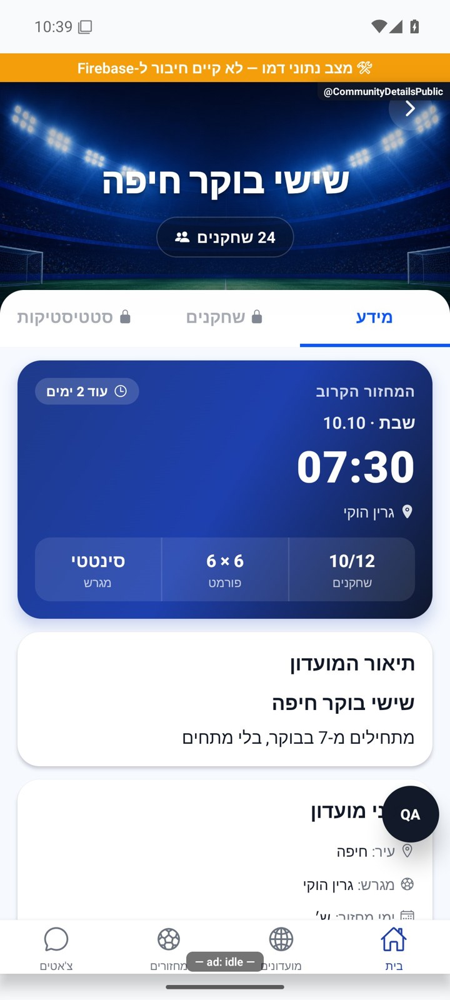
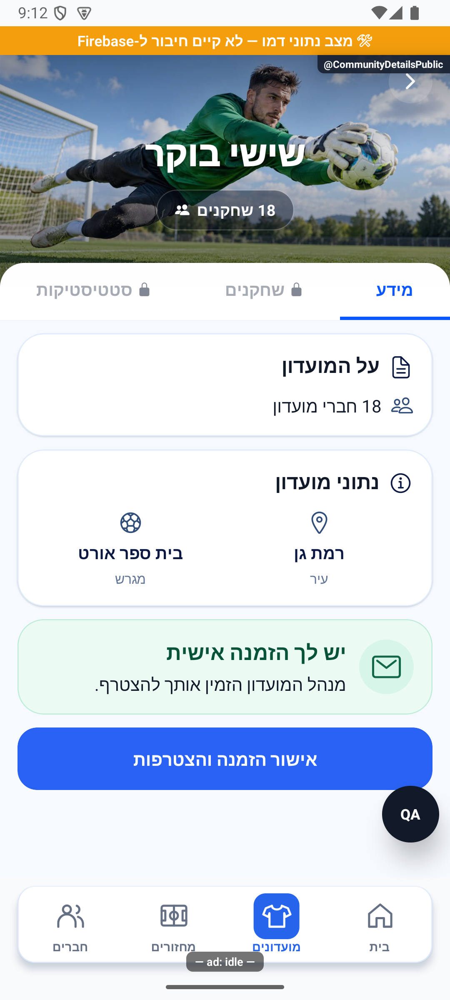

# תצוגה ציבורית והצטרפות למועדון

## אחידות כרטיס המחזור הקרוב והסרת כפילות — 17.10.2026

כרטיס `NextGameCard` מציג אותה תצוגה בהירה לשני הקהלים: תמונה משמאל, כותרת/ספירה לאחור/תאריך/שעה/מגרש מימין ורצועת נתונים מתחת. במסך חבר נשארת פעולת ״לפרטי המחזור״ והלחיצה על הכרטיס משתמשת במטפל הניווט הקיים. בציבורי `publicPreview` מונע פעולת פתיחת פרטי המחזור גם אם מועבר בטעות `onPress`. הרשמה עתידית מציגה חיווי נעילה ומועד פתיחה; ההבחנה בין מנהל לחבר נשארת במטפל המסך הקיים. מצב ללא מחזור ממשיך להציג הודעה ופעולת יצירה למנהל כשקיימת.

מסך החבר מעביר `resolveRoundCover(nextGame, group, false, failedRoundCover)` ומשתמש באותו מנגנון בחירת תמונה וכשל תמונה של המסך הציבורי. אין שאילתה או שינוי בממיר. הספירה נשארת אורך `players`, והקיבולת `maxPlayers`; אפס נרשמים נשאר אפס, ושדה חסר אינו מציג תא מומצא. הפורמט וסוג המגרש מגיעים מהמחזור. כרטיס ציבורי ״על המועדון״ מציג רק `description`; עיר וכמות חברים הוסרו ממנו כי הן בהירו. כשאין תיאור לא מוצג כרטיס ריק.

נצפה בדמו באנדרואיד: הציבורי `pub_4` מציג תיאור ללא שורות כפולות, ומסך החבר `g1` מציג תמונה, שעה 17:00, מגרש, 13/21, 7×7 ודשא. לחיצה דרך הממשק פתחה `MatchDetails` עם `gameId=gv2-6`. כל נתוני הדמו וההיסטוריה זהים לגיבוי. לא בוצעה הצטרפות, יצירה או שינוי מחזור. אייפון, ייצור ומצבי רשת לא נבדקו.

בדיקות: `npx tsc --noEmit` נקי; כל 365 החבילות ו־4426 הבדיקות עברו. ארבע בדיקות `clubNextGameCard.test.tsx` מכסות פתיחת מחזור ושגיאת תמונה, אפס נרשמים, הגנת הציבורי מניווט, הרשמה עתידית והפעולה במצב ריק. ראיות: `artifacts/club-next-card-2026-10-17/`, כולל יעד ניווט והשוואת נתונים. אין מסך חדש או שינוי במפת הכיסוי.

## הירו אחיד לפרטי המועדון — 17.10.2026

`CommunityStadiumHero` משתמש כעת באותה שפה חזותית של פרטי מחזור: סרגל פעולות לבן, תמונת רקע עם פינות מעוגלות והצללה תחתונה, שם המועדון והעיר בצד ימין למטה וספירת שחקנים בצד שמאל למטה. הטקסט יכול להישבר לשורות והספירה עוברת לשורה עצמאית כשאין רוחב. הכותרת אינה נחתכת למספר שורות קבוע.

שני המסכים מעבירים את `group.city` הקיים; אין שאילתה חדשה ואין עיר משוערת. במסך חבר הספירה נשארת `group.playerIds?.length ?? 0`; בציבורי היא נשארת `group.memberCount` מההיטל הציבורי. מקור התמונה והמעבר בין תמונות נשמרו: תמונה שהועלתה, תמונת גלריה, ואז ברירת מחדל לפי מזהה. אין שינוי בחישובים, שמירה או הרשאות.

חזרה, צ׳אט ותפריט שומרים על אותם מטפלי ניווט. מנהל רואה החלפת רקע בפינה העליונה השמאלית של התמונה; בזמן העלאה הפעולה מושבתת ומציגה מחוון. מבקר אינו מקבל תפריט ניהול, צ׳אט או החלפת תמונה. הלשוניות הציבוריות משתמשות כעת ב־`flush` ללא חפיפה לתמונה, כמו מסך החבר.

נצפו בפועל בדמו באנדרואיד: מסך חבר־מנהל עם עיר ו־23 שחקנים, כיווניות ותפריט שנפתח. בדיקת טיפוסים נקייה וכל 364 החבילות, 4422 בדיקות, עברו. לא נוספו בדיקות שמעתיקות סגנונות. אין שינוי בחוזי נתונים. בהשלמת הבדיקה באותו יום האמולטור התאושש לאחר אתחול עם עיבוד גרפי בתוכנה. התצוגה הציבורית נצפתה ברוחב רגיל ובמידות 840×1494, וכן היא ומסך החבר נצפו בהגדרת גופן מערכת 1.4. אין חפיפה בין השם, העיר וספירת השחקנים בהירו; ברוחב צר הספירה יורדת לשורה עצמאית משמאל. נצפתה גלילה אל תוכן המסך. פעולות מנהל אינן מוצגות בציבורי והלשוניות מוגנות בסמלי מנעול. לא בוצעה הצטרפות או הכרעה במחזור. הוחזרו 1080×2400 וגופן 1.0, ואומתו גם במנוע האפליקציה: רוחב 411.43, גובה 914.29, scale=2.625, fontScale=1. נתוני 16 המחזורים וההיסטוריה זהים לגיבוי. אייפון וייצור לא נבדקו.

ראיות ובדיקות: `artifacts/club-hero-2026-10-17/`. אין מסך חדש או שינוי במפת הכיסוי.

### צילומי השלמת הבדיקה — התאוששות האמולטור

- [תצוגה ציבורית רגילה](../screenshots/club-hero-public-2026-10-17.png).
- [תצוגה ציבורית צרה](../screenshots/club-hero-public-small-2026-10-17.png).
- [תצוגה ציבורית צרה בגופן מוגדל](../screenshots/club-hero-public-small-large-2026-10-17.png).
- [חבר־מנהל במסך צר ובגופן מוגדל](../screenshots/club-hero-member-small-large-2026-10-17.png).
- [גלילה לתוכן](../screenshots/club-hero-member-small-scroll-2026-10-17.png).
- [החזרת התצוגה הרגילה](../screenshots/club-hero-restored-2026-10-17.png).

ראיות נוספות: `artifacts/club-hero-2026-10-17/final-runtime.json`, `preservation.json` וקובצי היררכיית הממשק. לא נדרש שינוי בקוד האפליקציה בסבב ההשלמה. תצוגת ההירו עברה; הסבב אינו אישור לכל מסכי האפליקציה או לכל פעולות החברות. טקסט ארוך בכרטיסי תוכן אחרים אינו חלק מבדיקת ההירו.

## גבולות תמונת הכותרת — 8.10.2026

התצוגה הציבורית משתמשת באותו `CommunityStadiumHero` וב־`CoverCrossfade`; גם בה שתי התמונות תחומות כעת לגודל הכותרת ולא למידות הנכס המקוריות. מדיניות הצטרפות, מידע ציבורי וכתיבות לא השתנו. התצוגה נצפתה באמולטור אנדרואיד בדמו, ללא בקשת הצטרפות. [פירוט התיקון](../../changes/2026-10-08-cover-layout.md).

[להסבר הקצר והפשוט](public-preview-and-join.simple.md)

עודכן: 07.10.2026; מקור: `8e8fde5`. מסלול: גילוי/קישור הזמנה → `CommunityDetailsPublic` עם `groupId`. מסך: `src/screens/communities/CommunityDetailsPublicScreen.tsx`.

## אזורי המסך

רקע וכותרת, מספר שחקנים, לשוניות מידע/שחקנים/סטטיסטיקה, פרטים ציבוריים, תיאור, עיר ומגרש, מחזור קרוב ופעולת הצטרפות. אזורי שחקנים וסטטיסטיקה נעולים למי שאינו חבר ומסבירים את הסיבה בלחיצה. המחזור הקרוב הוא תקציר לקריאה בלבד; אין להסיק ממנו הרשאה לפתיחת פרטי מחזור או לשינוי הרשמה.

| פעולה או מצב | מקור נתונים | תנאי ותוצאה |
|---|---|---|
| פתיחת תצוגה | `groupsPublic` | בלי קריאה ישירה לרשומת מועדון פרטית |
| המשתמש כבר חבר | רשימת החברות | מעבר לפרטי המועדון הפרטיים |
| הצטרפות למועדון פתוח | `requestJoinById` | הצטרפות ישירה בכפוף לבדיקות השרת |
| מועדון סגור | בקשת הצטרפות | הוספה לממתינים והצגת מצב ממתין |
| אורח מבקש להצטרף | פעולה ממתינה | התחברות והמשך הפעולה אחרי שחזור החשבון |
| ביטול בקשה | `cancelJoinById` | הסרה מהממתינים; רשומת ביקורת אינה נמחקת |
| מועדון מלא/חברות קיימת | תשובת שרת | הודעה ייעודית; לא הודעת הצלחה כללית |

כפתור הפעולה עסוק במהלך בקשה כדי למנוע כפילות. טעינה, חסר/מחוק, שגיאה, אורח, חבר, מבקש, פתוח וסגור הם מצבים נפרדים. פירוט מספרי החברות יכול להשתנות בין הקריאה לבין פעולת ההצטרפות; השרת הוא ההכרעה.

## קבצים ושירותים

`src/services/groupService.ts`; `src/firebase/firestore.ts`; `src/components/community/CommunityStadiumHero.tsx`; שער ההתחברות והפעולה הממתינה; קריאת מחזורים ציבוריים. יצירת בקשת ההצטרפות ועדכון החברות כפופים לכללים/פונקציות בשרת. הכללים המקומיים נקראו, אך פריסתם לא נבדקה במסגרת המיפוי.

## ראיות וגבולות

הצילום מציג מועדון ציבורי בנתוני דמה עם לשוניות נעולות ומחזור קרוב הכולל תאריך, שעה וכמות נרשמים. לא בוצעה הצטרפות אמיתית, ביטול בקשה או שינוי הרשאה. מסמכי 071/086/090 מתעדים שינויים היסטוריים בתקציר הציבורי; הקוד הנוכחי הוא מקור המבנה המחייב.

בדיקות עתידיות: חזרה מהתחברות לפעולה המדויקת, בקשה כפולה, מועדון שהפך סגור בזמן הבקשה, חבר המופיע גם בממתינים, קישור למועדון שהוסר, הרשאות מידע ציבורי. השתמש בחשבון הבדיקה המאושר, לא בחשבון הבעלים.

## הצעות בלבד

להבהיר לפני לחיצה אם נדרשת הסכמת מנהל; להציג מעבר עדין למצב ממתין עם סמל אישור, בלי חגיגת הצטרפות לפני אישור; לאחר הצטרפות אמיתית להנפיש הופעת אווטאר המשתמש בסגל. אין להציג ציפייה לזמן אישור שאין לו מקור נתונים.

## פירוט טכני נוסף — זרימה, חישוב ונקודות שינוי

`requestJoinById` ו־`requestJoinByCode` מגיעים למסלול ההצטרפות המשותף; `writeJoin` מפריד לפי `isOpen`. פתוח: `arrayUnion(userId)` אל `groups.playerIds`, ללא מסמך בקשה. סגור: חיפוש בקשה ממתינה קיימת, יצירת `joinRequests` רק אם אינה קיימת והוספת המשתמש אל `pendingPlayerIds` באותה אצוות כתיבה.

דחייה קודמת נבדקת למועדון סגור ומעלה `GroupJoinRejectedError`; כשל בשאילתת בדיקת הדחייה מאפשר ניסיון כתיבה, והשרת עדיין קובע אם מותר. ההצטרפות הפתוחה אינה מעדכנת כאן `groupsPublic.memberCount`, ולכן ספירה ציבורית עשויה להתעכב. שינוי מסלול פתוח/סגור צריך לבדוק בקשה חוזרת, קיבולת, חשבון משוחזר והיטל ציבורי; אין לתקן פער מספרי באמצעות כתיבה בלתי מורשית מצד החבר.

הפירוט מתאר את הקוד שנקרא, ולא בדיקת כתיבה או הרשאות בסביבת הייצור. יש לקרוא את הקוד הממוקד וההפרש מאז מקור המיפוי לפני תיקון; בדיקות המוזכרות כאן לא הורצו מחדש לצורך עריכת התיעוד.

## תיקוני ההזמנה וההיכרות — 8.10.2026

`public/c/index.html` ו־`functions/templates/community.html` מפיקים מזהה מ־`/team/` וגם `/c/`. `inviteSuffix` נושא מזמין ומטא־נתוני מקור בכל קישור פתיחה, כולל כוונת אנדרואיד. קישורי החנות מפיקים יעד מועדון מפורש; מקור מקוצר `b` מפוענח לפני מטען ההתקנה. כל עוגני ההורדה משתמשים באותו יעד חנות, ובאייפון עוברים דרך המתנה להעתקה וטיפול בכשל. אין ניסיון אוטומטי לפתוח סכימה באייפון ללא ידיעה שהיישום מותקן; כפתור פתיחה מפורש נשאר. הרשאות התצוגה הציבורית, ההצטרפות ומסמכי המועדון לא השתנו. בדיקות הרצת התבניות מאמתות מועדון, מזמין וקמפיין; דף מועדון חי והתקנה באייפון לא הורצו.

מקור: `a348b9f` עם תיקונים מקומיים. ראיות ובדיקות: [דוח התיקון](../reviews/onboarding-fixes-2026-10-08.md).

## המשכיות מסך אחרי הצטרפות — 12.10.2026

תוקנה התנגשות בין החלפת המסך הציבורי למסך חבר כאשר המועדון מופיע בחנות הנתונים, לבין `goBack` בסיום ההצטרפות. `openMemberView` משותפת לתוצאת `joined`, לתוצאת `already_member` ולזיהוי החברות בחנות בעת מיקוד. היא מבצעת `replace` למסך `CommunityDetails` של אותו `groupId` פעם אחת למשתמש ולמועדון, ורק כשהמסך ממוקד. לכן לא נשארת תצוגת הצטרפות בהיסטוריית הניווט, ולא חוזרים לרשימת המועדונים אחרי הצטרפות מוצלחת. בקשה שבאמת ממתינה לאישור נשארת במסלול הקודם. נבדקת גם זהות המשתמש אחרי השלמת הפעולה.

ב־`groupStore.requestJoinById`, לאחר תשובת שרת חיובית נקרא המועדון המסוים דרך `groupService.get`. רק מסמך עם מזהה תואם וחברות מפורשת ב־`playerIds` או `adminIds` נוסף לחנות; לא משתמשים באובייקט הדמה החלקי שתשובת ההצטרפות מחזירה. המועדונים האחרים והבקשות האחרות נשמרים, והמועדון מוסר מרשימת הבקשות. הצלחת הקריאה הממוקדת אינה מחכה לשאילתות כל המועדונים וכל הבקשות. אם הקריאה נכשלת או אינה מאמתת חברות, נשאר מנגנון הרענון הקודם עם ניסיון חוזר יחיד. דור חשבון וזהות המשתמש מגינים מתשובה מאוחרת לחשבון אחר. אין שינוי בהרשאות או במדיניות ההצטרפות של השרת.

אימות: כל 3,530 הבדיקות עברו, לרבות בדיקות הצטרפות קיימות ושלוש בדיקות חדשות לקריאה ממוקדת, חברות קיימת ושינוי חשבון. באמולטור אנדרואיד בדמו מנותק נלחץ כפתור אישור ההזמנה במועדון הפתוח של הדמו: התצוגה נשארה באותו מועדון ועברה לתצוגת חבר, מספר השחקנים השתנה מ־18 ל־19 והלשוניות נפתחו. לא נוצרו נתוני ייצור ולא בוצעה הצטרפות למועדון של הבעלים או מתן. אין כאן מדידת זמן שרת בייצור או הוכחת קיצור לכל ההמתנה שמתן חווה. לא נבדק אייפון או אישור במועדון סגור מול שרת. מקור `ec536c6f1e2302ff40cfa3b16b230257cae8df53` עם שינויים מקומיים; אחרי 1.1.47/280, טרם הופץ.

## עיצוב תוכן לשונית המידע — 14.10.2026

עודכן רק תוכן המידע ב־`CommunityDetailsPublicScreen`. `CommunityStadiumHero`, `ClubTabs`, הנעילה, ההרשאות ופעולות ההצטרפות לא שונו. סדר התוכן: על המועדון, המחזור הציבורי הקרוב אם יש, נתוני המועדון, הזמנה פעילה אם יש, הצטרפות, יצירת קשר אם יש טלפון תקין וביטול בקשה קיימת. כרטיס על המועדון כולל תיאור ומספר חברים, ללא פורמט או משטח של מחזור.

`NextGameCard` מקבל `publicPreview` רק במסך הציבורי. הגרסה הקיימת במסך חבר נשארה ללא שינוי. הגרסה הבהירה משתמשת באותם חישובי תאריך, שעה, ספירה לאחור ומדדים: מספר הרשומים הוא `players.length`; המכסה היא `maxPlayers`; אין החלפה במספר חברי המועדון. תאים שחסר בהם מידע מוסתרים. נשמרות יחידות החישוב והעיגול של `countdownLabel` (דקות, שעות או ימים עד שבוע). הכרטיס נשאר ללא ניווט למחזור.

התמונה מגיעה דרך `resolveRoundCover` המשותף לפי אותו מחזור ומידע הכיסוי הציבורי של המועדון, עם טיפול בכשל טעינת תמונה מותאמת. אין שאילתת נתונים פרטיים חדשה. התמונה תחומה בתיבה, ואינה מכתיבה את גובה הכרטיס לפי מידות קובץ המקור.

נתוני המועדון נשארים עיר/כתובת, מגרש וימי ושעות המחזורים הנגזרים מהמחזורים הציבוריים שכבר נטענו. יום ושעה אינם העדפה חדשה שנאספת. הנתונים מוצגים בתאים גמישים, ללא קיצור כתובת ארוכה. אזור ההזמנה תלוי ב־`fromInvitation` הקיים; אין הבטחת הצטרפות על סמך קישור בלבד. כפתור ההצטרפות ממשיך דרך אותו מטפל ועם אותם מצבי טעינה, בקשה ממתינה וחזרה לתצוגת חבר.

אימות: בדיקת טיפוסים ו־3,698 בדיקות ב־301 חבילות עברו. באימולטור אנדרואיד בדמו נצפו מועדון עם מחזור קרוב, מצב ללא מחזור ותיאור חסר, והזמנה פעילה. נבדקו סדר אייקונים ועברית. לא נלחצו פעולות הצטרפות/ביטול/יצירת קשר ולא בוצעה כתיבה לחשבון אמיתי. אייפון, גופן מוגדל וטלפון תקין לא נבדקו חזותית בסבב זה.

## צמצום כפילויות ותיקון חיתוך התמונה — 14.10.2026

בהמשך לעיצוב לעיל הוסר כרטיס נתוני המועדון. העיר מוצגת מתחת למספר החברים ב״על המועדון״; אם אין עיר השורה מוסתרת. פרטי המחזור נשמרים בכרטיס המחזור.
רכיב התמונה בגרסת `publicPreview` של `NextGameCard` קיבל רוחב וגובה מפורשים של 100% בתוך התיבה, במקום מיקום מוחלט בלבד שהותיר מידות תמונה טבעיות. `resizeMode="cover"` שומר יחס ממדים וחיתוך מרכזי. מקור התמונה והבורר לא השתנו. הוסרו חישובי הימים והשעה האופייניים ותאי המידע שהתייתרו מהמסך הציבורי בלבד. ההירו, הטאבים, מדדי המחזור וההצטרפות נשארו ללא שינוי.

אומת באנדרואיד בדמו מול אותה תמונה שהופיעה חתוכה קודם; בדיקת טיפוסים וכל 3,698 הבדיקות עברו. ללא אימות אייפון או הצטרפות חיה.

## ביקורת השינויים היומית — 14.10.2026

טעינה ישנה לא תחליף את המועדון שאליו עברת. בכשל טעינה אפשר לנסות שוב. לחיצות הצטרפות חוזרות אינן שולחות בקשות כפולות.

`loadGeneration` מקשר תשובת טעינה לקריאה האחרונה, ומבוטל באובדן מיקוד. תשובה ישנה לא משנה את המועדון או את מצב הטעינה. `loadFailed` מציג ניסיון חוזר בכשל קריאת המועדון במקום להציג מועדון קודם או להישאר בטעינה. `joinInFlight` משותף להצטרפות ולביטול בקשה. חזרת ניווט לאחר תשובה מותנית במיקוד. הבדיקות מדמות סדר תשובות הפוך, יציאה בזמן טעינה, כשל וניסיון חוזר ולחיצות כפולות. מסך השגיאה החדש לא הורץ חזותית; אין אימות שרת חי או שינוי במדיניות ההצטרפות.

בדיקת טיפוסים וכל 3,703 הבדיקות ב־302 חבילות עברו. תוקנו תקלות בדרגת ביניים; לא אומת ממצא קריטי. אייפון ופעולות שרת אמיתיות לא נבדקו בסבב זה.

## סבב פולס — 15.10.2026

`CommunityDetailsPublicScreen` משתמש ב־`listInbox` ומחשב `invitationLoading` לפי בעל החשבון ומזהה המועדון. בזמן הכרעה הכפתור חסום עם מחוון טעינה. לא נוסף אישור הצטרפות בצד הלקוח: השרת הקיים ממשיך להחליט על החברות. צילום דמו מאמת כפתור אישור הזמנה למועדון סגור.

השינויים בסבב זה מקומיים וטרם הופצו. [דוח הסבב](../../changes/2026-10-15-pulse-sweep.md).

## פלוס בכפתור ההצטרפות — 17.10.2026

`CommunityDetailsPublicScreen` מעביר `iconLeft=add` רק כאשר אין טעינת הזמנה, הזמנה פעילה או בקשה ממתינה. `Button` מסדר את הסמל בצד הפיזי השמאלי תחת `forceRTL`; אין שינוי ב־`handleJoin`, הרשאות, נתונים או ניווט. נצפה בציבורי בדמו ללא הצטרפות.

[סקירת ההכנה, בדיקות ומגבלות](../../changes/2026-10-17-preinternal-audit.md).

## הפצה פנימית — 17.10.2026

שינויי הלקוח האחרונים המתועדים כאן נכללו בבינארי הפנימי `1.1.53 / 286` באנדרואיד. המסלול אומת בגוגל; הייצור נשאר בגרסה הקודמת. זה אינו אימות חדש של תרחיש ייצור או של מכשיר אפל. [מקור הבינארי, פריסת השרת, בדיקות ומגבלות](../../changes/2026-10-17-internal-1.1.53.md).
