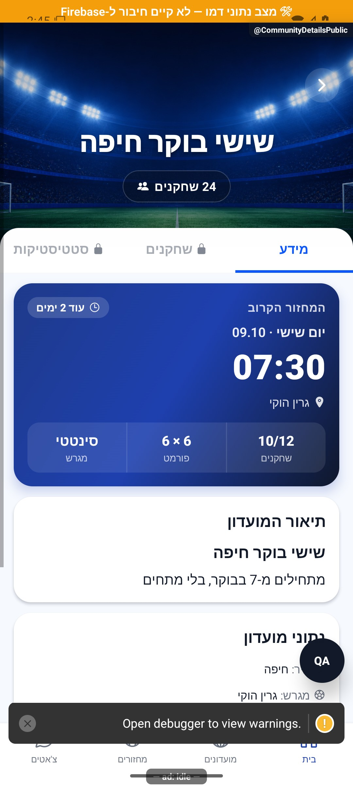
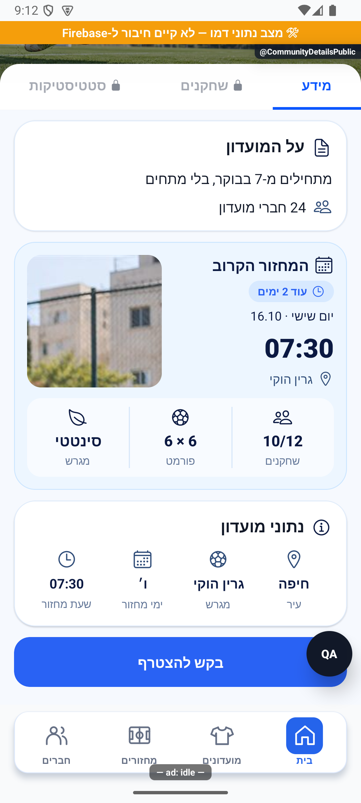
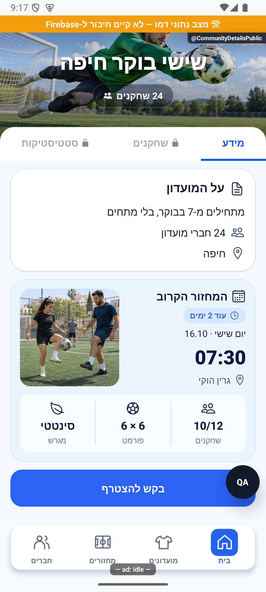
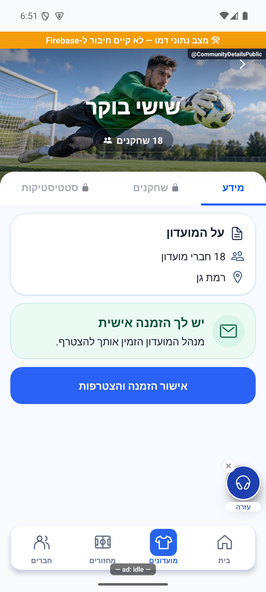
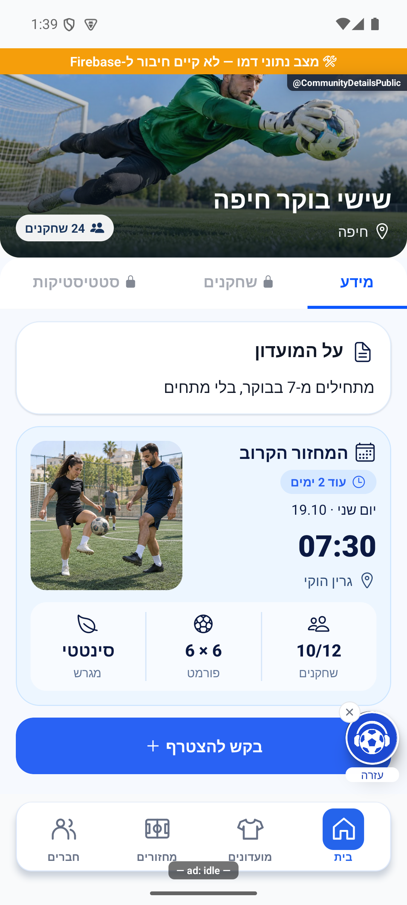

# מכירים מועדון ומצטרפים

## הרחבת אבחון דיווחים, 27.10.2026

הדיווחים יוכלו לכלול מה ניסו לבצע, מה היה מצב האפליקציה ומה החזיר השרת. פרטים חסרים מוצגים כלא ידועים, ומספר מוגבל של מופעים נשמר בלי למחוק את המופע הראשון. השינוי מקומי וטרם הופץ, ואינו משלים פרטים לדיווחים ישנים. [היקף, ראיות ומגבלות](../../changes/2026-10-27-diagnostic-context.md).

בדיקות הקוד הושלמו, אך השינוי עדיין מקומי ולא הופץ. פרטים שלא נאספו בדיווחים ישנים אינם משוחזרים בדיעבד.

## טיפול מלא בפריטי הפולס הפתוחים, 27.10.2026

הושלם סבב טיפול בפריטי הפולס עם תיקונים ותוצאות מחקר מוכנות לביקורת. פריטים שלא תוקנו נשארים פתוחים עם הסבר וצעד הבא. לא בוצעה הפצה או בדיקת מכשיר חדשה. [ממצאים, בדיקות ומסירה](../../changes/2026-10-27-pulse-completion.md).

## מחקר הרשמה מהאתר, 27.10.2026

נבדקה אפשרות לבחור מחזור מתוך דף המועדון ולבקש אליו מקום בלי להתקין את האפליקציה. אישור הבקשה אינו מצרף כחבר למועדון, ובקשה שנשלחה אינה מקום מאושר. זו הצעה בלבד; ההתנהגות הקיימת לא שונתה. [תוצאות ההתייעצות עם עשרה סוכנים](../../audits/2026-10-27-club-web-registration-consultation.md).

## כשל בטעינת המחזורים, 27.10.2026

אם קריאת המחזורים הקרובים של מועדון ציבורי נכשלת, מוצגת אפשרות הניסיון החוזר הקיימת במקום להסתיר את המחזורים כאילו אין כאלה. אחרי טעינה מוצלחת חוזרים לפרטי המועדון. התיקון מקומי וטרם הופץ; נבדק בקוד ובבדיקות מקומיות, ללא בדיקת מכשיר חדשה. [פירוט ובדיקות](public-preview-and-join.md#הבחנה-בין-כשל-למחזור-חסר-27102026).

כל 6179 הבדיקות המקומיות ובדיקת הטיפוסים עברו.

## טיפול בתקלות הפולס, 26.10.2026

נבדק שינוי ממוקד במקור משותף במהלך טיפול בתקלות הפולס. אין שינוי נוסף בפעולות הפיצר המתואר כאן.

השינוי מקומי וטרם הופץ. [בדיקות, מסירה ומגבלות](../../changes/2026-10-26-pulse-fixes.md).

## קישורי שיתוף בדומיין החדש - 26.10.2026

קישורים המועתקים מדף המועדון הציבורי נבנים בדומיין החדש. פרטי המועדון, דרכי ההצטרפות והרשאות הצפייה לא השתנו.

השינוי מקומי וטרם הופץ. הבדיקות, מסלולי הנתונים ומגבלות האימות מפורטים ב[דוח השינוי](../../changes/2026-10-26-share-domain.md). אין כאן אימות חדש של כל מצבי המסך.

## ביטול פעילות אחרי מחיקת מועדון - 26.10.2026

מחיקת מועדון עוצרת כעת את המחזורים השבועיים שלו, ובשרת נוספה הגנה שמונעת פתיחת מחזור למועדון שכבר נמחק. הטיפול מבטל מחזורים שטרם הסתיימו, דוחה בקשות חברות ממתינות, מסיר הרשמה להתראות ואת כרטיס המועדון הציבורי. נתוני עבר והישגים אישיים נשמרים. תיקון השרת נפרס ואומת באישור הבעלים. הסדרה שנותרה כובתה, ההרשמה להתראות והכרטיס הציבורי הוסרו; המחזור עצמו כבר לא היה קיים בבדיקה העדכנית. עצירת הסדרה המוקדמת בצד הלקוח תיכלל בבינארי עתידי. נשמרה ההיסטוריה. [המימוש, בדיקת השאריות ומגבלות האישור](../../changes/2026-10-26-deleted-club-recurring.md).

## שעון מדויק וכיתוב פנדל - 25.10.2026

במקורות המשותפים נוסף שימור השעון המדויק של פנדל במהלך משחק, וכיתוב ההבקעה ביומן קוצר. אין שינוי במונים או בתהליך העצמאי המתואר כאן; לא נערכה לו בדיקת ממשק חדשה במסגרת העדכון. השינוי מקומי וטרם הופץ. [פרטים וראיות](../../changes/2026-10-25-in-play-penalties.md#שעון-מדויק-וכיתוב-אירוע).

## פנדל במהלך משחק חי - 25.10.2026

עודכנו מקורות משותפים לצורך פנדלים במהלך משחק. אין שינוי מכוון בתהליך העצמאי המתואר במסמך הזה, ולא נערכה לו בדיקת ממשק חדשה במסגרת המשימה.

השינוי מקומי. נדרשת פריסת שרת לפני הפצת לקוח שמשתמש באפשרות; לא בוצעו פריסה או שינוי הרשאות. [חוזה הנתונים, התהליך, הבדיקות ומגבלות ההפצה](../../changes/2026-10-25-in-play-penalties.md).

## תיעוד כשלים — 20.10.2026

נוסף תיעוד אוטומטי לנקודות כשל במסלול הזה, עם מקור התקלה. הפעולה המקורית שומרת על ערכי החזרה והודעות השגיאה שלה. השינוי מקומי, טרם הופץ, ואין אימות מסירה חיה לפולס.

[דוח דיווח השגיאות והראיות](../../changes/2026-10-20-error-reporting-audit.md).

## המחזור הקרוב — 17.10.2026

המחזור הקרוב מוצג באותו עיצוב בהיר עם תמונה גם לחברי המועדון. חברים יכולים לפתוח ממנו את פרטי המחזור. בתצוגה הציבורית ״על המועדון״ כולל רק תיאור, ללא חזרה על העיר ומספר החברים שכבר נמצאים למעלה. נבדק בדמו באנדרואיד.

## עיצוב הכותרת — 17.10.2026

תמונת המועדון מוצגת כמו בפרטי המחזור: שם ועיר בתחתית מימין ומספר השחקנים משמאל. פעולות המועדון נשארות למעלה, בהתאם לתפקיד שלך. העיצוב משותף גם לתצוגה הציבורית. מסך החבר והתצוגה הציבורית נבדקו בדמו, גם במסך צר ובטקסט מוגדל. האמולטור חזר לפעול והגדרות התצוגה הוחזרו בסיום.

תיקון מ־8.10.2026: תמונת המועדון תחומה לראש המסך גם לפני הצטרפות. נבדק באמולטור אנדרואיד עם נתוני דמו, ללא הצטרפות למועדון.

לפני ההצטרפות רואים את פרטי המועדון המותרים לציבור. במועדון פתוח מצטרפים מיד, ובמועדון סגור שולחים בקשה למנהל.

[לפירוט המעמיק](public-preview-and-join.md)

## תיקוני ההזמנה וההיכרות — 8.10.2026

גם ההורדה מדף המועדון הציבורי שומרת את מי ששלח את ההזמנה. לאחר ההתקנה אפשר לפתוח את המועדון מהקישור המקורי.

## נשארים במועדון לאחר הצטרפות — 12.10.2026

לאחר הצטרפות מוצלחת פרטי אותו מועדון עוברים לתצוגה של חבר, במקום לחזור לרשימת המועדונים. נוספה טעינה ממוקדת של המועדון כדי שלא להמתין לרענון כל המועדונים כשאין צורך. נבדק באנדרואיד בדמו; זמני שרת אמיתיים לא נמדדו, והתיקון טרם הופץ.

## עיצוב המידע החדש — 14.10.2026

המידע מחולק לכרטיסים: על המועדון, המחזור הקרוב ונתוני המועדון. כרטיס המחזור כולל את היום והתאריך, השעה, הזמן שנותר, המגרש, הרשומים מתוך המכסה, הפורמט וסוג המשטח. אם יש הזמנה אישית פעילה, היא מודגשת בירוק מעל כפתור ההצטרפות. תמונת הכותרת והלשוניות נשארו כפי שהיו.

נבדק באימולטור בדמו, ללא הצטרפות אמיתית.

## צמצום כפילויות ותיקון חיתוך התמונה — 14.10.2026

בהמשך לעיצוב לעיל הוסר כרטיס נתוני המועדון. העיר מוצגת מתחת למספר החברים ב״על המועדון״; אם אין עיר השורה מוסתרת. פרטי המחזור נשמרים בכרטיס המחזור.
התמונה מוצגת כעת בתוך המסגרת ללא הגדלה שגויה של חלק מהרקע.

## ביקורת השינויים היומית — 14.10.2026

טעינה ישנה לא תחליף את המועדון שאליו עברת. בכשל טעינה אפשר לנסות שוב. לחיצות הצטרפות חוזרות אינן שולחות בקשות כפולות.

בדיקת טיפוסים וכל 3,703 הבדיקות ב־302 חבילות עברו. תוקנו תקלות בדרגת ביניים; לא אומת ממצא קריטי. אייפון ופעולות שרת אמיתיות לא נבדקו בסבב זה.

## סבב פולס — 15.10.2026

בזמן בדיקת ההזמנה מוצגת טעינה, ואחריה הכפתור המתאים. לא מופיע תחילה כפתור הצטרפות רגיל שמשתנה לאחר טעינת התמונות.

השינויים בסבב זה מקומיים וטרם הופצו. [דוח הסבב](../../changes/2026-10-15-pulse-sweep.md).

## פלוס בכפתור ההצטרפות — 17.10.2026

בכפתור ההצטרפות הרגיל מופיע פלוס משמאל לטקסט. הוא אינו מופיע בזמן בדיקת הזמנה, באישור הזמנה או בבקשה שכבר ממתינה.

[סקירת ההכנה, בדיקות ומגבלות](../../changes/2026-10-17-preinternal-audit.md).

## הפצה פנימית — 17.10.2026

שינויי הלקוח האחרונים המתועדים כאן נכללו בבינארי הפנימי `1.1.53 / 286` באנדרואיד. המסלול אומת בגוגל; הייצור נשאר בגרסה הקודמת. זה אינו אימות חדש של תרחיש ייצור או של מכשיר אפל. [מקור הבינארי, פריסת השרת, בדיקות ומגבלות](../../changes/2026-10-17-internal-1.1.53.md).

## תלות בעדכון העונות — 19.10.2026

קובץ תשתית משותף עודכן במסגרת העונות. שינוי זה אינו מוסיף פעולה חדשה למסך המתואר כאן; פרטי העונות והבדיקות מופיעים במסמך העונות.

[מצב המימוש, הבדיקות ומגבלות האימות של העונות](../clubs/seasons.md). מקומי בלבד; לא בוצעה פריסה במסגרת המשימה.

## תלות במידע על סגירת עונה — 23.10.2026

נוסף מידע משותף שמאפשר להסביר מדוע עונה מתעכבת בסגירה. אין שינוי נוסף בפעולות המתוארות כאן; השינוי מקומי וטרם הופץ. [המסלול, הבדיקות והמגבלות](../../changes/2026-10-23-season-automatic-recovery.md).

## בידוד מונה בקשות והתאוששות מרקע — 23.10.2026

ספירת בקשות הצטרפות אינה ממתינה יותר לדירוגי השחקנים במועדונים. מסך הבית טוען את המונה מחדש בחזרה מרקע ומתעלם מתוצאה ישנה שמגיעה אחריה. כשל אמיתי בקריאת הבקשות נשאר כשל ושומר את הספירה האחרונה; אין שינוי בעיצוב. נבדק בבדיקות קוד, מקומי וטרם הופץ. [הסבר, יומני שרת ומגבלות](../../changes/2026-10-23-inbox-resume.md).

## עדכון תלות משותפת בקריאות מידע — 23.10.2026

בקובצי השירות המשותפים נוספה אפשרות מפורשת לניסיון חוזר אחד בקריאה זמנית שנכשלה, תוך עצירה אם החשבון מתחלף. החיבור מוגבל ל־14 נקודות קריאה המפורטות בדוח; אין כאן טענה שכל פעולה בפיצ׳ר קיבלה ניסיון חוזר או שנבדק מסך חדש. בדיקות המאגר המלאות עברו (5,261 בדיקות ב־472 חבילות), אך אינן הוכחת הרצה במכשיר. הקוד מקומי וטרם הופץ. [מסלול, ראיות ומגבלות](../../changes/2026-10-23-four-open-errors.md).

## עדכון תלות מסבב הפולס — 23.10.2026

בתלות המשותפת נוספו התאוששות מוגבלת להעשרת מועדונים ובדיקות לביטול קריאה של חשבון או דור ישן. אין שינוי מכוון בכללי המוצר של המסך הזה ואין אימות מסך חדש עבורו. הקוד מקומי וטרם הופץ. [תחום השינוי והבדיקות](../../changes/2026-10-23-pulse-resweep.md).

## תלות בשמירת צבעי המחזור — 24.10.2026

שמירת המידע המשותפת עודכנה כדי להעביר את צבעי הקבוצות ממסכי הכוחות להכנה וללייב. אין תוספת פעולה במסך הזה, והוא לא נבדק מחדש במכשיר במסגרת התוספת. השינוי מקומי וטרם הופץ. [פרטי התוספת ומגבלות הבדיקה](../rounds/draft-setup.md#צבעים-לפני-שיבוץ-ובכל-שיטת-חלוקה--24102026).

## תאימות לשמירת פקודת רכיב הבית - 25.10.2026

נוספה הגנה פנימית מפני ביצוע חוזר של פעולת רכיב הבית. התהליך המתואר בעמוד זה לא השתנה במכוון, ונתונים ישנים נשארים נתמכים. התיקון מקומי וטרם הופץ. [מקור הבדיקה והמגבלות](../../changes/2026-10-25-widget-completion.md).
