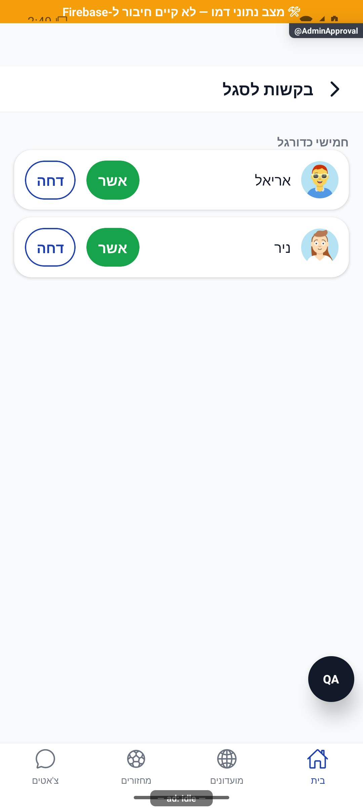

# בקשות ואישורים

## הרחבת אבחון דיווחים, 27.10.2026

נוספה מעטפת אבחון מקומית עם מצב בזמן הכשל, שלבים בעלי מזהה ותזמון, מצב רשת ובנייה ומופעים נפרדים לשגיאה. נקודת הכניסה לתעבורת השרת עוברת כעת דרך העטיפה המשותפת; תשובות, חריגות, אפשרויות קריאה ומדיניות הפיצר נשמרות. אין כאן שינוי בהרשאות או בחישובי המוצר. הבדיקות המלאות ומגבלות האימות מתועדות בדוח המקושר; אין טענה לאימות מכשיר או להפצה. [היקף, ראיות ומגבלות](../../changes/2026-10-27-diagnostic-context.md).

באימות הסופי עברו כל 6,231 הבדיקות ב-555 חבילות, ובדיקות הטיפוסים של הלקוח, השרת והפולס נקיות. צילום הדפדפן והידור מקורות האנדרואיד הם בדיקות מקומיות; אין הוכחת מכשיר, הידור אייפון או מסירה חיה של הבנייה החדשה. רישום יומן השחרור נחשב מאומת רק לפי קבלת הקריאה החוזרת בדוח השינוי.

## טיפול מלא בפריטי הפולס הפתוחים, 27.10.2026

נבדק השינוי הממוקד במקור המשותף: התנגשות גרסת מועדון בעת זקיפת השתתפות נשלחת כעת לניסיון חוזר מקומי מוגבל שבונה מחדש את אותה כתיבה ואת הגנת העונה. סמן מניעת הכפילות נשמר. אין שינוי בהרשאות, בניווט או במדיניות הפיצר הזה. אין אימות מכשיר חדש או פריסה. [ממצאים, בדיקות ומסירה](../../changes/2026-10-27-pulse-completion.md).

## טיפול בתקלות הפולס, 26.10.2026

השינוי במקור המשותף מוגבל לסיווג תוצאה צפויה לפני רישום שגיאה: תיעוד מחיקת מחזור שכבר קיים אינו כשל חדש, והתנגשות גרסה בעדכון עונה אינה מבטלת את הגנת הגרסה. אין שינוי בחוזה הפיצר, במכנים, בניווט או בהרשאות; לא נערכה הרצה חדשה לכל מצבי הפיצר. כשל לא צפוי בתיעוד מחיקה נזרק שוב כדי לאפשר ניסיון שרת חוזר.

השינוי מקומי וטרם הופץ. [בדיקות, מסירה ומגבלות](../../changes/2026-10-26-pulse-fixes.md).

מקורות שנבדקו בסבב: `functions/src/index.ts`.

## ביטול פעילות אחרי מחיקת מועדון - 26.10.2026

נבדקה השפעת השינוי התחום ב-`src/services/groupService.ts`, ב-`src/services/seriesService.ts` וב-`functions/src/index.ts`: עצירת סדרות לפני מחיקת מסמך ההרשאה, הפעלת ביטול פעילות באירוע מחיקת המועדון, ועסקאות יצירה שמאמתות את קיום המועדון והסדרה גם במנגנון ההעתקה הישן. `functions/src/clubDeletion.ts` שומרת מחזורים שהסתיימו ונתוני עבר, מבטלת מצבים פעילים, דוחה בקשות חברות ממתינות, מסירה רק את המועדון שנמחק מהרשמות להתראות ומסירה את ההעתק הציבורי. המימוש והבדיקות ב-`tests/logic/clubDeletion.test.ts` וב-`tests/logic/clubDeletionClient.test.ts` מפורטים ב[דוח התיקון](../../changes/2026-10-26-deleted-club-recurring.md). אין שינוי מסכים, ניווט, נוסחאות או הרשאות במסגרת תיקון זה. זו בדיקת השפעה ממוקדת ואינה אימות מחודש של שינויים קודמים במקורות המשותפים. תיקון השרת נפרס ואומת באישור הבעלים, עם השוואת המקור הפרוס והקוד המהודר ושימור יתר הפונקציות. הסדרה, הרשמת ההתראות והכרטיס הציבורי של המקרה הידוע טופלו ונקראו חזרה; המחזור כבר היה חסר בבדיקה העדכנית. שינוי הלקוח טרם נכלל בבינארי. סעיף הפריסה בדוח כולל את מגבלות בדיקת החבילה המבודדת, ללא טענה למחיקת מועדון בדיקה בייצור.

## שעון מדויק וכיתוב פנדל - 25.10.2026

במקורות המשותפים נוסף שימור השעון המדויק של פנדל במהלך משחק, וכיתוב ההבקעה ביומן קוצר. אין שינוי במונים או בתהליך העצמאי המתואר כאן; לא נערכה לו בדיקת ממשק חדשה במסגרת העדכון. השינוי מקומי וטרם הופץ. [פרטים וראיות](../../changes/2026-10-25-in-play-penalties.md#שעון-מדויק-וכיתוב-אירוע).

## פנדל במהלך משחק חי - 25.10.2026

נבדק השינוי הממוקד במקורות המשותפים: נוספו חוזי אירועי פנדל במהלך משחק, קוראים ומוני סטטיסטיקה, והגנות בעסקאות סיום ואיפוס משחק. מסלול הפיצר המתואר כאן אינו נקודת הכניסה להזנה החדשה. בדיקות המאגר עברו, אך אינן הוכחת הרצה חדשה של כל מצבי התהליך או של פריסה.

השינוי מקומי. נדרשת פריסת שרת לפני הפצת לקוח שמשתמש באפשרות; לא בוצעו פריסה או שינוי הרשאות. [חוזה הנתונים, התהליך, הבדיקות ומגבלות ההפצה](../../changes/2026-10-25-in-play-penalties.md).

## תלויות משותפות — 23.10.2026

הפעמון/מונה המשותף מדלג על טעינה במצב אורח ומבטל קבלת תשובה מחשבון קודם בניקוי האפקט. מסלולי ההצטרפות והאישור לא שונו; [פרטי החוזה והבדיקות](../profile/requests.md#טעינת-בקשות-במצב-אורח--23102026).

## תיעוד כשלים — 20.10.2026

נוספו תצפיות דיווח בנקודות הכשל של המקורות המשויכים לפיצ׳ר, במסגרת הרחבה רוחבית. נשמרו ערכי החזרה, הזריקות ותנאי הפעולה הקיימים; נוסף מקור קוד והקשר לדיווח. כיסוי תחבירי אינו הוכחת הרצה של כל מצב. השינוי מקומי וטרם הופץ; בדיקות המסירה, מגבלות מניעת הכפילויות והמסלולים שטרם חוברו מתועדים בדוח המשותף.

[דוח דיווח השגיאות והראיות](../../changes/2026-10-20-error-reporting-audit.md).

[להסבר הקצר והפשוט](requests-and-approvals.simple.md)

עודכן: 07.10.2026; מקור: `8e8fde5`. מסכים: `src/screens/RequestsScreen.tsx`, `src/screens/groups/AdminApprovalScreen.tsx`; מסלולים `Requests`, `AdminApproval`.

## שני הקשרים

`Requests` הוא תיבת בקשות: חברים, בקשות למועדונים שהמשתמש מנהל ובקשות למחזור שהוא מארגן. הוא אינו תיבת כל הודעות המערכת. `AdminApproval` הוא כעת כינוי לאותו `RequestsScreen`. כניסה מתפריט מועדון מעבירה `groupId` ובוחרת בו כסינון התחלתי, הניתן לשינוי. הפרטים והשמות נטענים באצווה כדי להימנע מקריאה נפרדת לכל שורה.

| פעולה | הרשאה ונתונים | תוצאה |
|---|---|---|
| אישור חבר | בקשת חברות אל המשתמש | עדכון הקשר לפי שירות החברים |
| אישור מועדון | מנהל, משתמש ממתין | עסקה שמעדכנת חברות ומסירה המתנה; רשומת ביקורת |
| דחיית מועדון | מנהל, משתמש ממתין | הסרת המתנה וסטטוס ביקורת |
| אישור מחזור | מארגן בעל הרשאה | תנאי מקום/הרשמה בתחום המחזורים |
| אישור קבוצתי | קבוצה קיימת; אישור לפני פעולה | עלולות להיות הצלחות חלקיות; לא הצלחה כללית עיוורת |
| רענון | חזרה למסך/משיכה | קריאה מחדש, בלי מחיקת נתונים בגלל תקלה זמנית |

מצב עסוק מונע אישור כפול. טעינה, תיבה ריקה, הרשאה שנעלמה, בקשה שכבר אושרה בידי מנהל אחר, כשל חלקי ותקלה ברענון הם מצבים נפרדים. מונה הפעמון צריך להצטמצם בעקבות שינוי מאומת; אינו מונה התראות דחיפה שנשלחו.

## תלות

`src/components/RequestsBell.tsx`; `src/services/groupService.ts` — `approveMember`, `rejectMember`, `getMemberApprover`; שירותי חברים ומחזורים; `src/firebase/firestore.ts`. אישור חבר מועדון קיים חייב להיות בטוח לחזרה; אין לשנות מזהי מסמכים בהעתקה ידנית. מקור השם והפרופיל צריך להיות הידרציה עדכנית ולא שם שנכתב לצורך צילום.

## הוכחות ופערים

הצילומים מציגים שתי בקשות מועדון ושלוש בקשות מחזור בנתוני דמה, וכפתורי אישור/דחייה. לא נלחצו פעולות. בקשת חברות, הצלחה חלקית, הרשאה שנשללה, אישור כפול ותיבה ריקה לא צולמו. אין בכך בדיקה של כתיבות אמיתיות.

## הצעות בלבד

להציג תוצאת פעולה בשורה לפני הסרתה, כך שהמשתמש יבין מה אושר; לאחר אישור קבוצתי להציג מספר הצלחות וכשלונות עם אפשרות ניסיון חוזר רק לנכשלים; להנפיש הקטנת מונה בלי להזיז כפתור שהמשתמש עומד ללחוץ עליו.

## פירוט טכני נוסף — זרימה, חישוב ונקודות שינוי

`approveMember` משלב את מעבר המשתמש מממתינים לחברים עם עדכון רשומות בקשה וביקורת; המסלול כולל עסקה כדי למנוע אישור כפול או חריגה מקיבולת. `rejectMember` אינו אותה פעולה כמו ביטול בקשה בידי המבקש, ו־`getMemberApprover` קורא את זהות המאשר כשהיא קיימת.

המזהים נלקחים מתוצאת השאילתה, ולא משוחזרים מטקסט מודפס. שינוי בקשות צריך לבדוק פעולה חוזרת, שני מנהלים שפועלים יחד, מועדון שהתמלא בין פתיחת המסך לאישור, שם שהשתנה ותגובה לאחר עזיבה. הפעמון מרכז בקשות ממספר סוגים; אין לסכום אותו עם הודעות שלא נקראו כאילו אלו אותה יחידה.

הפירוט מתאר את הקוד שנקרא, ולא בדיקת כתיבה או הרשאות בסביבת הייצור. יש לקרוא את הקוד הממוקד וההפרש מאז מקור המיפוי לפני תיקון; בדיקות המוזכרות כאן לא הורצו מחדש לצורך עריכת התיעוד.

## איחוד ועיצוב קומפקטי — 18.10.2026

מקור: `5148f63c2a8e9c454b68132fdb0d683a98a4adc9` עם שינויים מקומיים. לא הופץ. המימוש הנוכחי מחליף את התיאור החזותי ההיסטורי לעיל.

### ניווט ורכיבים

`AdminApprovalScreen.tsx` מייצא את `RequestsScreen` בשם הקודם: אין שני מימושים נפרדים. שני המסלולים רשומים במחסניות הבית, המועדונים, המחזורים והשיחות. `CommunityDetailsScreen` ו־`ManagerDashboardScreen` שולחים `{groupId}`; פעמון הבית פותח ללא סינון. הטיפוסים בשלוש מחסניות הבסיס מקבלים פרמטרים אופציונליים; מחסנית השיחות יורשת את טיפוס מחסנית המועדונים. פרמטר ניווט חדש מאפס את בחירת המועדון, והמשתמש יכול לשנותה בחלון בחירה.

`requestInboxRows` משטח את שלושת תורי הבקשות. סינון מועדון כולל בקשות חברות באותו מועדון ובקשות למחזורים ש־`game.groupId` שלהם תואם; בקשות חברות אישיות ומחזורים ללא מועדון מופיעים רק ב״כל המועדונים״. מזהה שורה משלב סוג, יעד ומשתמש, ולכן אותו שחקן בשני מועדונים או במחזור אינו מתאחד. הסינון הוא תצוגתי, ולא מעניק הרשאות או מוסיף שאילתות.

### תצוגה וחישובים

כותרת עם איור מגרש עדין, מונה, בורר מועדון ובורר מיון. `RequestCard` כולל תמונה בגודל 42, שם והקשר בשורה העליונה, ופרופיל/אישור/דחייה בשורת הפעולות. אין גובה קשיח לכרטיס: טקסט הפעולות יכול לגדול עם גופן מערכת, ושמות ארוכים נחתכים בשורה אחת. עיר מוצגת רק מתוך `user.availability.homeCity`, ללא השלמה מעיר המועדון.

המונה הוא `rows.length` אחרי הסינון: מספר בקשות, לא מספר שחקנים ייחודיים. לדוגמה, בקשת מועדון ובקשת מחזור של אותו אדם נספרות פעמיים. מיון לפי שם משתמש ב־`localeCompare(..., 'he')` על עותק השורות; ברירת המחדל שומרת סדר מקור, ואינה מתיימרת להיות סדר כרונולוגי. תאריך מוצג רק בבקשת חברות שיש לה `request.createdAt`; נתוני תורי המועדון והמחזור אינם כוללים כיום זמן בקשה, ולכן אין תאריך מומצא או שימוש בתאריך יצירת המשתמש.

### מצבים וכתיבות

| מצב | התנהגות |
|---|---|
| טעינה ראשונה | מציג טעינת כדור; לא מצב ריק מוקדם |
| רענון נכשל | שומר מידע קודם, מסמן שהמונה טרם עודכן ומציג ניסיון חוזר |
| אין בקשות בסינון | מסביר שאין בקשות במועדון ומציע לבחור מועדון אחר |
| פרופיל חסר | משמר את מזהה המשתמש ואת הבקשה, עם שם חלופי |
| אישור/דחייה | `actionLock` נועל מיד גם לחיצה שנייה לפני רינדור; כל כפתורי ההחלטה נעולים עד סוף הפעולה |
| אישור מועדון | עטיפת חנות המועדונים הקיימת לעדכון המטמון, מדידה והישגים; שירות ישיר רק אם המועדון טרם נטען לחנות; לאחר מכן רענון התיבה |
| מחזור מלא | הודעת המתנה לפי `approveGameJoin().bucket` |
| מועדון מלא | הודעת הקיבולת הקיימת עבור `GROUP_FULL` |
| אישור קבוצתי | אישור מקדים, תוצאות חלקיות; במועדון מתבצע גם רענון חנות המועדונים |
| רענון חופף/עזיבה | מונה `loadVersion` מונע מתשובת טעינה ישנה לדרוס תשובה עדכנית |

הכתיבות נשארות בשירותי החברות, המועדונים והמחזורים הקיימים. אין שינוי בכללי הרשאות, בממירים או בסכמת מסד. פרופיל נפתח עם `userId` ובהקשר מועדון כשיש `groupId`. אישור קבוצתי זמין לכל יעד בנפרד בסדר המקורי, ולא מערבב מועדונים.

### בדיקות וראיות

`tests/logic/requestInboxView.test.ts`: שמירת שלושת התורים וזהות חסרה; סינון מועדון ומחזוריו; מועדון ללא בקשות; ביטול סינון; מיון ללא שינוי המקור; שמירת מפתחות נפרדים; הימנעות מהמצאת תאריכים.

מקור ומגבלות הצילומים נרשמים במניפסט. בדיקת הכתיבות נעשית בדמו בלבד; אין אישור או דחייה של בקשות ייצור. לא נטען שהרשאות או תחרות בין שני מנהלים נבדקו מול שרת חי.

ליטוש 18.10.2026 לפי בקשת הבעלים: סדר ילדי שורת הפעולות הוא אישור, דחייה, פרופיל. במצב הכיווניות של היישום, אישור ודחייה מוצגים בימין והפרופיל משמאל. אין שימוש בהיפוך שורה, ואין שינוי בפעולות עצמן או בגובה הכרטיס.

## תלות בעדכון העונות — 19.10.2026

נבדק ההפרש בקבצים המשותפים הרשומים כאן: `src/firebase/firestore.ts`. השינוי ממוקד במדיניות העונות, קריאת מצבן, שיוך מחזור ופקודות ניהולן; אין שינוי מכוון בחוזה העצמאי המתואר במסמך זה. אין להסיק מכך שהמסך הזה הורץ מחדש.

[מצב המימוש, הבדיקות ומגבלות האימות של העונות](../clubs/seasons.md). מקומי בלבד; לא בוצעה פריסה במסגרת המשימה.

## תלות במידע על סגירת עונה — 23.10.2026

בדיקת ההבדל ב־`src/firebase/firestore.ts` וב־`src/types/index.ts` מראה שהשינוי מוגבל לקריאת `seasons.closureStatus` בחוזה `GroupSeasons`. יתר ממירי הנתונים והמסלולים המתועדים כאן לא שונו במשימה זו. אימות הריצה החדש מתייחס להתאוששות ולכרטיס העונה, ולא להרצה חדשה של כל מצבי המסך הזה. [המסלול, הבדיקות והמגבלות](../../changes/2026-10-23-season-automatic-recovery.md).

## בידוד מונה בקשות והתאוששות מרקע — 23.10.2026

`groupService.listForUser(userId, { includeAdminRatings: false })` מחזיר את נתוני החברות ללא קריאות `getClubAdminRatings` וללא שדה דירוגים. ברירת המחדל של מסכי המועדון שומרת את טעינת הדירוגים ואת התנהגות הכשל הקיימת. `requestsService.myAdminGroupsWithPending` משתמש במסלול המצומצם: מספר בקשות חברות + סכום הממתינים במועדונים שמנוהלים בידי המשתמש + סכום הממתינים במחזורים שיצר. אין שינוי במכנה או בהרשאות. אפקט המיקוד של מונה הבית מאזין גם ל־`AppState`: מעבר מצב מבטל דור קודם, חזרה ל־`active` מבצעת קריאה חדשה; ניקוי מסיר מאזין ומונע תוצאה מאוחרת. `inboxRatingsIsolation` מריץ את מתודות המקור ומוכיח ספירה של 4 גם כששרת הדירוגים נכשל ושימור כשל מקור אמיתי; `homeInboxResume` מריץ את אפקט המקור ומאמת תוצאה חדשה מול ישנה, ניקוי ואורח. אין כאן הוכחת פתרון לכל חריגת זמן, חיבור רשת או כניסת אפל. אין אימות מכשיר חדש של תרחיש רשת זה. [הסבר, יומני שרת ומגבלות](../../changes/2026-10-23-inbox-resume.md).

## עדכון תלות משותפת בקריאות מידע — 23.10.2026

בקובצי השירות המשותפים נוספה אפשרות מפורשת לניסיון חוזר אחד בקריאה זמנית שנכשלה, תוך עצירה אם החשבון מתחלף. החיבור מוגבל ל־14 נקודות קריאה המפורטות בדוח; אין כאן טענה שכל פעולה בפיצ׳ר קיבלה ניסיון חוזר או שנבדק מסך חדש. בדיקות המאגר המלאות עברו (5,261 בדיקות ב־472 חבילות), אך אינן הוכחת הרצה במכשיר. הקוד מקומי וטרם הופץ. [מסלול, ראיות ומגבלות](../../changes/2026-10-23-four-open-errors.md).

## עדכון תלות מסבב הפולס — 23.10.2026

בתלות המשותפת נוספו התאוששות מוגבלת להעשרת מועדונים ובדיקות לביטול קריאה של חשבון או דור ישן. אין שינוי מכוון בכללי המוצר של המסך הזה ואין אימות מסך חדש עבורו. הקוד מקומי וטרם הופץ. [תחום השינוי והבדיקות](../../changes/2026-10-23-pulse-resweep.md).

## תלות בשמירת צבעי המחזור — 24.10.2026

במסגרת בחירת צבעים לפני שיבוץ עודכנו מקורות משותפים הרשומים לפיצ׳ר: `src/firebase/firestore.ts`, `src/types/index.ts`. השינוי מוסיף מפת צבעים למחזור, קריאה וכתיבה שלה ושימורה במסלולי הכוחות וההכנה. אין כאן פעולת ממשק חדשה במסך זה. זו בדיקת השפעת התוספת הממוקדת, ולא חקירה או אימות חזותי מחודש של הפיצ׳ר. כל 480 חבילות הבדיקה ו־5,343 הבדיקות עברו; טיפוסי הלקוח והשרת נקיים. השינוי מקומי וטרם הופץ. [מסלול הנתונים, ראיות ומגבלות](../rounds/draft-setup.md#צבעים-לפני-שיבוץ-ובכל-שיטת-חלוקה--24102026).

## תאימות לשמירת פקודת רכיב הבית - 25.10.2026

השינוי התחום במקורות המשותפים `src/types/index.ts` ו-`src/firebase/firestore.ts` מוסיף ומשמר את `liveMatch.lastWidgetCommandId`, מזהה אטום למניעת ביצוע חוזר של פקודת רכיב הבית. הוא אופציונלי במסמכים ישנים ואינו משנה מונים, הכרעות, ניווט או הרשאות של הפיצר המתואר כאן. בדיקה מפעילה את ממיר הקריאה המקורי ומאמתת שימור ערך והיעדרו. אין בכך בדיקת מכשיר חדשה לכל מצבי הפיצר. [מקור הבדיקה והמגבלות](../../changes/2026-10-25-widget-completion.md).
