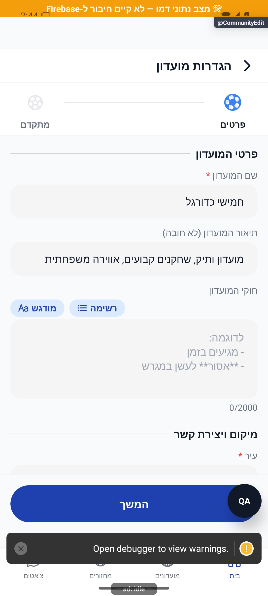
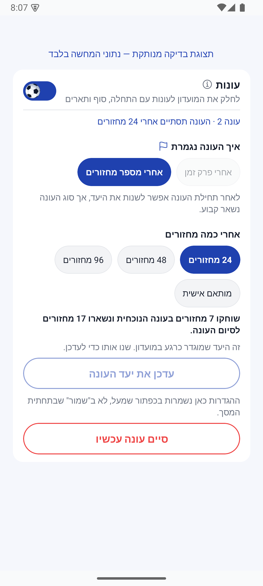
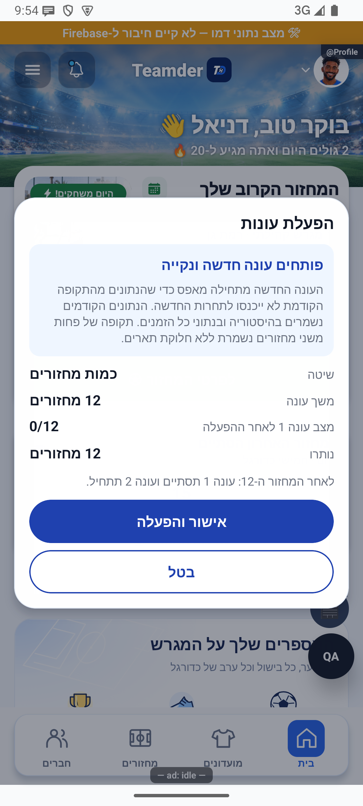

# ניהול עונות

תיקוני העונות הושלמו מקומית ב־11.10.2026 ונבדקו, אך עדיין לא הופצו. [דוח התיקונים](../reviews/2026-10-11-seasons-fixes.md).

מנהל יכול לחלק את פעילות המועדון לעונות ולבחור מתי עונה תסתיים. בסיום נשמר סיכום, ואפשר לראות את ההישגים של אותה עונה גם בהמשך.

סיכום המחזור האחרון צריך להשלים גם את נתוני הצמדים לפני חתימת העונה. אם העיבוד נקטע, הוא יכול להמשיך בלי לספור שוב שלבים שכבר נשמרו. נתון חסר מעונה שכבר נסגרה לא יתווסף לעונה החדשה בטעות.

ההגנות עודכנו מקומית ב־10.10.2026 ונבדקו בקוד מבודד. לא בוצעה סגירת עונה אמיתית או פריסה בסבב זה; נתון היסטורי חלקי אינו מתוקן אוטומטית.

[לפירוט המעמיק](seasons.md)

## תיקוני עיצוב ונגישות — 10.10.2026

מקור: `a348b9f235f1e1433497600555303231512a0834` עם שינויים מקומיים. אין בסעיף זה הוכחת גרסת חנות.

אפשרויות העונות מקבלות שם ומצב ברורים בקורא מסך, ללא שתי תחנות על אותו מתג.

בהפעלה מחדש מתחילה עונה נקייה, והפעילות שהייתה כשהעונות כבויות נשארת בנתוני כל הזמנים. כיבוי אינו פותח עונות שכבר נסגרו לשינויים. אם היו פחות משני מחזורים, הכיבוי שומר את הנתונים בלי להעניק תארים מלאכותיים.

אחרי תחילת העונה אפשר לשנות את היעד, אך סוג העונה נשאר קבוע. אם הסגירה נקטעת, ניסיון חוזר משלים אותה בלי למחוק הישגים או לספור אותם שוב.

## מתגי כדורגל בטפסים — 11.10.2026

בטפסי המועדון והמחזור, כדור מאויר מחליף את עיגול המתג: הפעלה מגלגלת אותו שמאלה על מסילה כחולה, וכיבוי ימינה על מסילה בהירה. גם מתג העונות בתוך טופס המועדון משתמש בעיצוב זה.

## כדור בעל נפח במתגים — 11.10.2026

כדור לבן וכחול עם תפרים, תאורה והצללה מחליף את האיור השטוח במתגי הטפסים. הגלגול שמאלה בהפעלה וימינה בכיבוי נשמר.

## כיווניות המתגים וההסברים — 11.10.2026

במתגי הטפסים, הכדור נמצא מימין כשהאפשרות כבויה ומתגלגל שמאלה בהפעלה. חלוניות המידע המשותפות מציגות מלל עברי מימין לשמאל.

בסגירות חדשות, זכייה משותפת בשחקן העונה שומרת לכל זוכה את גודל המדגם האישי שלו. התיקון מקומי ולא משנה זוכים או ארכיונים קיימים.

ב־13.10.2026 הורצו גם בדיקות מול מסד מקומי מבודד: סגירה שנקטעה המשיכה בלי לאפס פעמיים, נתונים שנוספו באמצע נשמרו, ופתיחה מחדש לא החזירה את אותה עונה פעמיים. לא נגעו במועדון אמיתי ולא בוצעה פריסה.

נבדק גם המעבר לעונה הבאה: חלון התיקונים נשמר ליום שלם, מחזור פעיל מעכב סגירה, ומוני העונה החדשה מתחילים מאפס בלי לפגוע בהיסטוריה. הבדיקות מקומיות; מסירת התראות ומנגנון התזמון בענן לא נבדקו בפועל.

## החלטות הבעלים — 13.10.2026

בהפעלה מחדש מתחילה עונה נקייה. לפני האישור מוצג הסבר שהנתונים הקודמים נשמרים בהיסטוריה ובכל הזמנים ואינם נכנסים לתחרות החדשה. תקופה של פחות משני מחזורים נשמרת ללא תארים.

השינוי מקומי וטרם נפרס. [פירוט הבדיקות והמעבר](../../changes/2026-10-13-approved-statistics-policy.md).

