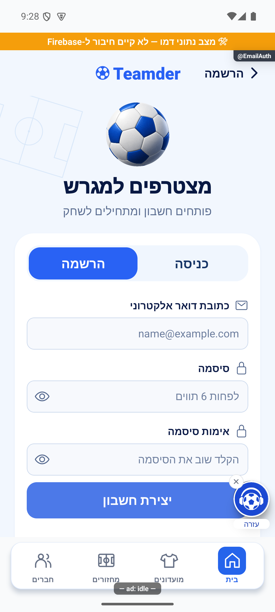
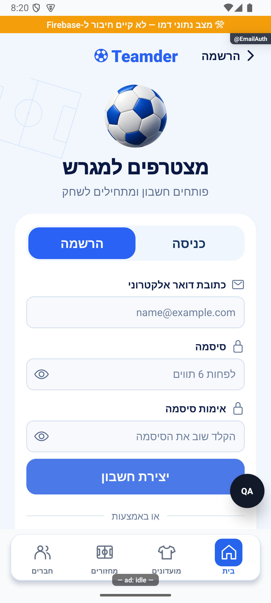
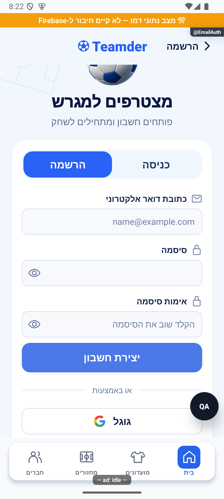
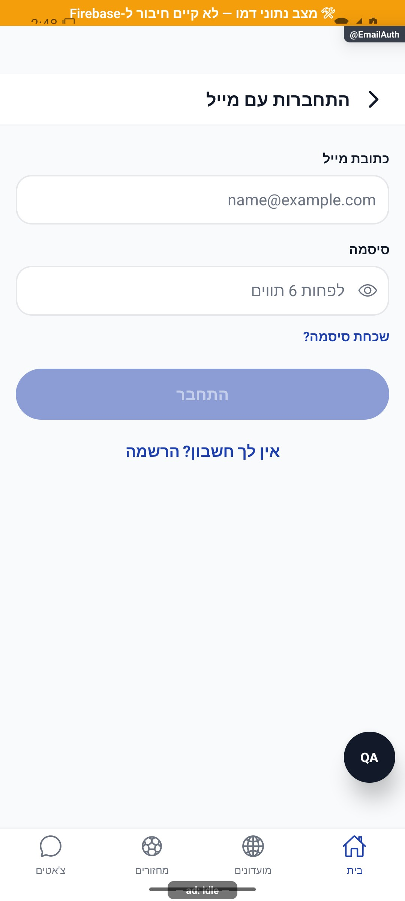

# התחברות וחלון הרשמה בהקשר הפעולה

## ניתוק מנויי החשבון לפני יציאה — 18.10.2026

אחרי יציאה וכניסה אמיתיות בדואר של חשבון הבדיקה, המוביל לכד `Uncaught Error in snapshot listener: permission-denied` ושתי אזהרות של `subscribeMyLiveOrUpcomingGames` באותו חלון זמן. הכניסה בדואר עצמה הסתיימה באותו מזהה חשבון ובמועדון הבדיקה הנכון: [מצב לאחר הכניסה](../../../artifacts/final-deep-audit-2026-10-17/real-email-login-restored-runtime.json). [קטע היומן המסונן לפני התיקון](../../../artifacts/final-deep-audit-2026-10-17/auth-signout-before.log) מתייחס לשלב היציאה, ולא מוכיח אובדן גישה לאחר הכניסה. לא נשמרו בו פרטי הזדהות.

במקור `userStore.signOut` קריאת `userService.signOut` קדמה לאיפוס המשתמש. לכן ביטול הזהות במסד הקדים את ניקויי האפקטים של `MainTabs` ושל `useWatchSync`. בנוסף, `chatService.subscribeUnread` לא סיפק מטפל שגיאה ל־`onSnapshot`; מנויי המשחקים כן סיפקו מטפל. הנוסח הכללי ביומן הוא ענף ברירת המחדל של ה־SDK כשחסר `observer.error`. מסלול זה משחזר את הפגם, אך ללא מחסנית מקור אין לייחס בוודאות את כל האירוע ההיסטורי למנוי היחיד הזה.

`userSessionListeners.subscribeUserSession` מרכז בעלות על קריאות החשבון בלבד: ההודעות שלא נקראו, שתי שאילתות המשחקים לשעון/רכיב, מסמך המשתמש ורשימת המועדונים. לכל חיבור יש דור ושומר זהות. הצלחה או כשל שהגיעו אחרי ניקוי, החלפת זהות או השהיה אינם מתעדכנים בחשבון הבא. הידרציית מועדון שהחלה בזהות הישנה נבדקת שוב לפני מסירתה. לפני ביטול ההתחברות, `signOut` מסיר תחילה את אסימון ההתראות לפי המדיניות הקיימת, ואז מפעיל `suspendUserSessionListeners(uid)` באופן סינכרוני. גם מנוי שנוצר בזמן שהיציאה ממתינה אינו נפתח.

| מצב | התוצאה |
|---|---|
| יציאה מצליחה | המנויים מנותקים לפני ביטול הזהות; ניקוי החנויות, הפעולה הממתינה והטיוטות ופתיחת האורח נשארים במסלול הקיים |
| היציאה נכשלת והזהות נשארת | השחרור ב־`finally` מחבר מחדש את המנויים התקפים בדור חדש; תשובות מהחיבור הישן נשארות פסולות |
| מנוי נוצר בזמן השהיה | אינו נפתח עד שחרור, ורק אם אותה זהות עדיין תקפה |
| כשל הרשאות באותו חשבון פעיל | ממשיך למטפל ולדיווח; אין הסתרת כשל תקף או הצגת רשימה ריקה כאילו הקריאה הצליחה |
| חיבור השאילתה השנייה נכשל | הראשונה מתנקה, הכשל מדווח ותשובות ממתינות של הניסיון החלקי מתבטלות |
| ניקוי כפול או השהיות חופפות | כל חיבור מתנקה פעם אחת; רק השחרור האחרון רשאי לחדש חיבור תקף |

`subscribeUnread` קיבל מטפל שגיאה מפורש ופרמטר אופציונלי להעברת הכשל לצרכן; נתוני ההודעות המאושרים אינם נמחקים בשל הכשל. גם מנוי מועדונים ללא מטפל צרכן מדווח כשל פעיל במקום לבלוע אותו. אין קריאה עסקית חדשה, שינוי הרשאה, כתיבת נתון או מנגנון ניסיון חוזר אוטומטי לקריאה שנדחתה. לא שונו מחיקת חשבון, ספקי הכניסה, קישור זהויות או שערי הפרופיל.

חיבור ראשוני נשען על חוזה קיים: `userService.getCurrentUser` ממתין ל־`waitForAuthRestore` לפני קריאת פרופיל או מעבר לעותק שמור של אותו מזהה. גם `hydrate` ו־`refreshFromSession` ממתינים לתוצאה לפני פרסום המשתמש. כניסת דואר, ספק ואורח מפרסמת משתמש רק אחרי השלמת ההזדהות. `MainTabs`, `RootNavigator` ו־`App/useWatchSync` קוראים את מזהה החשבון מחנות זו. לכן לא נוסף מנגנון המתנה לזהות בתוך רישום המנויים; רישום עם זהות שאינה נוכחית אינו נפתח. בדיקת הפעלה קרה עם כשל קריאת פרופיל מאמתת שהעותק השמור והמנוי אינם מתפרסמים לפני שחזור הזהות.

שלוש בדיקות של מתודת ההודעות המקורית נכשלו לפני התיקון. לאחריו עברו 14 בדיקות חדשות ב־`finalAuthListenerAudit.test.ts`, וביחד עם חמש חבילות התחברות, חנויות ודמו עברו 77 בדיקות; `npx tsc --noEmit` נקי. אלה בדיקות קוד עם תעבורה ומדידות זמן מבודדות, כולל מטפל `signOut` המקורי ושלושת מנויי הקריאה המקוריים; אימות המכשיר הנפרד מתואר להלן. [דוח, לוגים ומגבלות](../../../artifacts/final-deep-audit-2026-10-17/auth-listener-audit.md).

לאחר טעינה קרה של הקוד המתוקן, המוביל הפעיל במכשיר יציאה רגילה אל בית האורח, כניסה לחשבון הקיים דרך `EmailAuth` וחזרה ל־`Profile`. ב־18.10.2026 בשעה 00:56:04 לפי הזמן העולמי, [בדיקת התוצאה](../../../artifacts/final-deep-audit-2026-10-17/real-email-login-after-listener-fix.json) ו[מצב הריצה](../../../artifacts/final-deep-audit-2026-10-17/real-email-login-after-listener-fix-runtime.json) אישרו אותו מזהה חשבון ואותו מועדון בדיקה מול מסד אמיתי. בתהליך המקורי `10244` נקראו 2,573 שורות יומן, ונמצאו אפס התאמות לארבעת דפוסי השגיאה: `Uncaught Error in snapshot listener`,‏ `permission-denied`,‏ `subscribeMyLiveOrUpcomingGames error` ו־`subscribeUnread`. [פלט הסינון אחרי התיקון](../../../artifacts/final-deep-audit-2026-10-17/auth-signout-after.log) ריק מהתאמות; מספר השורות והדפוסים מתועדים בקובץ התוצאה, ואין לפרש את הקובץ הריק כהיעדר יומן מקור.

זהו אימות תחום של יציאה וכניסה בדואר באותו חשבון קיים, בלקוח פיתוח מקומי באנדרואיד, בגופן רגיל וברוחב כ־411.43. בית האורח נוצר במסלול האנונימי הרגיל של המוצר; לא נוצרו חשבון בדיקה או מועדון בדיקה חדשים. חלון היומן מוגבל למאגרי המכשיר ולתהליך שנקרא. אין בכך הוכחה שכל מנוי אפשרי נבדק, שחיבור ספק חיצוני או פרופיל חדש הורצו, או שאייפון וגרסת חנות אומתו.

## שער השלמת פרופיל בדואר — 18.10.2026

ב־`EmailAuthScreen` חידוש הפעולה אחרי כניסה בדואר מותנה כעת ב־`useUserStore.getState().hasCompletedOnboarding()`. חשבון קיים שחסר לו פרופיל ממתין למסך ההיכרות, בדיוק כפי שמסלול חשבון חדש ממתין לו. בדיקת המצב נעשית לאחר עדכון חנות המשתמש. מסלול הספקים כבר השתמש בשער ההשלמה; לא הוחלף מנגנון הספק או קישור החשבון.

| תוצאת ההתחברות | המשך |
|---|---|
| חשבון קיים והיכרות הושלמה | מתאם הפעולה רשאי להמשיך, בכפוף לאימותי היעד והטיוטה |
| חשבון קיים והיכרות לא הושלמה | אין חידוש פעולה מתוך מסך הדואר; שער השורש מציג היכרות |
| חשבון חדש | מסלול ההיכרות הקיים |
| ביטול או כשל | אין חידוש פעולה כתוצאה מהניסיון |

שתי בדיקות הדואר בתוך `tests/logic/finalOnboardingAuditProfile.test.ts` מאמתות חידוש עם פרופיל שלם והמתנה עם פרופיל חסר. יחד עם בדיקות שחזור הפעולה נוספו 35 בדיקות. 775 בדיקות ב־25 חבילות ממוקדות ובדיקת הטיפוסים עברו; מספר זה אינו כל חבילת הבדיקות. הציפייה הישנה ב־`tests/authUpgradeUpdatesStore.test.ts` עודכנה לתנאי ההשלמה. [דוח ויומנים](../../../artifacts/final-deep-audit-2026-10-17/onboarding-audit.md).

מסכי הכניסה וההרשמה נפתחו בפועל באנדרואיד עם `__DEV__`, דמו מאולץ ו־`p7`. המידות שנקראו בזמן הריצה: חלון 411.43×914.29, גופן 100%, מכשיר 1080×2400 בצפיפות 420. נצפו מעבר הלשונית ושלושת שדות ההרשמה. לא הוזנו אישורים ולא נשלחו כניסה, הרשמה, שחזור סיסמה או בקשת ספק. אין כאן אימות מקלדת חדש, ספק חי, מסד ייצור, התקנה מהחנות או מכשיר אפל. סימוני הדמו והבדיקה אינם חלק מהממשק המופץ.

הקשרי ההמשך מתועדים ב־[פעולה ממתינה](pending-actions.md) וב־[השלמת פרופיל](profile-onboarding.md). הסעיפים המתוארכים בהמשך מתעדים את ההיסטוריה ואינם הוכחה שנערכו שוב פעולות מול ספק אמיתי בסבב זה.

## עיצוב מסך הדואר — 14.10.2026, שינוי מקומי

המסך הקיים `src/screens/auth/EmailAuthScreen.tsx` עוצב לפי `artifacts/design-sketches/2026-10-14/01-email-auth.png`: רקע תכלת עם סימון מגרש עדין, הכדור המקומי התלת־ממדי מהטפסים, כרטיס לבן מעוגל ולשוניות כניסה והרשמה. אין מסך או מסלול ניווט חדש. הכניסה מכילה דואר וסיסמה; בהרשמה נוסף אימות סיסמה. כללי כתובת תקינה, לפחות שישה תווים והתאמת האימות, שחזור סיסמה ללא חשיפת קיום חשבון, טיפול בהתנגשות ספק וחידוש פעולה אחרי כניסה בדואר נשמרו.

`switchMode` מחליף מצב ומנקה את אימות הסיסמה. שדות מושבתים בזמן התחברות; `inFlight` מונע ניסיונות כניסה כפולים לפני הרינדור הבא. `ScrollSurface` בתוך `SafeKeyboardAvoidingView` מאפשר גלילה במסכים קטנים ובהרשמה. עין הסיסמה משמאל; האייקונים ותוויות השדות מימין. אין שינוי בנתונים, בהרשאות או בשרת.

נוספו כפתורי הספקים מהסקיצה: גוגל; אפל באייפון בלבד, בהתאם לתמיכת הספק הקיימת. `onProvider` משתמש ב־`upgradeAnonymous` הקיים, ממתין ל־`refreshFromSession` של הזהות שהתקבלה, וממשיך פעולה ממתינה רק אם `hasCompletedOnboarding` מאשר שהפרופיל הושלם. ביטול אינו מציג כשל; כשל אינו מחדש פעולה. במסלול חדש השלמת הפרופיל נשארת ב־`RootNavigator`. הקלט אינו מועבר לאירועי מדידה.

| מצב | תצוגה ופעולה |
|---|---|
| כניסה | שתי כניסות, שחזור סיסמה, כניסה לחשבון וספקים |
| הרשמה | שלושה שדות, כולל אימות; יצירת חשבון וספקים |
| פרטים לא תקינים | כפתור הדואר מושבת; אי־התאמה מוצגת אחרי הקלדת האימות |
| ניסיון פעיל | מחוון בכפתור המתאים וחסימת ניסיון מקביל |
| ספק בוטל או נכשל | ללא ניווט וללא חידוש פעולה |
| פרופיל חדש | המשך למסלול השלמת הפרופיל הקיים |

בדיקת הטיפוסים ו־3,690 בדיקות ב־300 חבילות עברו. חמש בדיקות בפונקציית המקור `tests/logic/emailAuthProviders.test.ts` בודקות סדר טעינת פרופיל וחידוש, חשבון חדש, ביטול, כשל ולחיצה כפולה. הצילומים החדשים צולמו באימולטור אנדרואיד, בקוד מקומי מעל `4a3cb346`, במצב דמו מאולץ. סרגל הדמו, סימון הבדיקה והניווט התחתון שייכים לאירוח מסך הבדיקה. לא נשלחו הרשמה, שחזור סיסמה או בקשת ספק אמיתיים; לא נבדק אייפון. המקור החזותי הוא סקיצה; הכדור הוא נכס המוצר הקיים, והסמל של גוגל מצויר בווקטור בארבעת צבעיו ומשמאל לטקסט. מיקוד שדה האימות גולל לתחתית הכרטיס לאחר התאמת המקלדת; התזמון מבוטל בפירוק המסך.

## עדכון מקומי — 10.10.2026

`ContextualAuthSheet.onEmailTransition` סוגר את הגיליון לצורך מעבר ואינו קורא `onCancel` של `IntentScreen`. זה משמר `existingAccountAttempt` בזמן המייל. `EmailAuthScreen` מאזין ל־`beforeRemove`: בהיעדר משתמש מלא הוא מפעיל `endExistingAccountAttempt`; בהצלחה משאיר את הסמן לשערי הכניסה. ביטול גיליון אמיתי נשאר במסלול הניקוי. אין שינוי בקישור אישורים או במיזוג חשבונות.

| מצב | תוצאה | כתיבה | ראיה |
|---|---|---|---|
| מעבר למייל | הניסיון נשמר | סימון מקומי בלבד | פונקציית מקור מבודדת |
| חזרה בלי חשבון מלא | הניסיון מתבטל | ניקוי בחנות | בדיקת תנאי המאזין |
| חזרה אחרי הצלחה | השער ממשיך לחשבון | מנגנון ההתחברות הקיים | בדיקות חנות וניווט |

**מצב האימות:** תיקון מקומי, 10.10.2026. ראיות השירותים ופונקציות המקור ב־`tests/logic/clientAuditRecovery.test.ts`; הריצה הממוקדת המתועדת עברה 417 בדיקות ב־8 חבילות; השלמת שחזור מאוחר תועדה בדוח התיקון. [דוח התיקון והגבולות](../../../artifacts/pre-release-2026-10-10/client-fixes.md). לא הורצו כאן פעולות מול מסד אמיתי ולא צולמו מצבי כשל רשת חדשים; התמונות ההיסטוריות אינן הוכחה לתיקון זה.

מצב המיפוי ההיסטורי: 14.10.2026. עדכון 18.10 בראש המסמך קובע את שער ההשלמה הנוכחי.

## תיקון מסלול החשבון הקיים — 8.10.2026

`IntentScreen` פותח `ContextualAuthSheet` ישירות, ולכן עוקף את רענון החנות שב־`useAuthenticatedAction`. אחרי הצלחת `upgradeAnonymous`, זהות ספק ההתחברות השתנתה אבל `currentUser` נותר אורח. כעת `onAuthenticated` סוגר את החלון ואחר כך ממתין ל־`userStore.refreshFromSession`; שערי `RootNavigator` קוראים את הפרופיל המעודכן. סדר הסגירה נשמר כדי למנוע חלונות חופפים באייפון. הסעיף מתאר את תיקון 8.10. מסלול המעבר למייל והביטול עודכן ב־10.10 כמפורט בראש המסמך.

בדיקת החיבור נוספה ב־`tests/entryExistingAccount.test.ts`, לצד בדיקות החלפת האורח בפרופיל חי ב־`tests/authUpgradeUpdatesStore.test.ts`. כל 2,803 הבדיקות ובדיקת הטיפוסים עברו. זו הוכחת חיבור הקוד ומעבר החנות, לא בדיקת ספק חי; משימת אפל נשארת פתוחה עד אימות באייפון.

[לקריאה קצרה ופשוטה](authentication.simple.md)

עודכן: 07.10.2026; קוד `8e8fde5`, `1.1.35` בבנייה. תפקידים: אורח, חשבון מלא, בעל חשבון קיים. מיפוי בלבד.

## מסכים וניווט

`src/screens/auth/SignInScreen.tsx` הוא מסך הכניסה המלא. `src/components/auth/ContextualAuthSheet.tsx` מופיע מעל המסך שבו אורח ביקש פעולה שמצריכה חשבון. `src/screens/auth/EmailAuthScreen.tsx` הוא מסלול `EmailAuth`, הרשום גם בערימות הכניסה וגם בערימות המארחות את ההורים. יש לבדוק את הרישום בכל הערימות לפני שינוי ניווט מתוך חלון משותף.

החלון מציג ידית, כותרת והסבר מותאמים: הצטרפות למחזור, הצטרפות למועדון, מועמדות להשלמה, יצירת מועדון, יצירת מחזור, שמירת זמינות או פתיחת חשבון. קיימים כפתורי Google ומייל; Apple תלוי מערכת וזמינות. בטיוטה מוצגת גם הבטחה שהעבודה נשמרה. ביטול סוגר את החלון ומשאיר את האורח והטיוטה.

זהו צילום חלון אמיתי המורכב בכלי הבדיקה מעל בית של חשבון דמו מלא. הוא מוכיח מראה ונוסח בלבד, לא הרשמה אנונימית או הצלחה מול ספק. פס הדמו, מזהה המסלול ובועת הבדיקה אינם חלק מעיצוב גרסת החנות.

## טבלת מצבים

| תנאי | פעולה ומעבר | כתיבה או שינוי זהות | ראיה |
|---|---|---|---|
| אורח, פעולה עסקית | שמירת פעולה או טיוטה ואז חלון | אחסון מקומי בלבד עד התחברות | קוד `useAuthenticatedAction` |
| Google או Apple, אישורים חדשים | קישור האישורים לזהות האנונימית | שימור אותו מזהה; יצירת פרופיל מלא | קוד `authUpgrade` |
| האישורים שייכים לחשבון קיים | שימוש באותם אישורים להתחברות לחשבון הקיים | החלפת זהות; אין מיזוג נתוני אורח | קוד |
| ביטול ספק | החלון נסגר או חוזר ללא ביצוע העסקה | נשאר אורח | קוד; לא אומת ספק חי |
| פעולה בתהליך או כשל | חסימת לחיצה כפולה; הודעת כשל | אין הצלחה מדומה | קוד |
| מייל, הרשמה | אימות שדות ויצירת משתמש | `createUserWithEmailAndPassword` יוצר מזהה חדש | קוד `firebase/auth.ts` |
| מייל, התחברות | מייל וסיסמה; הצלחה חוזרת לשערי השורש | מעבר למזהה החשבון | קוד; צילום טופס בלבד |
| איפוס סיסמה | שליחת בקשת איפוס לפי מייל | ספק ההזדהות | קוד; לא בוצעה שליחה |

הבדל חשוב: האפשרות `upgradeAnonymous(email)` אינה מסלול ההרשמה הפעיל במסך המייל. אין לתעד שמירת מזהה אורח במייל כאילו זהה לקישור Google/Apple. הטיוטה המקומית והכוונה יכולות לשרוד החלפת מזהה, אך אינן מיזוג מסמכי מסד.

## טופס מייל, שירותים וממיר

הטופס כולל מייל, סיסמה, אישור סיסמה בהרשמה, הצגה/הסתרה, מעבר בין כניסה להרשמה וקישור שכחת סיסמה. כפתור מושבת כשהשדות אינם תקינים. שגיאות מייל בשימוש, סיסמה חלשה/שגויה, הגבלת ניסיונות, רשת וספק אחר מקבלות טיפול ייעודי. בהצלחה `goBack` אינו סוף הזרימה: `RootNavigator` בודק היכרות ופרופיל.

מקורות: `src/services/authUpgrade.ts`, `src/hooks/useAuthenticatedAction.tsx`, `src/firebase/auth.ts`, `src/services/userService.ts`, `src/store/userStore.ts`, `src/components/auth/ContextualAuthSheet.tsx`. פרופיל מלא נקרא דרך ממיר המשתמש ב־`src/firebase/firestore.ts`; אורח אינו מקבל מסמך `users` עסקי. זיהוי במעקב צד שלישי צריך להחליף/לקשר זהות בסדר הקיים ולא להקדים לכתיבת החשבון.

בדיקות: `tests/authUpgradeUpdatesStore.test.ts`, `tests/guestAuthEntryPoints.test.ts`, `tests/logic/authUpgrade.test.ts`, `tests/logic/authRaceRetry.test.ts`. לא הופעל ספק חי במיפוי.

## שחזור וסיכונים

לבדוק בחשבון הבדיקה: ביטול ספק, הרשמה חדשה, התנגשות עם חשבון קיים, מייל מול ספק אחר, חזרה לאחר השלמת פרופיל והפעלה מחדש כשהטיוטה קיימת. כל התמונות בטבלה מכסות נוסחים בהרכבת דמו בלבד. מסמך 004 שטען שאין כלל קישור אישורים אינו מקור אמת לזרימת האורח הנוכחית; אין מכך הוכחה שכל התנגשות בין שני חשבונות מלאים נפתרה.

| הקשר החלון | צילום תצוגה שנפתח | נוסח מרכזי שנצפה |
|---|---|---|
| הצטרפות למחזור | [צילום](../screenshots/auth-join-game.jpg) | עוד רגע אתה בהרכב |
| הצטרפות למועדון | [צילום](../screenshots/auth-join-club.jpg) | עוד רגע אתה בסגל |
| מועמדות להשלמה | [צילום](../screenshots/auth-apply-filler.jpg) | מגישים מועמדות למחזור |
| יצירת מועדון | [צילום](../screenshots/auth-create-club.jpg) | שומרים את המועדון; מה שמילאת נשמר |
| יצירת מחזור | [צילום](../screenshots/auth-create-game.jpg) | שומרים את המשחק; מה שמילאת נשמר |
| שמירת זמינות | [צילום](../screenshots/auth-save-availability.jpg) | שומרים את הזמינות; מה שמילאת נשמר |
| חשבון | [צילום](../screenshots/auth-account-upgrade.jpg) | פותחים לך חשבון |

## פירוט מימוש ונקודות שינוי — העמקה 07.10.2026

`useAuthenticatedAction` הוא מקום ההחלטה אם להריץ פעולה מיד או לשמור בקשה ולהציג `ContextualAuthSheet`; אין להעביר את ההכרעה לכפתור ספק. `authUpgrade` מבחין בתוצאות קישור, מעבר לחשבון קיים, ביטול וכשל: זהות מלאה מתעדכנת בחנות לפני שמתאם החזרה ממשיך. מסלול המייל משתמש בפעולות `userStore.signInWithEmail`/`signUpWithEmail`, ולא בקישור האנונימי של ספקי Google/Apple.

נקודות שינוי: נוסח וחלון — `ContextualAuthSheet.tsx` ו־`he.ts`; כללי זהות — `authUpgrade.ts` ו־`firebase/auth.ts`; תנאי פתיחת חשבון — `useAuthenticatedAction.tsx`; חזרה לפעולה — `RootNavigator` ו־`actionResumers`. שינוי ספק מחייב בדיקת ביטול, התנגשות אישורים וחשבון ללא מסמך משתמש, ושמירת סדר השיקוף לזהות הנייטיבית. צילום חלון אינו אימות של אף אחד מהמסלולים האלה.

הבדיקות, מצבי המסך והראיות שכבר פורטו במסמך נשמרו. ההעמקה מבוססת על קריאת מקור ולא על הרצת פעולות נוספות; שינוי עתידי יצריך עדכון של שני המסמכים ובחינת המצבים הממוקדים.

## אימות ותיקונים מקומיים — 9.10.2026

ייחוס אינו נלקח רק ממפתח ההזמנה הישן. `applyInviteAttributionIfFresh` קורא את ציר `referral`, ו־`applyAcquisitionIfFresh` את ציר `acquisition`, באמצעות `storage.getInviteAttribution`. כל ציר נכתב פעם אחת במסמך המשתמש: `invitedBy` קיים או `acquisition` קיים אינם נדרסים. אין זיכוי עצמי. לפני כתיבה אחרי קריאת מסד נבדק מחדש שמזהה ההתחברות הנוכחי תואם ושאינו אנונימי.

רישום כרטיס הזכאות וסימון הפתרון מסודרים באותו תור `serializeInviteWrite`, כדי שפתרון מאוחר לא יפספס כרטיס שבדיוק נשמר. בארבעת מסלולי יצירת מסמך משתמש חדש נקרא `registerFreshInviteUser(fresh.id, fresh.createdAt)` לפני החלת הייחוס. `footy.invite.newUser` הוא כרטיס זכאות מקומי להשלמה, קשור למזהה משתמש, זמן יצירת המסמך וכתובת לא פתורה אם הייתה. הרשמה נחשבת טרייה רק עד 24 שעות מהיצירה; זמן עתידי ביותר מדקה נדחה. תוקף כרטיס שנוצר הוא 24 שעות ממועד הרישום המקומי. כרטיס נוצר רק כאשר קיימת כתובת לא פתורה או רשומת מזמין/מקור, ואינו ניתן לחשבון אחר שכבר נקשר לייחוס.

קישור לא פתור משאיר את הכרטיס עם `resolved:false`. רק פתרון אותה כתובת בתוך תוקף מסמן שהקישור נפתר. גם הזמנה ידועה יכולה ליצור כרטיס, כדי שכשל חולף בכתיבת הייחוס לא יאבד לצמיתות. `completeDeferredInviteAttribution` רץ לאחר חלון התאוששות בקדמת המסך; הוא בודק משתמש מלא נוכחי, כרטיס לאותו מזהה, תוקף, מסמך קיים וזמן `createdAt` זהה, ואז בודק שוב זהות לאחר ההמתנה למסד. הוא מחדש רק כתיבה שחסרה. חשבון ותיק אינו מקבל ייחוס אוטומטי רק מפני שנפתח היום קישור חדש.

פרטי המזמין נשמרים כ־`invitedBy`, `invitedByType`, `invitedByTargetId` ו־`invitedAt` של זמן שרת. בהזמנה כללית היעד הוא `app`. הרכישה כוללת `source`, ובמידת הצורך `campaign`, `linkId`, יעד בשדה ההיסטורי `gameId` ו־`at` בזמן מקומי. שם השדה `gameId` אינו הוכחה שהיעד הוא מחזור: המקור יכול להיות גם מועדון.

החלפת זהות במהלך בדיקת יעד אינה ממשיכה ניווט מסשן ישן. בחירה מפורשת בהקמת מועדון או בחיפוש נשארת קודמת להזמנה האוטומטית גם אחרי התחברות. טיוטה וייחוס הם אחסון מקומי נפרד; הם אינם מיזוג חשבונות או עסקה שכבר בוצעה.

בדיקות ממוקדות: `tests/logic/inviteAttributionExpanded.test.ts` מפעיל שירותי אחסון והכתיבה המקוריים עם זהות ומסד מדומים, כולל פתרון אחרי הרשמה, כשל כתיבה, חשבון אחר, אורח, זמן מסמך שונה, תוקף שפג והחלפה במהלך קריאה. `inviteNavigationExpanded.test.ts` בודק ביטול ניווט ישן וחידושו לזהות המוכנה החדשה.

האימות המשולב הסתיים ב־202 חבילות ו־2,966 בדיקות שעברו, ובדיקת טיפוסים נקייה. בדיקות השירותים והניווט מפעילות קוד מקור מול אחסון, זהות ומסד מדומים; בדיקות הדפים כוללות דפדפן מקומי עם רשת חיצונית חסומה. אין כאן הוכחת התקנה מהחנות, ספק התחברות חי, קישורים מאומתים במערכת ההפעלה או הרשאת לוח במכשיר. תיקוני המוצר מקומיים; אין לפרש את התיעוד כאישור שהגרסה הופצה. [דוח שמונת הסוכנים, התיקונים וגבולות האימות](../reviews/onboarding-expanded-fixes-2026-10-09.md).

### השלמת שחזור אחרי ספק — 10.10.2026

`refreshFromSession(expectedUid)` דורש פרופיל מלא עם מזהה תואם לספק. כשל, תוצאה ריקה, אורח או מזהה אחר מאפסים את פרופיל החנות, מגדירים `profileRestoreFailed` וזורקים לקורא. הזהות בספק אינה מוחלפת. `useAuthenticatedAction` תופס את הכשל וחוזר לפני `resumePendingAction`; מסך הכוונה מפנה לשער השחזור. `hydrate` של הניסיון החוזר קורא את הזהות שכבר התחברה וממשיך בשערים הרגילים. נבדקו גם הימנעות מהמשך הפעולה וגם מעבר מכשל לפרופיל תואם. אין התחברות ספק חיה בבדיקה.

## תיעוד פעולות ההצטרפות — 10.10.2026

הפעולות הנתמכות בתהליך מגיעות להיסטוריה ולהתראות בפולס, כולל זמן, ביקור וספירת לחיצות. לא מועבר תוכן שדות מוקלדים. נדרשים פריסת השרת ולקוח חדש; [הכיסוי, החישובים ומגבלות האימות](../shared/onboarding-activity.md).

## הקשחת אבטחה מקומית — 11.10.2026

אחסון Firebase JS משתמש ב־secureAuthStorage וב־encryptedPersistence: מפתח מגובב, חלקים עד 1,920 בתים, אימות קריאה לפני החלפת המצביע ומחיקת AsyncStorage הישן. פעולות על אותו מפתח סדרתיות. כשל אינו מוחק את ההתחברות הישנה. רכיב SecureStore מחייב בנייה מקומית חדשה; לא נבדק שחזור במכשיר פיזי. המראה הנייטיבית של Firebase לשעון ולווידג׳ט נשארת במנגנון הספרייה; קובץ ההתחברות שלה מוחרג מהגיבוי, אך לא הוחלפה ההצפנה הפנימית שלה. אימות מקור האפליקציה משתמש בספק פיתוח רק ב־__DEV__; TEAMDER_ENFORCE_APP_CHECK כבוי כברירת מחדל בשרת. אין כאן אכיפה בייצור.

## ביקורת השינויים היומית — 14.10.2026

שחזור סיסמה ננעל בזמן הבקשה ומציג טעינה, כדי למנוע שליחה כפולה או התחברות במקביל. כתובת הדואר מקוצצת לפני השליחה.

`onForgotPassword` משתמש באותו `inFlight` של ספקי הכניסה ובמצבי `busy` ו־`resetting`; `finally` משחרר גם אחרי כשל. בדיקת מקור מורצת עם הבטחה מושהית מאמתת בקשה אחת, כתובת מקוצצת ושחרור אחרי כשל. באימולטור נבדקו כניסה, הרשמה ואימות סיסמה לא תואם עם מקלדת פתוחה; שדה האימות והמשך נגישים. לא נשלחה בקשת שחזור אמיתית ולא נפתח ספק התחברות חי.

בדיקת טיפוסים וכל 3,703 הבדיקות ב־302 חבילות עברו. תוקנו תקלות בדרגת ביניים; לא אומת ממצא קריטי. אייפון ופעולות שרת אמיתיות לא נבדקו בסבב זה.

