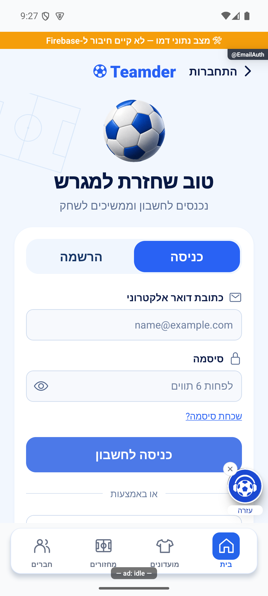
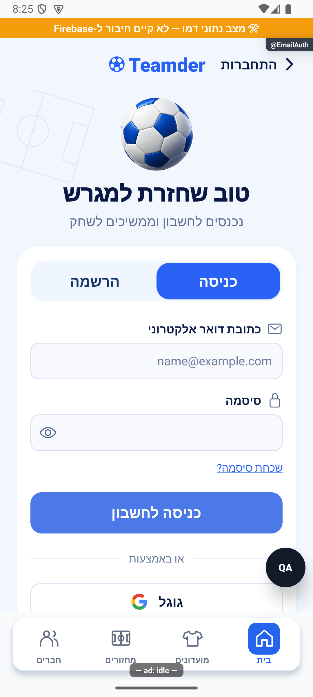
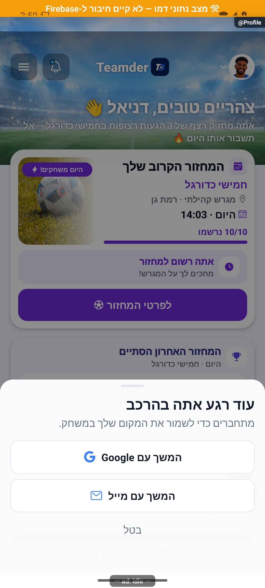
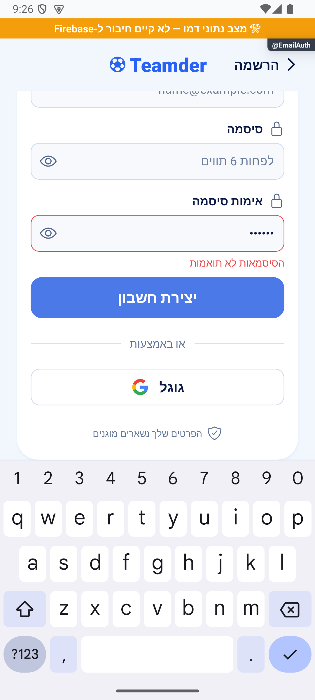

# התחברות וחלון הרשמה בהקשר הפעולה — הסבר קצר

## הרחבת אבחון דיווחים, 27.10.2026

הדיווחים יוכלו לכלול מה ניסו לבצע, מה היה מצב האפליקציה ומה החזיר השרת. פרטים חסרים מוצגים כלא ידועים, ומספר מוגבל של מופעים נשמר בלי למחוק את המופע הראשון. השינוי מקומי וטרם הופץ, ואינו משלים פרטים לדיווחים ישנים. [היקף, ראיות ומגבלות](../../changes/2026-10-27-diagnostic-context.md).

בדיקות הקוד הושלמו, אך השינוי עדיין מקומי ולא הופץ. פרטים שלא נאספו בדיווחים ישנים אינם משוחזרים בדיעבד.

## השבתת פעילות אישית לקראת הגרסה הבאה, 27.10.2026

הפעילות האישית וחיבור נתוני הספורט מוסתרים זמנית לקראת הגרסה הבאה. האפליקציה לא תבקש הרשאות מדידה ולא תתחיל סנכרון פעילות בגרסה הזאת. הנתונים שכבר נשמרו נשארים, והטיימר ונתוני הכדורגל הרגילים ממשיכים לפעול. השינוי מקומי וטרם הופץ; [פרטים ומגבלות](../../changes/2026-10-27-sports-activity-disabled.md).

## טיפול בתקלות הפולס, 26.10.2026

ביטול התחברות ותקלות זמניות מוכרות של ספק ההתחברות עוברים כעת דרך הסיווג הקיים לפני רישום שגיאה. הודעות ההתחברות ואפשרות הניסיון החוזר נשמרות.

השינוי מקומי וטרם הופץ. [בדיקות, מסירה ומגבלות](../../changes/2026-10-26-pulse-fixes.md).

## בדיקות העברת הזמנה לדומיין החדש - 26.10.2026

עודכנו בדיקות ההזמנה כדי לבדוק כתובת העתקה ופרטי התקנה בדומיין החדש, וכן שחזור קישור קצר בלי מזהה מזמין בשאילתה. יעד ההזמנה ושיוך המזמין נקראים מהקוד הקיים. לא השתנו כאן מסכי ההתחברות או כללי חידוש הפעולה. השינוי מקומי וטרם הופץ; אין אימות התקנה חדשה בחנות. [הבדיקות ומגבלות האימות](../../changes/2026-10-26-share-domain.md).

## הפצה פנימית 1.1.61 - 25.10.2026

הבינארי `1.1.61/295` הופץ ואומת במסלול הפנימי באנדרואיד. תיקוני הלקוח נכללים בו, ושירות הפרופיל נפרס ואומת בנפרד. גם תיקוני הסגל, שמירת התוצאה והתראת השגיאה בשרת נפרסו ואומתו באישור מפורש. שינויי יישום הפולס עצמו טרם הופצו. אין שינוי כללי הרשאה או הסבת נתונים. ניסוחי המצב המקומי בסעיפים הקודמים נכתבו לפני ההפצה; [דוח ההפצה](../../changes/2026-10-25-internal-1.1.61.md) מפרט בדיוק מה נכלל, מה נבדק ומה עדיין מקומי.

## תיקוני הפולס - 25.10.2026

כשל רשת בהתחברות נשאר הודעה ברורה שמאפשרת ניסיון נוסף ואינו נרשם כתקלה בתוכנה. לא שונו פרטי החשבון או מסלול ההתחברות. מקומי וטרם הופץ.

[מקורות, בדיקות, צילומים ומגבלות](../../changes/2026-10-25-pulse-fixes.md).

## הכדורגל שלי בעמוד הראשון של הקרוסלה - 25.10.2026

עודכנה הקרוסלה האישית בבית, בקובץ משותף לתהליך הזה או לכלי הבדיקה שלו. אין שינוי נוסף בפעולות המתוארות כאן ולא נערכה להן בדיקת ממשק חדשה. מקומי וטרם הופץ. [השינוי והבדיקות](../../changes/2026-10-25-home-profile-carousel.md).

## בדיקות ההיכרות לאחר התחברות - 25.10.2026

נוספו בדיקות כדי לוודא שבחירת דמות בלי תמונה אינה מבקשת למחוק קובץ. אין שינוי באופן ההתחברות או בחלון ההרשמה, ולא נערכה התחברות חיה חדשה במסגרת הבדיקה. התיקון מקומי וטרם הופץ. [החקירה](../../changes/2026-10-25-photo-recurrence.md).

## שעון מדויק וכיתוב פנדל - 25.10.2026

במקורות המשותפים נוסף שימור השעון המדויק של פנדל במהלך משחק, וכיתוב ההבקעה ביומן קוצר. אין שינוי במונים או בתהליך העצמאי המתואר כאן; לא נערכה לו בדיקת ממשק חדשה במסגרת העדכון. השינוי מקומי וטרם הופץ. [פרטים וראיות](../../changes/2026-10-25-in-play-penalties.md#שעון-מדויק-וכיתוב-אירוע).

## פנדל במהלך משחק חי - 25.10.2026

עודכנו מקורות משותפים לצורך פנדלים במהלך משחק. אין שינוי מכוון בתהליך העצמאי המתואר במסמך הזה, ולא נערכה לו בדיקת ממשק חדשה במסגרת המשימה.

השינוי מקומי. נדרשת פריסת שרת לפני הפצת לקוח שמשתמש באפשרות; לא בוצעו פריסה או שינוי הרשאות. [חוזה הנתונים, התהליך, הבדיקות ומגבלות ההפצה](../../changes/2026-10-25-in-play-penalties.md).

## כניסה לכרטיס השחקן בתפריט הבית — 24.10.2026

בקובץ הבית המשותף נוספה רק הכניסה ״כרטיס השחקן שלי״ לפני ארון התארים בתפריט. אין שינוי מכוון בהתנהגות העצמאית המתוארת כאן, ואין לראות בבדיקת התפריט אימות חדש של המסך או התהליך הזה. התוספת מקומית ואינה נכללת בבינארי הפנימי שכבר נבנה. [מקור, בדיקות ומגבלות](../../changes/2026-10-24-home-player-card-menu.md).

## תלות משותפת בכפתור בדיקת הקריסה — 23.10.2026

נוסף כפתור בדיקת קריסה זמני בגוף מסך הבית. אין שינוי מכוון בתהליך המתואר כאן; אין להסיק מהשינוי בקובץ המשותף שהמסך הזה נבדק מחדש במכשיר. [פירוט האימות והמגבלות](../../changes/2026-10-23-crash-test-and-pulse-followup.md).

## תיעוד כשלים — 20.10.2026

נוסף תיעוד אוטומטי לנקודות כשל במסלול הזה, עם מקור התקלה. הפעולה המקורית שומרת על ערכי החזרה והודעות השגיאה שלה. השינוי מקומי, טרם הופץ, ואין אימות מסירה חיה לפולס.

[דוח דיווח השגיאות והראיות](../../changes/2026-10-20-error-reporting-audit.md).

## סגירת החיבורים לפני יציאה מהחשבון — 18.10.2026

ביציאה מהחשבון נסגרים עכשיו חיבורי העדכון של ההודעות, המשחקים, הפרופיל והמועדונים לפני ביטול ההתחברות. כך תגובות מהחשבון הקודם אינן מעדכנות את החשבון הבא ואינן מציגות שגיאת הרשאות בגלל סדר היציאה. אם היציאה עצמה נכשלת והחשבון נשאר מחובר, החיבורים התקפים נפתחים מחדש. כשל אמיתי של החשבון הפעיל עדיין מדווח; הוא אינו הופך לרשימה ריקה.

הפגם שוחזר בקוד, ו־77 בדיקות ממוקדות ובדיקת הטיפוסים עברו. לאחר טעינה קרה של התיקון המוביל ביצע יציאה רגילה אל בית האורח וכניסה אמיתית בדואר לאותו חשבון בדיקה; החשבון והמועדון שוחזרו. ב־2,573 שורות היומן שנקראו מהתהליך לא נמצאו דפוסי שגיאת המנויים שנבדקו. זו הוכחה למסלול הזה בלבד, ולא לכל ספק או מנוי אפשרי. לא נוצרו חשבון בדיקה או מועדון חדשים, ולא שונו הרשאות או דרכי ההתחברות. [התוצאה, המקורות והגבולות](authentication.md#ניתוק-מנויי-החשבון-לפני-יציאה--18102026).

## השלמת פרופיל לפני המשך — 18.10.2026

גם חשבון קיים שמתחבר בדואר נדרש להשלים פרופיל חסר לפני שהאפליקציה ממשיכה פעולה שחיכתה. הצלחת ההתחברות לבדה אינה אישור שההצטרפות או השמירה הצליחו.

מסכי הכניסה וההרשמה נפתחו ונבחנו באימולטור דמו. לא נשלחו פרטי התחברות, הרשמה, שחזור סיסמה או בקשה לספק אמיתי. הסעיפים המתוארכים בהמשך מתעדים את השינויים הקודמים.

[דוח הביקורת והבדיקות](../../../artifacts/final-deep-audit-2026-10-17/onboarding-audit.md)

## מסך כניסה והרשמה מעודכן — 14.10.2026

בוחרים כניסה או הרשמה בלשוניות בראש הכרטיס. בהרשמה מקלידים את הסיסמה שוב כדי למנוע טעויות; בכניסה אפשר לשחזר סיסמה. הכדור, הצבעים והשדות עודכנו לפי הסקיצה, והמסך ניתן לגלילה.

סמל גוגל צבעוני ומופיע משמאל לטקסט. אפשר גם לבחור גוגל, ובאייפון אפל. חשבון חדש ממשיך להשלמת פרופיל, וחשבון קיים יכול להמשיך את הפעולה שחיכתה לפני ההתחברות.

המראה נבדק באימולטור אנדרואיד עם נתוני דמו. לא בוצעה התחברות אמיתית או בדיקה באייפון, והשינוי טרם הופץ.

## עדכון מקומי — 10.10.2026

המעבר להתחברות במייל ממשיך את הניסיון להיכנס לחשבון הקיים. סגירת החלון או חזרה מהמייל בלי התחברות מבטלות את הניסיון; הצלחה ממשיכה לחשבון שנבחר.

התנהגות הכשל נבדקה בקוד מבודד; לא הורצה במכשיר מול הנתונים האמיתיים.

מצב המיפוי ההיסטורי: 14.10.2026. העדכון מ־18.10 בראש המסמך קובע את התנהגות החזרה לפעולה כיום.

תיקון מקומי, 8.10.2026: התחברות לחשבון קיים ממסך בחירת הדרך מעדכנת את המשתמש באפליקציה, כדי שלא יישאר מזוהה כאורח אחרי ההתחברות. התיקון בקוד נבדק; ההתחברות עם אפל עדיין דורשת בדיקה באייפון.

אפשר לעיין באפליקציה לפני פתיחת חשבון, ולהתחבר כשמבקשים להצטרף או לשמור פעולה. בוחרים דרך התחברות, ואפשר לבטל ולהמשיך לגלוש.

[לפירוט הטכני](authentication.md)

הצילום מדגים את המראה בסביבת בדיקה, ולא מוכיח פעולה מול הנתונים האמיתיים.

## אימות ותיקונים מקומיים — 9.10.2026

גם אם הרשמה הסתיימה לפני שהקישור נפתר, האפליקציה יכולה להשלים את פרטי המזמין ומקור ההגעה לחשבון החדש במשך חלון מוגבל של 24 שעות. ההשלמה קשורה לאותו חשבון ולא עוברת לחשבון אחר. המזמין הראשון ומקור ההגעה הראשון נשמרים בנפרד; נתון שכבר נשמר בחשבון אינו נדרס.

התיקונים נבדקו מקומית. עדיין לא בוצעה הוכחת התקנה מהחנות או אימות באייפון פיזי; התמונות הקודמות הן תצוגות בדיקה ולא מסע התקנה. [דוח שמונת הסוכנים, התיקונים וגבולות האימות](../reviews/onboarding-expanded-fixes-2026-10-09.md).

### השלמת שחזור אחרי ספק — 10.10.2026

גם אחרי שספק ההתחברות אישר כניסה, קריאת פרופיל שנכשלה פותחת ניסיון חוזר ושומרת את החשבון. הפעולה שרציתם לעשות ממתינה עד לטעינת הפרופיל, ולא ממשיכה כאילו נשארתם אורחים.

## תיעוד פעולות ההצטרפות — 10.10.2026

הפעולות הנתמכות בתהליך מגיעות להיסטוריה ולהתראות בפולס, כולל זמן, ביקור וספירת לחיצות. לא מועבר תוכן שדות מוקלדים. נדרשים פריסת השרת ולקוח חדש; [הכיסוי, החישובים ומגבלות האימות](../shared/onboarding-activity.md).

## הקשחת אבטחה מקומית — 11.10.2026

ההתחברות נשמרת באחסון מוצפן הקשור למכשיר. בעדכון במכשיר הקיים נשמרת ההתחברות; בשחזור למכשיר חדש נדרשת כניסה מחדש. לפני מחיקת חשבון ייתכן שתידרש התחברות נוספת.

## ביקורת השינויים היומית — 14.10.2026

שחזור סיסמה ננעל בזמן הבקשה ומציג טעינה, כדי למנוע שליחה כפולה או התחברות במקביל. כתובת הדואר מקוצצת לפני השליחה.

בדיקת טיפוסים וכל 3,703 הבדיקות ב־302 חבילות עברו. תוקנו תקלות בדרגת ביניים; לא אומת ממצא קריטי. אייפון ופעולות שרת אמיתיות לא נבדקו בסבב זה.

## תלות בעדכון העונות — 19.10.2026

קובץ תשתית משותף עודכן במסגרת העונות. שינוי זה אינו מוסיף פעולה חדשה למסך המתואר כאן; פרטי העונות והבדיקות מופיעים במסמך העונות.

[מצב המימוש, הבדיקות ומגבלות האימות של העונות](../clubs/seasons.md). מקומי בלבד; לא בוצעה פריסה במסגרת המשימה.

השלמת אותו עדכון: מלל מדגם המצטיין במילון המשותף מתייחס לציוני מחזור, כולל מדגם מלא. אין שינוי במסלול המתואר כאן ואין אימות חזותי חדש שלו.

## שם המצטיין וסדר התארים — 19.10.2026

קובץ המלל המשותף עודכן: תואר העונה נקרא ״השחקן המצטיין״. מלל המסך והתנהגותו לא השתנו; מסך זה לא הורץ מחדש במסגרת שינוי השם. פירוט השינוי והראיות ב[סיכום העונה](../statistics/season-summary.md). השינוי מקומי וטרם הופץ.

## הבהרת התצוגה וסיכום אישי — 19.10.2026

הרכיבים והמלל המשותפים של סיכום העונה עודכנו: ניסוח ברור לניצחונות ולהפסדים, אוואטרים למובילים וכפתור ״סיכום העונה שלי״ בעיצוב כרטיס. [פירוט וראיות בסיכום העונה](../statistics/season-summary.md). השינוי מקומי וטרם הופץ.

## מלך הניצחונות לפי אחוז — 19.10.2026

תואר מלך הניצחונות עבר לאחוז ניצחונות עם סף השתתפות במחצית ממחזורי העונה. היחידה מועברת במידע המשותף; ספירות היסטוריות נשמרות. [החוזה והראיות בסיכום העונה](../statistics/season-summary.md). השינוי מקומי וטרם הופץ.

## תלות במלל המשותף — 20.10.2026

קובץ המלל המשותף השתנה במסגרת עיצוב כרטיס העונה בבית. אין שינוי במסכי הכניסה או בהתנהגותם.

המלל המשותף עודכן שוב כדי להתאים לנוסח הסופי של הכרטיס; אין שינוי במסכי הכניסה.

## תלות במידע על סגירת עונה — 23.10.2026

נוסף מידע משותף שמאפשר להסביר מדוע עונה מתעכבת בסגירה. אין שינוי נוסף בפעולות המתוארות כאן; השינוי מקומי וטרם הופץ. [המסלול, הבדיקות והמגבלות](../../changes/2026-10-23-season-automatic-recovery.md).

## בידוד מונה בקשות והתאוששות מרקע — 23.10.2026

ספירת בקשות הצטרפות אינה ממתינה יותר לדירוגי השחקנים במועדונים. מסך הבית טוען את המונה מחדש בחזרה מרקע ומתעלם מתוצאה ישנה שמגיעה אחריה. כשל אמיתי בקריאת הבקשות נשאר כשל ושומר את הספירה האחרונה; אין שינוי בעיצוב. נבדק בבדיקות קוד, מקומי וטרם הופץ. [הסבר, יומני שרת ומגבלות](../../changes/2026-10-23-inbox-resume.md).

## עדכון תלות מסבב הפולס — 23.10.2026

בתלות המשותפת נוספו התאוששות מוגבלת להעשרת מועדונים ובדיקות לביטול קריאה של חשבון או דור ישן. אין שינוי מכוון בכללי המוצר של המסך הזה ואין אימות מסך חדש עבורו. הקוד מקומי וטרם הופץ. [תחום השינוי והבדיקות](../../changes/2026-10-23-pulse-resweep.md).

## סריקת לילה ואחידות ממשק — 24.10.2026

סמלי גוגל והדואר במסך הכניסה מופיעים משמאל לכיתוב, באותו סדר של חלון ההתחברות שנפתח מתוך פעולה. השתנה הסידור בלבד; לא השתנתה דרך ההתחברות. צילום רכיב המקור נבדק בדמו אנדרואיד, ללא שליחת פרטי התחברות. מקומי וטרם הופץ.

[צילום אחרי](../screenshots/night-signin-after-2026-10-24.png) · [דוח הסריקה והגבולות](../../audits/2026-10-24-night-scan.md).

## תלות בשמירת צבעי המחזור — 24.10.2026

שמירת המידע המשותפת עודכנה כדי להעביר את צבעי הקבוצות ממסכי הכוחות להכנה וללייב. אין תוספת פעולה במסך הזה, והוא לא נבדק מחדש במכשיר במסגרת התוספת. השינוי מקומי וטרם הופץ. [פרטי התוספת ומגבלות הבדיקה](../rounds/draft-setup.md#צבעים-לפני-שיבוץ-ובכל-שיטת-חלוקה--24102026).

## הסרת כפתור בדיקה מהבית — 24.10.2026

ההבדל במקור המשותף `ProfileScreen.tsx` מסיר רק את הייבוא וההצגה של כרטיס הקריסה הזמני. אין שינוי בפעולות הפיצ׳ר המתואר כאן; צילום הבית אינו אימות מחודש של כל מצבי הפיצ׳ר. מקומי וטרם הופץ.

## התאמת בדיקת המקור המשותפת בלילה של 25.10.2026

עודכן אופן הפעלת בדיקת מקור משותפת בעקבות קיצור טעינת הסטטיסטיקה. אין שינוי נוסף בפעולות המתוארות כאן, והן לא נבדקו מחדש במכשיר בסבב הזה. [בדיקות ומגבלות](../../changes/2026-10-24-loading-performance.md).

## המשך קיצור טעינות בלילה של 25.10.2026

עודכנו קריאות מידע משותפות או מתאם הבדיקה שלהן כדי לצמצם טעינות מיותרות. אין שינוי נוסף בפעולות העצמאיות המתוארות כאן, ואין אימות מכשיר חדש שלהן בסבב הזה. [בדיקות, ראיות ומגבלות](../../changes/2026-10-24-loading-performance.md).

## תאימות לשמירת פקודת רכיב הבית - 25.10.2026

נוספה הגנה פנימית מפני ביצוע חוזר של פעולת רכיב הבית. התהליך המתואר בעמוד זה לא השתנה במכוון, ונתונים ישנים נשארים נתמכים. התיקון מקומי וטרם הופץ. [מקור הבדיקה והמגבלות](../../changes/2026-10-25-widget-completion.md).

במפתח נרשם גם שינוי מקביל ב-`src/screens/tabs/ProfileScreen.tsx` שלא נערך במשימת הקישורים. רענון החותמת אינו אימות חדש למסך הבית או למסלולי ההתחברות שלו; ראיות הריצה במשימה זו מוגבלות לבדיקות הקישורים ולבדיקות הקוד הכלליות.

## השפעת תיקוני השיחה והחזרה, 27.10.2026

נבדק ההבדל במילון המשותף `src/i18n/he.ts`: נוספה רק הודעת כשל לטעינת שיחה. אין שינוי בנוסח, בחישובים או בתהליך העצמאי המתואר כאן. אין בכך בדיקת מסך חדשה. [התהליך שהשתנה](../chat/message-interface.md#כשל-קריאת-שיחה-וניסיון-חוזר-27102026).
