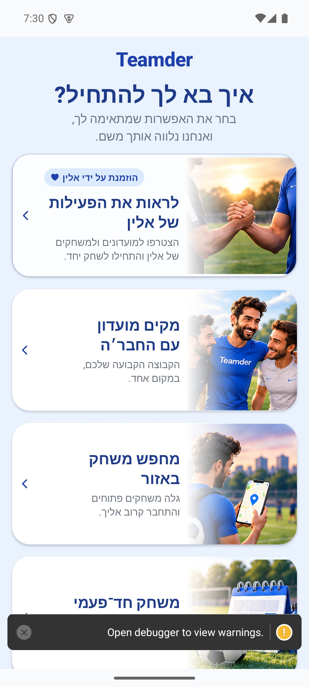

# פתיחת האפליקציה ובחירת כוונה — הסבר קצר

## הרחבת אבחון דיווחים, 27.10.2026

הדיווחים יוכלו לכלול מה ניסו לבצע, מה היה מצב האפליקציה ומה החזיר השרת. פרטים חסרים מוצגים כלא ידועים, ומספר מוגבל של מופעים נשמר בלי למחוק את המופע הראשון. השינוי מקומי וטרם הופץ, ואינו משלים פרטים לדיווחים ישנים. [היקף, ראיות ומגבלות](../../changes/2026-10-27-diagnostic-context.md).

בדיקות הקוד הושלמו, אך השינוי עדיין מקומי ולא הופץ. פרטים שלא נאספו בדיווחים ישנים אינם משוחזרים בדיעבד.

## טיפול מלא בפריטי הפולס הפתוחים, 27.10.2026

הושלם סבב טיפול בפריטי הפולס עם תיקונים ותוצאות מחקר מוכנות לביקורת. פריטים שלא תוקנו נשארים פתוחים עם הסבר וצעד הבא. לא בוצעה הפצה או בדיקת מכשיר חדשה. [ממצאים, בדיקות ומסירה](../../changes/2026-10-27-pulse-completion.md).

## טיפול בתקלות הפולס, 26.10.2026

נבדק שינוי ממוקד במקור משותף במהלך טיפול בתקלות הפולס. אין שינוי נוסף בפעולות הפיצר המתואר כאן.

השינוי מקומי וטרם הופץ. [בדיקות, מסירה ומגבלות](../../changes/2026-10-26-pulse-fixes.md).

## בדיקות העברת הזמנה לדומיין החדש - 26.10.2026

עודכנו בדיקות ההזמנה כדי לבדוק כתובת העתקה ופרטי התקנה בדומיין החדש, וכן שחזור קישור קצר בלי מזהה מזמין בשאילתה. יעד ההזמנה ושיוך המזמין נקראים מהקוד הקיים. לא השתנו כאן מסכי ההתחברות או כללי חידוש הפעולה. השינוי מקומי וטרם הופץ; אין אימות התקנה חדשה בחנות. [הבדיקות ומגבלות האימות](../../changes/2026-10-26-share-domain.md).

## ביטול פעילות אחרי מחיקת מועדון - 26.10.2026

מחיקת מועדון עוצרת כעת את המחזורים השבועיים שלו, ובשרת נוספה הגנה שמונעת פתיחת מחזור למועדון שכבר נמחק. הטיפול מבטל מחזורים שטרם הסתיימו, דוחה בקשות חברות ממתינות, מסיר הרשמה להתראות ואת כרטיס המועדון הציבורי. נתוני עבר והישגים אישיים נשמרים. תיקון השרת נפרס ואומת באישור הבעלים. הסדרה שנותרה כובתה, ההרשמה להתראות והכרטיס הציבורי הוסרו; המחזור עצמו כבר לא היה קיים בבדיקה העדכנית. עצירת הסדרה המוקדמת בצד הלקוח תיכלל בבינארי עתידי. נשמרה ההיסטוריה. [המימוש, בדיקת השאריות ומגבלות האישור](../../changes/2026-10-26-deleted-club-recurring.md).

## השפעת מקור משותף במשימת השעון - 26.10.2026

במקור השרת המשותף נוספה כניסה נפרדת לסנכרון הפעילות האישית מהשעון. פתיחת קישורי ההזמנה והקמפיין נשארת במסלול המתועד; אין בה כניסה למדידה האישית. לא נערכה כאן בדיקה חדשה של כל מצבי המסך. השינוי מקומי, ומצב ההפצה ומגבלות הבדיקה מפורטים בדוח המקושר. [היקף המימוש, הבדיקות, מגבלות האישור והצילומים](../../changes/2026-10-26-android-personal-activity.md).

## הפצה פנימית 1.1.61 - 25.10.2026

הבינארי `1.1.61/295` הופץ ואומת במסלול הפנימי באנדרואיד. תיקוני הלקוח נכללים בו, ושירות הפרופיל נפרס ואומת בנפרד. גם תיקוני הסגל, שמירת התוצאה והתראת השגיאה בשרת נפרסו ואומתו באישור מפורש. שינויי יישום הפולס עצמו טרם הופצו. אין שינוי כללי הרשאה או הסבת נתונים. ניסוחי המצב המקומי בסעיפים הקודמים נכתבו לפני ההפצה; [דוח ההפצה](../../changes/2026-10-25-internal-1.1.61.md) מפרט בדיוק מה נכלל, מה נבדק ומה עדיין מקומי.

## תיקוני הפולס - 25.10.2026

נבדק תיקון ממוקד בקובץ משותף במהלך סבב הפולס. אין שינוי מכוון בתהליך העצמאי המתואר כאן ואין טענה לבדיקת מסך חדשה שלו. מקומי וטרם הופץ.

[מקורות, בדיקות, צילומים ומגבלות](../../changes/2026-10-25-pulse-fixes.md).

## שעון מדויק וכיתוב פנדל - 25.10.2026

במקורות המשותפים נוסף שימור השעון המדויק של פנדל במהלך משחק, וכיתוב ההבקעה ביומן קוצר. אין שינוי במונים או בתהליך העצמאי המתואר כאן; לא נערכה לו בדיקת ממשק חדשה במסגרת העדכון. השינוי מקומי וטרם הופץ. [פרטים וראיות](../../changes/2026-10-25-in-play-penalties.md#שעון-מדויק-וכיתוב-אירוע).

## פנדל במהלך משחק חי - 25.10.2026

עודכנו מקורות משותפים לצורך פנדלים במהלך משחק. אין שינוי מכוון בתהליך העצמאי המתואר במסמך הזה, ולא נערכה לו בדיקת ממשק חדשה במסגרת המשימה.

השינוי מקומי. נדרשת פריסת שרת לפני הפצת לקוח שמשתמש באפשרות; לא בוצעו פריסה או שינוי הרשאות. [חוזה הנתונים, התהליך, הבדיקות ומגבלות ההפצה](../../changes/2026-10-25-in-play-penalties.md).

## תיעוד כשלים — 20.10.2026

נוסף תיעוד אוטומטי לנקודות כשל במסלול הזה, עם מקור התקלה. הפעולה המקורית שומרת על ערכי החזרה והודעות השגיאה שלה. השינוי מקומי, טרם הופץ, ואין אימות מסירה חיה לפולס.

[דוח דיווח השגיאות והראיות](../../changes/2026-10-20-error-reporting-audit.md).

## תיקון פערי העונות — 20.10.2026

השינוי בקובץ השרת המשותף במסגרת תיקוני העונות נוגע לשער הסגירה, אימות מחזור והשלמת סטטיסטיקה בלבד. נתיבי הפיצ׳ר המתועדים כאן לא שונו בסבב זה. הבדיקות המלאות עברו; אין בכך אימות חדש של פריסה או שירות חיצוני.

[דוח תיקונים, בדיקות ומגבלות](../reviews/2026-10-20-seasons-fixes.md).

## הפרדת פתיחה רגילה מייחוס ישן — 20.10.2026

לחיצה רגילה על אייקון האפליקציה מדווחת ככניסה אורגנית, גם אם נשמר במכשיר קישור קודם לצורך השלמת הרשמה. הקישור הישן נשאר זמין למסלול ההצטרפות, אבל אינו מוצג כאילו נפתח עכשיו.

## הסרת הפרסומת הקופצת — 19.10.2026

האפליקציה לא תציג עוד פרסומת קופצת כשנכנסים אליה. השינוי נמצא כרגע בגרסת הפיתוח המקומית ויגיע למשתמשים רק לאחר הפצת גרסה.

## פריסת שרת מאושרת — 17.10.2026

עדכוני השרת לתיעוד תהליך הכניסה ושם המזמין נפרסו. גרסת האפליקציה החדשה עדיין מקומית; אין בכך בדיקת התקנה חדשה או מסירת התראה במכשיר. [מצב הפריסה והראיות](../../changes/2026-10-17-server-preparation.md)

## עדכון מקומי — 10.10.2026

אם החשבון שוחזר אבל הפרופיל לא נטען, האפליקציה שומרת על החשבון ומציגה ניסיון חוזר. היא אינה מחליפה אותו בחשבון אורח בגלל תקלה זמנית.

התנהגות הכשל נבדקה בקוד מבודד; לא הורצה במכשיר מול הנתונים האמיתיים.

9.10.2026: קישורי פרסום קצרים שנוצרים בפולס משתמשים בכתובת `/play/…`. הם פותחים דף הורדה ושומרים את מקור הפרסום גם במעבר לחנות ולאפליקציה. נמצאה הגדרת אתר חסרה שגרמה לשגיאת 404; היא הוחזרה בקוד ונוספה בדיקה למניעת הסרתה בפריסה הבאה. מצב הפריסה והאימות מופיעים ב־[דוח התקלה](../reviews/campaign-link-routing-2026-10-09.md).

מצב עדכני: תיקונים מקומיים, 10.10.2026; סעיף העדכון בראש המסמך מתאר את השינוי האחרון. תיאורי המיפוי והבדיקות מ־7–8.10 בהמשך הם היסטוריים; הסיכום האחרון במסמך קובע את חוזה המימוש הנוכחי.

8.10.2026: לאחר התחברות לחשבון קיים, האפליקציה מעדכנת את זהות המשתמש וממשיכה לפי הפרופיל שלו. התיקון מקומי; מסלול אפל טרם נבדק באייפון.

בפתיחה הראשונה בוחרים מה רוצים לעשות: למצוא מחזור, לפתוח מועדון או לארגן מחזור חד־פעמי. אם הגעתם מהזמנה, אפשר לבחור גם בה או לבחור דרך אחרת.

[לפירוט הטכני](boot-and-intent.md)

צילום עדכני של מסך הבחירה עם הזמנת דמו מופיע בהמשך.

## בדיקת תהליך הכניסה — 8.10.2026

נמצא מצב שבו הזמנה שמגיעה אחרי טעינת מסך הבחירה נשמרת אך הכרטיס אינו מתעדכן. נבדקו גם קישורי החנות, דפי המועדון, התחברות ואישור הפרופיל. הדוח המקורי נשמר כראיה; הממצאים תוקנו בקוד המקומי בהמשך אותה משימה. עברו 415 בדיקות קיימות וחמש בדיקות אבחון שיחזרו תקלות. התקנה נקייה מהחנות ואייפון לא נבדקו. [הממצאים, הראיות והצעות התיקון](../reviews/onboarding-audit-2026-10-08.md).

## תיקוני ההזמנה וההיכרות — 8.10.2026

ההזמנה מתעדכנת גם אם פרטיה מגיעים מעט אחרי הפתיחה. בחירה שכבר ביצעתם נשמרת, ושם המזמין אינו נשאר מהזמנה קודמת.

## אימות ותיקונים מקומיים — 9.10.2026

ההזמנה מתעדכנת גם כשהיא מגיעה באיחור. הבחירה שלכם נשמרת: אם בחרתם לפתוח מועדון או לחפש מחזור, הזמנה ישנה לא תחליף את הבחירה אחרי ההתחברות. פתיחה שנכשלה זמנית מקבלת כמה ניסיונות נוספים; החלפת חשבון מבטלת את הניסיון הישן.

התיקונים נבדקו מקומית. עדיין לא בוצעה הוכחת התקנה מהחנות או אימות באייפון פיזי; התמונות הקודמות הן תצוגות בדיקה ולא מסע התקנה. [דוח שמונת הסוכנים, התיקונים וגבולות האימות](../reviews/onboarding-expanded-fixes-2026-10-09.md).

### השלמת שחזור אחרי ספק — 10.10.2026

גם אחרי שספק ההתחברות אישר כניסה, קריאת פרופיל שנכשלה פותחת ניסיון חוזר ושומרת את החשבון. הפעולה שרציתם לעשות ממתינה עד לטעינת הפרופיל, ולא ממשיכה כאילו נשארתם אורחים.

## תיעוד פעולות ההצטרפות — 10.10.2026

הפעולות הנתמכות בתהליך מגיעות להיסטוריה ולהתראות בפולס, כולל זמן, ביקור וספירת לחיצות. לא מועבר תוכן שדות מוקלדים. נדרשים פריסת השרת ולקוח חדש; [הכיסוי, החישובים ומגבלות האימות](../shared/onboarding-activity.md).

## אימות חי — 10.10.2026

שתי הפונקציות `recordOnboardingActivity` ו־`onOnboardingActivity` נפרסו באישור מפורש, כולל ניסיונות חוזרים. באמולטור בדיקות נפרד מול הייצור נשמר רצף פתיחה ובחירת הקמת מועדון. שירות ההתראות אישר שליחה לחמישה מכשירים בכל אחת משתי אבני הדרך; זו קבלת בקשת השליחה, לא אישור צפייה בטלפון. פעולות הצפייה וההמשך נשמרו כהיסטוריה בלבד.

נמצא ותוקן מקומית מרוץ: אירוע מקור הכניסה נשלח לפני שחזור זהות המשתמש, ולכן אורח סומן כחבר ולא קיבל התראת כניסה. מעתה מקור הכניסה מתפרסם לניווט מיד, אך האירוע ממתין לזהות משוחזרת דרך `entryGuestAfterHydration`. אחרי התיקון נצפה `is_guest: true` ושליחה מוצלחת. נוספו שתי בדיקות נסיגה; בדיקת הטיפוסים נקייה וכל 3,258 הבדיקות ב־231 חבילות עברו.

האימות בוצע עם קוד מקומי עדכני בתוך מעטפת פיתוח, ולא עם גרסה שהועלתה לחנות. בדיקות הזמנה למועדון ולמחזור, מעבר מחנות להתקנה והתחברות באפל טרם הושלמו בסבב החי הזה.

## המשך הבדיקה החיה — 10.10.2026

נבדקו בפועל הזמנת מועדון והזמנת מחזור דרך Chrome באמולטור נפרד: דף נחיתה, לחיצה על הכפתור הראשי, פתיחת האפליקציה במצב נקי והצגת אפשרות עם שם המזמין. במועדון נפתח היעד הנכון ונדרשה התחברות לבקשת הצטרפות. במחזור סגור נשמר היעד אך אורח נחסם לסגל בלבד. נבדקה גם הזמנה כללית בעת שהאפליקציה פעילה. מקור הכניסה נשמר עם היעד ועם זיהוי אורח; שירות השליחה אישר מסירה לחמישה מכשירים, בלי אישור הצגה בטלפון.

הבדיקה השתמשה בקוד מקומי במעטפת פיתוח ואינה הוכחת התקנה מהחנות. התחברות באפל ובגוגל, מעבר מהחנות לאחר התקנה והשלמת הצטרפות אחרי אישור מנהל לא אומתו. הממצאים, הצילומים וגבולות הכיסוי מפורטים ב־[דוח הבדיקה החיה](../../changes/2026-10-10-onboarding-live-qa.md).

## תלות בעדכון העונות — 19.10.2026

קובץ תשתית משותף עודכן במסגרת העונות. שינוי זה אינו מוסיף פעולה חדשה למסך המתואר כאן; פרטי העונות והבדיקות מופיעים במסמך העונות.

[מצב המימוש, הבדיקות ומגבלות האימות של העונות](../clubs/seasons.md). מקומי בלבד; לא בוצעה פריסה במסגרת המשימה.

## שינוי מוגבל בקובץ השרת המשותף — 24.10.2026

ב־`functions/src/index.ts` נוסף ייצוא רכיב קליטת הקריסות, ו־`onErrorLogged` מדלג על מקור הקריסות החדש כדי למנוע התראה כפולה. אין שינוי במסלול הפיצ׳ר המתואר כאן או בחישוביו. לפריסה הוכנה חבילה מהמקור הפרוס עצמו, עם תנאי הדילוג בלבד; אין פריסה של פונקציות הפיצ׳ר הזה. [היקף וראיות](../../changes/2026-10-24-crashlytics-pulse.md).

## תלות בשמירת צבעי המחזור — 24.10.2026

שמירת המידע המשותפת עודכנה כדי להעביר את צבעי הקבוצות ממסכי הכוחות להכנה וללייב. אין תוספת פעולה במסך הזה, והוא לא נבדק מחדש במכשיר במסגרת התוספת. השינוי מקומי וטרם הופץ. [פרטי התוספת ומגבלות הבדיקה](../rounds/draft-setup.md#צבעים-לפני-שיבוץ-ובכל-שיטת-חלוקה--24102026).

## טיפול בפולס — 24.10.2026

עודכן רכיב משותף של חלונות האישור ומסלול השרת להרשמה. אין בסבב הזה שינוי ייעודי או אימות חדש של מסך זה.

[פירוט התיקונים, הבדיקות והמגבלות](../../changes/2026-10-24-pulse-current.md). התיקונים מקומיים וטרם הופצו.

## תלות ביצוא היסטוריית השוואות — 24.10.2026

במשימה זו נוספה בקובץ השרת המשותף רק שורת יצוא של `recordPlayerComparison` ו־`getMyComparisonActivity`. מסלולי הפיצ׳ר המתוארים כאן לא שונו במסגרת התוספת הזאת ולא הורצו מחדש כתרחיש נפרד. אין פריסה או שינוי כללים. [המימוש, הבדיקות וגבולות האימות](../../changes/2026-10-24-comparison-activity.md).

## התאמת בדיקת המקור המשותפת בלילה של 25.10.2026

עודכן אופן הפעלת בדיקת מקור משותפת בעקבות קיצור טעינת הסטטיסטיקה. אין שינוי נוסף בפעולות המתוארות כאן, והן לא נבדקו מחדש במכשיר בסבב הזה. [בדיקות ומגבלות](../../changes/2026-10-24-loading-performance.md).

## המשך קיצור טעינות בלילה של 25.10.2026

עודכנו קריאות מידע משותפות או מתאם הבדיקה שלהן כדי לצמצם טעינות מיותרות. אין שינוי נוסף בפעולות העצמאיות המתוארות כאן, ואין אימות מכשיר חדש שלהן בסבב הזה. [בדיקות, ראיות ומגבלות](../../changes/2026-10-24-loading-performance.md).

## בדיקת תלות משותפת ברענון סגל בווידגט - 25.10.2026

נוסף תיקון נפרד לרענון רשימת השחקנים ברכיב הבית כשהאפליקציה סגורה. התוספת אינה משנה את התהליך המתואר בעמוד זה. היא מקומית וטרם הופצה. [פרטי הבדיקה והמגבלות](../../changes/2026-10-25-widget-roster-background.md).
