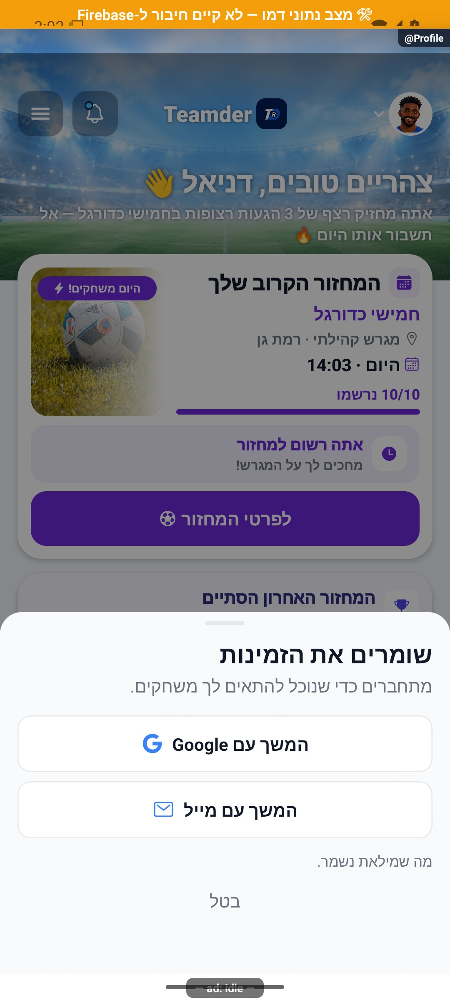

# פעולה ממתינה וטיוטה שחוזרת לאחר הרשמה — הסבר קצר

## אימות פרסום קבוצות בפולס, 2.11.2026

נבדק ההפרש התחום בשירות המשותף של המחזורים: נוספה בדיקת אישור לפרסום קבוצות כאשר תשובת הפעולה אובדת. אין שינוי בחישוב, במכנים או בפעולות העצמאיות של הפיצר המתואר כאן. התיקון מקומי וטרם הופץ; אין בדיקת מכשיר חדשה לפיצר זה.

[דוח הטיפול, הבדיקות והמגבלות](../../changes/2026-11-02-pulse-sweep.md).

## בקשות לשיחה אישית, 2.11.2026

נבדקה השפעת תוספת בקשות השיחה במקורות המשותפים. השינוי ממוקד בהרשאת שיחה, בשדות פרטיות ההודעות ובחיבורי הבדיקות; אין מכך אימות חדש של מסך זה במכשיר. המימוש מקומי וטרם הופץ או נפרס. [התנהגות, בדיקות ומגבלות](../chat/message-requests.md).

## החלפת הקבוצה הבועטת בפנדלים, 30.10.2026

בפנדלי ההכרעה נוספה אפשרות לבחור את הקבוצה שבועטת כעת, בלי למחוק את הבעיטות הקודמות. זהו עדכון תחום במקורות משותפים; אין שינוי מתוכנן במסך המתואר כאן ואין אימות מכשיר חדש שלו. [התנהגות, בדיקות ומגבלות](../../changes/2026-10-30-shootout-turn.md).

## הרחבת אבחון דיווחים, 27.10.2026

הדיווחים יוכלו לכלול מה ניסו לבצע, מה היה מצב האפליקציה ומה החזיר השרת. פרטים חסרים מוצגים כלא ידועים, ומספר מוגבל של מופעים נשמר בלי למחוק את המופע הראשון. השינוי מקומי וטרם הופץ, ואינו משלים פרטים לדיווחים ישנים. [היקף, ראיות ומגבלות](../../changes/2026-10-27-diagnostic-context.md).

בדיקות הקוד הושלמו, אך השינוי עדיין מקומי ולא הופץ. פרטים שלא נאספו בדיווחים ישנים אינם משוחזרים בדיעבד.

## בדיקות העברת הזמנה לדומיין החדש - 26.10.2026

עודכנו בדיקות ההזמנה כדי לבדוק כתובת העתקה ופרטי התקנה בדומיין החדש, וכן שחזור קישור קצר בלי מזהה מזמין בשאילתה. יעד ההזמנה ושיוך המזמין נקראים מהקוד הקיים. לא השתנו כאן מסכי ההתחברות או כללי חידוש הפעולה. השינוי מקומי וטרם הופץ; אין אימות התקנה חדשה בחנות. [הבדיקות ומגבלות האימות](../../changes/2026-10-26-share-domain.md).

## בדיקות הניקוי בסיום ההיכרות - 25.10.2026

נוספו בדיקות לניקוי תמונה לאחר שמירת פרופיל. החזרה לפעולה שהתחילה לפני ההרשמה אינה משתנה בתיקון הזה. התיקון מקומי וטרם הופץ, ואין כאן בדיקה חיה חדשה של כל מסלולי החזרה. [החקירה](../../changes/2026-10-25-photo-recurrence.md).

## שעון מדויק וכיתוב פנדל - 25.10.2026

במקורות המשותפים נוסף שימור השעון המדויק של פנדל במהלך משחק, וכיתוב ההבקעה ביומן קוצר. אין שינוי במונים או בתהליך העצמאי המתואר כאן; לא נערכה לו בדיקת ממשק חדשה במסגרת העדכון. השינוי מקומי וטרם הופץ. [פרטים וראיות](../../changes/2026-10-25-in-play-penalties.md#שעון-מדויק-וכיתוב-אירוע).

## פנדל במהלך משחק חי - 25.10.2026

עודכנו מקורות משותפים לצורך פנדלים במהלך משחק. אין שינוי מכוון בתהליך העצמאי המתואר במסמך הזה, ולא נערכה לו בדיקת ממשק חדשה במסגרת המשימה.

השינוי מקומי. נדרשת פריסת שרת לפני הפצת לקוח שמשתמש באפשרות; לא בוצעו פריסה או שינוי הרשאות. [חוזה הנתונים, התהליך, הבדיקות ומגבלות ההפצה](../../changes/2026-10-25-in-play-penalties.md).

## תיעוד כשלים — 20.10.2026

נוסף תיעוד אוטומטי לנקודות כשל במסלול הזה, עם מקור התקלה. הפעולה המקורית שומרת על ערכי החזרה והודעות השגיאה שלה. השינוי מקומי, טרם הופץ, ואין אימות מסירה חיה לפולס.

[דוח דיווח השגיאות והראיות](../../changes/2026-10-20-error-reporting-audit.md).

## בדיקת שינוי משותף — 19.10.2026

שינוי אחר במסך הכניסה הסיר את הפרסומת הקופצת. אופן שמירת הפעולה והמשך ביצועה לא השתנה.

מצב עדכני: ביקורת ותיקונים מקומיים, 18.10.2026. הסעיף הבא מתאר את החוזה הנוכחי; הסעיפים המתוארכים בהמשך שומרים את ההיסטוריה.

## חזרה בטוחה לפעולה — 18.10.2026

הפעולה שחיכתה מתחילה רק לאחר התחברות והשלמת הפרופיל. טיוטה חדשה אינה משמשת בטעות פעולה ישנה, ותשובה שמגיעה אחרי החלפת חשבון אינה מפעילה את הפעולה בשם החשבון החדש.

לפני יצירת מחזור נבדק שוב המועדון. אם הקריאה נכשלת, הפעולה והטיוטה נשמרות; אין להסיק שהמועדון נמחק רק משום שלא נטען. אם קריאה מוצלחת מראה שהמועדון אינו קיים או שאין הרשאת ניהול, הפעולה מסתיימת והטיוטה המתאימה מנוקה.

נוספו בדיקות לחזרה לפעולה ולהשלמת הפרופיל. מסכי ההתחברות והפרופיל נבחנו בדמו בלבד; לא בוצעה במסגרת ביקורת זו יצירה או הצטרפות בייצור. נשאר סיכון פתוח: אובדן תשובת שרת אחרי יצירה מוצלחת עלול לאפשר יצירה נוספת בניסיון חוזר; נעילה מקומית אינה התחייבות שרתית לפעולה יחידה.

[דוח הביקורת וגבולות האימות](../../../artifacts/final-deep-audit-2026-10-17/onboarding-audit.md) · [השלמת הפרופיל](profile-onboarding.simple.md)

אם נדרש חשבון באמצע פעולה, האפליקציה שומרת את מה שביקשתם ואת הפרטים שכבר מילאתם. לאחר ההתחברות היא ממשיכה במקום המתאים ובודקת מחדש אם אפשר לבצע את הפעולה.

[לפירוט הטכני](pending-actions.md)

הצילום מדגים את המראה בסביבת בדיקה, ולא מוכיח פעולה מול הנתונים האמיתיים.

## תיקוני סבב הבאגים — 8.10.2026

סיום פעולה קודמת לא מוחק הזמנה חדשה או טיוטה שערכתם בינתיים.

## תיקוני ההזמנה וההיכרות — 8.10.2026

הזמנה חדשה מקבלת קדימות על מידע ישן שמגיע מההתקנה. קישור קצר נפתח גם בתוך האפליקציה לאחר ההתקנה.

## אימות ותיקונים מקומיים — 9.10.2026

הזמנה חדשה מקבלת קדימות בניווט, אבל לא מוחקת טיוטה שכבר התחלתם. פתיחת מחזור לא מוחקת את פרטי מי שהזמין אתכם. אם קישור קצר לא נפתר בגלל הרשת, כתובתו נשמרת ונעשית התאוששות מוגבלת כשחוזרים לאפליקציה.

התיקונים נבדקו מקומית. עדיין לא בוצעה הוכחת התקנה מהחנות או אימות באייפון פיזי; התמונות הקודמות הן תצוגות בדיקה ולא מסע התקנה. [דוח שמונת הסוכנים, התיקונים וגבולות האימות](../reviews/onboarding-expanded-fixes-2026-10-09.md).

## תלות בעדכון העונות — 19.10.2026

קובץ תשתית משותף עודכן במסגרת העונות. שינוי זה אינו מוסיף פעולה חדשה למסך המתואר כאן; פרטי העונות והבדיקות מופיעים במסמך העונות.

[מצב המימוש, הבדיקות ומגבלות האימות של העונות](../clubs/seasons.md). מקומי בלבד; לא בוצעה פריסה במסגרת המשימה.

## תלות במידע על סגירת עונה — 23.10.2026

נוסף מידע משותף שמאפשר להסביר מדוע עונה מתעכבת בסגירה. אין שינוי נוסף בפעולות המתוארות כאן; השינוי מקומי וטרם הופץ. [המסלול, הבדיקות והמגבלות](../../changes/2026-10-23-season-automatic-recovery.md).

## תלות בשמירת צבעי המחזור — 24.10.2026

שמירת המידע המשותפת עודכנה כדי להעביר את צבעי הקבוצות ממסכי הכוחות להכנה וללייב. אין תוספת פעולה במסך הזה, והוא לא נבדק מחדש במכשיר במסגרת התוספת. השינוי מקומי וטרם הופץ. [פרטי התוספת ומגבלות הבדיקה](../rounds/draft-setup.md#צבעים-לפני-שיבוץ-ובכל-שיטת-חלוקה--24102026).

## תאימות לשמירת פקודת רכיב הבית - 25.10.2026

נוספה הגנה פנימית מפני ביצוע חוזר של פעולת רכיב הבית. התהליך המתואר בעמוד זה לא השתנה במכוון, ונתונים ישנים נשארים נתמכים. התיקון מקומי וטרם הופץ. [מקור הבדיקה והמגבלות](../../changes/2026-10-25-widget-completion.md).

## שלמות החלוקה המתוזמנת, 29.10.2026

במקורות המשותפים תוקנה שמירת חלוקה מתוזמנת לשש ולשבע קבוצות וסוננו אורחים שממתינים. דרך חישוב האיזון נשמרה. אין שינוי מכוון בפעולות העצמאיות המתוארות בעמוד זה ואין אימות מסך חדש שלהן; השינוי מקומי וטרם הופץ.

[היקף, בדיקות, פערים פתוחים ומגבלות](../../changes/2026-10-29-scheduled-balance-integrity.md).

## איזון ופיזור רמות לפני גיוון, 30.10.2026

עודכן החישוב המשותף של חלוקת כוחות לפי הדירוג הכללי: איזון הממוצעים קודם לפיזור הרמות, והגיוון מכריע אחרי שניהם. אין שינוי מכוון במבנה המסך או בפעולות העצמאיות המתוארות כאן, ואין אימות מכשיר חדש שלהן. השינוי מקומי וטרם הופץ או נפרס.

[מימוש, נוסחאות, בדיקות ומגבלות](../../changes/2026-10-30-rating-balance-priority.md).

## אימות כשלים בקבלת פרסום, 2.11.2026

בבדיקת אישור פרסום הקבוצות, כשל שלא ניתן לאמת כהצלחה נשאר כשל גלוי ונשמר באבחון. הבדיקה אינה שולחת הודעות שוב ואינה משנה הרשאות. השינוי תחום לשירות המשותף, מקומי וטרם הופץ.

[דוח הטיפול והראיות](../../changes/2026-11-02-pulse-sweep.md).
