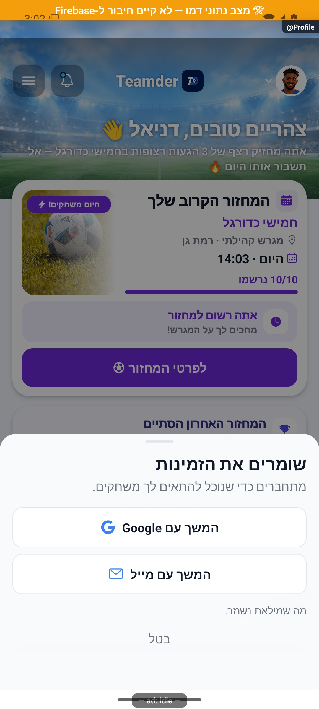

# פעולה ממתינה וטיוטה שחוזרת לאחר הרשמה — הסבר קצר

## בדיקת שינוי משותף — 19.10.2026

שינוי אחר במסך הכניסה הסיר את הפרסומת הקופצת. אופן שמירת הפעולה והמשך ביצועה לא השתנה.

מצב עדכני: ביקורת ותיקונים מקומיים, 18.10.2026. הסעיף הבא מתאר את החוזה הנוכחי; הסעיפים המתוארכים בהמשך שומרים את ההיסטוריה.

## חזרה בטוחה לפעולה — 18.10.2026

הפעולה שחיכתה מתחילה רק לאחר התחברות והשלמת הפרופיל. טיוטה חדשה אינה משמשת בטעות פעולה ישנה, ותשובה שמגיעה אחרי החלפת חשבון אינה מפעילה את הפעולה בשם החשבון החדש.

לפני יצירת מחזור נבדק שוב המועדון. אם הקריאה נכשלת, הפעולה והטיוטה נשמרות; אין להסיק שהמועדון נמחק רק משום שלא נטען. אם קריאה מוצלחת מראה שהמועדון אינו קיים או שאין הרשאת ניהול, הפעולה מסתיימת והטיוטה המתאימה מנוקה.

נוספו בדיקות לחזרה לפעולה ולהשלמת הפרופיל. מסכי ההתחברות והפרופיל נבחנו בדמו בלבד; לא בוצעה במסגרת ביקורת זו יצירה או הצטרפות בייצור. נשאר סיכון פתוח: אובדן תשובת שרת אחרי יצירה מוצלחת עלול לאפשר יצירה נוספת בניסיון חוזר; נעילה מקומית אינה התחייבות שרתית לפעולה יחידה.

[דוח הביקורת וגבולות האימות](../../../artifacts/final-deep-audit-2026-10-17/onboarding-audit.md) · [השלמת הפרופיל](profile-onboarding.simple.md)

אם נדרש חשבון באמצע פעולה, האפליקציה שומרת את מה שביקשתם ואת הפרטים שכבר מילאתם. לאחר ההתחברות היא ממשיכה במקום המתאים ובודקת מחדש אם אפשר לבצע את הפעולה.

[לפירוט הטכני](pending-actions.md)

הצילום מדגים את המראה בסביבת בדיקה, ולא מוכיח פעולה מול הנתונים האמיתיים.

## תיקוני סבב הבאגים — 8.10.2026

סיום פעולה קודמת לא מוחק הזמנה חדשה או טיוטה שערכתם בינתיים.

## תיקוני ההזמנה וההיכרות — 8.10.2026

הזמנה חדשה מקבלת קדימות על מידע ישן שמגיע מההתקנה. קישור קצר נפתח גם בתוך האפליקציה לאחר ההתקנה.

## אימות ותיקונים מקומיים — 9.10.2026

הזמנה חדשה מקבלת קדימות בניווט, אבל לא מוחקת טיוטה שכבר התחלתם. פתיחת מחזור לא מוחקת את פרטי מי שהזמין אתכם. אם קישור קצר לא נפתר בגלל הרשת, כתובתו נשמרת ונעשית התאוששות מוגבלת כשחוזרים לאפליקציה.

התיקונים נבדקו מקומית. עדיין לא בוצעה הוכחת התקנה מהחנות או אימות באייפון פיזי; התמונות הקודמות הן תצוגות בדיקה ולא מסע התקנה. [דוח שמונת הסוכנים, התיקונים וגבולות האימות](../reviews/onboarding-expanded-fixes-2026-10-09.md).

## תלות בעדכון העונות — 19.10.2026

קובץ תשתית משותף עודכן במסגרת העונות. שינוי זה אינו מוסיף פעולה חדשה למסך המתואר כאן; פרטי העונות והבדיקות מופיעים במסמך העונות.

[מצב המימוש, הבדיקות ומגבלות האימות של העונות](../clubs/seasons.md). מקומי בלבד; לא בוצעה פריסה במסגרת המשימה.
