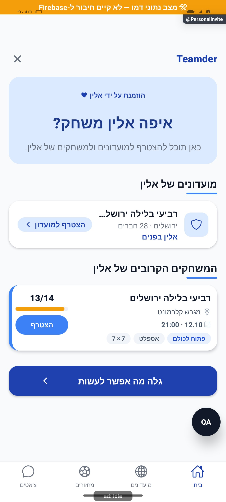

# הזמנה אישית — איפה המזמין משחק

## מסך הזמנה אישי חדש — 17.10.2026

עדכון זה מחליף את תיאור עיצוב ההזמנה ואת מגבלת המועדונים לחשבון מלא שבמיפוי ההיסטורי להלן. אותו מסלול `PersonalInvite` ב־`ProfileStack`, אותם `invitedBy` ו־`source`, ללא מסך חדש, שינוי קישור או צריכת שיוך הזמנה.

### מבנה ומסלול הנתונים

`PersonalInviteScreen` מציג כותרת מותג וסגירה ל־`GuestHome`, כרטיס זהות עם `UserAvatar` בגודל 76 ושם פעם אחת, פעולת חברות, כרטיס המחזור הראשון ומועדונים, ולבסוף קישור גילוי משני. תמונת המשתמש, האווטאר והחלופה בכשל הם של הרכיב הקיים; אין תמונה מומצאת או פרטי משתמש פרטיים. קריאת הזהות נשארה דרך `resolveInviter` ו־`usersPublic`. תוצאה ריקה או שם חסר מקבלים הזמנה כללית. החלפת מזמין מאפסת את הקריאה, ושם מוצג רק אם מזהה התוצאה תואם להזמנה הנוכחית.

`resolveInviteLandingActivity` הוא שירות תיאום חדש. לאורח הוא משתמש רק ב־`resolveInviteActivity` הקיים: מחזורים ציבוריים, פתוחים ועתידיים שבהם המזמין רשום בפועל, ללא המתנה/בקשת אישור. שאילתת הגילוי מסננת מחזורים שהצופה כבר רשום/ממתין/ממתין לאישור בהם; לכן ההודעה אומרת שאין מחזור שמוצג לצופה, ולא שאין למזמין פעילות. מועדוני אורח נגזרים מאותם מחזורים בלבד.

לחשבון מלא בלבד מתבצעות במקביל קריאת הפעילות ו־`socialPlayersService.profile(inviterId)` דרך `getSocialPlayerProfile` הקיים. רק מזהי המועדונים מהחוזה הזה משמשים כאן; נתוני סטטיסטיקה אחרים שמחזיר השירות אינם מוצגים. עד שלושה מזהים ייחודיים נטענים דרך `groupService.getPublic`, והתוצאה ממוזגת עם מועדוני הפעילות לפי מזהה, עד `MAX_CLUBS=3`. פרטי הפרופיל אינם משמשים חלופה למסמך ציבורי חסר או כושל. אין קריאת מסמך משתמש פרטי מהמסך, הרשאת אורח חדשה, אינדקס חברות ציבורי, שינוי כללים, שדה חדש או ממיר חדש. קיום המועדונים ללא מחזור מוכח בקוד מול החוזה הקיים ובדמו, לא בהרצת שרת ייצור חדשה.

רשימת המחזורים ממיונת בזמן התחלה, ורק הראשון מוצג. `UpcomingRound` משתמש ב־`resolveRoundCover` ובגלריה הקיימת, כולל החלפת תמונת מועדון שנכשלה. תאריך ושעה מגיעים מעזרי העיצוב הקיימים; השעה מוקפת בידוד כיווניות. מספר המקומות הוא `max(0, maxPlayers - players.length - activeGuestCount(guests) - pendingPromotion)`; קידום ממתין מוסיף אחד רק אם יש `uid`. לדוגמה 14 מקומות פחות 12 רשומים ואורח פעיל אחד משאיר מקום אחד. מחזור מלא מציג רשימת המתנה, ודרישת אישור מוצגת בנפרד. הכפתור פותח `MatchDetails`, והצטרפות נשארת בבעלות מסך הפרטים ובדיקותיו העדכניות. פתיחת מועדון נשארת `CommunityDetailsPublic`; אין הצטרפות מיידית מההזמנה.

### חברות, טעינה וכשלים

האורח פותח `useAuthenticatedAction.requestAuth` ואת `ContextualAuthSheet` הקיימים, בלי להתנתק ובלי ליצור פעולת חברות ממתינה. הכיתוב מבהיר שיש לשלוח בקשה לאחר ההתחברות; אין שליחה אוטומטית, ולכן גם ביטול ההתחברות אינו יוצר בקשה. לאחר שהזהות מקבלת חשבון מלא, נטענת הפעילות מחדש גם אם אותו `uid` נשמר, ואז מוצג `FriendActionButton` הקיים עם הזוג המדויק. הרכיב ממשיך להשתמש בשירות החברות ובהרשאות הקיימים עבור שליחה, בקשה נכנסת, חברות, דחייה וביטול מאושר. הזמנה עצמית מסתירה את הפעולה.

| מצב | התנהגות |
|---|---|
| טעינה | שלד פעילות, זהות נטענת בנפרד |
| אין מחזור | הודעה קצרה; מועדונים עצמאיים נשארים |
| פעילות ציבורית נכשלה, פרופיל הצליח | מועדונים נשמרים; כשל מחזור עם ניסיון חוזר |
| פרופיל או היטל מועדון נכשל | פעילות ציבורית נשמרת; אזהרה חלקית עם ניסיון חוזר |
| שני המקורות נכשלו | כשל מלא, ללא טענת אפס; פרטי המזמין נשארים |
| החלפת הזמנה או חשבון | מונה בקשות פוסל תשובות ישנות; מפתח בעלות מונע הצגת פעילות של זהות קודמת |
| סגירה | ניקוי קריאות בתהליך; ללא שינוי בשיוך ההזמנה השמור |

אירועי הצפייה, פתיחת יעד וגילוי נשמרו; שמות אינם נכתבים לניתוח שימוש. אין פעולת שמירה חדשה, שינוי שרת או פריסה במשימה זו.

### בדיקות והוכחות

בדיקת טיפוסים נקייה; כל 363 החבילות ו־4,411 הבדיקות עברו. נוספו שש בדיקות שירות לשער האורח, מועדונים בלי מחזור, פרטי היטל בלבד, איחוד והגבלת מזהים, כשלים חלקיים וכשל מלא. נוספו שש בדיקות רכיב עם הוקים מדומים: שם ואווטאר, שער התחברות בלי כתיבה, מעבר אורח לחשבון באותו מזהה, ניווט ציבורי, ניסיון חוזר, החלפת הזמנה ותשובה מאוחרת, הזמנה חסרה ועצמית. אלה בדיקות חוזים בקוד ולא הפעלת ספק התחברות. [לוג כל הבדיקות](../../../artifacts/invite-redesign-2026-10-17/jest.log).

באימולטור דמו נפתח המסלול דרך הניווט המקומי עם מזמין קיים. נבחנו [המסך הרגיל](../screenshots/invite-redesign-final-2026-10-17.png), [מועדונים בגלילה](../screenshots/invite-redesign-clubs-2026-10-17.png), [אורח](../screenshots/invite-redesign-guest-2026-10-17.png), [חלונית התחברות וביטולה](../screenshots/invite-redesign-auth-2026-10-17.png), [בקשה שנשלחה](../screenshots/invite-redesign-sent-2026-10-17.png), [אין מחזור](../screenshots/invite-redesign-empty-final-2026-10-17.png) ו[כשל](../screenshots/invite-redesign-failure-2026-10-17.png). דגל אורח, רשימה ריקה וכשל הודמו בזיכרון מקומי בלבד; הוחזרו שירות הפעילות וזהות המשתמש המקוריים. בקשת החברות החדשה נשלחה ובוטלה דרך הממשק בדמו בלבד. פתיחת פרטי המחזור נצפתה, ללא הרשמה. פרטי מועדון נבדקו בניתוב רכיב ולא נפתחו שוב במכשיר. [היררכיות](../../../artifacts/invite-redesign-2026-10-17/final.xml) ו[שימור המחזורים וההיסטוריה](../../../artifacts/invite-redesign-2026-10-17/preservation.json).

נבחן מסך רגיל 411×914 בגופן מערכת 1.0, וכן [תצוגה צרה](../screenshots/invite-redesign-large-text-2026-10-17.png) בגודל פיקסלים 945×2100 והגדרת מערכת גופן 1.2. התוכן נגלל; אין דרישה ששלושה מועדונים ייכנסו מעל הניווט יחד עם כל פרטי המחזור. ההגדרות הוחזרו למקור. הכיווניות, האווטאר מימין, התאריך, הכפתורים ושמות המועדונים נבחנו בצילומים שנפתחו. תגי דמו ופיתוח אינם חלק מהעיצוב.

לא הורצה התקנה מהחנות, שרשרת הזמנה מהתקנה חדשה, ספק התחברות אמיתי, אימות השרת/המרת מסמכים או כתיבת חברות בייצור. תמונה אישית חסרה/כושלת ושם ארוך מסתמכים על רכיבי הזהות והגלילה; לא צולמו מחדש במכשיר. אייפון לא נבדק. אין שינוי בהרשאות, פריסה, בנייה או העלאה. תיאורי המיפוי והצילומים הקודמים להלן נשמרים כהיסטוריה.

## מיפוי ובדיקות היסטוריים — עד 10.10.2026

## עדכון מקומי — 10.10.2026

`resolveInviteActivity` זורק כשל `getOpenGames` לאחר רישום שגיאה. כשל בפרטי מועדון בודד אינו מוחק מחזורים: התוצאה כוללת `clubsUnavailable: true` והכרטיסים הזמינים נשמרים. `PersonalInviteScreen` מפריד כשל מלא, כשל חלקי, טעינה וריק אמיתי. מונה בקשות מבטל תשובות להזמנה קודמת או למסך שנסגר; אין ריקון זהות המזמין בעקבות כשל פעילות. ספי שלושה מחזורים ושלושה מועדונים וחוזה הפעילות הציבורית לא השתנו.

| מצב | תצוגה | כתיבה | ראיה |
|---|---|---|---|
| שאילתת פעילות נכשלת | כשל וניסיון חוזר | אין | מבחני השירות |
| חלק מפרטי המועדונים נכשל | מחזורים זמינים ואזהרה חלקית | אין | מבחני השירות |
| פעילות תקינה ריקה | הסבר גילוי רגיל | אין | מבחנים קיימים |
| הזמנה מתחלפת במהלך קריאה | התשובה הישנה נזרקת | אין | מנגנון מונה בקשות |

**מצב האימות:** תיקון מקומי, 10.10.2026. ראיות השירותים ופונקציות המקור ב־`tests/logic/clientAuditRecovery.test.ts`; הריצה הממוקדת המתועדת עברה 417 בדיקות ב־8 חבילות; השלמת שחזור מאוחר תועדה בדוח התיקון. [דוח התיקון והגבולות](../../../artifacts/pre-release-2026-10-10/client-fixes.md). לא הורצו כאן פעולות מול מסד אמיתי ולא צולמו מצבי כשל רשת חדשים; התמונות ההיסטוריות אינן הוכחה לתיקון זה.

מצב עדכני: תיקונים מקומיים, 10.10.2026; סעיף העדכון בראש המסמך מתאר את השינוי האחרון. תיאורי המיפוי והבדיקות מ־7–8.10 בהמשך הם היסטוריים; הסיכום האחרון במסמך קובע את חוזה המימוש הנוכחי.

[לקריאה קצרה ופשוטה](personal-invite.simple.md)

עודכן: 07.10.2026; מקור `8e8fde5`, `1.1.35` בבנייה. מסלול `PersonalInvite` עם `invitedBy?` ו־`source?`; תפקידים: אורח ומשתמש מלא. אין פעולת הצטרפות אוטומטית מהצגת ההזמנה.

## ניווט ותצוגה

`src/screens/invite/PersonalInviteScreen.tsx` מציג כותרת הזמנה, שם המזמין, המועדונים הנגזרים מפעילותו הציבורית והמחזורים הקרובים שבהם הוא רשום. הסגירה מחזירה למסך הקודם; כפתור גילוי מוביל ל־`GuestHome` בערימת הבית. בחירת מועדון/מחזור פותחת את היעד הרלוונטי, ושער ההרשמה מטפל בפעולה עסקית של אורח.

בצילום נצפו אלין, מועדון אחד בירושלים עם 28 חברים ומחזור אחד עם 13/14. אלה נתוני דמו ולא מצב המזמין האמיתי או הוכחת ייחוס התקנה.

## מקור הנתונים ומצבים

`src/services/personalInvite.ts` קורא זהות מצומצמת מ־`usersPublic`: שם, תמונה/אווטאר ומזהה. פעילות נקראת ממחזורים ציבוריים עתידיים שבהם `players` כולל את המזמין. מועדונים נגזרים מאותה פעילות ומ־`groupsPublic`; אין קריאה של כל חברויות המזמין הפרטיות. מוצגים עד שלושה מכל סוג. המתנה ובקשה ממתינה אינן שקולות לרישום המזמין בהרכב.

| תנאי | תצוגה/מעבר | כתיבה | ראיה |
|---|---|---|---|
| אין מזהה מזמין | מצב `no_inviter`; דרך לגילוי | אין | קוד |
| אין מראה ציבורית | מצב `no_mirror`, ללא המצאת זהות | אין | קוד |
| קריאת זהות נכשלה | כשל והזדמנות לניסיון חוזר | אין | קוד |
| זהות נטענה, הפעילות בטעינה | זהות נפרדת מאזור הפעילות | אין | קוד |
| פעילות ציבורית זמינה | עד שלושה מועדונים ושלושה מחזורים | אין עד לחיצה עסקית | דמו וקוד |
| אין פעילות מתאימה | הסבר/גילוי; לא גילוי חברויות פרטיות | אין | קוד והיסטוריה 035 |
| בחירת פעולה של אורח | פתיחת היעד; הרשמה בהקשר הפעולה | פעולות ממתינות/טיוטות | קוד |

## קוד ובדיקות

`src/services/personalInvite.ts`, `src/utils/referrerInvite.ts`, `src/services/pendingAction.ts`, `src/services/deepLinkService.ts`, `src/navigation/ProfileStack.tsx`, `src/firebase/firestore.ts`. יש להבחין בין הממיר הציבורי המצומצם לבין ממיר `User` המלא; הוספת שדה לתצוגה אינה הרשאה לקרוא אותו מהפרופיל הפרטי.

בדיקות: `tests/personalInviteWiring.test.ts`, `tests/logic/personalInvite.test.ts`, `tests/logic/deepLinkBypassesHome.test.ts`. היסטוריה 029/031 מציגה עמוד פרופיל מזמין קודם; 035 והקוד החליפו אותו בתצוגת פעילות.

## שחזור וסיכונים

בחינת קישור אמיתי צריכה לכסות מזהה מזמין תקין, מראה חסרה, אפס מחזורים ציבוריים, יותר משלושה מחזורים, המתנה בלבד, שגיאת זהות ושגיאת פעילות בנפרד. לא נבדק כאן מסע התקנה/לחיצה אמיתי ולא ייחוס שרת. לפני שינוי ריקון/כשל יש לבדוק שאינו חשיפת חברויות פרטיות ואינו הופך חוסר נתון לרשימת מועדונים מומצאת.

## פירוט מימוש ונקודות שינוי — העמקה 07.10.2026

`resolveInviter` קורא `hydratePublicUsers([invitedBy])` ומחזיר `no_inviter`, `no_mirror` או `read_failed`; גם שם ריק נחשב מראה חסרה. `resolveInviteActivity` קורא `getOpenGames(viewerId, [])`, מסנן רק `players.includes(invitedBy)`, מגביל ל־`MAX_GAMES = 3`, ומפיק מזהי מועדונים ייחודיים עד `MAX_CLUBS = 3`. הקריאות למועדונים מקבילות, וכשל של מועדון יחיד מסמן `clubsUnavailable` בלי להפיל את המחזורים.

דיוק שגיאות: השירות זורק בכשל שאילתת הפעילות; המסך מבדיל כשל מריק אמיתי ומאפשר ניסיון חוזר. זהות ופעילות נטענות בנפרד כדי שכשל פעילות לא ימחוק את המזמין. שינוי חשיפת מידע מחייב בדיקת `usersPublic`/`groupsPublic` והקוראים, ולא הרחבה אוטומטית למסמך משתמש פרטי. הקריאה מסננת גם מחזורים שהצופה כבר רשום בהם לפי חוזה הגילוי.

הבדיקות, מצבי המסך והראיות שכבר פורטו במסמך נשמרו. ההעמקה מבוססת על קריאת מקור ולא על הרצת פעולות נוספות; שינוי עתידי יצריך עדכון של שני המסמכים ובחינת המצבים הממוקדים.

## תיקוני ההזמנה וההיכרות — 8.10.2026

`installReferrerService` קורא פעם אחת בכל ניסיון משותף, עם איחוד קריאות מקבילות ומגבלת 3,000 מילישניות. שגיאה זמנית, היעדר מודול או פקיעת הזמן אינם מסמנים צריכה. תוצאה תקינה, גם ללא הזמנה, מסומנת רק לאחר שמירה מוצלחת; כשל שמירה נשאר לניסיון בפתיחה הבאה. תשובה מאוחרת נזרקת. `clipboardInviteService` מוגבל לאייפון ולדגל התצורה, מאחד קריאות מקבילות ומסמן צריכה לפני קריאת התוכן שעלולה להציג הרשאת הדבקה. היעדר כתובת ללא קריאת תוכן אינו צורך את הניסיון; סירוב אינו גורם להקפצת בקשות נוספות. הלוח אינו מנוקה, כדי לא למחוק העתקה חדשה של המשתמש. זהו תיאור מימוש 8.10; המימוש העדכני מקבל את המקורות דרך `receivePendingInvite` ושומר ייחוס בנפרד, כמפורט בהמשך; לא שונו נתוני ייצור או הרשאות.

מקור: `a348b9f` עם תיקונים מקומיים. ראיות ובדיקות: [דוח התיקון](../reviews/onboarding-fixes-2026-10-08.md).

## אימות ותיקונים מקומיים — 9.10.2026

ממצאי הסקירה החוזרת מ־8.10 תוקנו מקומית. הזמנה אישית דורשת מזהה מזמין; מקור רכישה רגיל ללא מזמין נשמר לצורך רכישה ואינו ממציא דף אישי. `RootNavigator` בודק אחרי `wasLandingShown` שהפעולה והזהות עדיין מתאימות ושלא בוצעה בחירה אחרת. `navigatePersonalInvite` שמחזיר כישלון מקבל את אותו חלון של עד שלושה ניסיונות ניווט חוזרים כמו מחזור ומועדון. `markLandingShown` נכתב רק לאחר הצלחה. שימור הסימון בין רינדור והפעלה מחדש נבדק עם שירות האחסון האמיתי בזיכרון; אין זו הוכחת דף במכשיר.

מזמין ראשון ידוע ומקור רכישה ראשון ידוע נשמרים כל אחד בנפרד ב־`footy.invite.attribution`; לא נדרש להשאיר פעולת ניווט ישנה כדי לזכות חשבון חדש. קריאת הרשומה נקשרת למזהה המשתמש ואינה מעבירה אותה לחשבון אחר. קוד קצר שטרם נפתר שומר את כתובתו, ולא את המזמין הלא מאומת מהשאילתה. מזמין קנוני שמתגלה בהתאוששות יכול להיכתב לחשבון חדש בעל זכאות מקומית תקפה; החוזה מפורט ב־[התחברות](authentication.md).

מפנה ההתקנה באנדרואיד מוגבל לקריאה של 3,000 מילישניות, מאחד קריאות מקבילות ומשאיר כשל זמני לניסיון פתיחה הבא. `invite_url` במפנה מועבר לפותר הקישורים הקצרים. לאחר שמירת מידע תקין מסומן המקור כנקרא; פקיעה או כשל כתיבה אינם הצלחת שחזור.

באייפון הלוח נקרא רק כשהדגל מאפשר ויש כתובת. הסימון המקומי נכתב לפני קריאת תוכן שעשויה לבקש הרשאה; סירוב אינו יוצר בקשות חוזרות והלוח אינו נמחק. הזמנה מפורשת קיימת קודמת ללוח; כשהלוח או החנות מספקים הזמנה היא נכנסת דרך `receivePendingInvite` בלי למחוק טיוטה. אם לוח נדרס או ההרשאה נדחתה, מסלול החזרה הוא פתיחת הקישור המקורי לאחר ההתקנה. אין מנגנון שמבטיח שחזור אוטומטי בכל מקרה באייפון.

בדיקות המקור, השמירה והכתיבה המאוחרת: `tests/logic/inviteAttributionExpanded.test.ts` — 25 תרחישים. פירוט הניווט, הטיימרים והגבולות: `inviteNavigationExpanded.test.ts`.

האימות המשולב הסתיים ב־202 חבילות ו־2,966 בדיקות שעברו, ובדיקת טיפוסים נקייה. בדיקות השירותים והניווט מפעילות קוד מקור מול אחסון, זהות ומסד מדומים; בדיקות הדפים כוללות דפדפן מקומי עם רשת חיצונית חסומה. אין כאן הוכחת התקנה מהחנות, ספק התחברות חי, קישורים מאומתים במערכת ההפעלה או הרשאת לוח במכשיר. תיקוני המוצר מקומיים; אין לפרש את התיעוד כאישור שהגרסה הופצה. [דוח שמונת הסוכנים, התיקונים וגבולות האימות](../reviews/onboarding-expanded-fixes-2026-10-09.md).

## תלות בעדכון העונות — 19.10.2026

נבדק ההפרש בקבצים המשותפים הרשומים כאן: `src/firebase/firestore.ts`. השינוי ממוקד במדיניות העונות, קריאת מצבן, שיוך מחזור ופקודות ניהולן; אין שינוי מכוון בחוזה העצמאי המתואר במסמך זה. אין להסיק מכך שהמסך הזה הורץ מחדש.

[מצב המימוש, הבדיקות ומגבלות האימות של העונות](../clubs/seasons.md). מקומי בלבד; לא בוצעה פריסה במסגרת המשימה.
