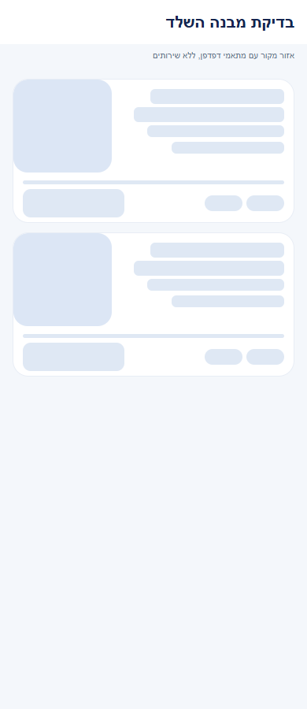
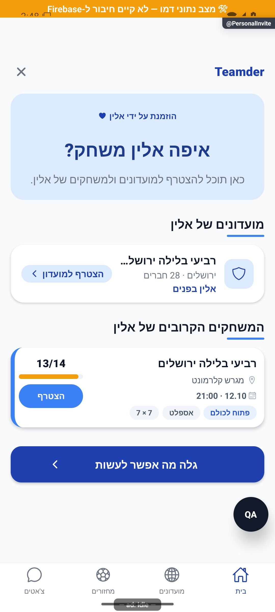

# הזמנה אישית — איפה המזמין משחק — הסבר קצר

## תיקוני לילה ובדיקת הפעולות, 5.11.2026

קישור שנפתח במפורש מקבל קדימות על הזמנה ישנה שחוזרת מהאחסון בזמן ההתקנה. השינוי מקומי. [ראיות ומגבלות](../../audits/2026-11-04-system-night/product-measurement.md).

## מדידת פעולות ואמינות נתונים, 5.11.2026

נוספה הכנה למדידת הפעולות ברכיבים המתועדים כאן. בפולס אפשר לראות ביצועים וחשבונות ייחודיים לפי פעולה ותקופה, כאשר קיים כיסוי מדידה. איסוף החשבונות החדש עדיין כבוי והמימוש מקומי. [פירוט והיקף הבדיקות](../../audits/2026-11-04-system-night/product-measurement.md).

## חיפוש שחקנים וזמני טעינה, 4.11.2026

שופרה טעינת חיפוש השחקנים, כרטיס שחקן אחר ואיתור פנויים למחזור ברכיבים המשותפים למסך זה. מימוש מקומי שטרם הופץ. [השינוי, המדידות והבדיקות](../../changes/2026-11-04-player-discovery-speed.md).

## ציר פעילות פרטי בפולס, 4.11.2026

נוסף תיעוד פרטי של ביקורים ופעילות במערכת הניהול. התוספת מקומית והאיסוף החדש כבוי כברירת מחדל; אין בדיקת מכשיר חדשה של מסך זה. מקומי וטרם הופץ או נפרס. [היקף, מקורות, בדיקות ומגבלות](../shared/usage-activity.md).

## שיפורי טעינה משותפים, 4.11.2026

עודכנו מנגנוני הטעינה המשותפים כדי לצמצם עבודה וקריאות חוזרות. דרך השימוש בפיצר נשמרת. השינוי מקומי וטרם הופץ, ואין אימות מכשיר חדש של המסך הזה. [היקף, מדידות ומגבלות](../../changes/2026-11-04-screen-performance.md).

## הפצה פנימית 1.1.74, 3.11.2026

עדכוני הלקוח הנוגעים לטעינה ולחיווי, במקורות המשותפים המשויכים למסמך הזה, כלולים בגרסת האנדרואיד הפנימית 1.1.74/306. החבילה ומסלול החנות אומתו; האימות החזותי נשאר בצילומי הדפדפן של סבבי המימוש, ואין אימות התקנה במכשיר. [תכולה, בדיקות ומגבלות](../../changes/2026-11-03-internal-1.1.74.md).

## התאמת מבנה שלדי הטעינה, 3.11.2026

השלד הותאם למבנה התוכן, כולל מיקום התמונות, האזורים והריווח. אין שינוי בנתונים או בפעולות המסך. השינוי מקומי וטרם הופץ. נבדקו אזורי מקור בדפדפן בשלושה רוחבים, ללא בדיקת מכשיר חדשה. [המידות, הבדיקות והמגבלות](../../changes/2026-11-03-skeleton-layout-alignment.md).

כל 6,820 הבדיקות ובדיקת הטיפוסים עברו. האימות החזותי במשימה זו הוא בדפדפן בלבד.

## הרחבת שלדי הטעינה, 2.11.2026

כרטיסי ההמתנה משתמשים כעת בפעימה אחידה שמכבדת צמצום תנועה, עם הודעת טעינה אחת. יתר התהליך נשמר. מימוש מקומי שטרם הופץ. [התנהגות, בדיקות, צילומים ומגבלות](../../changes/2026-11-02-loading-skeletons-expanded.md).

## אימות פרסום קבוצות בפולס, 2.11.2026

נבדק ההפרש התחום בשירות המשותף של המחזורים: נוספה בדיקת אישור לפרסום קבוצות כאשר תשובת הפעולה אובדת. אין שינוי בחישוב, במכנים או בפעולות העצמאיות של הפיצר המתואר כאן. התיקון מקומי וטרם הופץ; אין בדיקת מכשיר חדשה לפיצר זה.

[דוח הטיפול, הבדיקות והמגבלות](../../changes/2026-11-02-pulse-sweep.md).

## בקשות לשיחה אישית, 2.11.2026

נבדקה השפעת תוספת בקשות השיחה במקורות המשותפים. השינוי ממוקד בהרשאת שיחה, בשדות פרטיות ההודעות ובחיבורי הבדיקות; אין מכך אימות חדש של מסך זה במכשיר. המימוש מקומי וטרם הופץ או נפרס. [התנהגות, בדיקות ומגבלות](../chat/message-requests.md).

## החלפת הקבוצה הבועטת בפנדלים, 30.10.2026

בפנדלי ההכרעה נוספה אפשרות לבחור את הקבוצה שבועטת כעת, בלי למחוק את הבעיטות הקודמות. זהו עדכון תחום במקורות משותפים; אין שינוי מתוכנן במסך המתואר כאן ואין אימות מכשיר חדש שלו. [התנהגות, בדיקות ומגבלות](../../changes/2026-10-30-shootout-turn.md).

## התאוששות משגיאות בפולס, 28.10.2026

עודכנה תשתית הבדיקות המשותפת בעקבות תיקוני טעינה. לא בוצע שינוי מכוון בפעולות המתוארות בעמוד זה ולא בוצע אימות מכשיר חדש.

השינוי מקומי וטרם הופץ. [ממצאים, בדיקות ומגבלות](../../changes/2026-10-28-pulse-errors.md).

## הרחבת אבחון דיווחים, 27.10.2026

הדיווחים יוכלו לכלול מה ניסו לבצע, מה היה מצב האפליקציה ומה החזיר השרת. פרטים חסרים מוצגים כלא ידועים, ומספר מוגבל של מופעים נשמר בלי למחוק את המופע הראשון. השינוי מקומי וטרם הופץ, ואינו משלים פרטים לדיווחים ישנים. [היקף, ראיות ומגבלות](../../changes/2026-10-27-diagnostic-context.md).

בדיקות הקוד הושלמו, אך השינוי עדיין מקומי ולא הופץ. פרטים שלא נאספו בדיווחים ישנים אינם משוחזרים בדיעבד.

## קישורי שיתוף בדומיין החדש - 26.10.2026

קישורי ההזמנה החדשים קצרים ומשתמשים בדומיין החדש. המזמין ויעד ההזמנה נשמרים בקוד ההזמנה, וקישורים קודמים ממשיכים להיתמך.

השינוי מקומי וטרם הופץ. הבדיקות, מסלולי הנתונים ומגבלות האימות מפורטים ב[דוח השינוי](../../changes/2026-10-26-share-domain.md). אין כאן אימות חדש של כל מצבי המסך.

## שעון מדויק וכיתוב פנדל - 25.10.2026

במקורות המשותפים נוסף שימור השעון המדויק של פנדל במהלך משחק, וכיתוב ההבקעה ביומן קוצר. אין שינוי במונים או בתהליך העצמאי המתואר כאן; לא נערכה לו בדיקת ממשק חדשה במסגרת העדכון. השינוי מקומי וטרם הופץ. [פרטים וראיות](../../changes/2026-10-25-in-play-penalties.md#שעון-מדויק-וכיתוב-אירוע).

## פנדל במהלך משחק חי - 25.10.2026

עודכנו מקורות משותפים לצורך פנדלים במהלך משחק. אין שינוי מכוון בתהליך העצמאי המתואר במסמך הזה, ולא נערכה לו בדיקת ממשק חדשה במסגרת המשימה.

השינוי מקומי. נדרשת פריסת שרת לפני הפצת לקוח שמשתמש באפשרות; לא בוצעו פריסה או שינוי הרשאות. [חוזה הנתונים, התהליך, הבדיקות ומגבלות ההפצה](../../changes/2026-10-25-in-play-penalties.md).

## תיעוד כשלים — 20.10.2026

נוסף תיעוד אוטומטי לנקודות כשל במסלול הזה, עם מקור התקלה. הפעולה המקורית שומרת על ערכי החזרה והודעות השגיאה שלה. השינוי מקומי, טרם הופץ, ואין אימות מסירה חיה לפולס.

[דוח דיווח השגיאות והראיות](../../changes/2026-10-20-error-reporting-audit.md).

## מסך הזמנה אישי חדש — 17.10.2026

בראש המסך מופיעים האווטאר והשם של המזמין פעם אחת, עם ״הזמין אותך לשחק יחד״. אפשר לראות מחזור קרוב הזמין לצפייה ולהצטרפות, לפתוח את פרטיו ולגלול למועדונים. כרטיס המחזור כולל תמונת רקע מהגלריה הקיימת, תאריך, שעה, מגרש ומקומות פנויים. בהיעדר מחזור מוצגת הודעה קצרה והמועדונים נשארים כשאפשר לטעון אותם בנפרד.

לפני התחברות הכפתור הוא ״התחבר להוספה לחברים״. הוא פותח את ההתחברות הקיימת בלי לצאת מהמסך. לאחריה אפשר לשלוח בקשה במפורש; עצם ההתחברות אינה שולחת אותה. בחשבון מלא מוצג מצב החברות הרגיל: הוספה, בקשה שנשלחה, בקשה נכנסת או חברות קיימת. הזמנה עצמית אינה מציעה חברות לעצמכם.

לאורחים מוצגים רק מועדונים הנגזרים ממחזורים ציבוריים זמינים. אחרי התחברות נטענים גם מועדונים מתוך שירות הפרופיל הקיים, ללא תלות בקיום מחזור קרוב, ורק פרטי ההיטל הציבורי שלהם מוצגים. לכן ״אין מידע שמוצג לך״ אינו אומר שלמזמין אין מועדונים או פעילות פרטית. עד שלושה מועדונים מוצגים. כשל טעינה מקבל ניסיון חוזר, ולא הודעה מטעה שאין פעילות.

[הצילום החדש](../screenshots/invite-redesign-final-2026-10-17.png) · [מועדונים בגלילה](../screenshots/invite-redesign-clubs-2026-10-17.png) · [ללא מחזור](../screenshots/invite-redesign-empty-final-2026-10-17.png). נבדק באימולטור דמו; לא נבדקה התחברות או שמירת חברות אמיתית בייצור. [פירוט טכני וגבולות האימות](personal-invite.md).

## מיפוי ובדיקות היסטוריים — עד 10.10.2026

## עדכון מקומי — 10.10.2026

כשהפעילות של המזמין לא נטענת מוצגת תקלה עם ניסיון חוזר. אם רק פרטי חלק מהמועדונים נכשלו, המחזורים שכן נטענו נשארים מוצגים ואין הודעה מטעה שאין פעילות.

התנהגות הכשל נבדקה בקוד מבודד; לא הורצה במכשיר מול הנתונים האמיתיים.

מצב עדכני: תיקונים מקומיים, 10.10.2026; סעיף העדכון בראש המסמך מתאר את השינוי האחרון. תיאורי המיפוי והבדיקות מ־7–8.10 בהמשך הם היסטוריים; הסיכום האחרון במסמך קובע את חוזה המימוש הנוכחי.

הזמנה אישית מראה מי הזמין אתכם ובאילו מחזורים ציבוריים הוא משחק. אפשר לפתוח מחזור או מועדון מהמסך, או להמשיך לגלות מחזורים אחרים.

[לפירוט הטכני](personal-invite.md)

הצילום מדגים את המראה בסביבת בדיקה, ולא מוכיח פעולה מול הנתונים האמיתיים.

## תיקוני ההזמנה וההיכרות — 8.10.2026

פרטי המזמין נשמרים במעבר דרך דף ההורדה. באייפון ייתכן שתידרש הרשאת הדבקה; אם השחזור לא הצליח, אפשר לפתוח שוב את הקישור המקורי לאחר ההתקנה.

## אימות ותיקונים מקומיים — 9.10.2026

הזמנה אישית נפתחת רק כשידוע מי המזמין. היא אינה חוזרת שוב לאחר שכבר הוצגה, והחלפת הזמנה או חשבון מבטלת ניסיון ישן. באנדרואיד פרטי ההזמנה מועברים דרך מקור ההתקנה; באייפון השחזור נעזר בלוח ועשוי לדרוש הרשאה. אם אינו מצליח, פותחים שוב את הקישור המקורי אחרי ההתקנה.

התיקונים נבדקו מקומית. עדיין לא בוצעה הוכחת התקנה מהחנות או אימות באייפון פיזי; התמונות הקודמות הן תצוגות בדיקה ולא מסע התקנה. [דוח שמונת הסוכנים, התיקונים וגבולות האימות](../reviews/onboarding-expanded-fixes-2026-10-09.md).

## תלות בעדכון העונות — 19.10.2026

קובץ תשתית משותף עודכן במסגרת העונות. שינוי זה אינו מוסיף פעולה חדשה למסך המתואר כאן; פרטי העונות והבדיקות מופיעים במסמך העונות.

[מצב המימוש, הבדיקות ומגבלות האימות של העונות](../clubs/seasons.md). מקומי בלבד; לא בוצעה פריסה במסגרת המשימה.

## תלות במידע על סגירת עונה — 23.10.2026

נוסף מידע משותף שמאפשר להסביר מדוע עונה מתעכבת בסגירה. אין שינוי נוסף בפעולות המתוארות כאן; השינוי מקומי וטרם הופץ. [המסלול, הבדיקות והמגבלות](../../changes/2026-10-23-season-automatic-recovery.md).

## תלות בשמירת צבעי המחזור — 24.10.2026

שמירת המידע המשותפת עודכנה כדי להעביר את צבעי הקבוצות ממסכי הכוחות להכנה וללייב. אין תוספת פעולה במסך הזה, והוא לא נבדק מחדש במכשיר במסגרת התוספת. השינוי מקומי וטרם הופץ. [פרטי התוספת ומגבלות הבדיקה](../rounds/draft-setup.md#צבעים-לפני-שיבוץ-ובכל-שיטת-חלוקה--24102026).

## התאמת בדיקת המקור המשותפת בלילה של 25.10.2026

עודכן אופן הפעלת בדיקת מקור משותפת בעקבות קיצור טעינת הסטטיסטיקה. אין שינוי נוסף בפעולות המתוארות כאן, והן לא נבדקו מחדש במכשיר בסבב הזה. [בדיקות ומגבלות](../../changes/2026-10-24-loading-performance.md).

## המשך קיצור טעינות בלילה של 25.10.2026

עודכנו קריאות מידע משותפות או מתאם הבדיקה שלהן כדי לצמצם טעינות מיותרות. אין שינוי נוסף בפעולות העצמאיות המתוארות כאן, ואין אימות מכשיר חדש שלהן בסבב הזה. [בדיקות, ראיות ומגבלות](../../changes/2026-10-24-loading-performance.md).

## תלות בניווט עריכת קבוצות - 25.10.2026

נבדק השינוי הממוקד במקורות המשותפים: `src/navigation/ProfileStack.tsx`. נוסף מעבר מתפריט הלייב לחלוקת הכוחות עם שימור מפתח מסך המקור. אין שינוי נוסף בתהליך העצמאי המתואר כאן ולא נערכה לו בדיקת מסך חדשה. [היקף, בדיקות ומגבלות](../../changes/2026-10-25-live-draft-entry.md).

## תאימות לשמירת פקודת רכיב הבית - 25.10.2026

נוספה הגנה פנימית מפני ביצוע חוזר של פעולת רכיב הבית. התהליך המתואר בעמוד זה לא השתנה במכוון, ונתונים ישנים נשארים נתמכים. התיקון מקומי וטרם הופץ. [מקור הבדיקה והמגבלות](../../changes/2026-10-25-widget-completion.md).

## שלמות החלוקה המתוזמנת, 29.10.2026

במקורות המשותפים תוקנה שמירת חלוקה מתוזמנת לשש ולשבע קבוצות וסוננו אורחים שממתינים. דרך חישוב האיזון נשמרה. אין שינוי מכוון בפעולות העצמאיות המתוארות בעמוד זה ואין אימות מסך חדש שלהן; השינוי מקומי וטרם הופץ.

[היקף, בדיקות, פערים פתוחים ומגבלות](../../changes/2026-10-29-scheduled-balance-integrity.md).

## איזון ופיזור רמות לפני גיוון, 30.10.2026

עודכן החישוב המשותף של חלוקת כוחות לפי הדירוג הכללי: איזון הממוצעים קודם לפיזור הרמות, והגיוון מכריע אחרי שניהם. אין שינוי מכוון במבנה המסך או בפעולות העצמאיות המתוארות כאן, ואין אימות מכשיר חדש שלהן. השינוי מקומי וטרם הופץ או נפרס.

[מימוש, נוסחאות, בדיקות ומגבלות](../../changes/2026-10-30-rating-balance-priority.md).

## אימות כשלים בקבלת פרסום, 2.11.2026

בבדיקת אישור פרסום הקבוצות, כשל שלא ניתן לאמת כהצלחה נשאר כשל גלוי ונשמר באבחון. הבדיקה אינה שולחת הודעות שוב ואינה משנה הרשאות. השינוי תחום לשירות המשותף, מקומי וטרם הופץ.

[דוח הטיפול והראיות](../../changes/2026-11-02-pulse-sweep.md).

## תיקו בשתיים או בשלוש קבוצות, 6.11.2026

נבדק שינוי תחום במקורות המשותפים `src/services/gameService.ts`, `src/types/index.ts`: נוסף מסלול סיום משחק בתיקו בשתיים או בשלוש קבוצות, עם בחירה ידנית של הקבוצה שנשארת ושמירה במוני התיקו הקיימים. אין שינוי מכוון בפעולות העצמאיות של הפיצר המתועד כאן. בדיקות המסלול מפעילות שירות לקוח, ממירים וגוף שרת במאגר זיכרון; אין בכך הרצה חדשה של מסך זה. המימוש מקומי, ללא הפצה או פריסת שירות השמירה החדש. [התנהגות, נתונים, בדיקות ומגבלות](../../changes/2026-11-06-manual-draw.md).

## תלות משותפת בציון המחזור החדש, 6.11.2026

נוספה תמיכה מקומית בגרסת ציון למחזורי העתיד ובקריאת הרף הקפוא, תוך שמירת המודל של מחזורים קודמים. השינוי כאן תחום לתלות במקורות המשותפים, ואינו אימות חדש של כל המסלול העצמאי. אין פריסה, הסבת נתונים או שינוי ציוני עבר. [התנהגות, בדיקות ומגבלות](../../changes/2026-11-06-shared-evening-score.md).
