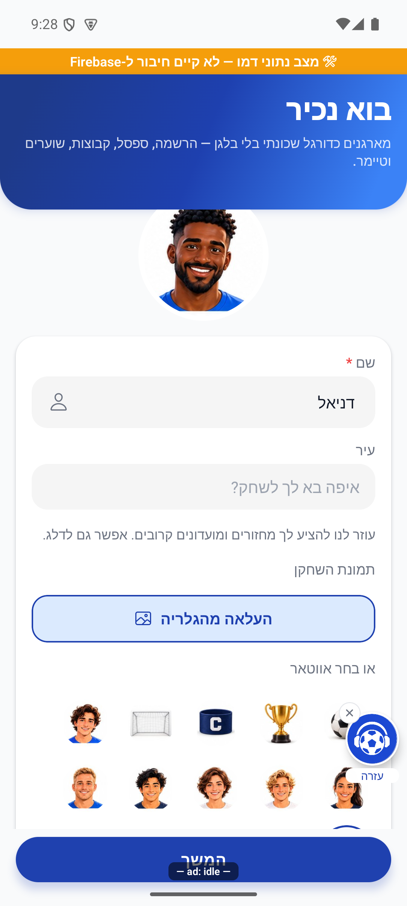
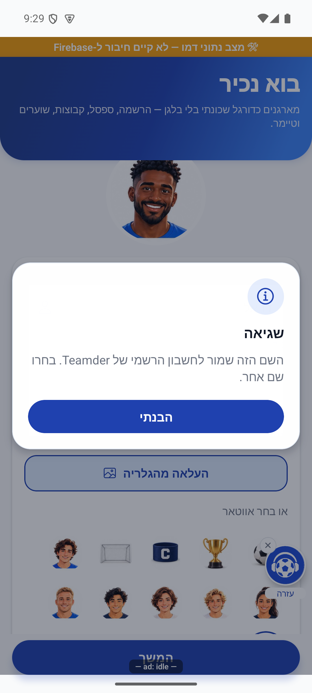
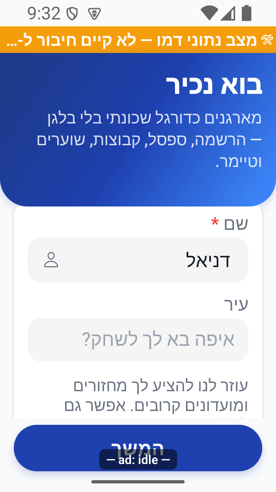
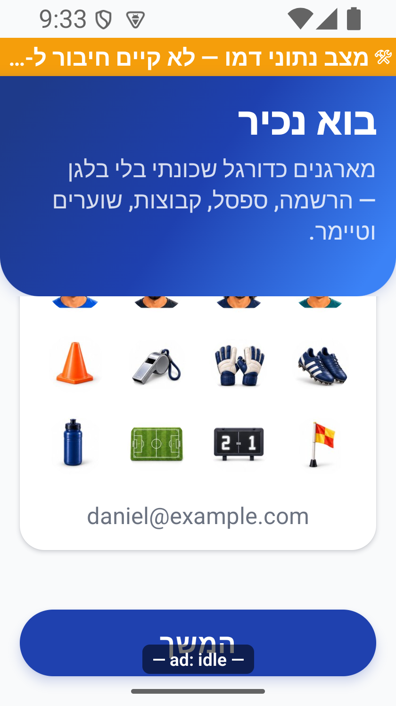
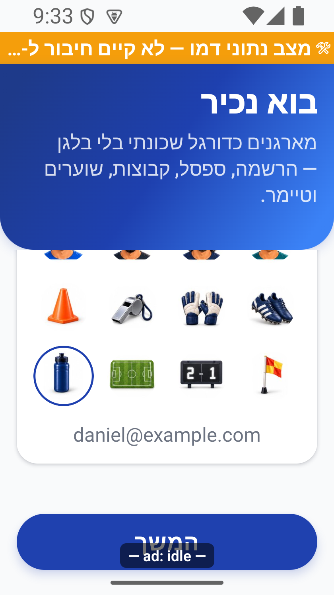
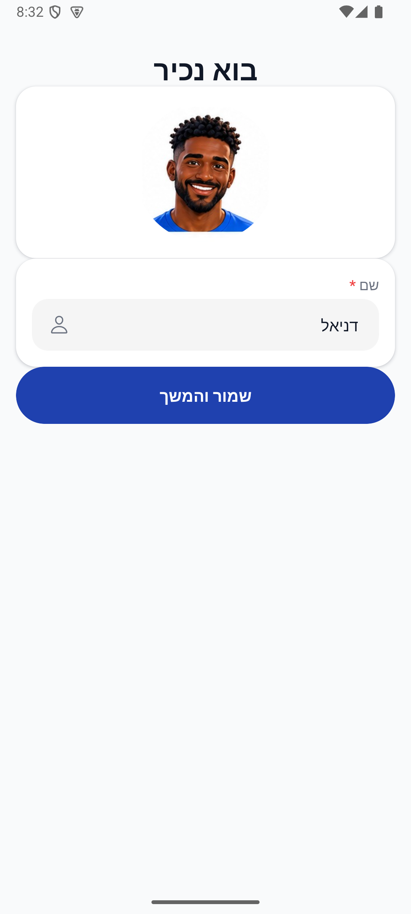
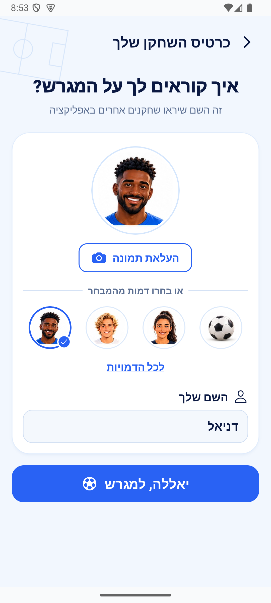
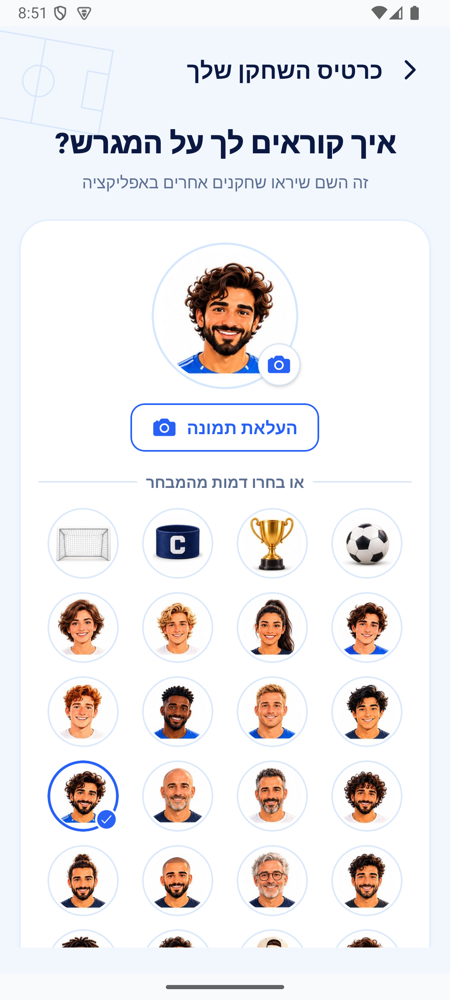
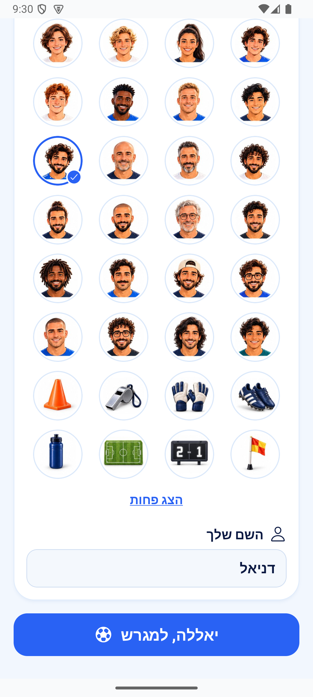

# היכרות והשלמת פרופיל לאחר התחברות

## תיעוד כשלים — 20.10.2026

נוספו תצפיות דיווח בנקודות הכשל של המקורות המשויכים לפיצ׳ר, במסגרת הרחבה רוחבית. נשמרו ערכי החזרה, הזריקות ותנאי הפעולה הקיימים; נוסף מקור קוד והקשר לדיווח. כיסוי תחבירי אינו הוכחת הרצה של כל מצב. השינוי מקומי וטרם הופץ; בדיקות המסירה, מגבלות מניעת הכפילויות והמסלולים שטרם חוברו מתועדים בדוח המשותף.

[דוח דיווח השגיאות והראיות](../../changes/2026-10-20-error-reporting-audit.md).

## הפרדת מקור פתיחה מייחוס הרשמה — 20.10.2026

`PendingInvite` שנשמר ב־`AsyncStorage` ממשיך לשמש לייחוס בהרשמה מאוחרת, אך אינו משמש כמקור הכניסה של הפעלה חדשה ללא קישור. ההחלטה על `entry_source_resolved` נעשית לפי `initialUrl` או מקור שנפתר באותה הפעלה; כך פתיחה רגילה אינה יורשת ערוץ או קמפיין היסטוריים.

[לקריאה קצרה ופשוטה](profile-onboarding.simple.md)

## שמירה, בעלות ומשוב — 18.10.2026

`PostSignInOnboardingScreen` מרכיב טופס עם מפתח מזהה המשתמש. החלפת חשבון מרכיבה טופס חדש, בלי להעביר שם, עיר או תמונה מהחשבון הקודם. נעילה משותפת מיידית מונעת העלאה ושמירה מקבילות גם לפני הרינדור הבא. השדות ובחירת הדמויות מושבתים בזמן הפעולה. בדיקות בעלות והרכבה נעשות גם אחרי העלאה וקידוד עיר ולפני שמירת תוצאה; תשובה מאוחרת אינה משנה טופס של משתמש אחר.

בחירת דמות מנקה את התמונה בטיוטה בלבד. מחיקת הקובץ הישן נדחית עד אישור שמירת הפרופיל ורק אם אותה זהות עדיין פעילה. כשל שמירה משאיר את התמונה הקודמת. `userService.completeOnboarding(patch, expectedUid)` מבדיל בין היעדר `photoUrl`, שמשאיר תמונה קיימת, לבין שדה מפורש ריק, שמנקה אותה עם `deleteField()` ומחזיר ומטמין משתמש ללא הכתובת. גם הדמו מכבד את ההבדל.

`useUserStore.completePostSignInOnboarding` לוכד בעלות לפני הקריאה, מעביר `expectedUid`, ובודק את זהות החנות ואת זהות התוצאה לפני `set`. השירות בודק את הזהות מול ההפעלה לפני ואחרי קריאת המשתמש, הכתיבה ועדכון המטמון. שינוי זהות מחזיר `StaleSessionError`. הגנות אלה אינן מבטלות כתיבה שכבר אושרה בשרת.

| מצב | התנהגות נוכחית |
|---|---|
| בחירת דמות | טיוטה מקומית בלבד; אין מחיקת קובץ מוקדמת |
| כשל שמירת פרופיל | הטיוטה נותרת לניסיון חוזר והתמונה הקודמת אינה נמחקת |
| שמירה מוצלחת עם דמות במקום תמונה | ניקוי שדה התמונה; ניקוי הקובץ רק לאחר האישור ובאותה זהות |
| ביטול בחירת תמונה או דחיית הרשאה | ללא שגיאת העלאה; הבחירה הקודמת נשמרת |
| כשל העלאה מסוג `unknown` או `network` | `he.profilePhotoUploadFailed` |
| שירות העלאה לא זמין | `he.profilePhotoUnavailable` |
| שם שמור או דמוי דואר | `he.officialNameTaken` או `he.emailNameNotAllowed` |
| כשל שמירה אחר | `he.profileSaveError`, במקום הודעת כשל התחברות |
| שינוי זהות או פירוק בזמן המתנה | אין עדכון, הודעת הצלחה או ניקוי קובץ בשם החשבון החדש |

קידוד העיר נשאר אופציונלי ומוגבל ל־4,000 מילישניות. לא שונו השדות העסקיים, הרשאות או פונקציות השרת.

### בדיקות וראיות הסבב

`tests/logic/finalOnboardingAuditProfile.test.ts` כולל 25 בדיקות משמעותיות של מטפלי המקור, השירות והחנות עם קלט ופלט נשלטים: טיוטת דמות, שמירה כפולה וכושלת וניסיון חוזר, החלפת זהות בהעלאה/קידוד/אישור, פירוק, ביטול והרשאה, ניקוי תמונה מפורש ושימור שדה שלא נשלח, עדכון החנות, שער הדואר והודעות הכשל. יחד עם 10 בדיקות שחזור ב־`finalOnboardingAuditRecovery.test.ts` נוספו 35 בדיקות. הריצה הממוקדת עברה 775 בדיקות ב־25 חבילות ובדיקת הטיפוסים עברה. זו אינה ריצת כל החבילה. [דוח הביקורת והיומנים](../../../artifacts/final-deep-audit-2026-10-17/onboarding-audit.md).

באימולטור אנדרואיד אומתו `__DEV__`, דמו מאולץ ו־`p7` לפני הבדיקה. המסך נפתח באמצעות שער היכרות מקומי, והכותב הוחלף זמנית בכשל מבוקר; לא נשמר פרופיל אמיתי. נצפו תצוגה רגילה, שגיאת העלאה, שגיאת שם, גלילה לשדות, שורת הדמויות האחרונה ובחירת `a42`. בסיום שוחזרו המשתמש, הכותב, מצב הכניסה והניווט; המחזור והיסטורייתו הושוו לגיבוי ונשארו ללא שינוי. הגופן והמידות הוחזרו.

| תצוגה | מידות שנקראו בזמן הריצה |
|---|---|
| רגילה | חלון 411.43×914.29, גופן 100%, מכשיר 1080×2400, צפיפות 420 |
| קטנה לאחר פתיחה קרה | חלון 320×569.14, גופן כ־140%, מכשיר 840×1494, צפיפות 420 |

הודעת השם הודגמה באמצעות `RESERVED_NAME` מוזרק כאשר השם המוצג היה דניאל; זו הוכחת תרגום הכשל, ולא הוכחת אימות שרת לשם הזה. שגיאת התמונה התקבלה ממתאם הדמו שהחזיר `unknown`; לא נבדקו בחירה והרשאות גלריה אמיתיות, העלאה או מחיקת קובץ בשרת. אין אימות כניסה לספק חי, התקנה מהחנות או מכשיר אפל.

במסך הקטן אזור הכותרת והתמונה גדול ונדרשת גלילה; כל השדות אינם נראים יחד. כפתור ההמשך נותר נגיש. סימון הפרסומות של הפיתוח עשוי לחפוף לחלק ממלל הכפתור. פס הדמו וסימון המסלול אינם ממשק מופץ; כלי העזרה נסגר לביקור לצילומי השדות הנקיים. מקורות, גיבויים ומגבלות נמצאים בדוח וברשומות הראיות, ואין להשתמש בצילום כאישור לשמירה חיה.

עודכן: 07.10.2026; מקור `8e8fde5`, גרסה `1.1.35` בבנייה. תפקיד: חשבון מלא חדש או חשבון שחסר בו סימון/שם. מיפוי קוד; הזרימה לא בוצעה מחדש מול ספק אמיתי.

## ניווט ואזורי המסך

`src/screens/onboarding/PostSignInOnboardingScreen.tsx` משלים את ההיכרות לחשבון מלא לפני הלשוניות. `src/screens/auth/ProfileSetupScreen.tsx` משלים פרופיל שחסר בו שם תקין. `RootNavigator` בודק היכרות תחילה ולאחר מכן `profileComplete`; אין להחליף בין הסימונים. אורח אינו חייב למלא את הטופס כדי לקרוא מסכים ציבוריים.

ההיכרות כוללת שם, בחירת תמונה או אווטאר, עיר אופציונלית עם חיפוש והמשך. בחירת עיר מנסה גם קידוד מיקום; כשל קידוד אינו הופך עיר אופציונלית לחובת רשת. אווטאר ברירת מחדל נבחר מתוך המערך. בחירת תמונה מבקשת הרשאות רלוונטיות ומטפלת בביטול ובכשל העלאה. ההשלמה ממשיכה לכוונה שנבחרה, ולא מחליפה אוטומטית את היעד בבית.

## מצבים וכתיבות

| תנאי | התנהגות | יעד כתיבה | ראיה |
|---|---|---|---|
| חשבון חדש ללא היכרות | טופס היכרות | `userService.completeOnboarding` | קוד |
| שם ריק/לא תקין | עצירת המשך; הודעת אימות | אין עדכון תקין | קוד |
| שם שמור רשמי או שם דמוי מייל | הגנת זהות ומניעת שם לא ראוי | אין עקיפת הגנת השם | קוד וכללי חשבון רשמי |
| עיר לא נבחרה | ניתן להשלים | פרופיל ללא עיר חדשה | קוד |
| עיר נבחרה, קידוד נכשל | ניסיון מיטבי ללא חסימת השלמה רק בשל העיר | השדות שהצליחו להיקבע | קוד; לא הודגם כשל |
| החלפת תמונה באווטאר | טיוטה; ניקוי התמונה רק לאחר שמירה מוצלחת ובאותה זהות | פרופיל, ואחריו אחסון תמונות | קוד ובדיקות 18.10 |
| היכרות הושלמה, פרופיל חסר | `ProfileSetup` | שם וסימון השלמת פרופיל | קוד שער השורש |
| ניסיון חשבון קיים שהסתיים בחשבון חדש | חזרה לבחירת כוונה לפי התפסים | מצב מקומי ב־`entryStore` | קוד ובדיקות |

## שירותים, ממיר ובדיקות

מקורות: `src/services/userService.ts`, `src/store/userStore.ts`, `src/store/entryStore.ts`, `src/firebase/firestore.ts`, מערך האווטארים ורכיב `UserAvatar`, `src/utils/officialAccount.ts`. בעת הוספת שדה היכרות יש לעדכן גם את ממיר המשתמש, לא רק את הטיפוס והכותב. האירוע המתעד עיר משתמש בנתון `has_city` ולא בשם העיר עצמו.

בדיקות קיימות: `tests/entryOnboarding.test.ts`, `tests/entryExistingAccount.test.ts`, `tests/rules/onboardingCity.test.mjs`. בנוסף בדיקות כיוון מלל, הוקים ושמות אירועים של הפרויקט. לא הורצו מחדש בידי סוכן המיפוי.

## ראיות, סיכונים ושחזור

תמונות ההיכרות במקורות 025, 029, 031 הן היסטוריות, וחלקן מציגות אווטארים קודמים. אין צילום נוכחי של השלמה מוצלחת מול השרת. תמונת `ProfileEdit` מתעדת את העורך לאחר ההיכרות ואינה תחליף לראיית הטופס הזה.

הסיכון ההיסטורי של מחיקת תמונה בזמן בחירת דמות תוקן ב־18.10: הניקוי נדחה לשמירה מוצלחת ובאותה זהות, ונבדק מול כשל וביטול בקוד. עדיין נדרשת בדיקה חיה בחשבון המאושר של העלאה, החלפת תמונה בדמות, שם מסופק מהספק וחזרה לכוונה אחרי ההשלמה; ראיות הדמו אינן מחליפות זאת.

## פירוט מימוש ונקודות שינוי — העמקה 07.10.2026

הכניסה לטפסים נקבעת מהשורש: חשבון מלא ללא היכרות מגיע ל־`PostSignInOnboardingScreen`, ואחרי כן נבדקת שלמות הפרופיל דרך `ProfileSetupScreen`. `handleSave` של ההיכרות מפעיל `completePostSignInOnboarding`; השם נבדק בשירות נגד שם שמור ושם דמוי אימייל, והעיר עוברת קידוד מיקום בניסיון שאינו תנאי הצלחה.

`handlePickPhoto` ו־`handlePickAvatar` מבטלים את החלופה בתצוגה: תמונה ו־avatarId אינם שתי בחירות מצטברות. החל מ־18.10 גם בהיכרות בחירת דמות משנה טיוטה בלבד, וניקוי קובץ נדחה לשמירה מוצלחת כמו בעריכת הפרופיל. שינוי סרגל או שמירה מחייב לבדוק שלא עוברים לשלב הבא לפני כתיבת `onboardingCompleted`, ושמנגנון חזרת הטיוטה לא רץ לפני שער הפרופיל. יש לשמר את כל ההוקים לפני חזרת טעינה מוקדמת.

הבדיקות, מצבי המסך והראיות שכבר פורטו במסמך נשמרו. ההעמקה מבוססת על קריאת מקור ולא על הרצת פעולות נוספות; שינוי עתידי יצריך עדכון של שני המסמכים ובחינת המצבים הממוקדים.

## תיקוני ההזמנה וההיכרות — 8.10.2026

`geocodeCity` מגביל את כל הבקשה, כולל קריאת התשובה, ל־4,000 מילישניות באמצעות מרוץ הבטחות ו־`AbortController`. המגבלה מועילה גם אם ספק התקשורת אינו מכבד ביטול. כשל זמני אינו נשמר במטמון; תשובה שמגיעה לאחר ביטול אינה מאכלסת אותו. שם העיר והמשך `completeOnboarding` נשארו ללא שינוי, ואין המצאת קואורדינטות או המתנה ללא גבול. הבדיקה משתמשת בבקשה שלא עונה כלל ומוודאת חזרת `null` וביטול אות הבקשה.

מקור: `a348b9f` עם תיקונים מקומיים. ראיות ובדיקות: [דוח התיקון](../reviews/onboarding-fixes-2026-10-08.md).

## תיעוד פעולות ההצטרפות — 10.10.2026

הפעולות הנתמכות בתהליך מגיעות להיסטוריה ולהתראות בפולס, כולל זמן, ביקור וספירת לחיצות. לא מועבר תוכן שדות מוקלדים. נדרשים פריסת השרת ולקוח חדש; [הכיסוי, החישובים ומגבלות האימות](../shared/onboarding-activity.md).

## תצוגת המצב הקיים — 14.10.2026

לקראת בחינת עיצוב, נפתח `ProfileSetupScreen` המקורי באימולטור דמו, ללא שינוי במסך וללא שמירה. `QARouteLauncher` קיבל תצוגת פיתוח דרך `footy://qa/ProfileSetup`, מאחורי שערי הפיתוח, מסלולי הבדיקה ודמו מאולץ. היא מרכיבה את הרכיב הקיים בחלונית ונסגרת בחזרה של המערכת, בלי לשנות את חנות המשתמש כדי לכפות מסלול הרשמה.

המסך הבסיסי מכיל כותרת, תצוגת דמות, שם חובה ושמירה. בצילום המקורי אין בחירת תמונה או עיר; אלה שייכים למסך ההיכרות המלא. הצילום אינו הוכחה למסע כניסה או שמירה מול שרת.

## עיצוב השלמת פרופיל בסיסית — 14.10.2026

המסך הקיים `ProfileSetupScreen` עודכן לפי הסקיצה המאושרת: רקע תכלת ומגרש עדין, כותרת, כרטיס לבן עם תמונה, כפתור העלאת תמונה, ארבע דמויות נבחרות ושדה שם. הכדור בכפתור ההמשך משמאל למלל. אין סמל מצלמה על התמונה ואין כרטיס תצוגה מקדימה נוסף. לחיצה על התמונה או על כפתור ההעלאה מפעילה את אותו בורר.

`FEATURED` בוחר ארבעה מזהים מהקטלוג הקיים; בחירה קיימת מחוץ לרשימה מחליפה את הפריט האחרון. ״לכל הדמויות״ מרחיב את כל 36 הדמויות מתוך `AVATARS`; הבחירה מתעדכנת מיד בדמות הגדולה ובטבעת הבחירה. לא נוספו עיר או עמדה. מסך ההיכרות המלא נותר נפרד.

`handlePickAvatar` משנה טיוטה מקומית ומנקה את כתובת התמונה בטיוטה. `handlePickPhoto` משתמש בשירות ההעלאה הקיים, מטפל בביטול, הרשאות וכשל, ומונע עדכון מאוחר אחרי יציאה או החלפת משתמש. העלאת הקובץ מתבצעת בזמן בחירת תמונה; שמירת שדות הפרופיל מתבצעת בהמשך. `handleSave` שולח שם מקוצץ, כתובת תמונה מפורשת ומזהה דמות דרך `userStore.updateProfile`. תמונה קודמת נמחקת רק לאחר שמירה מוצלחת של בחירת דמות. נעילה משותפת מונעת העלאה ושמירה כפולות. נשמרו אימות שם שמור, איסור שם דמוי דואר ושערי הניווט הקיימים; אין שינוי לסימון ההיכרות.

בדיקה: `tests/logic/profileSetupChoices.test.ts` מכיל שמונה בדיקות המטפלות בבחירה כטיוטה, כשל ושמירה חוזרת, לחיצה כפולה, ניקוי תמונה אחרי הצלחה, ביטול/הרשאה/כשל העלאה ותגובה מאוחרת. בדיקת טיפוסים וכל 3,698 הבדיקות ב־301 חבילות עברו. באימולטור אנדרואיד בדמו נבדקו יישור עברית, פתיחת הגלריה והחלפת דמות. אין אימות העלאה או שמירה חיה, מסע הרשמה מלא או אייפון.

מסלול הפיתוח `footy://qa/ProfileSetup` מוגן בדגלי פיתוח ודמו מאולץ; `onClose` סוגר רק את חלונית התצוגה המקדימה, ללא שינוי חנות המשתמש.

## ביקורת השינויים היומית — 14.10.2026

כשלא מאשרים גישה לגלריה, מוצג הסבר שמפנה להגדרות הטלפון. ביטול רגיל של בחירת תמונה נשאר ללא הודעת שגיאה.

`handlePickPhoto` מבדיל בין `permission` ל־`cancelled` בהודעה למשתמש, תוך שמירת הטיוטה. בדיקות המקור אומתו מחדש. באימולטור נבדקו פתיחה וגלילה של כל הדמויות, החלפת בחירה והגעה לשדה השם ולכפתור ההמשך. לא שונתה הרשאה במכשיר ולא בוצעה העלאה חיה.

בדיקת טיפוסים וכל 3,703 הבדיקות ב־302 חבילות עברו. תוקנו תקלות בדרגת ביניים; לא אומת ממצא קריטי. אייפון ופעולות שרת אמיתיות לא נבדקו בסבב זה.

## תלות בעדכון העונות — 19.10.2026

נבדק ההפרש בקבצים המשותפים הרשומים כאן: `src/firebase/firestore.ts`. השינוי ממוקד במדיניות העונות, קריאת מצבן, שיוך מחזור ופקודות ניהולן; אין שינוי מכוון בחוזה העצמאי המתואר במסמך זה. אין להסיק מכך שהמסך הזה הורץ מחדש.

[מצב המימוש, הבדיקות ומגבלות האימות של העונות](../clubs/seasons.md). מקומי בלבד; לא בוצעה פריסה במסגרת המשימה.
