# בית של משתמש מלא

## הרחבת אבחון דיווחים, 27.10.2026

נוספה מעטפת אבחון מקומית עם מצב בזמן הכשל, שלבים בעלי מזהה ותזמון, מצב רשת ובנייה ומופעים נפרדים לשגיאה. נקודת הכניסה לתעבורת השרת עוברת כעת דרך העטיפה המשותפת; תשובות, חריגות, אפשרויות קריאה ומדיניות הפיצר נשמרות. אין כאן שינוי בהרשאות או בחישובי המוצר. הבדיקות המלאות ומגבלות האימות מתועדות בדוח המקושר; אין טענה לאימות מכשיר או להפצה. [היקף, ראיות ומגבלות](../../changes/2026-10-27-diagnostic-context.md).

באימות הסופי עברו כל 6,231 הבדיקות ב-555 חבילות, ובדיקות הטיפוסים של הלקוח, השרת והפולס נקיות. צילום הדפדפן והידור מקורות האנדרואיד הם בדיקות מקומיות; אין הוכחת מכשיר, הידור אייפון או מסירה חיה של הבנייה החדשה. רישום יומן השחרור נחשב מאומת רק לפי קבלת הקריאה החוזרת בדוח השינוי.

## השבתת פעילות אישית לקראת הגרסה הבאה, 27.10.2026

נבדק השינוי הממוקד במקורות המשותפים: הכניסה לפעילות האישית וכרטיסי הפעילות מוסתרים לקראת הגרסה הבאה. מדידה, הרשאות ספורט וסנכרון הושבתו בשירותים, ללא שינוי בתוצאות הכדורגל או בפעולות הפיצר הזה. שינוי מקומי שטרם הופץ, ללא בדיקת מכשיר חדשה. [היקף וראיות](../../changes/2026-10-27-sports-activity-disabled.md).

## השפעת מקור משותף במשימת השעון - 26.10.2026

נבדק ההפרש ב-`src/services/gameService.ts`: `stopRotation` עוצר את השעון וסוגר קטע ריצה באותה טרנזקציה שמשחזרת את ההרכב; `_persistRotation` משמר קטע ריצה פתוח לפני איפוס שעון המשחק הבא. נשמרים `startedAt` והיסטוריית `activeIntervals`, ונמנעים שיבוצים ישנים אחרי עצירת הרוטציה. השוואת שתי המתודות למצב הקודם משחזרת את חותמת המקור שנרשמה לפיצר לפני תיקון זה. בקשות המחזור הקרוב והמחזור שהסתיים, והמכנים המוצגים בבית, לא שונו בתיקון זה. זו בדיקת השפעת השינוי התחום במקור המשותף, ולא הרצה מחודשת של כל מצבי הפיצר. השינוי מקומי; מסמך זה אינו מאשר פריסה, שינוי הרשאות או העלאה לחנות. הצילומים בסיכום האישי מבוססים על רכיבי המקור עם מתאמי דפדפן ונתוני בדיקה, ולא על הרצת אנדרואיד או שעון. [היקף המימוש, הבדיקות, מגבלות האישור והצילומים](../../changes/2026-10-26-android-personal-activity.md).

## הפצה פנימית 1.1.61 - 25.10.2026

הבינארי `1.1.61/295` הופץ ואומת במסלול הפנימי באנדרואיד. תיקוני הלקוח נכללים בו, ושירות הפרופיל נפרס ואומת בנפרד. גם תיקוני הסגל, שמירת התוצאה והתראת השגיאה בשרת נפרסו ואומתו באישור מפורש. שינויי יישום הפולס עצמו טרם הופצו. אין שינוי כללי הרשאה או הסבת נתונים. ניסוחי המצב המקומי בסעיפים הקודמים נכתבו לפני ההפצה; [דוח ההפצה](../../changes/2026-10-25-internal-1.1.61.md) מפרט בדיוק מה נכלל, מה נבדק ומה עדיין מקומי.

## תיקוני הפולס - 25.10.2026

`StatisticsIllustration kind=ball` מציג איור וקטורי מקורי בצבעי הסדרה במקום תמונת כדור; הגביע, הנעל והכפפה לא שונו. לא השתנו מוני מחזורים, שערים ובישולים, מכנים, העמדה בקרוסלה או הניווט. צילום רכיבי הבית בדמו הוא בדיקת הרכיב עם נתוני הדגמה, ולא צילום חשבון ייצור.

[מקורות, בדיקות, צילומים ומגבלות](../../changes/2026-10-25-pulse-fixes.md).

## כניסת חלונית העדכון מלמעלה - 25.10.2026

חלונית `UpdateBanner` המשולבת ב־`HomeHero` מקבלת תנועת כניסה מלמעלה של 420 אלפיות שנייה עם האטה לקראת העצירה. נקודת ההתחלה מתחשבת בגובה ובמיקום הנמדדים; המיקום הסופי, פריסת הברכה ותנאי ההצגה נשמרו. התנועה רצה רק בהרכבת הכרטיס ומכבדת `ReduceMotion.System`. אין נתיב חדש או שינוי נתונים. [פרטי המימוש, הראיות ומגבלות הבדיקה](../shared/global-gates.md).

[ראיות ומגבלות](../../changes/2026-10-25-update-banner-motion.md).

## הפצה פנימית 1.1.60 - 25.10.2026

נכלל בגרסה הפנימית `1.1.60/294`. שירותי הפנדלים במהלך משחק נפרסו ואומתו, לרבות שמירת הפירוט וארכיון העונות. הייצור בחנות נשאר `1.1.57/291`. הסעיפים ההיסטוריים שמתארים מימוש מקומי קדמו להפצה זו. אין בסבב ההפצה בדיקת התקנה, משחק מלא מול שרת או צילום ממשק חדש. [מקור מדויק, בדיקות וקבלות](../../changes/2026-10-25-internal-1.1.60.md).

## תובנות אישיות מגוונות בכרטיס - 25.10.2026

`src/utils/homePersonalStats.ts` מוסיף את `homeProfileInsights(stats, now)`, שבונה מאגר של עד שמונה משפחות תובנה כשיש להן בסיס. `homeProfileInsight(stats, { playerId, now })` בוחר תובנה אחת לפי גיבוב מזהה השחקן והיום המקומי. `src/components/home/HomePersonalStats.tsx` מעביר את `user.id` אל `src/components/home/HomeProfileOverview.tsx`. אין קריאות נתונים, שמירה, מנוי או שעון חדש. התובנה אינה מתחלפת בזמן הקריאה; ביום חדש ובמאגר זהה נבחרת האפשרות הבאה כאשר יש יותר מאפשרות אחת. עדכון נתונים יכול לשנות את המאגר והבחירה גם באותו יום. בלי מזהה, למשל בבדיקת רכיב מבודד, נבחרת האפשרות הראשונה.

| משפחה | תנאי וחישוב | היקף המידע והניסוח |
|---|---|---|
| הגעה | רצף תקף של לפחות שתי הגעות; אחרת אחוז הגעה של 80 ומעלה מתוך לפחות שלושה מחזורים רשומים | אותם רצף, שיא ומכנה קיימים; לכל היותר תובנת הגעה אחת |
| ציונים | חמש נקודות ייחודיות ושלמות עם תאריכים תקפים מהעבר בתוך 90 ימים, וללא `incomplete`; מיון תאריך ומזהה | מחזור אחרון עם ציון של 8.5 ומעלה והפרש של לפחות חצי נקודה מממוצע ארבעת קודמיו; אחרת ממוצע שני האחרונים גבוה לפחות בחצי נקודה משלושת קודמיהם; אחרת ממוצע של לפחות 7 וטווח של עד 0.75. לכל היותר תובנת ציונים אחת, ללא טענת שיא כל הזמנים |
| מעורבות | לפחות חמישה מחזורים וחמש פעולות, וסכום שערים ובישולים חלקי מחזורים שהגיע אליהם של לפחות 1 | ממוצע מעוגל לעשירית מתוך המונים המצטברים; כשמעוגל לאחד הניסוח ביחיד ובקירוב |
| סגנון | לפחות חמש פעולות; לפחות שלושה בישולים ושיעור בישולים של 60 אחוז ומעלה, או לפחות שלושה שערים ושיעור שערים של 70 אחוז ומעלה; אחרת לפחות חמישה מכל סוג וחלוקה בטווח 40 עד 60 אחוז | אחוזים מעוגלים מתוך סכום שערים ובישולים, ללא השוואה לשחקנים אחרים. לכל היותר תובנת סגנון אחת |
| קשר בבישולים | צמד מוביל עם לפחות שלושה בישולים ונתון כולל של לפחות חמישה, מספר הצמד אינו עולה על הכולל וחלקו לפחות 30 אחוז | מקבל הבישולים מחולק לכל הבישולים; אחרת מוסר הבישולים מחולק לכל השערים. אין שמות מומצאים או קריאות זהות נוספות |
| תוצאות | מידע שלם, לפחות שלושה מחזורים מתועדים ועשרה משחקים; מונים שלמים ולא שליליים וסכומם שווה למספר המשחקים; שיעור ניצחונות של לפחות 60 אחוז | ניצחונות חלקי משחקים כולל תיקו, לא חלקי מחזורים. הטקסט מציין את כמות המשחקים והמחזורים שתועדו ואינו טוען לכיסוי מלא |
| ציון דרך | לפחות שבעה מחזורים, ועד שלושה מחזורים ליעד גדול ממש מהמספר הקיים מתוך 10, 25, 50, 75, 100, 150, 200, 300, 400, 500, 750, 1000 | יעד מחזורים, בנפרד מיעד השערים בעמוד אחר בקרוסלה; לא מוצג יעד שכבר הושג |
| חיבורים | מספר חיובי ושלם של שחקנים שונים | נתון ההשתתפות הקיים. אין טענת צמיחה בזמן מתוך ערך מצטבר |

אם אין תובנה מתאימה, מוצג מסר התחלה או המשכיות. מוני ביצועים ויחסים נבדקים לשלמות, סופיות, אי שליליות וסכום בטוח לפני החישוב. אין הסקת שיא אישי מ-`bestGoals` או `bestAssists`, מאחר שהבית מעשיר רק חמשת המחזורים האחרונים. ציונים ישנים, עתידיים, כפולים, חלקיים או לא תקפים אינם בסיס לסיפור על הכושר הנוכחי. המקורות הם `PlayerStatsSummary`, `highlights`, מוני המשתמש ונתוני הצמדים שכבר נטענו; לא שונה שירות, ממיר, מסד או הרשאה.

עודכנו סמלי סוגי התובנות, ללא שינוי במבנה הכרטיס, בכפתורים או בשאר הקרוסלה. `tests/logic/homeProfileInsight.test.ts` יחד עם בדיקות הרכיב וסדר הקרוסלה כוללים 38 בדיקות ממוקדות שעברו. כל 516 חבילות הבדיקה ו-5,819 בדיקות הפרויקט עברו, ובדיקת הטיפוסים נקייה. ראיית אנדרואיד עדכנית מדגימה בחירה יומית של תובנת מעורבות במקום הרצף, עם ניסוח ביחיד ומימין לשמאל. צילום הלפני נלקח מהראיה המאומתת בשלב הקודם, כמפורט במניפסט. תוצאות הבדיקות המלאות וגבולות האימות ב[דוח השינוי](../../changes/2026-10-25-home-player-insights.md). מקומי וטרם הופץ.

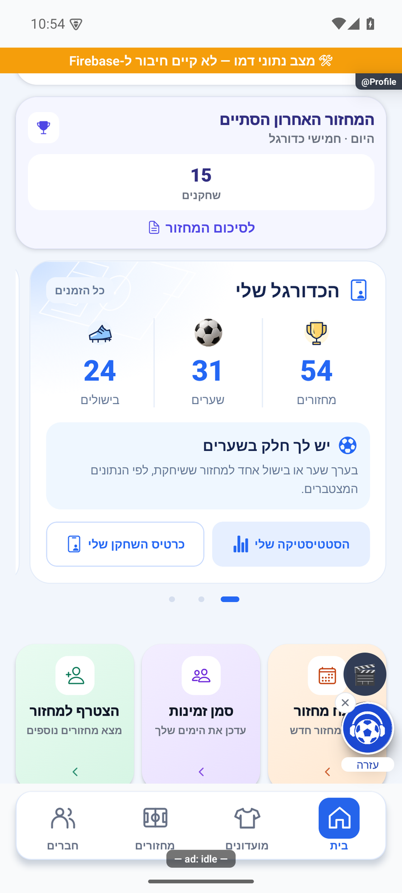

## אייקונים משמאל בכפתורי הקרוסלה - 25.10.2026

ב-`src/components/home/HomeProfileOverview.tsx` שונה סדר הילדים בשני כפתורי הפעולה: הטקסט קודם והאייקון אחריו. תחת כיווניות היישום ושורת `row`, הטקסט נמצא בימין והאייקון בשמאל. אין היפוך שורה או שינוי בסגנון, במקור הנתונים, במכנים, בנגישות או ביעדי הניווט. אין צורך בבדיקת יחידה חדשה לשינוי סדר חזותי בלבד; הכפתורים כבר מכוסים בבדיקות הפעולות הקיימות.

המיקום נצפה בצילום אנדרואיד עדכני עם נתוני המחשה. צילום הלפני משתמש בראיה המאומתת מהשלב הקודם, לפני שינוי הסדר, כמפורט במניפסט. בדיקת הטיפוסים וכל 516 חבילות הבדיקה עם 5,796 בדיקות עברו; פירוט האימות מתועד ב[דוח השינוי](../../changes/2026-10-25-home-profile-carousel.md#מיקום-האייקונים-בכפתורים). התיקון מקומי וטרם הופץ, ללא אימות אייפון או מכשיר פיזי.

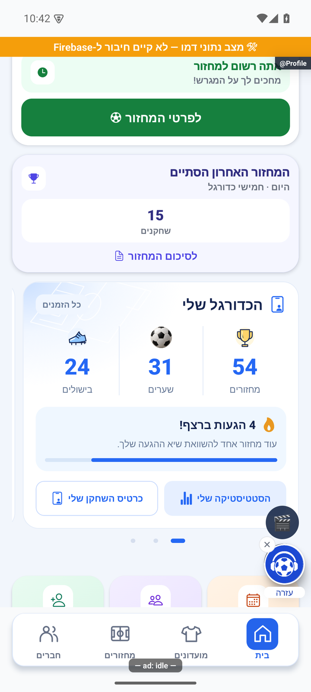

## הכדורגל שלי בעמוד הראשון של הקרוסלה - 25.10.2026

`src/components/home/HomePersonalStats.tsx` נשאר רכיב הקרוסלה האופקית בתוך `src/screens/tabs/ProfileScreen.tsx`, אחרי כרטיסי המחזורים ולפני הפעולות. `src/utils/homePersonalStats.ts` מחזיר תמיד `overview` ראשון לאחר קריאת נתונים מוצלחת. אחריו `scores`, `partner`, `milestone` לפי התנאים הקיימים. אין עמוד `numbers` נוסף, כותרת חיצונית כפולה או מקטע פרופיל נפרד.

`src/components/home/HomeProfileOverview.tsx` מציג מחזורים, שערים ובישולים פעם אחת, תחום קבוע "כל הזמנים", תובנה ושני כפתורים. המעטפת שלו היא `View`, כדי למנוע הפעלת ניווט לסטטיסטיקה בלחיצה על כרטיס השחקן. `onOpen` מפעיל `navigate('Statistics')`; `onProfile` מפעיל `push('PlayerCard', { userId: localUser.id })` באותה מחסנית. יתר העמודים נשארים לחיצים לסטטיסטיקה. לא נוסף מסלול ניווט.

`homeProfileInsights` בונה כעת מאגר תובנות שמפורט בסעיף החדש בראש המסמך. סדר העדיפות הקבוע מהשלב הראשון הוחלף בבחירה יומית לפי השחקן. חישוב רצף ההגעה המקורי נשמר: רצף 4 מול שיא 5 מציג מחזור אחד להשוואת השיא, ללא יעד עתידי מומצא במקרה של שוויון. נוסחת הרצף והגדרות ההגעה מפורטות ב[חוזה הסטטיסטיקה](../statistics/personal-statistics.md).

טעינה וכשל אינם אפס. כשל בסיס שומר תשובה קודמת של אותו חשבון ומאפשר ניסיון נוסף; בעלות החשבון וביטול אפקט המיקוד נשמרו. הצלחה ללא פעילות מציגה עמוד ראשון בלבד עם אפסים ומסר מתאים. גובה אחיד נמדד מהתוכן הטבעי בתוספת 34, עם מפתח חשבון, רוחב וגודל גופן. אין הגדלת גובה חוזרת מתוך גובה שכבר נמתח. נשמרו החלקה, הצצה לעמוד הבא, נקודות נגישות וצמצום תנועה.

תרחיש `ProfileStatisticsFull` מדגים 54 מחזורים, 31 שערים, 24 בישולים ורצף 4 מול 5. `ProfileStatisticsEmpty` מאפס גם את מקורות התובנה. שני המצבים מוגבלים לפיתוח עם נתוני דמו וכלי בדיקה; אין נתוני דמו במסלול ייצור. כלי `src/dev/OverlayAuditPreview.tsx` הותאם לחוזה שני הכפתורים.

בדיקת טיפוסים נקייה וכל 516 חבילות הבדיקה עם 5,796 בדיקות עברו. 29 בדיקות ממוקדות מכסות סדר עמודים, תובנות, שני כפתורים, ספי נתונים, חישוב היסטוריה מלאה ותאריכים חסרים. באימולטור אנדרואיד נצפו העמוד הראשון לאחר פתיחה נקייה, התאמת נקודות לעמודי הכושר והשותף, הניווט לשני המסכים ואפס אמיתי. הצילומים לפני ואחרי רשומים במניפסט. לא נבדקו ייצור, אייפון, מכשיר פיזי או מסך קטן בגופן מוגדל באופן חזותי. אין מדידת מהירות חדשה. מקומי, ללא בנייה או הפצה.

[דוח השינוי והראיות](../../changes/2026-10-25-home-profile-carousel.md).

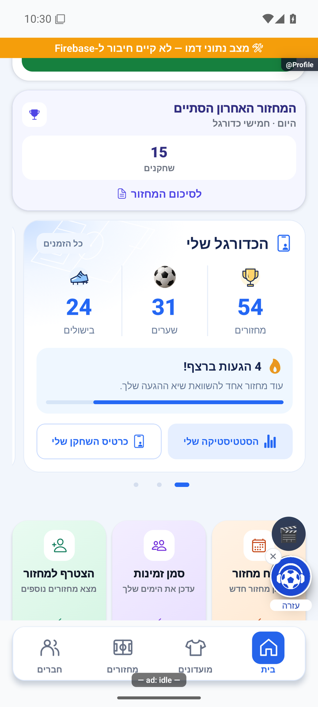

## שעון מדויק וכיתוב פנדל - 25.10.2026

במקורות המשותפים נוסף שימור השעון המדויק של פנדל במהלך משחק, וכיתוב ההבקעה ביומן קוצר. אין שינוי במונים או בתהליך העצמאי המתואר כאן; לא נערכה לו בדיקת ממשק חדשה במסגרת העדכון. השינוי מקומי וטרם הופץ. [פרטים וראיות](../../changes/2026-10-25-in-play-penalties.md#שעון-מדויק-וכיתוב-אירוע).

## פנדל במהלך משחק חי - 25.10.2026

נבדק השינוי הממוקד במקורות המשותפים: נוספו חוזי אירועי פנדל במהלך משחק, קוראים ומוני סטטיסטיקה, והגנות בעסקאות סיום ואיפוס משחק. מסלול הפיצר המתואר כאן אינו נקודת הכניסה להזנה החדשה. בדיקות המאגר עברו, אך אינן הוכחת הרצה חדשה של כל מצבי התהליך או של פריסה.

השינוי מקומי. נדרשת פריסת שרת לפני הפצת לקוח שמשתמש באפשרות; לא בוצעו פריסה או שינוי הרשאות. [חוזה הנתונים, התהליך, הבדיקות ומגבלות ההפצה](../../changes/2026-10-25-in-play-penalties.md).

## טעינה מקבילה של הסטטיסטיקה האישית בלילה של 25.10.2026

כרטיסי הבית ב-`src/components/home/HomePersonalStats.tsx` משתמשים ב-`src/services/playerStatsService.ts`. שלוש שאילתות הבסיס של השירות מתחילות כעת יחד במקום להמתין למחזורי המשתמש לפני קריאת הצמדים. מספר המחזורים, השערים, הבישולים, הצמדים והמכנים נשמר; גם ההגבלה של העשרת הבית לחמשת המחזורים האחרונים נשמרה. אם המסך יצא ממיקוד במהלך קריאת הבסיס, לא מתחילות קריאות העשרת היסטוריה. כשל מקור עדיין נזרק, וכרטיסים קודמים נשמרים לפי מנגנון הבית הקיים; אין תשובת אפסים חדשה, מטמון נוסף או שינוי עיצוב.

`tests/logic/personalStatisticsLoading.test.ts` בודק התחלת שלוש שאילתות במקביל, פרסום בסיס שלם, כשל מכל מקור וביטול לפני היסטוריה; הבדיקות הקיימות של חמישה מחזורים מול מוני חיים עברו. זהו שינוי בשירות משותף, ללא אימות מכשיר חדש של כל מצבי הבית. [פרטי החוזה והבדיקות](../statistics/personal-statistics.md), [תוצאות ומגבלות](../../changes/2026-10-24-loading-performance.md). מקומי וטרם הופץ.

## כניסה לכרטיס השחקן בתפריט הבית — 24.10.2026

בקובץ הבית המשותף נוספה רק הכניסה ״כרטיס השחקן שלי״ לפני ארון התארים בתפריט. אין שינוי מכוון בהתנהגות העצמאית המתוארת כאן, ואין לראות בבדיקת התפריט אימות חדש של המסך או התהליך הזה. התוספת מקומית ואינה נכללת בבינארי הפנימי שכבר נבנה. [מקור, בדיקות ומגבלות](../../changes/2026-10-24-home-player-card-menu.md).

## הסרת כפתור הקריסה — 24.10.2026

`ProfileScreen` אינו מייבא או מציג עוד את `CrashTestCard`. אין כניסה ממסך הבית לשירות הקריסה המכוונת; רכיב הבדיקה והשירות נשמרו בקוד ללא חיבור למסך. לא שונו איסוף הקריסות, זיהוי המשתמש, נתונים, מונים או ניווט. נצפה מסך הבית באמולטור אנדרואיד, עם נתוני דמו מאומתים, לפני ואחרי השינוי; הכרטיס הוסר והכרטיס הבא מוצג מתחת לכותרת בכיווניות תקינה. אין אימות אייפון או בינארי מופץ; השינוי מקומי וטרם הופץ.

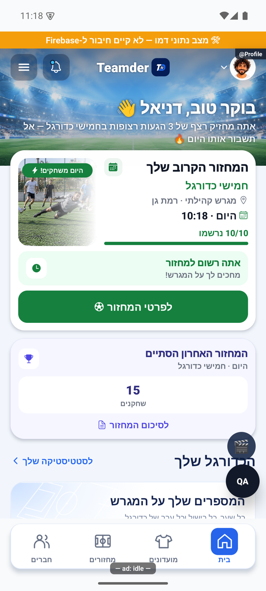

## תיעוד כשלים — 20.10.2026

נוספו תצפיות דיווח בנקודות הכשל של המקורות המשויכים לפיצ׳ר, במסגרת הרחבה רוחבית. נשמרו ערכי החזרה, הזריקות ותנאי הפעולה הקיימים; נוסף מקור קוד והקשר לדיווח. כיסוי תחבירי אינו הוכחת הרצה של כל מצב. השינוי מקומי וטרם הופץ; בדיקות המסירה, מגבלות מניעת הכפילויות והמסלולים שטרם חוברו מתועדים בדוח המשותף.

[דוח דיווח השגיאות והראיות](../../changes/2026-10-20-error-reporting-audit.md).

עדכון מגע מקומי מ־13.10.2026: משטח הגלילה הראשי של `ProfileScreen` משתמש ב־`ScrollSurface` ומעביר את אותה הפניה ל־`useScrollToTop`, אותו רענון במשיכה ואותם מאפייני תוכן. נוספו רישום גרירה/תנע וההגנה הקיימת מפני אירוע סיום תנע חסר; לא הוחלפו הכרטיסים או פעולותיהם. [מנגנון, בדיקות ומגבלות](../shared/menus-and-motion.md). אין להסיק מכך שהתקלה המדווחת שוחזרה במכשיר אמיתי.

[לקריאה קצרה ופשוטה](dashboard.simple.md)

עודכן: 07.10.2026; מקור `8e8fde5`, גרסה `1.1.35` בבנייה. המסך הוא `src/screens/tabs/ProfileScreen.tsx`, מסלול `Profile` בלשונית הבית. השם הטכני אינו אומר שזה כרטיס הפרופיל האישי. תפקידים: שחקן ומארגן; אורח מקבל בית אחר.

## אזורים וניווט

החלק העליון כולל רקע מגרש, מיתוג, ברכת שעה, משפט מאמן המבוסס על נתונים, תמונת משתמש, תפריט ופעמון. האווטאר פותח `ProfileEdit`; הפעמון פותח `Requests` ולא תיבת כל ההתראות. במרכז מוצג מחזור קרוב, לעתים מחזור שהסתיים לצדו, ולאחריהם פעולות יצירת מחזור, זמינות וגילוי מחזורים. בהמשך לוח פנויים, רשימת צעדי התחלה, קרוסלת הידעת, הזמנת חברים ואזורי תמיכה בהתאם לתנאים.

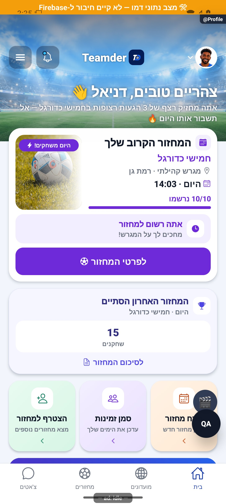

בצילום נראה דניאל, מחזור רשום 10/10 וכרטיס שהסתיים עם 15 שחקנים. אין זו בדיקה של אותו חשבון בייצור. בגלילה נוספת צולמו אזור הזמינות, רשימת ההתחלה, הקרוסלה והזמנת חברים. הנתונים והצבע הסגול של המחזור הם של הדמו; סמלי המעבדה והבדיקה אינם כפתורי גרסת החנות.

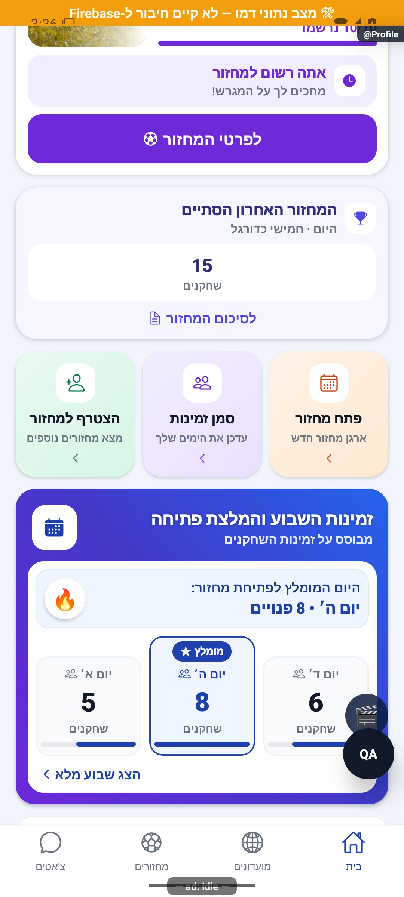
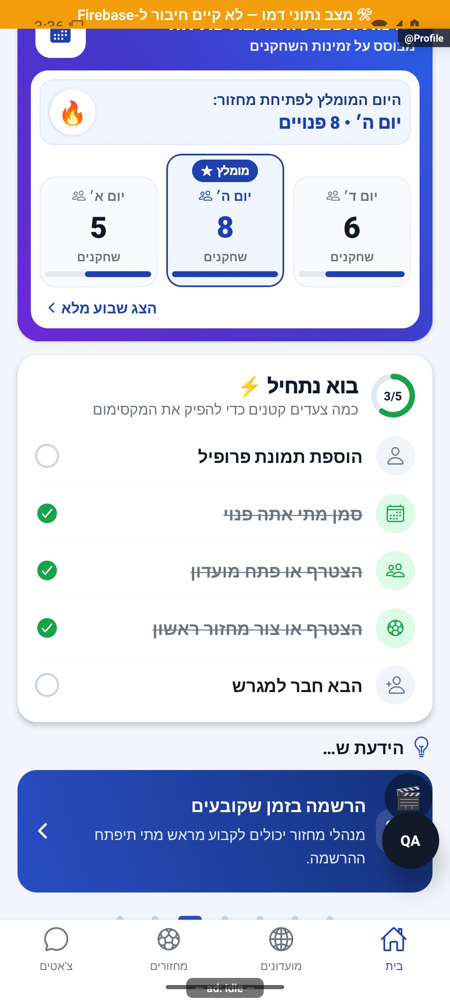
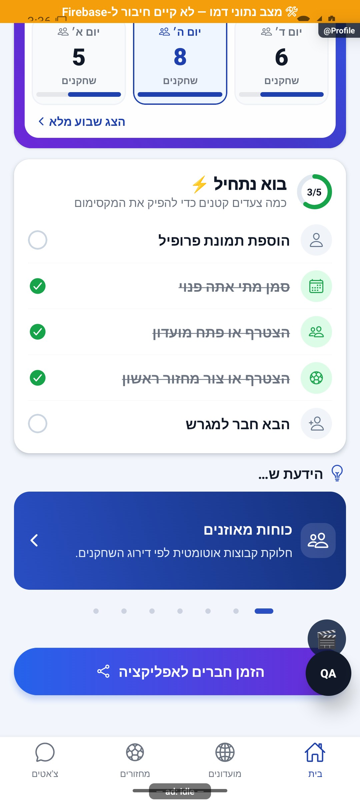

## מצבים ושינויים

| תנאי | תוצאה | כתיבה | ראיה |
|---|---|---|---|
| נתונים טרם נטענו | רכיבי טעינה; לא קביעה שאין מחזור | קריאות בלבד | קוד |
| מחזור פעיל/קרוב מתאים | כרטיס לפי סדר העדיפויות | אין עד לפעולה | דמו וקוד |
| מחזור שהתקיים בתוך חלון הסיכום | כרטיס סיכום בהתאם להשתתפות | אין | קוד |
| בקשות למנהל קיימות | ספירת בקשות וקיצור אישורים | אין בפתיחה | קוד; `Requests` צולם בדמו |
| סיכום עונה חדש בטווח 48 שעות | פס כניסה ל־`SeasonSummary` | עצם פתיחה אינה סימון נקרא | קוד |
| יצירת מחזור | ניווט ל־`GameTab`/`GamesList` עם בקשת יצירה | יצירה רק באשף | קוד |
| כל צעדי ההפעלה הושלמו ונתונים מוכנים | הסתרת רשימת ההתחלה | אין | קוד |
| מצב פיתוח | כפתור מעבדת אנימציה וחלון כלי בדיקה | כלי מקומי | קוד |

ברכת המאמן נבחרת ממקורות נתונים ולא מתחלפת סתם בכל רינדור; מנגנון הבחירה מחזיק את הבחירה לאורך הרכבת המסך. נתוני מחזורים, מועדונים, הגדרות בית והתראות נטענים מראש או מתחדשים במיקוד. שינוי צריך לשמור על סנכרון הנתונים ולא ליצור מספר נוסף עם הגדרה שונה.

## קוד, בדיקות וסיכונים

מקורות: `src/components/home/HomeHero.tsx`, `HomeDashboardParts.tsx`, `HomeRoundCards.tsx`, `HomeAvailabilityPanel.tsx`, `OnboardingChecklist.tsx`, `DidYouKnowCard.tsx`, `src/services/homeConfigService.ts`, `src/store/userStore.ts`, `src/store/groupStore.ts`. קריאות משתמש/מחזור/מועדון עוברות דרך השירותים וממירי `src/firebase/firestore.ts`; יש לבדוק גם מסלול אמיתי כי דמו אינו בודק ממיר.

בדיקות: `tests/logic/homeRouting.test.ts`, `tests/logic/homeHero.test.ts`, `tests/logic/homeRoundState.test.ts`, `tests/logic/homeAvailabilityView.test.ts`. המיפוי לא הריץ בדיקות ולא אישר כתיבה מהבית.

רשימת ההתחלה בודקת תמונה לפי `photoUrl` בלבד; בחירת אווטאר אינה משלימה כיום את צעד התמונה. יתר הצעדים: זמינות, מועדון, רישום/השתתפות במחזור, ומשתמש שהצטרף דרך ייחוס ההזמנה — לחיצה על שיתוף בלבד אינה השלמה. זהו פער הגדרה אפשרי, לא תיקון שבוצע.

לפני שינוי עיין גם ב־[כרטיסי מחזור](round-cards.md), [פנויים](availability-preview.md), [קרוסלה](tips-carousel.md), [תפריט](home-menu.md), [בית אורח](guest-home.md). שחזור עתידי: ללא מחזור, מחזור ממתין, מלא, היום, חי, הסתיים, עונה חדשה, מארגן עם בקשות, ונתונים איטיים. לא לבצע סיום/מחיקה בחשבון הייצור לצורך יצירת המצב.

## פירוט מימוש ונקודות שינוי — העמקה 07.10.2026

זהו מסך הרכבה: `ProfileScreen` טוען ומכין נתונים, והרכיבים `HomeHero`, `HomeRoundCards`, `HomeAvailabilityPanel` ו־`DidYouKnowCard` מציגים אותם. שינוי רכיב תצוגה אינו אמור להוסיף שוב את אותן קריאות בתוך ילדיו; יש להבדיל בין מצב לא נטען לבין תשובה שאין פריט.

רשימת ההתחלה מסתירה עצמה רק כשנתוני הבסיס והמונים מוכנים וכל חמשת הצעדים הושלמו: `photoUrl`, זמינות, מועדונים, רישום/השתתפות ומספר מוזמנים אמיתיים. שינוי ההגדרה לאווטאר מחייב תיאום בין התצוגה לבין מקור המונה ולא שינוי סמל בלבד. פס סיכום עונה עובד בטווח 48 שעות, והניווט אליו אינו סימון קריאה. כפתור יצירה מעביר לבורר `GamesList` עם `openCreate`; אין לכתוב מחזור מהבית. שינוי ברכת המאמן צריך לשמר בחירה יציבה לאורך הרכבת המסך כדי שלא תתחלף בכל עדכון נתונים.

הבדיקות, מצבי המסך והראיות שכבר פורטו במסמך נשמרו. ההעמקה מבוססת על קריאת מקור ולא על הרצת פעולות נוספות; שינוי עתידי יצריך עדכון של שני המסמכים ובחינת המצבים הממוקדים.

## עבודת ציור וגלילה — 9.10.2026

מקור: שינויים מקומיים מעל `a348b9f`, טרם פורסמו. תשתית `ScrollSurface` מחוברת לפרטי מועדון, ללשוניות פרטי מחזור, לסטטיסטיקות מועדון ולסיכום האישי. היא מסמנת תחילת/סוף מחווה ותנופה בלבד; אין שינוי נתונים או עדכון מצב בכל פריים. `CountUp` ו־`StatDonut` מתייצבים לערך הסופי במהלך גלילה; שורות ללא שינוי מיקום אינן מתזמנות תנועה. אנימציות `LivingIcon` ו־`Breathing` נעצרות כשמסך המקור מאבד מיקוד, כשהיישום ברקע, בזמן גלילה ובהגדרת צמצום תנועה. תמונות פרופיל ורקע משתמשות ב־`resizeMethod=resize`, לצמצום פענוח באנדרואיד לפי גודל התצוגה.

אין שינוי בחישובים, במכנים, בשדות המסד או בהרשאות. [התנהגות, בדיקות ומגבלות](../shared/menus-and-motion.md) · [מדידות וראיות](../reviews/scroll-performance-2026-10-09.md). הבדיקה בדמו אינה אימות גרסת חנות במכשיר פיזי.

## קרוסלת סטטיסטיקה אישית — 11.10.2026

מקור מקומי מעל `ec536c6f`. `HomePersonalStats` משולב ב־`ProfileScreen` אחרי כרטיסי המחזורים ולפני פעולות הבית. מיועד לבית משתמש רשום; אורח חוזר קודם למסך הבית שלו. בעמוד הראשון שני כפתורים נפרדים ל-`Statistics` ול-`PlayerCard` העצמי באותה מחסנית; יתר הכרטיסים פותחים `Statistics`. אין מסך מוצר חדש.

`useFocusEffect` קורא משתמש טרי ואז `playerStatsService.compute` עם `recentHighlightsOnly: true`. שערים ובישולים מקורם במוני המשתמש; מחזורים ושותף מחושבים באותו שירות של הסטטיסטיקה האישית. פירוט ציונים נטען לחמשת המחזורים האחרונים בלבד, לאחר מיון תאריך יורד; מוני ההשתתפות נשארים לכל הזמנים. אין בקשות פירוט לכל מחזור היסטורי מהבית ואין חישובי שיא המבוססים על חלון זה. השותף נטען ב־`userService.getUserById`; כשל זהות מסתיר את השקופית.

`homeStatsSlides` בונה תחילה `overview` עם הנתונים והתובנה, ואחריו ציונים כשיש נקודות, שותף כשיש מחזור משותף וזהות זמינה, ויעד שערים קרוב. עמוד המספרים הישן הוחלף, גם במצב ללא פעילות. `nextPersonalMilestone` בוחר יעד גדול מהמניין מתוך 10/25/50/75/100/150/200, במרחק של לכל היותר הגדול מבין 3 ו־10% מהיעד. אין המצאת שיא או התראה. ציון אפס הוא נקודה תקפה. הגרף מסודר ישן בימין וחדש בשמאל; מגמה משתמשת ב־`scoreTrend` בכל השינויים, ולכן עלייה ואחריה ירידה היא מגמה מעורבת. נקודה יחידה אינה מגמה.

טעינה מוצגת בנפרד ממצב ריק. כשל בסיס מציג ניסיון חוזר ומשמר תשובה קודמת של אותו משתמש; `owner` וביטול האפקט חוסמים תשובות ופרטים של משתמש קודם. אין כתיבה עסקית. `FlatList` אופקית עם עצירה בכרטיס והצצה לכרטיס הבא; הנקודות מסונכרנות לפריטים הנראים וניתנות ללחיצה. אין החלפה אוטומטית. הגדרת צמצום תנועה מבטלת את אנימציית בחירת הנקודות. בהגדלת גופן מעל 1.5 הגרף הופך לרשימת ציונים קריאה.

הבדיקות ב־`homePersonalStats.test.ts` מכסות רישום ללא הגעה, פעילות ראשונה, ציון אפס, שותף וגבולות יעד. `personalStatisticsLoading.test.ts` בודק שהבית מגביל פירוט לחמישה מחזורים ושמסך הסטטיסטיקה ממשיך לטעון היסטוריה מלאה. תרחישי `ProfileStatisticsFull` ו־`ProfileStatisticsEmpty` דורשים פיתוח, נתוני דמו וכלי בדיקה; הם לא נשמרים. באימולטור נצפו הגרף, המספרים, השותף, מצב חדש, החלקות, נקודות וקישור למסך האישי. לא נבדקו מסד ייצור, אייפון או טלפון פיזי.

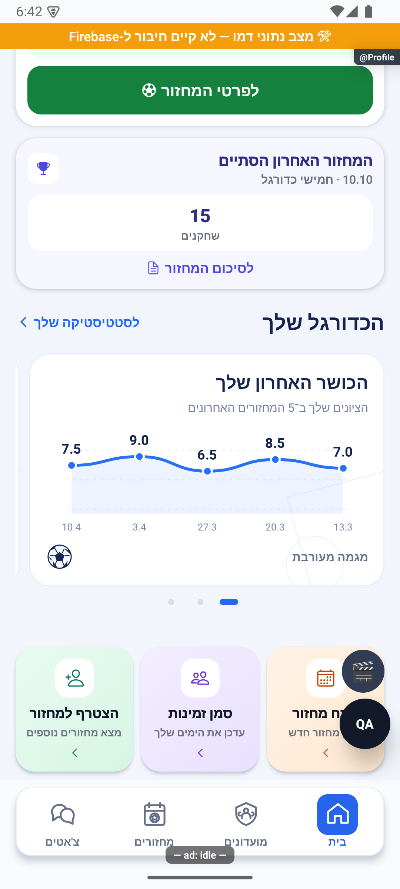
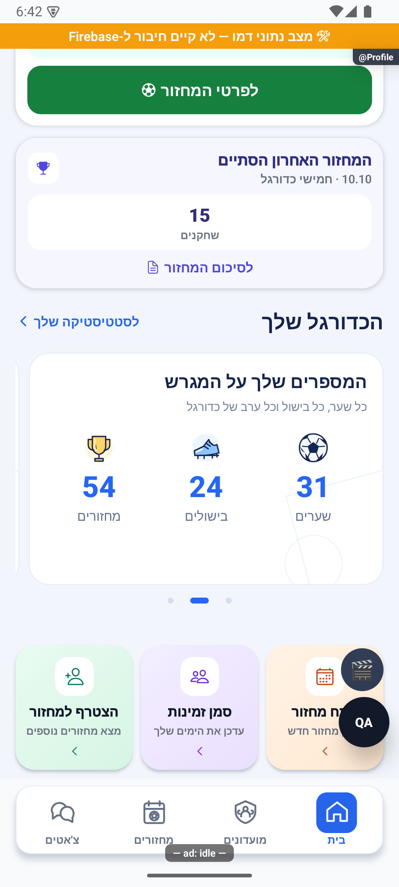
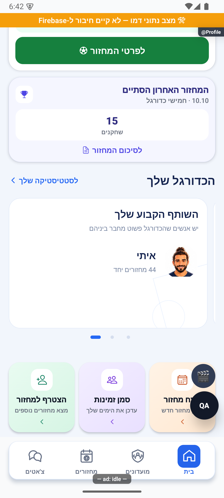
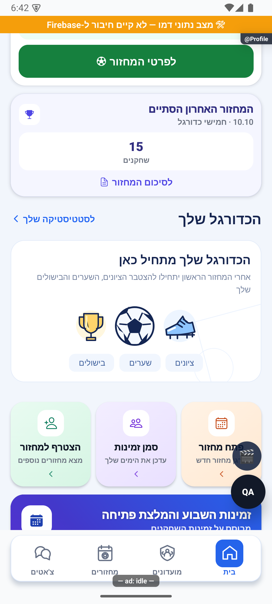

## הרחבת השותף ואיור המגרש — 11.10.2026

`PitchWatermark` הוא איור וקטורי ללא מגע ונגישות, מעל שמאל בכרטיס תחת כיווניות היישום, עם קווי מגרש ורקע כחול שקוף. החליף את הקישוט התחתון. `PartnerResults` מציג תוצאות באותה קבוצה מתוך `regularPartnerResults`, ולא תוצאות ראש־בראש או תוצאות של השותף המוביל בניצחונות. הזהות עדיין נבחרת לפי `mostPlayedWith`.

`playerStatsService` מוצא בשאילתות הצמדים הקיימות את רשומת אותו שותף לפי `a` או `b`; אין קריאה נוספת. `personalPartnerResults` מקבל `sameTeam`, `winsTogether`, `lossesTogether`, ורק כאשר שלושתם מספרים שלמים לא שליליים, המכנה חיובי וסכום הניצחונות וההפסדים אינו גדול ממנו, מחזיר תוצאות. תיקו = מספר המשחקים באותה קבוצה פחות ניצחונות והפסדים. אחוז ניצחון = עיגול 100 כפול ניצחונות חלקי כל המשחקים באותה קבוצה, כולל תיקו. שדות חסרים או נתונים סותרים מסתירים את אזור התוצאות; לא הופכים היעדר מידע לאפס. המחזורים המשותפים נשארים ספירה נפרדת.

`personalPartnerStats.test.ts` בודק מכנה, חוסר נתונים, ערכים לא תקינים וסכום סותר. בדיקות השירות ב־`personalStatisticsLoading.test.ts` מאמתות את שני צדדי הרשומה ושאין שימוש ב־`winsA`/`winsB` במקום תוצאות משותפות. נצפו המגרש, השורה הצבעונית, המכנה וההחלקה באימולטור אנדרואיד עם נתוני המחשה. אין אימות מסד ייצור או אייפון.

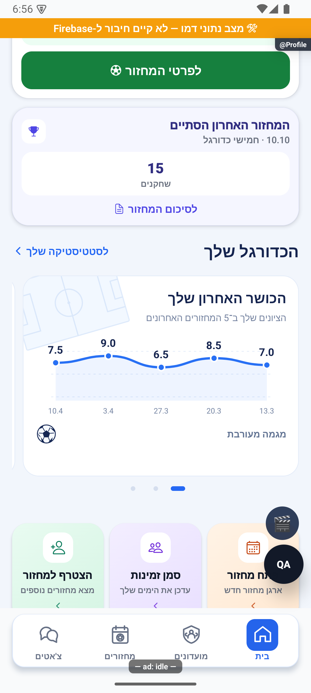

### תיקון איור לפי תמונת הייחוס

`PitchWatermark` מחליף את המסגרת הכחולה המסובבת בקווי מגרש לבנים דקים בפרספקטיבה וב־`RadialGradient` תכלת המתפוגג לשקיפות. האיור נשאר וקטורי, קבוע וללא מגע, בצד שמאל למעלה תחת כיווניות היישום. אין שינוי בנתונים או בתוצאות השותף. נצפה באימולטור אנדרואיד בנתוני המחשה; אייפון ומכשיר פיזי לא נבדקו.

### איור נתונים וגובה תוכן — 11.10.2026

`FootballDataIllustration` מצייר כדור, קווי תנועה ושלוש עמודות בגוני כחול אפור בשורת הסיום של כרטיס הציונים. האיור קבוע ווקטורי, ללא קריאת נתונים נוספת. הוסר הכדור הבודד. `renderCard` מודד גובה טבעי באמצעות `onLayout`, עם `alignSelf: flex-start` שמונע מתיחת כרטיס קצר לגובה אחיו. `cardHeights` שומר גובה לכל סוג כרטיס; גובה הרשימה נקבע לפי הכרטיס הנראה. עדכון המדידה מדלג על הפרש הקטן מחצי נקודה כדי למנוע לולאות מדידה. גובה מינימלי נשמר ליציבות, ואין גובה קשיח שעלול לחתוך טקסט מוגדל.

באימולטור נצפו כרטיסי הציונים, המספרים והשותף, החלקה ביניהם והתאמת הנקודות והגובה, ללא חיתוך בתחתית. נתוני המחשה בלבד; אייפון ומכשיר פיזי לא נבדקו.

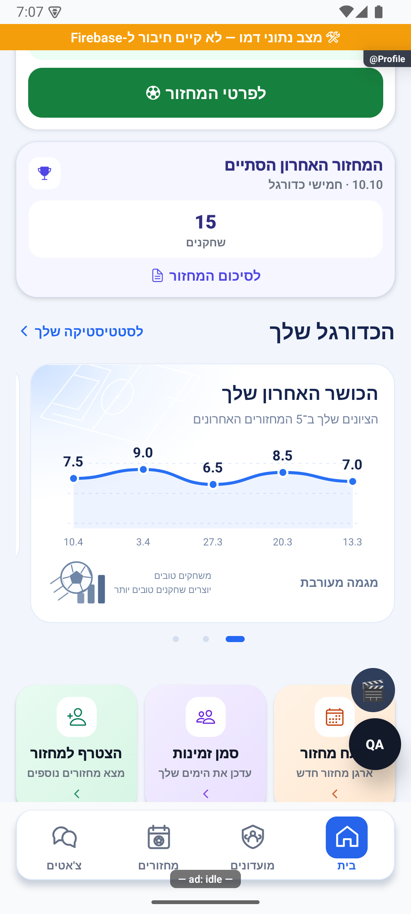
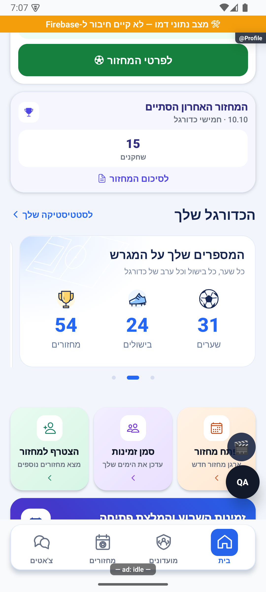
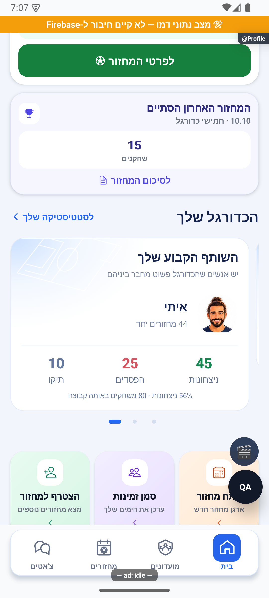

## תכלת למחזור שטרם נפתח — 11.10.2026

מצב `opensSoon` ב־`HomeRoundCards.tsx` משתמש כעת בהדגשה `#087EAD` וברקע הודעה `#EAF7FD`. אותו גוון משמש את שם המועדון, האייקונים, תגית ״טרם נפתח״ וכפתור פרטי המחזור. מצב המחזור, התזמון והניווט אינם משתנים. צילום הרכיב האמיתי באמולטור אנדרואיד עם נתוני המחשה ופעולות מנוטרלות מאמת את הכיווניות והצבעים; אינו בדיקה מול חשבון אמיתי או אייפון.

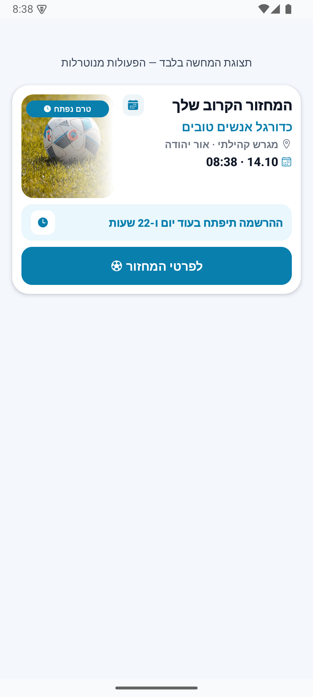

## תמונת המחזור הקרוב — 11.10.2026

`UpcomingRoundCard` משתמש ב־`resolveRoundCover(game, cover, coverLoading, failedPhotoUrl)` במקום תמונת כדור קבועה. `ProfileScreen` מעביר את המועדון מהמאגר המקומי, או טוען `groupService.getPublic` כשאין חברות במועדון. התשובה מוצמדת למזהה המועדון והמשתמש, וביטול האפקט מונע תשובה מאוחרת. עד סיום הבירור לא מוצגת תמונת ברירת מחדל חולפת. סדר הבחירה זהה לפרטים: העלאה אישית, סוג המגרש ומזהה המחזור, גלריית מועדון, ברירת מחדל. מחזור עצמאי או יתום אינו משתמש בתמונת המועדון. כשל תמונה עובר לאותה חלופה, וכשל מאוחר מתמונה שהוחלפה נזנח. אין שינוי בבחירת המחזור, במכנים, בנתונים או בניווט. בדיקות `roundCoverRendering.test.ts` משוות גם את הבית לרשימה ולפרטים בכל המצבים הללו.

22.10.2026: תמונת ברירת־המחדל `c12` בגלריית תמונות המועדונים הוחלפה מ־`daylight-ball.jpg` ל־`daylight-team.jpg`. מזהה `c12` נשמר כדי לא לשנות נתונים קיימים; השינוי משפיע על הבית, רשימת המחזורים ופרטי המחזור בכל מקום שבו נבחרה תמונה זו.

נצפה באימולטור אנדרואיד עם נתוני המחשה מנותקים; אייפון וחשבון ייצור לא נבדקו.

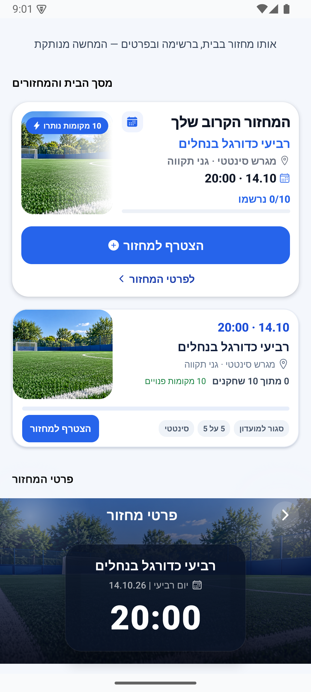

## סבב דיווחים — 12.10.2026

`HomeRoundCards.TONE.opensSoon` משתמש ב־`#15803D` ו־`#ECFDF3`; הכותרת, התג, האייקונים, הודעת התזמון והכפתור נצבעים מאותו מקור. הטקסט ״טרם נפתח״ וההפניה לפרטים נשארים, ואין שינוי לזכאות או לזמן ההרשמה. [צילום רכיב הדמו](../screenshots/pulse-scheduled-green-2026-10-12.png).

ב־`HomeDashboardParts` שורת הפעולות נמתחת, גובה מינימום 150, תיאור בגובה מינימום שתי שורות וחץ המיושר לתחתית. לא נקבע גובה מקסימום, כך שהגדלת גופן יכולה להגדיל את השורה. [גובה הכרטיסים](../screenshots/pulse-home-tiles-2026-10-12.png). זהו תיקון כרטיסי הפעולה; גובה שקופיות הסטטיסטיקה ממשיך להתאים לתוכן כפי שאופיין קודם. `FootballDataIllustration` משתמש בתמונה השקופה המקומית `football-data-v2.png`, שנוצרה בכלי יצירת התמונות ונבדקה במסך המרונדר. [איור בכרטיס הכושר](../screenshots/pulse-home-illustration-2026-10-12.png). לא השתנו מונים, ציונים או מכנים.

התיקונים מקומיים וטרם הופצו. מקור: `ec536c6f` עם שינויים מקומיים. [דוח הסבב ומגבלות הבדיקה](../../changes/2026-10-12-pulse-sweep.md).

## גובה אחיד בקרוסלה — 12.10.2026

כרטיסי הציונים, המספרים והשותף משתמשים מעתה בגובה משותף לפי הכרטיס הגבוה ביותר. מעבר ביניהם אינו מקפיץ את התוכן שמתחת. המדידה מתאימה לרוחב ולגודל הגופן; הנתונים אינם משתנים. באימולטור אנדרואיד נמדד גובה אחיד של 703 פיקסלים בשלושת הכרטיסים, וכרטיס הפעולה שמתחת נשאר באותו מקום. התנהגות הגובה המותאם לכל שקופית שתועדה קודם הוחלפה. אייפון וגופן מוגדל לא הורצו. [הסבר טכני וראיות](../../changes/2026-10-12-home-carousel-height.md).

## בועת ההדרכה — 13.10.2026

HomeGuideOverlay משתמש במשטח הדיאלוג ובהחשכה המשותפים. הדמות, זנב הבועה ותוכן ההדרכה נשמרו, ואין שינוי בזכאות להצגה או בסגירה. [צילום רכיב אמיתי בדמו](../screenshots/overlays-home-guide-2026-10-13.png). הראיה היא למצב מוצג בגופן רגיל באנדרואיד בלבד, לא לכל תנאי הכניסה להדרכה.

הבהרת הכיסוי מ־13.10.2026: רכיב HomeGuideOverlay אינו מחובר כיום למסך הבית. הצילום נפתח רק בכלי הבדיקה; עדכון הרכיב לא מוסיף חלונית הדרכה למשתמשים. אין טענה שנבדקו תנאי הצגתה בזרימת מוצר.

## סבב פולס — 15.10.2026

`HomePersonalStats` ממרכז את שלושת המספרים בתוך `minHeight:cardHeight-34`. המדידה הטבעית והתוספת 34 נשמרות כדי למנוע הגדלה מחזורית. לא השתנו מונים או מכנים. אומתו 38 שערים, 16 בישולים ו־49 מחזורים בנתוני המחשה בלבד.

השינויים בסבב זה מקומיים וטרם הופצו. [דוח הסבב](../../changes/2026-10-15-pulse-sweep.md).

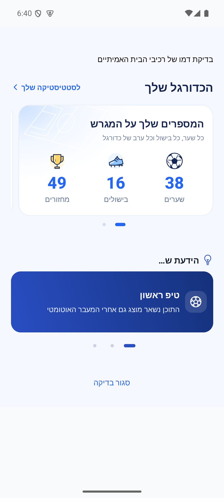

## השלמת שני דיווחים נוספים — 15.10.2026

ב־HomePersonalStats הוסר justifyContent:center ממעטפת הכרטיס numbers. הכותרת וההסבר נשארים בראש; מעטפת numbersBody עם flexGrow:1 ממרכזת רק את אזור שלושת המספרים. מדידת cardHeight והוספת 34 נשמרו כדי למנוע הגדלה חוזרת. נצפו 38 שערים, 16 בישולים ו־49 מחזורים ברכיב האמיתי בתרחיש דמו. אין שינוי במונים, במכנים או במעבר הקרוסלה.

תיקון מקומי לאחר 1.1.51. צילום רינדור של קוד הרכיב באנדרואיד דמו; ללא נתוני המדווח, כתיבת ייצור או בדיקת אייפון.

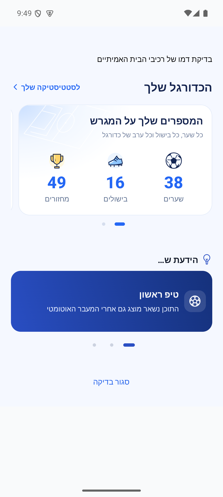

## הצעת עדכון בכותרת — 17.10.2026

`HomeHero` קורא את זכאות ההצעה מ־`useUpdatePromptStore`. במצב `optional`, `UpdateBanner` מחליף את שורת התפריט/פעמון/אווטאר בכרטיס התואם לתמונת הבעלים, מעל אותה ברכה ועל אותו מגרש. סגירה או ״אחר כך״ מחזירות את השורה; אין שינוי במקור המחזורים, החשבון או הסטטיסטיקה. הכרטיס מופיע בבית ממוקד בלבד, אינו חלון חוסם, ושערים אחרים ממשיכים לעבוד. במצב `force` נשמר חלון השורש.

כפתור העדכון פותח חנות עם מדידת לחיצה, פתיחה והשלמה לאחר הופעת בינארי חדש. [תנאי גרסאות, נתונים, דחייה, מדידה ובדיקות](../shared/global-gates.md#חלונית-עדכון-לפי-החנות-ומדידת-השלמה--17102026). נצפה באנדרואיד דמו רגיל וב־320 נקודות עם גופן 1.4; טקסט ההסבר נשבר לשתי שורות בלי חיתוך. אין ראיית חנות חיה או אייפון.

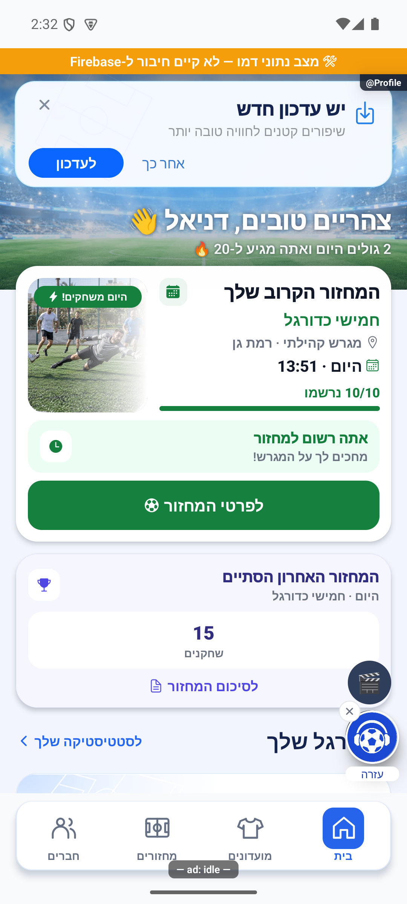

## הפצה פנימית — 17.10.2026

שינויי הלקוח האחרונים המתועדים כאן נכללו בבינארי הפנימי `1.1.53 / 286` באנדרואיד. המסלול אומת בגוגל; הייצור נשאר בגרסה הקודמת. זה אינו אימות חדש של תרחיש ייצור או של מכשיר אפל. [מקור הבינארי, פריסת השרת, בדיקות ומגבלות](../../changes/2026-10-17-internal-1.1.53.md).

## סבב פולס — 18.10.2026

`HomePersonalStats` משתמש באותו `StatisticsIllustration kind=ball` שהוחלף לתמונה. המונים, סדר הכרטיסים, התנועה ומכני המחזורים לא שונו. צילום הרכיב המשותף הוא בדיקת נכס התמונה, ואינו צילום מסך הבית כולו.

השינויים מקומיים וטרם הופצו. לא שונו הרשאות ולא נשלחו הזמנות או הודעות. בדיקת הדפדפן משתמשת בקוד הרכיבים בפועל, במתאם סגנונות, בסמלים חלופיים ובנתוני הדגמה; אינה הוכחת אנדרואיד או אייפון. שני האמולטורים לא הגיבו לפקודות או לצילום בסבב זה.

## תלות בעדכון העונות — 19.10.2026

נבדק ההפרש בקבצים המשותפים הרשומים כאן: `src/firebase/firestore.ts`. השינוי ממוקד במדיניות העונות, קריאת מצבן, שיוך מחזור ופקודות ניהולן; אין שינוי מכוון בחוזה העצמאי המתואר במסמך זה. אין להסיק מכך שהמסך הזה הורץ מחדש.

[מצב המימוש, הבדיקות ומגבלות האימות של העונות](../clubs/seasons.md). מקומי בלבד; לא בוצעה פריסה במסגרת המשימה.

## תלות במסך הבית — 20.10.2026

`src/screens/tabs/ProfileScreen.tsx` השתנה בשכבת התצוגה של כרטיס `seasonClosed` בלבד. מנגנון הגלילה, הנתונים והפעולות של לוח הבית לא השתנו; לא בוצע אימות מסך באמולטור כי לא היה מכשיר מחובר.

הכרטיס הסופי משתמש ב־`LinearGradient`, גביע לבן בצד שמאל החזותי, טקסט לבן וכפתור מסגרת. לא השתנו קריאות הנתונים, מנגנון הגלילה או פעולות לוח הבית.

## תלות במידע על סגירת עונה — 23.10.2026

בדיקת ההבדל ב־`src/firebase/firestore.ts` וב־`src/types/index.ts` מראה שהשינוי מוגבל לקריאת `seasons.closureStatus` בחוזה `GroupSeasons`. יתר ממירי הנתונים והמסלולים המתועדים כאן לא שונו במשימה זו. אימות הריצה החדש מתייחס להתאוששות ולכרטיס העונה, ולא להרצה חדשה של כל מצבי המסך הזה. [המסלול, הבדיקות והמגבלות](../../changes/2026-10-23-season-automatic-recovery.md).

## בידוד מונה בקשות והתאוששות מרקע — 23.10.2026

`groupService.listForUser(userId, { includeAdminRatings: false })` מחזיר את נתוני החברות ללא קריאות `getClubAdminRatings` וללא שדה דירוגים. ברירת המחדל של מסכי המועדון שומרת את טעינת הדירוגים ואת התנהגות הכשל הקיימת. `requestsService.myAdminGroupsWithPending` משתמש במסלול המצומצם: מספר בקשות חברות + סכום הממתינים במועדונים שמנוהלים בידי המשתמש + סכום הממתינים במחזורים שיצר. אין שינוי במכנה או בהרשאות. אפקט המיקוד של מונה הבית מאזין גם ל־`AppState`: מעבר מצב מבטל דור קודם, חזרה ל־`active` מבצעת קריאה חדשה; ניקוי מסיר מאזין ומונע תוצאה מאוחרת. `inboxRatingsIsolation` מריץ את מתודות המקור ומוכיח ספירה של 4 גם כששרת הדירוגים נכשל ושימור כשל מקור אמיתי; `homeInboxResume` מריץ את אפקט המקור ומאמת תוצאה חדשה מול ישנה, ניקוי ואורח. אין כאן הוכחת פתרון לכל חריגת זמן, חיבור רשת או כניסת אפל. אין אימות מכשיר חדש של תרחיש רשת זה. [הסבר, יומני שרת ומגבלות](../../changes/2026-10-23-inbox-resume.md).

## תיקון מסבב הפולס החוזר — 23.10.2026

נבדקו התקלות מול צילומי הדיווח והמקורות. רשת זמינות ותיקה מתרחבת לכל השעות כאשר נשמרו ימים ללא שעות; רשת מפורשת ריקה אינה משתנה. שכבות הקרוסלה ממלאות מסגרת אחת שנמדדת לפי הטיפ הגבוה ביותר. חלונית שמירת עונה משתמשת בעיצוב הכדורגל הקיים, תוך שימור חסימת השמירה. העשרת תמונת מועדונים מקבלת ניסיון נוסף בכשל זמני ומבטלת תוצאה של חשבון או דור ישן. כשל ספק כתובות אנדרואיד המסוים נשאר בגיבוי מיקום ועיר ולא מוצג כתקלה באפליקציה. פירוט נקודות החיבור, המקרים שלא השתנו והבדיקות נמצא ב[דוח הסבב](../../changes/2026-10-23-pulse-resweep.md); אין להסיק שכל הפעולות בפיצ׳ר שונו.

הצילומים `pulse-resweep-before-2026-10-23.png`, `pulse-resweep-after-2026-10-23.png`, `pulse-dialog-before-2026-10-23.png`, `pulse-dialog-after-2026-10-23.png` רשומים במניפסט. הם מרכיבי מקור עם נתוני דמה, ולא מסכי ייצור. הקוד מקומי וטרם הופץ.

## תלות בשמירת צבעי המחזור — 24.10.2026

במסגרת בחירת צבעים לפני שיבוץ עודכנו מקורות משותפים הרשומים לפיצ׳ר: `src/firebase/firestore.ts`, `src/types/index.ts`. השינוי מוסיף מפת צבעים למחזור, קריאה וכתיבה שלה ושימורה במסלולי הכוחות וההכנה. אין כאן פעולת ממשק חדשה במסך זה. זו בדיקת השפעת התוספת הממוקדת, ולא חקירה או אימות חזותי מחודש של הפיצ׳ר. כל 480 חבילות הבדיקה ו־5,343 הבדיקות עברו; טיפוסי הלקוח והשרת נקיים. השינוי מקומי וטרם הופץ. [מסלול הנתונים, ראיות ומגבלות](../rounds/draft-setup.md#צבעים-לפני-שיבוץ-ובכל-שיטת-חלוקה--24102026).

בדיקות הסרת הכפתור: טיפוסים נקיים; 480 חבילות ו־5,343 בדיקות עברו. [דוח השינוי והמגבלות](../../changes/2026-10-24-home-crash-button-removal.md).

## המשך קיצור טעינות בלילה של 25.10.2026

כרטיסי המחזור הקרוב והמחזור שהסתיים בבית משתמשים כעת באותה בקשה פעילה של `src/services/gameService.ts`, גם לפני קבלת תשובה ראשונה. שתי שאילתות המשתתף והיוצר אינן נשלחות פעמיים. חישוב ההישגים שמפעיל הבית משתמש בקריאות המקבילות של `src/services/achievementsService.ts`, עם אותם מונים ומסלולי כשל. לא השתנו רישומי המיקוד, הניווט או העיצוב בבית. בדיקות גופי השירות מוכיחות את מספר הקריאות ואת שמירת המונים; זו אינה מדידת מכשיר. [חוזה כרטיסי המחזור](round-cards.md), [חוזה ההישגים](../profile/achievements.md). [בדיקות, ראיות ומגבלות](../../changes/2026-10-24-loading-performance.md).

## תגובה מיידית לכפתורי השעון - 25.10.2026

נבדק ההפרש ב-`src/services/gameService.ts`: פעולות התחלת והשהיית שעון מחזירות את מצב הלייב מהעסקה הקיימת לשימוש בתגובת התצוגה. אין שינוי בעוגני הזמן, בכתיבות, בהגנות מעבר משחק או במידע שהקוראים האחרים שומרים. אין הרצה חדשה של כל מצבי הפיצר המתואר כאן. [בדיקות, ראיות ומגבלות](../../changes/2026-10-25-live-timer-response.md). התיקון מקומי וטרם הופץ.

## תאימות לשמירת פקודת רכיב הבית - 25.10.2026

השינוי התחום במקורות המשותפים `src/types/index.ts` ו-`src/firebase/firestore.ts` מוסיף ומשמר את `liveMatch.lastWidgetCommandId`, מזהה אטום למניעת ביצוע חוזר של פקודת רכיב הבית. הוא אופציונלי במסמכים ישנים ואינו משנה מונים, הכרעות, ניווט או הרשאות של הפיצר המתואר כאן. בדיקה מפעילה את ממיר הקריאה המקורי ומאמתת שימור ערך והיעדרו. אין בכך בדיקת מכשיר חדשה לכל מצבי הפיצר. [מקור הבדיקה והמגבלות](../../changes/2026-10-25-widget-completion.md).
