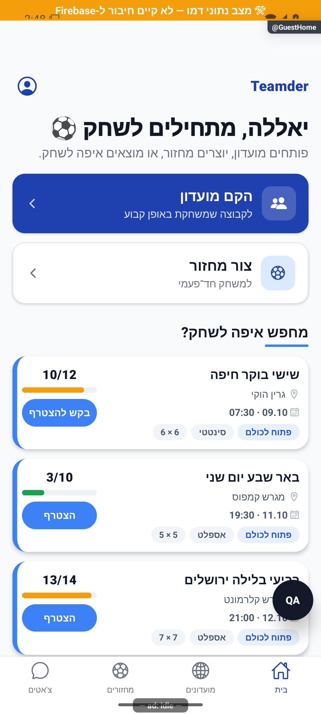

# בית אורח וגילוי ראשוני

## הרחבת אבחון דיווחים, 27.10.2026

נוספה מעטפת אבחון מקומית עם מצב בזמן הכשל, שלבים בעלי מזהה ותזמון, מצב רשת ובנייה ומופעים נפרדים לשגיאה. נקודת הכניסה לתעבורת השרת עוברת כעת דרך העטיפה המשותפת; תשובות, חריגות, אפשרויות קריאה ומדיניות הפיצר נשמרות. אין כאן שינוי בהרשאות או בחישובי המוצר. הבדיקות המלאות ומגבלות האימות מתועדות בדוח המקושר; אין טענה לאימות מכשיר או להפצה. [היקף, ראיות ומגבלות](../../changes/2026-10-27-diagnostic-context.md).

באימות הסופי עברו כל 6,231 הבדיקות ב-555 חבילות, ובדיקות הטיפוסים של הלקוח, השרת והפולס נקיות. צילום הדפדפן והידור מקורות האנדרואיד הם בדיקות מקומיות; אין הוכחת מכשיר, הידור אייפון או מסירה חיה של הבנייה החדשה. רישום יומן השחרור נחשב מאומת רק לפי קבלת הקריאה החוזרת בדוח השינוי.

## שעון מדויק וכיתוב פנדל - 25.10.2026

במקורות המשותפים נוסף שימור השעון המדויק של פנדל במהלך משחק, וכיתוב ההבקעה ביומן קוצר. אין שינוי במונים או בתהליך העצמאי המתואר כאן; לא נערכה לו בדיקת ממשק חדשה במסגרת העדכון. השינוי מקומי וטרם הופץ. [פרטים וראיות](../../changes/2026-10-25-in-play-penalties.md#שעון-מדויק-וכיתוב-אירוע).

## פנדל במהלך משחק חי - 25.10.2026

נבדק השינוי הממוקד במקורות המשותפים: נוספו חוזי אירועי פנדל במהלך משחק, קוראים ומוני סטטיסטיקה, והגנות בעסקאות סיום ואיפוס משחק. מסלול הפיצר המתואר כאן אינו נקודת הכניסה להזנה החדשה. בדיקות המאגר עברו, אך אינן הוכחת הרצה חדשה של כל מצבי התהליך או של פריסה.

השינוי מקומי. נדרשת פריסת שרת לפני הפצת לקוח שמשתמש באפשרות; לא בוצעו פריסה או שינוי הרשאות. [חוזה הנתונים, התהליך, הבדיקות ומגבלות ההפצה](../../changes/2026-10-25-in-play-penalties.md).

## תיעוד כשלים — 20.10.2026

נוספו תצפיות דיווח בנקודות הכשל של המקורות המשויכים לפיצ׳ר, במסגרת הרחבה רוחבית. נשמרו ערכי החזרה, הזריקות ותנאי הפעולה הקיימים; נוסף מקור קוד והקשר לדיווח. כיסוי תחבירי אינו הוכחת הרצה של כל מצב. השינוי מקומי וטרם הופץ; בדיקות המסירה, מגבלות מניעת הכפילויות והמסלולים שטרם חוברו מתועדים בדוח המשותף.

[דוח דיווח השגיאות והראיות](../../changes/2026-10-20-error-reporting-audit.md).

[לקריאה קצרה ופשוטה](guest-home.simple.md)

עודכן: 07.10.2026; מקור `8e8fde5`, `1.1.35` בבנייה. `src/screens/home/GuestHomeScreen.tsx`, מסלול `GuestHome`. תפקיד מיועד: אורח אנונימי; ניתן להרכיב את המסך בדמו גם כשזהות הדמו מלאה.

## אזורים ונתיבי פעולה

בראש מיתוג, כניסה לחשבון וכותרת להתחלת משחק. שני כרטיסים מציעים הקמת מועדון קבוע ומחזור חד־פעמי. מתחת רשימת מחזורים ציבוריים קרובים, פעולה לצפייה בכל המחזורים וקיצורי זמינות לפי התנאים. המשתמש יכול לראות מידע לפני הרשמה; בקשת כתיבה נעצרת בחלון הרשמה בהקשר הפעולה.

בצילום נצפו כרטיס הקמת מועדון כחול, כרטיס מחזור לבן ושלושה מחזורים עם תפוסות 10/12, 3/10, 13/14. זהו אימות תצוגה בלבד; פתיחת `GuestHome` אינה משנה את זהות ההזדהות ולא מוכיחה גישה אנונימית למסד.

## מצבים ומעברים

| תנאי/פעולה | תגובה | כתיבה | ראיה |
|---|---|---|---|
| קריאת מחזורים בטעינה | תצוגת טעינה | אין | קוד |
| קריאה נכשלה | כשל וניסיון חוזר | אין | קוד |
| אין מחזורים ציבוריים מתאימים | הזמנה ליצור מחזור, ללא רשימה מומצאת | אין | קוד |
| יש מחזורים | רשימה מוגבלת לפי קבוע הגילוי | אין | דמו וקוד |
| הקמת מועדון/מחזור חד־פעמי | פתיחת האשף; שימור טיוטה לפני הרשמה | יצירה רק לאחר חשבון ואימות | קוד |
| הצטרפות למחזור | פרטי יעד ושער פעולה | פעולה ממתינה ואחר כך עסקת הצטרפות | קוד |
| התחברות/ביטול | חלון חשבון; ביטול משאיר יכולת גלישה | זהות ספק, לא עסקה אוטומטית | קוד |
| חזרה במיקוד עם טיוטה | שחזור יצירת מועדון קודם למחזור לפי המתאם | אחסון מקומי עד אישור | קוד |

## שירותים ובדיקות

המסך קורא מחזורים פתוחים דרך `gameService.getOpenGames` ומגביל את הרשימה בצד התצוגה. `src/hooks/useAuthenticatedAction.tsx`, `src/services/draftStore.ts`, `src/services/actionResumers.ts` ו־`src/store/entryStore.ts` אחראים לחזרת הטיוטה; תוקף שבעה ימים אינו הרשאה לביצוע. ממיר המחזור ב־`src/firebase/firestore.ts` עדיין נדרש בקריאה אמיתית. אין להחליף שגיאת קריאה ברשימה ריקה.

בדיקות: `tests/guestHomeWiring.test.ts`, `tests/guestAuthEntryPoints.test.ts`, `tests/logic/draftStore.test.ts`. [התחברות](../entry/authentication.md) ו־[פעולה ממתינה](../entry/pending-actions.md) מכסות את ההמשך.

## מגבלות ושחזור

מסך הבית הישן של אורח באודיט 004 אינו העיצוב הנוכחי. בדיקה עתידית צריכה לזהות אורח אמיתי, פתיחה אורגנית אחרי בחירת כוונה, חזרה מטיוטה, כשל מחזורים, ביטול הרשמה וחזרה מרשימת כל המחזורים. לא נבדקו כאן חשבון אורגני, הרשאות קריאה אנונימיות מול השרת או ביצוע יצירה. אין לייצר חשבון נוסף לצורך הבדיקה בלי חשבון הבדיקה המאושר.

## פירוט מימוש ונקודות שינוי — העמקה 07.10.2026

`load` מפעיל `getOpenGames(user.id, myCommunities.map(g => g.id))` ומגביל ל־`DISCOVERY_LIMIT = 3`. מצב גילוי הוא איחוד מפורש `loading`/`ready`/`error`; כשל הגילוי אינו מוחק את כרטיסי היצירה או את ההסבר. הטעינה הראשונית תלויה במזהה המשתמש; אין להניח שכל מיקוד טוען מחדש את הרשימה.

הבדיקה במיקוד לטיוטה קוראת קודם `draftStore.read('club')`, ורק אם אין — טיוטת מחזור. `alive` מונע עדכון לאחר יציאה. `continueDraft` פותח את האשף, והפקיעה נאכפת בקריאה. שינוי קיצור או כרטיס צריך לעבור דרך `openCreateClub`, `openCreateGame`, `openAvailability`, `openAllGames` ו־`openAccount`, כדי לשמור את מקור המדידה והכוונה. פתיחת מסך בדמו אינה מחליפה משתמש לאנונימי ואינה מאמתת את מסמכי הגילוי הציבוריים.

הבדיקות, מצבי המסך והראיות שכבר פורטו במסמך נשמרו. ההעמקה מבוססת על קריאת מקור ולא על הרצת פעולות נוספות; שינוי עתידי יצריך עדכון של שני המסמכים ובחינת המצבים הממוקדים.

## תלות בעדכון העונות — 19.10.2026

נבדק ההפרש בקבצים המשותפים הרשומים כאן: `src/firebase/firestore.ts`. השינוי ממוקד במדיניות העונות, קריאת מצבן, שיוך מחזור ופקודות ניהולן; אין שינוי מכוון בחוזה העצמאי המתואר במסמך זה. אין להסיק מכך שהמסך הזה הורץ מחדש.

[מצב המימוש, הבדיקות ומגבלות האימות של העונות](../clubs/seasons.md). מקומי בלבד; לא בוצעה פריסה במסגרת המשימה.

## תלות במידע על סגירת עונה — 23.10.2026

בדיקת ההבדל ב־`src/firebase/firestore.ts` וב־`src/types/index.ts` מראה שהשינוי מוגבל לקריאת `seasons.closureStatus` בחוזה `GroupSeasons`. יתר ממירי הנתונים והמסלולים המתועדים כאן לא שונו במשימה זו. אימות הריצה החדש מתייחס להתאוששות ולכרטיס העונה, ולא להרצה חדשה של כל מצבי המסך הזה. [המסלול, הבדיקות והמגבלות](../../changes/2026-10-23-season-automatic-recovery.md).

## תלות בשמירת צבעי המחזור — 24.10.2026

במסגרת בחירת צבעים לפני שיבוץ עודכנו מקורות משותפים הרשומים לפיצ׳ר: `src/firebase/firestore.ts`, `src/types/index.ts`. השינוי מוסיף מפת צבעים למחזור, קריאה וכתיבה שלה ושימורה במסלולי הכוחות וההכנה. אין כאן פעולת ממשק חדשה במסך זה. זו בדיקת השפעת התוספת הממוקדת, ולא חקירה או אימות חזותי מחודש של הפיצ׳ר. כל 480 חבילות הבדיקה ו־5,343 הבדיקות עברו; טיפוסי הלקוח והשרת נקיים. השינוי מקומי וטרם הופץ. [מסלול הנתונים, ראיות ומגבלות](../rounds/draft-setup.md#צבעים-לפני-שיבוץ-ובכל-שיטת-חלוקה--24102026).

## תאימות לשמירת פקודת רכיב הבית - 25.10.2026

השינוי התחום במקורות המשותפים `src/types/index.ts` ו-`src/firebase/firestore.ts` מוסיף ומשמר את `liveMatch.lastWidgetCommandId`, מזהה אטום למניעת ביצוע חוזר של פקודת רכיב הבית. הוא אופציונלי במסמכים ישנים ואינו משנה מונים, הכרעות, ניווט או הרשאות של הפיצר המתואר כאן. בדיקה מפעילה את ממיר הקריאה המקורי ומאמתת שימור ערך והיעדרו. אין בכך בדיקת מכשיר חדשה לכל מצבי הפיצר. [מקור הבדיקה והמגבלות](../../changes/2026-10-25-widget-completion.md).
