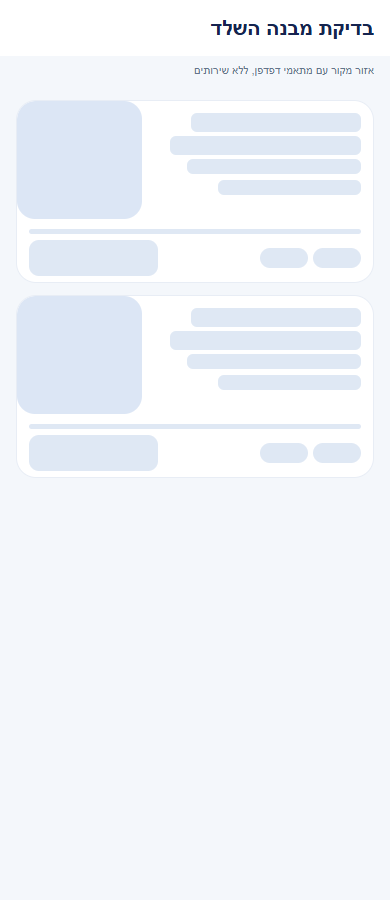
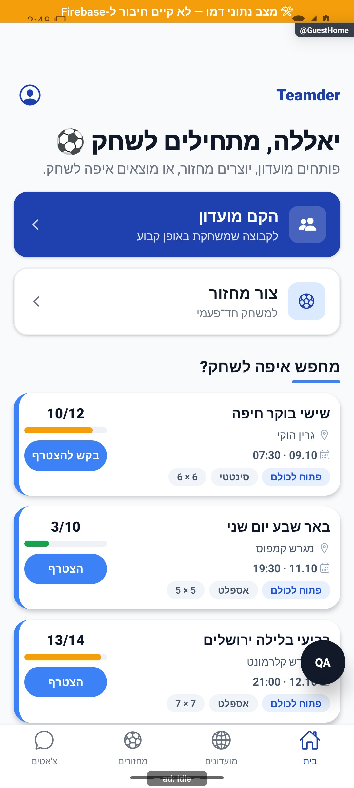

# בית אורח וגילוי ראשוני

## מדידת פעולות ואמינות נתונים, 5.11.2026

במיפוי מקור הרכיבים המוזכרים במסמך נמצאו 9 נקודות מטפל ו-9 מזהי פעולה. הספירה מתארת קוד וכוללת רכיבים משותפים; אין לחבר אותה לספירות של מסמכים אחרים ואין לראות בה הרצת כל המסך. המדידה מפורטת לפי גבול פקד מקורי, פעולה עסקית ומצב חשבון. תשובה מאוחרת נבדקת מול בעל הפעולה, ומצב קיים או בקשה חוזרת אינם תמיד הצלחה חדשה. רשימת המקרים שהורצו ומגבלות המסד, המכשיר והכיסוי נשמרות [בדוח המדידה](../../audits/2026-11-04-system-night/product-measurement.md) ובדוחות המקושרים אליו. המימוש מקומי; לא בוצעה בדיקה חדשה של כל מצבי הפיצר.

## חיפוש שחקנים וזמני טעינה, 4.11.2026

קריאת מחזורים עתידיים של מועדון יכולה להעביר כשל גישה לחלונית ההזמנה כשהיא מבקשת תשובה מאומתת. ברירת המחדל של יתר הקוראים נשמרת. בדיקה זו תחומה למקור המשותף, ללא הרצה חדשה של כל המסך העצמאי. מימוש מקומי שטרם הופץ. [השינוי, המדידות והבדיקות](../../changes/2026-11-04-player-discovery-speed.md).

## ציר פעילות פרטי בפולס, 4.11.2026

נבדקו התוספות במקורות המשותפים לצורך ציר פעילות פרטי בפולס: דיווח ניווט והקשר, תיעוד ניסיון הרשמה ותוצאתו וגבולות זהות ומחיקת חשבון. התוספת היא תיעוד ברקע במקומות הנתמכים; אין מכך אימות חדש של כל מצבי הפיצר הזה או שינוי בחישוביו. מקומי וטרם הופץ או נפרס. [היקף, מקורות, בדיקות ומגבלות](../shared/usage-activity.md).

## הפצה פנימית 1.1.74, 3.11.2026

עדכוני הלקוח ב-`src/components/anim/MatchCardSkeleton.tsx` כלולים בחבילה הפנימית 1.1.74/306. ארכיון המקור המקומי וחתימת החבילה אומתו מול החבילה שהחזירה גוגל. מקור הבסיס הוא `06417f6132f4c7636aaee25574354ed7722966b9` עם שינויים שלא נשמרו לגיט.

עברו 6864 בדיקות יישום, בדיקות טיפוסים, 360 בדיקות הרשאות בסדרה ו-38 בדיקות שרת במסד הדגמה. ההרשאות והשירותים הפעילים נשמרו, ללא הסבת נתונים או קידום לייצור. האימות החזותי הוא מצילומי המקור בדפדפן שכבר תועדו, ללא התקנה או הרצת הפיצר הזה במכשיר בגרסה החדשה. אין בכך הכרזה על הפצת שינויים אחרים המתועדים במסמך. [מקור, קבלות, תכולה ומגבלות](../../changes/2026-11-03-internal-1.1.74.md).

## התאמת מבנה שלדי הטעינה, 3.11.2026

באזורים המשויכים לפיצר הזה נבדק שלד `rounds` במתאם דפדפן. אין בכך אימות המסך המלא או כל מצב נתונים. ההתאמה עוסקת בפריסה ובהודעת ההמתנה הנגישה; שירותי הטעינה, מצבי הכשל, המיון, החישובים, המכנים והניווט נשארו ללא שינוי. מקורות משויכים שנערכו: `src/components/anim/MatchCardSkeleton.tsx`.

[טבלת השינויים לפי אזור, המידות, השוואות למקור, הבדיקות והמגבלות](../../changes/2026-11-03-skeleton-layout-alignment.md). מקומי וטרם הופץ, ללא בדיקת מכשיר או שרת חי חדשה.

אימות במשימה זו: 6,820 בדיקות ב-608 חבילות ובדיקת טיפוסים עברו; 84 בדיקות רוחב של אזורי מקור ותשע השוואות מידות לכרטיסים אמיתיים עברו. אין בכך אימות מכשיר חדש של הפיצר או של מצבי נתונים שלא נבדקו.

## ליטוש מקומי והשפעת רכיבים, 3.11.2026

ההשפעה היא במסלול היוצא מבית האורח, לא בנתוני הגילוי: `src/services/actionResumers.ts` מקבל סיכום הזמנות אופציונלי מ-`createGameFromValues` ושומר תוצאת יצירה סופית גם בכשל משני. קבלה שהושלמה אינה שולחת שוב. `GuestHome` נשאר ברשימת המסלולים שבהם בועת העזרה נראית; הטיוטה והכניסה לעזרה לא שונו. בדיקות היצירה וחידושה עברו במבודד, וכלי הנראות נבדק בטבלת מסלולים. לא הורצה כאן זרימת אורח מלאה או קריאת שרת חדשה של הבית, ואין שינוי בספי גילוי או במספרי הזמינות.

השינוי מקומי וטרם הופץ. אין כאן אימות חדש של מסך מוצר מלא, מכשיר, קורא מסך או שרת. [הראיות והמגבלות של המשימה](../../changes/2026-11-03-overnight-mission.md).

## הרחבת שלדי הטעינה, 2.11.2026

הרכיב המשותף `src/components/anim/MatchCardSkeleton.tsx` עבר לפעימה אחת בכל אזור, עם אותן מידות וכמות הכרטיסים שהצרכן ביקש. קריאות הנתונים, ההזמנה, התפקידים ויעדי הניווט של הפיצר לא שונו. אין אימות מכשיר חדש. מימוש מקומי שטרם הופץ. [התנהגות, בדיקות, צילומים ומגבלות](../../changes/2026-11-02-loading-skeletons-expanded.md).

## אימות פרסום קבוצות בפולס, 2.11.2026

נבדק ההפרש התחום בשירות המשותף של המחזורים: נוספה בדיקת אישור לפרסום קבוצות כאשר תשובת הפעולה אובדת. אין שינוי בחישוב, במכנים או בפעולות העצמאיות של הפיצר המתואר כאן. התיקון מקומי וטרם הופץ; אין בדיקת מכשיר חדשה לפיצר זה.

השינוי ב-`src/services/gameService.ts` מוגבל ל-`publishDraftTeams` ולתלות בסיווג כשלים זמניים. נבדקו גבולות קבלת השרת, התאמת החשבון והחלוקה, ושימור השגיאה כאשר האימות נכשל. `tests/logic/publishTeamsReceipt.test.ts` מפעיל את פונקציית השירות מול תחליפי קריאה וכתיבה; אין בכך הרצת כל המסלולים של המסמך הזה.

[דוח הטיפול, הבדיקות והמגבלות](../../changes/2026-11-02-pulse-sweep.md).

## בקשות לשיחה אישית, 2.11.2026

נבדקה השפעת תוספת בקשות השיחה במקורות המשותפים. השינוי ממוקד בהרשאת שיחה, בשדות פרטיות ההודעות ובחיבורי הבדיקות; אין מכך אימות חדש של מסך זה במכשיר. המימוש מקומי וטרם הופץ או נפרס. [התנהגות, בדיקות ומגבלות](../chat/message-requests.md).

מקורות משותפים שנבדקו בהיקף השינוי הזה: `src/firebase/firestore.ts`, `src/types/index.ts`. אין בסעיף זה טענה להרצת כל המסלולים ההיסטוריים של הפיצר. [מסירת המימוש](../../changes/2026-11-02-message-requests.md).

## החלפת הקבוצה הבועטת בפנדלים, 30.10.2026

נבדק ההבדל התחום במשימה במקורות המשותפים `src/services/gameService.ts`, `src/types/index.ts` ו-`src/firebase/firestore.ts`: הוא מוסיף ומשמר תור מפורש לפנדלי ההכרעה ומעדכן אותו ברישום ובביטול בעיטה. אין שינוי בשדות, בחישובים או במסלול הנתונים העצמאי של הפיצר המתואר כאן. בדיקת הקורא והעסקאות מפורטת בדוח; אין בכך הרצה מחדש של המסך הזה. [התנהגות, בדיקות ומגבלות](../../changes/2026-10-30-shootout-turn.md).

## הרחבת אבחון דיווחים, 27.10.2026

נוספה מעטפת אבחון מקומית עם מצב בזמן הכשל, שלבים בעלי מזהה ותזמון, מצב רשת ובנייה ומופעים נפרדים לשגיאה. נקודת הכניסה לתעבורת השרת עוברת כעת דרך העטיפה המשותפת; תשובות, חריגות, אפשרויות קריאה ומדיניות הפיצר נשמרות. אין כאן שינוי בהרשאות או בחישובי המוצר. הבדיקות המלאות ומגבלות האימות מתועדות בדוח המקושר; אין טענה לאימות מכשיר או להפצה. [היקף, ראיות ומגבלות](../../changes/2026-10-27-diagnostic-context.md).

באימות הסופי עברו כל 6,231 הבדיקות ב-555 חבילות, ובדיקות הטיפוסים של הלקוח, השרת והפולס נקיות. צילום הדפדפן והידור מקורות האנדרואיד הם בדיקות מקומיות; אין הוכחת מכשיר, הידור אייפון או מסירה חיה של הבנייה החדשה. רישום יומן השחרור נחשב מאומת רק לפי קבלת הקריאה החוזרת בדוח השינוי.

## שעון מדויק וכיתוב פנדל - 25.10.2026

במקורות המשותפים נוסף שימור השעון המדויק של פנדל במהלך משחק, וכיתוב ההבקעה ביומן קוצר. אין שינוי במונים או בתהליך העצמאי המתואר כאן; לא נערכה לו בדיקת ממשק חדשה במסגרת העדכון. השינוי מקומי וטרם הופץ. [פרטים וראיות](../../changes/2026-10-25-in-play-penalties.md#שעון-מדויק-וכיתוב-אירוע).

## פנדל במהלך משחק חי - 25.10.2026

נבדק השינוי הממוקד במקורות המשותפים: נוספו חוזי אירועי פנדל במהלך משחק, קוראים ומוני סטטיסטיקה, והגנות בעסקאות סיום ואיפוס משחק. מסלול הפיצר המתואר כאן אינו נקודת הכניסה להזנה החדשה. בדיקות המאגר עברו, אך אינן הוכחת הרצה חדשה של כל מצבי התהליך או של פריסה.

השינוי מקומי. נדרשת פריסת שרת לפני הפצת לקוח שמשתמש באפשרות; לא בוצעו פריסה או שינוי הרשאות. [חוזה הנתונים, התהליך, הבדיקות ומגבלות ההפצה](../../changes/2026-10-25-in-play-penalties.md).

## תיעוד כשלים — 20.10.2026

נוספו תצפיות דיווח בנקודות הכשל של המקורות המשויכים לפיצ׳ר, במסגרת הרחבה רוחבית. נשמרו ערכי החזרה, הזריקות ותנאי הפעולה הקיימים; נוסף מקור קוד והקשר לדיווח. כיסוי תחבירי אינו הוכחת הרצה של כל מצב. השינוי מקומי וטרם הופץ; בדיקות המסירה, מגבלות מניעת הכפילויות והמסלולים שטרם חוברו מתועדים בדוח המשותף.

[דוח דיווח השגיאות והראיות](../../changes/2026-10-20-error-reporting-audit.md).

[לקריאה קצרה ופשוטה](guest-home.simple.md)

עודכן: 07.10.2026; מקור `8e8fde5`, `1.1.35` בבנייה. `src/screens/home/GuestHomeScreen.tsx`, מסלול `GuestHome`. תפקיד מיועד: אורח אנונימי; ניתן להרכיב את המסך בדמו גם כשזהות הדמו מלאה.

## אזורים ונתיבי פעולה

בראש מיתוג, כניסה לחשבון וכותרת להתחלת משחק. שני כרטיסים מציעים הקמת מועדון קבוע ומחזור חד־פעמי. מתחת רשימת מחזורים ציבוריים קרובים, פעולה לצפייה בכל המחזורים וקיצורי זמינות לפי התנאים. המשתמש יכול לראות מידע לפני הרשמה; בקשת כתיבה נעצרת בחלון הרשמה בהקשר הפעולה.

בצילום נצפו כרטיס הקמת מועדון כחול, כרטיס מחזור לבן ושלושה מחזורים עם תפוסות 10/12, 3/10, 13/14. זהו אימות תצוגה בלבד; פתיחת `GuestHome` אינה משנה את זהות ההזדהות ולא מוכיחה גישה אנונימית למסד.

## מצבים ומעברים

| תנאי/פעולה | תגובה | כתיבה | ראיה |
|---|---|---|---|
| קריאת מחזורים בטעינה | תצוגת טעינה | אין | קוד |
| קריאה נכשלה | כשל וניסיון חוזר | אין | קוד |
| אין מחזורים ציבוריים מתאימים | הזמנה ליצור מחזור, ללא רשימה מומצאת | אין | קוד |
| יש מחזורים | רשימה מוגבלת לפי קבוע הגילוי | אין | דמו וקוד |
| הקמת מועדון/מחזור חד־פעמי | פתיחת האשף; שימור טיוטה לפני הרשמה | יצירה רק לאחר חשבון ואימות | קוד |
| הצטרפות למחזור | פרטי יעד ושער פעולה | פעולה ממתינה ואחר כך עסקת הצטרפות | קוד |
| התחברות/ביטול | חלון חשבון; ביטול משאיר יכולת גלישה | זהות ספק, לא עסקה אוטומטית | קוד |
| חזרה במיקוד עם טיוטה | שחזור יצירת מועדון קודם למחזור לפי המתאם | אחסון מקומי עד אישור | קוד |

## שירותים ובדיקות

המסך קורא מחזורים פתוחים דרך `gameService.getOpenGames` ומגביל את הרשימה בצד התצוגה. `src/hooks/useAuthenticatedAction.tsx`, `src/services/draftStore.ts`, `src/services/actionResumers.ts` ו־`src/store/entryStore.ts` אחראים לחזרת הטיוטה; תוקף שבעה ימים אינו הרשאה לביצוע. ממיר המחזור ב־`src/firebase/firestore.ts` עדיין נדרש בקריאה אמיתית. אין להחליף שגיאת קריאה ברשימה ריקה.

בדיקות: `tests/guestHomeWiring.test.ts`, `tests/guestAuthEntryPoints.test.ts`, `tests/logic/draftStore.test.ts`. [התחברות](../entry/authentication.md) ו־[פעולה ממתינה](../entry/pending-actions.md) מכסות את ההמשך.

## מגבלות ושחזור

מסך הבית הישן של אורח באודיט 004 אינו העיצוב הנוכחי. בדיקה עתידית צריכה לזהות אורח אמיתי, פתיחה אורגנית אחרי בחירת כוונה, חזרה מטיוטה, כשל מחזורים, ביטול הרשמה וחזרה מרשימת כל המחזורים. לא נבדקו כאן חשבון אורגני, הרשאות קריאה אנונימיות מול השרת או ביצוע יצירה. אין לייצר חשבון נוסף לצורך הבדיקה בלי חשבון הבדיקה המאושר.

## פירוט מימוש ונקודות שינוי — העמקה 07.10.2026

`load` מפעיל `getOpenGames(user.id, myCommunities.map(g => g.id))` ומגביל ל־`DISCOVERY_LIMIT = 3`. מצב גילוי הוא איחוד מפורש `loading`/`ready`/`error`; כשל הגילוי אינו מוחק את כרטיסי היצירה או את ההסבר. הטעינה הראשונית תלויה במזהה המשתמש; אין להניח שכל מיקוד טוען מחדש את הרשימה.

הבדיקה במיקוד לטיוטה קוראת קודם `draftStore.read('club')`, ורק אם אין — טיוטת מחזור. `alive` מונע עדכון לאחר יציאה. `continueDraft` פותח את האשף, והפקיעה נאכפת בקריאה. שינוי קיצור או כרטיס צריך לעבור דרך `openCreateClub`, `openCreateGame`, `openAvailability`, `openAllGames` ו־`openAccount`, כדי לשמור את מקור המדידה והכוונה. פתיחת מסך בדמו אינה מחליפה משתמש לאנונימי ואינה מאמתת את מסמכי הגילוי הציבוריים.

הבדיקות, מצבי המסך והראיות שכבר פורטו במסמך נשמרו. ההעמקה מבוססת על קריאת מקור ולא על הרצת פעולות נוספות; שינוי עתידי יצריך עדכון של שני המסמכים ובחינת המצבים הממוקדים.

## תלות בעדכון העונות — 19.10.2026

נבדק ההפרש בקבצים המשותפים הרשומים כאן: `src/firebase/firestore.ts`. השינוי ממוקד במדיניות העונות, קריאת מצבן, שיוך מחזור ופקודות ניהולן; אין שינוי מכוון בחוזה העצמאי המתואר במסמך זה. אין להסיק מכך שהמסך הזה הורץ מחדש.

[מצב המימוש, הבדיקות ומגבלות האימות של העונות](../clubs/seasons.md). מקומי בלבד; לא בוצעה פריסה במסגרת המשימה.

## תלות במידע על סגירת עונה — 23.10.2026

בדיקת ההבדל ב־`src/firebase/firestore.ts` וב־`src/types/index.ts` מראה שהשינוי מוגבל לקריאת `seasons.closureStatus` בחוזה `GroupSeasons`. יתר ממירי הנתונים והמסלולים המתועדים כאן לא שונו במשימה זו. אימות הריצה החדש מתייחס להתאוששות ולכרטיס העונה, ולא להרצה חדשה של כל מצבי המסך הזה. [המסלול, הבדיקות והמגבלות](../../changes/2026-10-23-season-automatic-recovery.md).

## תלות בשמירת צבעי המחזור — 24.10.2026

במסגרת בחירת צבעים לפני שיבוץ עודכנו מקורות משותפים הרשומים לפיצ׳ר: `src/firebase/firestore.ts`, `src/types/index.ts`. השינוי מוסיף מפת צבעים למחזור, קריאה וכתיבה שלה ושימורה במסלולי הכוחות וההכנה. אין כאן פעולת ממשק חדשה במסך זה. זו בדיקת השפעת התוספת הממוקדת, ולא חקירה או אימות חזותי מחודש של הפיצ׳ר. כל 480 חבילות הבדיקה ו־5,343 הבדיקות עברו; טיפוסי הלקוח והשרת נקיים. השינוי מקומי וטרם הופץ. [מסלול הנתונים, ראיות ומגבלות](../rounds/draft-setup.md#צבעים-לפני-שיבוץ-ובכל-שיטת-חלוקה--24102026).

## תאימות לשמירת פקודת רכיב הבית - 25.10.2026

השינוי התחום במקורות המשותפים `src/types/index.ts` ו-`src/firebase/firestore.ts` מוסיף ומשמר את `liveMatch.lastWidgetCommandId`, מזהה אטום למניעת ביצוע חוזר של פקודת רכיב הבית. הוא אופציונלי במסמכים ישנים ואינו משנה מונים, הכרעות, ניווט או הרשאות של הפיצר המתואר כאן. בדיקה מפעילה את ממיר הקריאה המקורי ומאמתת שימור ערך והיעדרו. אין בכך בדיקת מכשיר חדשה לכל מצבי הפיצר. [מקור הבדיקה והמגבלות](../../changes/2026-10-25-widget-completion.md).

## שלמות החלוקה המתוזמנת, 29.10.2026

נבדק השינוי הממוקד במקורות המשותפים: נוספו אזורי קבוצה שש ושבע למתאמי החלוקה ולקורא ההשמות, וסוננו אורחים ממתינים בשני מסלולי היצירה בשרת. אין שינוי בליבת האיזון או בחישובים העצמאיים של המסלול המתואר כאן. 15 בדיקות ממוקדות של החלוקה וקורא הנתונים עברו, וכן בדיקות הטיפוסים של הלקוח והשרת. אין אימות מכשיר חדש, שינוי חזותי מתוכנן או פריסה.

[היקף, בדיקות, פערים פתוחים ומגבלות](../../changes/2026-10-29-scheduled-balance-integrity.md).

## איזון ופיזור רמות לפני גיוון, 30.10.2026

נבדק שינוי תחום במקורות המשותפים של חלוקת הכוחות ומדדי השמירה. החישוב נותן עדיפות לפער ממוצעים, אחריו לפיזור הקצוות ולפרופיל הרמות, ולבסוף לציוותים חוזרים. התג rating_priority_v3 נוסף בלי להסיר קריאת דורות ישנים. אין שינוי מכוון בחישובים העצמאיים או בניווט המתוארים כאן. 112 בדיקות ממוקדות ובדיקות הטיפוסים של הלקוח והשרת עברו; אין בכך הרצה של המסך במכשיר או הפצה.

[מימוש, נוסחאות, בדיקות ומגבלות](../../changes/2026-10-30-rating-balance-priority.md).

## אימות כשלים בקבלת פרסום, 2.11.2026

בבדיקת אישור פרסום הקבוצות, כשל שלא ניתן לאמת כהצלחה נשאר כשל גלוי ונשמר באבחון. הבדיקה אינה שולחת הודעות שוב ואינה משנה הרשאות. השינוי תחום לשירות המשותף, מקומי וטרם הופץ.

נוסף תיעוד תצפית בנקודות הכשל של אימות קבלת הפרסום ב-`src/services/gameService.ts`. בדיקת `tests/logic/authTransientReads.test.ts` סופרת כעת גם את קריאת הקבלה, עם הרשאת ניסיון חוזר לקריאה בלבד; כתיבת תחילת העונה נשארת ללא ניסיון חוזר זמני. אין שינוי בזרימות העצמאיות האחרות המתוארות במסמך זה.

[דוח הטיפול והראיות](../../changes/2026-11-02-pulse-sweep.md).

## תיקו בשתיים או בשלוש קבוצות, 6.11.2026

נבדק שינוי תחום במקורות המשותפים `src/services/gameService.ts`, `src/types/index.ts`: נוסף מסלול סיום משחק בתיקו בשתיים או בשלוש קבוצות, עם בחירה ידנית של הקבוצה שנשארת ושמירה במוני התיקו הקיימים. אין שינוי מכוון בפעולות העצמאיות של הפיצר המתועד כאן. בדיקות המסלול מפעילות שירות לקוח, ממירים וגוף שרת במאגר זיכרון; אין בכך הרצה חדשה של מסך זה. המימוש מקומי, ללא הפצה או פריסת שירות השמירה החדש. [התנהגות, נתונים, בדיקות ומגבלות](../../changes/2026-11-06-manual-draw.md).

## תלות משותפת בציון המחזור החדש, 6.11.2026

נוספה תמיכה מקומית בגרסת ציון למחזורי העתיד ובקריאת הרף הקפוא, תוך שמירת המודל של מחזורים קודמים. השינוי כאן תחום לתלות במקורות המשותפים, ואינו אימות חדש של כל המסלול העצמאי. המקורות המשותפים שנבדקו בהפרש התחום: src/firebase/firestore.ts, src/types/index.ts. אין פריסה, הסבת נתונים או שינוי ציוני עבר. [התנהגות, בדיקות ומגבלות](../../changes/2026-11-06-shared-evening-score.md).
