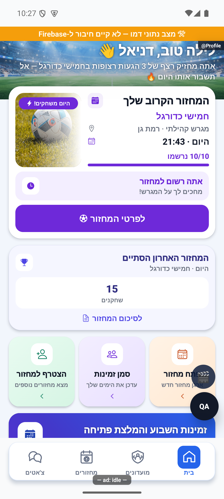

# כרטיסי המחזור הקרוב והמחזור שהסתיים

## תלות משותפת בכפתור בדיקת הקריסה — 23.10.2026

נבדק ההפרש הממוקד ב־`src/screens/tabs/ProfileScreen.tsx` וב־`src/i18n/he.ts`: נוסף כרטיס בדיקת קריסה ומלל הבדיקה בלבד. אין שינוי מכוון בניווט, במספרים או בתנאי הפעולה של הפיצ׳ר המתואר כאן. אין אימות מכשיר חדש של המסלול הזה. [פירוט האימות והמגבלות](../../changes/2026-10-23-crash-test-and-pulse-followup.md).

## עונה שהסתיימה — עיצוב כרטיס הסיכום, 20.10.2026

ב־`ProfileScreen` כרטיס `seasonClosed` נשאר לחיץ וממשיך לנווט ל־`SeasonSummary` עם אותו `groupId` ו־`seasonId`. השינוי הוא בשכבת התצוגה בלבד: הכרטיס משתמש כעת ברקע מדורג כחול־סגול, בגביע לבן בתוך תג בצד השמאלי החזותי, בכותרת `עונה N הסתיימה!`, בתיאור קבוע ובכפתור מסגרת `לצפייה בסיכום`. סדר הילדים נשמר בכיוון המקור כדי ש־`forceRTL` יציב את הטקסט בצד הימני ואת הגביע אחריו; לא נוסף `row-reverse` ולא נוסף `writingDirection`.

הטקסטים הם `עונה N הסתיימה!`, `כנס לראות את הביצועים שלך העונה!` ו־`לצפייה בסיכום`. לא השתנו מקור הנתון, חלון 48 השעות, תנאי ההצגה, הניווט או סימון הקריאה. זהו תיקון חזותי מקומי מעל `f5d74cf3`; לא בוצעה פריסה.

צילום השוואה שסופק בבקשה נשמר כמקור עיצוב חיצוני. צילום חדש של המסך המרונדר ובדיקת RTL באמולטור ממתינים לאמולטור זמין; `adb devices` לא החזיר מכשיר במשימת השינוי, ולכן אין לייחס לסעיף זה אימות מסך בפועל.
## תיעוד כשלים — 20.10.2026

נוספו תצפיות דיווח בנקודות הכשל של המקורות המשויכים לפיצ׳ר, במסגרת הרחבה רוחבית. נשמרו ערכי החזרה, הזריקות ותנאי הפעולה הקיימים; נוסף מקור קוד והקשר לדיווח. כיסוי תחבירי אינו הוכחת הרצה של כל מצב. השינוי מקומי וטרם הופץ; בדיקות המסירה, מגבלות מניעת הכפילויות והמסלולים שטרם חוברו מתועדים בדוח המשותף.

[דוח דיווח השגיאות והראיות](../../changes/2026-10-20-error-reporting-audit.md).

## שורת צירוף ובדיקת הפולס — 17.10.2026

הבית ופרטי המחזור מעבירים knownStartsAt לשירות requestJoinGame. קריאת המחזור המאושרת ובדיקת התנגשות בהרשמות מתחילות במקביל. תשובה מוקדמת משמשת רק כש־data.startsAt שווה לשעה שהמסך הציג; שינוי שעה מחייב בדיקה חוזרת. כשל קריאה מוקדמת נלכד מיד ואינו יוצר דחייה בלתי מטופלת גם אם בדיקת המחזור נעצרת. אין עקיפת מצב מחזור, כרטיס אדום, הרשאות, תור ההוגנות או אישור ההקצאה. בדיקת הסדר מריצה את המתודה האמיתית ומוכיחה חפיפה ובדיקה חוזרת; עדיין אין מדידת קיצור זמן במכשיר המדווח.

[בדיקות, צילומים ומגבלות](../../changes/2026-10-17-roster-recruitment-and-pulse.md).

## בדיקות הפולס והגרסה הפנימית 1.1.55 — 17.10.2026

`PrimaryCta` מקבל את `busy` הקיים מ־`joiningId`, מציג `ActivityIndicator`, מלל שמירה ו־`accessibilityState.busy`. אין השהיה חדשה ואין שינוי בתור, בקיבולת או בבקשות האישור. הדיווח המצורף מדד כ־1.1 שניות מהלחיצה לאירוע ההצטרפות; התיקון הוא משוב גלוי בזמן ההמתנה, ולא טענה לקיצור זמן שרת שלא נמדד מחדש.

[ראיות, בדיקות ומגבלות](../../changes/2026-10-17-internal-1.1.55.md).

## אורחים במונה הסגל של מחזור שהסתיים — 17.10.2026

בבדיקת 11 מול 11 בייצור, כרטיס הבית הציג שני משחקים ושחקן אחד, למרות סגל של חשבון אחד ו־32 אורחים פעילים. `completedMetrics` ב־`src/utils/homeRoundState.ts` מוסיף כעת `activeGuestCount(game.guests)` אל אורך `game.players`, באותו חוזה שבו `deriveRoundState` מחשב רשומים. אורח עם `waitlisted=true` אינו נספר; מסמך ישן ללא `guests` שומר את הספירה הקודמת. מונה המשחקים ממשיך להגיע מ־`committedRoundCount` בלבד, ומדד שגודלו אפס עדיין מושמט. אין קריאת נתונים חדשה, שינוי ממיר או כתיבה. זהו גודל הסגל הרשום במסמך, ללא גזירת נוכחות חדשה, ללא ספירת `participantIds` הכולל גם קהלים נוספים וללא שחזור השתתפות מההרכב האחרון.

המקור `tmp/live-action-production/data-eleven-sealed-proof.json` שנקרא מציג `players.length=1`, 32 אורחים פעילים, אפס אורחים בהמתנה ושתי התחייבויות משחק. הפער קיים גם בקוד שקדם לריפקטור; הבדיקה החדשה חשפה אותו. ארבעה תרחישים נוספו ל־`homeRoundState.test.ts`: חשבון ו־32 אורחים, אורחים בלבד, המתנה שאינה נספרת ומסמך ללא אורחים. הם בודקים מספרי סגל ומשחקים ואת שימור מסמך המקור.

אימות מקורי נפרד: המוביל פתח קר באימולטור אנדרואיד מול מחזור הבדיקה בייצור, ברוחב 411 ובגופן רגיל. [צילום הבית הרגיל](../screenshots/action-pitch-production-eleven-home-guests-fixed-normal-2026-10-17.png), שנפתח ונבחן גם בסקירה עצמאית, מציג 33 שחקנים ושני משחקים. המספרים נצפו גם ב־320×569/140%: [צילום הבית הקטן](../screenshots/action-pitch-production-eleven-home-guests-fixed-small-2026-10-17.png). בצילום הקטן כלי העזרה חופפים חלק מתווית המשחקים אך שני המספרים גלויים. אלו ראיות התצוגה המתוקנת למקור הזה; אין בהן הוכחת נוכחות של כל הרשומים, בדיקת אייפון או בדיקה חזותית של כל ארבעת מקרי הנתונים. העותקים הקנוניים נשמרו ללא שינוי במפת הראיות.

[לקריאה קצרה ופשוטה](round-cards.simple.md)

עודכן: 07.10.2026; מקור `8e8fde5`, גרסה `1.1.35` שהועלתה למסלול הפנימי. פיצ׳ר בתוך `ProfileScreen`; תפקידים: שחקן, ממתין, מבקש אישור ומארגן.

## בחירה ותצוגה

`src/components/home/HomeRoundCards.tsx` מציג את המחזור המרכזי ובמקרים מתאימים כרטיס סיכום משני. בחירת המחזור נעשית ב־`pickHomeRound`; אין להציג כרטיס אין מחזור עד שהקריאה הושלמה. כרטיס קרוב כולל שם, תמונת אווירה, מיקום, שעה, תפוסה, מצב משתמש וכפתור. כרטיס הסתיים כולל רק נתונים זמינים וכניסה ל־`MatchDetails` עם `initialTab: 'stats'`; הוא אינו פותח כיום את מסך הסיכום הישן.

## סדר מצבים

| קדימות/תנאי | משמעות | פעולה/כתיבה | ראיה |
|---|---|---|---|
| חי | מחזור בזמן משחק | פתיחת פרטים/לייב לפי הרשאה | קוד |
| ברשימת המתנה | המשתמש ממתין | הצגת מקום לפי אינדקס ועוד אחד | קוד |
| בקשה ממתינה | דורש אישור | מידע על ההמתנה להחלטה | קוד |
| היום והמשתמש רשום | מחזור היום שלך | פרטים; לא הרשמה נוספת | דמו וקוד |
| רשום ביום אחר | רישום קיים | פרטים | קוד |
| הרשמה שטרם נפתחה | תנאי `opensSoon` לפי זמן ההרשמה או סטטוס מתוזמן; שש שעות הן סף `startsSoon` לקיקוף | שעון/הסבר | קוד |
| סגור, מלא, פתוח | תנאי קיבולת ולוח זמנים | בהתאם למצב | קוד |
| הסתיים בחלון 24 שעות והמשתמש שיחק | סיכום מתאים | ניווט ללשונית נתונים | קוד |

תפוסה כוללת שחקנים ואורחים פעילים; קיבולת שאינה חיובית אינה נהפכת לאחוז שרירותי. שער כניסה בזמן מתחשב בחסד של שעה ובמצב ריצה; אין לגזור אותו מחדש מתאריך בלבד. ספירת משחקונים מוצגת רק כאשר מספר ההתחייבויות חיובי, וספירת שחקנים רק כשקיים הרכב חיובי; חוסר נתון אינו אפס מומצא.

## הצטרפות, שירותים וממיר

לחיצה משתמשת ב־`requestJoinGame(..., 'home')`. התוצאה מבחינה בין הרכב, המתנה ואישור. המסך מעדכן מקומית את כרטיסי המחזורים והמשתתפים ומציג משוב, ואז מבצע קריאה סמכותית לאחר 2,500 אלפיות שנייה. נעילת פעולה וכשל/התנגשות/סגירת הרשמה צריכים להישאר ברורים. לא בוצעה הצטרפות חיה במהלך המיפוי.

קרא `src/utils/homeRoundState.ts`, `src/services/gameLifecycle.ts`, `src/utils/eveningPlayed.ts`, `src/services/gameService.ts`, `src/screens/tabs/ProfileScreen.tsx` וממיר המחזור ב־`src/firebase/firestore.ts`. `eveningPlayed` הוא מקור האמת לשאלה אם מחזור התקיים; הסטטוס או השעון לבדם אינם תחליף.

בדיקות: `tests/logic/homeRoundState.test.ts`, `tests/logic/homeRouting.test.ts`, `tests/logic/joinCtaCapacity.test.ts`. דמו מכסה בצילום רישום למחזור היום וכרטיס שהסתיים בלבד. לשחזור יתר המצבים להשתמש בנתוני בדיקה מאושרים, לא לבטל/לסיים מחזור ייצור. שינוי חזותי צריך לבדוק גם מצב המתנה ובקשה כדי לא להבטיח מקום שאין למשתמש.

## פירוט מימוש ונקודות שינוי — העמקה 07.10.2026

`deriveRoundState` מחזיר גם מדדים וגם `kind`: מספר רשומים הוא אורך `players` ועוד `activeGuestCount`; קיבולת לא חיובית היא null; מקומות שנותרו הם `max(0, capacity-registered)` כאשר יש קיבולת. `startsSoon` הוא זמן חיובי עד שש שעות **לקיקוף**; `opensSoon` הוא מצב הרשמה שטרם נפתחה או מחזור מתוזמן, בלי אותה הגבלת שש שעות. אלו שני תנאים שונים.

`doorOpenAt` משתמש בסטטוס הפתוח, `LATE_REG_GRACE_MS` ומצב משחקון רץ, וצריך להישאר תואם ל־`canJoinGame` כשחוזה המחזור משתנה. `pickHomeRound` נותן קדימות למחזור הקרוב, מסכם שהסתיים בקומפקטי, ומציג הזדמנות ליצירה כשאין קרוב גם אם יש סיכום. `completedMetrics` קורא `committedRoundCount > 0`, ומאז תיקון 17.10.2026 מחשב סגל מתוך `players.length + activeGuestCount(guests)` ומציג אותו כשהסכום חיובי; שערים אינם זמינים במסמך הבית ואינם מחייבים קריאת היסטוריית משחקונים לעיצוב. שינוי מספור או תג משתמש מתחיל במודול הטהור ובבדיקות, לא בתנאים חדשים בתוך JSX.

הבדיקות, מצבי המסך והראיות שכבר פורטו במסמך נשמרו. ההעמקה מבוססת על קריאת מקור ולא על הרצת פעולות נוספות; שינוי עתידי יצריך עדכון של שני המסמכים ובחינת המצבים הממוקדים.

## השלמת הנפשות — 8.10.2026

StatusPanel משתמשת ב־HeightReveal ומציגה את body שמתקבל מהמצב הקיים. גובה התוכן נמדד ולא נקבע לפי מספר קבוע; withTiming של 260 אלפיות שנייה פותחת גובה ואטימות. אין שינוי ב־deriveRoundState, במספר הרשומים או בקריאות השירות. hidden מכבה מגע וחשיפה לקורא מסך, בעוד תוכן מדיד נשמר כשצריך. בדמו המקומי state.waitlist הראה מקום 1 ומלל שאינו מבטיח מקום בהרכב. צילום זה אינו בדיקת התקדמות תור מול שרת.

[פרטי האימות והמגבלות](../../changes/2026-10-08-motion-completion.md). מקור: `9ec0dfd` עם שינויים מקומיים; טרם פורסמה גרסה.

## תיקוני עיצוב ונגישות — 10.10.2026

מקור: `a348b9f235f1e1433497600555303231512a0834` עם שינויים מקומיים. אין בסעיף זה הוכחת גרסת חנות.

`HomeRoundCards.tsx` מסדרת טקסט לפני האייקון בשורות רגילות תחת הכיווניות הכפויה. הסדר חל על כותרת, מיקום, תאריך, מצב וסיכום קומפקטי; חצי חזרה וזהות שחקן אינם חלק מהכלל. לא השתנו בחירת המחזור, סדר הכרעת המצב, הרשמה, ספירה או ניווט. צילום הבית החדש נבדק בפועל; בוררי המצב נבדקים בנפרד ב־`homeRoundState`.

הצילום: אנדרואיד בדמו במעטפת פיתוח `1.1.33/1`, ללא שמירה חיה; אין הוכחת אייפון או קורא מסך.

## תיקוני דיווחים — 10.10.2026, אחרי גרסה 1.1.45

HomeRoundCards מציב את Ionicons לפני Text בשתי שורות infoRow תחת forceRTL. אין שינוי בחירת מחזור או חישוב נתון.

שינוי מקומי מעל bcca0886; לא נבנתה גרסה בסבב הזה. נבדק בקוד ובבדיקות אוטומטיות. צילומי אנדרואיד בנתוני דמו בלבד; אין אימות באייפון או בטלפון המדווח.

## ירוק למחזור של היום כשהשחקן רשום — 11.10.2026

מצב `today` בכרטיס המחזור הקרוב משתמש כעת באותו ירוק של `registered`: הדגשה `#15803D` ורקע עדין `#ECFDF3`. התווית, שם המועדון, האייקונים, פס התפוסה, הודעת ההרשמה והכפתור משתמשים בצבע המצב הקיים. ההכרעה האם השחקן רשום וסדר המצבים לא השתנו. מצב מחזור חי נשאר בעיצובו הקיים. תצוגת הבדיקה `_home_registered` מציגה את הרכיב האמיתי במחזור דמו להיום ללא פעולות או כתיבה למסד.

22.10.2026: בגלריית התמונות נשמר מזהה ברירת־המחדל `c12`, אך המקור שלו הוחלף מ־`daylight-ball.jpg` ל־`daylight-team.jpg`. כך נשמרת תאימות לנתוני מועדונים קיימים, והבית, הרשימה ופרטי המחזור מקבלים את אותה תמונת קבוצה כאשר אין תמונה אישית זמינה.

[צילום הכרטיס הירוק](../screenshots/home-registered-green-2026-10-11.png). נצפה ברכיב האמיתי באמולטור עם נתוני המחשה מנותקים בלבד.

## מאגר 60 תמונות — 12.10.2026

מקור: `ec536c6f1e2302ff40cfa3b16b230257cae8df53` עם שינויים מקומיים אחרי 1.1.47/280. ששת המאגרים ב־`src/data/roundSurfaceCovers.ts` מכילים עשר תמונות כל אחד; `src/assets/images/roundCovers/manifest.json` שומר מזהה, תיאור היצירה, מידות וחותמת לכל קובץ. המאגר נוצר בכלי `image_gen` המובנה, 60 קריאות נפרדות. התמונות נשמרו מקומית והוקטנו ל־1152×768, איכות JPEG 82, בסך 11,052,997 בתים. אין שימוש בספק תמונות מרוחק ואין כתיבה למסד.

`roundCoverPeriod(startsAt)` מחשב את החודש ואת השעה ב־`Asia/Jerusalem`, כולל שעון קיץ דרך מאגר אזורי הזמן. חלונות האור המקומיים המשוערים לפי חודש, בדקות מאז חצות: ינואר 390–1035, פברואר 375–1050, מרץ 375–1080, אפריל 375–1155, מאי 345–1185, יוני 330–1200, יולי 345–1200, אוגוסט 360–1185, ספטמבר 375–1125, אוקטובר 390–1080, נובמבר 375–1005, דצמבר 390–1005. התחלה כלולה וסיום אינו כלול. זו הערכה חזותית עונתית, לא חישוב זריחה ושקיעה לפי מיקום. תאריך חסר, לא סופי, לא תקין או לא חיובי משתמש ביום. התוצאה אינה תלויה בשעה הנוכחית או באזור הזמן של הצופה.

`roundSurfaceCover` בוחר תחילה משטח ויום/לילה, ואז אינדקס `hash(roundId) % 10`, עם אותו חישוב 31 הקיים. שינוי שעת המחזור או סוג המגרש יכול לשנות את התמונה; רענון בלבד לא משנה אותה. סדר הקבצים קבוע. אין הבטחה שלכל שני מחזורים סמוכים תהיה תמונה שונה. `resolveRoundCover` מעביר את `startsAt`; `MatchStadiumHero` מעביר אותו גם לבורר המשותף, כפי שעושים כרטיס הרשימה והבית. תמונה שהועלתה נשמרת; כשל טעינה חוזר למשטח. בהמתנה לטעינת המועדון נשמר מצב התמונה הניטרלי; בהיעדר משטח נשמר סדר הגלריה וברירת המחדל. תמונות מועדון מובנות אינן גוברות על משטח, בהתאם להתנהגות הקוד הקודמת. מחזור יתום אינו משתמש בשיוך ישן.

בדיקות: `roundCoverRendering` מרנדרת את רכיבי הבית, הרשימה והכותרת ומשווה מקור בשלושת המשטחים ביום ובלילה, קדימות העלאה, כשל והמתנה. `roundCoverPeriod` מכסה עונות, חצות, גבולות חודשים, גבול חלון ותאריך פגום. `roundCoverLibrary` מאמתת 60 קבצים שונים, 10 בכל קטגוריה, חותמות, חתימת JPEG ותקציב משקל. כל 3,523 הבדיקות ב־268 חבילות עברו; בדיקת הטיפוסים עברה. ראיות: `artifacts/round-cover-library-2026-10-12/`. אין פריסה, שינוי הרשאות או הסבת נתונים. בדיקת מכשיר מתועדת בנפרד בדוח השינוי; אין להסיק מכיסוי קוד על אימות באייפון או מול ייצור.

נצפו רכיבים אמיתיים באנדרואיד עם נתוני המחשה מנותקים ופעולות מנוטרלות; ששת המצבים נבדקו מבחינת חיתוך וכיווניות. זמן האמולטור UTC, אך בחירת התאורה נעשית לפי ישראל. אין אימות אייפון, נתוני ייצור או גרסת חנות.

## תלות בעדכון העונות — 19.10.2026

נבדק ההפרש בקבצים המשותפים הרשומים כאן: `src/firebase/firestore.ts`, `src/services/gameService.ts`, `src/utils/eveningPlayed.ts`. השינוי ממוקד במדיניות העונות, קריאת מצבן, שיוך מחזור ופקודות ניהולן; אין שינוי מכוון בחוזה העצמאי המתואר במסמך זה. אין להסיק מכך שהמסך הזה הורץ מחדש.

[מצב המימוש, הבדיקות ומגבלות האימות של העונות](../clubs/seasons.md). מקומי בלבד; לא בוצעה פריסה במסגרת המשימה.

## תלות במידע על סגירת עונה — 23.10.2026

בדיקת ההבדל ב־`src/firebase/firestore.ts` וב־`src/types/index.ts` מראה שהשינוי מוגבל לקריאת `seasons.closureStatus` בחוזה `GroupSeasons`. יתר ממירי הנתונים והמסלולים המתועדים כאן לא שונו במשימה זו. אימות הריצה החדש מתייחס להתאוששות ולכרטיס העונה, ולא להרצה חדשה של כל מצבי המסך הזה. [המסלול, הבדיקות והמגבלות](../../changes/2026-10-23-season-automatic-recovery.md).

## בידוד מונה בקשות והתאוששות מרקע — 23.10.2026

`groupService.listForUser(userId, { includeAdminRatings: false })` מחזיר את נתוני החברות ללא קריאות `getClubAdminRatings` וללא שדה דירוגים. ברירת המחדל של מסכי המועדון שומרת את טעינת הדירוגים ואת התנהגות הכשל הקיימת. `requestsService.myAdminGroupsWithPending` משתמש במסלול המצומצם: מספר בקשות חברות + סכום הממתינים במועדונים שמנוהלים בידי המשתמש + סכום הממתינים במחזורים שיצר. אין שינוי במכנה או בהרשאות. אפקט המיקוד של מונה הבית מאזין גם ל־`AppState`: מעבר מצב מבטל דור קודם, חזרה ל־`active` מבצעת קריאה חדשה; ניקוי מסיר מאזין ומונע תוצאה מאוחרת. `inboxRatingsIsolation` מריץ את מתודות המקור ומוכיח ספירה של 4 גם כששרת הדירוגים נכשל ושימור כשל מקור אמיתי; `homeInboxResume` מריץ את אפקט המקור ומאמת תוצאה חדשה מול ישנה, ניקוי ואורח. אין כאן הוכחת פתרון לכל חריגת זמן, חיבור רשת או כניסת אפל. אין אימות מכשיר חדש של תרחיש רשת זה. [הסבר, יומני שרת ומגבלות](../../changes/2026-10-23-inbox-resume.md).

## עדכון תלות משותפת בקריאות מידע — 23.10.2026

בקובצי השירות המשותפים נוספה אפשרות מפורשת לניסיון חוזר אחד בקריאה זמנית שנכשלה, תוך עצירה אם החשבון מתחלף. החיבור מוגבל ל־14 נקודות קריאה המפורטות בדוח; אין כאן טענה שכל פעולה בפיצ׳ר קיבלה ניסיון חוזר או שנבדק מסך חדש. בדיקות המאגר המלאות עברו (5,261 בדיקות ב־472 חבילות), אך אינן הוכחת הרצה במכשיר. הקוד מקומי וטרם הופץ. [מסלול, ראיות ומגבלות](../../changes/2026-10-23-four-open-errors.md).
