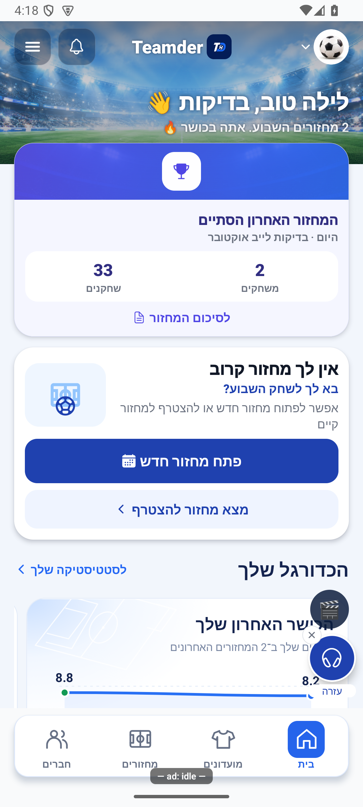
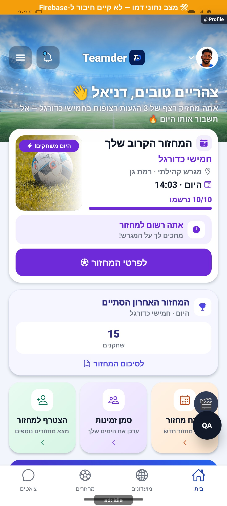
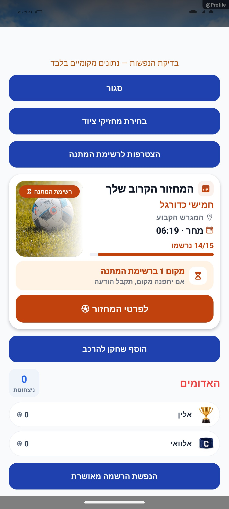

# כרטיסי המחזור הקרוב והמחזור שהסתיים — הסבר קצר

## בדיקת קצה ואימות מקורי, 2.11.2026

נבדקה השפעת תיקוני ההמשכיות במקור המשותף ובבדיקות. ההתנהגות העצמאית והחישובים של הפיצר נשמרו. מקומי וטרם הופץ. [שחזור, תיקונים, בדיקות ומגבלות](../../changes/2026-11-02-experience-review.md).

## המשכיות ומשוב בשימוש, 2.11.2026

כרטיס המחזור בבית מציג בבירור שההרשמה נשמרת, ואחר כך אישור קצר לפי ההרשמה, ההמתנה או הבקשה לאישור. מימוש מקומי שטרם הופץ. [התנהגות, בדיקות, צילומים ומגבלות](../../changes/2026-11-02-experience-polish.md).

## שלדי טעינה בשלושה אזורים, 2.11.2026

במסכים המשותפים נוספו שלדי טעינה בבית, בסגל ובנתוני המועדון. אין שינוי בפעולות העצמאיות של הפיצר המתואר כאן. השינוי מקומי וטרם הופץ. [מימוש, בדיקות, צילומים ומגבלות](../../changes/2026-11-02-loading-skeletons.md).

## אימות פרסום קבוצות בפולס, 2.11.2026

נבדק ההפרש התחום בשירות המשותף של המחזורים: נוספה בדיקת אישור לפרסום קבוצות כאשר תשובת הפעולה אובדת. אין שינוי בחישוב, במכנים או בפעולות העצמאיות של הפיצר המתואר כאן. התיקון מקומי וטרם הופץ; אין בדיקת מכשיר חדשה לפיצר זה.

[דוח הטיפול, הבדיקות והמגבלות](../../changes/2026-11-02-pulse-sweep.md).

## בקשות לשיחה אישית, 2.11.2026

נבדקה השפעת תוספת בקשות השיחה במקורות המשותפים. השינוי ממוקד בהרשאת שיחה, בשדות פרטיות ההודעות ובחיבורי הבדיקות; אין מכך אימות חדש של מסך זה במכשיר. המימוש מקומי וטרם הופץ או נפרס. [התנהגות, בדיקות ומגבלות](../chat/message-requests.md).

## החלפת הקבוצה הבועטת בפנדלים, 30.10.2026

בפנדלי ההכרעה נוספה אפשרות לבחור את הקבוצה שבועטת כעת, בלי למחוק את הבעיטות הקודמות. זהו עדכון תחום במקורות משותפים; אין שינוי מתוכנן במסך המתואר כאן ואין אימות מכשיר חדש שלו. [התנהגות, בדיקות ומגבלות](../../changes/2026-10-30-shootout-turn.md).

## התאוששות משגיאות בפולס, 28.10.2026

טעינת פרטי מחזור וטבלת מועדון יכולה להתאושש מכשל חיבור קצר בעזרת ניסיון נוסף. כשל מתמשך נשאר גלוי ואינו מוצג כאפס או כמידע חסר שאומת.

השינוי מקומי וטרם הופץ. [ממצאים, בדיקות ומגבלות](../../changes/2026-10-28-pulse-errors.md).

## הרחבת אבחון דיווחים, 27.10.2026

הדיווחים יוכלו לכלול מה ניסו לבצע, מה היה מצב האפליקציה ומה החזיר השרת. פרטים חסרים מוצגים כלא ידועים, ומספר מוגבל של מופעים נשמר בלי למחוק את המופע הראשון. השינוי מקומי וטרם הופץ, ואינו משלים פרטים לדיווחים ישנים. [היקף, ראיות ומגבלות](../../changes/2026-10-27-diagnostic-context.md).

בדיקות הקוד הושלמו, אך השינוי עדיין מקומי ולא הופץ. פרטים שלא נאספו בדיווחים ישנים אינם משוחזרים בדיעבד.

## השבתת פעילות אישית לקראת הגרסה הבאה, 27.10.2026

הפעילות האישית וחיבור נתוני הספורט מוסתרים זמנית לקראת הגרסה הבאה. האפליקציה לא תבקש הרשאות מדידה ולא תתחיל סנכרון פעילות בגרסה הזאת. הנתונים שכבר נשמרו נשארים, והטיימר ונתוני הכדורגל הרגילים ממשיכים לפעול. השינוי מקומי וטרם הופץ; [פרטים ומגבלות](../../changes/2026-10-27-sports-activity-disabled.md).

## השפעת מקור משותף במשימת השעון - 26.10.2026

במקור המחזורים המשותף תוקן שימור זמן הריצה בזמן עצירת רוטציה ומעבר למשחק הבא. סינון, מיון ומטמון כרטיסי המחזורים לא שונו בתיקון זה. לא נערכה כאן בדיקה חדשה של כל מצבי המסך. השינוי מקומי, ומצב ההפצה ומגבלות הבדיקה מפורטים בדוח המקושר. [היקף המימוש, הבדיקות, מגבלות האישור והצילומים](../../changes/2026-10-26-android-personal-activity.md).

## הכדורגל שלי בעמוד הראשון של הקרוסלה - 25.10.2026

עודכנה הקרוסלה האישית בבית, בקובץ משותף לתהליך הזה או לכלי הבדיקה שלו. אין שינוי נוסף בפעולות המתוארות כאן ולא נערכה להן בדיקת ממשק חדשה. מקומי וטרם הופץ. [השינוי והבדיקות](../../changes/2026-10-25-home-profile-carousel.md).

## שעון מדויק וכיתוב פנדל - 25.10.2026

במקורות המשותפים נוסף שימור השעון המדויק של פנדל במהלך משחק, וכיתוב ההבקעה ביומן קוצר. אין שינוי במונים או בתהליך העצמאי המתואר כאן; לא נערכה לו בדיקת ממשק חדשה במסגרת העדכון. השינוי מקומי וטרם הופץ. [פרטים וראיות](../../changes/2026-10-25-in-play-penalties.md#שעון-מדויק-וכיתוב-אירוע).

## פנדל במהלך משחק חי - 25.10.2026

עודכנו מקורות משותפים לצורך פנדלים במהלך משחק. אין שינוי מכוון בתהליך העצמאי המתואר במסמך הזה, ולא נערכה לו בדיקת ממשק חדשה במסגרת המשימה.

השינוי מקומי. נדרשת פריסת שרת לפני הפצת לקוח שמשתמש באפשרות; לא בוצעו פריסה או שינוי הרשאות. [חוזה הנתונים, התהליך, הבדיקות ומגבלות ההפצה](../../changes/2026-10-25-in-play-penalties.md).

## כניסה לכרטיס השחקן בתפריט הבית — 24.10.2026

בקובץ הבית המשותף נוספה רק הכניסה ״כרטיס השחקן שלי״ לפני ארון התארים בתפריט. אין שינוי מכוון בהתנהגות העצמאית המתוארת כאן, ואין לראות בבדיקת התפריט אימות חדש של המסך או התהליך הזה. התוספת מקומית ואינה נכללת בבינארי הפנימי שכבר נבנה. [מקור, בדיקות ומגבלות](../../changes/2026-10-24-home-player-card-menu.md).

## תלות משותפת בכפתור בדיקת הקריסה — 23.10.2026

נוסף כפתור בדיקת קריסה זמני בגוף מסך הבית. אין שינוי מכוון בתהליך המתואר כאן; אין להסיק מהשינוי בקובץ המשותף שהמסך הזה נבדק מחדש במכשיר. [פירוט האימות והמגבלות](../../changes/2026-10-23-crash-test-and-pulse-followup.md).

## עונה שהסתיימה — עיצוב כרטיס הסיכום, 20.10.2026

כרטיס העונה שהסתיימה מעל המחזור הקרוב קיבל עיצוב כחול־סגול חדש: גביע בצד שמאל, כותרת עונה, הסבר קצר וכפתור לצפייה בסיכום. הפעולה והנתונים לא השתנו; זהו שינוי חזותי מקומי בלבד.

הצילום המצורף לבקשה שימש מקור להשוואה. צילום חדש של המסך המרונדר יתווסף לאחר חיבור אמולטור; כרגע אין אימות חזותי של המימוש במכשיר.
## תיעוד כשלים — 20.10.2026

נוסף תיעוד אוטומטי לנקודות כשל במסלול הזה, עם מקור התקלה. הפעולה המקורית שומרת על ערכי החזרה והודעות השגיאה שלה. השינוי מקומי, טרם הופץ, ואין אימות מסירה חיה לפולס.

[דוח דיווח השגיאות והראיות](../../changes/2026-10-20-error-reporting-audit.md).

## שורת צירוף ובדיקת הפולס — 17.10.2026

בדיקות ההצטרפות מתחילות במקביל כדי לחסוך המתנה בין קריאות. ההצלחה עדיין מוצגת רק אחרי שהשרת מאשר את ההרשמה.

[בדיקות, צילומים ומגבלות](../../changes/2026-10-17-roster-recruitment-and-pulse.md).

## בדיקות הפולס והגרסה הפנימית 1.1.55 — 17.10.2026

בזמן הצטרפות למחזור מופיעים גלגל טעינה והודעת שמירה על הכפתור. הלחצן מושבת עד שתתקבל תשובה; ההצלחה מוצגת לפי התשובה האמיתית של ההרשמה.

[ראיות, בדיקות ומגבלות](../../changes/2026-10-17-internal-1.1.55.md).

## אורחים בסיכום הבית — 17.10.2026

מונה השחקנים בכרטיס המחזור שהסתיים כולל גם אורחים פעילים, כמו מונה ההרשמה לפני המחזור. אורחים בהמתנה אינם נספרים. למשל, חשבון אחד ו־32 אורחים פעילים מוצגים כ־33 שחקנים; מספר המשחקים אינו משתנה. זהו גודל הסגל הרשום, ולא מדידה חדשה של מי שיחק בפועל.

התיקון מקומי. ארבע בדיקות נתונים עברו, כולל אורחים בלבד ומחזור ישן ללא אורחים. לאחר פתיחה קרה באימולטור אנדרואיד מול מחזור הבדיקה בייצור נצפו בבית 33 שחקנים ושני משחקים, ברוחב רגיל ובגופן רגיל וגם במסך 320×569 עם גופן 140%. הצילומים נבחנו גם בנפרד; שכבת העזרה חופפת חלק מתווית המשחקים בצילום הקטן, אך המספרים גלויים. הצילום שבו הופיע שחקן אחד מתעד את הפגם המקורי.

כרטיס המחזור מראה אם אתם רשומים, ממתינים, צריכים אישור או יכולים להצטרף. אחרי מחזור ששיחקתם בו אפשר לפתוח ממנו את הנתונים.

[לפירוט הטכני](round-cards.md)

הצילום מדגים את המראה בסביבת בדיקה, ולא מוכיח פעולה מול הנתונים האמיתיים.

## השלמת הנפשות — 8.10.2026

כרטיס ההמתנה נפתח בעדינות לשורת המקום בתור. הכפתור והמידע נשארים זמינים בלי לחכות לסיום התנועה.

[פרטי האימות והמגבלות](../../changes/2026-10-08-motion-completion.md). מקור: `9ec0dfd` עם שינויים מקומיים; טרם פורסמה גרסה.

## תיקוני עיצוב ונגישות — 10.10.2026

מקור: `a348b9f235f1e1433497600555303231512a0834` עם שינויים מקומיים. אין בסעיף זה הוכחת גרסת חנות.

בכרטיסי המחזור בבית האייקונים התלויים בטקסט מופיעים משמאל לטקסט, גם במידע על מקום, תאריך ומצב וגם בסיכום הקומפקטי. מיקום התמונה ומשמעות המצבים נשמרו.

## תיקוני דיווחים — 10.10.2026, אחרי גרסה 1.1.45

אייקוני המיקום והתאריך בכרטיס המחזור בבית מופיעים מימין לטקסט.

שינוי מקומי מעל bcca0886; לא נבנתה גרסה בסבב הזה. נבדק בקוד ובבדיקות אוטומטיות. צילומי אנדרואיד בנתוני דמו בלבד; אין אימות באייפון או בטלפון המדווח.

## ירוק למחזור של היום כשהשחקן רשום — 11.10.2026

מצב `today` בכרטיס המחזור הקרוב משתמש כעת באותו ירוק של `registered`: הדגשה `#15803D` ורקע עדין `#ECFDF3`. התווית, שם המועדון, האייקונים, פס התפוסה, הודעת ההרשמה והכפתור משתמשים בצבע המצב הקיים. ההכרעה האם השחקן רשום וסדר המצבים לא השתנו. מצב מחזור חי נשאר בעיצובו הקיים. תצוגת הבדיקה `_home_registered` מציגה את הרכיב האמיתי במחזור דמו להיום ללא פעולות או כתיבה למסד.

22.10.2026: כאשר המחזור משתמש בתמונת ברירת־המחדל `c12`, מוצגת תמונת קבוצה רחבה במקום תמונת כדור מקרוב. אין שינוי במידע או בפעולות הכרטיס.

[צילום הכרטיס הירוק](../screenshots/home-registered-green-2026-10-11.png). נצפה ברכיב האמיתי באמולטור עם נתוני המחשה מנותקים בלבד.

## מאגר תמונות לפי משטח ושעת המחזור — 12.10.2026

המחזור מקבל תמונה מתוך מאגר של 60 תמונות: 10 לכל שילוב של דשא, סינתטי או אספלט ביום ובלילה. יש מגרשים, שחקנים, חימום ואווירת משחק. הבחירה נעשית לפי שעת המחזור בישראל ועונת השנה בקירוב, ונשארת זהה בבית, ברשימה ובפרטים. תמונה שהמועדון העלה בעצמו נשארת בעדיפות ראשונה. ללא תאריך תקין נבחר מאגר היום; ללא סוג מגרש נשמרת החלופה הקיימת.

[גלריית התמונות](../../../src/assets/images/roundCovers/index.html). השינוי מקומי ולא נכלל עדיין בגרסת החנות.

## תלות בעדכון העונות — 19.10.2026

קובץ תשתית משותף עודכן במסגרת העונות. שינוי זה אינו מוסיף פעולה חדשה למסך המתואר כאן; פרטי העונות והבדיקות מופיעים במסמך העונות.

[מצב המימוש, הבדיקות ומגבלות האימות של העונות](../clubs/seasons.md). מקומי בלבד; לא בוצעה פריסה במסגרת המשימה.

## תלות במידע על סגירת עונה — 23.10.2026

נוסף מידע משותף שמאפשר להסביר מדוע עונה מתעכבת בסגירה. אין שינוי נוסף בפעולות המתוארות כאן; השינוי מקומי וטרם הופץ. [המסלול, הבדיקות והמגבלות](../../changes/2026-10-23-season-automatic-recovery.md).

## בידוד מונה בקשות והתאוששות מרקע — 23.10.2026

ספירת בקשות הצטרפות אינה ממתינה יותר לדירוגי השחקנים במועדונים. מסך הבית טוען את המונה מחדש בחזרה מרקע ומתעלם מתוצאה ישנה שמגיעה אחריה. כשל אמיתי בקריאת הבקשות נשאר כשל ושומר את הספירה האחרונה; אין שינוי בעיצוב. נבדק בבדיקות קוד, מקומי וטרם הופץ. [הסבר, יומני שרת ומגבלות](../../changes/2026-10-23-inbox-resume.md).

## עדכון תלות משותפת בקריאות מידע — 23.10.2026

בקובצי השירות המשותפים נוספה אפשרות מפורשת לניסיון חוזר אחד בקריאה זמנית שנכשלה, תוך עצירה אם החשבון מתחלף. החיבור מוגבל ל־14 נקודות קריאה המפורטות בדוח; אין כאן טענה שכל פעולה בפיצ׳ר קיבלה ניסיון חוזר או שנבדק מסך חדש. בדיקות המאגר המלאות עברו (5,261 בדיקות ב־472 חבילות), אך אינן הוכחת הרצה במכשיר. הקוד מקומי וטרם הופץ. [מסלול, ראיות ומגבלות](../../changes/2026-10-23-four-open-errors.md).

## תלות בשמירת צבעי המחזור — 24.10.2026

שמירת המידע המשותפת עודכנה כדי להעביר את צבעי הקבוצות ממסכי הכוחות להכנה וללייב. אין תוספת פעולה במסך הזה, והוא לא נבדק מחדש במכשיר במסגרת התוספת. השינוי מקומי וטרם הופץ. [פרטי התוספת ומגבלות הבדיקה](../rounds/draft-setup.md#צבעים-לפני-שיבוץ-ובכל-שיטת-חלוקה--24102026).

## הסרת כפתור בדיקה מהבית — 24.10.2026

ההבדל במקור המשותף `ProfileScreen.tsx` מסיר רק את הייבוא וההצגה של כרטיס הקריסה הזמני. אין שינוי בפעולות הפיצ׳ר המתואר כאן; צילום הבית אינו אימות מחודש של כל מצבי הפיצ׳ר. מקומי וטרם הופץ.

## תלות בעריכת קבוצות בלייב — 24.10.2026

בקובץ השירות המשותף נוסף מסלול לעריכת הקבוצות והתור במשחק חי, כולל איפוס המשחק הנוכחי בלבד בעת החלפת קבוצה. לא שונו מסלולי הפיצ׳ר הזה במסגרת התוספת ולא בוצע לו אימות מסך חדש. [מסלול השינוי, הבדיקות והמגבלות](../rounds/live-advanced.md#עריכת-הקבוצות-והתור-בזמן-הלייב--24102026). מקומי וטרם הופץ.

## בדיקת עומק לעריכת הקבוצות — 24.10.2026

בקובץ השירות המשותף תוקן שימור זהות המשחק במחזור ישן בעת שינוי תור בלייב. הדיווח על הצלחת החלפה נשלח כעת רק אחרי שמירה. מסלולי הפיצ׳ר הזה לא שונו ולא בוצעה לו בדיקת מסך חדשה. כל 5,496 בדיקות הפרויקט עברו; אין בכך הוכחת מסד חי או הפצה. [הראיות ומגבלות הבדיקה](../../audits/2026-10-24-live-teams.md). מקומי וטרם הופץ.

## המשך קיצור טעינות בלילה של 25.10.2026

כרטיס המחזור הקרוב וכרטיס המחזור שהסתיים משתמשים באותה טעינת רשימה גם בפתיחה ראשונה. פעולה שמחייבת רענון מאפשרת טעינה חדשה, וכשל מלא אינו נשמר כאילו אין מחזורים. התיקון מקומי ונבדק בקוד, בלי מדידת זמן במכשיר. [בדיקות, ראיות ומגבלות](../../changes/2026-10-24-loading-performance.md).

## תגובה מיידית לכפתורי השעון - 25.10.2026

עודכן רכיב השעון המשותף למסכי הלייב. אין שינוי מכוון בהתנהגות הפיצר המתואר כאן. [בדיקות, ראיות ומגבלות](../../changes/2026-10-25-live-timer-response.md). התיקון מקומי וטרם הופץ.

## תאימות לשמירת פקודת רכיב הבית - 25.10.2026

נוספה הגנה פנימית מפני ביצוע חוזר של פעולת רכיב הבית. התהליך המתואר בעמוד זה לא השתנה במכוון, ונתונים ישנים נשארים נתמכים. התיקון מקומי וטרם הופץ. [מקור הבדיקה והמגבלות](../../changes/2026-10-25-widget-completion.md).

## השפעת תיקוני השיחה והחזרה, 27.10.2026

נבדק ההבדל במילון המשותף `src/i18n/he.ts`: נוספה רק הודעת כשל לטעינת שיחה. אין שינוי בנוסח, בחישובים או בתהליך העצמאי המתואר כאן. אין בכך בדיקת מסך חדשה. [התהליך שהשתנה](../chat/message-interface.md#כשל-קריאת-שיחה-וניסיון-חוזר-27102026).

## שלמות החלוקה המתוזמנת, 29.10.2026

במקורות המשותפים תוקנה שמירת חלוקה מתוזמנת לשש ולשבע קבוצות וסוננו אורחים שממתינים. דרך חישוב האיזון נשמרה. אין שינוי מכוון בפעולות העצמאיות המתוארות בעמוד זה ואין אימות מסך חדש שלהן; השינוי מקומי וטרם הופץ.

[היקף, בדיקות, פערים פתוחים ומגבלות](../../changes/2026-10-29-scheduled-balance-integrity.md).

## איזון ופיזור רמות לפני גיוון, 30.10.2026

עודכן החישוב המשותף של חלוקת כוחות לפי הדירוג הכללי: איזון הממוצעים קודם לפיזור הרמות, והגיוון מכריע אחרי שניהם. אין שינוי מכוון במבנה המסך או בפעולות העצמאיות המתוארות כאן, ואין אימות מכשיר חדש שלהן. השינוי מקומי וטרם הופץ או נפרס.

[מימוש, נוסחאות, בדיקות ומגבלות](../../changes/2026-10-30-rating-balance-priority.md).

## אימות כשלים בקבלת פרסום, 2.11.2026

בבדיקת אישור פרסום הקבוצות, כשל שלא ניתן לאמת כהצלחה נשאר כשל גלוי ונשמר באבחון. הבדיקה אינה שולחת הודעות שוב ואינה משנה הרשאות. השינוי תחום לשירות המשותף, מקומי וטרם הופץ.

[דוח הטיפול והראיות](../../changes/2026-11-02-pulse-sweep.md).
