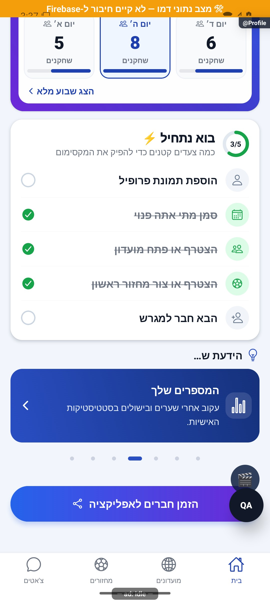
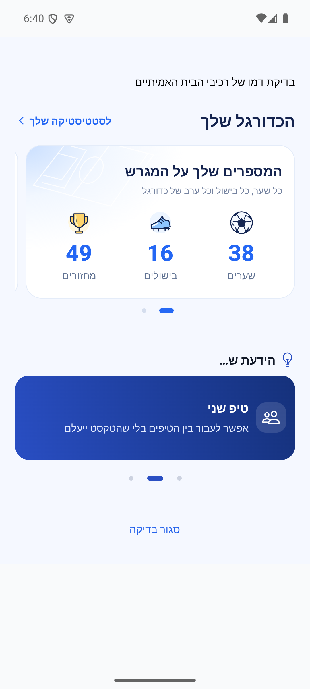

# קרוסלת הידעת

## תיעוד כשלים — 20.10.2026

נוספו תצפיות דיווח בנקודות הכשל של המקורות המשויכים לפיצ׳ר, במסגרת הרחבה רוחבית. נשמרו ערכי החזרה, הזריקות ותנאי הפעולה הקיימים; נוסף מקור קוד והקשר לדיווח. כיסוי תחבירי אינו הוכחת הרצה של כל מצב. השינוי מקומי וטרם הופץ; בדיקות המסירה, מגבלות מניעת הכפילויות והמסלולים שטרם חוברו מתועדים בדוח המשותף.

[דוח דיווח השגיאות והראיות](../../changes/2026-10-20-error-reporting-audit.md).

[לקריאה קצרה ופשוטה](tips-carousel.simple.md)

עודכן: 07.10.2026; מקור `8e8fde5`, `1.1.35` בבנייה. רכיב `src/components/home/DidYouKnowCard.tsx` בתוך הבית. תפקידים: משתמש מלא; מידע קצר על יכולות האפליקציה.

## מבנה והתנהגות

שבעה פריטים כוללים כותרת, אייקון, מלל קצר ופעולה: חלוקת כוחות, זמינות, היסטוריה, סטטיסטיקה, תכנון מחזורים, הזמנות ועונות. המקור להרכבת רשימת הטיפים והפעולות הוא `src/screens/tabs/ProfileScreen.tsx`; מקור המלל `src/i18n/he.ts`. בתחתית נקודות בחירה ללא הכיתוב אחד מתוך שבעה. המלל משתמש ברוחב הכרטיס; אין פס דקורטיבי צדדי כחלק מהעיצוב שסוכם.

## מצבים ופעולות

| תנאי | מעבר/תצוגה | כתיבה | ראיה |
|---|---|---|---|
| מסך במיקוד ותנועה מותרת | התקדמות כל שש שניות | אין | קוד |
| המסך אינו במיקוד | עצירת התקדמות אוטומטית | אין | קוד |
| העדפת הפחתת תנועה | אין אוטומציה; מעבר מיידי | אין | קוד |
| החלקה אופקית | זיהוי משיכה והחלפת פריט | אין | קוד |
| לחיצה על נקודה | בחירה בפריט | אין | קוד |
| לחיצה על פעולה | ניווט ליעד הרלוונטי | הכתיבה רק בפיצ׳ר היעד | קוד |

המעבר משלב שקיפות והזזה של 18 נקודות לאורך 380 אלפיות שנייה עם עקומה מעוקבת והנפשה מקורית. תחילת מחווה דורשת 12 נקודות; השלמת החלפה דורשת 35 ותנועה אופקית לפחות פי 1.5 מהאנכית כדי לא לחטוף גלילת בית. הפריט הנכנס אינו מוכרז לנגישות בזמן כפילות המעבר. אלה ערכי קוד, לא מדידת קצב פריימים במכשיר.

## ראיות, בדיקות ושחזור

אין צילום סטטי שמוכיח חלקות. לא נבדקו כאן סרטון אמיתי מהאמולטור, מכשיר חלש או קורא מסך. צילום הבית העליון אינו מציג את הקרוסלה שמתחת לקפל. בדיקות האנימציה/תנועה הקיימות בפרויקט אינן מחליפות גלילה והחלקה בזמן ריצה.

שני הצילומים נלקחו בהמתנה להתחלפות פריטים; הם מוכיחים את התוכן והפריסה של הפריטים האלה. אינם סרטון או מדידה של חלקות המעבר.

לפני תיקון קרא גם את פעולות הטיפים ב־`ProfileScreen`, את ערכי התנועה ברכיב ואת מילון העברית. לשחזור: גלילה אל הקרוסלה, מעבר אוטומטי, משיכה קצרה שאינה מחליפה, משיכה ארוכה, גלילה אנכית, לחיצה על נקודה וחזרה מהיעד, ואז הפחתת תנועה. אין כאן ממיר מסד או כתיבת נתונים עצמאית. הצעת אנימציה נוספת חייבת לשמור על עצירה מחוץ למיקוד ועל הפחתת תנועה.

## פירוט מימוש ונקודות שינוי — העמקה 07.10.2026

`selectRef` מסרב כאשר אין פריטים או `moving.current` פעיל, ומנרמל יעד באמצעות מודולו כדי לאפשר מעבר מחזורי. בזמן תנועה מוחזקים פריט נוכחי ו־`incoming`; רק לאחר `Animated.timing` שהסתיים מתעדכנים האינדקס והפריט הנכנס. כך שתי שכבות המלל מוכנות לפני ההנפשה; לחיצה על הפעולה חסומה בזמן המעבר.

ההתקדמות היא `setTimeout` התלוי באינדקס, מספר פריטים, מיקוד והפחתת תנועה, ולא שעון קבוע שחוטף את הקריאה מיד לאחר בחירה ידנית. קריאת `AccessibilityInfo.isReduceMotionEnabled` והמנוי לשינוי מנוקים ביציאה. `current` מוגבל לאורך הרשימה כדי לא לקרוא מעבר לסופה. נקודת שינוי תוכן: רשימת הטיפים בבית ו־`he.ts`; תנועה: `DidYouKnowCard`. בדיקה סטטית מוכיחה פריסה בלבד; שינוי תנועה מחייב סרטון ריצה והחלקה מול גלילה אנכית.

הבדיקות, מצבי המסך והראיות שכבר פורטו במסמך נשמרו. ההעמקה מבוססת על קריאת מקור ולא על הרצת פעולות נוספות; שינוי עתידי יצריך עדכון של שני המסמכים ובחינת המצבים הממוקדים.

## סבב פולס — 15.10.2026

`DidYouKnowCard` מאפס `progress` בסיום מוצלח של ההנפשה ומחיל במצב סטטי `opacity:1/translateX:0`. כך שכבת התוכן אינה נשארת שקופה בדרייבר המקורי. תנאי מיקוד, הפחתת תנועה וטיימר נשמרו. צולמו שני טיפים שונים באותו רכיב לאחר מעבר אוטומטי באנדרואיד בדמו; אין אימות באייפון.

השינויים בסבב זה מקומיים וטרם הופצו. [דוח הסבב](../../changes/2026-10-15-pulse-sweep.md).

## תלות בעדכון העונות — 19.10.2026

נבדק ההפרש בקבצים המשותפים הרשומים כאן: `src/i18n/he.ts`. השינוי ממוקד במדיניות העונות, קריאת מצבן, שיוך מחזור ופקודות ניהולן; אין שינוי מכוון בחוזה העצמאי המתואר במסמך זה. אין להסיק מכך שהמסך הזה הורץ מחדש.

[מצב המימוש, הבדיקות ומגבלות האימות של העונות](../clubs/seasons.md). מקומי בלבד; לא בוצעה פריסה במסגרת המשימה.

השלמת אותו עדכון: מלל מדגם המצטיין במילון המשותף מתייחס לציוני מחזור, כולל מדגם מלא. אין שינוי במסלול המתואר כאן ואין אימות חזותי חדש שלו.

## שם המצטיין וסדר התארים — 19.10.2026

קובץ המלל המשותף עודכן: תואר העונה נקרא ״השחקן המצטיין״. מלל המסך והתנהגותו לא השתנו; מסך זה לא הורץ מחדש במסגרת שינוי השם. פירוט השינוי והראיות ב[סיכום העונה](../statistics/season-summary.md). השינוי מקומי וטרם הופץ.

## הבהרת התצוגה וסיכום אישי — 19.10.2026

הרכיבים והמלל המשותפים של סיכום העונה עודכנו: ניסוח ברור לניצחונות ולהפסדים, אוואטרים למובילים וכפתור ״סיכום העונה שלי״ בעיצוב כרטיס. הספירות, מסנן העונה, התארים וכללי הזכאות לא השתנו. המסכים האחרים בתחום לא הורצו מחדש במסגרת תיקון התצוגה. [פירוט וראיות בסיכום העונה](../statistics/season-summary.md). השינוי מקומי וטרם הופץ.

## מלך הניצחונות לפי אחוז — 19.10.2026

תואר מלך הניצחונות עבר לאחוז ניצחונות עם סף השתתפות במחצית ממחזורי העונה. היחידה מועברת במידע המשותף; ספירות היסטוריות נשמרות. לא שונתה התנהגות אחרת בתחום זה, והמסך שלו לא הורץ במסגרת השינוי. [החוזה והראיות בסיכום העונה](../statistics/season-summary.md). השינוי מקומי וטרם הופץ.

## תלות במלל ובמסך הבית — 20.10.2026

`src/i18n/he.ts` ו־`src/screens/tabs/ProfileScreen.tsx` השתנו במסגרת עיצוב כרטיס העונה שהסתיימה. קרוסלת ההסברים, הניווט שלה והמקורות שלה לא השתנו; המסך לא הורץ באמולטור.

נוסח הכרטיס הסופי הוא „עונה N הסתיימה!” ו„כנס לראות את הביצועים שלך העונה!”. אין שינוי בקרוסלה או בנתוני הטיפים.
