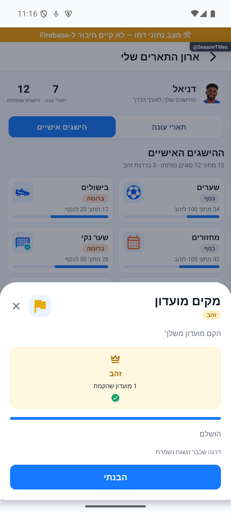
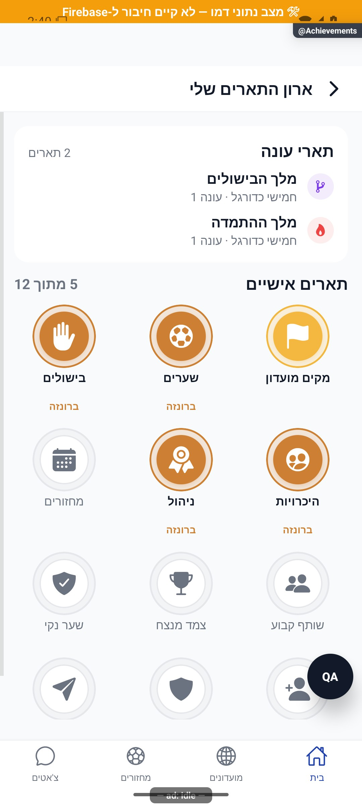
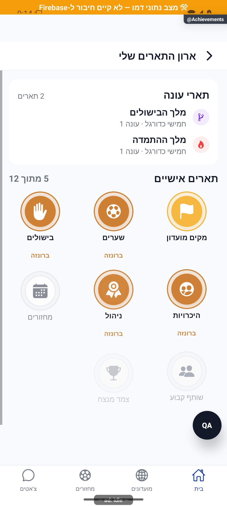
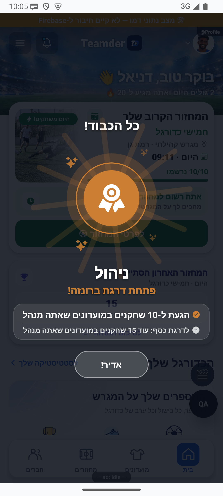

# ארון התארים וההישגים האישיים

## הרחבת אבחון דיווחים, 27.10.2026

נוספה מעטפת אבחון מקומית עם מצב בזמן הכשל, שלבים בעלי מזהה ותזמון, מצב רשת ובנייה ומופעים נפרדים לשגיאה. נקודת הכניסה לתעבורת השרת עוברת כעת דרך העטיפה המשותפת; תשובות, חריגות, אפשרויות קריאה ומדיניות הפיצר נשמרות. אין כאן שינוי בהרשאות או בחישובי המוצר. הבדיקות המלאות ומגבלות האימות מתועדות בדוח המקושר; אין טענה לאימות מכשיר או להפצה. [היקף, ראיות ומגבלות](../../changes/2026-10-27-diagnostic-context.md).

באימות הסופי עברו כל 6,231 הבדיקות ב-555 חבילות, ובדיקות הטיפוסים של הלקוח, השרת והפולס נקיות. צילום הדפדפן והידור מקורות האנדרואיד הם בדיקות מקומיות; אין הוכחת מכשיר, הידור אייפון או מסירה חיה של הבנייה החדשה. רישום יומן השחרור נחשב מאומת רק לפי קבלת הקריאה החוזרת בדוח השינוי.

## שעון מדויק וכיתוב פנדל - 25.10.2026

במקורות המשותפים נוסף שימור השעון המדויק של פנדל במהלך משחק, וכיתוב ההבקעה ביומן קוצר. אין שינוי במונים או בתהליך העצמאי המתואר כאן; לא נערכה לו בדיקת ממשק חדשה במסגרת העדכון. השינוי מקומי וטרם הופץ. [פרטים וראיות](../../changes/2026-10-25-in-play-penalties.md#שעון-מדויק-וכיתוב-אירוע).

## פנדל במהלך משחק חי - 25.10.2026

נבדק השינוי הממוקד במקורות המשותפים: נוספו חוזי אירועי פנדל במהלך משחק, קוראים ומוני סטטיסטיקה, והגנות בעסקאות סיום ואיפוס משחק. מסלול הפיצר המתואר כאן אינו נקודת הכניסה להזנה החדשה. בדיקות המאגר עברו, אך אינן הוכחת הרצה חדשה של כל מצבי התהליך או של פריסה.

השינוי מקומי. נדרשת פריסת שרת לפני הפצת לקוח שמשתמש באפשרות; לא בוצעו פריסה או שינוי הרשאות. [חוזה הנתונים, התהליך, הבדיקות ומגבלות ההפצה](../../changes/2026-10-25-in-play-penalties.md).

## חזרה מארון התארים לכרטיס המקורי — 24.10.2026

פתיחת ארון התארים מהכרטיס העצמי וחזרה ממנו מחזירות לאותו כרטיס ולאותה לשונית. הארון נוסף לערימות המועדונים, המחזורים והשיחות, ונפתח כמסך חדש מעל הכרטיס גם אם ביקרו בו קודם. החץ וחזרת אנדרואיד אומתו באימולטור מתוך מועדון; שאר המארחים נבדקו בנתב. מקומי וטרם הופץ. `src/navigation/CommunitiesStack.tsx`, `src/navigation/GameStack.tsx` ו־`src/navigation/ChatStack.tsx` רושמים `AchievementsScreen`; הבית כבר רשם אותו. `OwnPlayerCard.go` מפעיל `nav.push` עבור `Achievements` במקום מסלול גיבוי בין לשוניות. לא שונו `AchievementsScreen`, חישובי התארים או `ScreenHeader.goBack`. בדיקת הנתב האמיתי מאמתת מפתח כרטיס קודם בארבע הערימות, עם ובלי ביקור קודם בארון. טיפוסים ו־5,609 בדיקות עברו. [מסלול הניווט, בדיקות, צילומים ומגבלות](../../changes/2026-10-24-cabinet-back.md).

## תיעוד כשלים — 20.10.2026

נוספו תצפיות דיווח בנקודות הכשל של המקורות המשויכים לפיצ׳ר, במסגרת הרחבה רוחבית. נשמרו ערכי החזרה, הזריקות ותנאי הפעולה הקיימים; נוסף מקור קוד והקשר לדיווח. כיסוי תחבירי אינו הוכחת הרצה של כל מצב. השינוי מקומי וטרם הופץ; בדיקות המסירה, מגבלות מניעת הכפילויות והמסלולים שטרם חוברו מתועדים בדוח המשותף.

[דוח דיווח השגיאות והראיות](../../changes/2026-10-20-error-reporting-audit.md).

[להסבר הקצר](achievements.simple.md)

## המימוש הנוכחי — 18.10.2026

בסיס `5148f63c2a8e9c454b68132fdb0d683a98a4adc9` עם שינויים מקומיים שטרם הופצו. המקור החזותי המאושר: `artifacts/design-sketches/2026-10-18-achievement-cabinet/01-cabinet-tabs-and-achievement-detail.png`. הכניסה הרגילה היא תפריט הבית > ארון התארים שלי > `Achievements` ב־`ProfileStack`. גם `SeasonTitles` הקיים מייצא כעת את אותו `AchievementsScreen`; אין מסך ניווט נוסף ואין שינוי רישום.

### המבנה

כותרת ארון אחת, תמונת המשתמש מימין, שם ומשפט קצר, וספירות נפרדות של תארי עונה ושל משפחות הישגים שנפתחו. לשונית תארי העונה מימין נבחרת בתחילה; הישגים אישיים משמאל. החלפת לשונית מאפסת את הגלילה, ללא איפוס זכיות. בטעינה או כשל של מקור תארי העונה הספירה היא קו מפריד, ולא אפס.

לשונית העונה משתמשת ב־`SeasonTitlesShelf` ובנתונים הקפואים של `seasonTitlesService`. הקיבוץ לפי מזהה מועדון, מזהה עונה ושם מועדון שמור; במידע ישן ללא מזהים משתמשים בשם ובמספר העונה. הקבוצה החדשה ביותר מוצגת, קבוצות שנסגרו באותו זמן מוצגות יחד, ויתר הקבוצות נפתחות בכפתור ״עונות קודמות״. מגני `SeasonTitleEmblem` בגודל 38 זהים לסיכומי העונה. ערך הזכייה מגיע מהשדה `value` שכבר נכתב בסגירת העונה. [פירוט מקור התארים](season-titles.md).

לשונית ההישגים משתמשת ב־`AchievementTile` וברשת שתי עמודות. לכל משפחה סמל קטגוריה יציב, רקע בהיר, תג דרגה קטן, מספר אל היעד הבא ופס המתחיל מימין. הסמלים מבוססים על התמונות המקומיות של סיכום העונה ועל ספריית האייקונים הקיימת, ללא יצירת תמונות שחקן. אייקון הקטגוריה משמאל לטקסט. הסדר החזותי הקבוע: שערים, בישולים, מחזורים, שער נקי, שותף קבוע, צמד מנצח, היכרויות, חברים, מועדונים, הזמנות, ניהול, מקים מועדון. הסדר מחליף את מיון הדרגות הקודם כדי שהמיקום לא יקפוץ בשדרוג. זהב מציג השלמה; נעול מציג סמל בהיר ויעד פתיחה. גובה מינימלי 82, רוחב 49%, ריפוד 8; טקסט יכול להרחיב את הכרטיס.

### דרגות וחישובים

הספים והמקורות נשארו ב־`src/data/achievements.ts` וב־`achievementsService`. הספירה הראשית היא מספר המשפחות שבהן `unlocked=true`; ספירת הזהב נפרדת. 12 מתוך 12 אינם בהכרח 12 דרגות זהב. דרגה נוכחית היא הגבוהה מבין השמורה לנגזרת, ודרגה הבאה היא הסף שמעל הדרגה הנוכחית. פס ההתקדמות הוא המונה חלקי סף הדרגה הבאה, מוגבל לטווח 0–100%; אין חלוקה ביחס לטווח שבין הדרגות. בזהב/השלמה הפס מלא. ההפרש המוצג הוא `max(0, next.threshold - value)`.

| משפחה | ברונזה / כסף / זהב |
|---|---|
| שערים | 5 / 20 / 100 |
| בישולים | 5 / 20 / 75 |
| מחזורים | 5 / 25 / 100 |
| שער נקי | 10 / 50 / 150 |
| שותף קבוע | 5 / 15 / 30 מחזורים עם אותו שחקן |
| צמד מנצח | 3 / 10 / 25 ניצחונות יחד |
| היכרויות | 10 / 30 / 75 |
| חברים | 3 / 10 / 25 |
| מועדונים | 2 / 5 / 10 |
| הזמנות | 3 / 10 / 25 מצטרפים שהובאו |
| ניהול | 10 / 25 / 50 שחקנים נוכחיים במועדונים מנוהלים, ללא המשתמש עצמו |
| מקים מועדון | זהב בלבד, הקמת מועדון אחד |

`AchievementDetail` פותח `SafeModal` עם חלונית תחתונה הניתנת לגלילה, עד 90% מגובה החלון. הכותרת, הדרגה, המונה הזמין, תנאי ההישג ושלבי הדרגות מוצגים בנפרד. ספי ההגדרה מסומנים לפי הדרגה שהושגה, גם אם מונה חי ירד. מקים מועדון מציג שלב אחד. תאריך מופיע כשידוע בלבד. סגירה בכפתור, באזור הכהה, ב״הבנתי״ או בחזרת המכשיר. 34 שערים מדגימים כסף, פס 34% ליעד 100 ועוד 66 לזהב.

### טעינה, כשלים וכתיבה

| מצב | תוצאה |
|---|---|
| טעינת תארי עונה | מחוון וספירה לא ידועה; אין הצהרת אפס |
| אין תארי עונה | הסבר מפורש; הספירה אפס אחרי הצלחה בלבד |
| כשל תארי עונה | הודעה וניסיון חוזר; חריגת השירות אינה הופכת לרשימה ריקה |
| גזירת הישגים בטעינה | מחוון; אין הצגת מספרי חנות ואז החלפתם |
| גזירה נכשלת | דרגות שמורות, הודעה וניסיון חוזר; אין מונה, יעד מספרי או פס בכרטיסים ובפירוט |
| נתון עדכני תקין | `listFromCounters`, דרגה שמורה גבוהה נשמרת |
| פתיחה חדשה | מנגנון `persistDerivedUnlocks` ותור `AchievementCelebration` הקיימים |
| החלפת משתמש | קריאות מסומנות בבעלות, אפקטים מבטלים תגובות קודמות ונתוני המשתמש האישי מתאפסים |

טעינת משתמש, גזירת מונים, מיזוג זכיות, שמירה בעסקה וחגיגות לא הוחלפו בחישובי ממשק. כניסה לארון יכולה לשמור זכיות חדשות לפי המנגנון הקיים, גם דרך המסלול הישן `SeasonTitles` שמציג כעת את הארון המלא. פתיחת פירוט אינה מעניקה תואר. אין שינוי ספים, סכמות, הרשאות, כותב סגירת עונה או פריסה.

### אימות ומגבלות

`seasonTitlesService.test.ts` בודקת את קורא המסמכים בפועל: העברת `value`, שמות ומזהים קפואים, חסר לעומת אפס, מפתח לא מוכר, שני מועדונים בעלי אותו שם וכשל קריאה שאינו ריק. בדיקות השמירה המקבילה וההתאוששות הקיימות נשמרו. בדיקת טיפוסים נקייה; 425 חבילות ו־4,996 בדיקות עברו.

באמולטור 5554 בדמו מנותק נבדקו שתי הלשוניות, 12 משפחות, ששת שורות הרשת בגלילה, פירוט כסף, הישג חד־פעמי, עונות קודמות, חזרת המכשיר ומצבי כשל סינתטיים. לקריאת הייצור, שמירת זכייה חדשה, חגיגות, אייפון, מצב כהה, גופן מוגדל וקורא מסך אין אימות חדש במשימה הזאת. פירוט הנתונים הסינתטיים ומקורות הצילומים ב־[יומן השינוי](../../changes/2026-10-18-achievement-cabinet.md) וב־[מניפסט](../screenshots/manifest.json).

## רקע היסטורי — התצוגות והעדכונים להלן קודמים לארון החדש

תיאור המימוש הנוכחי לעיל מחליף את מבנה הרשת, המיון, החלונית והמדף המתוארים להלן. כללי הנתונים, השמירה והפרטיות נשמרים אלא אם צוין אחרת.

## שמירה מקבילה — 13.10.2026

`persistFirebase` קורא את המשתמש וממזג את הדרגות בתוך `runTransaction`. התנגשות גורמת לקריאה מחדש ולמיזוג מול ההישג שכבר נשמר; סנכרון עם מונה נמוך אינו יכול להוריד תג חדש מזהב לברונזה. `diffUnlocks`, הספים וזכאות ההישגים לא שונו. רישום אירועי המדידה והחזרת תור החגיגה נעשים אחרי אישור העסקה, ללא תופעות לוואי בתוך הניסיון החוזר. משתמש חסר אינו נוצר. כשל העסקה עדיין מטופל בגבול `persistDerivedUnlocks` הקיים, בלי לשלול תגים מהתצוגה.

`achievementUnlockConcurrency.test.ts` מריץ את פונקציות המקור בפועל מול מודל עסקה בזיכרון: שתי קריאות מקבילות, שמירת זהב וניסיון ברונזה ישן, ניסיון חוזר וקבלת זהב ללא חגיגה כפולה; נבדקו גם שמירת חותמת הישג קיים ומסמך משתמש חסר. זו בדיקת לוגיקה ואינה בדיקת שרת או הרשאות חיה. תיקון מקומי, ללא פריסה.

חגיגת הישג קיימת נצפתה ב־`_overlay_audit_celebration`, המוגן בפיתוח ובדמו: דרגת כסף לשערים, 20 מתוך סף הזהב 100, ולכן נותרו 80. חזרת המכשיר סגרה אותה למסך הדמו. [צילום](../screenshots/overlays-achievement-celebration-2026-10-13.png). לא שונה עיצוב החגיגה ולא הוענק הישג אמיתי; צילום זה אינו מוכיח שמירה, תור מרובה או תנועה מופחתת. נשמר המופע החגיגי החופשי על רקע כהה כחריג מכוון למעטפות הלבנות.

## עדכון מקומי — 10.10.2026

`achievementsService.deriveCounters` זורק אם קריאת מחזורים, צמדים או מספר מצטרפים נכשלת; מקור נכשל אינו אפס. `buildList` בוחר את הדרגה הגבוהה מבין השמורה והנגזרת ושומר את תאריך הפתיחה השמור. `AchievementsScreen` וענף הכרטיס העצמי ב־`PlayerCardScreen` מציגים אזהרה וניסיון חוזר, משתמשים בהישגים השמורים ומסתירים התקדמות מספרית במודאל בזמן כשל. לא מפעילים `persistDerivedUnlocks` או חגיגה על תוצאת כשל. אחרי עדכון תקין ההתקדמות שוב נגזרת מהנתונים, והישג שכבר הושג אינו נשלל.

נבדקו כשל בכל מקור ושמירת דרגה ותאריך גבוהים שכבר הושגו באמצעות מודול המקור עם קלט מבודד; לא הוענק הישג בייצור.

**מצב האימות:** תיקון מקומי, 10.10.2026. ראיות השירותים ופונקציות המקור ב־`tests/logic/clientAuditRecovery.test.ts`; הריצה הממוקדת המתועדת עברה 417 בדיקות ב־8 חבילות; השלמת שחזור מאוחר תועדה בדוח התיקון. [דוח התיקון והגבולות](../../../artifacts/pre-release-2026-10-10/client-fixes.md). לא הורצו כאן פעולות מול מסד אמיתי ולא צולמו מצבי כשל רשת חדשים; התמונות ההיסטוריות אינן הוכחה לתיקון זה.

[לקריאה קצרה ופשוטה](achievements.simple.md)

עודכן: 07.10.2026; מקור `8e8fde5`, `1.1.35` בבנייה. `src/screens/profile/AchievementsScreen.tsx`, מסלול `Achievements`. תפקיד: משתמש מלא רואה את אוסף עצמו.

## אזורים

מדף תארי עונה בראש; מתחת רשת הישגים אישיים עם ספירת פתוחים מתוך כלל ההישגים, אייקון, שם ודרגה. לחיצה פותחת הסבר, התקדמות, דרגה הבאה או מקסימום ותאריך פתיחה לפי הנתון. הישג הוא אבן דרך מצטברת; תואר עונה הוא זכייה תחרותית סגורה במועדון מסוים. אין לאחד את מקורותיהם.

הצילום מכסה את חלקו העליון של המסך, לא את כל המודאלים והדרגות. אין מכאן הוכחה לכתיבת פתיחה חדשה.

| מצב | התנהגות | כתיבה | ראיה |
|---|---|---|---|
| טעינה | המתנה לנתון/גזירה; לא החלפה מיידית באפס | קריאות | קוד |
| גזירה מצליחה | מונים ממקורות פעילות | ייתכן שימור פתיחות חדשות | קוד |
| גזירה נכשלת | אזהרה, ניסיון חוזר והישגים שמורים; ללא התקדמות מספרית | אין שמירת פתיחות מכשל | מבחנים מבודדים |
| הישג נעול/פתוח/דרגה מתקדמת | עיצוב מתאים ומודאל מידע | אין מהלחיצה בלבד | קוד ודמו לרשת |
| הישג חדש | שימור פתיחה וחגיגה | `persistDerivedUnlocks` | קוד; לא הופעל חי |
| אין תארי עונה | המדף מחזיר ללא תצוגה | אין | קוד |

## מקור אמת, שירותים וממיר

`src/services/achievementsService.ts` גוזר מונים ממועדונים, חברים, מחזורים, שערים, בישולים ושערים נקיים. הוא משתמש במטמון ובחלופה שמורה; הישג שכבר נפתח אינו ננעל מחדש רק מפני שהקשר נעלם. `src/data/achievements.ts`, `src/components/AchievementBadge.tsx`, `AchievementCelebration.tsx`, `src/components/profile/SeasonTitlesShelf.tsx` קובעים את הנראות והחגיגה. נתוני משתמש שמורים תלויים בממיר `src/firebase/firestore.ts`; תארי העונה נקראים בתת־אוסף נפרד.

פתיחת מסך ההישגים יכולה לכתוב פתיחות נגזרות ולהציג חגיגה. לכן אין לסווג אותה תמיד כקריאה טהורה בייצור; סוכן המיפוי ראה דמו ולא הפעיל פתיחה מול החשבון האמיתי. בדיקות לוגיקת מחזורים, שערים נקיים ועונות אינן הוכחה לכל מודאל ודרגה.

## שחזור וסיכונים

לבדוק מצב נעול, דרגה ראשונה, מעבר דרגה, מקסימום, פתיחה חדשה, מקור נגזר שנכשל, תואר עונה לצד תג ואפס תארים. להשתמש בחשבון הבדיקה; לא להעלות מונים/להעניק הישגים בייצור כדי להשיג צילום. שגיאת נתון עשויה להיות במקור הפעילות או בממיר ולא ברשת האייקונים. [תארי עונה](season-titles.md) מפרט מקור תחרותי נפרד.

## פירוט מימוש ונקודות שינוי — העמקה 07.10.2026

המסך מריץ בנפרד `getUserById` ו־`deriveCounters`; כשל רענון משתמש משאיר עותק חנות, וכשל נגזרת מגדיר `deriveFailed` ומאפשר fallback למונים השמורים. הוא אינו מציג תחילה מונים ישנים ואחר כך מחליף אותם כל עוד הנגזרת לא הוכרעה, כדי למנוע הבהוב תארים לא נכון.

אחרי נגזרת, `persistDerivedUnlocks` כותב דרגות חדשות ומחזיר תור לחגיגה; לכן **פתיחת המסך יכולה לכתוב** ואינה בדיקת ייצור לקריאה בלבד. `listFromCounters` שומר רשימת הישגים שכבר נפתחה; המיון הוא פתוחים תחילה ואז זהב/כסף/ארד, ונעולים לפי הגדרה. שינוי סף שייך להגדרות ולשירות, שינוי חגיגה לתור ולרכיב, ותארי עונה למדף הנפרד. יש לבדוק כשל נגזרת בלי שלילת הישג, עדכון קבוצות והחלפת משתמש; צילום הגריד אינו מאמת כתיבת דרגה.

הבדיקות, מצבי המסך והראיות שכבר פורטו במסמך נשמרו. ההעמקה מבוססת על קריאת מקור ולא על הרצת פעולות נוספות; שינוי עתידי יצריך עדכון של שני המסמכים ובחינת המצבים הממוקדים.

## עדכון 8.10.2026 — תנועה ותיקוני דיווחים

`CelebrationCard` קורא `useReducedMotion`; במצב מופחת קנה המידה, הטקסט והאטימות מקבלים ערכים סופיים וקונפטי אינו מורכב. הלולאות של הקרניים, הזוהר, הגלים והניצוצות מוגבלות למחזור אחד; פירוק מבטל את כל הערכים המונפשים והטיימרים. תור ההישגים ומנגנון רישום הישג חדש נשארו ללא שינוי.

**ראיה ומגבלות:** רשימת ההישגים הורצה. לא נוצר הישג חדש בבדיקה ולכן חגיגת ההישג ומצב התנועה המופחתת שלה לא אומתו חזותית.

בדיקת הטיפוסים ו־183 חבילות הבדיקות עברו, 2,752 בדיקות. מצב המקור: `9ec0dfd` עם שינויים מקומיים; אין גרסה חדשה שפורסמה. [יומן השינוי וההקלטות](../../changes/2026-10-08-motion-and-pulse.md).

## גבולות מידע אישי — 11.10.2026

לאחר אישור הבעלים, קוראי זהות של שחקן אחר משתמשים בהיטל ציבורי בלבד; `users`, `playerStats` ותארים אישיים מוגבלים לבעלים. נתוני זוג אישיים מוגבלים לאחד המשתתפים; סטטיסטיקה מלאה של אדם אחר נשלחת דרך שער הפרטיות בשרת. טבלאות, תוצאות, השוואות וארכיוני מועדון נשארו לפי הרשאת המועדון. פרטי מסלול הקריאה, המקרים והבדיקות ב[גילוי שחקנים ופרטיות](../profile/player-discovery.md). השינוי מקומי וטרם נפרס; אין כאן אימות חדש של תצוגת ייצור.

## החלטות הבעלים — 13.10.2026

הישג הניהול מתייחס למספר השחקנים הנוכחיים במועדונים שאתה מנהל, ולא למספר שחקנים שאימנת לאורך השנים.

`coaching.nounHe` ו־`howHe` הובהרו בהתאם ל־playersCoached הנגזר מחברות נוכחית במועדונים מנוהלים. הספים 10/25/50 והדרגות שכבר נשמרו לא השתנו. נצפתה חגיגת ברונזה בנתונים סינתטיים עם 10 שחקנים ו־15 עד כסף; לא הוענק הישג ולא נבדקה שמירה.

השינוי מקומי וטרם נפרס. [פירוט הבדיקות והמעבר](../../changes/2026-10-13-approved-statistics-policy.md).

## סמלי תארי העונה — 18.10.2026

`SeasonTitlesShelf`, המופיע גם במסך ההישגים, עבר להשתמש ב־`SeasonTitleEmblem`: אותו מגן של תואר עונה שמופיע בסיכום האישי, בסיכום המועדון ובשיתוף. תארי עונה נשארו נפרדים מתגי אבני הדרך. לא השתנו תהליך פתיחת הישגים, דרגותיהם, החגיגה, השמירה או הספים. צילום המדף נעשה במסלול התארים הייעודי ובנתוני דמה; לא צולמה במשימה זו מעטפת מסך ההישגים כולה. [סמלי התארים והראיות](season-titles.md).

## שימוש משותף גם בהישגי מועדון — 18.10.2026

`AchievementCabinetCards` מייצא חוזה תצוגה `AchievementDisplayItem`, הכולל את שדות ההישג שנדרשים לתצוגה בלי לחייב `metric` אישי. `AchievementListItem` האישי תואם לו ללא המרה. כרטיסי המועדון ממירים את `ClubBadge` לאותו חוזה, תוך השארת הזכאות בקטלוג המועדון. נוספו סמלי לוח שנה, כדור, אנשים, שעון, אש ומגן בהתאם לשש משפחות המועדון.

ברירת המחדל של `AchievementDetail.context` נשארת `personal` עם הודעת שמירת הדרגה. `context=club` מציג הסבר שהדרגה מחושבת מהנתונים העדכניים, ללא הודעת שמירה או תאריך פתיחה. סימון `unit=percent` משמש רק לארגון המועדון: אחוזים בערך ובסף ונקודות אחוז בהפרש. המראה, הנתונים, הספים ומנגנון שמירת ההישגים האישיים נשמרו. [מקור המועדון וראיות](../clubs/details.md).

## תלות בעדכון העונות — 19.10.2026

נבדק ההפרש בקבצים המשותפים הרשומים כאן: `src/firebase/firestore.ts`. השינוי ממוקד במדיניות העונות, קריאת מצבן, שיוך מחזור ופקודות ניהולן; אין שינוי מכוון בחוזה העצמאי המתואר במסמך זה. אין להסיק מכך שהמסך הזה הורץ מחדש.

[מצב המימוש, הבדיקות ומגבלות האימות של העונות](../clubs/seasons.md). מקומי בלבד; לא בוצעה פריסה במסגרת המשימה.

## מלך הניצחונות לפי אחוז — 19.10.2026

תואר מלך הניצחונות עבר לאחוז ניצחונות עם סף השתתפות במחצית ממחזורי העונה. היחידה מועברת במידע המשותף; ספירות היסטוריות נשמרות. לא שונתה התנהגות אחרת בתחום זה, והמסך שלו לא הורץ במסגרת השינוי. [החוזה והראיות בסיכום העונה](../statistics/season-summary.md). השינוי מקומי וטרם הופץ.

## תלות במידע על סגירת עונה — 23.10.2026

בדיקת ההבדל ב־`src/firebase/firestore.ts` וב־`src/types/index.ts` מראה שהשינוי מוגבל לקריאת `seasons.closureStatus` בחוזה `GroupSeasons`. יתר ממירי הנתונים והמסלולים המתועדים כאן לא שונו במשימה זו. אימות הריצה החדש מתייחס להתאוששות ולכרטיס העונה, ולא להרצה חדשה של כל מצבי המסך הזה. [המסלול, הבדיקות והמגבלות](../../changes/2026-10-23-season-automatic-recovery.md).

## תלות בשמירת צבעי המחזור — 24.10.2026

במסגרת בחירת צבעים לפני שיבוץ עודכנו מקורות משותפים הרשומים לפיצ׳ר: `src/firebase/firestore.ts`, `src/types/index.ts`. השינוי מוסיף מפת צבעים למחזור, קריאה וכתיבה שלה ושימורה במסלולי הכוחות וההכנה. אין כאן פעולת ממשק חדשה במסך זה. זו בדיקת השפעת התוספת הממוקדת, ולא חקירה או אימות חזותי מחודש של הפיצ׳ר. כל 480 חבילות הבדיקה ו־5,343 הבדיקות עברו; טיפוסי הלקוח והשרת נקיים. השינוי מקומי וטרם הופץ. [מסלול הנתונים, ראיות ומגבלות](../rounds/draft-setup.md#צבעים-לפני-שיבוץ-ובכל-שיטת-חלוקה--24102026).

## התאמת בדיקת המקור המשותפת בלילה של 25.10.2026

ההבדל החדש ב-`tests/logic/clientAuditRecovery.test.ts` מוגבל לשלוש בדיקות הסטטיסטיקה: איתור `useFocusEffect` במקום `useEffect`, חילוץ גוף `React.useCallback`, ומתאם לקריאת `pairStats` המקבילה. התרחישים והתנאים של יתר בדיקות המקור בקובץ נשמרו. אין שינוי בקוד המוצר של התחום המתואר כאן במסגרת התאמת המבחן, ואין אימות מכשיר חדש שלו. [תיקוני הטעינה, תוצאות הבדיקות ומגבלות](../../changes/2026-10-24-loading-performance.md).

## המשך קיצור טעינות בלילה של 25.10.2026

ב-`src/services/achievementsService.ts` מקורות `deriveCounters` מתחילים במקביל: מחזורי השתתפות, שני כיווני צמדים ומספר המצטרפים בהזמנה. הייבוא של `userService` נשאר עצל כדי למנוע מעגל תלויות. `readAchievementSource` מדווח את שם הפעולה המקורי וזורק את השגיאה; כשל אינו הופך להתקדמות אפס ואינו ממתין לסיום שאר המקורות. `isAttendedGame` עדיין קובע השתתפות. מוני המועדונים, המנהלים, השותפים והמונים האישיים נשמרו. לא שונתה שמירת תארים או זקיפה, ולא נוסף מטמון.

`tests/logic/achievementReadParallelism.test.ts` מפעיל את מתודת המקור ועזריה ומוכיח שארבע קריאות מתחילות לפני כל תשובה: מחזורים, שני צדדי צמדים והזמנות. נבדקו מונים עם אי הגעה, מועדון בניהול ושניים בחברות ושגיאה מכל מקור. מתאם הכשל ב-`tests/logic/clientAuditRecovery.test.ts` כולל כעת גם את מקור ההזמנות שמתחיל במקביל; ציפיית הדחייה נשמרה. אין שינוי עיצוב או מדידת מכשיר. [בדיקות, ראיות ומגבלות](../../changes/2026-10-24-loading-performance.md).

## תלות בניווט עריכת קבוצות - 25.10.2026

נבדק השינוי הממוקד במקורות המשותפים: `src/navigation/CommunitiesStack.tsx`, `src/navigation/GameStack.tsx`. נוסף מעבר מתפריט הלייב לחלוקת הכוחות עם שימור מפתח מסך המקור. אין שינוי נוסף בתהליך העצמאי המתואר כאן ולא נערכה לו בדיקת מסך חדשה. [היקף, בדיקות ומגבלות](../../changes/2026-10-25-live-draft-entry.md).

## תאימות לשמירת פקודת רכיב הבית - 25.10.2026

השינוי התחום במקורות המשותפים `src/types/index.ts` ו-`src/firebase/firestore.ts` מוסיף ומשמר את `liveMatch.lastWidgetCommandId`, מזהה אטום למניעת ביצוע חוזר של פקודת רכיב הבית. הוא אופציונלי במסמכים ישנים ואינו משנה מונים, הכרעות, ניווט או הרשאות של הפיצר המתואר כאן. בדיקה מפעילה את ממיר הקריאה המקורי ומאמתת שימור ערך והיעדרו. אין בכך בדיקת מכשיר חדשה לכל מצבי הפיצר. [מקור הבדיקה והמגבלות](../../changes/2026-10-25-widget-completion.md).
