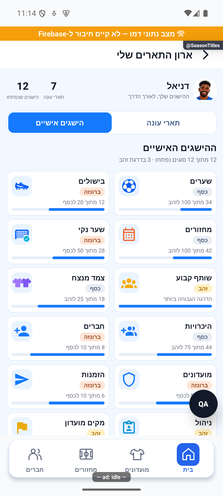
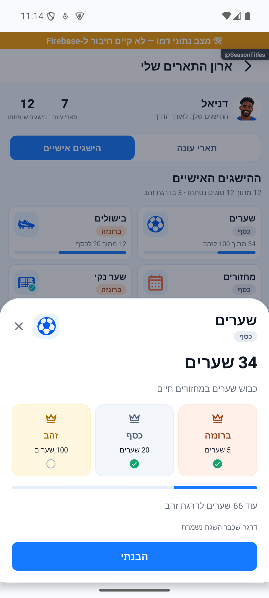

# ארון התארים שלי

[לפירוט הטכני](achievements.md)

בארון יש שתי לשוניות: תארי העונה שבהם זכיתם, וההישגים האישיים שהתקדמתם בהם. למעלה מופיעות ספירות נפרדות של הזכיות ושל סוגי ההישגים שנפתחו.

ההישגים האישיים מוצגים בכרטיסים קטנים עם סמל, דרגה והתקדמות ליעד הבא. לחיצה פותחת הסבר, ספים וכמה נשאר להתקדם. יש 12 סוגים; פתיחת כולם אינה אומרת שכולם הגיעו לזהב. דרגה שכבר הושגה נשמרת. ״מקים מועדון״ הוא הישג חד־פעמי, ללא שלבי ברונזה וכסף.

אם עדכון הפעילות נכשל, מוצגות הדרגות השמורות עם ניסיון חוזר. ההתקדמות המספרית מוסתרת עד שאפשר לטעון אותה מחדש. ספי הזכייה נשארו כפי שהיו, כולל הישג הניהול שמתייחס לשחקנים הנוכחיים במועדונים שאתם מנהלים.

עודכן מקומית ב־18.10.2026, טרם הופץ. הצילומים מהאפליקציה בדמו, עם נתוני זיכרון סינתטיים; אינם נתוני החשבון האמיתי. חגיגות הזכייה ומנגנון שמירת הדרגות ממשיכים לפעול כפי שהיו.

הכרטיסים וחלון הפירוט משמשים כעת גם את הישגי המועדון כדי לשמור על עיצוב אחיד. ההישגים האישיים ממשיכים לשמור את הדרגות שכבר הושגו; דרגות המועדון מחושבות לפי נתוניו העדכניים. [להישגי המועדון](../clubs/details.simple.md).

## תלות בעדכון העונות — 19.10.2026

קובץ תשתית משותף עודכן במסגרת העונות. שינוי זה אינו מוסיף פעולה חדשה למסך המתואר כאן; פרטי העונות והבדיקות מופיעים במסמך העונות.

[מצב המימוש, הבדיקות ומגבלות האימות של העונות](../clubs/seasons.md). מקומי בלבד; לא בוצעה פריסה במסגרת המשימה.

## מלך הניצחונות לפי אחוז — 19.10.2026

תואר מלך הניצחונות עבר לאחוז ניצחונות עם סף השתתפות במחצית ממחזורי העונה. היחידה מועברת במידע המשותף; ספירות היסטוריות נשמרות. [החוזה והראיות בסיכום העונה](../statistics/season-summary.md). השינוי מקומי וטרם הופץ.
