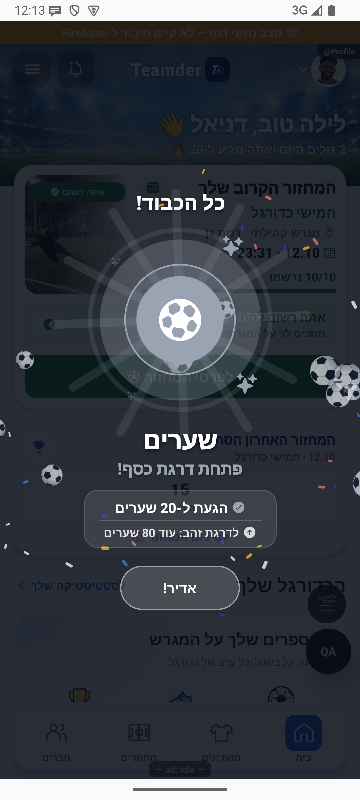

# ארון התארים וההישגים האישיים — הסבר קצר

13.10.2026: תוקנה שמירת ההישגים כך ששני עדכונים במקביל לא יורידו דרגה שכבר נצברה. תנאי הזכייה נשארו ללא שינוי. התיקון נבדק מקומית וטרם הופץ.

החגיגה הוצגה ונסגרה בדמו באנדרואיד, ללא הענקת הישג אמיתי.

## עדכון מקומי — 10.10.2026

אם עדכון הפעילות נכשל, ההישגים שכבר קיבלתם נשארים מוצגים עם הסבר וניסיון חוזר. אין הצגת התקדמות כאילו היא עדכנית כשלא הצלחנו לטעון אותה.

התנהגות הכשל נבדקה בקוד מבודד; לא הורצה במכשיר מול הנתונים האמיתיים.

ארון ההישגים מראה את ההישגים שכבר קיבלתם ומה עוד אפשר להשיג. לחיצה על הישג מסבירה את ההתקדמות, ולצדו מופיעים גם תארים מעונות.

[לפירוט הטכני](achievements.md)

הצילום מדגים את המראה בסביבת בדיקה, ולא מוכיח פעולה מול הנתונים האמיתיים.

## עדכון 8.10.2026 — תנועה ותיקוני דיווחים

חגיגת הישג מסתיימת אחרי תנועה קצרה במקום להמשיך בלולאה. בהגדרת תנועה מופחתת ההישג מוצג ללא קפיצות וקונפטי.

## גבולות מידע אישי — 11.10.2026

שמות ותמונות השחקנים נשמרים. מידע סטטיסטי של המועדון נשאר לפי הרשאות המועדון, והנתונים האישיים מוגבלים לפי הגדרות הפרטיות. השינוי הושלם מקומית וטרם הופץ.

## החלטות הבעלים — 13.10.2026

הישג הניהול מתייחס למספר השחקנים הנוכחיים במועדונים שאתה מנהל, ולא למספר שחקנים שאימנת לאורך השנים.

השינוי מקומי וטרם נפרס. [פירוט הבדיקות והמעבר](../../changes/2026-10-13-approved-statistics-policy.md).

