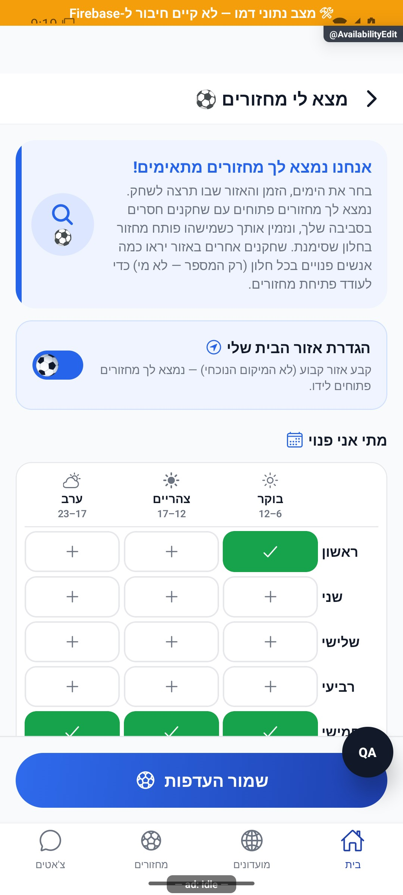

# עריכת זמינות, מקום ורדיוס

## הרחבת אבחון דיווחים, 27.10.2026

נוספה מעטפת אבחון מקומית עם מצב בזמן הכשל, שלבים בעלי מזהה ותזמון, מצב רשת ובנייה ומופעים נפרדים לשגיאה. נקודת הכניסה לתעבורת השרת עוברת כעת דרך העטיפה המשותפת; תשובות, חריגות, אפשרויות קריאה ומדיניות הפיצר נשמרות. אין כאן שינוי בהרשאות או בחישובי המוצר. הבדיקות המלאות ומגבלות האימות מתועדות בדוח המקושר; אין טענה לאימות מכשיר או להפצה. [היקף, ראיות ומגבלות](../../changes/2026-10-27-diagnostic-context.md).

באימות הסופי עברו כל 6,231 הבדיקות ב-555 חבילות, ובדיקות הטיפוסים של הלקוח, השרת והפולס נקיות. צילום הדפדפן והידור מקורות האנדרואיד הם בדיקות מקומיות; אין הוכחת מכשיר, הידור אייפון או מסירה חיה של הבנייה החדשה. רישום יומן השחרור נחשב מאומת רק לפי קבלת הקריאה החוזרת בדוח השינוי.

## שעון מדויק וכיתוב פנדל - 25.10.2026

במקורות המשותפים נוסף שימור השעון המדויק של פנדל במהלך משחק, וכיתוב ההבקעה ביומן קוצר. אין שינוי במונים או בתהליך העצמאי המתואר כאן; לא נערכה לו בדיקת ממשק חדשה במסגרת העדכון. השינוי מקומי וטרם הופץ. [פרטים וראיות](../../changes/2026-10-25-in-play-penalties.md#שעון-מדויק-וכיתוב-אירוע).

## פנדל במהלך משחק חי - 25.10.2026

נבדק השינוי הממוקד במקורות המשותפים: נוספו חוזי אירועי פנדל במהלך משחק, קוראים ומוני סטטיסטיקה, והגנות בעסקאות סיום ואיפוס משחק. מסלול הפיצר המתואר כאן אינו נקודת הכניסה להזנה החדשה. בדיקות המאגר עברו, אך אינן הוכחת הרצה חדשה של כל מצבי התהליך או של פריסה.

השינוי מקומי. נדרשת פריסת שרת לפני הפצת לקוח שמשתמש באפשרות; לא בוצעו פריסה או שינוי הרשאות. [חוזה הנתונים, התהליך, הבדיקות ומגבלות ההפצה](../../changes/2026-10-25-in-play-penalties.md).

## התאוששות חיפוש מקום — 23.10.2026

`src/services/govmapService.ts` מחזיר `unavailable:true` ואינו שומר `remember([])` כשחיפוש ראשי ריק והמקור החלופי נכשל. דחיית המקור הראשי אינה מדווחת ככשל חיפוש אם החלופה סיפקה תוצאות; כשל בשני המקורות עדיין מדווח. לא נשלחות כותרות מתחזות ואין שינוי הרשאות. `tests/logic/govmapFallbackRecovery.test.ts` בודק בחירה ומטמון מול תשובות מדומות. אין בדיקת שירות מפות חי במכשיר. [פירוט האימות והמגבלות](../../changes/2026-10-23-crash-test-and-pulse-followup.md).

## תיעוד כשלים — 20.10.2026

נוספו תצפיות דיווח בנקודות הכשל של המקורות המשויכים לפיצ׳ר, במסגרת הרחבה רוחבית. נשמרו ערכי החזרה, הזריקות ותנאי הפעולה הקיימים; נוסף מקור קוד והקשר לדיווח. כיסוי תחבירי אינו הוכחת הרצה של כל מצב. השינוי מקומי וטרם הופץ; בדיקות המסירה, מגבלות מניעת הכפילויות והמסלולים שטרם חוברו מתועדים בדוח המשותף.

[דוח דיווח השגיאות והראיות](../../changes/2026-10-20-error-reporting-audit.md).

[לקריאה קצרה ופשוטה](availability-edit.simple.md)

עודכן: 07.10.2026; מקור `8e8fde5`, `1.1.35` בבנייה. `src/screens/profile/AvailabilityEditScreen.tsx`, מסלול `AvailabilityEdit`. כניסה מהבית, תפריט, שבוע או גילוי; תפקידים: אורח עם טיוטה ומשתמש מלא.

## אזורי המסך

מתג זמינות/מקום, בחירת מיקום מהמכשיר או חיפוש, מפה וסיכה, רדיוס, לוח שבעה ימים בשלושה חלונות יומיים, בחירות מהירות, התראות התאמה ושמירה. מקום כבוי נועל את ההגדרות התלויות במיקום ומסביר למה. ברירת המפה `DEFAULT_CENTER` היא מרכז תצוגה בלבד; אינה מקום שהמשתמש בחר.

זהו צילום המצב הכבוי בלבד. הוא אינו מוכיח בחירת סיכה, הרשאת מיקום, חיפוש או שמירה מול שרת.

## טבלת מצבים

| תנאי/פעולה | תגובה | כתיבה | ראיה |
|---|---|---|---|
| הפעלה ללא מקום נבחר | לא ניתן לשמור כאילו מקום קיים | אין קואורדינטות מומצאות | קוד |
| הרשאת מיקום/מיקום מכשיר | בחירת מקום מספרי תקין | בטיוטה עד שמירה | קוד |
| חיפוש/גרירת סיכה/הקשה במפה | מקום, תווית וניסיון קידוד הפוך | בטיוטה | קוד |
| שינוי רדיוס | 5–50 ק״מ, ברירת מחדל 15 | בשמירה | קוד |
| לוח רגיל | 21 תאים עצמאיים | בשמירה | קוד |
| בחירה מהירה | ערבים: שבעה; סוף שבוע: שישי/שבת שש; הכול: 21; ניקוי | בטיוטה | קוד |
| כיבוי | ניקוי מקום/עיר והפסקת התראות השלמה; שימור הלוח | כותב הזמינות | דמו חזותי וקוד |
| אורח שומר | טיוטה ושער הרשמה; חזרה לאחר פרופיל | מקומי ואז הכותב היחיד | קוד |
| חזרה עם שינוי | שמור/התעלם/בטל | לפי בחירה | קוד |

לוח חדש מקבל קדימות על שדות ימים/זמנים ישנים. בעת המרה: יום חסר מרחיב לכל הימים, זמן חסר לכל החלונות; שניהם ריקים אינם זמינות לכל השבוע. העדפת הודעות ברירת מחדל מופעלת אלא אם נשמר `false`; `isAvailableForInvites` נשמר לפי המנגנון ואינו נמחק בטעות.

## שירותים וממיר

`src/services/availabilitySave.ts` ו־`persistAvailability` הם הכותב היחיד, גם למסך וגם לשחזור טיוטה ב־`actionResumers`. הוא מגביל לוח תקין, כותב תאימות לשדות קודמים, מעדכן חנות משתמש, מנקה מטמון גילוי ומודיע על שינוי. `src/services/draftStore.ts`, `src/components/availability/AvailabilityRadiusMap.tsx`, `AvailabilityRadiusMapModal.tsx` משתתפים. הקריאה המלאה תלויה בממיר המשתמש ב־`src/firebase/firestore.ts`; בדיקת דמו אינה מכסה אותו. שגיאות מירוץ זהות מטופלות באמצעות המנגנון המצומצם הקיים ולא הרשאה כללית חדשה.

בדיקות: `tests/logic/availabilityGrid.test.ts`, `tests/logic/availabilityPersistState.test.ts`, `tests/logic/availabilityDraftRestore.test.ts`, `tests/rules/availabilitySave.test.mjs`.

## שחזור וסיכונים

לבחון שדות ישנים, לוח חדש וישן יחד, מקום כבוי, אישור/סירוב הרשאה, מקום ששמו אינו תואם לסיכה, טיוטת אורח ותוקף, שגיאת שמירה, ניווט עם שינוי. לא בוצעה שמירת זמינות חיה. לא לקבל את מרכז המפה כהוכחת בחירה ולא לסמן כיבוי כאילו מחק את כל הלוח.

## פירוט מימוש ונקודות שינוי — העמקה 07.10.2026

`save` בונה את הלוח מהתאים הנבחרים ואת שדות התאימות; `persistAvailability.buildSaved` שומר רק ימים שהם מספר שלם 0–6, ורשימות לא ריקות של מחרוזות עד שמונה בכל יום. דיוק: בשכבה זו אין סינון כל מחרוזת לקבוצת שלושת החלונות; הלוח התקין נבנה במסך. אין לטעון שהכותב לבדו מאמת ערכי חלון סגורים.

הכותב ממיר מקום/עיר חסרים ל־null ב־Firestore, בעוד החנות משתמשת ב־undefined. `withAuthRaceRetry` עטוף על הכתיבה; רק `permission-denied` מנסה `ensureUserDoc`, ורק אם מסמך שוחזר מתבצעת כתיבה נוספת. אחרי הצלחה `applyLocally` מעדכן רק את אותו uid, מנקה מטמון זמינות ורושם `AvailabilitySet`; בכשל אין עדכון מקומי שמעמיד פנים שנשמר. גם דמו מעדכן את החנות. שינוי שדות מחייב מסך, טיוטה, ממיר משתמש ושרת התאמות; בדיקת דמו אינה תחליף לבדיקת קורא השדות.

הבדיקות, מצבי המסך והראיות שכבר פורטו במסמך נשמרו. ההעמקה מבוססת על קריאת מקור ולא על הרצת פעולות נוספות; שינוי עתידי יצריך עדכון של שני המסמכים ובחינת המצבים הממוקדים.

## עדכון 8.10.2026 — תנועה ותיקוני דיווחים

בכל תא `ChangeMotion` מקבל את ערך `on`, עם פעימה של 180 אלפיות שנייה. המסגרת ושטח הלחיצה אינם מונפשים. `toggleSlot` עדיין משנה טיוטה בלבד; פונקציית השמירה והחישובים לא השתנו.

**ראיה ומגבלות:** הופעל אזור הבית ונבחר תא בדמו בלי לשמור. לא נבדקו כתיבת מסד או הודעת הצלחה מהשרת.

בדיקת הטיפוסים ו־183 חבילות הבדיקות עברו, 2,752 בדיקות. מצב המקור: `9ec0dfd` עם שינויים מקומיים; אין גרסה חדשה שפורסמה. [יומן השינוי וההקלטות](../../changes/2026-10-08-motion-and-pulse.md).

## תיקוני עיצוב ונגישות — 10.10.2026

מקור: `a348b9f235f1e1433497600555303231512a0834` עם שינויים מקומיים. אין בסעיף זה הוכחת גרסת חנות.

למתגים הועברו שמות מפורשים. `AvailabilityRadiusMapModal` מעבירה שם לרכיב `RangeSlider`, המכריז על מינימום, מקסימום וערך ומגיב לפעולות הגדלה/הקטנה בצעד המוגדר. הצעד מעוגל ביחס למינימום: `min + round((raw-min)/step)*step`, ונחתך לגבולות. המצב המושבת חוסם פעולות. המחוות קוראות מאפיינים עדכניים דרך הפניה, כדי לא לשמור רדיוס או callback ישן. בדיקות נגישות כוללות מינימום 3 וצעד 2; קורא מסך וחלון הרדיוס לא הורצו במכשיר בסבב זה.

## תלות בעדכון העונות — 19.10.2026

נבדק ההפרש בקבצים המשותפים הרשומים כאן: `src/firebase/firestore.ts`. השינוי ממוקד במדיניות העונות, קריאת מצבן, שיוך מחזור ופקודות ניהולן; אין שינוי מכוון בחוזה העצמאי המתואר במסמך זה. אין להסיק מכך שהמסך הזה הורץ מחדש.

[מצב המימוש, הבדיקות ומגבלות האימות של העונות](../clubs/seasons.md). מקומי בלבד; לא בוצעה פריסה במסגרת המשימה.

## תלות במידע על סגירת עונה — 23.10.2026

בדיקת ההבדל ב־`src/firebase/firestore.ts` וב־`src/types/index.ts` מראה שהשינוי מוגבל לקריאת `seasons.closureStatus` בחוזה `GroupSeasons`. יתר ממירי הנתונים והמסלולים המתועדים כאן לא שונו במשימה זו. אימות הריצה החדש מתייחס להתאוששות ולכרטיס העונה, ולא להרצה חדשה של כל מצבי המסך הזה. [המסלול, הבדיקות והמגבלות](../../changes/2026-10-23-season-automatic-recovery.md).

## תלות בשמירת צבעי המחזור — 24.10.2026

במסגרת בחירת צבעים לפני שיבוץ עודכנו מקורות משותפים הרשומים לפיצ׳ר: `src/firebase/firestore.ts`, `src/types/index.ts`. השינוי מוסיף מפת צבעים למחזור, קריאה וכתיבה שלה ושימורה במסלולי הכוחות וההכנה. אין כאן פעולת ממשק חדשה במסך זה. זו בדיקת השפעת התוספת הממוקדת, ולא חקירה או אימות חזותי מחודש של הפיצ׳ר. כל 480 חבילות הבדיקה ו־5,343 הבדיקות עברו; טיפוסי הלקוח והשרת נקיים. השינוי מקומי וטרם הופץ. [מסלול הנתונים, ראיות ומגבלות](../rounds/draft-setup.md#צבעים-לפני-שיבוץ-ובכל-שיטת-חלוקה--24102026).

## תאימות לשמירת פקודת רכיב הבית - 25.10.2026

השינוי התחום במקורות המשותפים `src/types/index.ts` ו-`src/firebase/firestore.ts` מוסיף ומשמר את `liveMatch.lastWidgetCommandId`, מזהה אטום למניעת ביצוע חוזר של פקודת רכיב הבית. הוא אופציונלי במסמכים ישנים ואינו משנה מונים, הכרעות, ניווט או הרשאות של הפיצר המתואר כאן. בדיקה מפעילה את ממיר הקריאה המקורי ומאמתת שימור ערך והיעדרו. אין בכך בדיקת מכשיר חדשה לכל מצבי הפיצר. [מקור הבדיקה והמגבלות](../../changes/2026-10-25-widget-completion.md).
