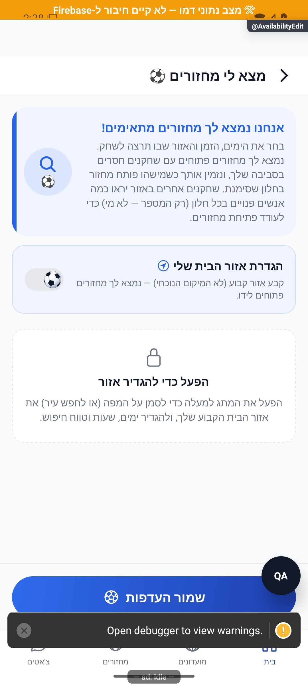

# עריכת זמינות, מקום ורדיוס — הסבר קצר

## התאוששות חיפוש מקום — 23.10.2026

כשהחיפוש הראשי נכשל והחיפוש החלופי מצליח, אפשר לבחור מקום כרגיל. כששני המקורות נכשלים, המצב אינו נשמר עוד כאילו החיפוש הצליח בלי תוצאות; ניסיון נוסף יכול להתאושש. השינוי מקומי וטרם הופץ. [פירוט האימות והמגבלות](../../changes/2026-10-23-crash-test-and-pulse-followup.md).

## תיעוד כשלים — 20.10.2026

נוסף תיעוד אוטומטי לנקודות כשל במסלול הזה, עם מקור התקלה. הפעולה המקורית שומרת על ערכי החזרה והודעות השגיאה שלה. השינוי מקומי, טרם הופץ, ואין אימות מסירה חיה לפולס.

[דוח דיווח השגיאות והראיות](../../changes/2026-10-20-error-reporting-audit.md).

מסמנים מתי פנויים לשחק, בוחרים מקום וכמה רחוק מוכנים להגיע. אפשר לבחור כל חלון בנפרד ולהחליט אם לקבל הודעות על מחזורים מתאימים.

[לפירוט הטכני](availability-edit.md)

הצילום מדגים את המראה בסביבת בדיקה, ולא מוכיח פעולה מול הנתונים האמיתיים.

## עדכון 8.10.2026 — תנועה ותיקוני דיווחים

בחירת חלון פנוי מקבלת פעימה קצרה בסמל. הסימון עדיין נשמר רק בלחיצה על שמירת העדפות.

## תיקוני עיצוב ונגישות — 10.10.2026

מקור: `a348b9f235f1e1433497600555303231512a0834` עם שינויים מקומיים. אין בסעיף זה הוכחת גרסת חנות.

אפשרויות הזמינות ומרחק החיפוש מקבלות שם ברור בקורא מסך. אפשר לשנות מרחק גם ללא גרירה.

## תלות בעדכון העונות — 19.10.2026

קובץ תשתית משותף עודכן במסגרת העונות. שינוי זה אינו מוסיף פעולה חדשה למסך המתואר כאן; פרטי העונות והבדיקות מופיעים במסמך העונות.

[מצב המימוש, הבדיקות ומגבלות האימות של העונות](../clubs/seasons.md). מקומי בלבד; לא בוצעה פריסה במסגרת המשימה.

## תלות במידע על סגירת עונה — 23.10.2026

נוסף מידע משותף שמאפשר להסביר מדוע עונה מתעכבת בסגירה. אין שינוי נוסף בפעולות המתוארות כאן; השינוי מקומי וטרם הופץ. [המסלול, הבדיקות והמגבלות](../../changes/2026-10-23-season-automatic-recovery.md).

## תלות בשמירת צבעי המחזור — 24.10.2026

שמירת המידע המשותפת עודכנה כדי להעביר את צבעי הקבוצות ממסכי הכוחות להכנה וללייב. אין תוספת פעולה במסך הזה, והוא לא נבדק מחדש במכשיר במסגרת התוספת. השינוי מקומי וטרם הופץ. [פרטי התוספת ומגבלות הבדיקה](../rounds/draft-setup.md#צבעים-לפני-שיבוץ-ובכל-שיטת-חלוקה--24102026).
