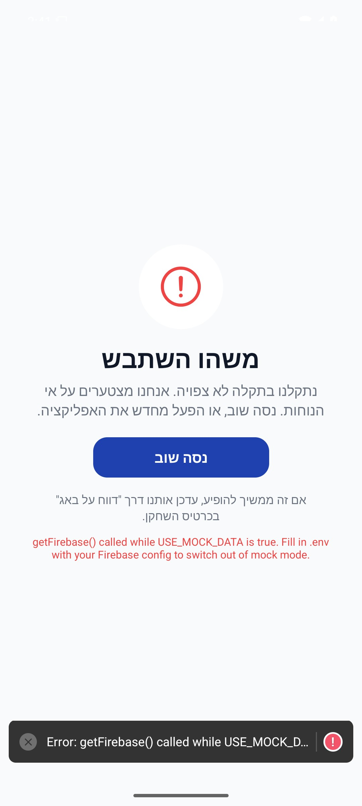
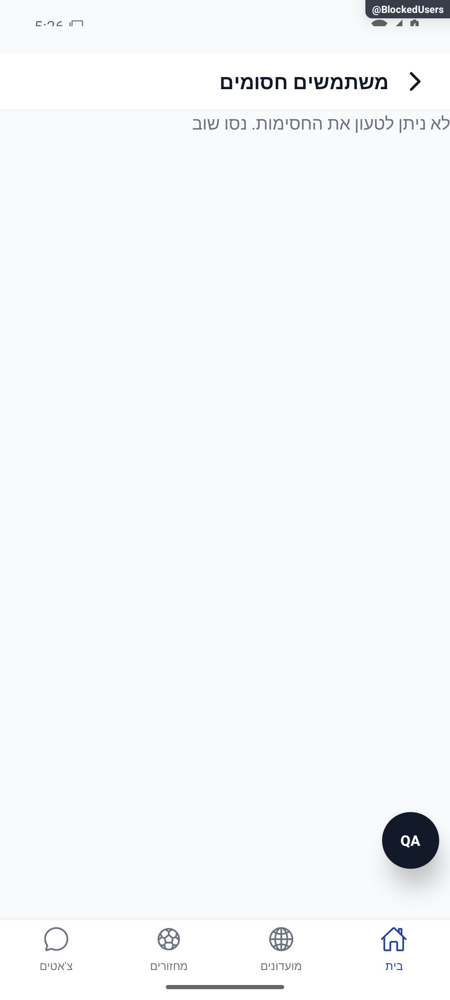

# משתמשים חסומים

## הרחבת אבחון דיווחים, 27.10.2026

נוספה מעטפת אבחון מקומית עם מצב בזמן הכשל, שלבים בעלי מזהה ותזמון, מצב רשת ובנייה ומופעים נפרדים לשגיאה. נקודת הכניסה לתעבורת השרת עוברת כעת דרך העטיפה המשותפת; תשובות, חריגות, אפשרויות קריאה ומדיניות הפיצר נשמרות. אין כאן שינוי בהרשאות או בחישובי המוצר. הבדיקות המלאות ומגבלות האימות מתועדות בדוח המקושר; אין טענה לאימות מכשיר או להפצה. [היקף, ראיות ומגבלות](../../changes/2026-10-27-diagnostic-context.md).

באימות הסופי עברו כל 6,231 הבדיקות ב-555 חבילות, ובדיקות הטיפוסים של הלקוח, השרת והפולס נקיות. צילום הדפדפן והידור מקורות האנדרואיד הם בדיקות מקומיות; אין הוכחת מכשיר, הידור אייפון או מסירה חיה של הבנייה החדשה. רישום יומן השחרור נחשב מאומת רק לפי קבלת הקריאה החוזרת בדוח השינוי.

## שעון מדויק וכיתוב פנדל - 25.10.2026

במקורות המשותפים נוסף שימור השעון המדויק של פנדל במהלך משחק, וכיתוב ההבקעה ביומן קוצר. אין שינוי במונים או בתהליך העצמאי המתואר כאן; לא נערכה לו בדיקת ממשק חדשה במסגרת העדכון. השינוי מקומי וטרם הופץ. [פרטים וראיות](../../changes/2026-10-25-in-play-penalties.md#שעון-מדויק-וכיתוב-אירוע).

## פנדל במהלך משחק חי - 25.10.2026

נבדק השינוי הממוקד במקורות המשותפים: נוספו חוזי אירועי פנדל במהלך משחק, קוראים ומוני סטטיסטיקה, והגנות בעסקאות סיום ואיפוס משחק. מסלול הפיצר המתואר כאן אינו נקודת הכניסה להזנה החדשה. בדיקות המאגר עברו, אך אינן הוכחת הרצה חדשה של כל מצבי התהליך או של פריסה.

השינוי מקומי. נדרשת פריסת שרת לפני הפצת לקוח שמשתמש באפשרות; לא בוצעו פריסה או שינוי הרשאות. [חוזה הנתונים, התהליך, הבדיקות ומגבלות ההפצה](../../changes/2026-10-25-in-play-penalties.md).

## תיעוד כשלים — 20.10.2026

נוספו תצפיות דיווח בנקודות הכשל של המקורות המשויכים לפיצ׳ר, במסגרת הרחבה רוחבית. נשמרו ערכי החזרה, הזריקות ותנאי הפעולה הקיימים; נוסף מקור קוד והקשר לדיווח. כיסוי תחבירי אינו הוכחת הרצה של כל מצב. השינוי מקומי וטרם הופץ; בדיקות המסירה, מגבלות מניעת הכפילויות והמסלולים שטרם חוברו מתועדים בדוח המשותף.

[דוח דיווח השגיאות והראיות](../../changes/2026-10-20-error-reporting-audit.md).

## עדכון מקומי — 10.10.2026

נוסח `he.blockedIntro` תוקן לתיאור חסימה חד־צדדית: הודעות החסום מוסתרות אצל החוסם והתראות ממנו אינן נשלחות; ההודעות שלכם בשיחות משותפות נשארות גלויות לו. אין שינוי ב־`users/{uid}/blocked`, בהרשאות, במנוי או בשליחת הודעות. התיקון הוא לנוסח המבטיח את ההתנהגות הקיימת, ולא הוספת הסתרה הדדית. צילום קודם אינו ראיה לנוסח החדש.

**מצב האימות:** תיקון מקומי, 10.10.2026. ראיות השירותים ופונקציות המקור ב־`tests/logic/clientAuditRecovery.test.ts`; הריצה הממוקדת המתועדת עברה 417 בדיקות ב־8 חבילות; השלמת שחזור מאוחר תועדה בדוח התיקון. [דוח התיקון והגבולות](../../../artifacts/pre-release-2026-10-10/client-fixes.md). לא הורצו כאן פעולות מול מסד אמיתי ולא צולמו מצבי כשל רשת חדשים; התמונות ההיסטוריות אינן הוכחה לתיקון זה.

[לקריאה קצרה ופשוטה](blocked-users.simple.md)

עודכן: 07.10.2026; מקור `8e8fde5`, `1.1.35` בבנייה. `src/screens/profile/BlockedUsersScreen.tsx`, מסלול `BlockedUsers`, מתפריט הבית. תפקיד: חשבון מלא מנהל את החסימות שלו.

## מבנה ותהליך

כותרת, רשימת חסימות עם זהויות ופעולת הסרת חסימה לאחר אישור. `chatService.subscribeBlocked` מאזין ל־`users/{uid}/blocked`; טעינת שמות נפרדת מעצם רשימת המזהים. אין למפות רשימת חסימות מתוך שדה חברים או מצב בקשת חברות.

בבדיקה המסך קרא `getFirebase()` כאשר `USE_MOCK_DATA` מופעל, ונראה גבול שגיאה ולאחריו מסך שגיאה של פיתוח. הצילום מוכיח כשל מסלול בדמו בלבד. אין מכאן טענה שהמסך נכשל בחשבון אמיתי או שאין למשתמש חסומים.

| תנאי | תגובה | כתיבה | ראיה |
|---|---|---|---|
| המאזין טרם מסר נתון | טעינה | אין | קוד |
| חסימות זמינות | פתרון זהויות ותצוגה | אין | קוד בלבד |
| זהות לא נמצאה | תווית חלופית לפי הקוד | אין | קוד |
| אין חסימות | מצב ריק | אין | קוד בלבד |
| עיכוב שש שניות | כשל וניסיון חוזר; רשימה מאושרת נשמרת | אין | תיקון 8.10; צילום דמו מוגבל |
| הסרת חסימה | חלון אישור ואז מחיקה | `deleteDoc` של חסימה | קוד; לא בוצע |
| מצב דמו | קריאת שירות אמיתי גורמת לכשל | אין שינוי ייצור | נצפה בפועל בדמו |

## מקורות וסיכונים

`src/services/chatService.ts:subscribeBlocked`, שירות קריאת משתמשים ונתיבי מסד ב־`src/firebase/firestore.ts`. קריאת זהות עשויה להשתמש בממיר משתמש; אוסף החסימות נפרד. שגיאת הסרה מוצגת כיום בטקסט גולמי; יש לבדוק נוסח, שמירת הרשימה וניסיון חוזר לפני שינוי.

אין טענה לכיסוי בדיקה ייעודית של המסך או להצלחת המאזין האמיתי. נדרש לשפר את יכולת הבדיקה לפני צילום כל המצבים בדמו, אך המיפוי אינו תיקון. לבדיקה אמיתית להשתמש בחשבון הבדיקה המאושר, חסימה קיימת, כשל רשת, זהות חסרה וביטול חלון הסרה. לא להסיר חסימה של הבעלים לצורך המיפוי.

## פירוט מימוש ונקודות שינוי — העמקה 07.10.2026

אפקט המסך מפעיל `chatService.subscribeBlocked(me.id)`, ממיר Set לרשימת מזהים ומבקש `hydratePlayers` עבור זהויות. אירוע פתיחה נרשם רק בפליטה הראשונה. cleanup מנתק מנוי ומנקה טיימר; ללא פליטה אחרי 6,000 אלפיות שנייה מוצג כשל וניסיון חוזר; אין המרה לרשימה ריקה מאושרת.

`onUnblock` מבקש אישור, מגדיר `busy[uid]`, מפעיל `unblockUser` ומציג הצלחה; הסרת השורה באה מהמנוי ולא ממחיקה אופטימית. בכשל נרשמים לוג/אירוע ומוצג כיום message גולמי בטוסט — נקודת שיפור בנוסח, לא שינוי שבוצע. שם לא פתור משתמש בשם כללי גם באישור, בלי שלוש נקודות. שינוי תמיכת דמו צריך להתחיל במנוי השירות שזורק דרך getFirebase, ולא להסתיר את ErrorBoundary. צילום הכשל מוכיח מגבלת סביבת דמו בלבד.

הבדיקות, מצבי המסך והראיות שכבר פורטו במסמך נשמרו. ההעמקה מבוססת על קריאת מקור ולא על הרצת פעולות נוספות; שינוי עתידי יצריך עדכון של שני המסמכים ובחינת המצבים הממוקדים.

## תיקוני סבב הבאגים — 8.10.2026

B11: chatService.subscribeBlocked שומרת את הרשימה האחרונה ומדווחת onError; גם כשל סינכרוני בהקמת המנוי מטופל. BlockedUsersScreen מציגה שגיאה אם לא התקבלה תשובה במשך שש שניות; תשובה מוצלחת מונעת את שגיאת הזמן. שינוי חשבון מנקה את הרשימה המקומית. צילום דמו בודק כשל הקמת מנוי בלבד, ולא הרשאות ייצור.

[ראיות, בדיקות ומגבלות](../../changes/2026-10-08-audit-fixes.md).

כשל הקמת מנוי בדמו; אין בדיקת חסימות ייצור. נצפתה הודעת ניסיון חוזר במקום רשימה ריקה.

## תלות בעדכון העונות — 19.10.2026

נבדק ההפרש בקבצים המשותפים הרשומים כאן: `src/firebase/firestore.ts`. השינוי ממוקד במדיניות העונות, קריאת מצבן, שיוך מחזור ופקודות ניהולן; אין שינוי מכוון בחוזה העצמאי המתואר במסמך זה. אין להסיק מכך שהמסך הזה הורץ מחדש.

[מצב המימוש, הבדיקות ומגבלות האימות של העונות](../clubs/seasons.md). מקומי בלבד; לא בוצעה פריסה במסגרת המשימה.

## תלות במידע על סגירת עונה — 23.10.2026

בדיקת ההבדל ב־`src/firebase/firestore.ts` וב־`src/types/index.ts` מראה שהשינוי מוגבל לקריאת `seasons.closureStatus` בחוזה `GroupSeasons`. יתר ממירי הנתונים והמסלולים המתועדים כאן לא שונו במשימה זו. אימות הריצה החדש מתייחס להתאוששות ולכרטיס העונה, ולא להרצה חדשה של כל מצבי המסך הזה. [המסלול, הבדיקות והמגבלות](../../changes/2026-10-23-season-automatic-recovery.md).

## תלות בשמירת צבעי המחזור — 24.10.2026

במסגרת בחירת צבעים לפני שיבוץ עודכנו מקורות משותפים הרשומים לפיצ׳ר: `src/firebase/firestore.ts`, `src/types/index.ts`. השינוי מוסיף מפת צבעים למחזור, קריאה וכתיבה שלה ושימורה במסלולי הכוחות וההכנה. אין כאן פעולת ממשק חדשה במסך זה. זו בדיקת השפעת התוספת הממוקדת, ולא חקירה או אימות חזותי מחודש של הפיצ׳ר. כל 480 חבילות הבדיקה ו־5,343 הבדיקות עברו; טיפוסי הלקוח והשרת נקיים. השינוי מקומי וטרם הופץ. [מסלול הנתונים, ראיות ומגבלות](../rounds/draft-setup.md#צבעים-לפני-שיבוץ-ובכל-שיטת-חלוקה--24102026).

## התאמת בדיקת המקור המשותפת בלילה של 25.10.2026

ההבדל החדש ב-`tests/logic/clientAuditRecovery.test.ts` מוגבל לשלוש בדיקות הסטטיסטיקה: איתור `useFocusEffect` במקום `useEffect`, חילוץ גוף `React.useCallback`, ומתאם לקריאת `pairStats` המקבילה. התרחישים והתנאים של יתר בדיקות המקור בקובץ נשמרו. אין שינוי בקוד המוצר של התחום המתואר כאן במסגרת התאמת המבחן, ואין אימות מכשיר חדש שלו. [תיקוני הטעינה, תוצאות הבדיקות ומגבלות](../../changes/2026-10-24-loading-performance.md).

## המשך קיצור טעינות בלילה של 25.10.2026

ב-`tests/logic/clientAuditRecovery.test.ts` נוסף למתאם בדיקת כשל ההישגים גם מקור ההזמנות שמתחיל כעת במקביל. בדיקות התחומים האחרים וציפיית זריקת הכשל נשמרו. אין אימות מכשיר חדש של כל מצבי הפיצר המתואר כאן. [בדיקות, ראיות ומגבלות](../../changes/2026-10-24-loading-performance.md).

## תאימות לשמירת פקודת רכיב הבית - 25.10.2026

השינוי התחום במקורות המשותפים `src/types/index.ts` ו-`src/firebase/firestore.ts` מוסיף ומשמר את `liveMatch.lastWidgetCommandId`, מזהה אטום למניעת ביצוע חוזר של פקודת רכיב הבית. הוא אופציונלי במסמכים ישנים ואינו משנה מונים, הכרעות, ניווט או הרשאות של הפיצר המתואר כאן. בדיקה מפעילה את ממיר הקריאה המקורי ומאמתת שימור ערך והיעדרו. אין בכך בדיקת מכשיר חדשה לכל מצבי הפיצר. [מקור הבדיקה והמגבלות](../../changes/2026-10-25-widget-completion.md).
