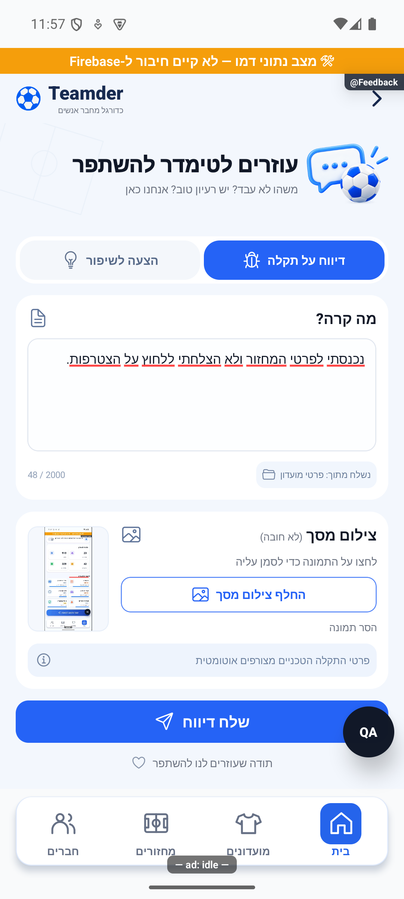

# דיווח תקלה והצעת שיפור

## הפצה פנימית 1.1.66, 27.10.2026

חלון ההצעות והשבתת איסוף הספורט נכללים כעת בגרסת הטלפון הפנימית `1.1.66/300`. נבדקו החבילה והחנות, כל 6252 בדיקות היישום ו-353 בדיקות הכללים עברו. אין אימות התקנה או תשובה חיה מהגרסה החדשה לפולס; צילום החלון מתצוגת מקור בדפדפן. הייצור והשעון ללא שינוי. [מקור, בדיקות ומגבלות](../../changes/2026-10-27-internal-1.1.66.md).

## חלון הצעות בכניסה, 27.10.2026

נוסף חלון שמבקש מהמשתמשים לספר מה חסר להם באפליקציה. הוא כולל באנר כדורגל, תיבת טקסט וכפתור שליחה, בלי אולי אחר כך. ההצעות נשלחות לרשימת הדיווחים בפולס; אפשר לסגור באיקס. הוא מופיע בבית לאחר התחברות והשלמת פרופיל, פעם אחת לחשבון במכשיר אחרי סגירה או שליחה. בכשל שליחה הטקסט נשאר לניסיון חוזר. השינוי מקומי וטרם הופץ; החיבור נבדק מקומית ולא בשליחה חיה ממכשיר. [פרטים וראיות](../../changes/2026-10-27-feedback-prompt.md).

## הרחבת אבחון דיווחים, 27.10.2026

הדיווחים יוכלו לכלול מה ניסו לבצע, מה היה מצב האפליקציה ומה החזיר השרת. פרטים חסרים מוצגים כלא ידועים, ומספר מוגבל של מופעים נשמר בלי למחוק את המופע הראשון. השינוי מקומי וטרם הופץ, ואינו משלים פרטים לדיווחים ישנים. [היקף, ראיות ומגבלות](../../changes/2026-10-27-diagnostic-context.md).

בדיקות הקוד הושלמו, אך השינוי עדיין מקומי ולא הופץ. פרטים שלא נאספו בדיווחים ישנים אינם משוחזרים בדיעבד.

## טיפול מלא בפריטי הפולס הפתוחים, 27.10.2026

הושלם סבב טיפול בפריטי הפולס עם תיקונים ותוצאות מחקר מוכנות לביקורת. פריטים שלא תוקנו נשארים פתוחים עם הסבר וצעד הבא. לא בוצעה הפצה או בדיקת מכשיר חדשה. [ממצאים, בדיקות ומסירה](../../changes/2026-10-27-pulse-completion.md).

## טיפול בתקלות הפולס, 26.10.2026

נבדק שינוי ממוקד במקור משותף במהלך טיפול בתקלות הפולס. אין שינוי נוסף בפעולות הפיצר המתואר כאן.

השינוי מקומי וטרם הופץ. [בדיקות, מסירה ומגבלות](../../changes/2026-10-26-pulse-fixes.md).

## ביטול פעילות אחרי מחיקת מועדון - 26.10.2026

מחיקת מועדון עוצרת כעת את המחזורים השבועיים שלו, ובשרת נוספה הגנה שמונעת פתיחת מחזור למועדון שכבר נמחק. הטיפול מבטל מחזורים שטרם הסתיימו, דוחה בקשות חברות ממתינות, מסיר הרשמה להתראות ואת כרטיס המועדון הציבורי. נתוני עבר והישגים אישיים נשמרים. תיקון השרת נפרס ואומת באישור הבעלים. הסדרה שנותרה כובתה, ההרשמה להתראות והכרטיס הציבורי הוסרו; המחזור עצמו כבר לא היה קיים בבדיקה העדכנית. עצירת הסדרה המוקדמת בצד הלקוח תיכלל בבינארי עתידי. נשמרה ההיסטוריה. [המימוש, בדיקת השאריות ומגבלות האישור](../../changes/2026-10-26-deleted-club-recurring.md).

## השפעת מקור משותף במשימת השעון - 26.10.2026

במקור השרת המשותף נוספה כניסה נפרדת לסנכרון הפעילות האישית מהשעון. השליחה והקריאה של דיווחי המשתמש לא שונו בהוספת ייצוא הפעילות. לא נערכה כאן בדיקה חדשה של כל מצבי המסך. השינוי מקומי, ומצב ההפצה ומגבלות הבדיקה מפורטים בדוח המקושר. [היקף המימוש, הבדיקות, מגבלות האישור והצילומים](../../changes/2026-10-26-android-personal-activity.md).

## הפצה פנימית 1.1.61 - 25.10.2026

הבינארי `1.1.61/295` הופץ ואומת במסלול הפנימי באנדרואיד. תיקוני הלקוח נכללים בו, ושירות הפרופיל נפרס ואומת בנפרד. גם תיקוני הסגל, שמירת התוצאה והתראת השגיאה בשרת נפרסו ואומתו באישור מפורש. שינויי יישום הפולס עצמו טרם הופצו. אין שינוי כללי הרשאה או הסבת נתונים. ניסוחי המצב המקומי בסעיפים הקודמים נכתבו לפני ההפצה; [דוח ההפצה](../../changes/2026-10-25-internal-1.1.61.md) מפרט בדיוק מה נכלל, מה נבדק ומה עדיין מקומי.

## תיקוני הפולס - 25.10.2026

נבדק תיקון ממוקד בקובץ משותף במהלך סבב הפולס. אין שינוי מכוון בתהליך העצמאי המתואר כאן ואין טענה לבדיקת מסך חדשה שלו. מקומי וטרם הופץ.

[מקורות, בדיקות, צילומים ומגבלות](../../changes/2026-10-25-pulse-fixes.md).

## שעון מדויק וכיתוב פנדל - 25.10.2026

במקורות המשותפים נוסף שימור השעון המדויק של פנדל במהלך משחק, וכיתוב ההבקעה ביומן קוצר. אין שינוי במונים או בתהליך העצמאי המתואר כאן; לא נערכה לו בדיקת ממשק חדשה במסגרת העדכון. השינוי מקומי וטרם הופץ. [פרטים וראיות](../../changes/2026-10-25-in-play-penalties.md#שעון-מדויק-וכיתוב-אירוע).

## פנדל במהלך משחק חי - 25.10.2026

עודכנו מקורות משותפים לצורך פנדלים במהלך משחק. אין שינוי מכוון בתהליך העצמאי המתואר במסמך הזה, ולא נערכה לו בדיקת ממשק חדשה במסגרת המשימה.

השינוי מקומי. נדרשת פריסת שרת לפני הפצת לקוח שמשתמש באפשרות; לא בוצעו פריסה או שינוי הרשאות. [חוזה הנתונים, התהליך, הבדיקות ומגבלות ההפצה](../../changes/2026-10-25-in-play-penalties.md).

## תיעוד כשלים — 20.10.2026

נוסף תיעוד אוטומטי לנקודות כשל במסלול הזה, עם מקור התקלה. הפעולה המקורית שומרת על ערכי החזרה והודעות השגיאה שלה. השינוי מקומי, טרם הופץ, ואין אימות מסירה חיה לפולס.

[דוח דיווח השגיאות והראיות](../../changes/2026-10-20-error-reporting-audit.md).

## תיקון פערי העונות — 20.10.2026

השינוי בקובץ השרת המשותף במסגרת תיקוני העונות נוגע לשער הסגירה, אימות מחזור והשלמת סטטיסטיקה בלבד. נתיבי הפיצ׳ר המתועדים כאן לא שונו בסבב זה. הבדיקות המלאות עברו; אין בכך אימות חדש של פריסה או שירות חיצוני.

[דוח תיקונים, בדיקות ומגבלות](../reviews/2026-10-20-seasons-fixes.md).

שני הכפתורים בתפריט נשארו: כל אחד פותח את הלשונית המתאימה במסך החדש. אפשר לעבור בין הלשוניות בלי לאבד את המלל או את התמונה שכבר צורפה.

כותבים מה קרה או מה רוצים לשפר, ואפשר לצרף צילום מסך וללחוץ עליו כדי לסמן. פרטי התקלה הטכניים מצורפים אוטומטית. אפשר להחליף או להסיר את התמונה; אם השליחה נכשלת, הטיוטה נשמרת לניסיון חוזר כל עוד נשארים במסך.

[לפירוט הטכני, הבדיקות והמגבלות](feedback.md)

[לשונית הצעת שיפור](../screenshots/feedback-redesign-suggestion-2026-10-18.png). הצילומים נלקחו מהיישום באמולטור עם נתוני דמה; השינוי מקומי וטרם הופץ. לא נשלח דיווח אמיתי לצורך הבדיקה.

דיווחים נשלחים לאזור הדיווחים בפולס. [מידע על רצף הפעולות ופרטיות](../shared/diagnostic-journal.simple.md).

## תלות בעדכון העונות — 19.10.2026

קובץ תשתית משותף עודכן במסגרת העונות. שינוי זה אינו מוסיף פעולה חדשה למסך המתואר כאן; פרטי העונות והבדיקות מופיעים במסמך העונות.

[מצב המימוש, הבדיקות ומגבלות האימות של העונות](../clubs/seasons.md). מקומי בלבד; לא בוצעה פריסה במסגרת המשימה.

## שינוי מוגבל בקובץ השרת המשותף — 24.10.2026

ב־`functions/src/index.ts` נוסף ייצוא רכיב קליטת הקריסות, ו־`onErrorLogged` מדלג על מקור הקריסות החדש כדי למנוע התראה כפולה. אין שינוי במסלול הפיצ׳ר המתואר כאן או בחישוביו. לפריסה הוכנה חבילה מהמקור הפרוס עצמו, עם תנאי הדילוג בלבד; אין פריסה של פונקציות הפיצ׳ר הזה. [היקף וראיות](../../changes/2026-10-24-crashlytics-pulse.md).

## תלות בשמירת צבעי המחזור — 24.10.2026

שמירת המידע המשותפת עודכנה כדי להעביר את צבעי הקבוצות ממסכי הכוחות להכנה וללייב. אין תוספת פעולה במסך הזה, והוא לא נבדק מחדש במכשיר במסגרת התוספת. השינוי מקומי וטרם הופץ. [פרטי התוספת ומגבלות הבדיקה](../rounds/draft-setup.md#צבעים-לפני-שיבוץ-ובכל-שיטת-חלוקה--24102026).

## טיפול בפולס — 24.10.2026

עודכן רכיב משותף של חלונות האישור ומסלול השרת להרשמה. אין בסבב הזה שינוי ייעודי או אימות חדש של מסך זה.

[פירוט התיקונים, הבדיקות והמגבלות](../../changes/2026-10-24-pulse-current.md). התיקונים מקומיים וטרם הופצו.

## תלות ביצוא היסטוריית השוואות — 24.10.2026

במשימה זו נוספה בקובץ השרת המשותף רק שורת יצוא של `recordPlayerComparison` ו־`getMyComparisonActivity`. מסלולי הפיצ׳ר המתוארים כאן לא שונו במסגרת התוספת הזאת ולא הורצו מחדש כתרחיש נפרד. אין פריסה או שינוי כללים. [המימוש, הבדיקות וגבולות האימות](../../changes/2026-10-24-comparison-activity.md).

## בדיקת תלות משותפת ברענון סגל בווידגט - 25.10.2026

נוסף תיקון נפרד לרענון רשימת השחקנים ברכיב הבית כשהאפליקציה סגורה. התוספת אינה משנה את התהליך המתואר בעמוד זה. היא מקומית וטרם הופצה. [פרטי הבדיקה והמגבלות](../../changes/2026-10-25-widget-roster-background.md).
