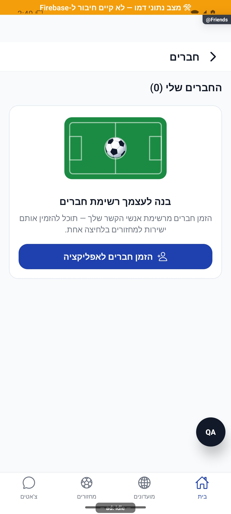
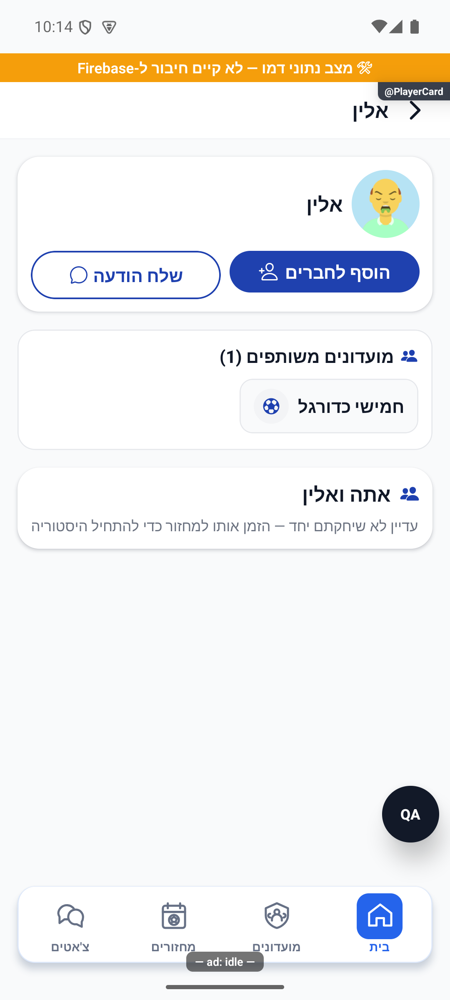
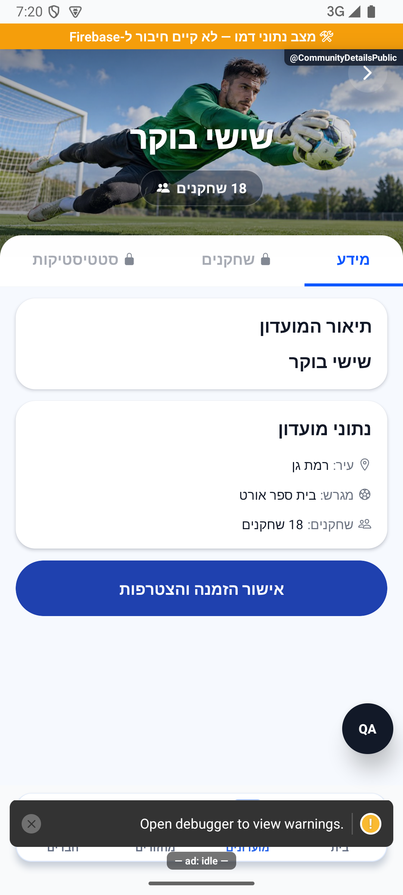
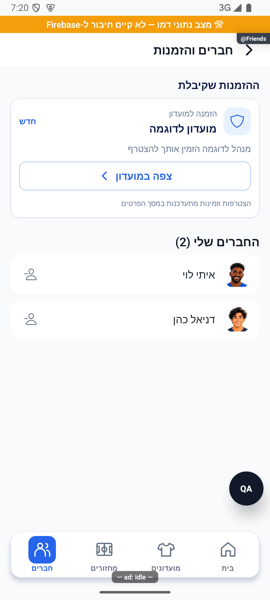
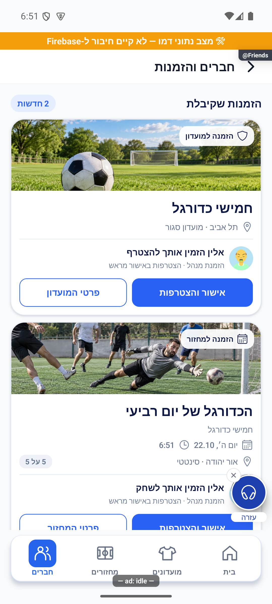

# חברים ובקשות חברות

## הכרעת הזמנות והצטרפות — 11.10.2026

ההתנהגות העדכנית מחליפה את תיאור ההזמנות הקודם: הזמנת מנהל היא אישור מראש, אך אינה מצרפת ללא הסכמת הנמען. פרטי המימוש, המכנים לקיבולת, התוקף, הרשאות, המסלולים, תאימות ללקוחות ישנים ובדיקות: [תיקון הזמנות ואישור הצטרפות](../../changes/2026-10-11-invitation-admission.md).

במועדון משתמשים ב־`joinSocialClub` מול המועדון הקנוני ולא בהכרעה לפי המראה הציבורית. במחזור משתמשים ב־`reconcileGameJoins` ובאישור מפורש ב־`approvedInvites`; `invitedUserIds` אינו אישור. התוצאה במסך מגיעה ממסמך הבקשה בשרת. כל הזמנות המועדון נפתחות במסך `CommunityDetailsPublic` הקיים עם `fromInvitation`, כולל בקשות ישנות ממתינות; הרשאה אינה נובעת מהפרמטר.

אימות: 253 חבילות ו־3414 בדיקות יישום; 328 בדיקות הרשאות מול הכללים המלאים; 9 בדיקות פונקציות מול מסד הדגמה מקומי. לא בוצעו פריסה, הסבת נתונים או בדיקת מסירה לטלפון ייצור.

## חברים והזמנות — 11.10.2026

מסך `Friends` הקיים מרכז כעת גם הזמנות. אותו מסך נפתח מתפריט הבית לפי שער החברים הקיים, ומכפתור קבוע מעל שתי הלשוניות ב־`ChatsList`. הוסרה כניסת הבקשות הכפולה מתוך `PlayerDiscovery`. לא נוסף מסך או מסלול.

`ReceivedInvitations` מוצג לפני בקשות החברות והחברים, שממשיכים להשתמש בפעולותיהם הקיימות. הזמנות נטענות בנפרד בעת מיקוד ומשיכה לרענון, עם טעינה, מצב ריק וכשל עם ניסיון חוזר. חשבון אורח אינו מבצע שאילתות אלה.

`receivedInvitationsService.list(uid)` קורא `notifications` עם `recipientId == uid`, אחרי ולפני בדיקת זהות מחנות המשתמש ומההתחברות. תגובה מאוחרת אחרי החלפת חשבון מעלה `StaleSessionError`. אין שינוי הרשאות או אינדקס מורכב. נקראות כל התראות הנמען לפני הסינון כדי שמגבלה שרירותית לא תסתיר הזמנות ישנות; נפח גדול בעתיד ידרוש עימוד מתאים.

`receivedInvitations` משאיר סוגים `groupInvitation` ו־`inviteToGame` עם יעד תקין, תומך בזמן מספרי ובחותמת זמן, ממיין מהחדש לישן ושומר הזמנה אחרונה אחת לכל סוג ויעד. הזמנות שנקראו נשארות ברשימה. סימון ״חדש״ תלוי ב־`read`. אין כאן דחייה או מחיקה של הזמנה.

פתיחה מפעילה `navigateForPush` ומנסה `notificationsService.markRead`; כשל סימון אינו חוסם פתיחה ועלול להחזיר ״חדש״ ברענון. מועדון עם `invitationOnly` פותח `CommunityDetailsPublic`, אחרת `CommunityDetails`; הדגל נתמך גם כמחרוזת `'true'` כמו בהתראת דחיפה. מחזור פותח `MatchDetails`. מסך היעד בודק הצטרפות, הרשאות והרשמה עדכניות. הכרטיס אינו מצרף אוטומטית ואינו מבטיח מקום פנוי. הזמנות ישנות נשארות לצפייה בפרטים.

בדמו רשומות ההתראות וסימון הקריאה נשמרים בזיכרון בלבד. `_received_invites` זורע שתי התראות מקומיות ליעדי דמו קיימים, תחת שערי הפיתוח ובתנאי `FORCE_MOCK`. לא נוצרו חשבונות, מועדונים או נתוני ייצור.

בדיקות: טיפוסים נקיים וכל 249 החבילות, 3396 הבדיקות עברו. נוספו `receivedInvitations.test.ts` ו־`receivedInvitationsService.test.ts` לסינון נמען וסוג, מיון וכפילויות, קריאה וחותמת זמן, כשל הרשאות, החלפת חשבון וניווט עם דגל דחיפה. נצפו כניסה מהלשונית, מצב ריק, שתי הזמנות ופתיחת מועדון באימולטור מנותק. צילומים: `friends-invites-entry-2026-10-11.png`, `friends-invites-empty-2026-10-11.png`, `friends-invites-list-2026-10-11.png`. מסירה אמיתית, נתוני ייצור ואייפון לא נבדקו; אין פריסה.

[לקריאה קצרה ופשוטה](friends.simple.md)

עודכן: 07.10.2026; מקור `8e8fde5`, `1.1.35` בבנייה. `src/screens/profile/FriendsScreen.tsx`, מסלול `Friends`; תפריט הבית לפי שער, כרטיסי שחקנים. תפקיד: חשבון מלא.

## אזורים

חברים קיימים, בקשות נכנסות ויוצאות, פעולות אישור/דחייה/ביטול, קישור לכרטיס השחקן ושיתוף הזמנה. בהיעדר קשרים מוצגים איור מגרש וכפתור הזמנת חברים. שיתוף הזמנה לא מוסיף חבר אוטומטית.

המסך המצולם כולל אפס חברים וקיצור שיתוף. לא נבדקו בתמונה תורים לא ריקים או עסקאות אישור.

| מצב/פעולה | מעבר ומשוב | כתיבה | ראיה |
|---|---|---|---|
| מיקוד/משיכה לרענון | טעינת חברים ושני תורים במקביל | אין | קוד |
| אין חברים | מצב ריק ושיתוף | אין עד פעולה | דמו |
| בקשה נכנסת | אישור/דחייה בנעילה לפי משתמש | פונקציית חברות שרתית | קוד |
| בקשה יוצאת | ביטול הבקשה | שירות חברות | קוד |
| חבר קיים | הסרה לאחר אישור | עדכון חברות דו־צדדית | קוד; לא בוצעה הסרה |
| כרטיס שחקן | `PlayerCard` ללא כפיית מועדון | אין | קוד |

## שירותים, ממיר וסיכונים

`src/services/friendsService.ts` משתמש ב־`friendRequests/{from__to}` ובסטטוסים מאושר/נדחה, ובשדה `users.friends`. האישור משמר הדדיות בצד השרת; הערת שירות ישנה שלפיה המודל עדיין אינו מוכן אינה מתארת את הקוד הפעיל. `src/components/profile/FriendActionButton.tsx` מציג עצמי/ללא קשר/נכנסת/יוצאת/חברים/נדחתה ותלוי באותה מערכת.

כשל קריאת מצב ב־`FriendActionButton` עלול להיראות כמצב ללא קשר. אין להסיק מכפתור הוספה שהשרת אישר שאין קשר. הוספת שדה חברות צריכה לעדכן ממיר משתמש ב־`src/firebase/firestore.ts` וכל קריאת מצב. לא נבדקה כאן פעולה חיה ולא נטענו בכוונה קשרי הבעלים.

לבדיקה עתידית: בקשה נכנסת ויוצאת לאותו יעד לפי המצב, אישור משני מכשירים, ביטול שלאחר החלטה, כשל קריאה, הסרה עם ביטול חלון וחזרה מכרטיס. בדיקות רוחביות מכסות ניווט אורח; אין טענה לכיסוי בדיקה ייעודית לכל מצבי החברות. הפעולות שרתיות אינן מותרות לחשבון אורח רק משום שהכפתור הוצג בדמו.

## פירוט מימוש ונקודות שינוי — העמקה 07.10.2026

**תיאור היסטורי שהוחלף בתיקון 8.10.2026:** `load` קורא חברים, בקשות נכנסות ויוצאות במקביל באמצעות `Promise.all` ומעדכן את שלוש הרשימות רק לאחר הצלחה. `handleAccept` מוסיף את המבקש לחברים ומסיר מהנכנסות לפני הקריאה השרתיּת; אחר כך מרענן. בכשל מוצגת הודעה, אך אין שחזור מפורש של השינוי האופטימי באותו catch — פער לבדיקה, לא תוצאה שרתית שאושרה.

`handleCancelOutgoing` ו־`handleRemove` מסירים מקומית רק אחרי הצלחת השירות ואז מרעננים; הסרת חבר דורשת חלון אישור. `busyId` עוקב אחר משתמש אחד. שגיאת load שומרת את מה שכבר הוצג ונרשמת בלוג, ללא מסך כשל ייעודי. שינוי חברות צריך לתאם `FriendActionButton` ואת המסמך `friendRequests/{from__to}` מול המערכים שנכתבים בפונקציה השרתיּת. יש לבדוק קריאה מיד אחרי כתיבה ותגובה מאוחרת, לא רק מצב ריק בדמו.

הבדיקות, מצבי המסך והראיות שכבר פורטו במסמך נשמרו. ההעמקה מבוססת על קריאת מקור ולא על הרצת פעולות נוספות; שינוי עתידי יצריך עדכון של שני המסמכים ובחינת המצבים הממוקדים.

## תיקוני סבב הבאגים — 8.10.2026

B14: handleAccept לוכדת את הבקשה ומצב החברות לפני עדכון אופטימי. catch מסירה רק חבר שנוסף באותה פעולה ומחזירה בקשה חסרה בעדכון פונקציונלי, בלי לדרוס שינויים אחרים. בדיקה יזומה מחזירה אפס חברים ובקשה אחת אחרי דחיית השירות.

[ראיות, בדיקות ומגבלות](../../changes/2026-10-08-audit-fixes.md).

## תיקוני עיצוב ונגישות — 10.10.2026

מקור: `a348b9f235f1e1433497600555303231512a0834` עם שינויים מקומיים. אין בסעיף זה הוכחת גרסת חנות.

סדר כפתור ההזמנה ב־`FriendsScreen` הוא טקסט ואז אייקון בשורה רגילה. פעולות החברות המשותפות מתועדות גם בכרטיס השחקן. אין שינוי בחיפוש, סינון או כתיבת בקשה. הצילום החדש מוכיח את הרכיב המשותף בכרטיס שחקן; כפתור ההזמנה במסך החברים עצמו לא צולם בסבב זה.

הצילום: אנדרואיד בדמו במעטפת פיתוח `1.1.33/1`, ללא שמירה חיה; אין הוכחת אייפון או קורא מסך.

## עדכון 11.10.2026 — חברים וחיפוש שחקנים

האפיון והמימוש המעודכנים נמצאים ב[גילוי שחקנים ופרטיות](../profile/player-discovery.md). זהו עדכון מקומי, והוא גובר על תיאור ההתנהגות הישן כאשר קיימת סתירה. `PlayerCard` ו־`Statistics` נשארים המסלולים הקיימים; `ChatsList` מארח שתי לשוניות. ברירת המחדל לסטטיסטיקה היא חברים, ולתהליך החדש נשלח היטל מצומצם מהשרת. נצפו תצוגות נתוני המחשה באימולטור ונבדקו הפונקציות במסד מקומי. בהמשך התקבל אישור מפורש והושלמה הקשחת ההרשאות מקומית, לרבות התאמת קוראי הזהות הישנים. טרם נפרס; תלות עדכון הלקוחות מפורטת במסמך החדש.

### השלמת הרשאות מקומית — 11.10.2026

המדיניות המאושרת וקוראי הנתונים מפורטים ב[גילוי שחקנים ופרטיות](../profile/player-discovery.md). `userService.getUserById` מחזיר זהות בלבד לשחקן אחר; רק העצמי מקבל מסמך פרטי. טבלאות מועדון נשארו במסלול הרשאות המועדון. כללי ההודעות נאכפים גם בכתיבה ישירה, חברות מאושרת מוגנת, והיסטוריה נשמרת. אין כאן שינוי חזותי נוסף; הצילומים הקודמים הם מנתוני המחשה, ולא בדיקת שרת ייצור.

צילומי תיקון ההזמנות: [רשימה ומצב הרשמה](../screenshots/invitations-status-2026-10-11.png), [כפתור מימוש ההזמנה](../screenshots/invitation-accept-2026-10-11.png). נצפו באמולטור בקוד העדכני ובנתוני הדגמה בלבד.

## שני חברים קבועים בנתוני ההדגמה — 11.10.2026

למשתמש ההדגמה נוספו איתי לוי ודניאל כהן כחברים מאושרים והדדיים. איתי מדגים חבר עם 12 מחזורים משותפים ודניאל חבר ללא מחזורים משותפים. רשימת החברים, החיפוש והפרופיל קוראים את אותו מצב חברות מקומי. הנתונים נטענים מחדש בהפעלה מלאה וניתנים לשינוי במהלך ההדגמה; אין חשבונות חדשים או כתיבה לנתוני ייצור.

[רשימת שני החברים בדמו](../screenshots/demo-friends-list-2026-10-11.png) · [פרופיל חבר שנפתח מהרשימה](../screenshots/demo-friend-profile-2026-10-11.png). נצפו באמולטור; עברו בדיקת טיפוסים ו־3414 בדיקות יישום.

## סבב באגים — 12.10.2026

פעולות ובקשות חברות קשורות לחשבון שבשמו התחילו. לאחר מעבר חשבון אין פעולה בשם המשתמש החדש ואין הצגה של תשובה ישנה. קריאות זהות ציבורית מרוכזות, וכשל קריאה אינו הופך לרשימת בקשות ריקה; שחקן שנמחק באמת מוצג כלא ידוע. מסך החברים שומר את התוצאה העדכנית בלבד, מבטל תשובות לאחר יציאה, ומשמר רשימה שכבר נטענה בכשל. מופיעה הודעת כשל עם ניסיון חוזר במקום טענה שאין חברים.

אימות בקוד המקור: `friendsOwnerIsolation.test.ts`, `publicPlayerRead.test.ts`, `friendsLoadOrder.test.ts`. [דוח השחזור והגבולות](../../changes/2026-10-12-bug-sweep.md). [כשל טעינה באמולטור](../screenshots/friends-load-error-2026-10-12.png) ו[התאוששות](../screenshots/friends-load-recovered-2026-10-12.png) נצפו בנתוני הדגמה בלבד, כולל כיווניות. לא הוחלף חשבון אמיתי ולא נבדק ספק חי או אייפון. השינוי מקומי אחרי גרסה 1.1.47 ואינו נכלל בבנייה 280 שכבר עלתה.

## אחידות זיהוי הזמנות והסתרת הזמנות שאושרו — 12.10.2026

`CommunityDetailsPublicScreen` טוען את `receivedInvitationsService.list` בכל מיקוד, לפי המשתמש המחובר. `hasClubInvitation` בודק הזמנה למועדון המבוקש, תוקף מפורש ומצב; הזמנה שאינה זמינה, שפגה או שכבר הצטרפו דרכה אינה מפעילה את הכפתור. `managerApproved: false` אינו אישור מנהל. הפרמטר `fromInvitation` בניווט כבר אינו מקור ההכרעה. אותה הזמנה מפעילה את כפתור אישור ההזמנה גם בכניסה מרשימת המועדונים, לרבות כשיש בקשת הצטרפות ממתינה. ההצטרפות עצמה ממשיכה דרך `requestJoinById` ובדיקות השרת הקיימות; לא שונו הרשאות, קיבולת, חסימות או מדיניות אישור.

תשובות מאוחרות לאחר יציאה מהמסך נזנחות, ומצב ההזמנה קשור למשתמש ולמועדון. בכשל בדיקת ההזמנה נרשמת שגיאה ונשמרת פעולת ההצטרפות הרגילה; אין להסיק אישור מפרמטר ניווט.

`receivedInvitations` מסיר מצב `joined` אחרי בחירת ההזמנה העדכנית לכל יעד, גם למועדון וגם למחזור. כך הזמנה ישנה לא חוזרת לאחר שהחדשה כבר טופלה. הודעה שנקראה אינה בהכרח הזמנה שאושרה, ולכן קריאה לבדה אינה מסתירה הזמנה. הרשימה נטענת מחדש בחזרה למסך. מצב ההצטרפות מגיע מ־`getReceivedInvitations`; מסלול התאימות לשרת ישן ללא הפונקציה אינו מחשב בעצמו חברות ביעד ולכן תלוי במצב שיש בהודעה. לא שונו ספירות ההתראות או תג הצ׳אטים, שאינו מונה ההזמנות.

אימות: 3,527 בדיקות, בדיקת טיפוסים ובדיקת תיעוד. בדיקות הרגרסיה מכסות מועדון ומחזור שכבר הצטרפו אליהם, אי־החזרת הזמנה ישנה, יעד שונה, תוקף, מצב לא זמין והזמנת חבר שאינה אישור מנהל. באמולטור אנדרואיד בדמו נפתח המועדון ללא `fromInvitation` והופיע אישור הזמנה; במסך החברים הוזנו מצב פתוח ומצב שהצטרפו אליו, ורק הפתוח הוצג. נתוני ההזמנות בבדיקה השנייה הוזרקו חד־פעמית לשירות דרך מסלול בדיקה מוגבל לפיתוח ודמו; אין בכך אימות של שרת הייצור או הצטרפות אמיתית. לא נבדק אייפון. אין שינוי נתוני משתמשים, פריסה או בנייה. מקור: `ec536c6f1e2302ff40cfa3b16b230257cae8df53` עם שינויים מקומיים, אחרי 1.1.47/280.

## כרטיסי הזמנה ואישור מתוך הרשימה — 12.10.2026

מקור: 'ec536c6f1e2302ff40cfa3b16b230257cae8df53' עם שינויים מקומיים אחרי 1.1.47/280; טרם הופץ. אין מסך חדש: 'ReceivedInvitations' ממשיך להתארח ב־'FriendsScreen' בכל מחסניות הכניסה הקיימות.

- תצוגה: 'src/components/social/InvitationCard.tsx' כולל תמונת כיסוי בגובה 108, תג סוג ההזמנה, כותרת, פרטים, מזמין עם תמונה ציבורית, כפתור אישור ראשי וכפתור פרטים. כל השורות מסודרות לפי כללי הכיווניות. תמונות בגודל מפורש ממלאות את הכיסוי בלי להשתמש במידות הטבעיות של הנכס. 'resolveRoundCover' משותף לכרטיס המחזור ולמסך הפרטים, כולל סוג מגרש, שעת המחזור, מזהה, תמונה שהעלה המועדון ומחזור חד־פעמי. כשל בתמונה שהועלתה חוזר למאגר המקומי.
- נתונים: 'receivedInvitationsService.list' שומר את שאילתת הנמען והגנת הסשן; 'withPreviews' קורא מועדונים דרך 'groupService.getPublic', מחזורים דרך 'gameService.getGameById' ומזמינים דרך 'hydratePublicUsers'. אין קריאת מסמך פרטי של המזמין. קריאות מועדון חוזרות באותה טעינה מאוחדות. שדות 'preview' נבנים מהשירותים, אינם שדות חדשים במסד ולכן אינם דורשים שינוי ממירי הקריאה. כשל במידע משלים אינו מוחק הזמנה ואינו נטען כאילו מחזור חסר. חזרה למסך ורענון מרעננים את המצב; אין מנוי חי חדש לרשימת ההזמנות.
- קיבולת: תפוסה = מספר המשתמשים בהרכב + 'activeGuestCount' + מקום שמור להצעת קידום פעילה. ממתינים ואורחים ממתינים אינם תופסים מקום. 'isFull' מתקיים כשיש מכסה חיובית והתפוסה גדולה או שווה לה. דוגמה: 9 רשומים ואורח פעיל אחד במכסה 10 מוצגים כמלא; 9 רשומים ואורח בהמתנה אינם מלאים. זהו מידע לתצוגה בלבד. המרוץ על המקום האחרון מוכרע במסלול ההרשמה הקיים לפי זמן הלחיצה, לא לפי הכרטיס שנצפה קודם.
- פעולה: 'acceptReceivedInvitation' מאמת את המשתמש לפני ואחרי הפעולה. מועדון עובר דרך 'useGroupStore.requestJoinById' והפונקציה הקיימת 'joinSocialClub'; מחזור עובר דרך 'gameService.requestJoinGame(...,'notification')' וממתין לתוצאה המוסמכת של בקשת ההרשמה. אין כתיבה ישירה להרכב, אין יצירת אישור מהטקסט שבהתראה ואין שינוי בהרשאות.
- ניווט: אחרי 'joined/already_member' למועדון, 'navigateInvite' פותח 'CommunitiesTab → CommunityDetails' כאשר החברות כבר נטענה לחנות. מחזור פותח 'GameTab → MatchDetails' רק אחרי תשובת 'players/waitlist/pending'. המתנה מוצגת כהמתנה, ואישור ממתין אינו מוצג כהרשמה. אי אפשר להבטיח הצטרפות ישירה להזמנה רגילה או להזמנה של מנהל שאיבד את הרשאתו; השרת הקיים הוא הקובע. הזמנת מנהל תקפה מחליפה אישור כפי שאופיין.
- רציפות: הפניה סינכרונית חוסמת לחיצות מקבילות גם בין כרטיסים; מחוון טעינה מוצג בכרטיס הפעיל והכפתורים חסומים. 'finally' משחרר את החסימה. אחרי הצלחה מוסרות גם כפילויות של אותו יעד וסוג. סימון ההתראה כנקראה אינו תנאי להצלחת ההצטרפות. אחרי עזיבת המסך או החלפת חשבון, תשובה ישנה אינה מפעילה ניווט. בכשל מוצגת הודעה והרשימה נבדקת מחדש. בהיעדר יכולת ניווט ההצטרפות נשארת שמורה ואפשר להיכנס דרך הרשימות.
- רשימות: התצוגה מסתירה גם הזמנת מחזור ישנה כשהמחזור שקראנו כבר כולל את השחקן בהרכב או בהמתנה, ולכן צירוף ישיר של מנהל אינו משאיר הזמנה מיותרת. חברות קיימת במועדון מוסתרת לפי תוצאת השרת או החברות המאומתת בחנות. בדמו המנותק עודכן 'mockSubmitJoin' לכבד הזמנת מנהל נוכחי ותקפה; אין שינוי למסלול הרשאות הייצור.
- בדיקות: 'acceptReceivedInvitation.test.ts', 'invitationCardAcceptance.test.ts', 'receivedInvitationPreviews.test.ts', 'invitationClubAcceptance.test.ts' מפעילים קוד אמיתי עם תלויות מבודדות. 'invitationReconciler.test.ts' מאמת את מסלול השרת לשחקן חיצוני: הזמנת מנהל מובילה להרכב או להמתנה גם כשנדרש אישור, ואינה עוקפת דחייה, זהות לא מתאימה או מחזור סגור. בדיקת המועדון מפעילה את 'joinSocialClub' עצמו ומוודאת כניסה למועדון סגור עם הזמנת מנהל, מכסה, חסימה וחברות קיימת. אין בדיקות ניצול או כתיבה לייצור.
- ראיה: באמולטור נצפו אישור מועדון סגור ו־19 חברים לעומת 18 קודם, חזרה לרשימה ללא הזמנתו, אישור מחזור ו־1/10 בהרכב, ואישור מחזור מלא עם 10/10 בהרכב ו־1 בהמתנה, כולל המשתמש עצמו ברשימת ההמתנה. המשתמש מנהל במחזור הדמו; אישור מנהל לשחקן חיצוני נבדק במבחן השרת המבודד. אין הוכחה לבינארי החנות, למסירה מול שרת ייצור או לאייפון.

פירוט: [יומן השינוי](../../changes/2026-10-12-invitation-cards.md).

תוצאת הבדיקות הסופית: 3,561 בדיקות ב־273 חבילות עברו, בדיקת טיפוסים נקייה ובדיקת מסמכי הפיצ׳רים ללא כשלים. הוכנו 7 צילומי דמו מתועדים; אין פריסה או העלאת גרסה במשימה זו.

## סבב דיווחים — 12.10.2026

העדכון מחליף את כרטיס הכניסה הרחב שהיה מעל שתי הלשוניות. `ChatsListScreen` מציג פעולת `ScreenHeader` בשם חברים והזמנות עם `badge`. `useSocialInboxBadge` קורא בקשות נכנסות ממתינות דרך `friendsService.queryRequests` והזמנות דרך `receivedInvitationsService.list`; המונה הוא מספר הבקשות ועוד הזמנות שלא נקראו ושאינן מסומנות joined/expired/unavailable. הזמנות שהתקבלו כבר מסוננות במסלול הקיים, ותוקף הזמנה ישנה שאינו מסומן עדיין כפג תוקף אינו מחושב מחדש במונה. בקשה ממתינה נספרת עד לטיפול, גם אם כבר נראתה; הזמנה נקראת במסלול הקיים, אין כתיבת ״נקרא״ רק בגלל הצגת המעטפה. אין הבטחה לתג פוש מיידי: רענון בעת מיקוד, חזרה לחזית ובכל 30 שניות כשהמסך ממוקד. אין רענון מקביל, אין שאילתות לאורח ואין הצגת מונה מחשבון אחר. כשל שומר את המונה הקודם. המקור להזמנות כולל את קריאות פרטי היעדים הקיימות ולכן יש עלות קריאה מחזורית. [צילום שתי הזמנות](../screenshots/pulse-inbox-header-2026-10-12.png). אין מסך חדש או שינוי בהרשאות.

התיקונים מקומיים וטרם הופצו. מקור: `ec536c6f` עם שינויים מקומיים. [דוח הסבב ומגבלות הבדיקה](../../changes/2026-10-12-pulse-sweep.md).

## סבב פולס — 15.10.2026

`receivedInvitationsService.listInbox` מבצע קריאת תיבה ונרמול בלבד; `list` מוסיף `withPreviews` ובודק שוב את בעל החשבון. `useSocialInboxBadge` קורא את התיבה הקלה. `ReceivedInvitations` מנוי ל־`useGroupStore`, מסנן הזמנות למועדון שהמשתמש חבר/מנהל בו ומחדש במיקוד לפי מפתח חברות ממויין. מסלול המחזורים הקיים מסנן חברות בהרכב/המתנה לאחר קריאת המחזור; השרת מסנן הצטרפות בתיבה החדשה. לא נוספה הבטחה לזמן רשת קבוע, ולא שונו הרשאות. בדיקה מוכיחה שקריאת התיבה מסתיימת גם כשקריאת הרקע של התמונה תקועה; צילום הזמנות בדמו אינו הוכחה לחשבון המדווח.

השינויים בסבב זה מקומיים וטרם הופצו. [דוח הסבב](../../changes/2026-10-15-pulse-sweep.md).

## חברות מתוך הזמנה אישית — 17.10.2026

מסך ההזמנה האישית משתמש כעת בפעולת החברות הקיימת לאחר התחברות. אורח פותח את חלונית ההתחברות, ואז שולח בקשה במפורש; אין שליחה אוטומטית. שירות החברות וההרשאות לא השתנו. [מימוש, בדיקות ומגבלות](../entry/personal-invite.md#מסך-הזמנה-אישי-חדש--17102026).
