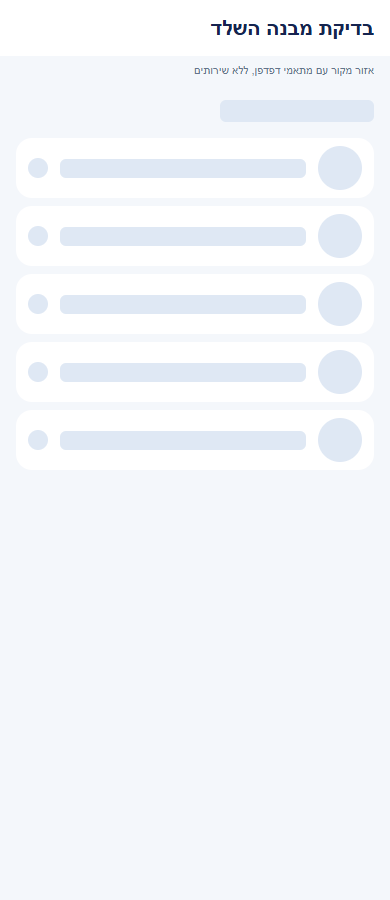
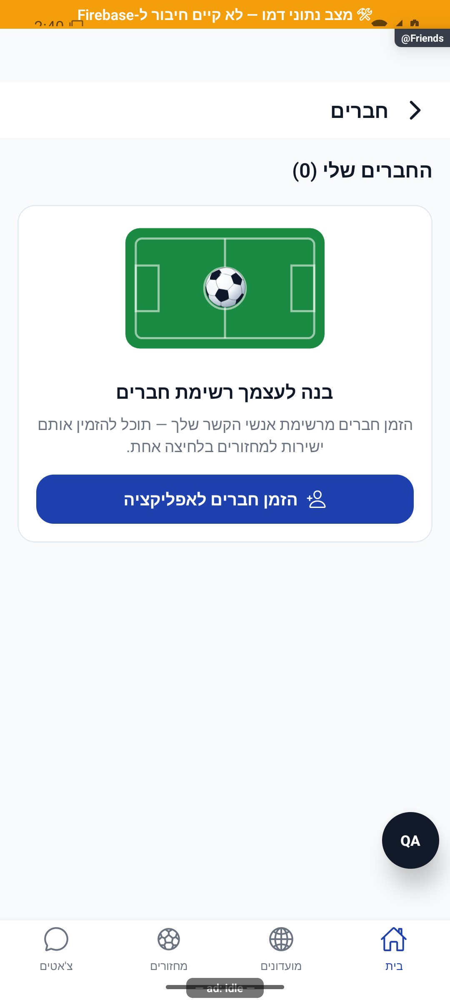
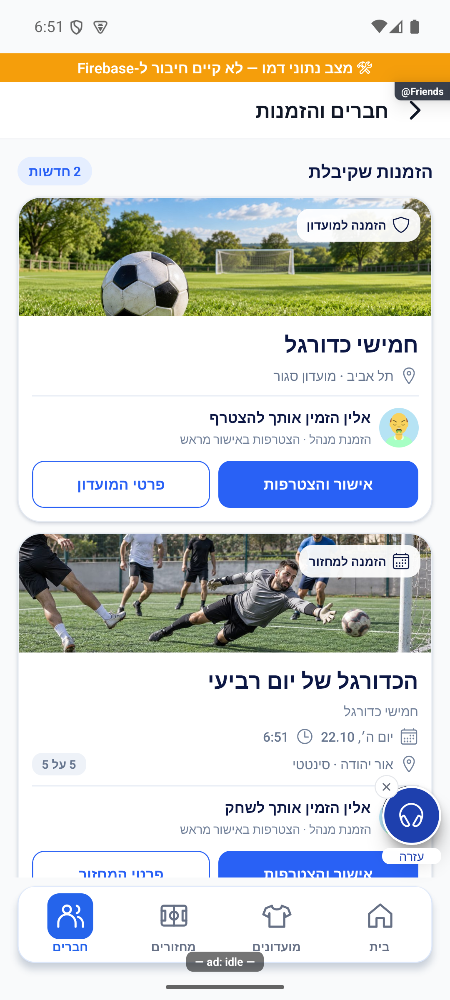
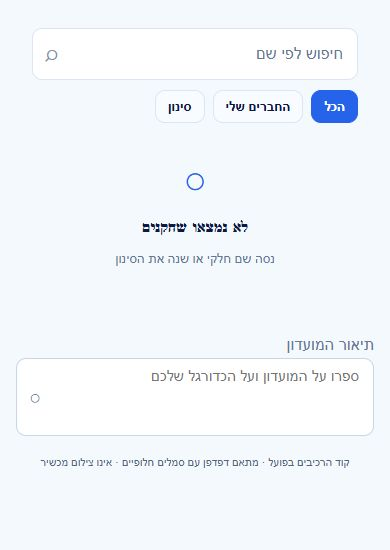

# חברים ובקשות חברות — הסבר קצר

## מדידת פעולות ואמינות נתונים, 5.11.2026

נוספה הכנה למדידת הפעולות ברכיבים המתועדים כאן. בפולס אפשר לראות ביצועים וחשבונות ייחודיים לפי פעולה ותקופה, כאשר קיים כיסוי מדידה. איסוף החשבונות החדש עדיין כבוי והמימוש מקומי. [פירוט והיקף הבדיקות](../../audits/2026-11-04-system-night/product-measurement.md).

## בדיקת לילה, 4.11.2026

חסימה שנכנסה בזמן שליחת הזמנה מונעת גם את יצירת ההזמנה עצמה.

הזמנה שכבר פגה אינה נפתחת מחדש בעקבות בקשה ממתינה לאותו יעד. תוקף מפורש נבדק גם בזמן הלחיצה.

כשפותחים שוב הזמנה אחרי שאחד הצדדים חסם את השני, היא מוצגת כלא זמינה. האפליקציה מפסיקה לטעון פרטי מזמין ומחזור עבור אותה הזמנה. נבדק מקומית. [בדיקת ההזמנות](../../audits/2026-11-04-system-night/privacy.md).

## חיפוש שחקנים וזמני טעינה, 4.11.2026

במסך מצא שחקנים מופיע המצב של כל קשר עם תוצאות החיפוש. אפשר להבדיל בין חבר, בקשה לאישור ובקשה שכבר נשלחה בלי לחכות לבדיקה נפרדת לכל שם. מימוש מקומי שטרם הופץ. [השינוי, המדידות והבדיקות](../../changes/2026-11-04-player-discovery-speed.md).

## התאמה למסך ולגופן, 4.11.2026

ברשימות החברים ובקשות החברות, שם ארוך יכול לעבור שורה. כשאין מקום ליד השם, כפתורי הפעולה עוברים למטה ונשארים באותה בקשה.

## ציר פעילות פרטי בפולס, 4.11.2026

נוסף תיעוד פרטי של ביקורים ופעילות במערכת הניהול. התוספת מקומית והאיסוף החדש כבוי כברירת מחדל; אין בדיקת מכשיר חדשה של מסך זה. מקומי וטרם הופץ או נפרס. [היקף, מקורות, בדיקות ומגבלות](../shared/usage-activity.md).

## שיפורי טעינה משותפים, 4.11.2026

עודכנו מנגנוני הטעינה המשותפים כדי לצמצם עבודה וקריאות חוזרות. דרך השימוש בפיצר נשמרת. השינוי מקומי וטרם הופץ, ואין אימות מכשיר חדש של המסך הזה. [היקף, מדידות ומגבלות](../../changes/2026-11-04-screen-performance.md).

## הפצה פנימית 1.1.74, 3.11.2026

עדכוני הלקוח הנוגעים לטעינה ולחיווי, במקורות המשותפים המשויכים למסמך הזה, כלולים בגרסת האנדרואיד הפנימית 1.1.74/306. החבילה ומסלול החנות אומתו; האימות החזותי נשאר בצילומי הדפדפן של סבבי המימוש, ואין אימות התקנה במכשיר. [תכולה, בדיקות ומגבלות](../../changes/2026-11-03-internal-1.1.74.md).

## מצבים ריקים והמשכיות פעולה, 3.11.2026

בדיקת המשך החיפוש עודכנה כך שתוודא שתוצאות מחשבון או חיפוש קודם אינן מפעילות טעינת עמוד נוסף. זהו שינוי בהקשר הבדיקה של חיפוש השחקנים; פעולות החברות והרשימה במסך החברים נשארות כפי שהיו. [היקף העבודה והאימות](../../changes/2026-11-03-experience-followup.md).

תוצאות האימות בסבב זה: כל 6864 הבדיקות ב-614 חבילות ובדיקת הטיפוסים עברו. בדיקות המצבים הממוקדות עברו ב-83 מקרים. נבדקו 72 פריסות של אזורי מקור בדפדפן, ונבדקה כיווניות בצילומים. אין אימות מכשיר או שירות חי חדש.

## התאמת מבנה שלדי הטעינה, 3.11.2026

השלד הותאם למבנה התוכן, כולל מיקום התמונות, האזורים והריווח. אין שינוי בנתונים או בפעולות המסך. השינוי מקומי וטרם הופץ. נבדקו אזורי מקור בדפדפן בשלושה רוחבים, ללא בדיקת מכשיר חדשה. [המידות, הבדיקות והמגבלות](../../changes/2026-11-03-skeleton-layout-alignment.md).

כל 6,820 הבדיקות ובדיקת הטיפוסים עברו. האימות החזותי במשימה זו הוא בדפדפן בלבד.

## גרסת אנדרואיד פנימית 1.1.73, 3.11.2026

קוד הלקוח המתואר במסמך נכלל בגרסת האנדרואיד הפנימית 1.1.73/305. מקור החבילה, החתימה והמסלול אומתו מול החנות; הייצור נשאר 1.1.72/304. אין אימות התקנה מחנות או גרסת אייפון חדשה. [מקור, בדיקות, קבלות ומגבלות](../../changes/2026-11-03-internal-1.1.73.md).

## תיקוני דיווחי הפולס, 3.11.2026

אם בירור קשר החברות נכשל בגלל ניתוק זמני, מתבצע ניסיון קריאה נוסף. כשל מתמשך עדיין מוצג ככשל, ואינו הופך לקביעה שאין חברות. התיקון מקומי וטרם הופץ.

[פירוט התיקונים, הבדיקות, הצילומים והמגבלות](../../changes/2026-11-03-pulse-sweep.md).

## ליטוש מקומי והשפעת רכיבים, 3.11.2026

השיפור ברכיבים המשותפים המשמשים את חברים ובקשות חברות כולל חלופת שם לתמונה שנכשלה. אין שינוי בנתונים או בכללי הפעולות העצמאיות של הפיצר. הבדיקה הממוקדת של רכיבי המקור אינה בדיקה חדשה של המסך המלא במכשיר.

[הראיות והמגבלות של המשימה](../../changes/2026-11-03-overnight-mission.md).

## בדיקת קצה ואימות מקורי, 2.11.2026

נבדקה השפעת תיקוני ההמשכיות במקור המשותף ובבדיקות. ההתנהגות העצמאית והחישובים של הפיצר נשמרו. מקומי וטרם הופץ. [שחזור, תיקונים, בדיקות ומגבלות](../../changes/2026-11-02-experience-review.md).

## המשכיות ומשוב בשימוש, 2.11.2026

רשימת החברים עוברת בעדינות מההמתנה הראשונה לתוכן. חברים קיימים נשארים בזמן רענון. מימוש מקומי שטרם הופץ. [התנהגות, בדיקות, צילומים ומגבלות](../../changes/2026-11-02-experience-polish.md).

## הרחבת שלדי הטעינה, 2.11.2026

רשימת החברים וההזמנות מציגה שלד בפתיחה הראשונה. חברים ובקשות שכבר נטענו נשארים ברענון ובכשל, עם חיווי עדכון או ניסיון חוזר. מידע מהחשבון הקודם מוסתר מיד. מימוש מקומי שטרם הופץ. [התנהגות, בדיקות, צילומים ומגבלות](../../changes/2026-11-02-loading-skeletons-expanded.md).

## אימות פרסום קבוצות בפולס, 2.11.2026

נבדק ההפרש התחום בשירות המשותף של המחזורים: נוספה בדיקת אישור לפרסום קבוצות כאשר תשובת הפעולה אובדת. אין שינוי בחישוב, במכנים או בפעולות העצמאיות של הפיצר המתואר כאן. התיקון מקומי וטרם הופץ; אין בדיקת מכשיר חדשה לפיצר זה.

[דוח הטיפול, הבדיקות והמגבלות](../../changes/2026-11-02-pulse-sweep.md).

## בקשות לשיחה אישית, 2.11.2026

חברים ממשיכים להתכתב ישירות. הסרת חברות שומרת שיחה אם כל צד שלח לפחות הודעה לפני ההסרה, או אם קיים אישור שיחה מפורש. המימוש מקומי וטרם הופץ או נפרס. [התנהגות, בדיקות ומגבלות](../chat/message-requests.md).

## החלפת הקבוצה הבועטת בפנדלים, 30.10.2026

בפנדלי ההכרעה נוספה אפשרות לבחור את הקבוצה שבועטת כעת, בלי למחוק את הבעיטות הקודמות. זהו עדכון תחום במקורות משותפים; אין שינוי מתוכנן במסך המתואר כאן ואין אימות מכשיר חדש שלו. [התנהגות, בדיקות ומגבלות](../../changes/2026-10-30-shootout-turn.md).

## הרחבת אבחון דיווחים, 27.10.2026

הדיווחים יוכלו לכלול מה ניסו לבצע, מה היה מצב האפליקציה ומה החזיר השרת. פרטים חסרים מוצגים כלא ידועים, ומספר מוגבל של מופעים נשמר בלי למחוק את המופע הראשון. השינוי מקומי וטרם הופץ, ואינו משלים פרטים לדיווחים ישנים. [היקף, ראיות ומגבלות](../../changes/2026-10-27-diagnostic-context.md).

בדיקות הקוד הושלמו, אך השינוי עדיין מקומי ולא הופץ. פרטים שלא נאספו בדיווחים ישנים אינם משוחזרים בדיעבד.

## טיפול בתקלות הפולס, 26.10.2026

רכיב הזמנת החברים אינו טוען רשימת חברים עבור אורח שאין לו פרופיל קבוע. תוצאה שהגיעה אחרי עזיבת הרכיב אינה מחזירה חברים מחשבון קודם.

השינוי מקומי וטרם הופץ. [בדיקות, מסירה ומגבלות](../../changes/2026-10-26-pulse-fixes.md).

## הפצה פנימית 1.1.61 - 25.10.2026

הבינארי `1.1.61/295` הופץ ואומת במסלול הפנימי באנדרואיד. תיקוני הלקוח נכללים בו, ושירות הפרופיל נפרס ואומת בנפרד. גם תיקוני הסגל, שמירת התוצאה והתראת השגיאה בשרת נפרסו ואומתו באישור מפורש. שינויי יישום הפולס עצמו טרם הופצו. אין שינוי כללי הרשאה או הסבת נתונים. ניסוחי המצב המקומי בסעיפים הקודמים נכתבו לפני ההפצה; [דוח ההפצה](../../changes/2026-10-25-internal-1.1.61.md) מפרט בדיוק מה נכלל, מה נבדק ומה עדיין מקומי.

## תיקוני הפולס - 25.10.2026

נבדק תיקון ממוקד בקובץ משותף במהלך סבב הפולס. אין שינוי מכוון בתהליך העצמאי המתואר כאן ואין טענה לבדיקת מסך חדשה שלו. מקומי וטרם הופץ.

[מקורות, בדיקות, צילומים ומגבלות](../../changes/2026-10-25-pulse-fixes.md).

## שעון מדויק וכיתוב פנדל - 25.10.2026

במקורות המשותפים נוסף שימור השעון המדויק של פנדל במהלך משחק, וכיתוב ההבקעה ביומן קוצר. אין שינוי במונים או בתהליך העצמאי המתואר כאן; לא נערכה לו בדיקת ממשק חדשה במסגרת העדכון. השינוי מקומי וטרם הופץ. [פרטים וראיות](../../changes/2026-10-25-in-play-penalties.md#שעון-מדויק-וכיתוב-אירוע).

## פנדל במהלך משחק חי - 25.10.2026

עודכנו מקורות משותפים לצורך פנדלים במהלך משחק. אין שינוי מכוון בתהליך העצמאי המתואר במסמך הזה, ולא נערכה לו בדיקת ממשק חדשה במסגרת המשימה.

השינוי מקומי. נדרשת פריסת שרת לפני הפצת לקוח שמשתמש באפשרות; לא בוצעו פריסה או שינוי הרשאות. [חוזה הנתונים, התהליך, הבדיקות ומגבלות ההפצה](../../changes/2026-10-25-in-play-penalties.md).

## חיפוש גם של חברים קיימים - 25.10.2026

החיפוש הרגיל כולל כעת גם חברים שכבר הוספת, לפי שם מלא או חלקי. הכפתור "החברים שלי" מצמצם לחברים בלבד. מסנני העיר והזמינות עדיין חלים; משתמשים שהסתירו את עצמם בחיפוש, חסומים וחשבונות אורח אינם נחשפים. התיקון מקומי וטרם הופץ.

[בדיקות וגבולות האימות](../../changes/2026-10-25-player-search.md).

## ניסיון חוזר לקריאת מידע זמנית — 23.10.2026

קריאת מידע שנכשלת זמנית יכולה להתבצע פעם נוספת, במקום להיעלם מיד. חשבון שהתחלף מפסיק את הבקשה; כשל מתמשך נשאר כשל ולא מוצג כרשימה ריקה תקינה. השינוי מקומי וטרם הופץ. [פירוט האימות והמגבלות](../../changes/2026-10-23-crash-test-and-pulse-followup.md).

## בקשת חברות שעדיין אינה קיימת — 23.10.2026

בדיקת קשר עם שחקן ממשיכה לבדוק בקשות בשני הכיוונים גם כשבקשה חסרה. המצב הרגיל הזה אינו יוצר עוד דיווח תקלה אוטומטי; כשל אחר ממשיך להירשם ולהגיע למבקש. התיקון מקומי וטרם הופץ.

## תיעוד כשלים — 20.10.2026

נוסף תיעוד אוטומטי לנקודות כשל במסלול הזה, עם מקור התקלה. הפעולה המקורית שומרת על ערכי החזרה והודעות השגיאה שלה. השינוי מקומי, טרם הופץ, ואין אימות מסירה חיה לפולס.

[דוח דיווח השגיאות והראיות](../../changes/2026-10-20-error-reporting-audit.md).

## הזמנות ואישור מראש — 11.10.2026

הזמנה אישית ממנהל מאפשרת להצטרף בלי אישור נוסף, גם למועדון סגור. מצטרפים רק אחרי שלוחצים להצטרף; ההזמנה אינה שומרת מקום. במחזור מלא נכנסים להמתנה, ובמועדון מלא ההצטרפות נחסמת. קישור שיתוף רגיל אינו אישור מראש. הזמנה חדשה תקפה לשבעה ימים ולמחזור לא מעבר לגבול ההרשמה שלו; חסימה ודחייה קודמת אינן מתבטלות בגללה.

ברשימת ההזמנות מופיעים גם מצבים כמו הצטרפת, ממתין לאישור, המועדון מלא, הרשמה שטרם נפתחה והזמנה שאינה זמינה. השינוי מקומי ועדיין דורש פריסה והפצת גרסה.

## חברים והזמנות — 11.10.2026

הכפתור ״חברים והזמנות״ בלשונית החברים ובתפריט הבית פותח את אותו מסך. הוא מרכז בקשות חברות שקיבלת ושלחת, חברים קיימים והזמנות למועדונים ולמחזורים.

ליד הזמנה שטרם פתחת מופיע ״חדש״. פותחים את הפרטים ומחליטים שם אם להצטרף; הפתיחה אינה מצרפת אוטומטית. הזמנות נשארות גם אחרי קריאה וגם אם פספסת את ההתראה בטלפון. ההרשמה והזמינות העדכניות מופיעות במסך הפרטים.

[כניסה מהלשונית](../screenshots/friends-invites-entry-2026-10-11.png) · [רשימת הזמנות בדמו](../screenshots/friends-invites-list-2026-10-11.png). נבדק באימולטור מנותק; לא נבדקה מסירה למכשיר אמיתי וטרם הופץ.

מסך החברים מציג את החברים שלכם ואת בקשות החברות שנשלחו והתקבלו. אפשר לאשר בקשה, לבטל בקשה ששלחתם, לפתוח כרטיס שחקן או להסיר חבר.

[לפירוט הטכני](friends.md)

הצילום מדגים את המראה בסביבת בדיקה, ולא מוכיח פעולה מול הנתונים האמיתיים.

## תיקוני סבב הבאגים — 8.10.2026

כשאישור חברות נכשל, הבקשה חוזרת לרשימה והמשתמש אינו מוצג כחבר חדש.

## תיקוני עיצוב ונגישות — 10.10.2026

מקור: `a348b9f235f1e1433497600555303231512a0834` עם שינויים מקומיים. אין בסעיף זה הוכחת גרסת חנות.

סמל הזמנת החברים מופיע משמאל לטקסט.

## עדכון 11.10.2026

נוספה לשונית ״חברים״ שמרכזת שיחות וחיפוש שחקנים. הפרופיל הקיים חודש, עם זמינות, מועדונים וסטטיסטיקה לפי הבחירה בפרטיות. הודעות חדשות מיועדות לחברים בלבד. [הסבר פשוט לפיצ׳ר](../profile/player-discovery.simple.md). השינוי מקומי וטרם הופץ; השלמת ההרשאות אושרה ומומשה, והפריסה טרם בוצעה.

### השלמת הרשאות מקומית — 11.10.2026

הודעות חדשות דורשות חברות הדדית וללא חסימה. מידע אישי מוגבל לפי פרטיות, ושמות ותמונות בסגלים ובשיחות נשמרים. הכללים וההתאמות הושלמו לאחר אישור; טרם הופץ.

## שני חברים קבועים בנתוני ההדגמה — 11.10.2026

למשתמש ההדגמה נוספו איתי לוי ודניאל כהן כחברים מאושרים והדדיים. איתי מדגים חבר עם 12 מחזורים משותפים ודניאל חבר ללא מחזורים משותפים. רשימת החברים, החיפוש והפרופיל קוראים את אותו מצב חברות מקומי. הנתונים נטענים מחדש בהפעלה מלאה וניתנים לשינוי במהלך ההדגמה; אין חשבונות חדשים או כתיבה לנתוני ייצור.

[רשימת שני החברים בדמו](../screenshots/demo-friends-list-2026-10-11.png) · [פרופיל חבר שנפתח מהרשימה](../screenshots/demo-friend-profile-2026-10-11.png). נצפו באמולטור; עברו בדיקת טיפוסים ו־3414 בדיקות יישום.

## תיקוני טעינה וחברות — 12.10.2026

בכשל טעינה תופיע הודעה עם ״נסה שוב״, במקום להציג בטעות שאין חברים. ניסיון חוזר יכול להחזיר את הרשימה. תוצאה ישנה לא תדרוס רענון חדש, ופעולה שהחלה בחשבון קודם לא תישלח בשם חשבון שהתחבר אחריו. התיקונים מקומיים ואינם כלולים עדיין בגרסת החנות.

## תיקון הזמנות — 12.10.2026

כשקיבלת הזמנה למועדון, כפתור אישור ההזמנה מופיע גם אם הגעת דרך רשימת המועדונים. הזמנות למועדונים ולמחזורים שכבר הצטרפת אליהם מוסתרות מרשימת ההזמנות בחזרה למסך. הזמנה שרק פתחת עדיין תופיע עד להצטרפות. נבדק באנדרואיד בדמו מנותק; טרם הופץ.

## כרטיסי הזמנות עם תמונה ואישור ישיר — 12.10.2026

הזמנות למועדונים ולמחזורים מוצגות בכרטיסים עם תמונת המקום, פרטי המזמין וכפתורי ״אישור והצטרפות״ ופרטים. במחזור רואים גם תאריך, שעה, מיקום, סוג מגרש ופורמט כשיש נתונים.

אישור הזמנת מנהל תקפה מצרף ישירות ופותח את פרטי אותו מועדון או מחזור במצב המעודכן. כשההרכב מלא, הכרטיס מציין שההצטרפות היא לרשימת ההמתנה; לאחר האישור המשתמש נכנס להמתנה, בלי להגדיל את ההרכב מעבר למכסה. במהלך האישור מופיע מחוון טעינה ולחיצות חוזרות חסומות. ההזמנה נעלמת אחרי הצטרפות או כניסה להמתנה. הזמנה אינה עוקפת חסימה, דחייה, מחזור סגור או תוקף שפג. הזמנה שאינה אישור מנהל עשויה להישאר ממתינה לאישור בהתאם להגדרות.

נבדק באמולטור אנדרואיד בדמו מנותק, וכן בבדיקות אוטומטיות של מסלולי הלקוח והשרת הקיימים. טרם הופץ.

## סבב דיווחים — 12.10.2026

הכניסה לחברים ולהזמנות מלשונית החברים הועברה למעטפה ליד ההגדרות. תג אדום מציין בקשות חברות ממתינות והזמנות שעדיין לא נקראו. הוא פותח את אותו מסך כמו תפריט הבית.

התיקונים מקומיים וטרם הופצו. מקור: `ec536c6f` עם שינויים מקומיים. [דוח הסבב ומגבלות הבדיקה](../../changes/2026-10-12-pulse-sweep.md).

## סבב פולס — 15.10.2026

הזמנה למועדון שכבר הצטרפת אליו מוסתרת ברגע שנתוני החברות מתעדכנים. מונה ההזמנות אינו ממתין לתמונות של המועדון או המזמין.

השינויים בסבב זה מקומיים וטרם הופצו. [דוח הסבב](../../changes/2026-10-15-pulse-sweep.md).

## חברות מתוך הזמנה אישית — 17.10.2026

מסך ההזמנה האישית משתמש כעת בפעולת החברות הקיימת לאחר התחברות. אורח פותח את חלונית ההתחברות, ואז שולח בקשה במפורש; אין שליחה אוטומטית. שירות החברות וההרשאות לא השתנו. [מימוש, בדיקות ומגבלות](../entry/personal-invite.md#מסך-הזמנה-אישי-חדש--17102026).

## סבב פולס — 18.10.2026

חיפוש שם ממשיך כעת גם כשהעמוד הראשון אינו מכיל התאמות ויש עמודים נוספים לבדיקה. רמז החיפוש מוצג באפור קריא. כשל אינו מוצג כתוצאה ריקה.

השינויים מקומיים וטרם הופצו. לא שונו הרשאות ולא נשלחו הזמנות או הודעות. בדיקת הדפדפן משתמשת בקוד הרכיבים בפועל, במתאם סגנונות, בסמלים חלופיים ובנתוני הדגמה; אינה הוכחת אנדרואיד או אייפון. שני האמולטורים לא הגיבו לפקודות או לצילום בסבב זה.

## תלות בעדכון העונות — 19.10.2026

קובץ תשתית משותף עודכן במסגרת העונות. שינוי זה אינו מוסיף פעולה חדשה למסך המתואר כאן; פרטי העונות והבדיקות מופיעים במסמך העונות.

[מצב המימוש, הבדיקות ומגבלות האימות של העונות](../clubs/seasons.md). מקומי בלבד; לא בוצעה פריסה במסגרת המשימה.

## תלות במידע על סגירת עונה — 23.10.2026

נוסף מידע משותף שמאפשר להסביר מדוע עונה מתעכבת בסגירה. אין שינוי נוסף בפעולות המתוארות כאן; השינוי מקומי וטרם הופץ. [המסלול, הבדיקות והמגבלות](../../changes/2026-10-23-season-automatic-recovery.md).

## עדכון תלות משותפת בקריאות מידע — 23.10.2026

בקובצי השירות המשותפים נוספה אפשרות מפורשת לניסיון חוזר אחד בקריאה זמנית שנכשלה, תוך עצירה אם החשבון מתחלף. החיבור מוגבל ל־14 נקודות קריאה המפורטות בדוח; אין כאן טענה שכל פעולה בפיצ׳ר קיבלה ניסיון חוזר או שנבדק מסך חדש. בדיקות המאגר המלאות עברו (5,261 בדיקות ב־472 חבילות), אך אינן הוכחת הרצה במכשיר. הקוד מקומי וטרם הופץ. [מסלול, ראיות ומגבלות](../../changes/2026-10-23-four-open-errors.md).

## תלות בשמירת צבעי המחזור — 24.10.2026

שמירת המידע המשותפת עודכנה כדי להעביר את צבעי הקבוצות ממסכי הכוחות להכנה וללייב. אין תוספת פעולה במסך הזה, והוא לא נבדק מחדש במכשיר במסגרת התוספת. השינוי מקומי וטרם הופץ. [פרטי התוספת ומגבלות הבדיקה](../rounds/draft-setup.md#צבעים-לפני-שיבוץ-ובכל-שיטת-חלוקה--24102026).

## דיווחים ושגיאות וסגירה לפי גיל — 24.10.2026

עודכנו תלויות משותפות בכרטיס העצמי ובקריאת חברים: כפתורי הכרטיס מציגים סמל משמאל לטקסט, והיעדר פרופיל ברשימת החברים נשאר כשל מפורש. אין שינוי ייעודי נוסף או אימות מסך חדש של פיצ׳ר זה.

[מקור הדיווחים, הבדיקות ומגבלות הסבב](../../changes/2026-10-24-pulse-age-pass.md). השינויים מקומיים וטרם הופצו.

## קריאת זהויות בסגל גדול - 25.10.2026

בסגלים גדולים ממאה שחקנים, חלקי רשימת השמות יכולים להיטען במקביל במקום בזה אחר זה. סדר הנתונים ובדיקת החשבון נשמרים, וכשל אינו מוצג כרשימה חלקית תקינה. נבדק בקוד; התיקון מקומי וטרם הופץ, ללא מדידת זמן במכשיר. [בדיקות, ראיות ומגבלות](../../changes/2026-10-24-loading-performance.md).

## תאימות לשמירת פקודת רכיב הבית - 25.10.2026

נוספה הגנה פנימית מפני ביצוע חוזר של פעולת רכיב הבית. התהליך המתואר בעמוד זה לא השתנה במכוון, ונתונים ישנים נשארים נתמכים. התיקון מקומי וטרם הופץ. [מקור הבדיקה והמגבלות](../../changes/2026-10-25-widget-completion.md).

## שלמות החלוקה המתוזמנת, 29.10.2026

במקורות המשותפים תוקנה שמירת חלוקה מתוזמנת לשש ולשבע קבוצות וסוננו אורחים שממתינים. דרך חישוב האיזון נשמרה. אין שינוי מכוון בפעולות העצמאיות המתוארות בעמוד זה ואין אימות מסך חדש שלהן; השינוי מקומי וטרם הופץ.

[היקף, בדיקות, פערים פתוחים ומגבלות](../../changes/2026-10-29-scheduled-balance-integrity.md).

## איזון ופיזור רמות לפני גיוון, 30.10.2026

עודכן החישוב המשותף של חלוקת כוחות לפי הדירוג הכללי: איזון הממוצעים קודם לפיזור הרמות, והגיוון מכריע אחרי שניהם. אין שינוי מכוון במבנה המסך או בפעולות העצמאיות המתוארות כאן, ואין אימות מכשיר חדש שלהן. השינוי מקומי וטרם הופץ או נפרס.

[מימוש, נוסחאות, בדיקות ומגבלות](../../changes/2026-10-30-rating-balance-priority.md).

## אימות כשלים בקבלת פרסום, 2.11.2026

בבדיקת אישור פרסום הקבוצות, כשל שלא ניתן לאמת כהצלחה נשאר כשל גלוי ונשמר באבחון. הבדיקה אינה שולחת הודעות שוב ואינה משנה הרשאות. השינוי תחום לשירות המשותף, מקומי וטרם הופץ.

[דוח הטיפול והראיות](../../changes/2026-11-02-pulse-sweep.md).

## תיקו בשתיים או בשלוש קבוצות, 6.11.2026

נבדק שינוי תחום במקורות המשותפים `src/services/gameService.ts`, `src/types/index.ts`: נוסף מסלול סיום משחק בתיקו בשתיים או בשלוש קבוצות, עם בחירה ידנית של הקבוצה שנשארת ושמירה במוני התיקו הקיימים. אין שינוי מכוון בפעולות העצמאיות של הפיצר המתועד כאן. בדיקות המסלול מפעילות שירות לקוח, ממירים וגוף שרת במאגר זיכרון; אין בכך הרצה חדשה של מסך זה. המימוש מקומי, ללא הפצה או פריסת שירות השמירה החדש. [התנהגות, נתונים, בדיקות ומגבלות](../../changes/2026-11-06-manual-draw.md).

## תלות משותפת בציון המחזור החדש, 6.11.2026

נוספה תמיכה מקומית בגרסת ציון למחזורי העתיד ובקריאת הרף הקפוא, תוך שמירת המודל של מחזורים קודמים. השינוי כאן תחום לתלות במקורות המשותפים, ואינו אימות חדש של כל המסלול העצמאי. אין פריסה, הסבת נתונים או שינוי ציוני עבר. [התנהגות, בדיקות ומגבלות](../../changes/2026-11-06-shared-evening-score.md).
