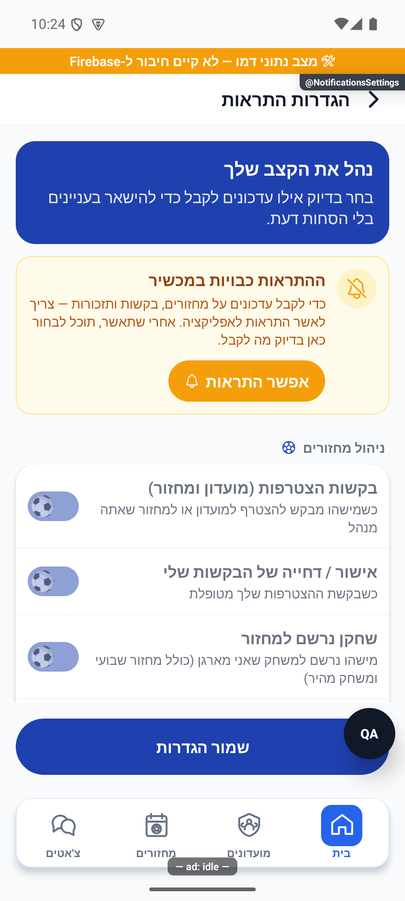
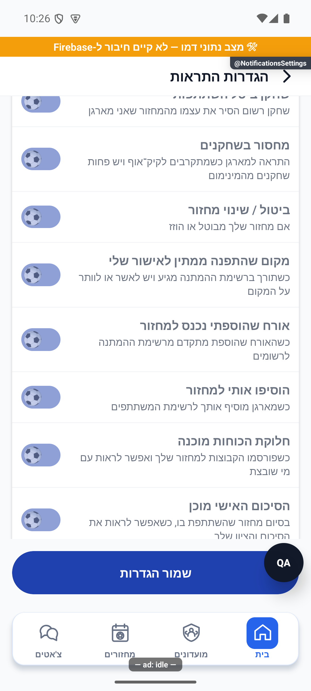

# הגדרות התראות והרשאת מכשיר

## תיעוד כשלים — 20.10.2026

נוספו תצפיות דיווח בנקודות הכשל של המקורות המשויכים לפיצ׳ר, במסגרת הרחבה רוחבית. נשמרו ערכי החזרה, הזריקות ותנאי הפעולה הקיימים; נוסף מקור קוד והקשר לדיווח. כיסוי תחבירי אינו הוכחת הרצה של כל מצב. השינוי מקומי וטרם הופץ; בדיקות המסירה, מגבלות מניעת הכפילויות והמסלולים שטרם חוברו מתועדים בדוח המשותף.

[דוח דיווח השגיאות והראיות](../../changes/2026-10-20-error-reporting-audit.md).

## תיקון פערי העונות — 20.10.2026

השינוי בקובץ השרת המשותף במסגרת תיקוני העונות נוגע לשער הסגירה, אימות מחזור והשלמת סטטיסטיקה בלבד. נתיבי הפיצ׳ר המתועדים כאן לא שונו בסבב זה. הבדיקות המלאות עברו; אין בכך אימות חדש של פריסה או שירות חיצוני.

[דוח תיקונים, בדיקות ומגבלות](../reviews/2026-10-20-seasons-fixes.md).

[לקריאה קצרה ופשוטה](notification-settings.simple.md)

עודכן: 10.10.2026; מקור `a348b9f235f1e1433497600555303231512a0834` עם שינויים מקומיים. מסך `src/screens/profile/NotificationsSettingsScreen.tsx`, מסלול `NotificationsSettings` מתפריט הבית; משתמש מחובר. אין כאן הוכחת גרסת חנות או משלוח חי.

## אזורים וכיסוי

כרטיס הסבר, שער הרשאת מערכת, חמש קטגוריות, שמירת העדפות והעדפת מעקב עצמאית. יש 29 מתגים: 28 העדפות מכסות את 30 סוגי השרת, ועוד מתג שיווק. `approvedRejected` משותף לאישור ולדחייה; `friendRequest` משותף לבקשת חברות ולאישורה. צ׳אט, הסכמת זמינות והשתקת שיחה נשארים במסלולים שלהם.

| קטגוריה | מספר מתגים | תוכן |
|---|---:|---|
| מחזורים | 12 | בקשות, אישור/דחייה, הרשמה, ביטול, מחסור, שינוי, הצעת מקום, קידום אורח, הוספה, חלוקה, סיכום וחג |
| מועדון וחברים | 9 | מחזור חדש, מקום פתוח, מילוי, הזמנה למחזור, מחיקת מועדון, הזמנה למועדון, סיכום עונה, הפיכת מחזור למועדון וחברות |
| תזכורות | 4 | מחזור קרוב, תזכורת הרשמה, דירוג וצמיחה |
| מילוי מקומות | 3 | הזדמנות להצטרף, התעניינות שהתקבלה וללא מועמדים |
| שיווק | 1 | הודעות במסלול השיווק של ערכת המעקב |

לכל שורה שם והסבר ממוקד. הרשימה נמצאת ב־`src/utils/notificationPreferenceCatalog.ts`; תוספות המלל ב־`src/i18n/notificationPreferences.ts`, והמלל הקודם במילון הראשי. `NotificationPrefs` וברירות המחדל ב־`src/types/index.ts`. 11 השדות החדשים אופציונליים כדי לשמור תאימות למשתמשים ישנים; ברירתם `true`, בהתאם להתנהגות השליחה הקודמת.

הצילומים הם אנדרואיד בדמו, במעטפת פיתוח `1.1.33/1` עם קוד מעודכן. הם מוכיחים רק את השורות והמצב הנראים. לא ניתנה הרשאה, לא נשמרה העדפה ולא נשלח פוש. השכבה הצפה של כלי הבדיקה מסתירה חלק קטן מהמסך.

## מצבים ומסלול נתונים

| מצב/פעולה | תגובה | כתיבה | ראיה |
|---|---|---|---|
| טעינת העדפות | `prefsReady=false`; שינוי ושמירה חסומים | אין | קוד |
| כשל טעינה | הודעה; אין שמירת ברירות מחדל בטעות | אין | קוד |
| הרשאה לא זמינה | מצב `null`; אין טענה שהמערכת חסמה | אין | קוד |
| הרשאה חסומה | כרטיס הסבר; שורה מושבתת גם באירוע נגיש | רק הרשאת מערכת בפעולה מפורשת | צילום וקוד |
| חזרה מהגדרות הטלפון | `AppState=active` מרענן מצב הרשאה | אין | קוד |
| שינוי מתג | טיוטה מקומית; חסום בטעינה/שמירה/הרשאה חסומה | בשמירה בלבד | בדיקות וקוד |
| שמירה | שירות שומר ואז מעדכן בסיס בחנות וחוזר | `users/{uid}/private/push.notificationPrefs` | קוד; לא הורץ חי |
| החלפת חשבון | תוצאת טעינה ישנה נזרקת; שמירה אינה מחזירה חשבון ישן לחנות | לפי החשבון שהתחיל את השמירה | קוד |
| חזרה עם שינוי | הגנת שינויים שלא נשמרו | לפי בחירה | קוד |
| שינוי מעקב צד שלישי | החלפה מיידית מחוץ לטיוטה | ערכת המעקב בלבד | קוד |

`mergeNotificationPreferences` בונה אובייקט חדש מברירות מחדל, העדפות ישנות בשורש ולאחריהן מסמך פרטי. רק שדות מוכרים ובוליאניים מתקבלים. `false` מפורש נשמר; שדה חסר אינו מבטל ערך ישן. ערך פרטי מפורש גובר. לדוגמה: ישן `gameReminder=false` ופרטי `{rateReminder:false}` משאירים את שניהם כבויים. מפת `edited` משמרת שינוי מקומי אם תגובת טעינה מגיעה אחריו.

`notificationsService.loadPreferences` מפיצה כשל קריאה. `savePreferences` משתמשת במסמך הפרטי; אין כתיבה לשורש המשתמש. הממיר ב־`src/firebase/firestore.ts` סורק את מפת ברירות המחדל ולכן קורא גם את השדות החדשים. במנגנון השרת `functions/src/index.ts`, הביטוי `prefKey` קובע את ההעדפה לכל סוג. שינוי `marketingPush` מעדכן בנפרד את ערוץ השיווק בערכת המעקב; השרת העצמי אינו משתמש בו. הפעולה אינה עסקה משותפת עם מסמך ההעדפות.

## נגישות ועיצוב

השורה השלמה היא תחנה יחידה עם תפקיד מתג, שם, הסבר ומצב מסומן/מושבת. `BallSwitch` הפנימי מוסתר מקורא המסך כדי למנוע כפילות. מנגנון `disabled` מלווה בחסימת `toggle` עצמו, ולכן אינו תלוי רק במגע. מתג מעקב עצמאי נגיש מחוץ לשער הרשאת הפוש. טקסט כפתור ההרשאה קודם לאייקון במקור, ולכן האייקון משמאל תחת הכיווניות הכפויה.

לא מורידים שקיפות להורה של כרטיס בעל הצללה באנדרואיד: השילוב הציג מסגרת אפורה עבה. הכרטיס נשאר אטום, והמלל והמתג מציגים בנפרד מצב מושבת. התוצאה נצפתה בצילומים המעודכנים.

## בדיקות ושחזור

`tests/logic/notificationPreferenceCoverage.test.ts` קוראת את איחוד 30 סוגי השרת האמיתי, בודקת שכל סוג מגיע למתג יחיד, שכל העדפה מוצגת עם ברירת מחדל והסבר, וכל `false` נשמר בהידרציה ובסבב JSON. נבדקים מסמך פרטי חלקי, קדימות וערכים פגומים. בדיקות רלוונטיות נוספות: `tests/notificationPermissionWiring.test.ts`, `tests/rules/notificationSender.test.mjs`, `tests/hooksAfterEarlyReturn.test.ts`, `tests/logic/copyDirectionality.test.ts`.

טרם הורצו במכשיר: קורא מסך, אייפון, קבלת הרשאה וחזרה מהגדרות, רשת מנותקת ושמירת העדפות בחשבון בדיקות. בדיקת כיסוי אינה הוכחת אספקה או חסימת פוש מקצה לקצה.

## היסטוריה

[ביקורת 7.10.2026](../reviews/notification-coverage-2026-10-07.md) תיעדה 14 סוגי שרת ללא מתג. הפער נסגר ב־10.10 באמצעות 13 מתגים נוספים, משום ששני סוגי חברות חולקים העדפה. תיקוני טעינה וזהות מ־8.10 נשמרים; [הראיות ההיסטוריות](../../changes/2026-10-08-audit-fixes.md) אינן ראיה לצילומי הסבב החדש.

## אימות גרסה בנויה — 18.10.2026

ב־1.1.56/289 נבדקה בקשת הרשאה דרך מסך ההגדרות ואישור החלונית המקורית, במכשיר הבדיקה בלבד. לאחר האישור נשמר אסימון יחיד במסמך הפרטי של חשבון הבדיקה עם גרסת המקור1.1.56. הרכיב המקורי אותחל ושחזר סשן תקף; התקבלה תשובת רישום חיובית מהספק, ושמונת מקרי הסשן הארוזים עברו לעומת2/8 בבינארי1.1.55. בדיקת המקרים השתמשה באובייקטים מנותקים, בלי לשנות אחסון סשן חי.

נשלחה התראת FCM ישירה יחידה לאותו מכשיר: התקבלה קבלת שליחה, ההתראה נצפתה במגירה ולחיצה עליה פתחה את האפליקציה. אין בכך הוכחת קמפיין ספק, אייפון, מכשיר פיזי, כל מצבי הרקע או שמירה של כל העדפות ההתראות. ה־APK נגזר מאותו AAB שהוגש, עם חתימת בדיקה קיימת; אין הוכחת שדרוג דרך Play.

[דוח הגרסה וקבלות הרישום והמסירה](../../changes/2026-10-18-internal-1.1.56.md). [הרשאה שהוצגה בפועל](../screenshots/internal56-permission-prompt-2026-10-18.png), [לאחר אישור](../screenshots/internal56-permission-granted-2026-10-18.png), [התראת הבדיקה שנמסרה](../screenshots/internal56-push-delivered-2026-10-18.png).

## תלות בעדכון העונות — 19.10.2026

נבדק ההפרש בקבצים המשותפים הרשומים כאן: `functions/src/index.ts`, `src/firebase/firestore.ts`, `src/types/index.ts`. השינוי ממוקד במדיניות העונות, קריאת מצבן, שיוך מחזור ופקודות ניהולן; אין שינוי מכוון בחוזה העצמאי המתואר במסמך זה. אין להסיק מכך שהמסך הזה הורץ מחדש.

[מצב המימוש, הבדיקות ומגבלות האימות של העונות](../clubs/seasons.md). מקומי בלבד; לא בוצעה פריסה במסגרת המשימה.

## מלך הניצחונות לפי אחוז — 19.10.2026

תואר מלך הניצחונות עבר לאחוז ניצחונות עם סף השתתפות במחצית ממחזורי העונה. היחידה מועברת במידע המשותף; ספירות היסטוריות נשמרות. לא שונתה התנהגות אחרת בתחום זה, והמסך שלו לא הורץ במסגרת השינוי. [החוזה והראיות בסיכום העונה](../statistics/season-summary.md). השינוי מקומי וטרם הופץ.

## תלות במידע על סגירת עונה — 23.10.2026

בדיקת ההבדל ב־`src/firebase/firestore.ts` וב־`src/types/index.ts` מראה שהשינוי מוגבל לקריאת `seasons.closureStatus` בחוזה `GroupSeasons`. יתר ממירי הנתונים והמסלולים המתועדים כאן לא שונו במשימה זו. אימות הריצה החדש מתייחס להתאוששות ולכרטיס העונה, ולא להרצה חדשה של כל מצבי המסך הזה. [המסלול, הבדיקות והמגבלות](../../changes/2026-10-23-season-automatic-recovery.md).

## שינוי מוגבל בקובץ השרת המשותף — 24.10.2026

ב־`functions/src/index.ts` נוסף ייצוא רכיב קליטת הקריסות, ו־`onErrorLogged` מדלג על מקור הקריסות החדש כדי למנוע התראה כפולה. אין שינוי במסלול הפיצ׳ר המתואר כאן או בחישוביו. לפריסה הוכנה חבילה מהמקור הפרוס עצמו, עם תנאי הדילוג בלבד; אין פריסה של פונקציות הפיצ׳ר הזה. [היקף וראיות](../../changes/2026-10-24-crashlytics-pulse.md).

## תלות בשמירת צבעי המחזור — 24.10.2026

במסגרת בחירת צבעים לפני שיבוץ עודכנו מקורות משותפים הרשומים לפיצ׳ר: `functions/src/index.ts`, `src/firebase/firestore.ts`, `src/types/index.ts`. השינוי מוסיף מפת צבעים למחזור, קריאה וכתיבה שלה ושימורה במסלולי הכוחות וההכנה. אין כאן פעולת ממשק חדשה במסך זה. זו בדיקת השפעת התוספת הממוקדת, ולא חקירה או אימות חזותי מחודש של הפיצ׳ר. כל 480 חבילות הבדיקה ו־5,343 הבדיקות עברו; טיפוסי הלקוח והשרת נקיים. השינוי מקומי וטרם הופץ. [מסלול הנתונים, ראיות ומגבלות](../rounds/draft-setup.md#צבעים-לפני-שיבוץ-ובכל-שיטת-חלוקה--24102026).

## טיפול בפולס — 24.10.2026

נבדקה התלות בקבצים המשותפים: שינוי `AppDialog` נוגע לעיצוב בקשות לייב ולפריסת חלון צר או גופן מוגדל; שינוי מסלול אירוע ההרשמה בשרת משמר את עסקת השיבוץ. שאר התנהגות הפיצ׳ר לא נבדקה מחדש בסבב זה. אין להסיק מכרטיס מרוענן על אימות מסך, משלוח או פריסה.

[פירוט התיקונים, הבדיקות והמגבלות](../../changes/2026-10-24-pulse-current.md). התיקונים מקומיים וטרם הופצו.

## תלות ביצוא היסטוריית השוואות — 24.10.2026

במשימה זו נוספה בקובץ השרת המשותף רק שורת יצוא של `recordPlayerComparison` ו־`getMyComparisonActivity`. מסלולי הפיצ׳ר המתוארים כאן לא שונו במסגרת התוספת הזאת ולא הורצו מחדש כתרחיש נפרד. אין פריסה או שינוי כללים. [המימוש, הבדיקות וגבולות האימות](../../changes/2026-10-24-comparison-activity.md).
