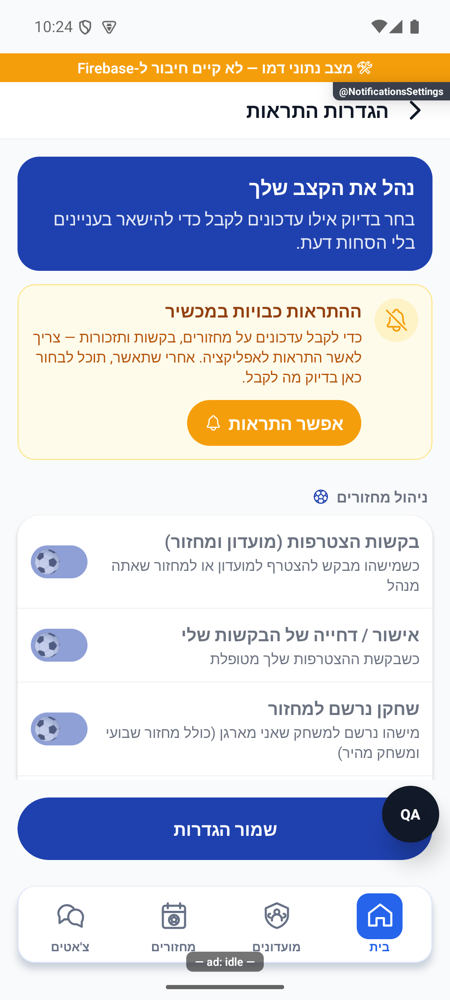
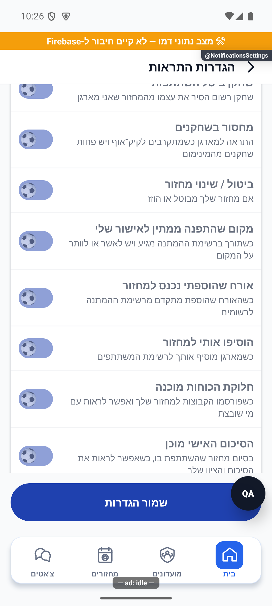

# הגדרות התראות והרשאת מכשיר

## עצירת מחזור קבוע ללא פעילות, 6.11.2026

נבדק השינוי התחום ב-`functions/src/clubDeletion.ts`, `functions/src/index.ts`, `tests/logic/clubDeletion.test.ts`: בדיקת חוסר פעילות לפני יצירת מחזור קבוע ושמירת שלוש החלטות בזמן ניקוי מחזורים ריקים. ההכרעה משתמשת במקור הקיים לקיום מחזור ומגינה על מחזור עם הרשמה שנותר לא מוכרע. עסקאות היצירה והניקוי נשארות מוגנות מפני שינוי מקביל ומועדון חסר. אין שינוי מכוון בחישובים, במכנים, בהרשאות, בניווט או בפעולות העצמאיות האחרות של הפיצר הזה. בדיקות מקור השרת הורצו במאגר זיכרון; הפריסה הממוקדת של שני שירותי התזמון אומתה בייצור מול המקור שנבדק, ותועדה הרצת שירות חמש הדקות ללא שגיאות. אין בכך אימות חדש של המסך או של יתר פעולות הפיצר. [ההתנהגות, מסלול הנתונים, הבדיקות ומגבלות ההפעלה](../../changes/2026-11-06-inactive-recurring-rounds.md).

## דירוג בסיס לשחקן ללא דירוג, 6.11.2026

נבדק שינוי תחום במקורות המשותפים של הכוחות האוטומטיים: שחקן ללא דירוג מחושב כ-2.5 מתוך 5, וההסברים תואמים. דירוג מפורש נשמר. אין כאן אימות חדש של כל מצבי הפיצר העצמאי; השינוי מקומי וטרם הופץ. המקורות המשותפים שנבדקו בהפרש זה: `functions/src/index.ts`. [ההתנהגות, הבדיקות ומגבלות האימות](../rounds/draft-setup.md#דירוג-בסיס-לשחקן-ללא-דירוג-6112026).

## ממצאי סבב הפולס, 5.11.2026

בשתי רשומות מגרסה מדווחת 1.1.76 חזר `TOO_MANY_REGISTRATIONS`: תחילה מתוך `messaging().getToken()` ובהמשך מתוך מסלול התאימות של `expo-notifications`. הקוד לא שמר אסימון חלופי תקין; הרשומות שייכות לשני שלבים של אותו מסלול. לא שונו הרשאה, מזהה התקנה או רישומי מכשיר. נדרשת בדיקת ספק ומכשיר כדי לפתור את דחיית הרישום. אין הוכחה שכשל הספק נפתר. מקומי, ללא הפצה או אימות מכשיר חדש. [ממצאים, בדיקות ומגבלות](../../changes/2026-11-05-pulse-sweep.md).

## מדידת פעולות ואמינות נתונים, 5.11.2026

במיפוי מקור הרכיבים המוזכרים במסמך נמצאו 12 נקודות מטפל ו-12 מזהי פעולה. הספירה מתארת קוד וכוללת רכיבים משותפים; אין לחבר אותה לספירות של מסמכים אחרים ואין לראות בה הרצת כל המסך. המדידה מפורטת לפי גבול פקד מקורי, פעולה עסקית ומצב חשבון. תשובה מאוחרת נבדקת מול בעל הפעולה, ומצב קיים או בקשה חוזרת אינם תמיד הצלחה חדשה. רשימת המקרים שהורצו ומגבלות המסד, המכשיר והכיסוי נשמרות [בדוח המדידה](../../audits/2026-11-04-system-night/product-measurement.md) ובדוחות המקושרים אליו. המימוש מקומי; לא בוצעה בדיקה חדשה של כל מצבי הפיצר.

## חיפוש שחקנים וזמני טעינה, 4.11.2026

קריאת מחזורים עתידיים של מועדון יכולה להעביר כשל גישה לחלונית ההזמנה כשהיא מבקשת תשובה מאומתת. ברירת המחדל של יתר הקוראים נשמרת. שירות החיפוש, הכרטיס וגיוס הפנויים התעדכן. מסלולי התאימות של זהויות, סטטיסטיקה מלאה והזמנות ממשיכים לבדוק גישה. נקודת הכניסה מייצאת את מעדכן מפתח השמות הפרטי. אירוע זה דורש פריסה נפרדת. בדיקה זו תחומה למקור המשותף, ללא הרצה חדשה של כל המסך העצמאי. מימוש מקומי שטרם הופץ. [השינוי, המדידות והבדיקות](../../changes/2026-11-04-player-discovery-speed.md).

## ציר פעילות פרטי בפולס, 4.11.2026

בציר הפעילות, תשובת שרת על מצב הרשמה קיים אינה נספרת כהרשמה חדשה. קבלה ללא סימון יצירה מפורש מוצגת עם מגבלת אמינות.

נבדקו התוספות במקורות המשותפים לצורך ציר פעילות פרטי בפולס: דיווח ניווט והקשר, תיעוד ניסיון הרשמה ותוצאתו וגבולות זהות ומחיקת חשבון. התוספת היא תיעוד ברקע במקומות הנתמכים; אין מכך אימות חדש של כל מצבי הפיצר הזה או שינוי בחישוביו. מקומי וטרם הופץ או נפרס. [היקף, מקורות, בדיקות ומגבלות](../shared/usage-activity.md).

## השפעת שיפורי הטעינה המשותפים, 4.11.2026

קריאות חופפות לזהויות שחקנים או לדירוגי מועדון חולקות עבודה פעילה באותה התחברות. שמירת פרופיל או דירוג מבטלת שיתוף קודם, ולא נשמרת תשובה שהושלמה לשימוש חוזר. אין שינוי במקור הרשאות או בחוזה הנתונים העצמאי של הפיצר.

מקורות משויכים שנבדקו בהיקף השינוי: `src/services/groupService.ts`.

מימוש מקומי וטרם הופץ. אין בכך אימות מכשיר חדש של הפיצר הזה או מדידת מהירות של כל מסלוליו. [המדידות התחומות, הבדיקות והמגבלות](../../changes/2026-11-04-screen-performance.md).

## תיקוני דיווחי הפולס, 3.11.2026

נבדק ההפרש התחום ב-functions/src/index.ts, באתר index:20a83f91b9 בלבד: קוד כפילות של joinCredited נבדק לפני observeCaughtError. הסמן וההגדלה נשארים אטומיים, ושגיאות אחרות נשארות נצפות. אין שינוי מכוון בחישובים, במכנים, בניווט או בהרשאות של הפיצר המתואר כאן. בדיקת הלולאה הממוקדת מתועדת ב-shared/data-and-state-contracts; אין כאן בדיקת מסך או מסלול ייצור חדש של הפיצר הזה.

[פירוט התיקונים, הבדיקות, הצילומים והמגבלות](../../changes/2026-11-03-pulse-sweep.md).

## העברת אורח לרשימת המתנה, 3.11.2026

נבדק ההפרש הממוקד במקור המשותף `functions/src/index.ts`: תנאי `guestSeatFreed` ב-`onGameRosterChanged` מבחין כעת בין הסרת אורח פעיל לבין העברה ידנית להמתנה. אין שינוי מכוון בחישובים, בנתונים, בניווט או בפעולות העצמאיות של הפיצר המתואר כאן. בדיקות גילוי העזיבה והקידום מכסות את השינוי המשותף; אין בדיקת מסך חדשה לפיצר זה. התיקון מקומי וטרם נפרס או הופץ.

[היקף, בדיקות ומגבלות](../../changes/2026-11-03-guest-waitlist.md).

## השפעה תחומה בביקורת הלילה, 3.11.2026

תיקון סיבת השורש ב-`src/hooks/useUnsavedChangesGuard.ts` שומר הפניה עדכנית לפעולת השמירה, למלל ול-`savingRef`. הצרכן `NotificationsSettingsScreen` עדיין מפנה ל-`save` הקיים, אך מאזיני החזרה והלשונית אינם שומרים עוד את ההעדפות מן ההרכבה הראשונה. אין שינוי בשירות, בהרשאת המכשיר או בערוצי המסירה.

`tests/logic/unsavedChangesLatestCallback.test.ts` מפעיל את המנגנון המקורי בשמונה מצבים עם מאזינים ומנגנוני React חלופיים. בדיקות החזרה והלשונית מאמתות שנשמר אובייקט העדפות עדכני, לרבות מעבר `marketingPush` מאמת לשקר, ולא רק שנקראה פונקציה. נבדקו גם חלון שכבר נפתח, מלל מעודכן, החלפת הפניית נעילה והתעלמות ויציאה. שישה מבחנים נכשלו לפני התיקון וכל שמונת המבחנים עברו אחריו כחלק מ-397 בדיקות ממוקדות. אין מכך שמירת העדפות אמת או אימות המכשיר. [מקור, בדיקות ומגבלות](../../../artifacts/overnight-2026-11-02/unsaved-validation-report.md).

ההבדל ב-`tests/logic/copyDirectionality.test.ts` מוסיף בדיקות שם עברי ושם לועזי ב-`he.roundSummaryPairText`. נבדקה השפעתו על מקור הבדיקה המשותף בלבד. מסך ההתראות, המכנים, השמירה וקבלת הרשאת המכשיר לא שונו. צילום מקור נבדק במצב הרשאה כבויה; לא נלחץ אישור הרשאה ולא נערכה בדיקת מסירת התראות. מקומי וטרם הופץ. [בדיקות וגבולות](../../changes/2026-11-03-overnight-mission.md).

## אימות פרסום קבוצות בפולס, 2.11.2026

נבדק ההפרש התחום בשירות המשותף של המחזורים: נוספה בדיקת אישור לפרסום קבוצות כאשר תשובת הפעולה אובדת. אין שינוי בחישוב, במכנים או בפעולות העצמאיות של הפיצר המתואר כאן. התיקון מקומי וטרם הופץ; אין בדיקת מכשיר חדשה לפיצר זה.

השינוי ב-`src/services/gameService.ts` מוגבל ל-`publishDraftTeams` ולתלות בסיווג כשלים זמניים. נבדקו גבולות קבלת השרת, התאמת החשבון והחלוקה, ושימור השגיאה כאשר האימות נכשל. `tests/logic/publishTeamsReceipt.test.ts` מפעיל את פונקציית השירות מול תחליפי קריאה וכתיבה; אין בכך הרצת כל המסלולים של המסמך הזה.

[דוח הטיפול, הבדיקות והמגבלות](../../changes/2026-11-02-pulse-sweep.md).

## בקשות לשיחה אישית, 2.11.2026

נבדקה השפעת תוספת בקשות השיחה במקורות המשותפים. השינוי ממוקד בהרשאת שיחה, בשדות פרטיות ההודעות ובחיבורי הבדיקות; אין מכך אימות חדש של מסך זה במכשיר. המימוש מקומי וטרם הופץ או נפרס. [התנהגות, בדיקות ומגבלות](../chat/message-requests.md).

מקורות משותפים שנבדקו בהיקף השינוי הזה: `functions/src/index.ts`, `functions/src/socialPlayers.ts`, `src/firebase/firestore.ts`, `src/types/index.ts`. אין בסעיף זה טענה להרצת כל המסלולים ההיסטוריים של הפיצר. [מסירת המימוש](../../changes/2026-11-02-message-requests.md).

## הסרת מגבלת החברים במועדון, 1.11.2026

נבדקה השפעת השינוי הממוקד במקורות המשותפים: הוסרה מגבלת החברים במועדון. אין שינוי מכוון בהתנהגות העצמאית של המסך המתואר כאן או במספר המקומות במחזור. התיקון מקומי וטרם הופץ; אין בדיקת מכשיר חדשה לפיצר זה.

מקורות ששונו בהיקף המשימה: `functions/src/index.ts`, `functions/src/socialPlayers.ts`, `src/services/groupService.ts`. מספרי החברים אינם משמשים עוד כתנאי תפוסה במועדון. שדות התאימות הישנים אינם נאכפים.

[מסלול הנתונים, התנאים, התאימות, הבדיקות ומגבלות ההפצה](../../changes/2026-11-01-unlimited-club-members.md).

## פריסת הגנות הסרת המחזור, 30.10.2026

נפרסו שבע חבילות מבודדות, ועדכון המקור בלבד אומת מול כל הקבצים הפעילים. הגדרות השירותים והאירועים ו-111 השירותים האחרים נשמרו. אומתו מוכנות ותעבורה לגרסאות החדשות, קריאה עצמית עם חשבון בדיקות קיים ושימור גרסאות כל 496 המסמכים שבגיבוי. שש דחיות בקשות דפדפן לא תקינות סווגו לפי מזהי בקשה; לא זוהה כשל ריצה עסקי בלתי צפוי. לא הופעלו מחיקה, חסימת מחזור או בקשת שמירה תקינה על נתוני המועדון. זו ראיית הפריסה התחומה ולא הרצה מחודשת של כל מסך.

[גרסאות פעילות, בדיקות שרת וגבולות האישור](../../changes/2026-10-30-evening-removal-server-deployment.md).

## השלמת הגנת הסרת המחזור, 30.10.2026

הורחבה ההגנה ב-`functions/src/personalActivity.ts` וב-`functions/src/managerRoundHistory.ts`: קריאת `gameRemovalBlocksWrite` וקיום המחזור בתוך עסקת יצירת הנתונים. בקשת סנכרון לאחר הסרה מחזירה כשל מפורש במקום ניסיון חוזר ללא סוף. ב-`functions/src/index.ts` גם חבילת סטטיסטיקה מלקוח ישן מעדכנת את המחזור עם תנאי גרסה, ומכסת הפעולות כוללת תמיד כתיבת הגנה זו. אין שינוי בחישובי התוצאות, הפרטיות או הניווט מעבר להגדרת המחזור המתועד שפורטה קודם. נבדקו ארבעה עשר תרחישים ראשיים, שמונה תרחישי חסימה ושחזור, שמונה בדיקות חבילות ושבע בדיקות פעילות ונתוני מנהל במסד מקומי. ההיקף הוא בדיקת השינוי התחום במקורות משותפים, ולא הרצה מחודשת של כל מסך או של תשתית מסירת האירועים. התיקונים טרם נפרסו.

[תוכנית הביצוע, החבילות, הבדיקות וגבולות האישור](../../changes/2026-10-30-evening-removal-readiness.md).

## הגנה בהסרת מחזור היסטורי, 30.10.2026

השינוי התחום ב-`functions/src/index.ts` עוטף את עיבוד אירועי הסגל בזכות עיבוד כדי לסנכרן הסרה ניהולית עתידית; הוא מוסיף קריאת קיום מחזור בעסקאות של השלמת היסטוריה ושמירת פעילות. השינוי ב-`functions/src/socialPlayers.ts` משווה את הגדרת המחזור המתועד לחישוב העצמי. אין שינוי מכוון בפעולות העצמאיות האחרות המתועדות כאן, בהרשאות או בניווט. זו בדיקת השפעה תחומה של המקורות המשותפים, ולא הרצה של כל מצבי הפיצר. אין פריסה או אימות מכשיר חדש.

[התנהגות, סדר הפעולות, חישובים, בדיקות וגבולות האישור](../../changes/2026-10-30-evening-removal-readiness.md).

## החלפת הקבוצה הבועטת בפנדלים, 30.10.2026

נבדק ההבדל התחום במשימה במקורות המשותפים `src/services/gameService.ts`, `src/types/index.ts` ו-`src/firebase/firestore.ts`: הוא מוסיף ומשמר תור מפורש לפנדלי ההכרעה ומעדכן אותו ברישום ובביטול בעיטה. אין שינוי בשדות, בחישובים או במסלול הנתונים העצמאי של הפיצר המתואר כאן. בדיקת הקורא והעסקאות מפורטת בדוח; אין בכך הרצה מחדש של המסך הזה. [התנהגות, בדיקות ומגבלות](../../changes/2026-10-30-shootout-turn.md).

## תלות בסינון הצעות השלמה - 28.10.2026

השינוי הנוכחי ב-`functions/src/index.ts` מוגבל לבחירת הצעות השלמה: סף תפוסה של 70 אחוז ובדיקת הרשמה מתנגשת לפני יצירת התראה. אין שינוי מכוון בתהליך העצמאי המתואר כאן ואין אימות חדש שלו. רענון המקור המשותף אינו מאמת שינויים קודמים שהיו בו מאז קליטת התיעוד. [היקף, בדיקות ומגבלות](../../changes/2026-10-28-filler-eligibility.md). מקומי וטרם נפרס.

## הרחבת אבחון דיווחים, 27.10.2026

נוספה מעטפת אבחון מקומית עם מצב בזמן הכשל, שלבים בעלי מזהה ותזמון, מצב רשת ובנייה ומופעים נפרדים לשגיאה. נקודת הכניסה לתעבורת השרת עוברת כעת דרך העטיפה המשותפת; תשובות, חריגות, אפשרויות קריאה ומדיניות הפיצר נשמרות. אין כאן שינוי בהרשאות או בחישובי המוצר. הבדיקות המלאות ומגבלות האימות מתועדות בדוח המקושר; אין טענה לאימות מכשיר או להפצה. [היקף, ראיות ומגבלות](../../changes/2026-10-27-diagnostic-context.md).

באימות הסופי עברו כל 6,231 הבדיקות ב-555 חבילות, ובדיקות הטיפוסים של הלקוח, השרת והפולס נקיות. צילום הדפדפן והידור מקורות האנדרואיד הם בדיקות מקומיות; אין הוכחת מכשיר, הידור אייפון או מסירה חיה של הבנייה החדשה. רישום יומן השחרור נחשב מאומת רק לפי קבלת הקריאה החוזרת בדוח השינוי.

## טיפול מלא בפריטי הפולס הפתוחים, 27.10.2026

נבדק השינוי הממוקד במקור המשותף: התנגשות גרסת מועדון בעת זקיפת השתתפות נשלחת כעת לניסיון חוזר מקומי מוגבל שבונה מחדש את אותה כתיבה ואת הגנת העונה. סמן מניעת הכפילות נשמר. אין שינוי בהרשאות, בניווט או במדיניות הפיצר הזה. אין אימות מכשיר חדש או פריסה. [ממצאים, בדיקות ומסירה](../../changes/2026-10-27-pulse-completion.md).

## טיפול בתקלות הפולס, 26.10.2026

השינוי במקור המשותף מוגבל לסיווג תוצאה צפויה לפני רישום שגיאה: תיעוד מחיקת מחזור שכבר קיים אינו כשל חדש, והתנגשות גרסה בעדכון עונה אינה מבטלת את הגנת הגרסה. אין שינוי בחוזה הפיצר, במכנים, בניווט או בהרשאות; לא נערכה הרצה חדשה לכל מצבי הפיצר. כשל לא צפוי בתיעוד מחיקה נזרק שוב כדי לאפשר ניסיון שרת חוזר.

השינוי מקומי וטרם הופץ. [בדיקות, מסירה ומגבלות](../../changes/2026-10-26-pulse-fixes.md).

מקורות שנבדקו בסבב: `functions/src/index.ts`.

## ביטול פעילות אחרי מחיקת מועדון - 26.10.2026

נבדקה השפעת השינוי התחום ב-`src/services/groupService.ts`, ב-`src/services/seriesService.ts` וב-`functions/src/index.ts`: עצירת סדרות לפני מחיקת מסמך ההרשאה, הפעלת ביטול פעילות באירוע מחיקת המועדון, ועסקאות יצירה שמאמתות את קיום המועדון והסדרה גם במנגנון ההעתקה הישן. `functions/src/clubDeletion.ts` שומרת מחזורים שהסתיימו ונתוני עבר, מבטלת מצבים פעילים, דוחה בקשות חברות ממתינות, מסירה רק את המועדון שנמחק מהרשמות להתראות ומסירה את ההעתק הציבורי. המימוש והבדיקות ב-`tests/logic/clubDeletion.test.ts` וב-`tests/logic/clubDeletionClient.test.ts` מפורטים ב[דוח התיקון](../../changes/2026-10-26-deleted-club-recurring.md). אין שינוי מסכים, ניווט, נוסחאות או הרשאות במסגרת תיקון זה. זו בדיקת השפעה ממוקדת ואינה אימות מחודש של שינויים קודמים במקורות המשותפים. תיקון השרת נפרס ואומת באישור הבעלים, עם השוואת המקור הפרוס והקוד המהודר ושימור יתר הפונקציות. הסדרה, הרשמת ההתראות והכרטיס הציבורי של המקרה הידוע טופלו ונקראו חזרה; המחזור כבר היה חסר בבדיקה העדכנית. שינוי הלקוח טרם נכלל בבינארי. סעיף הפריסה בדוח כולל את מגבלות בדיקת החבילה המבודדת, ללא טענה למחיקת מועדון בדיקה בייצור.

## השפעת מקור משותף במשימת השעון - 26.10.2026

נבדקה תוספת הייצוא ב-`functions/src/index.ts`: ארבע הפעולות `onGamePersonalActivityChanged`, `savePersonalActivity`, `getMyPersonalActivity`, `onPersonalActivityOwnerDeleted` מחוברות למסלול נפרד של יומן השתתפות ומדידה אישית. הסרת שורת הייצוא לצורך השוואה בלבד משחזרת את חותמת המקור שנרשמה לפני המשימה, ולכן תוספת זו היא ההבדל הממוקד שנבדק כאן. העדפות ההתראות ובקשת הרשאת ההתראות אינן משתנות בעקבות ייצוא הפעילות. זו בדיקת השפעת השינוי התחום במקור המשותף, ולא הרצה מחודשת של כל מצבי הפיצר. השינוי מקומי; מסמך זה אינו מאשר פריסה, שינוי הרשאות או העלאה לחנות. הצילומים בסיכום האישי מבוססים על רכיבי המקור עם מתאמי דפדפן ונתוני בדיקה, ולא על הרצת אנדרואיד או שעון. [היקף המימוש, הבדיקות, מגבלות האישור והצילומים](../../changes/2026-10-26-android-personal-activity.md).

## הפצה פנימית 1.1.61 - 25.10.2026

הבינארי `1.1.61/295` הופץ ואומת במסלול הפנימי באנדרואיד. תיקוני הלקוח נכללים בו, ושירות הפרופיל נפרס ואומת בנפרד. גם תיקוני הסגל, שמירת התוצאה והתראת השגיאה בשרת נפרסו ואומתו באישור מפורש. שינויי יישום הפולס עצמו טרם הופצו. אין שינוי כללי הרשאה או הסבת נתונים. ניסוחי המצב המקומי בסעיפים הקודמים נכתבו לפני ההפצה; [דוח ההפצה](../../changes/2026-10-25-internal-1.1.61.md) מפרט בדיוק מה נכלל, מה נבדק ומה עדיין מקומי.

## תיקוני הפולס - 25.10.2026

נבדקה השפעת שינוי המקור המשותף: `functions/src/index.ts`. השינוי מוגבל לטיפול בדחיות צפויות, ניסיונות קריאה חוזרים או רכיב חזותי משותף, כמפורט בדוח הסבב. אין שינוי נוסף בחוזה התהליך המתואר כאן, במכנים, בזכאות או בהרשאות; לא נערכה הרצה חדשה של כל מצבי הפיצר.

[מקורות, בדיקות, צילומים ומגבלות](../../changes/2026-10-25-pulse-fixes.md).

## שעון מדויק וכיתוב פנדל - 25.10.2026

במקורות המשותפים נוסף שימור השעון המדויק של פנדל במהלך משחק, וכיתוב ההבקעה ביומן קוצר. אין שינוי במונים או בתהליך העצמאי המתואר כאן; לא נערכה לו בדיקת ממשק חדשה במסגרת העדכון. השינוי מקומי וטרם הופץ. [פרטים וראיות](../../changes/2026-10-25-in-play-penalties.md#שעון-מדויק-וכיתוב-אירוע).

## פנדל במהלך משחק חי - 25.10.2026

נבדק השינוי הממוקד במקורות המשותפים: נוספו חוזי אירועי פנדל במהלך משחק, קוראים ומוני סטטיסטיקה, והגנות בעסקאות סיום ואיפוס משחק. מסלול הפיצר המתואר כאן אינו נקודת הכניסה להזנה החדשה. בדיקות המאגר עברו, אך אינן הוכחת הרצה חדשה של כל מצבי התהליך או של פריסה.

השינוי מקומי. נדרשת פריסת שרת לפני הפצת לקוח שמשתמש באפשרות; לא בוצעו פריסה או שינוי הרשאות. [חוזה הנתונים, התהליך, הבדיקות ומגבלות ההפצה](../../changes/2026-10-25-in-play-penalties.md).

## תיעוד כשלים — 20.10.2026

נוספו תצפיות דיווח בנקודות הכשל של המקורות המשויכים לפיצ׳ר, במסגרת הרחבה רוחבית. נשמרו ערכי החזרה, הזריקות ותנאי הפעולה הקיימים; נוסף מקור קוד והקשר לדיווח. כיסוי תחבירי אינו הוכחת הרצה של כל מצב. השינוי מקומי וטרם הופץ; בדיקות המסירה, מגבלות מניעת הכפילויות והמסלולים שטרם חוברו מתועדים בדוח המשותף.

[דוח דיווח השגיאות והראיות](../../changes/2026-10-20-error-reporting-audit.md).

## תיקון פערי העונות — 20.10.2026

השינוי בקובץ השרת המשותף במסגרת תיקוני העונות נוגע לשער הסגירה, אימות מחזור והשלמת סטטיסטיקה בלבד. נתיבי הפיצ׳ר המתועדים כאן לא שונו בסבב זה. הבדיקות המלאות עברו; אין בכך אימות חדש של פריסה או שירות חיצוני.

[דוח תיקונים, בדיקות ומגבלות](../reviews/2026-10-20-seasons-fixes.md).

[לקריאה קצרה ופשוטה](notification-settings.simple.md)

עודכן: 10.10.2026; מקור `a348b9f235f1e1433497600555303231512a0834` עם שינויים מקומיים. מסך `src/screens/profile/NotificationsSettingsScreen.tsx`, מסלול `NotificationsSettings` מתפריט הבית; משתמש מחובר. אין כאן הוכחת גרסת חנות או משלוח חי.

## אזורים וכיסוי

כרטיס הסבר, שער הרשאת מערכת, חמש קטגוריות, שמירת העדפות והעדפת מעקב עצמאית. יש 29 מתגים: 28 העדפות מכסות את 30 סוגי השרת, ועוד מתג שיווק. `approvedRejected` משותף לאישור ולדחייה; `friendRequest` משותף לבקשת חברות ולאישורה. צ׳אט, הסכמת זמינות והשתקת שיחה נשארים במסלולים שלהם.

| קטגוריה | מספר מתגים | תוכן |
|---|---:|---|
| מחזורים | 12 | בקשות, אישור/דחייה, הרשמה, ביטול, מחסור, שינוי, הצעת מקום, קידום אורח, הוספה, חלוקה, סיכום וחג |
| מועדון וחברים | 9 | מחזור חדש, מקום פתוח, מילוי, הזמנה למחזור, מחיקת מועדון, הזמנה למועדון, סיכום עונה, הפיכת מחזור למועדון וחברות |
| תזכורות | 4 | מחזור קרוב, תזכורת הרשמה, דירוג וצמיחה |
| מילוי מקומות | 3 | הזדמנות להצטרף, התעניינות שהתקבלה וללא מועמדים |
| שיווק | 1 | הודעות במסלול השיווק של ערכת המעקב |

לכל שורה שם והסבר ממוקד. הרשימה נמצאת ב־`src/utils/notificationPreferenceCatalog.ts`; תוספות המלל ב־`src/i18n/notificationPreferences.ts`, והמלל הקודם במילון הראשי. `NotificationPrefs` וברירות המחדל ב־`src/types/index.ts`. 11 השדות החדשים אופציונליים כדי לשמור תאימות למשתמשים ישנים; ברירתם `true`, בהתאם להתנהגות השליחה הקודמת.

הצילומים הם אנדרואיד בדמו, במעטפת פיתוח `1.1.33/1` עם קוד מעודכן. הם מוכיחים רק את השורות והמצב הנראים. לא ניתנה הרשאה, לא נשמרה העדפה ולא נשלח פוש. השכבה הצפה של כלי הבדיקה מסתירה חלק קטן מהמסך.

## מצבים ומסלול נתונים

| מצב/פעולה | תגובה | כתיבה | ראיה |
|---|---|---|---|
| טעינת העדפות | `prefsReady=false`; שינוי ושמירה חסומים | אין | קוד |
| כשל טעינה | הודעה; אין שמירת ברירות מחדל בטעות | אין | קוד |
| הרשאה לא זמינה | מצב `null`; אין טענה שהמערכת חסמה | אין | קוד |
| הרשאה חסומה | כרטיס הסבר; שורה מושבתת גם באירוע נגיש | רק הרשאת מערכת בפעולה מפורשת | צילום וקוד |
| חזרה מהגדרות הטלפון | `AppState=active` מרענן מצב הרשאה | אין | קוד |
| שינוי מתג | טיוטה מקומית; חסום בטעינה/שמירה/הרשאה חסומה | בשמירה בלבד | בדיקות וקוד |
| שמירה | שירות שומר ואז מעדכן בסיס בחנות וחוזר | `users/{uid}/private/push.notificationPrefs` | קוד; לא הורץ חי |
| החלפת חשבון | תוצאת טעינה ישנה נזרקת; שמירה אינה מחזירה חשבון ישן לחנות | לפי החשבון שהתחיל את השמירה | קוד |
| חזרה עם שינוי | הגנת שינויים שלא נשמרו | לפי בחירה | קוד |
| שינוי מעקב צד שלישי | החלפה מיידית מחוץ לטיוטה | ערכת המעקב בלבד | קוד |

`mergeNotificationPreferences` בונה אובייקט חדש מברירות מחדל, העדפות ישנות בשורש ולאחריהן מסמך פרטי. רק שדות מוכרים ובוליאניים מתקבלים. `false` מפורש נשמר; שדה חסר אינו מבטל ערך ישן. ערך פרטי מפורש גובר. לדוגמה: ישן `gameReminder=false` ופרטי `{rateReminder:false}` משאירים את שניהם כבויים. מפת `edited` משמרת שינוי מקומי אם תגובת טעינה מגיעה אחריו.

`notificationsService.loadPreferences` מפיצה כשל קריאה. `savePreferences` משתמשת במסמך הפרטי; אין כתיבה לשורש המשתמש. הממיר ב־`src/firebase/firestore.ts` סורק את מפת ברירות המחדל ולכן קורא גם את השדות החדשים. במנגנון השרת `functions/src/index.ts`, הביטוי `prefKey` קובע את ההעדפה לכל סוג. שינוי `marketingPush` מעדכן בנפרד את ערוץ השיווק בערכת המעקב; השרת העצמי אינו משתמש בו. הפעולה אינה עסקה משותפת עם מסמך ההעדפות.

## נגישות ועיצוב

השורה השלמה היא תחנה יחידה עם תפקיד מתג, שם, הסבר ומצב מסומן/מושבת. `BallSwitch` הפנימי מוסתר מקורא המסך כדי למנוע כפילות. מנגנון `disabled` מלווה בחסימת `toggle` עצמו, ולכן אינו תלוי רק במגע. מתג מעקב עצמאי נגיש מחוץ לשער הרשאת הפוש. טקסט כפתור ההרשאה קודם לאייקון במקור, ולכן האייקון משמאל תחת הכיווניות הכפויה.

לא מורידים שקיפות להורה של כרטיס בעל הצללה באנדרואיד: השילוב הציג מסגרת אפורה עבה. הכרטיס נשאר אטום, והמלל והמתג מציגים בנפרד מצב מושבת. התוצאה נצפתה בצילומים המעודכנים.

## בדיקות ושחזור

`tests/logic/notificationPreferenceCoverage.test.ts` קוראת את איחוד 30 סוגי השרת האמיתי, בודקת שכל סוג מגיע למתג יחיד, שכל העדפה מוצגת עם ברירת מחדל והסבר, וכל `false` נשמר בהידרציה ובסבב JSON. נבדקים מסמך פרטי חלקי, קדימות וערכים פגומים. בדיקות רלוונטיות נוספות: `tests/notificationPermissionWiring.test.ts`, `tests/rules/notificationSender.test.mjs`, `tests/hooksAfterEarlyReturn.test.ts`, `tests/logic/copyDirectionality.test.ts`.

טרם הורצו במכשיר: קורא מסך, אייפון, קבלת הרשאה וחזרה מהגדרות, רשת מנותקת ושמירת העדפות בחשבון בדיקות. בדיקת כיסוי אינה הוכחת אספקה או חסימת פוש מקצה לקצה.

## היסטוריה

[ביקורת 7.10.2026](../reviews/notification-coverage-2026-10-07.md) תיעדה 14 סוגי שרת ללא מתג. הפער נסגר ב־10.10 באמצעות 13 מתגים נוספים, משום ששני סוגי חברות חולקים העדפה. תיקוני טעינה וזהות מ־8.10 נשמרים; [הראיות ההיסטוריות](../../changes/2026-10-08-audit-fixes.md) אינן ראיה לצילומי הסבב החדש.

## אימות גרסה בנויה — 18.10.2026

ב־1.1.56/289 נבדקה בקשת הרשאה דרך מסך ההגדרות ואישור החלונית המקורית, במכשיר הבדיקה בלבד. לאחר האישור נשמר אסימון יחיד במסמך הפרטי של חשבון הבדיקה עם גרסת המקור1.1.56. הרכיב המקורי אותחל ושחזר סשן תקף; התקבלה תשובת רישום חיובית מהספק, ושמונת מקרי הסשן הארוזים עברו לעומת2/8 בבינארי1.1.55. בדיקת המקרים השתמשה באובייקטים מנותקים, בלי לשנות אחסון סשן חי.

נשלחה התראת FCM ישירה יחידה לאותו מכשיר: התקבלה קבלת שליחה, ההתראה נצפתה במגירה ולחיצה עליה פתחה את האפליקציה. אין בכך הוכחת קמפיין ספק, אייפון, מכשיר פיזי, כל מצבי הרקע או שמירה של כל העדפות ההתראות. ה־APK נגזר מאותו AAB שהוגש, עם חתימת בדיקה קיימת; אין הוכחת שדרוג דרך Play.

[דוח הגרסה וקבלות הרישום והמסירה](../../changes/2026-10-18-internal-1.1.56.md). [הרשאה שהוצגה בפועל](../screenshots/internal56-permission-prompt-2026-10-18.png), [לאחר אישור](../screenshots/internal56-permission-granted-2026-10-18.png), [התראת הבדיקה שנמסרה](../screenshots/internal56-push-delivered-2026-10-18.png).

## תלות בעדכון העונות — 19.10.2026

נבדק ההפרש בקבצים המשותפים הרשומים כאן: `functions/src/index.ts`, `src/firebase/firestore.ts`, `src/types/index.ts`. השינוי ממוקד במדיניות העונות, קריאת מצבן, שיוך מחזור ופקודות ניהולן; אין שינוי מכוון בחוזה העצמאי המתואר במסמך זה. אין להסיק מכך שהמסך הזה הורץ מחדש.

[מצב המימוש, הבדיקות ומגבלות האימות של העונות](../clubs/seasons.md). מקומי בלבד; לא בוצעה פריסה במסגרת המשימה.

## מלך הניצחונות לפי אחוז — 19.10.2026

תואר מלך הניצחונות עבר לאחוז ניצחונות עם סף השתתפות במחצית ממחזורי העונה. היחידה מועברת במידע המשותף; ספירות היסטוריות נשמרות. לא שונתה התנהגות אחרת בתחום זה, והמסך שלו לא הורץ במסגרת השינוי. [החוזה והראיות בסיכום העונה](../statistics/season-summary.md). השינוי מקומי וטרם הופץ.

## תלות במידע על סגירת עונה — 23.10.2026

בדיקת ההבדל ב־`src/firebase/firestore.ts` וב־`src/types/index.ts` מראה שהשינוי מוגבל לקריאת `seasons.closureStatus` בחוזה `GroupSeasons`. יתר ממירי הנתונים והמסלולים המתועדים כאן לא שונו במשימה זו. אימות הריצה החדש מתייחס להתאוששות ולכרטיס העונה, ולא להרצה חדשה של כל מצבי המסך הזה. [המסלול, הבדיקות והמגבלות](../../changes/2026-10-23-season-automatic-recovery.md).

## שינוי מוגבל בקובץ השרת המשותף — 24.10.2026

ב־`functions/src/index.ts` נוסף ייצוא רכיב קליטת הקריסות, ו־`onErrorLogged` מדלג על מקור הקריסות החדש כדי למנוע התראה כפולה. אין שינוי במסלול הפיצ׳ר המתואר כאן או בחישוביו. לפריסה הוכנה חבילה מהמקור הפרוס עצמו, עם תנאי הדילוג בלבד; אין פריסה של פונקציות הפיצ׳ר הזה. [היקף וראיות](../../changes/2026-10-24-crashlytics-pulse.md).

## תלות בשמירת צבעי המחזור — 24.10.2026

במסגרת בחירת צבעים לפני שיבוץ עודכנו מקורות משותפים הרשומים לפיצ׳ר: `functions/src/index.ts`, `src/firebase/firestore.ts`, `src/types/index.ts`. השינוי מוסיף מפת צבעים למחזור, קריאה וכתיבה שלה ושימורה במסלולי הכוחות וההכנה. אין כאן פעולת ממשק חדשה במסך זה. זו בדיקת השפעת התוספת הממוקדת, ולא חקירה או אימות חזותי מחודש של הפיצ׳ר. כל 480 חבילות הבדיקה ו־5,343 הבדיקות עברו; טיפוסי הלקוח והשרת נקיים. השינוי מקומי וטרם הופץ. [מסלול הנתונים, ראיות ומגבלות](../rounds/draft-setup.md#צבעים-לפני-שיבוץ-ובכל-שיטת-חלוקה--24102026).

## טיפול בפולס — 24.10.2026

נבדקה התלות בקבצים המשותפים: שינוי `AppDialog` נוגע לעיצוב בקשות לייב ולפריסת חלון צר או גופן מוגדל; שינוי מסלול אירוע ההרשמה בשרת משמר את עסקת השיבוץ. שאר התנהגות הפיצ׳ר לא נבדקה מחדש בסבב זה. אין להסיק מכרטיס מרוענן על אימות מסך, משלוח או פריסה.

[פירוט התיקונים, הבדיקות והמגבלות](../../changes/2026-10-24-pulse-current.md). התיקונים מקומיים וטרם הופצו.

## תלות ביצוא היסטוריית השוואות — 24.10.2026

במשימה זו נוספה בקובץ השרת המשותף רק שורת יצוא של `recordPlayerComparison` ו־`getMyComparisonActivity`. מסלולי הפיצ׳ר המתוארים כאן לא שונו במסגרת התוספת הזאת ולא הורצו מחדש כתרחיש נפרד. אין פריסה או שינוי כללים. [המימוש, הבדיקות וגבולות האימות](../../changes/2026-10-24-comparison-activity.md).

## בדיקת תלות משותפת ברענון סגל בווידגט - 25.10.2026

נבדקה השפעת התוספת ב-`functions/src/index.ts`: האירוע החדש `onGameWidgetRosterChanged` מופרד ממסלולי הפיצר המתואר כאן, ומעביר הודעת נתונים שקטה לטעינת סגל בווידגט. אין שינוי נוסף בהתנהגות הפיצר, בחישוביו או בהרשאותיו במסגרת תוספת זו. לא נערכה בדיקת מכשיר חדשה לכל מצבי הפיצר. [תכולת התיקון ובדיקותיו](../../changes/2026-10-25-widget-roster-background.md).

## תאימות לשמירת פקודת רכיב הבית - 25.10.2026

השינוי התחום במקורות המשותפים `src/types/index.ts` ו-`src/firebase/firestore.ts` מוסיף ומשמר את `liveMatch.lastWidgetCommandId`, מזהה אטום למניעת ביצוע חוזר של פקודת רכיב הבית. הוא אופציונלי במסמכים ישנים ואינו משנה מונים, הכרעות, ניווט או הרשאות של הפיצר המתואר כאן. בדיקה מפעילה את ממיר הקריאה המקורי ומאמתת שימור ערך והיעדרו. אין בכך בדיקת מכשיר חדשה לכל מצבי הפיצר. [מקור הבדיקה והמגבלות](../../changes/2026-10-25-widget-completion.md).

## תלות בהיסטוריית הרשמה בלוח המנהל - 28.10.2026

בקובץ `functions/src/index.ts` נוספו רק ייצואים עצמאיים של איסוף היסטוריית הרשמה וקריאתה למנהלי מועדון. אין שינוי מכוון במסלול הפיצר המתואר כאן, בחישוביו או בהרשאותיו, ולא נערכה לו בדיקת מסך חדשה. השירותים החדשים מקומיים וטרם נפרסו. [היקף, חישובים וראיות בלוח המנהל](../clubs/manager-dashboard.md).

## שלמות החלוקה המתוזמנת, 29.10.2026

נבדק השינוי הממוקד במקורות המשותפים: נוספו אזורי קבוצה שש ושבע למתאמי החלוקה ולקורא ההשמות, וסוננו אורחים ממתינים בשני מסלולי היצירה בשרת. אין שינוי בליבת האיזון או בחישובים העצמאיים של המסלול המתואר כאן. 15 בדיקות ממוקדות של החלוקה וקורא הנתונים עברו, וכן בדיקות הטיפוסים של הלקוח והשרת. אין אימות מכשיר חדש, שינוי חזותי מתוכנן או פריסה.

[היקף, בדיקות, פערים פתוחים ומגבלות](../../changes/2026-10-29-scheduled-balance-integrity.md).

## נתונים עדכניים בעסקת החלוקה, 29.10.2026

נבדק השינוי התחום במקורות המשותפים של החלוקה: בדיקת מצב ותזמון בתוך העסקה, הגדרות וסגל עדכניים, קריאת דירוגים בתוך העסקה והשמטת כל הדירוגים בהגרלה אקראית. אין שינוי בחישוב האיזון או בהתנהגות העצמאית של המסלול המתואר כאן. 41 בדיקות ממוקדות עברו; אין בכך אימות מכשיר או מסירה חיה. השינוי מקומי וטרם נפרס.

[מימוש, בדיקות ומגבלות](../../changes/2026-10-29-scheduled-balance-races.md).

## איזון ופיזור רמות לפני גיוון, 30.10.2026

נבדק שינוי תחום במקורות המשותפים של חלוקת הכוחות ומדדי השמירה. החישוב נותן עדיפות לפער ממוצעים, אחריו לפיזור הקצוות ולפרופיל הרמות, ולבסוף לציוותים חוזרים. התג rating_priority_v3 נוסף בלי להסיר קריאת דורות ישנים. אין שינוי מכוון בחישובים העצמאיים או בניווט המתוארים כאן. 112 בדיקות ממוקדות ובדיקות הטיפוסים של הלקוח והשרת עברו; אין בכך הרצה של המסך במכשיר או הפצה.

[מימוש, נוסחאות, בדיקות ומגבלות](../../changes/2026-10-30-rating-balance-priority.md).

## אימות כשלים בקבלת פרסום, 2.11.2026

בבדיקת אישור פרסום הקבוצות, כשל שלא ניתן לאמת כהצלחה נשאר כשל גלוי ונשמר באבחון. הבדיקה אינה שולחת הודעות שוב ואינה משנה הרשאות. השינוי תחום לשירות המשותף, מקומי וטרם הופץ.

נוסף תיעוד תצפית בנקודות הכשל של אימות קבלת הפרסום ב-`src/services/gameService.ts`. בדיקת `tests/logic/authTransientReads.test.ts` סופרת כעת גם את קריאת הקבלה, עם הרשאת ניסיון חוזר לקריאה בלבד; כתיבת תחילת העונה נשארת ללא ניסיון חוזר זמני. אין שינוי בזרימות העצמאיות האחרות המתוארות במסמך זה.

[דוח הטיפול והראיות](../../changes/2026-11-02-pulse-sweep.md).

## עדכון מקור משותף לבקשות השלמה, 4.11.2026

שינוי הסינון והטיפול בבקשות השלמה תועד בפיצר המחזורים. אין שינוי מכוון במסלול העצמאי המתועד כאן ולא נערך לו אימות מכשיר חדש. מקורות משותפים שהשתנו במסגרת התיקון: functions/src/index.ts. [הראיות והמגבלות](../../changes/2026-11-04-filler-requests.md).

## תיקו בשתיים או בשלוש קבוצות, 6.11.2026

נבדק שינוי תחום במקורות המשותפים `functions/src/index.ts`, `src/services/gameService.ts`, `src/types/index.ts`: נוסף מסלול סיום משחק בתיקו בשתיים או בשלוש קבוצות, עם בחירה ידנית של הקבוצה שנשארת ושמירה במוני התיקו הקיימים. אין שינוי מכוון בפעולות העצמאיות של הפיצר המתועד כאן. בדיקות המסלול מפעילות שירות לקוח, ממירים וגוף שרת במאגר זיכרון; אין בכך הרצה חדשה של מסך זה. המימוש מקומי, ללא הפצה או פריסת שירות השמירה החדש. [התנהגות, נתונים, בדיקות ומגבלות](../../changes/2026-11-06-manual-draw.md).

## תלות משותפת בציון המחזור החדש, 6.11.2026

נוספה תמיכה מקומית בגרסת ציון למחזורי העתיד ובקריאת הרף הקפוא, תוך שמירת המודל של מחזורים קודמים. השינוי כאן תחום לתלות במקורות המשותפים, ואינו אימות חדש של כל המסלול העצמאי. המקורות המשותפים שנבדקו בהפרש התחום: src/firebase/firestore.ts, src/types/index.ts. אין פריסה, הסבת נתונים או שינוי ציוני עבר. [התנהגות, בדיקות ומגבלות](../../changes/2026-11-06-shared-evening-score.md).
