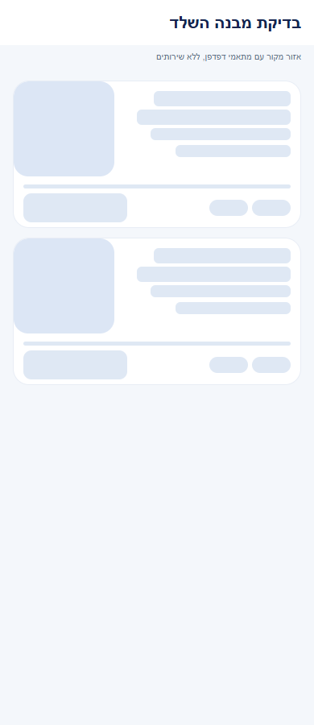
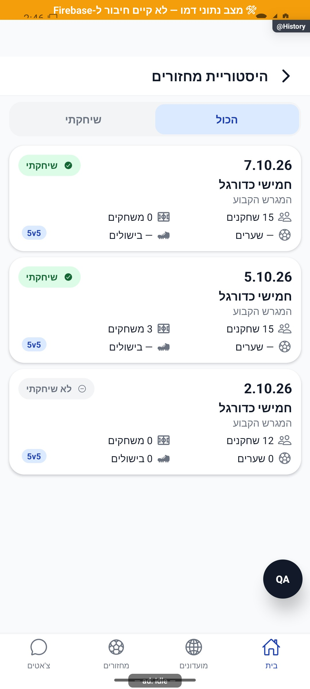
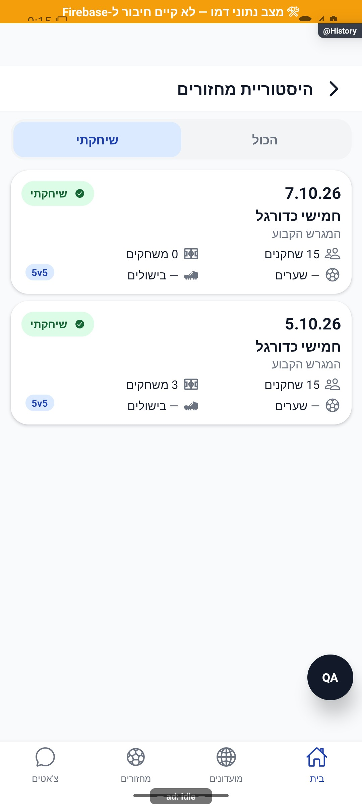
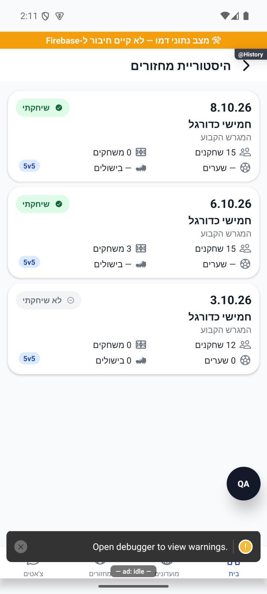

# היסטוריית המחזורים האישית

## מדידת פעולות ואמינות נתונים, 5.11.2026

במיפוי מקור הרכיבים המוזכרים במסמך נמצאו 3 נקודות מטפל ו-3 מזהי פעולה. הספירה מתארת קוד וכוללת רכיבים משותפים; אין לחבר אותה לספירות של מסמכים אחרים ואין לראות בה הרצת כל המסך. המדידה מפורטת לפי גבול פקד מקורי, פעולה עסקית ומצב חשבון. תשובה מאוחרת נבדקת מול בעל הפעולה, ומצב קיים או בקשה חוזרת אינם תמיד הצלחה חדשה. רשימת המקרים שהורצו ומגבלות המסד, המכשיר והכיסוי נשמרות [בדוח המדידה](../../audits/2026-11-04-system-night/product-measurement.md) ובדוחות המקושרים אליו. המימוש מקומי; לא בוצעה בדיקה חדשה של כל מצבי הפיצר.

## חיפוש שחקנים וזמני טעינה, 4.11.2026

קריאת מחזורים עתידיים של מועדון יכולה להעביר כשל גישה לחלונית ההזמנה כשהיא מבקשת תשובה מאומתת. ברירת המחדל של יתר הקוראים נשמרת. בדיקה זו תחומה למקור המשותף, ללא הרצה חדשה של כל המסך העצמאי. מימוש מקומי שטרם הופץ. [השינוי, המדידות והבדיקות](../../changes/2026-11-04-player-discovery-speed.md).

## ציר פעילות פרטי בפולס, 4.11.2026

נבדקו התוספות במקורות המשותפים לצורך ציר פעילות פרטי בפולס: דיווח ניווט והקשר, תיעוד ניסיון הרשמה ותוצאתו וגבולות זהות ומחיקת חשבון. התוספת היא תיעוד ברקע במקומות הנתמכים; אין מכך אימות חדש של כל מצבי הפיצר הזה או שינוי בחישוביו. מקומי וטרם הופץ או נפרס. [היקף, מקורות, בדיקות ומגבלות](../shared/usage-activity.md).

## הפצה פנימית 1.1.74, 3.11.2026

עדכוני הלקוח ב-`src/components/anim/MatchCardSkeleton.tsx`, `src/components/loading/ScreenSkeletons.tsx` כלולים בחבילה הפנימית 1.1.74/306. ארכיון המקור המקומי וחתימת החבילה אומתו מול החבילה שהחזירה גוגל. מקור הבסיס הוא `06417f6132f4c7636aaee25574354ed7722966b9` עם שינויים שלא נשמרו לגיט.

עברו 6864 בדיקות יישום, בדיקות טיפוסים, 360 בדיקות הרשאות בסדרה ו-38 בדיקות שרת במסד הדגמה. ההרשאות והשירותים הפעילים נשמרו, ללא הסבת נתונים או קידום לייצור. האימות החזותי הוא מצילומי המקור בדפדפן שכבר תועדו, ללא התקנה או הרצת הפיצר הזה במכשיר בגרסה החדשה. אין בכך הכרזה על הפצת שינויים אחרים המתועדים במסמך. [מקור, קבלות, תכולה ומגבלות](../../changes/2026-11-03-internal-1.1.74.md).

## התאמת מבנה שלדי הטעינה, 3.11.2026

באזורים המשויכים לפיצר הזה נבדק שלד `rounds` במתאם דפדפן. אין בכך אימות המסך המלא או כל מצב נתונים. ההתאמה עוסקת בפריסה ובהודעת ההמתנה הנגישה; שירותי הטעינה, מצבי הכשל, המיון, החישובים, המכנים והניווט נשארו ללא שינוי. מקורות משויכים שנערכו: `src/components/loading/ScreenSkeletons.tsx`, `src/components/anim/MatchCardSkeleton.tsx`.

[טבלת השינויים לפי אזור, המידות, השוואות למקור, הבדיקות והמגבלות](../../changes/2026-11-03-skeleton-layout-alignment.md). מקומי וטרם הופץ, ללא בדיקת מכשיר או שרת חי חדשה.

אימות במשימה זו: 6,820 בדיקות ב-608 חבילות ובדיקת טיפוסים עברו; 84 בדיקות רוחב של אזורי מקור ותשע השוואות מידות לכרטיסים אמיתיים עברו. אין בכך אימות מכשיר חדש של הפיצר או של מצבי נתונים שלא נבדקו.

## הרחבת שלדי הטעינה, 2.11.2026

`src/components/anim/MatchCardSkeleton.tsx` מחליף את הנצנוצים בפעימה אחת לכל אזור ובהודעת טעינה משותפת. `HistoryScreen` ממשיך להציג ארבעה כרטיסים לפי תנאי הטעינה הקיימים. לא השתנו קריאת ההיסטוריה, מיון התאריכים, הודעות הכשל והריק או פתיחת פרטי מחזור.

בסיס השלדים הוא `src/components/loading/ScreenSkeletons.tsx`: פעימה שמכבדת צמצום תנועה, הודעה אחרי ארבע שניות, ניקוי בעזיבה וצורות שאינן מקבלות מיקוד. אין בכך אימות מכשיר, תנועה אמיתית או חיבור למסד. מימוש מקומי שטרם הופץ. [התנהגות, בדיקות, צילומים ומגבלות](../../changes/2026-11-02-loading-skeletons-expanded.md).

## אימות פרסום קבוצות בפולס, 2.11.2026

נבדק ההפרש התחום בשירות המשותף של המחזורים: נוספה בדיקת אישור לפרסום קבוצות כאשר תשובת הפעולה אובדת. אין שינוי בחישוב, במכנים או בפעולות העצמאיות של הפיצר המתואר כאן. התיקון מקומי וטרם הופץ; אין בדיקת מכשיר חדשה לפיצר זה.

השינוי ב-`src/services/gameService.ts` מוגבל ל-`publishDraftTeams` ולתלות בסיווג כשלים זמניים. נבדקו גבולות קבלת השרת, התאמת החשבון והחלוקה, ושימור השגיאה כאשר האימות נכשל. `tests/logic/publishTeamsReceipt.test.ts` מפעיל את פונקציית השירות מול תחליפי קריאה וכתיבה; אין בכך הרצת כל המסלולים של המסמך הזה.

[דוח הטיפול, הבדיקות והמגבלות](../../changes/2026-11-02-pulse-sweep.md).

## בקשות לשיחה אישית, 2.11.2026

נבדקה השפעת תוספת בקשות השיחה במקורות המשותפים. השינוי ממוקד בהרשאת שיחה, בשדות פרטיות ההודעות ובחיבורי הבדיקות; אין מכך אימות חדש של מסך זה במכשיר. המימוש מקומי וטרם הופץ או נפרס. [התנהגות, בדיקות ומגבלות](../chat/message-requests.md).

מקורות משותפים שנבדקו בהיקף השינוי הזה: `src/firebase/firestore.ts`, `src/types/index.ts`. אין בסעיף זה טענה להרצת כל המסלולים ההיסטוריים של הפיצר. [מסירת המימוש](../../changes/2026-11-02-message-requests.md).

## החלפת הקבוצה הבועטת בפנדלים, 30.10.2026

נבדק ההבדל התחום במשימה במקורות המשותפים `src/services/gameService.ts`, `src/types/index.ts` ו-`src/firebase/firestore.ts`: הוא מוסיף ומשמר תור מפורש לפנדלי ההכרעה ומעדכן אותו ברישום ובביטול בעיטה. אין שינוי בשדות, בחישובים או במסלול הנתונים העצמאי של הפיצר המתואר כאן. בדיקת הקורא והעסקאות מפורטת בדוח; אין בכך הרצה מחדש של המסך הזה. [התנהגות, בדיקות ומגבלות](../../changes/2026-10-30-shootout-turn.md).

## התאוששות משגיאות בפולס, 28.10.2026

במקור המשותף `src/services/gameService.ts`, הקריאות `getGameById` ו-`getCommunityChampionship` משתמשות כעת ב-`withAuthRaceRetry` עם `retryTransientReads: true`. כשל זמני מאפשר ניסיון קריאה נוסף אחרי 500 אלפיות שנייה עם בדיקת בעלות על החשבון. מסלול החלוקה השמורה נשאר במסלול ההמתנה המדויק שלו. מסמך חסר נשאר חסר, סירוב הרשאה שומר על הטיפול הקיים וכשל מתמשך נזרק. אין שינוי בכתיבות, במכנים, בחישובי המחזור או בהכרעת התוצאה.

השינוי מקומי וטרם הופץ או נפרס. אין שינוי חזותי ואין צילום מכשיר חדש. [ממצאים, בדיקות ומגבלות](../../changes/2026-10-28-pulse-errors.md).

## הרחבת אבחון דיווחים, 27.10.2026

נוספה מעטפת אבחון מקומית עם מצב בזמן הכשל, שלבים בעלי מזהה ותזמון, מצב רשת ובנייה ומופעים נפרדים לשגיאה. נקודת הכניסה לתעבורת השרת עוברת כעת דרך העטיפה המשותפת; תשובות, חריגות, אפשרויות קריאה ומדיניות הפיצר נשמרות. אין כאן שינוי בהרשאות או בחישובי המוצר. הבדיקות המלאות ומגבלות האימות מתועדות בדוח המקושר; אין טענה לאימות מכשיר או להפצה. [היקף, ראיות ומגבלות](../../changes/2026-10-27-diagnostic-context.md).

באימות הסופי עברו כל 6,231 הבדיקות ב-555 חבילות, ובדיקות הטיפוסים של הלקוח, השרת והפולס נקיות. צילום הדפדפן והידור מקורות האנדרואיד הם בדיקות מקומיות; אין הוכחת מכשיר, הידור אייפון או מסירה חיה של הבנייה החדשה. רישום יומן השחרור נחשב מאומת רק לפי קבלת הקריאה החוזרת בדוח השינוי.

## השפעת מקור משותף במשימת השעון - 26.10.2026

נבדק ההפרש ב-`src/services/gameService.ts`: `stopRotation` עוצר את השעון וסוגר קטע ריצה באותה טרנזקציה שמשחזרת את ההרכב; `_persistRotation` משמר קטע ריצה פתוח לפני איפוס שעון המשחק הבא. נשמרים `startedAt` והיסטוריית `activeIntervals`, ונמנעים שיבוצים ישנים אחרי עצירת הרוטציה. השוואת שתי המתודות למצב הקודם משחזרת את חותמת המקור שנרשמה לפיצר לפני תיקון זה. בחירת המחזורים בהיסטוריה והמשמעות של מחזור ששוחק נשארות בחוזה הקיים. זו בדיקת השפעת השינוי התחום במקור המשותף, ולא הרצה מחודשת של כל מצבי הפיצר. השינוי מקומי; מסמך זה אינו מאשר פריסה, שינוי הרשאות או העלאה לחנות. הצילומים בסיכום האישי מבוססים על רכיבי המקור עם מתאמי דפדפן ונתוני בדיקה, ולא על הרצת אנדרואיד או שעון. [היקף המימוש, הבדיקות, מגבלות האישור והצילומים](../../changes/2026-10-26-android-personal-activity.md).

## שעון מדויק וכיתוב פנדל - 25.10.2026

במקורות המשותפים נוסף שימור השעון המדויק של פנדל במהלך משחק, וכיתוב ההבקעה ביומן קוצר. אין שינוי במונים או בתהליך העצמאי המתואר כאן; לא נערכה לו בדיקת ממשק חדשה במסגרת העדכון. השינוי מקומי וטרם הופץ. [פרטים וראיות](../../changes/2026-10-25-in-play-penalties.md#שעון-מדויק-וכיתוב-אירוע).

## פנדל במהלך משחק חי - 25.10.2026

נבדק השינוי הממוקד במקורות המשותפים: נוספו חוזי אירועי פנדל במהלך משחק, קוראים ומוני סטטיסטיקה, והגנות בעסקאות סיום ואיפוס משחק. מסלול הפיצר המתואר כאן אינו נקודת הכניסה להזנה החדשה. בדיקות המאגר עברו, אך אינן הוכחת הרצה חדשה של כל מצבי התהליך או של פריסה.

השינוי מקומי. נדרשת פריסת שרת לפני הפצת לקוח שמשתמש באפשרות; לא בוצעו פריסה או שינוי הרשאות. [חוזה הנתונים, התהליך, הבדיקות ומגבלות ההפצה](../../changes/2026-10-25-in-play-penalties.md).

## תיעוד כשלים — 20.10.2026

נוספו תצפיות דיווח בנקודות הכשל של המקורות המשויכים לפיצ׳ר, במסגרת הרחבה רוחבית. נשמרו ערכי החזרה, הזריקות ותנאי הפעולה הקיימים; נוסף מקור קוד והקשר לדיווח. כיסוי תחבירי אינו הוכחת הרצה של כל מצב. השינוי מקומי וטרם הופץ; בדיקות המסירה, מגבלות מניעת הכפילויות והמסלולים שטרם חוברו מתועדים בדוח המשותף.

[דוח דיווח השגיאות והראיות](../../changes/2026-10-20-error-reporting-audit.md).

[לקריאה קצרה ופשוטה](personal-history.simple.md)

עודכן: 07.10.2026; מקור `8e8fde5`, `1.1.35` בבנייה. `src/screens/tabs/HistoryScreen.tsx`, מסלול `History`, כניסה מתפריט הבית. תפקיד: חשבון מלא; היסטוריה חוצת מועדונים.

## הגדרה ותצוגה

ההיסטוריה כוללת רישומים למחזורי עבר שהסתיימו: הרכב, המתנה ובקשות לפי `participantIds` או האיחוד התואם כשאין שדה. היא אינה אומרת שהמשתמש שיחק בכולם. בחירת הכול/שיחקתי הוסרה ב־8.10.2026. מוצגים כל הפריטים שמחזיר השירות; `viewerPlayed` נשאר מקור תגית ההשתתפות בכרטיס, בלי סינון מקומי.

כרטיס `src/components/match/CommunityHistoryRow.tsx` משותף להיסטוריית מועדון ולאישית: תאריך, תג שיחקתי/לא שיחקתי, שם מחזור, מגרש, מספר שחקנים, משחקונים, שערים ובישולים. מבנה המדדים נשאר אחיד. כאשר נתון אישי חסר הוא מוצג כקו, לא אפס. כיום עדיין מוצג שבב פורמט כגון `5v5` אם הוא קיים במקור; אין להניח שהשבב הוסר לפי סקיצה קודמת.

בצילום מחזור 7.10 עם 0 משחקונים ושערים/בישולים חסרים; 5.10 עם 3 משחקונים ונתונים חסרים; 2.10 לא שיחקתי עם אפסים. אלה נתוני דמו, לא הוכחה לתוכן קריאת המסד.

| תנאי/פעולה | תצוגה/מעבר | כתיבה | ראיה |
|---|---|---|---|
| טעינה | ארבעה שלדי כרטיסים | אין | קוד |
| קריאה נכשלה | הודעת כשל ונסה שוב | אין | קוד |
| הרשימה ריקה | הסבר היסטוריה אמיתי | אין | קוד |
| יש תוצאות | תאריך יורד; עד 50 כברירת שירות | אין | דמו וקוד |
| בחירת כרטיס | `MatchDetails` בתוך הערימה הנוכחית | אין | קוד |

## שירותים ובדיקות

`src/services/gameService.ts:getPersonalHistory`, `src/utils/personalHistory.ts`, `src/utils/eveningPlayed.ts`, `src/firebase/firestore.ts`. `isPersonalHistoryGame` בודק מחזור שהסתיים ותאריך לפני עכשיו; ספירת מחזורים ומצב שיחקתי אינם ספירת משחקונים. שינוי עונה אינו אמור למחוק היסטוריה אישית מצטברת. ממיר `GameSummary`/מחזור חייב להחזיר את המדדים החדשים בקריאה אמיתית.

בדיקות: `tests/logic/personalHistory.test.ts`, `tests/logic/seasonPersonal.test.ts`. לא בוצעה כאן בדיקת מסד חיה. שחזור: כמה מועדונים, המתנה בלבד, בקשה בלבד, אי הגעה, משחק בפועל, חוסר סטטיסטיקה, כשל קריאה, בחירת כרטיס וחזרה. אין מצב השתתפות לא תועדה במוצר הנוכחי; חוסר שערים הוא חוסר מדד ולא סטטוס שלישי.

## פירוט מימוש ונקודות שינוי — העמקה 07.10.2026

`isPersonalHistoryGame` דורש מזהה משתמש, `status === 'finished'`, זמן התחלה בעבר וחברות ב־`participantIds`; רק כשהשדה חסר משתמשים באיחוד שחקנים, המתנה ובקשות. מערך קיים ריק אינו ״חסר״ ולכן לא נופלים לתאימות. זה אינו מדד השתתפות, שהשירות מספק בנפרד ב־`viewerPlayed`.

`HistoryScreen` טוען בשינוי userId או `reload`, לא בכל מיקוד. הוא ממיין תאריך יורד ומציג את `items` ישירות ללא מסנן. אין שינוי במקור הנתונים או במונים. `alive` חוסם עדכון לאחר יציאה; catch מציג כשל נפרד וניסיון חוזר מעלה reload. `openDetails` מנווט ב־ProfileStack כדי שהחזרה תהיה להיסטוריה. שינוי עיצוב שורה נעשה ב־`CommunityHistoryRow` המשותף, ולכן מחייב בדיקת היסטוריית מועדון ואישית יחד. המגבלה בשירות היא עד 50 מחזורים; התצוגה אינה הבטחה לארכיון בלתי מוגבל.

הבדיקות, מצבי המסך והראיות שכבר פורטו במסמך נשמרו. ההעמקה מבוססת על קריאת מקור ולא על הרצת פעולות נוספות; שינוי עתידי יצריך עדכון של שני המסמכים ובחינת המצבים הממוקדים.

## ראיה היסטורית — תנועה ותיקוני דיווחים (לפני הסרת המסנן)

`ChangeMotion` עוטף את הרשימה עם `triggerKey=playedOnly` ו־240 אלפיות שנייה. אין החלפת מפתח של הרשימה, איפוס גלילה או שינוי חישוב ההשתתפות.

**ראיה ומגבלות:** הסינון הורץ בדמו: שלושה מחזורים הופיעו בהכול ושניים בסינון שיחקתי.

בדיקת הטיפוסים ו־183 חבילות הבדיקות עברו, 2,752 בדיקות. מצב המקור: `9ec0dfd` עם שינויים מקומיים; אין גרסה חדשה שפורסמה. [יומן השינוי וההקלטות](../../changes/2026-10-08-motion-and-pulse.md).

## הסרת המסנן האישי — 8.10.2026

מקור `a348b9f` עם שינויים מקומיים. הוסרו `playedOnly`, הכפתורים, סגנונותיהם ועטיפת `ChangeMotion` שהופעלה רק בהחלפת המסנן. `FlatList` מקבלת `items` ישירות. מצבי טעינה, כשל, ניסיון חוזר וריק נשמרים. היסטוריית המועדון והכרטיס המשותף אינם משתנים. בדיקות: `artifacts/history-no-filter-tsc.log` ו־`artifacts/history-no-filter-jest.log`.

נצפה באימולטור אנדרואיד בדמו: כותרת ואחריה הרשימה, ללא בחירת הכול/שיחקתי. לא הופעלו כתיבות. סימוני פיתוח בצילום אינם חלק מההפצה. אייפון לא הורץ.

## תלות בעדכון העונות — 19.10.2026

נבדק ההפרש בקבצים המשותפים הרשומים כאן: `src/firebase/firestore.ts`, `src/services/gameService.ts`, `src/utils/eveningPlayed.ts`. השינוי ממוקד במדיניות העונות, קריאת מצבן, שיוך מחזור ופקודות ניהולן; אין שינוי מכוון בחוזה העצמאי המתואר במסמך זה. אין להסיק מכך שהמסך הזה הורץ מחדש.

[מצב המימוש, הבדיקות ומגבלות האימות של העונות](../clubs/seasons.md). מקומי בלבד; לא בוצעה פריסה במסגרת המשימה.

## תלות במידע על סגירת עונה — 23.10.2026

בדיקת ההבדל ב־`src/firebase/firestore.ts` וב־`src/types/index.ts` מראה שהשינוי מוגבל לקריאת `seasons.closureStatus` בחוזה `GroupSeasons`. יתר ממירי הנתונים והמסלולים המתועדים כאן לא שונו במשימה זו. אימות הריצה החדש מתייחס להתאוששות ולכרטיס העונה, ולא להרצה חדשה של כל מצבי המסך הזה. [המסלול, הבדיקות והמגבלות](../../changes/2026-10-23-season-automatic-recovery.md).

## עדכון תלות משותפת בקריאות מידע — 23.10.2026

בקובצי השירות המשותפים נוספה אפשרות מפורשת לניסיון חוזר אחד בקריאה זמנית שנכשלה, תוך עצירה אם החשבון מתחלף. החיבור מוגבל ל־14 נקודות קריאה המפורטות בדוח; אין כאן טענה שכל פעולה בפיצ׳ר קיבלה ניסיון חוזר או שנבדק מסך חדש. בדיקות המאגר המלאות עברו (5,261 בדיקות ב־472 חבילות), אך אינן הוכחת הרצה במכשיר. הקוד מקומי וטרם הופץ. [מסלול, ראיות ומגבלות](../../changes/2026-10-23-four-open-errors.md).

## תלות בשמירת צבעי המחזור — 24.10.2026

במסגרת בחירת צבעים לפני שיבוץ עודכנו מקורות משותפים הרשומים לפיצ׳ר: `src/firebase/firestore.ts`, `src/services/gameService.ts`, `src/types/index.ts`. השינוי מוסיף מפת צבעים למחזור, קריאה וכתיבה שלה ושימורה במסלולי הכוחות וההכנה. אין כאן פעולת ממשק חדשה במסך זה. זו בדיקת השפעת התוספת הממוקדת, ולא חקירה או אימות חזותי מחודש של הפיצ׳ר. כל 480 חבילות הבדיקה ו־5,343 הבדיקות עברו; טיפוסי הלקוח והשרת נקיים. השינוי מקומי וטרם הופץ. [מסלול הנתונים, ראיות ומגבלות](../rounds/draft-setup.md#צבעים-לפני-שיבוץ-ובכל-שיטת-חלוקה--24102026).

## תלות בעריכת קבוצות בלייב — 24.10.2026

בקובץ השירות המשותף נוסף מסלול לעריכת הקבוצות והתור במשחק חי, כולל איפוס המשחק הנוכחי בלבד בעת החלפת קבוצה. לא שונו מסלולי הפיצ׳ר הזה במסגרת התוספת ולא בוצע לו אימות מסך חדש. [מסלול השינוי, הבדיקות והמגבלות](../rounds/live-advanced.md#עריכת-הקבוצות-והתור-בזמן-הלייב--24102026). מקומי וטרם הופץ.

## בדיקת עומק לעריכת הקבוצות — 24.10.2026

בקובץ השירות המשותף תוקן שימור זהות המשחק במחזור ישן בעת שינוי תור בלייב. הדיווח על הצלחת החלפה נשלח כעת רק אחרי שמירה. מסלולי הפיצ׳ר הזה לא שונו ולא בוצעה לו בדיקת מסך חדשה. כל 5,496 בדיקות הפרויקט עברו; אין בכך הוכחת מסד חי או הפצה. [הראיות ומגבלות הבדיקה](../../audits/2026-10-24-live-teams.md). מקומי וטרם הופץ.

## המשך קיצור טעינות בלילה של 25.10.2026

נבדק ההבדל ב-`src/services/gameService.ts`: הוא מוגבל לאיחוד בקשות פעילות במטמון רשימות המחזורים, מניעת מילוי המטמון מתשובה שלפני ביטולו, וזריקת כשל כששתי שאילתות הרשימה נכשלו. סינון הרשימות, חצי תשובה מוצלח, פעולות המחזור, מנויי הלייב והמונים לא שונו. [חוזה המטמון והבדיקות](../home/round-cards.md). אין אימות מכשיר חדש של כל מצבי הפיצר המתואר כאן. [בדיקות, ראיות ומגבלות](../../changes/2026-10-24-loading-performance.md).

## תגובה מיידית לכפתורי השעון - 25.10.2026

נבדק ההפרש ב-`src/services/gameService.ts`: פעולות התחלת והשהיית שעון מחזירות את מצב הלייב מהעסקה הקיימת לשימוש בתגובת התצוגה. אין שינוי בעוגני הזמן, בכתיבות, בהגנות מעבר משחק או במידע שהקוראים האחרים שומרים. אין הרצה חדשה של כל מצבי הפיצר המתואר כאן. [בדיקות, ראיות ומגבלות](../../changes/2026-10-25-live-timer-response.md). התיקון מקומי וטרם הופץ.

## תאימות לשמירת פקודת רכיב הבית - 25.10.2026

השינוי התחום במקורות המשותפים `src/types/index.ts` ו-`src/firebase/firestore.ts` מוסיף ומשמר את `liveMatch.lastWidgetCommandId`, מזהה אטום למניעת ביצוע חוזר של פקודת רכיב הבית. הוא אופציונלי במסמכים ישנים ואינו משנה מונים, הכרעות, ניווט או הרשאות של הפיצר המתואר כאן. בדיקה מפעילה את ממיר הקריאה המקורי ומאמתת שימור ערך והיעדרו. אין בכך בדיקת מכשיר חדשה לכל מצבי הפיצר. [מקור הבדיקה והמגבלות](../../changes/2026-10-25-widget-completion.md).

## שלמות החלוקה המתוזמנת, 29.10.2026

נבדק השינוי הממוקד במקורות המשותפים: נוספו אזורי קבוצה שש ושבע למתאמי החלוקה ולקורא ההשמות, וסוננו אורחים ממתינים בשני מסלולי היצירה בשרת. אין שינוי בליבת האיזון או בחישובים העצמאיים של המסלול המתואר כאן. 15 בדיקות ממוקדות של החלוקה וקורא הנתונים עברו, וכן בדיקות הטיפוסים של הלקוח והשרת. אין אימות מכשיר חדש, שינוי חזותי מתוכנן או פריסה.

[היקף, בדיקות, פערים פתוחים ומגבלות](../../changes/2026-10-29-scheduled-balance-integrity.md).

## איזון ופיזור רמות לפני גיוון, 30.10.2026

נבדק שינוי תחום במקורות המשותפים של חלוקת הכוחות ומדדי השמירה. החישוב נותן עדיפות לפער ממוצעים, אחריו לפיזור הקצוות ולפרופיל הרמות, ולבסוף לציוותים חוזרים. התג rating_priority_v3 נוסף בלי להסיר קריאת דורות ישנים. אין שינוי מכוון בחישובים העצמאיים או בניווט המתוארים כאן. 112 בדיקות ממוקדות ובדיקות הטיפוסים של הלקוח והשרת עברו; אין בכך הרצה של המסך במכשיר או הפצה.

[מימוש, נוסחאות, בדיקות ומגבלות](../../changes/2026-10-30-rating-balance-priority.md).

## אימות כשלים בקבלת פרסום, 2.11.2026

בבדיקת אישור פרסום הקבוצות, כשל שלא ניתן לאמת כהצלחה נשאר כשל גלוי ונשמר באבחון. הבדיקה אינה שולחת הודעות שוב ואינה משנה הרשאות. השינוי תחום לשירות המשותף, מקומי וטרם הופץ.

נוסף תיעוד תצפית בנקודות הכשל של אימות קבלת הפרסום ב-`src/services/gameService.ts`. בדיקת `tests/logic/authTransientReads.test.ts` סופרת כעת גם את קריאת הקבלה, עם הרשאת ניסיון חוזר לקריאה בלבד; כתיבת תחילת העונה נשארת ללא ניסיון חוזר זמני. אין שינוי בזרימות העצמאיות האחרות המתוארות במסמך זה.

[דוח הטיפול והראיות](../../changes/2026-11-02-pulse-sweep.md).

## תיקו בשתיים או בשלוש קבוצות, 6.11.2026

נבדק שינוי תחום במקורות המשותפים `src/services/gameService.ts`, `src/types/index.ts`: נוסף מסלול סיום משחק בתיקו בשתיים או בשלוש קבוצות, עם בחירה ידנית של הקבוצה שנשארת ושמירה במוני התיקו הקיימים. אין שינוי מכוון בפעולות העצמאיות של הפיצר המתועד כאן. בדיקות המסלול מפעילות שירות לקוח, ממירים וגוף שרת במאגר זיכרון; אין בכך הרצה חדשה של מסך זה. המימוש מקומי, ללא הפצה או פריסת שירות השמירה החדש. [התנהגות, נתונים, בדיקות ומגבלות](../../changes/2026-11-06-manual-draw.md).

## תלות משותפת בציון המחזור החדש, 6.11.2026

נוספה תמיכה מקומית בגרסת ציון למחזורי העתיד ובקריאת הרף הקפוא, תוך שמירת המודל של מחזורים קודמים. השינוי כאן תחום לתלות במקורות המשותפים, ואינו אימות חדש של כל המסלול העצמאי. המקורות המשותפים שנבדקו בהפרש התחום: src/firebase/firestore.ts, src/types/index.ts. אין פריסה, הסבת נתונים או שינוי ציוני עבר. [התנהגות, בדיקות ומגבלות](../../changes/2026-11-06-shared-evening-score.md).
