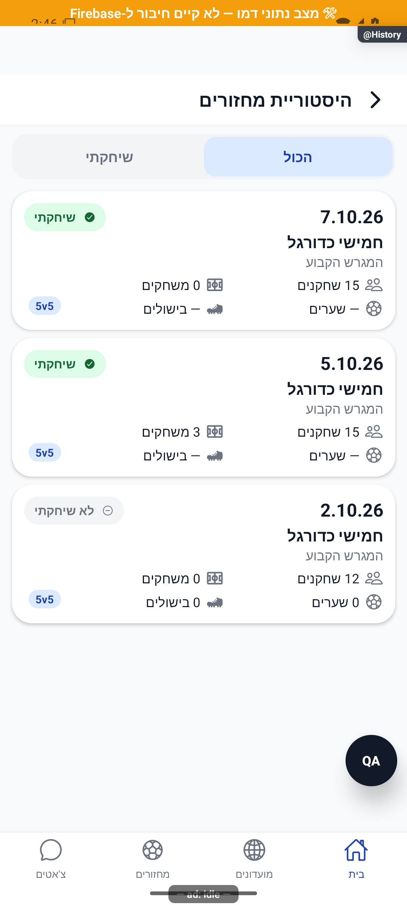
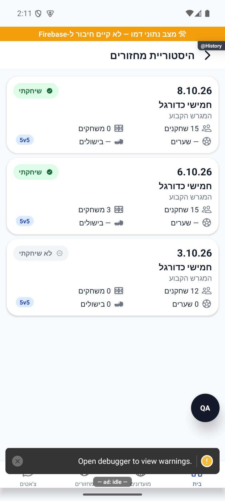

# היסטוריית המחזורים האישית — הסבר קצר

ההיסטוריה האישית מרכזת מחזורים קודמים מכל המועדונים שלכם. כל המחזורים שהתקבלו להיסטוריה מוצגים ברשימה אחת, ואפשר לפתוח מחזור לפרטים.

[לפירוט הטכני](personal-history.md)

הצילום מדגים את המראה בסביבת בדיקה, ולא מוכיח פעולה מול הנתונים האמיתיים.

## עדכון 8.10.2026 — תנועה ותיקוני דיווחים

הבחירה ״הכול / שיחקתי״ הוסרה מההיסטוריה האישית. גובה הכרטיסים נשאר אחיד.

נצפה באימולטור אנדרואיד בדמו: כותרת ואחריה הרשימה, ללא בחירת הכול/שיחקתי. לא הופעלו כתיבות. סימוני פיתוח בצילום אינם חלק מההפצה. אייפון לא הורץ.

## תלות בעדכון העונות — 19.10.2026

קובץ תשתית משותף עודכן במסגרת העונות. שינוי זה אינו מוסיף פעולה חדשה למסך המתואר כאן; פרטי העונות והבדיקות מופיעים במסמך העונות.

[מצב המימוש, הבדיקות ומגבלות האימות של העונות](../clubs/seasons.md). מקומי בלבד; לא בוצעה פריסה במסגרת המשימה.
