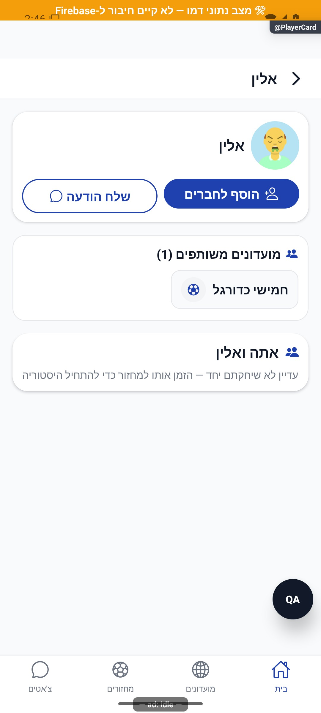

# כרטיס שחקן — עצמי, שחקן אחר ואורח

## הרחבת אבחון דיווחים, 27.10.2026

נוספה מעטפת אבחון מקומית עם מצב בזמן הכשל, שלבים בעלי מזהה ותזמון, מצב רשת ובנייה ומופעים נפרדים לשגיאה. נקודת הכניסה לתעבורת השרת עוברת כעת דרך העטיפה המשותפת; תשובות, חריגות, אפשרויות קריאה ומדיניות הפיצר נשמרות. אין כאן שינוי בהרשאות או בחישובי המוצר. הבדיקות המלאות ומגבלות האימות מתועדות בדוח המקושר; אין טענה לאימות מכשיר או להפצה. [היקף, ראיות ומגבלות](../../changes/2026-10-27-diagnostic-context.md).

באימות הסופי עברו כל 6,231 הבדיקות ב-555 חבילות, ובדיקות הטיפוסים של הלקוח, השרת והפולס נקיות. צילום הדפדפן והידור מקורות האנדרואיד הם בדיקות מקומיות; אין הוכחת מכשיר, הידור אייפון או מסירה חיה של הבנייה החדשה. רישום יומן השחרור נחשב מאומת רק לפי קבלת הקריאה החוזרת בדוח השינוי.

## טיפול מלא בפריטי הפולס הפתוחים, 27.10.2026

נבדק השינוי הממוקד במקור המשותף: התנגשות גרסת מועדון בעת זקיפת השתתפות נשלחת כעת לניסיון חוזר מקומי מוגבל שבונה מחדש את אותה כתיבה ואת הגנת העונה. סמן מניעת הכפילות נשמר. אין שינוי בהרשאות, בניווט או במדיניות הפיצר הזה. אין אימות מכשיר חדש או פריסה. [ממצאים, בדיקות ומסירה](../../changes/2026-10-27-pulse-completion.md).

## טיפול בתקלות הפולס, 26.10.2026

השינוי במקור המשותף מוגבל לסיווג תוצאה צפויה לפני רישום שגיאה: תיעוד מחיקת מחזור שכבר קיים אינו כשל חדש, והתנגשות גרסה בעדכון עונה אינה מבטלת את הגנת הגרסה. אין שינוי בחוזה הפיצר, במכנים, בניווט או בהרשאות; לא נערכה הרצה חדשה לכל מצבי הפיצר. כשל לא צפוי בתיעוד מחיקה נזרק שוב כדי לאפשר ניסיון שרת חוזר.

השינוי מקומי וטרם הופץ. [בדיקות, מסירה ומגבלות](../../changes/2026-10-26-pulse-fixes.md).

מקורות שנבדקו בסבב: `functions/src/index.ts`.

## קישורי שיתוף בדומיין החדש - 26.10.2026

שיתוף הקישור האישי מכרטיס השחקן משתמש כעת בקישור קצר בדומיין החדש. אם החשבון משתנה בזמן ההמתנה, הודעת השיתוף אינה נפתחת עבור החשבון הקודם.

המימוש המשותף משתמש ב-`src/utils/linkDomains.ts`, ב-`src/services/inviteLinkService.ts`, ב-`src/services/deepLinkService.ts` וב-`src/services/incomingInvite.ts`. קישורים קצרים אינם משכפלים את `invitedBy`; הבעלות נקראת מהמסמך הקיים. כשל שמירת קוד מחזיר כתובת מלאה, ופענוח שנכשל נשמר לשחזור. אין שינוי במונים, בהרשאות או במסלול ההצטרפות.

השינוי מקומי וטרם הופץ. הבדיקות, מסלולי הנתונים ומגבלות האימות מפורטים ב[דוח השינוי](../../changes/2026-10-26-share-domain.md). אין כאן אימות חדש של כל מצבי המסך.

## ביטול פעילות אחרי מחיקת מועדון - 26.10.2026

נבדקה השפעת השינוי התחום ב-`src/services/groupService.ts`, ב-`src/services/seriesService.ts` וב-`functions/src/index.ts`: עצירת סדרות לפני מחיקת מסמך ההרשאה, הפעלת ביטול פעילות באירוע מחיקת המועדון, ועסקאות יצירה שמאמתות את קיום המועדון והסדרה גם במנגנון ההעתקה הישן. `functions/src/clubDeletion.ts` שומרת מחזורים שהסתיימו ונתוני עבר, מבטלת מצבים פעילים, דוחה בקשות חברות ממתינות, מסירה רק את המועדון שנמחק מהרשמות להתראות ומסירה את ההעתק הציבורי. המימוש והבדיקות ב-`tests/logic/clubDeletion.test.ts` וב-`tests/logic/clubDeletionClient.test.ts` מפורטים ב[דוח התיקון](../../changes/2026-10-26-deleted-club-recurring.md). אין שינוי מסכים, ניווט, נוסחאות או הרשאות במסגרת תיקון זה. זו בדיקת השפעה ממוקדת ואינה אימות מחודש של שינויים קודמים במקורות המשותפים. תיקון השרת נפרס ואומת באישור הבעלים, עם השוואת המקור הפרוס והקוד המהודר ושימור יתר הפונקציות. הסדרה, הרשמת ההתראות והכרטיס הציבורי של המקרה הידוע טופלו ונקראו חזרה; המחזור כבר היה חסר בבדיקה העדכנית. שינוי הלקוח טרם נכלל בבינארי. סעיף הפריסה בדוח כולל את מגבלות בדיקת החבילה המבודדת, ללא טענה למחיקת מועדון בדיקה בייצור.

## השפעת מקור משותף במשימת השעון - 26.10.2026

נבדק ההפרש ב-`src/services/gameService.ts`: `stopRotation` עוצר את השעון וסוגר קטע ריצה באותה טרנזקציה שמשחזרת את ההרכב; `_persistRotation` משמר קטע ריצה פתוח לפני איפוס שעון המשחק הבא. נשמרים `startedAt` והיסטוריית `activeIntervals`, ונמנעים שיבוצים ישנים אחרי עצירת הרוטציה. השוואת שתי המתודות למצב הקודם משחזרת את חותמת המקור שנרשמה לפיצר לפני תיקון זה. קריאת נתוני הצמד וכרטיס השחקן אינה מקבלת נתוני גוף חדשים בעקבות שינוי הרוטציה. זו בדיקת השפעת השינוי התחום במקור המשותף, ולא הרצה מחודשת של כל מצבי הפיצר. השינוי מקומי; מסמך זה אינו מאשר פריסה, שינוי הרשאות או העלאה לחנות. הצילומים בסיכום האישי מבוססים על רכיבי המקור עם מתאמי דפדפן ונתוני בדיקה, ולא על הרצת אנדרואיד או שעון. [היקף המימוש, הבדיקות, מגבלות האישור והצילומים](../../changes/2026-10-26-android-personal-activity.md).

## הפצה פנימית 1.1.61 - 25.10.2026

הבינארי `1.1.61/295` הופץ ואומת במסלול הפנימי באנדרואיד. תיקוני הלקוח נכללים בו, ושירות הפרופיל נפרס ואומת בנפרד. גם תיקוני הסגל, שמירת התוצאה והתראת השגיאה בשרת נפרסו ואומתו באישור מפורש. שינויי יישום הפולס עצמו טרם הופצו. אין שינוי כללי הרשאה או הסבת נתונים. ניסוחי המצב המקומי בסעיפים הקודמים נכתבו לפני ההפצה; [דוח ההפצה](../../changes/2026-10-25-internal-1.1.61.md) מפרט בדיוק מה נכלל, מה נבדק ומה עדיין מקומי.

## תיקוני הפולס - 25.10.2026

`getSocialPlayerProfile` מחשב `statisticsAllowed` אחרי קריאת היעד ולפני קריאות הסטטיסטיקה. `readStatisticsRows` מתחיל באותה `Promise.all` עם המועדונים, המחזורים והזוג. אותה תשובת נתונים מזינה את `readStatistics`, בלי לשנות סינון מחזור ששוחק, מכנים, פרטיות או ממירים. `socialPlayersService.call` מגביל רק את קריאת הכרטיס ל-15000 מילישניות; כשל נשאר כשל עם ניסיון חוזר במסך. אין מטמון חדש של מידע פרטי. `tests/logic/pulseProfileLoading.test.ts` מאמת התחלה במקביל גם כשמועדונים טרם ענו, ואפס קריאות סטטיסטיקה כשאסור לצפות.

[מקורות, בדיקות, צילומים ומגבלות](../../changes/2026-10-25-pulse-fixes.md).

## הפצה פנימית 1.1.60 - 25.10.2026

נכלל בגרסה הפנימית `1.1.60/294`. שירותי הפנדלים במהלך משחק נפרסו ואומתו, לרבות שמירת הפירוט וארכיון העונות. הייצור בחנות נשאר `1.1.57/291`. הסעיפים ההיסטוריים שמתארים מימוש מקומי קדמו להפצה זו. אין בסבב ההפצה בדיקת התקנה, משחק מלא מול שרת או צילום ממשק חדש. [מקור מדויק, בדיקות וקבלות](../../changes/2026-10-25-internal-1.1.60.md).

## הכדורגל שלי בעמוד הראשון של הקרוסלה - 25.10.2026

נוספה כניסה קיימת נוספת לכרטיס העצמי מתוך העמוד הראשון של קרוסלת הבית. `HomePersonalStats.onProfile` מחובר ב-`ProfileScreen` ל-`nav.push('PlayerCard', { userId: localUser.id })`. הכפתור נמצא במעטפת שאינה לחיצה לסטטיסטיקה, ולכן פותח רק את הכרטיס העצמי. נתוני הכרטיס, שיתוף, פרטיות ומסלולי המועדונים נשמרו. חזרה מחזירה למסך הבית שממנו נפתח. נצפתה באימולטור אנדרואיד בנתוני המחשה פתיחת "כרטיס השחקן שלי" והמועדונים דרך הכפתור; זו אינה הרצה חדשה של כל חלקי הכרטיס או נתוני ייצור. כל 5,796 בדיקות הפרויקט ובדיקת טיפוסים עברו. מקומי וטרם הופץ. [דוח השינוי](../../changes/2026-10-25-home-profile-carousel.md).

## שעון מדויק וכיתוב פנדל - 25.10.2026

במקורות המשותפים נוסף שימור השעון המדויק של פנדל במהלך משחק, וכיתוב ההבקעה ביומן קוצר. אין שינוי במונים או בתהליך העצמאי המתואר כאן; לא נערכה לו בדיקת ממשק חדשה במסגרת העדכון. השינוי מקומי וטרם הופץ. [פרטים וראיות](../../changes/2026-10-25-in-play-penalties.md#שעון-מדויק-וכיתוב-אירוע).

## פנדל במהלך משחק חי - 25.10.2026

נבדק השינוי הממוקד במקורות המשותפים: נוספו חוזי אירועי פנדל במהלך משחק, קוראים ומוני סטטיסטיקה, והגנות בעסקאות סיום ואיפוס משחק. מסלול הפיצר המתואר כאן אינו נקודת הכניסה להזנה החדשה. בדיקות המאגר עברו, אך אינן הוכחת הרצה חדשה של כל מצבי התהליך או של פריסה.

השינוי מקומי. נדרשת פריסת שרת לפני הפצת לקוח שמשתמש באפשרות; לא בוצעו פריסה או שינוי הרשאות. [חוזה הנתונים, התהליך, הבדיקות ומגבלות ההפצה](../../changes/2026-10-25-in-play-penalties.md).

## חזרה מארון התארים לכרטיס המקורי — 24.10.2026

פתיחת ארון התארים מהכרטיס העצמי וחזרה ממנו מחזירות לאותו כרטיס ולאותה לשונית. הארון נוסף לערימות המועדונים, המחזורים והשיחות, ונפתח כמסך חדש מעל הכרטיס גם אם ביקרו בו קודם. החץ וחזרת אנדרואיד אומתו באימולטור מתוך מועדון; שאר המארחים נבדקו בנתב. מקומי וטרם הופץ. `src/navigation/CommunitiesStack.tsx`, `src/navigation/GameStack.tsx` ו־`src/navigation/ChatStack.tsx` רושמים `AchievementsScreen`; הבית כבר רשם אותו. `OwnPlayerCard.go` מפעיל `nav.push` עבור `Achievements` במקום מסלול גיבוי בין לשוניות. לא שונו `AchievementsScreen`, חישובי התארים או `ScreenHeader.goBack`. בדיקת הנתב האמיתי מאמתת מפתח כרטיס קודם בארבע הערימות, עם ובלי ביקור קודם בארון. טיפוסים ו־5,609 בדיקות עברו. [מסלול הניווט, בדיקות, צילומים ומגבלות](../../changes/2026-10-24-cabinet-back.md).

## סיכום המחזור מכרטיס השחקן — 24.10.2026

הכפתור ״לסיכום המחזור שלי״ בכרטיס העצמי פותח את פרטי המחזור האחרון ובוחר את לשונית הסטטיסטיקה כאשר היא זמינה לפי תנאי המחזור והגישה הקיימים. אין מעבר דרך מסך הסיכום האישי הנפרד. התיקון מקומי וטרם הופץ. `src/components/profile/OwnPlayerCard.tsx` מעביר ל־`MatchDetails` את `gameId: last.id` ו־`initialTab: 'stats'`. היעד כבר רשום בכל ארבע הערימות של הכרטיס; `MatchDetailsScreen` צורך את הפרמטר אחרי הטעינה ומשאיר מידע אם `dataTabsLocked`. אין שינוי בחישובים, בספירה, בהרשאות, במאגר או במסך הישן. בדיקת הרגרסיה מפעילה את מטפל המקור ובודקת את ארבעת הרישומים. עברו טיפוסים ו־5,606 בדיקות בהרצה מלאה. [מקור, בדיקות, צילומים ומגבלות](../../changes/2026-10-24-own-card-round-link.md).

## עדכון הפצה פנימית — 24.10.2026

נכלל בגרסה הפנימית `1.1.59/293`, ממקור `7c6f98e`. שני שירותי היסטוריית ההשוואות ועדכון הצבעים בשני נתיבי החלוקה המתוזמנת נפרסו ואומתו. אין היסטוריית השוואות ישנה; רק לקוחות חדשים מתעדים ביקורים. הייצור בחנות נשאר `1.1.57/291`, והכללים נשמרו לתאימות. טענות ״מקומי״ או ״טרם הופץ״ בהמשך מתארות את שלבי הפיתוח שקדמו להפצה זו. [מקור, בדיקות, פריסה ומגבלות](../../changes/2026-10-24-internal-1.1.59.md). אין בסבב זה אימות ממשק או התקנה חדשים.

## היסטוריית השוואות פרטית — 24.10.2026

`src/components/profile/ComparisonActivitySection.tsx` משולב ב־`src/components/profile/OwnPlayerCard.tsx` אחרי המחזור האחרון ולפני ארון התארים. הוא אינו חלק ממשטח השיתוף או התצוגה הציבורית. הסקשן קורא רק את היסטוריית החשבון המחובר, ונסגר מיד כשמזהה הבעלים אינו תואם או כשזהו אורח. אין מסלול ניווט חדש; הרשימה המלאה היא `SafeModal` בתוך הכרטיס.

הסקשן מציג מסנן 30 ימים/כל הזמנים, שני מונים נפרדים — שחקנים שונים וביקורי השוואה — ושלוש שורות אחרונות. ״לכל ההשוואות״ פותח את כל השחקנים שנקראו עם עמודים נוספים לפי הצורך. שורה מרכזת שחקן אחד בכל המועדונים, ומציגה את מספר ביקוריו בתקופה ואת המועדון, תקופת הנתונים והתאריך של ביקורו האחרון. היא אינה טוענת שכל הביקורים בוצעו במועדון האחרון. הפרטים מגיעים מההיטל המצומצם של השרת, ללא דואר, טלפון או אסימונים.

`src/services/comparisonActivityService.ts` קושר את הקריאה לזהות החנות וזהות ההתחברות לפני ניסיון חוזר ואחרי תשובה. `src/types/comparisonActivity.ts` מגדיר את מוני התוצאה, שורות השחקנים וסמן העמוד. התשובה בממשק קשורה במפורש לבעלים ולתקופה; החלפת מסנן אינה מציגה מונים מהתקופה הקודמת, ותשובות מאוחרות נפסלות לפי דור ומפתח. ניסיון טעינת עמודים נוספים חסום במקביל, מאחד שורות לפי מזהה ומשמר רשימה קיימת כשעמוד נוסף נכשל. כשל מקור אינו ריקנות או אפס: מוצגת אפשרות ניסיון חוזר. תשובה תקינה ללא שורות מסבירה שאין עדיין השוואות מתועדות ושאין שחזור היסטוריה מלפני הפעלת הפיצ׳ר.

אין כרגע מאגר היסטוריה קיים שניתן לייבא. אירוע המדידה הישן קשור להחלפת לשונית ואינו בסיס לספירת ביקורים אמינה. המימוש החדש, הספירה ומדיניות השרת מפורטים ב[מסמך ההשוואה](../statistics/player-compare.md#רישום-השוואה-והיסטוריה-לבעל-הכרטיס--24102026). השירותים החדשים טרם נפרסו; ההדגמה אינה הוכחת איסוף או קריאה בייצור.

באימולטור אנדרואיד נפתחו הסקשן והרשימה המלאה ונבחרו שתי התקופות. `src/dev/comparisonActivityFixture.ts` מספק בדמו 6 שחקנים ו־14 השוואות בחודש לעומת 7 ו־19 בכל הזמנים, ללא שמירה. [כרטיס הדגמה](../screenshots/comparison-activity-card-2026-10-24.png) · [כל הזמנים ברשימה המלאה](../screenshots/comparison-activity-all-2026-10-24.png). לא נבדקו אייפון, גופן מוגדל או פעולות נגד נתוני ייצור. [בדיקות, יומן ומגבלות](../../changes/2026-10-24-comparison-activity.md).

## כותרת ומחזור קרוב מצומצמים — 24.10.2026

בהמשך לבקשת הבעלים, רק אזור הפתיחה ב־`src/components/profile/OwnPlayerCard.tsx` הוקטן. `Hero` מקבל `compact` בכרטיס העצמי: גובה מזערי 112 במקום 186, תמונת משתמש 56 במקום 82, גודל שם 21 במקום 25 וריפוד 12 במקום 16. הגובה אינו נעול, ולכן שם ועיר יכולים להגדיל אותו. ההירו בתמונה לשיתוף ובתצוגה הציבורית אינו מקבל את הדגל ושומר על מידותיו.

`CompactUpcomingRound` מחליף את הכרטיס הקודם באותו מיקום: פרטים מימין ותמונה משמאל, תג `רשום` בירוק או `מתקיים עכשיו` בסגול, ופעולת מעבר אחת בגובה מזערי 44. בוטלו שורת אישור נוספת וכפתור מלא נפרד. אזור הפרטים והתמונה הוא בגובה מזערי 116, עם ריפוד 12 ומרווח 8; הגובה הכולל המזערי הוא כ־192 יחידות, ויכול לגדול עם המלל. התמונה תופסת 28% מהרוחב בטווח 80–108. אין שימוש ב־`row-reverse` ואין גובה קשיח למלל.

התמונה נבחרת באמצעות `src/data/roundCover.ts` ו־`resolveRoundCover`, אותו בורר המשמש את כרטיס הבית. נלקחת תמונת המועדון שכבר נקרא; לא נוספה קריאה לרשת. כשל תמונה חיצונית עובר למקור החלופי, ותשובת כשל של כתובת קודמת אינה פוסלת תמונה חדשה. התאריך והשעה משתמשים ב־`formatGameDay` ו־`formatTime` מתוך `src/utils/format.ts`. כשל או טעינת נתונים ומצב ללא מחזור עדיין משתמשים בכרטיס המצב הקודם. בחירת המחזור, מונים, הרשאות, סיכום המחזור האחרון ופעולות השיתוף לא שונו. רכיב הבית עצמו לא נערך.

אימות: בדיקת טיפוסים נקייה וכל 479 חבילות הבדיקה ו־5,323 הבדיקות עברו. נצפו באימולטור אנדרואיד ההירו המצומצם, תמונה משמאל, פרטים וסמלים מימין, תג הרשמה ופעולת מעבר אחת. [לפני השינוי](../screenshots/own-player-card-compact-before-2026-10-24.png) · [אחרי השינוי](../screenshots/own-player-card-compact-after-2026-10-24.png). נתוני הדגמה בלבד, במעטפת הפיתוח ובגופן הרגיל; אין אימות חדש של אייפון, גופן מוגדל, תמונה חיצונית שנכשלת, מצב חי או רשת ייצור. [תוצאות ומגבלות](../../changes/2026-10-24-own-player-card.md).

## הכרטיס העצמי החדש — 24.10.2026

בסיס `2f93005a9716313a470285c4d77f0ccad3c19f44` עם שינויים מקומיים קודמים שנשמרו. העיצוב מבוסס על הסקיצות שאושרו בשיחה. סעיף זה מחליף את התיאור ההיסטורי של הכרטיס העצמי בהמשך המסמך. אין מסלול חדש, שינוי הרשאות או פריסה.

### רכיבים ומסלול נתונים

`src/screens/players/PlayerCardScreen.tsx` בוחר את `src/components/profile/OwnPlayerCard.tsx` לפני התקנת הענף הישן, רק בחשבון מלא עם מזהה עצמי. אורח ושחקן אחר ממשיכים במסלול הקודם. כך האפקטים והקריאות הישנים אינם מוכפלים, ואין שמירת הישגים כתוצאה מצפייה בכרטיס החדש. נותר מעבר לארון התארים הקיים.

`src/services/ownPlayerCardService.ts` קורא במקביל משתמש עדכני ואת `games` לפי `participantIds array-contains uid`. קריאת המחזורים אינה מוגבלת ל־50 או לעונה פעילה. מופעל הממיר הקיים ב־`col.games()`; מזהים נשמרים מהמסמכים ולא מוקלדים מחדש. זהות המשתמש נבדקת לפני הקריאות ואחריהן; חשבון שהתחלף או אורח מקבלים `StaleSessionError` ולא רשימה ריקה.

בנפרד נקראים `groupService.listForUser(uid, {includeAdminRatings:false})` למועדונים ללא קריאת דירוגי מנהל, ו־`userService.getInvitedUsersCount` למונה ההפניות. כל מקטע נטען בנפרד, וכשל אינו מוצג כאפס או כריקנות. אפקט המיקוד מחזיק דור וניקוי לפסילת תשובות אחרי איבוד מיקוד, החלפת חשבון או בקשה חדשה. זהות מקומית מוצגת בכותרת מיד; מספרים ממתינים לתוצאת המקור העדכנית.

### חישובים, יחידות ומצבים

`src/utils/ownPlayerCard.ts` מרכז את הבחירה ואת חוזה המספרים:

| נתון או מצב | הכרעה | תוצאה |
|---|---|---|
| מחזורים לכל הזמנים | מספר מסמכים המקיימים `isAttendedGame`, הנשען על `eveningPlayed.ts` | אין מגבלת 50 ואין איפוס עונה |
| המחזור האחרון | מיון המחזורים שהמשתמש השתתף בהם בפועל לפי `startsAt` יורד | מדלג על אי־הגעה, המתנה, ביטול ומחזור לא מאומת |
| המחזור הבא | חברות ב־`players`, מצב לפי `effectiveStatus`, טרם התיישן לפי `isStaleAfterStart`, עתידי או חי | מחזור חי קודם לעתידי; מארגן בלבד, המתנה ואישור ממתין אינם רשומים כשחקנים |
| שערים ובישולים לכל הזמנים | `stats.goals` ו־`stats.assists` של המשתמש העדכני | אין שימוש במוני עונה; מונה ותיק חסר נחשב אפס |
| נתוני המחזור האחרון | `gamePlayerStats` מסונן במזהה מחזור ובמזהה משתמש, עד רשומה אחת | `rounds` הוא מספר המשחקים של השחקן במחזור, לא מספר מחזורים ולא כלל משחקי הערב |
| רשומה חסרה או כשל משני | אין נתון אמין | מקפים במקום אפסים; פרטי המחזור והמעבר לסיכום נשמרים |
| מונים דלילים ברשומה קיימת | שערים/בישולים חסרים בלבד נחשבים אפס | `null` מפורש, מספר פגום או מכנה משחקים חסר נשארים מקף |
| מקור תקין ללא מחזור מתאים או מועדונים | אין פריט לבחירה | הסבר ייעודי למצב ריק |
| כשל מקור ראשי | הקריאה נכשלה | כשל וניסיון חוזר, ללא הסקת חשבון ריק |

אין ממוצעים או אחוזים חדשים. צפייה אינה משנה הרשמה, מונים או הישגים.

### תצוגה ציבורית ושיתוף

התצוגה המקדימה היא חלון `SafeModal` בתוך המסלול הקיים, עבור שחקן רשום שאינו חבר. `socialPlayersService.profile(uid)` מספק זהות, זמינות ומועדונים מההיטל הקיים. מאחר שהבקשה נעשית כבעל הכרטיס, אין הסתמכות על `canSeeStatistics` של העצמי: המספרים מוצגים רק אם `statisticsVisibility === 'everyone'`. `friends` וברירת המחדל מציגים הסבר לחברים בלבד; `onlyMe` מציג הסבר לעצמי בלבד. אין זוגות, בקשת חברות עצמית או פרטי חשבון פרטיים.

משטח השיתוף נפרד מהמסך הפרטי. הוא כולל שם, תמונה ועיר אם יש; `publicCardStats` מוסיף מספרים רק כשההגדרה העדכנית היא `everyone`. אין בו מועדונים, דואר, המחזור הבא, המחזור האחרון או הפניות. `captureRef` ו־`expo-sharing` משתפים תמונה בעקבות לחיצה; זמינות השיתוף נבדקת, לחיצות כפולות נחסמות, ושגיאה מוצגת. זו תמונה ולא קישור לפרופיל: לא הומצא נתיב קישור שאינו נתמך במארח. הזמנת חברים משתמשת בנפרד ב־`buildAppInviteUrl(uid)` עם שיוך המזמין. לא נוצרת הזמנה ולא נשלחת הודעה אוטומטית.

### ניווט

`Statistics`, `MatchDetails`, `EveningSummary` ונתיב המועדון של `clubRouteFor` נפתחים במחסנית המארחת. `ProfileEdit`, `Achievements`, `SocialPrivacy`, `Referrals` נפתחים מקומית אם הם רשומים במארח, ואחרת דרך `ProfileTab` עם `initial:false`. זאת כדי שכפתורים מכרטיס עצמי שנפתח בצ׳אט, במחזור או במועדון לא ינווטו למסלול מקומי חסר. סגירת התצוגה המקדימה וחזרה דרך המערכת מחזירות לכרטיס.

### בדיקות וראיות

השלמה לפי בקשת הבעלים ב־24.10.2026: המסך המקורי נפתח גם באימולטור `Teamder_API_35:5554`, מתוך שרת פיתוח מקומי בפורט 8084 עם `EXPO_PUBLIC_FOOTY_FORCE_MOCK=1` ו־`EXPO_PUBLIC_QA_ROUTES=1`. הכניסה הייתה דרך סגל מועדון ההדגמה > תפריט דניאל > כרטיס שחקן; תנאי העצמי האמיתי הופעל, ללא הזרקת רכיב או מתאמי דפדפן. נצפו כותרות וסמלים בצד ימין, סדר המדדים, מחזור עתידי מאושר, מחזור אחרון ושיתוף בגלילה. בדמו הוצגו 2 מחזורים, 18 שערים, 11 בישולים ו־0 מצטרפים; נתוני המשחקים במחזור האחרון חסרים בדמו ולכן מוצגים כמקפים. אלה אינם נתוני הבעלים. [החלק העליון](../screenshots/own-player-card-native-top-2026-10-24.png), [נתונים ומחזור אחרון](../screenshots/own-player-card-native-last-2026-10-24.png), [שיתוף והזמנה](../screenshots/own-player-card-native-share-2026-10-24.png). נשמרו צילומים אמיתיים שהוקטנו ל־720×1600, והמקור והמגבלות נרשמו במניפסט. לא הופעלו כפתורי שיתוף או שמירה, לא נבדקו ייצור, אייפון או גופן מוגדל. מגבלת ״ללא אימות אנדרואיד״ שבפסקת המציג בהמשך מתארת את שלב האימות הקודם בלבד.

`tests/logic/ownPlayerCard.test.ts`, `tests/logic/ownPlayerCardService.test.ts`, `tests/logic/ownPlayerCardLifecycle.test.ts` מריצים את הבחירה, שירות המקור ואפקט המיקוד/הניווט מהמקור. מכוסים 75 מחזורי עבר, יחידות מחזור ומשחק, אי־הגעה והמתנה, מחזור חי ותיק, ערכים חסרים, פרטיות, כשל מקור, החלפת חשבון, איבוד מיקוד וניווט חוצה לשוניות. [תוצאות האימות הסופיות](../../changes/2026-10-24-own-player-card.md).

[צילום המסך החדש](../screenshots/own-player-card-after-2026-10-24.png), [תצוגה מקדימה](../screenshots/own-player-card-public-2026-10-24.png), [מצב ריק ברוחב 320](../screenshots/own-player-card-empty-320-2026-10-24.png). הצילומים הם רינדור של רכיב המקור עם נתוני המחשה במתאמי דפדפן, לא תמונות מחולל ולא צילום מכשיר. היפוך יישור התוויות מותאם במציג לחוזה הכיווניות המתועד; זו אינה הוכחת `forceRTL` באנדרואיד. האווטאר מובנה לצורך המציג, ורכיב הכותרת ותמונת המגרש מהמאגר. אין במציג לשונית ניווט תחתונה או בדיקת רשת ייצור, שמירה וחלונית שיתוף אמיתית. נדרש אימות מכשיר אנדרואיד ואייפון, הגדלת גופן ותמונת משתמש מרוחקת לפני הפצה.

## קיצור טעינה ומניעת קריאות כפולות — 23.10.2026

`PlayerCardScreen` מאתחל את `user` מהחשבון הנוכחי רק בצפייה עצמית של חשבון מלא, ומתחיל עם `loading=false`. אפקט הטעינה שומר את אותו פרופיל במהלך `getUserById`; בכשל זמני נשארת התוצאה הידועה. אורח, גם כשמזהה היעד זהה לזהותו, ממשיך בלעדית במסלול `hydratePublicUsers` ואינו מקבל את אובייקט החשבון כפרופיל מלא. זהות ציבורית מסגל אינה משמשת תחליף לרשומת משתמש פרטית. בכרטיס אחר ממשיך לפעול `src/components/social/SocialPlayerProfile.tsx`: `openInvites` משתמש בבקשת ההכנה הפעילה או בהצלחה שנקלטה לפני פחות מ־30,000 מילישניות; גם רשימה ריקה מוצלחת נחשבת תשובה. כשל או תוצאה ישנה מחייבים קריאה חדשה. ההכנה מתחדשת במיקוד ולא נשמרת כמטמון גלובלי. אין שמירת נתונים סטטיסטיים של שחקן אחר מעבר לאישור השרת, ואין שינוי בהכרעת הזמנה בשרת. לא קוצר בסבב זה החישוב הפנימי של `getSocialPlayerProfile`.

[בדיקות, צילומים ומגבלות](../../changes/2026-10-23-screen-loading.md).

## ניסיון חוזר לקריאת מידע זמנית — 23.10.2026

`src/services/readRetry.ts` מבצע עד שני ניסיונות לקריאות בלבד, בהפרש 500 מילישניות, עבור `functions/internal`, `functions/unavailable`, `functions/deadline-exceeded` והמקבילות ללא הקידומת. `src/services/publicPlayerService.ts`, `src/services/clubAdminRatings.ts`, `src/services/availabilityFeedService.ts` ו־`src/services/clubFriendsService.ts` משלבים אותו בקריאות השמות, ההזמנות, הדירוגים, הזמינות והחברים. בדיקת בעלות נעשית לפני בקשה, אחרי התשובה ולפני ניסיון חוזר. אין ניסיון חוזר לכתיבות, אין עקיפת הרשאות ואין המרת כשל לרשימה ריקה. שגיאה מתמשכת עדיין מדווחת; זה שיפור התאוששות שנבדק בכשל מדומה, ולא הוכחת סיבת הכשל ההיסטורי ברשת. [פירוט האימות והמגבלות](../../changes/2026-10-23-crash-test-and-pulse-followup.md).

## תלות שעודכנה — 23.10.2026

החרגת התצפית הצפויה ב־friendsService אינה משנה את ערכי הקשר או את פעולות הכרטיס. [חוזה הקריאה והבדיקות](friends.md).

## תיעוד כשלים — 20.10.2026

נוספו תצפיות דיווח בנקודות הכשל של המקורות המשויכים לפיצ׳ר, במסגרת הרחבה רוחבית. נשמרו ערכי החזרה, הזריקות ותנאי הפעולה הקיימים; נוסף מקור קוד והקשר לדיווח. כיסוי תחבירי אינו הוכחת הרצה של כל מצב. השינוי מקומי וטרם הופץ; בדיקות המסירה, מגבלות מניעת הכפילויות והמסלולים שטרם חוברו מתועדים בדוח המשותף.

[דוח דיווח השגיאות והראיות](../../changes/2026-10-20-error-reporting-audit.md).

## עדכון מקומי — 10.10.2026: הישגים במידע שמור

בכרטיס עצמי, כשל `deriveCounters` אינו מוחק מדליות שכבר הושגו ואינו מייצר מונים של אפס. `achievementsService.buildList` משמר את הדרגה הגבוהה שכבר נשמרה ואת מועד הפתיחה, גם כשחלק מפעילות העבר אינה מגיעה. מופיעים אזהרה וניסיון חוזר; במודאל ההישג ההתקדמות המספרית מוסתרת עד לעדכון תקין. אין חגיגה או `persistDerivedUnlocks` על תוצאת מקור שנכשל. תנאי הכרטיס העצמי נשאר נפרד משחקן אחר ומאורח; כימיה וזוגות לא שונו בתיקון זה.

ראיה: מודול המקור במבחנים `tests/logic/clientAuditRecovery.test.ts`, שמירת דרגות ותאריכים וכשל מקורות. [דוח התיקון והגבולות](../../../artifacts/pre-release-2026-10-10/client-fixes.md). אין צילום חדש של מצב כשל הרשת, אין הענקת הישג אמיתי ואין להסיק מהצילום הרגיל שהופעל מקור כושל.

[לקריאה קצרה ופשוטה](player-card.simple.md)

עודכן: 07.10.2026; מקור `8e8fde5`, `1.1.35` בבנייה. `src/screens/players/PlayerCardScreen.tsx`, מסלול `PlayerCard` עם `userId` ו־`groupId?`. כניסה מרשימות שחקנים, חברים, בקשות והפניות; האווטאר בבית פותח עורך, לא מסך זה.

## תצוגה לפי הקשר

אורח מקבל זהות ציבורית מצומצמת וקריאה להרשמה ללא יציאה או התחברות אוטומטית. חשבון מלא רואה כרטיס עצמי או שחקן אחר. כרטיס אחר כולל שם/תמונה, פעולת חברות, שליחת הודעה, מועדונים משותפים וסיכום יחד/ראש בראש כאשר קיימים נתונים. `groupId` מפורש מאפשר קיצור להשוואה במועדון; בלעדיו סעיף הקשר קורא נתוני זוג גלובליים ולא מניח שכל היסטוריה שייכת למועדון הנבחר.

בצילום אלין עם הוספה לחברים, הודעה, מועדון משותף אחד והסבר שטרם שיחקו יחד. תמונת URI החיצונית של הדמו אינה האווטאר המובנה החדש; אין זו ראיה לכשל תאימות.

| תנאי | תוצאה ופעולה | כתיבה | ראיה |
|---|---|---|---|
| אורח | `usersPublic` בלבד וקריאה להרשמה | הרשמה רק בעקבות לחיצה | קוד |
| חשבון מלא, משתמש עצמי | נתוני עצמי, הפניות/הישגים לפי תנאים | פתיחות הישגים עשויות להישמר | קוד |
| שחקן אחר | `FriendActionButton`, הודעה וקשרים | חברות/צ׳אט בעקבות פעולה | דמו וקוד |
| `groupId` מפורש | כניסה ל־`PlayerCompare` בהקשר | אין בקריאה | קוד |
| זוג עם היסטוריה | יחד/מול, ניצחונות/הפסדים/תיקו ובישולים | אין | קוד |
| אין היסטוריה | הסבר להזמנה/יצירת היסטוריה | אין | דמו |
| קריאת משתמש נכשלת | עלולה להיראות כלא נמצא | אין | קוד; סיכון |
| קריאת קשר נכשלת | חלק מהחלופות הן אפסים/אין היסטוריה | אין | קוד; לא כשל חי שנמדד |

## מקורות וממיר

`src/services/userService.ts`, `src/services/gameService.ts:getPairStats`, `src/services/groupService.ts`, `src/services/friendsService.ts`, `src/services/chatService.ts:dmConvId`, `src/navigation/navigationRef.ts:goToDirectChat`, `src/utils/clubRoute.ts`, `src/services/achievementsService.ts`. זהות ציבורית משתמשת בממיר `PublicUser`; חשבון מלא בממיר `User` שב־`src/firebase/firestore.ts`. הנתונים הגלובליים נפרדים מ־`communityPairStats` העונתיים/מועדוניים.

הערות הכותרת על דירוג עמיתים וכפתור הזמנה מושבת שייכות לקוד קודם; חישובי מצב/דירוג שנשארו בקובץ אינם הוכחה לבקר דירוג מוצג. יש לקרוא את ענף התצוגה בפועל. [חברים](friends.md) מפרט את מצבי הכפתור; ההשוואה והציר מתועדים במסמכיהם הנפרדים.

## בדיקות ושחזור

לא בוצעה כאן כתיבת חברות/הודעה/הישג אמיתית. בדיקות סטטיסטיקה וזוגות קיימות אינן בדיקת כל ענפי הכרטיס. לבדוק עצמי, אחר, אורח, מזהה חסר, תמונה חיצונית, מזהה אווטאר ישן, מועדון מפורש/ללא מועדון, קשר חיובי/אפס/כשל וחזרה ליעד המקורי. אין לפתוח כרטיס עצמי בייצור כקריאה טהורה בלי לשקול `persistDerivedUnlocks` וחגיגות הישג.

## פירוט מימוש ונקודות שינוי — העמקה 07.10.2026

המסך מבחין עצמי/אחר/אורח לפני טעינת נתונים: אורח משתמש במראה הציבורית המצומצמת ומקבל הרשמה בהקשר, לא ניסיון לקרוא פרופיל פרטי. תצוגה עצמית כוללת הישגים ומספר מוזמנים כשחיובי; נגזרת הישגים יכולה גם לשמור דרגות, ולכן צפייה עצמית אינה תמיד קריאה בלבד.

כשיש groupId מפורש `PairEntry` יכול לפתוח השוואה בהקשר המועדון. בלעדיו `PairStats` מרכז קשר משותף ומועדונים, עם ניווט למסלולים הרשומים של המארחים; אין להמציא groupId כדי להתגבר על ניווט שקט. `FriendActionButton` מחזיק את יחסי החברות, והודעה משתמשת במזהה שיחה הנגזר מהמשתתפים. שינוי נתון צריך לבדוק את שירות הזוגות והמכנה שלו, לא לשנות תווית ״משחקים״ למספר של מחזורים. כשל זוגות עשוי להוביל לאפסים; אין לפרש אותם כממצא שאין קשר. שינוי תצוגת אווטאר צריך לזכור שתמונת URI גוברת על avatarId, כולל דמו Dicebear.

הבדיקות, מצבי המסך והראיות שכבר פורטו במסמך נשמרו. ההעמקה מבוססת על קריאת מקור ולא על הרצת פעולות נוספות; שינוי עתידי יצריך עדכון של שני המסמכים ובחינת המצבים הממוקדים.

## עבודת ציור וגלילה — 9.10.2026

מקור: שינויים מקומיים מעל `a348b9f`, טרם פורסמו. תשתית `ScrollSurface` מחוברת לפרטי מועדון, ללשוניות פרטי מחזור, לסטטיסטיקות מועדון ולסיכום האישי. היא מסמנת תחילת/סוף מחווה ותנופה בלבד; אין שינוי נתונים או עדכון מצב בכל פריים. `CountUp` ו־`StatDonut` מתייצבים לערך הסופי במהלך גלילה; שורות ללא שינוי מיקום אינן מתזמנות תנועה. אנימציות `LivingIcon` ו־`Breathing` נעצרות כשמסך המקור מאבד מיקוד, כשהיישום ברקע, בזמן גלילה ובהגדרת צמצום תנועה. תמונות פרופיל ורקע משתמשות ב־`resizeMethod=resize`, לצמצום פענוח באנדרואיד לפי גודל התצוגה.

אין שינוי בחישובים, במכנים, בשדות המסד או בהרשאות. [התנהגות, בדיקות ומגבלות](../shared/menus-and-motion.md) · [מדידות וראיות](../reviews/scroll-performance-2026-10-09.md). הבדיקה בדמו אינה אימות גרסת חנות במכשיר פיזי.

## תיקוני עיצוב ונגישות — 10.10.2026

מקור: `a348b9f235f1e1433497600555303231512a0834` עם שינויים מקומיים. אין בסעיף זה הוכחת גרסת חנות.

`FriendActionButton` מסדרת תווית לפני סמל בשורה רגילה, ולכן תחת הכיווניות הכפויה הסמל משמאל. אין שינוי בבקשת חברות, אישור, זהות או מסלול שיחה. נצפו בפועל פעולות הוספה לחברים והודעה בכרטיס שחקן בדמו; לא נשלחה בקשה או הודעה.

הצילום: אנדרואיד בדמו במעטפת פיתוח `1.1.33/1`, ללא שמירה חיה; אין הוכחת אייפון או קורא מסך.

## עדכון 11.10.2026 — חברים וחיפוש שחקנים

האפיון והמימוש המעודכנים נמצאים ב[גילוי שחקנים ופרטיות](../profile/player-discovery.md). זהו עדכון מקומי, והוא גובר על תיאור ההתנהגות הישן כאשר קיימת סתירה. `PlayerCard` ו־`Statistics` נשארים המסלולים הקיימים; `ChatsList` מארח שתי לשוניות. ברירת המחדל לסטטיסטיקה היא חברים, ולתהליך החדש נשלח היטל מצומצם מהשרת. נצפו תצוגות נתוני המחשה באימולטור ונבדקו הפונקציות במסד מקומי. בהמשך התקבל אישור מפורש והושלמה הקשחת ההרשאות מקומית, לרבות התאמת קוראי הזהות הישנים. טרם נפרס; תלות עדכון הלקוחות מפורטת במסמך החדש.

### השלמת הרשאות מקומית — 11.10.2026

המדיניות המאושרת וקוראי הנתונים מפורטים ב[גילוי שחקנים ופרטיות](../profile/player-discovery.md). `userService.getUserById` מחזיר זהות בלבד לשחקן אחר; רק העצמי מקבל מסמך פרטי. טבלאות מועדון נשארו במסלול הרשאות המועדון. כללי ההודעות נאכפים גם בכתיבה ישירה, חברות מאושרת מוגנת, והיסטוריה נשמרת. אין כאן שינוי חזותי נוסף; הצילומים הקודמים הם מנתוני המחשה, ולא בדיקת שרת ייצור.

## ליטוש תקציר הפרופיל — 11.10.2026

בפרופיל של שחקן אחר הוסרו ממוצע הציונים והגרף מהתקציר. מחזורים, שערים ובישולים מוצגים בשלושה אריחים עם אייקונים וצבעים עדינים. מסך הסטטיסטיקה המלאה והגדרות הפרטיות נשמרו. נצפה באימולטור אנדרואיד עם נתוני המחשה; [התנהגות וראיות](player-discovery.md).

## תשובות זהות מאוחרות — 12.10.2026

`publicPlayerService` קושר קריאת מראה, סגל אורח ועמודי זהות לחשבון המקורי. הוא בודק זהות לפני ניסיון חוזר ואחרי התשובה, וזורק `StaleSessionError` לאחר מעבר חשבון. נבדק במודול המקור ב־`publicPlayerRead.test.ts`; אין החלפת חשבון אמיתי או שינוי חזותי בפרופיל.

## תלות בעדכון העונות — 19.10.2026

נבדק ההפרש בקבצים המשותפים הרשומים כאן: `src/firebase/firestore.ts`, `src/services/gameService.ts`. השינוי ממוקד במדיניות העונות, קריאת מצבן, שיוך מחזור ופקודות ניהולן; אין שינוי מכוון בחוזה העצמאי המתואר במסמך זה. אין להסיק מכך שהמסך הזה הורץ מחדש.

[מצב המימוש, הבדיקות ומגבלות האימות של העונות](../clubs/seasons.md). מקומי בלבד; לא בוצעה פריסה במסגרת המשימה.

## תלות במידע על סגירת עונה — 23.10.2026

בדיקת ההבדל ב־`src/firebase/firestore.ts` וב־`src/types/index.ts` מראה שהשינוי מוגבל לקריאת `seasons.closureStatus` בחוזה `GroupSeasons`. יתר ממירי הנתונים והמסלולים המתועדים כאן לא שונו במשימה זו. אימות הריצה החדש מתייחס להתאוששות ולכרטיס העונה, ולא להרצה חדשה של כל מצבי המסך הזה. [המסלול, הבדיקות והמגבלות](../../changes/2026-10-23-season-automatic-recovery.md).

## בידוד מונה בקשות והתאוששות מרקע — 23.10.2026

`groupService.listForUser(userId, { includeAdminRatings: false })` מחזיר את נתוני החברות ללא קריאות `getClubAdminRatings` וללא שדה דירוגים. ברירת המחדל של מסכי המועדון שומרת את טעינת הדירוגים ואת התנהגות הכשל הקיימת. `requestsService.myAdminGroupsWithPending` משתמש במסלול המצומצם: מספר בקשות חברות + סכום הממתינים במועדונים שמנוהלים בידי המשתמש + סכום הממתינים במחזורים שיצר. אין שינוי במכנה או בהרשאות. אפקט המיקוד של מונה הבית מאזין גם ל־`AppState`: מעבר מצב מבטל דור קודם, חזרה ל־`active` מבצעת קריאה חדשה; ניקוי מסיר מאזין ומונע תוצאה מאוחרת. `inboxRatingsIsolation` מריץ את מתודות המקור ומוכיח ספירה של 4 גם כששרת הדירוגים נכשל ושימור כשל מקור אמיתי; `homeInboxResume` מריץ את אפקט המקור ומאמת תוצאה חדשה מול ישנה, ניקוי ואורח. אין כאן הוכחת פתרון לכל חריגת זמן, חיבור רשת או כניסת אפל. אין אימות מכשיר חדש של תרחיש רשת זה. [הסבר, יומני שרת ומגבלות](../../changes/2026-10-23-inbox-resume.md).

## עדכון תלות משותפת בקריאות מידע — 23.10.2026

בקובצי השירות המשותפים נוספה אפשרות מפורשת לניסיון חוזר אחד בקריאה זמנית שנכשלה, תוך עצירה אם החשבון מתחלף. החיבור מוגבל ל־14 נקודות קריאה המפורטות בדוח; אין כאן טענה שכל פעולה בפיצ׳ר קיבלה ניסיון חוזר או שנבדק מסך חדש. בדיקות המאגר המלאות עברו (5,261 בדיקות ב־472 חבילות), אך אינן הוכחת הרצה במכשיר. הקוד מקומי וטרם הופץ. [מסלול, ראיות ומגבלות](../../changes/2026-10-23-four-open-errors.md).

## תיקון מסבב הפולס החוזר — 23.10.2026

נבדקו התקלות מול צילומי הדיווח והמקורות. רשת זמינות ותיקה מתרחבת לכל השעות כאשר נשמרו ימים ללא שעות; רשת מפורשת ריקה אינה משתנה. שכבות הקרוסלה ממלאות מסגרת אחת שנמדדת לפי הטיפ הגבוה ביותר. חלונית שמירת עונה משתמשת בעיצוב הכדורגל הקיים, תוך שימור חסימת השמירה. העשרת תמונת מועדונים מקבלת ניסיון נוסף בכשל זמני ומבטלת תוצאה של חשבון או דור ישן. כשל ספק כתובות אנדרואיד המסוים נשאר בגיבוי מיקום ועיר ולא מוצג כתקלה באפליקציה. פירוט נקודות החיבור, המקרים שלא השתנו והבדיקות נמצא ב[דוח הסבב](../../changes/2026-10-23-pulse-resweep.md); אין להסיק שכל הפעולות בפיצ׳ר שונו.

הצילומים `pulse-resweep-before-2026-10-23.png`, `pulse-resweep-after-2026-10-23.png`, `pulse-dialog-before-2026-10-23.png`, `pulse-dialog-after-2026-10-23.png` רשומים במניפסט. הם מרכיבי מקור עם נתוני דמה, ולא מסכי ייצור. הקוד מקומי וטרם הופץ.

## תלות בשמירת צבעי המחזור — 24.10.2026

במסגרת בחירת צבעים לפני שיבוץ עודכנו מקורות משותפים הרשומים לפיצ׳ר: `src/firebase/firestore.ts`, `src/services/gameService.ts`, `src/types/index.ts`. השינוי מוסיף מפת צבעים למחזור, קריאה וכתיבה שלה ושימורה במסלולי הכוחות וההכנה. אין כאן פעולת ממשק חדשה במסך זה. זו בדיקת השפעת התוספת הממוקדת, ולא חקירה או אימות חזותי מחודש של הפיצ׳ר. כל 480 חבילות הבדיקה ו־5,343 הבדיקות עברו; טיפוסי הלקוח והשרת נקיים. השינוי מקומי וטרם הופץ. [מסלול הנתונים, ראיות ומגבלות](../rounds/draft-setup.md#צבעים-לפני-שיבוץ-ובכל-שיטת-חלוקה--24102026).

## תלות בעריכת קבוצות בלייב — 24.10.2026

בקובץ השירות המשותף נוסף מסלול לעריכת הקבוצות והתור במשחק חי, כולל איפוס המשחק הנוכחי בלבד בעת החלפת קבוצה. לא שונו מסלולי הפיצ׳ר הזה במסגרת התוספת ולא בוצע לו אימות מסך חדש. [מסלול השינוי, הבדיקות והמגבלות](../rounds/live-advanced.md#עריכת-הקבוצות-והתור-בזמן-הלייב--24102026). מקומי וטרם הופץ.

## בדיקת עומק לעריכת הקבוצות — 24.10.2026

בקובץ השירות המשותף תוקן שימור זהות המשחק במחזור ישן בעת שינוי תור בלייב. הדיווח על הצלחת החלפה נשלח כעת רק אחרי שמירה. מסלולי הפיצ׳ר הזה לא שונו ולא בוצעה לו בדיקת מסך חדשה. כל 5,496 בדיקות הפרויקט עברו; אין בכך הוכחת מסד חי או הפצה. [הראיות ומגבלות הבדיקה](../../audits/2026-10-24-live-teams.md). מקומי וטרם הופץ.

## דיווחים ושגיאות וסגירה לפי גיל — 24.10.2026

`Action` ב־`src/components/profile/OwnPlayerCard.tsx` מציג את הטקסט לפני הסמל בסדר המקור, ולכן הסמל משמאל תחת הכיווניות הכפויה. גם מחוון הטעינה נשאר בצד הסמל. כותרות הסעיפים לא שונו. צילומי [פעולות](../screenshots/pulse-age-profile-actions-after-2026-10-24.png) ו[שיתוף](../screenshots/pulse-age-profile-share-after-2026-10-24.png) נצפו באימולטור בדמו; השיתוף עצמו לא הופעל.

[מקור הדיווחים, הבדיקות ומגבלות הסבב](../../changes/2026-10-24-pulse-age-pass.md). השינויים מקומיים וטרם הופצו.

## התאמת בדיקת המקור המשותפת בלילה של 25.10.2026

ההבדל החדש ב-`tests/logic/clientAuditRecovery.test.ts` מוגבל לשלוש בדיקות הסטטיסטיקה: איתור `useFocusEffect` במקום `useEffect`, חילוץ גוף `React.useCallback`, ומתאם לקריאת `pairStats` המקבילה. התרחישים והתנאים של יתר בדיקות המקור בקובץ נשמרו. אין שינוי בקוד המוצר של התחום המתואר כאן במסגרת התאמת המבחן, ואין אימות מכשיר חדש שלו. [תיקוני הטעינה, תוצאות הבדיקות ומגבלות](../../changes/2026-10-24-loading-performance.md).

## המשך קיצור טעינות בלילה של 25.10.2026

נבדק ההבדל ב-`src/services/gameService.ts`: הוא מוגבל לאיחוד בקשות פעילות במטמון רשימות המחזורים, מניעת מילוי המטמון מתשובה שלפני ביטולו, וזריקת כשל כששתי שאילתות הרשימה נכשלו. סינון הרשימות, חצי תשובה מוצלח, פעולות המחזור, מנויי הלייב והמונים לא שונו. [חוזה המטמון והבדיקות](../home/round-cards.md). נבדק ההבדל ב-`src/services/achievementsService.ts`: מקורות חישוב ההישגים נקראים במקביל בלי לשנות מונים, תארים או שמירת הישגים. [חוזה ההישגים](../profile/achievements.md). ב-`tests/logic/clientAuditRecovery.test.ts` נוסף למתאם בדיקת כשל ההישגים גם מקור ההזמנות שמתחיל כעת במקביל. בדיקות התחומים האחרים וציפיית זריקת הכשל נשמרו. אין אימות מכשיר חדש של כל מצבי הפיצר המתואר כאן. [בדיקות, ראיות ומגבלות](../../changes/2026-10-24-loading-performance.md).

## קריאת זהויות בסגל גדול - 25.10.2026

`readPlayerIdentities` ב-`src/services/publicPlayerService.ts` מחלק מזהים ייחודיים לקבוצות של עד 100, וקורא עד ארבע קבוצות במקביל דרך `mapConcurrent`. לדוגמה, 101 מזהים מתחילים בשתי קריאות עצמאיות במקום להמתין לקריאה הראשונה. המיזוג נשאר לפי סדר הקבוצות המקורי גם כשהתשובות חוזרות בסדר אחר. בדיקת בעלות החשבון לפני ואחרי כל קריאה ואחרי האיסוף נשמרה. כשל מפסיק התחלת קבוצות נוספות, ממתין לקריאות שכבר התחילו וזורק את שגיאת המקור; אין פרסום סגל חלקי. אין שינוי בהיתר השרת, במגבלת 100 מזהים, במטמון, במסלול האורח או בקורא מראה יחידה.

נוספו ארבע בדיקות ב-`tests/logic/publicPlayerRead.test.ts`: לכל היותר ארבע קריאות, שימור סדר ומזהים חסרים, כשל בלי תשובה חלקית, חשבון שהתחלף ללא התחלת קבוצות נוספות וקלט ריק ללא קריאה. 19 בדיקות ממוקדות עברו בשלוש חבילות יחד עם בדיקות המקביליות וחנות השחקנים. אין שינוי עיצוב או אימות חדש של זמן טעינה במכשיר. [בדיקות, ראיות ומגבלות](../../changes/2026-10-24-loading-performance.md).

## תגובה מיידית לכפתורי השעון - 25.10.2026

נבדק ההפרש ב-`src/services/gameService.ts`: פעולות התחלת והשהיית שעון מחזירות את מצב הלייב מהעסקה הקיימת לשימוש בתגובת התצוגה. אין שינוי בעוגני הזמן, בכתיבות, בהגנות מעבר משחק או במידע שהקוראים האחרים שומרים. אין הרצה חדשה של כל מצבי הפיצר המתואר כאן. [בדיקות, ראיות ומגבלות](../../changes/2026-10-25-live-timer-response.md). התיקון מקומי וטרם הופץ.

## תלות בניווט עריכת קבוצות - 25.10.2026

נבדק השינוי הממוקד במקורות המשותפים: `src/navigation/CommunitiesStack.tsx`, `src/navigation/GameStack.tsx`. נוסף מעבר מתפריט הלייב לחלוקת הכוחות עם שימור מפתח מסך המקור. אין שינוי נוסף בתהליך העצמאי המתואר כאן ולא נערכה לו בדיקת מסך חדשה. [היקף, בדיקות ומגבלות](../../changes/2026-10-25-live-draft-entry.md).

## תאימות לשמירת פקודת רכיב הבית - 25.10.2026

השינוי התחום במקורות המשותפים `src/types/index.ts` ו-`src/firebase/firestore.ts` מוסיף ומשמר את `liveMatch.lastWidgetCommandId`, מזהה אטום למניעת ביצוע חוזר של פקודת רכיב הבית. הוא אופציונלי במסמכים ישנים ואינו משנה מונים, הכרעות, ניווט או הרשאות של הפיצר המתואר כאן. בדיקה מפעילה את ממיר הקריאה המקורי ומאמתת שימור ערך והיעדרו. אין בכך בדיקת מכשיר חדשה לכל מצבי הפיצר. [מקור הבדיקה והמגבלות](../../changes/2026-10-25-widget-completion.md).
