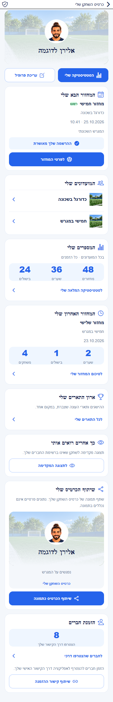

# כרטיס שחקן — עצמי, שחקן אחר ואורח — הסבר קצר

## הרחבת אבחון דיווחים, 27.10.2026

הדיווחים יוכלו לכלול מה ניסו לבצע, מה היה מצב האפליקציה ומה החזיר השרת. פרטים חסרים מוצגים כלא ידועים, ומספר מוגבל של מופעים נשמר בלי למחוק את המופע הראשון. השינוי מקומי וטרם הופץ, ואינו משלים פרטים לדיווחים ישנים. [היקף, ראיות ומגבלות](../../changes/2026-10-27-diagnostic-context.md).

בדיקות הקוד הושלמו, אך השינוי עדיין מקומי ולא הופץ. פרטים שלא נאספו בדיווחים ישנים אינם משוחזרים בדיעבד.

## טיפול מלא בפריטי הפולס הפתוחים, 27.10.2026

הושלם סבב טיפול בפריטי הפולס עם תיקונים ותוצאות מחקר מוכנות לביקורת. פריטים שלא תוקנו נשארים פתוחים עם הסבר וצעד הבא. לא בוצעה הפצה או בדיקת מכשיר חדשה. [ממצאים, בדיקות ומסירה](../../changes/2026-10-27-pulse-completion.md).

## טיפול בתקלות הפולס, 26.10.2026

נבדק שינוי ממוקד במקור משותף במהלך טיפול בתקלות הפולס. אין שינוי נוסף בפעולות הפיצר המתואר כאן.

השינוי מקומי וטרם הופץ. [בדיקות, מסירה ומגבלות](../../changes/2026-10-26-pulse-fixes.md).

## קישורי שיתוף בדומיין החדש - 26.10.2026

שיתוף הקישור האישי מכרטיס השחקן משתמש כעת בקישור קצר בדומיין החדש. אם החשבון משתנה בזמן ההמתנה, הודעת השיתוף אינה נפתחת עבור החשבון הקודם.

השינוי מקומי וטרם הופץ. הבדיקות, מסלולי הנתונים ומגבלות האימות מפורטים ב[דוח השינוי](../../changes/2026-10-26-share-domain.md). אין כאן אימות חדש של כל מצבי המסך.

## ביטול פעילות אחרי מחיקת מועדון - 26.10.2026

מחיקת מועדון עוצרת כעת את המחזורים השבועיים שלו, ובשרת נוספה הגנה שמונעת פתיחת מחזור למועדון שכבר נמחק. הטיפול מבטל מחזורים שטרם הסתיימו, דוחה בקשות חברות ממתינות, מסיר הרשמה להתראות ואת כרטיס המועדון הציבורי. נתוני עבר והישגים אישיים נשמרים. תיקון השרת נפרס ואומת באישור הבעלים. הסדרה שנותרה כובתה, ההרשמה להתראות והכרטיס הציבורי הוסרו; המחזור עצמו כבר לא היה קיים בבדיקה העדכנית. עצירת הסדרה המוקדמת בצד הלקוח תיכלל בבינארי עתידי. נשמרה ההיסטוריה. [המימוש, בדיקת השאריות ומגבלות האישור](../../changes/2026-10-26-deleted-club-recurring.md).

## השפעת מקור משותף במשימת השעון - 26.10.2026

במקור המחזורים המשותף תוקן שימור זמן הריצה בזמן עצירת רוטציה ומעבר למשחק הבא. קריאת נתוני הצמד וכרטיס השחקן אינה מקבלת נתוני גוף חדשים בעקבות שינוי הרוטציה. לא נערכה כאן בדיקה חדשה של כל מצבי המסך. השינוי מקומי, ומצב ההפצה ומגבלות הבדיקה מפורטים בדוח המקושר. [היקף המימוש, הבדיקות, מגבלות האישור והצילומים](../../changes/2026-10-26-android-personal-activity.md).

## הפצה פנימית 1.1.61 - 25.10.2026

הבינארי `1.1.61/295` הופץ ואומת במסלול הפנימי באנדרואיד. תיקוני הלקוח נכללים בו, ושירות הפרופיל נפרס ואומת בנפרד. גם תיקוני הסגל, שמירת התוצאה והתראת השגיאה בשרת נפרסו ואומתו באישור מפורש. שינויי יישום הפולס עצמו טרם הופצו. אין שינוי כללי הרשאה או הסבת נתונים. ניסוחי המצב המקומי בסעיפים הקודמים נכתבו לפני ההפצה; [דוח ההפצה](../../changes/2026-10-25-internal-1.1.61.md) מפרט בדיוק מה נכלל, מה נבדק ומה עדיין מקומי.

## תיקוני הפולס - 25.10.2026

טעינת כרטיס שחקן אחר מקבלת מגבלת המתנה ומתחילה קריאות עצמאיות במקביל בשרת. לא נמדד קיצור זמן במכשיר אמיתי; שינוי השרת מקומי וטרם נפרס.

[מקורות, בדיקות, צילומים ומגבלות](../../changes/2026-10-25-pulse-fixes.md).

## הפצה פנימית 1.1.60 - 25.10.2026

נכלל בגרסה הפנימית `1.1.60/294`. שירותי הפנדלים במהלך משחק נפרסו ואומתו, לרבות שמירת הפירוט וארכיון העונות. הייצור בחנות נשאר `1.1.57/291`. הסעיפים ההיסטוריים שמתארים מימוש מקומי קדמו להפצה זו. אין בסבב ההפצה בדיקת התקנה, משחק מלא מול שרת או צילום ממשק חדש. [מקור מדויק, בדיקות וקבלות](../../changes/2026-10-25-internal-1.1.60.md).

## הכדורגל שלי בעמוד הראשון של הקרוסלה - 25.10.2026

אפשר לפתוח את כרטיס השחקן שלי גם מהעמוד הראשון בקרוסלה האישית בבית, לצד הכפתור הנפרד לסטטיסטיקה. הכפתור פותח את הכרטיס שלך ושומר על החזרה לבית. התוספת מקומית ונבדקה באימולטור עם נתוני המחשה; טרם הופצה. [בדיקות ומגבלות](../../changes/2026-10-25-home-profile-carousel.md).

## שעון מדויק וכיתוב פנדל - 25.10.2026

במקורות המשותפים נוסף שימור השעון המדויק של פנדל במהלך משחק, וכיתוב ההבקעה ביומן קוצר. אין שינוי במונים או בתהליך העצמאי המתואר כאן; לא נערכה לו בדיקת ממשק חדשה במסגרת העדכון. השינוי מקומי וטרם הופץ. [פרטים וראיות](../../changes/2026-10-25-in-play-penalties.md#שעון-מדויק-וכיתוב-אירוע).

## פנדל במהלך משחק חי - 25.10.2026

עודכנו מקורות משותפים לצורך פנדלים במהלך משחק. אין שינוי מכוון בתהליך העצמאי המתואר במסמך הזה, ולא נערכה לו בדיקת ממשק חדשה במסגרת המשימה.

השינוי מקומי. נדרשת פריסת שרת לפני הפצת לקוח שמשתמש באפשרות; לא בוצעו פריסה או שינוי הרשאות. [חוזה הנתונים, התהליך, הבדיקות ומגבלות ההפצה](../../changes/2026-10-25-in-play-penalties.md).

## חזרה מארון התארים לכרטיס המקורי — 24.10.2026

פתיחת ארון התארים מהכרטיס העצמי וחזרה ממנו מחזירות לאותו כרטיס ולאותה לשונית. הארון נוסף לערימות המועדונים, המחזורים והשיחות, ונפתח כמסך חדש מעל הכרטיס גם אם ביקרו בו קודם. החץ וחזרת אנדרואיד אומתו באימולטור מתוך מועדון; שאר המארחים נבדקו בנתב. מקומי וטרם הופץ. [מסלול הניווט, בדיקות, צילומים ומגבלות](../../changes/2026-10-24-cabinet-back.md).

## סיכום המחזור מכרטיס השחקן — 24.10.2026

הכפתור ״לסיכום המחזור שלי״ בכרטיס העצמי פותח את פרטי המחזור האחרון ובוחר את לשונית הסטטיסטיקה כאשר היא זמינה לפי תנאי המחזור והגישה הקיימים. אין מעבר דרך מסך הסיכום האישי הנפרד. התיקון מקומי וטרם הופץ. [מקור, בדיקות, צילומים ומגבלות](../../changes/2026-10-24-own-card-round-link.md).

## עדכון הפצה פנימית — 24.10.2026

נכלל בגרסה הפנימית `1.1.59/293`, ממקור `7c6f98e`. שני שירותי היסטוריית ההשוואות ועדכון הצבעים בשני נתיבי החלוקה המתוזמנת נפרסו ואומתו. אין היסטוריית השוואות ישנה; רק לקוחות חדשים מתעדים ביקורים. הייצור בחנות נשאר `1.1.57/291`, והכללים נשמרו לתאימות. טענות ״מקומי״ או ״טרם הופץ״ בהמשך מתארות את שלבי הפיתוח שקדמו להפצה זו. [מקור, בדיקות, פריסה ומגבלות](../../changes/2026-10-24-internal-1.1.59.md). אין בסבב זה אימות ממשק או התקנה חדשים.

## מי השווה את עצמו אליי — 24.10.2026

אחרי המחזור האחרון נוסף סקשן פרטי שמציג כמה שחקנים השוו את עצמם אליך וכמה השוואות ביצעו. בכל שורה רואים שחקן, מספר השוואות, תאריך ומועדון של ההשוואה האחרונה; אפשר לבחור 30 ימים או כל הזמנים ולפתוח רשימה מלאה.

אין היסטוריה ישנה שניתן לשחזר: האיסוף יתחיל רק אחרי הפצת הפיצ׳ר ופונקציות השרת. המימוש מקומי וטרם הופץ. [צילום אנדרואיד עם נתוני המחשה](../screenshots/comparison-activity-card-2026-10-24.png) · [מקורות, ספירה ומגבלות](player-card.md).

## כותרת ומחזור קרוב מצומצמים — 24.10.2026

החלק העליון תופס פחות מקום: תמונת הפרופיל והשם הוקטנו. המחזור הקרוב מוצג כמו גרסה קטנה של הכרטיס במסך הבית, עם פרטים מימין, תמונת מגרש משמאל, תג הרשמה ומעבר קצר לפרטי המחזור. יתר הנתונים, המחזור האחרון ואפשרויות השיתוף נשארו בהמשך הגלילה.

המימוש מקומי וטרם הופץ. נבדק וצולם באימולטור אנדרואיד עם נתוני הדגמה. [צילום העיצוב המצומצם](../screenshots/own-player-card-compact-after-2026-10-24.png) · [המידות, האימות והמגבלות](player-card.md).

## הכרטיס העצמי החדש — 24.10.2026

הכרטיס שלך מעוצב עם רקע מגרש וכרטיסיות כמו כרטיס שחקן אחר. המחזור הקרוב שאליו אתה רשום כשחקן מוצג למעלה; בהמשך נמצאים המועדונים שלך, מחזורים ששיחקת בכל הזמנים, שערים ובישולים, והמחזור האחרון שבו שיחקת עם מעבר לסיכום האישי. נתון שלא תועד מוצג כמקף.

בהמשך הגלילה נמצאים ארון התארים, תצוגה מקדימה לשחקן שאינו חבר שלך, שיתוף הכרטיס כתמונה והזמנת חברים בקישור האישי. התמונה המשותפת כוללת מספרים רק כשהסטטיסטיקה מוגדרת לכולם; היא אינה צילום של כל המסך הפרטי. שיתוף הכרטיס הוא תמונה ולא קישור לפרופיל.

המימוש מקומי וטרם הופץ. לאחר בדיקות הקוד ומציג הדפדפן נפתח גם המסך המקורי באימולטור אנדרואיד, עם משתמש ונתוני הדגמה בלבד. נצפו החלק העליון, הנתונים והמחזור האחרון ואזור השיתוף; לא בוצעו קריאת הנתונים החדשה בייצור, בדיקת אייפון או שיתוף בפועל. [פירוט, בדיקות ומגבלות](player-card.md).

[צילום מהאימולטור — החלק העליון](../screenshots/own-player-card-native-top-2026-10-24.png) · [נתונים והמחזור האחרון](../screenshots/own-player-card-native-last-2026-10-24.png) · [שיתוף והזמנה](../screenshots/own-player-card-native-share-2026-10-24.png).

## קיצור טעינה ומניעת קריאות כפולות — 23.10.2026

הכרטיס העצמי מציג את הפרופיל שכבר נטען ומרענן אותו ברקע. בכרטיס שחקן אחר פתיחת חלונית ההזמנות משתמשת בטעינת המחזורים שכבר מתבצעת או הסתיימה לאחרונה. פרטי שחקן אחר עדיין מתקבלים מהשרת לפי הרשאות הפרטיות. השינוי מקומי וטרם הופץ.

[בדיקות, צילומים ומגבלות](../../changes/2026-10-23-screen-loading.md).

## ניסיון חוזר לקריאת מידע זמנית — 23.10.2026

קריאת מידע שנכשלת זמנית יכולה להתבצע פעם נוספת, במקום להיעלם מיד. חשבון שהתחלף מפסיק את הבקשה; כשל מתמשך נשאר כשל ולא מוצג כרשימה ריקה תקינה. השינוי מקומי וטרם הופץ. [פירוט האימות והמגבלות](../../changes/2026-10-23-crash-test-and-pulse-followup.md).

## תלות שעודכנה — 23.10.2026

בדיקת קשר עם שחקן אינה מייצרת דיווח שגיאה עבור בקשה חסרה; התנהגות הכרטיס נשמרת. התיקון מקומי וטרם הופץ.

## תיעוד כשלים — 20.10.2026

נוסף תיעוד אוטומטי לנקודות כשל במסלול הזה, עם מקור התקלה. הפעולה המקורית שומרת על ערכי החזרה והודעות השגיאה שלה. השינוי מקומי, טרם הופץ, ואין אימות מסירה חיה לפולס.

[דוח דיווח השגיאות והראיות](../../changes/2026-10-20-error-reporting-audit.md).

## עדכון מקומי — 10.10.2026

אם עדכון ההישגים בכרטיס שלכם נכשל, המדליות שכבר קיבלתם נשארות. תוכלו לנסות שוב, והתקדמות מספרית תוצג רק כשיש נתון עדכני. התיקון נבדק בקוד מבודד, ולא בתקלת רשת במכשיר.

כרטיס שחקן מציג את הפרופיל שלו ואת המידע הרלוונטי למשחקים שלכם. אפשר לבקש חברות, לשלוח הודעה או לראות נתונים משותפים בהתאם להקשר.

[לפירוט הטכני](player-card.md)

הצילום מדגים את המראה בסביבת בדיקה, ולא מוכיח פעולה מול הנתונים האמיתיים.

## שיפור תגובה בגלילה — 9.10.2026

צומצמה עבודה מיותרת של אנימציות ותמונות. מספרים מתייצבים בזמן גלילה, ואנימציות רקע מחזוריות נעצרות כשעוברים למסך אחר. הנתונים, סדר התוכן והניווט נשארים כפי שהיו. הבדיקה בוצעה באימולטור אנדרואיד עם נתוני דמו; טלפון פיזי ואייפון לא נבדקו.

## תיקוני עיצוב ונגישות — 10.10.2026

מקור: `a348b9f235f1e1433497600555303231512a0834` עם שינויים מקומיים. אין בסעיף זה הוכחת גרסת חנות.

בפעולות החברות וההודעה האייקונים מופיעים משמאל לטקסט באותה שורה.

## עדכון 11.10.2026

נוספה לשונית ״חברים״ שמרכזת שיחות וחיפוש שחקנים. הפרופיל הקיים חודש, עם זמינות, מועדונים וסטטיסטיקה לפי הבחירה בפרטיות. הודעות חדשות מיועדות לחברים בלבד. [הסבר פשוט לפיצ׳ר](../profile/player-discovery.simple.md). השינוי מקומי וטרם הופץ; השלמת ההרשאות אושרה ומומשה, והפריסה טרם בוצעה.

### השלמת הרשאות מקומית — 11.10.2026

הודעות חדשות דורשות חברות הדדית וללא חסימה. מידע אישי מוגבל לפי פרטיות, ושמות ותמונות בסגלים ובשיחות נשמרים. הכללים וההתאמות הושלמו לאחר אישור; טרם הופץ.

## ליטוש תקציר הפרופיל — 11.10.2026

בפרופיל של שחקן אחר הוסרו ממוצע הציונים והגרף מהתקציר. מחזורים, שערים ובישולים מוצגים בשלושה אריחים עם אייקונים וצבעים עדינים. מסך הסטטיסטיקה המלאה והגדרות הפרטיות נשמרו. נצפה באימולטור אנדרואיד עם נתוני המחשה; [התנהגות וראיות](player-discovery.md).

## תיקון טעינה — 12.10.2026

מידע שהתחיל להיטען בחשבון קודם אינו מתקבל אחרי מעבר לחשבון אחר. זהו תיקון מקומי שטרם הופץ.

## תלות בעדכון העונות — 19.10.2026

קובץ תשתית משותף עודכן במסגרת העונות. שינוי זה אינו מוסיף פעולה חדשה למסך המתואר כאן; פרטי העונות והבדיקות מופיעים במסמך העונות.

[מצב המימוש, הבדיקות ומגבלות האימות של העונות](../clubs/seasons.md). מקומי בלבד; לא בוצעה פריסה במסגרת המשימה.

## תלות במידע על סגירת עונה — 23.10.2026

נוסף מידע משותף שמאפשר להסביר מדוע עונה מתעכבת בסגירה. אין שינוי נוסף בפעולות המתוארות כאן; השינוי מקומי וטרם הופץ. [המסלול, הבדיקות והמגבלות](../../changes/2026-10-23-season-automatic-recovery.md).

## בידוד מונה בקשות והתאוששות מרקע — 23.10.2026

ספירת בקשות הצטרפות אינה ממתינה יותר לדירוגי השחקנים במועדונים. מסך הבית טוען את המונה מחדש בחזרה מרקע ומתעלם מתוצאה ישנה שמגיעה אחריה. כשל אמיתי בקריאת הבקשות נשאר כשל ושומר את הספירה האחרונה; אין שינוי בעיצוב. נבדק בבדיקות קוד, מקומי וטרם הופץ. [הסבר, יומני שרת ומגבלות](../../changes/2026-10-23-inbox-resume.md).

## עדכון תלות משותפת בקריאות מידע — 23.10.2026

בקובצי השירות המשותפים נוספה אפשרות מפורשת לניסיון חוזר אחד בקריאה זמנית שנכשלה, תוך עצירה אם החשבון מתחלף. החיבור מוגבל ל־14 נקודות קריאה המפורטות בדוח; אין כאן טענה שכל פעולה בפיצ׳ר קיבלה ניסיון חוזר או שנבדק מסך חדש. בדיקות המאגר המלאות עברו (5,261 בדיקות ב־472 חבילות), אך אינן הוכחת הרצה במכשיר. הקוד מקומי וטרם הופץ. [מסלול, ראיות ומגבלות](../../changes/2026-10-23-four-open-errors.md).

## עדכון מסבב הפולס — 23.10.2026

תוקנה הצגת זמינות ישנה בכרטיס שחקן, פריסת הטקסט בקרוסלת הטיפים ועיצוב חלונית שמירת העונה. נוסף טיפול מוגבל בתקלות זמניות בטעינת מועדונים ובספק הכתובת באנדרואיד. אלו שינויים ברכיבים משותפים; לא כל פעולה במסך השתנתה. התיקונים מקומיים וטרם הופצו. [בדיקות, צילומים ומגבלות](../../changes/2026-10-23-pulse-resweep.md).

## תלות בשמירת צבעי המחזור — 24.10.2026

שמירת המידע המשותפת עודכנה כדי להעביר את צבעי הקבוצות ממסכי הכוחות להכנה וללייב. אין תוספת פעולה במסך הזה, והוא לא נבדק מחדש במכשיר במסגרת התוספת. השינוי מקומי וטרם הופץ. [פרטי התוספת ומגבלות הבדיקה](../rounds/draft-setup.md#צבעים-לפני-שיבוץ-ובכל-שיטת-חלוקה--24102026).

## תלות בעריכת קבוצות בלייב — 24.10.2026

בקובץ השירות המשותף נוסף מסלול לעריכת הקבוצות והתור במשחק חי, כולל איפוס המשחק הנוכחי בלבד בעת החלפת קבוצה. לא שונו מסלולי הפיצ׳ר הזה במסגרת התוספת ולא בוצע לו אימות מסך חדש. [מסלול השינוי, הבדיקות והמגבלות](../rounds/live-advanced.md#עריכת-הקבוצות-והתור-בזמן-הלייב--24102026). מקומי וטרם הופץ.

## בדיקת עומק לעריכת הקבוצות — 24.10.2026

בקובץ השירות המשותף תוקן שימור זהות המשחק במחזור ישן בעת שינוי תור בלייב. הדיווח על הצלחת החלפה נשלח כעת רק אחרי שמירה. מסלולי הפיצ׳ר הזה לא שונו ולא בוצעה לו בדיקת מסך חדשה. כל 5,496 בדיקות הפרויקט עברו; אין בכך הוכחת מסד חי או הפצה. [הראיות ומגבלות הבדיקה](../../audits/2026-10-24-live-teams.md). מקומי וטרם הופץ.

## דיווחים ושגיאות וסגירה לפי גיל — 24.10.2026

בכרטיס העצמי סמלי כפתורי הפעולה מוצגים משמאל לטקסט, כולל הסטטיסטיקה, עריכת הפרופיל ושני כפתורי השיתוף. אין שינוי בפעולות הכפתורים.

[מקור הדיווחים, הבדיקות ומגבלות הסבב](../../changes/2026-10-24-pulse-age-pass.md). השינויים מקומיים וטרם הופצו.

## התאמת בדיקת המקור המשותפת בלילה של 25.10.2026

עודכן אופן הפעלת בדיקת מקור משותפת בעקבות קיצור טעינת הסטטיסטיקה. אין שינוי נוסף בפעולות המתוארות כאן, והן לא נבדקו מחדש במכשיר בסבב הזה. [בדיקות ומגבלות](../../changes/2026-10-24-loading-performance.md).

## המשך קיצור טעינות בלילה של 25.10.2026

עודכנו קריאות מידע משותפות או מתאם הבדיקה שלהן כדי לצמצם טעינות מיותרות. אין שינוי נוסף בפעולות העצמאיות המתוארות כאן, ואין אימות מכשיר חדש שלהן בסבב הזה. [בדיקות, ראיות ומגבלות](../../changes/2026-10-24-loading-performance.md).

## קריאת זהויות בסגל גדול - 25.10.2026

בסגלים גדולים ממאה שחקנים, חלקי רשימת השמות יכולים להיטען במקביל במקום בזה אחר זה. סדר הנתונים ובדיקת החשבון נשמרים, וכשל אינו מוצג כרשימה חלקית תקינה. נבדק בקוד; התיקון מקומי וטרם הופץ, ללא מדידת זמן במכשיר. [בדיקות, ראיות ומגבלות](../../changes/2026-10-24-loading-performance.md).

## תגובה מיידית לכפתורי השעון - 25.10.2026

עודכן רכיב השעון המשותף למסכי הלייב. אין שינוי מכוון בהתנהגות הפיצר המתואר כאן. [בדיקות, ראיות ומגבלות](../../changes/2026-10-25-live-timer-response.md). התיקון מקומי וטרם הופץ.

## תלות בניווט עריכת קבוצות - 25.10.2026

נבדק השינוי הממוקד במקורות המשותפים: `src/navigation/CommunitiesStack.tsx`, `src/navigation/GameStack.tsx`. נוסף מעבר מתפריט הלייב לחלוקת הכוחות עם שימור מפתח מסך המקור. אין שינוי נוסף בתהליך העצמאי המתואר כאן ולא נערכה לו בדיקת מסך חדשה. [היקף, בדיקות ומגבלות](../../changes/2026-10-25-live-draft-entry.md).

## תאימות לשמירת פקודת רכיב הבית - 25.10.2026

נוספה הגנה פנימית מפני ביצוע חוזר של פעולת רכיב הבית. התהליך המתואר בעמוד זה לא השתנה במכוון, ונתונים ישנים נשארים נתמכים. התיקון מקומי וטרם הופץ. [מקור הבדיקה והמגבלות](../../changes/2026-10-25-widget-completion.md).
