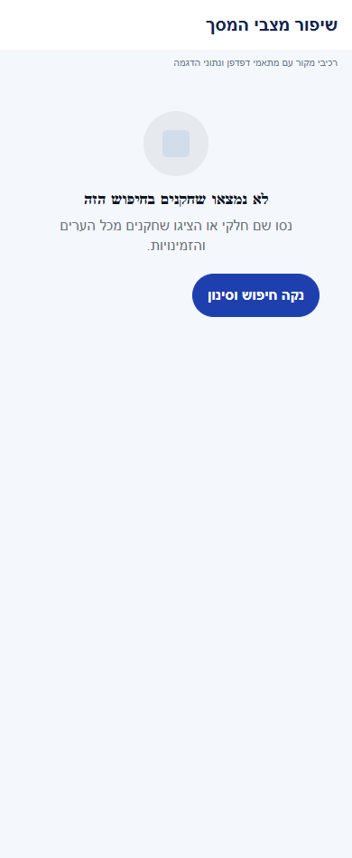

# חברים, גילוי שחקנים ופרטיות

## עצירת מחזור קבוע ללא פעילות, 6.11.2026

נבדק השינוי התחום ב-`functions/src/index.ts`: בדיקת חוסר פעילות לפני יצירת מחזור קבוע ושמירת שלוש החלטות בזמן ניקוי מחזורים ריקים. ההכרעה משתמשת במקור הקיים לקיום מחזור ומגינה על מחזור עם הרשמה שנותר לא מוכרע. עסקאות היצירה והניקוי נשארות מוגנות מפני שינוי מקביל ומועדון חסר. אין שינוי מכוון בחישובים, במכנים, בהרשאות, בניווט או בפעולות העצמאיות האחרות של הפיצר הזה. בדיקות מקור השרת הורצו במאגר זיכרון; הפריסה הממוקדת של שני שירותי התזמון אומתה בייצור מול המקור שנבדק, ותועדה הרצת שירות חמש הדקות ללא שגיאות. אין בכך אימות חדש של המסך או של יתר פעולות הפיצר. [ההתנהגות, מסלול הנתונים, הבדיקות ומגבלות ההפעלה](../../changes/2026-11-06-inactive-recurring-rounds.md).

## דירוג בסיס לשחקן ללא דירוג, 6.11.2026

נבדק שינוי תחום במקורות המשותפים של הכוחות האוטומטיים: שחקן ללא דירוג מחושב כ-2.5 מתוך 5, וההסברים תואמים. דירוג מפורש נשמר. אין כאן אימות חדש של כל מצבי הפיצר העצמאי; השינוי מקומי וטרם הופץ. המקורות המשותפים שנבדקו בהפרש זה: `functions/src/index.ts`. [ההתנהגות, הבדיקות ומגבלות האימות](../rounds/draft-setup.md#דירוג-בסיס-לשחקן-ללא-דירוג-6112026).

## מדידת פעולות ואמינות נתונים, 5.11.2026

במיפוי מקור הרכיבים המוזכרים במסמך נמצאו 34 נקודות מטפל ו-34 מזהי פעולה. הספירה מתארת קוד וכוללת רכיבים משותפים; אין לחבר אותה לספירות של מסמכים אחרים ואין לראות בה הרצת כל המסך. המדידה מפורטת לפי גבול פקד מקורי, פעולה עסקית ומצב חשבון. תשובה מאוחרת נבדקת מול בעל הפעולה, ומצב קיים או בקשה חוזרת אינם תמיד הצלחה חדשה. רשימת המקרים שהורצו ומגבלות המסד, המכשיר והכיסוי נשמרות [בדוח המדידה](../../audits/2026-11-04-system-night/product-measurement.md) ובדוחות המקושרים אליו. המימוש מקומי; לא בוצעה בדיקה חדשה של כל מצבי הפיצר.

## מדידה מול הייצור, 4.11.2026

בייצור פעילים מעדכן השמות וחיפוש הגרסה השנייה. לפני הפעלת המפתח ואחריה נמצאו 777 מתוך 777 חשבונות זכאים, ללא שמות חסרים או עודפים. קריאת לקוח ישירה נדחתה, וסמן של לקוח קודם המשיך לעמוד הבא. באמולטור מול השרת התקצר החציון לחיפוש השם שנבדק מ-2.479 ל-1.230 שניות. [מדידות, בדיקות ומגבלות](../../changes/2026-11-04-player-discovery-production.md).

## חיפוש שחקנים וזמני טעינה, 4.11.2026

כאשר פעולת חברות הושלמה בזמן שיש בקשת עימוד פעילה, התשובה הישנה נפסלת והעמוד נבדק מחדש. כך עמוד שהתחיל לפני אישור חברות אינו מחזיר את הכפתור למצבו הקודם.

המסך משתמש ב-`src/hooks/usePlayerSearch.ts` עבור פתיחה, המשך אוטומטי בעמודים ריקים, ניסיון חוזר לפי סוג הכשל ושחזור טווח הקריאה. `functions/src/socialDirectory.ts` מתחזק מפתח פרטי לשמות. `functions/src/socialPlayers.ts` מאמת הרשאות וחסימות ומתאים את מקור המועמדים לכוונה. מצב הקשר מגיע עבור כל שורה. מעבר חשבון מסלק את החיפוש הקודם. חישובי מחזורים משותפים, סינון יום ושעה, ההתאוששות והמדידות מפורטים במסמך השינוי. מימוש מקומי שטרם הופץ. [השינוי, המדידות והבדיקות](../../changes/2026-11-04-player-discovery-speed.md). [לפני](../screenshots/discovery-speed-search-before-2026-11-04.png) ו[אחרי](../screenshots/discovery-speed-search-after-2026-11-04.png).

## חיפוש שחקנים בגופן מוגדל, 4.11.2026

שלושת המסננים בראש רשימת השחקנים עוברים לשורה נוספת כאשר הכיתובים אינם נכנסים יחד לרוחב המסך. לכל מסנן מוקצה לכל היותר רוחב הרשימה.

ב-`PlayerDiscovery`, כאשר רוחב החלון חלקי מקדם הגופן קטן מ-355 נקודות, כפתור החברות עובר מתחת לזהות השחקן ומקבל את מלוא רוחב הכרטיס. בשאר המצבים נשאר הכפתור לצד השחקן ורוחבו המרבי גדל עם הגופן. התווית בתוך `FriendActionButton` יכולה להישבר לשורות לפי רוחב הכפתור.

שדה החיפוש והמסננים מוצגים בכותרת הרשימה לכל אורך השימוש. כאשר גובה החלון חלקי מקדם הגופן קטן מ-440 נקודות, הכותרת נגללת עם התוצאות. בחלון גבוה יותר היא נשארת נגישה בראש הרשימה. בזמן הקלדה הכותרת שומרת על מצב הגלילה שלה כדי ששינוי בגובה החלון עם פתיחת המקלדת לא יחליף את שדה החיפוש. בחלון הסינון, שעות היום וכפתורי ההצגה והניקוי יכולים לרדת לשורות נוספות. עברו בדיקות הדפדוף והרענון של חיפוש השחקנים.

במדמה אנדרואיד ברוחב 320 ובגופן 200%, אחרי גלילה קצרה של הרשימה נראו שלוש הפעולות "הכל", "החברים שלי" ו"סינון" במלואן. [מסנני גילוי השחקנים](../screenshots/font-layout-search-2026-11-04.png).

## בדיקת התהליך והמהירות, 4.11.2026

בחיפוש הפעיל נמדדו 161 בקשות מוצלחות בחציון של 0.75 שניות, ובכרטיס שחקן 45 בקשות בחציון של 3.79 שניות, בשבעת הימים שהסתיימו ב-3.11. במסד הדגמה עם 400 מסמכים נדרשו עשרה עמודים לשם מאוחר וכן למציאת חבר יחיד. שוחזרו ניסיון חוזר שעובר לעמוד הבא במקום לרענן את הראשון ואובדן החיפוש במעבר לשיחות. נמצאה גם אי התאמה בין טבלת הזמינות לבין הסינון לחשבונות עם נתונים ישנים. אלה ממצאי מחקר. [המקורות, המדידות, ההמלצות וגבולות האימות](../reviews/player-discovery-audit-2026-11-04.md).

## ציר פעילות פרטי בפולס, 4.11.2026

בציר הפעילות, תשובת שרת על מצב הרשמה קיים אינה נספרת כהרשמה חדשה. קבלה ללא סימון יצירה מפורש מוצגת עם מגבלת אמינות.

נבדקו התוספות במקורות המשותפים לצורך ציר פעילות פרטי בפולס: דיווח ניווט והקשר, תיעוד ניסיון הרשמה ותוצאתו וגבולות זהות ומחיקת חשבון. התוספת היא תיעוד ברקע במקומות הנתמכים; אין מכך אימות חדש של כל מצבי הפיצר הזה או שינוי בחישוביו. מקומי וטרם הופץ או נפרס. [היקף, מקורות, בדיקות ומגבלות](../shared/usage-activity.md).

## השפעת שיפורי הטעינה המשותפים, 4.11.2026

קריאות חופפות לזהויות שחקנים או לדירוגי מועדון חולקות עבודה פעילה באותה התחברות. שמירת פרופיל או דירוג מבטלת שיתוף קודם, ולא נשמרת תשובה שהושלמה לשימוש חוזר. אין שינוי במקור הרשאות או בחוזה הנתונים העצמאי של הפיצר.

מקורות משויכים שנבדקו בהיקף השינוי: `src/services/clubAdminRatings.ts`, `src/services/publicPlayerService.ts`.

מימוש מקומי וטרם הופץ. אין בכך אימות מכשיר חדש של הפיצר הזה או מדידת מהירות של כל מסלוליו. [המדידות התחומות, הבדיקות והמגבלות](../../changes/2026-11-04-screen-performance.md).

## הפצה פנימית 1.1.74, 3.11.2026

עדכוני הלקוח ב-`src/components/ReadStatusNotice.tsx`, `src/components/loading/CentralSkeletons.tsx`, `src/hooks/useRoundChanges.ts`, `src/services/roundVisitService.ts`, `src/utils/photoPhase.ts`, `src/utils/roundVisit.ts`, `src/components/social/PlayerDiscovery.tsx`, `src/components/social/SocialPlayerProfile.tsx` כלולים בחבילה הפנימית 1.1.74/306. ארכיון המקור המקומי וחתימת החבילה אומתו מול החבילה שהחזירה גוגל. מקור הבסיס הוא `06417f6132f4c7636aaee25574354ed7722966b9` עם שינויים שלא נשמרו לגיט.

עברו 6864 בדיקות יישום, בדיקות טיפוסים, 360 בדיקות הרשאות בסדרה ו-38 בדיקות שרת במסד הדגמה. ההרשאות והשירותים הפעילים נשמרו, ללא הסבת נתונים או קידום לייצור. האימות החזותי הוא מצילומי המקור בדפדפן שכבר תועדו, ללא התקנה או הרצת הפיצר הזה במכשיר בגרסה החדשה. אין בכך הכרזה על הפצת שינויים אחרים המתועדים במסמך. [מקור, קבלות, תכולה ומגבלות](../../changes/2026-11-03-internal-1.1.74.md).

## מצבים ריקים והמשכיות פעולה, 3.11.2026

חיפוש שחקנים ללא תוצאה מציע להרחיב את החיפוש. רענון באותו חיפוש שומר את השחקנים שכבר הוצגו, ומעבר לחשבון או חיפוש אחר מסתיר את התוצאה הקודמת.

מקורות משויכים שנערכו: `src/components/social/PlayerDiscovery.tsx`.

ההתנהגות, טבלת המצבים, מסלול הנתונים, בידוד הזהות, ניווט, שמירת שישים ביקורי מחזור מקומיים, השהיית חיווי של שש שניות ושלבי התמונה מתועדים ב[דוח השינוי](../../changes/2026-11-03-experience-followup.md). מקורות המנגנונים: `src/components/ReadStatusNotice.tsx`, `src/hooks/useRoundChanges.ts`, `src/services/roundVisitService.ts`, `src/utils/roundVisit.ts`, `src/utils/photoPhase.ts`. אין שינוי בחישובים, במכנים או בהרשאות. חיווי עיכוב אינו הוכחה להתנתקות ואינו אישור כתיבה; אין מטמון תוכן קבוע חדש.

המימוש מקומי. נבדקו עשרים ושניים מצבי מקור ושני אזורי השוואה ב-72 בדיקות רוחב בדפדפן. תמונות וסמלים הוחלפו במצייני מקום; מצב עיכוב מוזן למתאם והתזמון נבדק בקוד. אין אימות מכשיר, שרת חי או מסך מלא חדש.

תוצאות האימות בסבב זה: כל 6864 הבדיקות ב-614 חבילות ובדיקת הטיפוסים עברו. בדיקות המצבים הממוקדות עברו ב-83 מקרים. נבדקו 72 פריסות של אזורי מקור בדפדפן, ונבדקה כיווניות בצילומים. אין אימות מכשיר או שירות חי חדש.

## הרחבת טעינת השלד במסכים מרכזיים, 3.11.2026

נבדק ההפרש התחום במקורות המשותפים בלבד. השלד יושב בענפי ההמתנה הקיימים; סוגי השלדים נמצאים ב-`src/components/loading/CentralSkeletons.tsx`. מצבי כשל, ריק, פרטיות והחלפת הקשר נשארים נפרדים. אין שינוי בשירותים, בחישובים, במכנים או בהרשאות. ההמתנה ברענון לוח המנהל שומרת מידע שכבר התקבל עבור אותו חשבון ומועדון; בכרטיס האישי נשמר מנגנון הקריאה הקיים, לרבות איפוס חלקיו בתחילת ביקור.

מקורות משויכים שנערכו: `src/components/social/SocialPlayerProfile.tsx`.

[טבלת המבנים, תנאי ההכרעה, מסלול הנתונים, הבדיקות והמגבלות](../../changes/2026-11-03-central-screen-skeletons.md). מקומי וטרם הופץ. האימות החזותי תחום לאזורי מקור עם מתאמי דפדפן, ללא אימות מכשיר או שרת חי חדש.

בדיקות במשימה זו: 6,831 בדיקות ב-609 חבילות ובדיקת טיפוסים עברו. נבדקו 25 מצבי מקור ב-162 בדיקות רוחב, ובוצעו תשע השוואות מידות לרכיבי תוכן. אין בכך אימות מכשיר חדש של הפיצר או של מצבים שאינם כלולים בדוח.

## תיקוני דיווחי הפולס, 3.11.2026

נבדק ההפרש התחום ב-functions/src/index.ts, באתר index:20a83f91b9 בלבד: קוד כפילות של joinCredited נבדק לפני observeCaughtError. הסמן וההגדלה נשארים אטומיים, ושגיאות אחרות נשארות נצפות. אין שינוי מכוון בחישובים, במכנים, בניווט או בהרשאות של הפיצר המתואר כאן. בדיקת הלולאה הממוקדת מתועדת ב-shared/data-and-state-contracts; אין כאן בדיקת מסך או מסלול ייצור חדש של הפיצר הזה. getRelationship וגבולות הניסיון החוזר מתועדים ב-profile/friends; אין נתון ריק במקום כשל מתמשך ואין הוכחת מכשיר.

[פירוט התיקונים, הבדיקות, הצילומים והמגבלות](../../changes/2026-11-03-pulse-sweep.md).

## העברת אורח לרשימת המתנה, 3.11.2026

נבדק ההפרש הממוקד במקור המשותף `functions/src/index.ts`: תנאי `guestSeatFreed` ב-`onGameRosterChanged` מבחין כעת בין הסרת אורח פעיל לבין העברה ידנית להמתנה. אין שינוי מכוון בחישובים, בנתונים, בניווט או בפעולות העצמאיות של הפיצר המתואר כאן. בדיקות גילוי העזיבה והקידום מכסות את השינוי המשותף; אין בדיקת מסך חדשה לפיצר זה. התיקון מקומי וטרם נפרס או הופץ.

[היקף, בדיקות ומגבלות](../../changes/2026-11-03-guest-waitlist.md).

## ליטוש מקומי והשפעת רכיבים, 3.11.2026

השפעה עקיפה דרך `ScreenHeader`: רק פעולות נוספות המועברות ב-actions נחשפות ככפתורים בעלי שם, עם סמל ותג דקורטיביים. אין שינוי בנתונים או בכללי הפעולות העצמאיות של הפיצר. לפירוט הנעילה, הנתונים, הכשל וגבולות ההרצה ראו [חוזי הרכיבים המשותפים](../shared/menus-and-motion.md). אין כאן טענה שכל זרימת חברים, גילוי שחקנים ופרטיות הורצה.

השינוי מקומי וטרם הופץ. אין כאן אימות חדש של מסך מוצר מלא, מכשיר, קורא מסך או שרת. [הראיות והמגבלות של המשימה](../../changes/2026-11-03-overnight-mission.md).

## הרחבת שלדי הטעינה, 2.11.2026

נבדק ההפרש התחום במקור או בבדיקה המשותפים. השינוי מוסיף מציגי טעינה או חושף לשימוש חוזר את בסיס השלדים; בדיקות החברים כוללות כעת סמן תשובה מוכן, ובכשל בודקות שרשימה קיימת אינה נדרסת ואין סימון של תשובה ריקה מוצלחת. תנאי הרשאות, כתיבות, חישובים, מכנים, פעולות וניווט של הפיצר העצמאי נשמרו. כותרת מצב ורענון אינן אישור חדש לתקינות הפיצר כולו או למכשיר. מימוש מקומי שטרם הופץ. [התנהגות, בדיקות, צילומים ומגבלות](../../changes/2026-11-02-loading-skeletons-expanded.md).

## אימות פרסום קבוצות בפולס, 2.11.2026

נבדק ההפרש התחום בשירות המשותף של המחזורים: נוספה בדיקת אישור לפרסום קבוצות כאשר תשובת הפעולה אובדת. אין שינוי בחישוב, במכנים או בפעולות העצמאיות של הפיצר המתואר כאן. התיקון מקומי וטרם הופץ; אין בדיקת מכשיר חדשה לפיצר זה.

השינוי ב-`src/services/gameService.ts` מוגבל ל-`publishDraftTeams` ולתלות בסיווג כשלים זמניים. נבדקו גבולות קבלת השרת, התאמת החשבון והחלוקה, ושימור השגיאה כאשר האימות נכשל. `tests/logic/publishTeamsReceipt.test.ts` מפעיל את פונקציית השירות מול תחליפי קריאה וכתיבה; אין בכך הרצת כל המסלולים של המסמך הזה.

[דוח הטיפול, הבדיקות והמגבלות](../../changes/2026-11-02-pulse-sweep.md).

## בקשות לשיחה אישית, 2.11.2026

אפשר לפנות גם לשחקן שאינו חבר באמצעות בקשת שיחה. הגדרת קבלת בקשות נפרדת מגילוי ומסטטיסטיקה; משתמשים קיימים ללא בחירה מוכחת צריכים לבחור במפורש. המימוש מקומי וטרם הופץ או נפרס. [התנהגות, בדיקות ומגבלות](../chat/message-requests.md).

מקורות משותפים שנבדקו בהיקף השינוי הזה: `functions/src/index.ts`, `functions/src/socialPlayers.ts`, `src/components/social/SocialPlayerProfile.tsx`, `src/firebase/firestore.ts`, `src/screens/profile/SocialPrivacyScreen.tsx`, `src/services/socialPlayersService.ts`, `src/types/index.ts`. אין בסעיף זה טענה להרצת כל המסלולים ההיסטוריים של הפיצר. [מסירת המימוש](../../changes/2026-11-02-message-requests.md).

## הסרת מגבלת החברים במועדון, 1.11.2026

נבדקה השפעת השינוי הממוקד במקורות המשותפים: הוסרה מגבלת החברים במועדון. אין שינוי מכוון בהתנהגות העצמאית של המסך המתואר כאן או במספר המקומות במחזור. התיקון מקומי וטרם הופץ; אין בדיקת מכשיר חדשה לפיצר זה.

מקורות ששונו בהיקף המשימה: `functions/src/index.ts`, `functions/src/socialPlayers.ts`. מספרי החברים אינם משמשים עוד כתנאי תפוסה במועדון. שדות התאימות הישנים אינם נאכפים.

[מסלול הנתונים, התנאים, התאימות, הבדיקות ומגבלות ההפצה](../../changes/2026-11-01-unlimited-club-members.md).

## פריסת הגנות הסרת המחזור, 30.10.2026

נפרסו שבע חבילות מבודדות, ועדכון המקור בלבד אומת מול כל הקבצים הפעילים. הגדרות השירותים והאירועים ו-111 השירותים האחרים נשמרו. אומתו מוכנות ותעבורה לגרסאות החדשות, קריאה עצמית עם חשבון בדיקות קיים ושימור גרסאות כל 496 המסמכים שבגיבוי. שש דחיות בקשות דפדפן לא תקינות סווגו לפי מזהי בקשה; לא זוהה כשל ריצה עסקי בלתי צפוי. לא הופעלו מחיקה, חסימת מחזור או בקשת שמירה תקינה על נתוני המועדון. זו ראיית הפריסה התחומה ולא הרצה מחודשת של כל מסך.

[גרסאות פעילות, בדיקות שרת וגבולות האישור](../../changes/2026-10-30-evening-removal-server-deployment.md).

## השלמת הגנת הסרת המחזור, 30.10.2026

הורחבה ההגנה ב-`functions/src/personalActivity.ts` וב-`functions/src/managerRoundHistory.ts`: קריאת `gameRemovalBlocksWrite` וקיום המחזור בתוך עסקת יצירת הנתונים. בקשת סנכרון לאחר הסרה מחזירה כשל מפורש במקום ניסיון חוזר ללא סוף. ב-`functions/src/index.ts` גם חבילת סטטיסטיקה מלקוח ישן מעדכנת את המחזור עם תנאי גרסה, ומכסת הפעולות כוללת תמיד כתיבת הגנה זו. אין שינוי בחישובי התוצאות, הפרטיות או הניווט מעבר להגדרת המחזור המתועד שפורטה קודם. נבדקו ארבעה עשר תרחישים ראשיים, שמונה תרחישי חסימה ושחזור, שמונה בדיקות חבילות ושבע בדיקות פעילות ונתוני מנהל במסד מקומי. ההיקף הוא בדיקת השינוי התחום במקורות משותפים, ולא הרצה מחודשת של כל מסך או של תשתית מסירת האירועים. התיקונים טרם נפרסו.

[תוכנית הביצוע, החבילות, הבדיקות וגבולות האישור](../../changes/2026-10-30-evening-removal-readiness.md).

## הגנה בהסרת מחזור היסטורי, 30.10.2026

השינוי התחום ב-`functions/src/index.ts` עוטף את עיבוד אירועי הסגל בזכות עיבוד כדי לסנכרן הסרה ניהולית עתידית; הוא מוסיף קריאת קיום מחזור בעסקאות של השלמת היסטוריה ושמירת פעילות. השינוי ב-`functions/src/socialPlayers.ts` משווה את הגדרת המחזור המתועד לחישוב העצמי. אין שינוי מכוון בפעולות העצמאיות האחרות המתועדות כאן, בהרשאות או בניווט. זו בדיקת השפעה תחומה של המקורות המשותפים, ולא הרצה של כל מצבי הפיצר. אין פריסה או אימות מכשיר חדש.

[התנהגות, סדר הפעולות, חישובים, בדיקות וגבולות האישור](../../changes/2026-10-30-evening-removal-readiness.md).

## החלפת הקבוצה הבועטת בפנדלים, 30.10.2026

נבדק ההבדל התחום במשימה במקורות המשותפים `src/services/gameService.ts`, `src/types/index.ts` ו-`src/firebase/firestore.ts`: הוא מוסיף ומשמר תור מפורש לפנדלי ההכרעה ומעדכן אותו ברישום ובביטול בעיטה. אין שינוי בשדות, בחישובים או במסלול הנתונים העצמאי של הפיצר המתואר כאן. בדיקת הקורא והעסקאות מפורטת בדוח; אין בכך הרצה מחדש של המסך הזה. [התנהגות, בדיקות ומגבלות](../../changes/2026-10-30-shootout-turn.md).

## הרחבת אבחון דיווחים, 27.10.2026

נוספה מעטפת אבחון מקומית עם מצב בזמן הכשל, שלבים בעלי מזהה ותזמון, מצב רשת ובנייה ומופעים נפרדים לשגיאה. נקודת הכניסה לתעבורת השרת עוברת כעת דרך העטיפה המשותפת; תשובות, חריגות, אפשרויות קריאה ומדיניות הפיצר נשמרות. אין כאן שינוי בהרשאות או בחישובי המוצר. הבדיקות המלאות ומגבלות האימות מתועדות בדוח המקושר; אין טענה לאימות מכשיר או להפצה. [היקף, ראיות ומגבלות](../../changes/2026-10-27-diagnostic-context.md).

באימות הסופי עברו כל 6,231 הבדיקות ב-555 חבילות, ובדיקות הטיפוסים של הלקוח, השרת והפולס נקיות. צילום הדפדפן והידור מקורות האנדרואיד הם בדיקות מקומיות; אין הוכחת מכשיר, הידור אייפון או מסירה חיה של הבנייה החדשה. רישום יומן השחרור נחשב מאומת רק לפי קבלת הקריאה החוזרת בדוח השינוי.

## הפצה פנימית 1.1.61 - 25.10.2026

הבינארי `1.1.61/295` הופץ ואומת במסלול הפנימי באנדרואיד. תיקוני הלקוח נכללים בו, ושירות הפרופיל נפרס ואומת בנפרד. גם תיקוני הסגל, שמירת התוצאה והתראת השגיאה בשרת נפרסו ואומתו באישור מפורש. שינויי יישום הפולס עצמו טרם הופצו. אין שינוי כללי הרשאה או הסבת נתונים. ניסוחי המצב המקומי בסעיפים הקודמים נכתבו לפני ההפצה; [דוח ההפצה](../../changes/2026-10-25-internal-1.1.61.md) מפרט בדיוק מה נכלל, מה נבדק ומה עדיין מקומי.

## תיקוני הפולס - 25.10.2026

נבדקה השפעת שינוי המקור המשותף: `functions/src/socialPlayers.ts`, `src/services/readRetry.ts`, `src/services/socialPlayersService.ts`. השינוי מוגבל לטיפול בדחיות צפויות, ניסיונות קריאה חוזרים או רכיב חזותי משותף, כמפורט בדוח הסבב. אין שינוי נוסף בחוזה התהליך המתואר כאן, במכנים, בזכאות או בהרשאות; לא נערכה הרצה חדשה של כל מצבי הפיצר.

[מקורות, בדיקות, צילומים ומגבלות](../../changes/2026-10-25-pulse-fixes.md).

## שעון מדויק וכיתוב פנדל - 25.10.2026

במקורות המשותפים נוסף שימור השעון המדויק של פנדל במהלך משחק, וכיתוב ההבקעה ביומן קוצר. אין שינוי במונים או בתהליך העצמאי המתואר כאן; לא נערכה לו בדיקת ממשק חדשה במסגרת העדכון. השינוי מקומי וטרם הופץ. [פרטים וראיות](../../changes/2026-10-25-in-play-penalties.md#שעון-מדויק-וכיתוב-אירוע).

## פנדל במהלך משחק חי - 25.10.2026

נבדק השינוי הממוקד במקורות המשותפים: נוספו חוזי אירועי פנדל במהלך משחק, קוראים ומוני סטטיסטיקה, והגנות בעסקאות סיום ואיפוס משחק. מסלול הפיצר המתואר כאן אינו נקודת הכניסה להזנה החדשה. בדיקות המאגר עברו, אך אינן הוכחת הרצה חדשה של כל מצבי התהליך או של פריסה.

השינוי מקומי. נדרשת פריסת שרת לפני הפצת לקוח שמשתמש באפשרות; לא בוצעו פריסה או שינוי הרשאות. [חוזה הנתונים, התהליך, הבדיקות ומגבלות ההפצה](../../changes/2026-10-25-in-play-penalties.md).

אימות 25.10.2026: בדיקת טיפוסים וכל 5,720 הבדיקות עברו. אימות המסך המתוקן חסום במסך לבן לאחר טעינה מחדש באימולטור; התיקון מקומי וטרם הופץ. [ראיות ומגבלות](../../changes/2026-10-25-player-search.md).

## הכללת חברים בחיפוש הכללי - 25.10.2026

נמצאה החרגה מכוונת ב-`src/utils/socialPlayers.ts`: הפונקציה `playerDiscoveryMatches` החזירה שקר לכל חבר כאשר `friendsOnly` לא הופעל, גם עם שם תואם. ההחרגה הופעלה גם ב-`src/services/socialPlayersService.ts` על תשובת השרת וגם ב-`src/components/social/PlayerDiscovery.tsx` לפני ההצגה. כעת היא משתמשת ישירות ב-`playerSearchMatches`. מצב "הכל" כולל חברים ושאינם חברים; `friendsOnly` עדיין מצמצם לחברים. שם, עיר וימי ושעות זמינות נשארים תנאים מצטברים. נרמול שם חלקי, ניקוד, רווחים וסימני כיווניות נשמר.

מסלול הנתונים נשאר `ChatsListScreen` בטאב החברים, `PlayerDiscovery`, השירות, `searchSocialPlayers` וההיטל הציבורי. אין שינוי בניווט, בהרשאות, בפרטיות או בממיר הקריאה. השרת סורק עמודים של 40 מסמכים לפי מזהה בקוד הנוכחי, ולא עוצר אחרי העמוד הראשון; לקוח ממשיך אוטומטית בעמודים ריקים באמצעות הסמן, ותוצאות נוספות נטענות בגלילה או בכפתור. חבר יכול להימצא גם בעמוד מאוחר. המיון הוא בתוך עמוד בלבד. מגבלת הקצב הקיימת היא 90 בקשות חיפוש לדקה; באוסף גדול או בהקלדה רבה עלול להידרש ניסיון נוסף, ולכן אין הבטחת חיפוש מיידי ובלתי מוגבל בכל היקף.

השרת ממשיך להחריג את העצמי, חשבונות אורח, משתמש בלי שם, מי שכיבה הופעה בחיפוש וחסימות בשני הכיוונים. רשימת המשתמשים המלאה והמידע הפרטי אינם נשלחים ללקוח. התיקון בצד הלקוח מתאים לתשובת השרת הקיימת ואינו דורש שינוי בפונקציית השרת.

`tests/logic/discoveryDefaultFriends.test.ts` מכסה הכללה ושם חלקי של חבר, שם משפחה, ניקוד וכיווניות, צמצום לחברים ומסננים. `tests/logic/socialSession.test.ts` מפעיל את השירות האמיתי עם תשובות שרת מדומות: חבר נשמר בתשובה ובסמן, וחבר בעל שם תואם נמצא אחרי שני עמודים ריקים. `tests/logic/playerDiscoveryPagination.test.ts` מכסה המשך אוטומטי, סוף אוסף, עומס וכשל. הבדיקות החדשות נכשלו לפני התיקון. [תוצאות הבדיקות, הצילומים והמגבלות](../../changes/2026-10-25-player-search.md). מקומי בלבד, טרם הופץ.

## קיצור טעינה ומניעת קריאות כפולות — 23.10.2026

ב־`src/components/social/SocialPlayerProfile.tsx` נשמר `inviteGamesLoadedAt` מקומי למסך. `openInvites` פותח מיד את החלונית ומדלג על קריאה כפולה כשההכנה פעילה, או כשהצליחה לפני פחות מ־30 שניות. תשובה ריקה מוצלחת תקפה גם היא; `inviteError` או גיל גדול יותר מפעילים קריאה חדשה. שינוי התלויות/מיקוד מאפסים את חותמת ההכנה. לא השתנו הסינון למחזורים בניהול הצופה, פעולת שליחת הזמנה, פרטיות או חסימה. השירות `getSocialPlayerProfile` ממשיך לקבל אישור שרת בכל טעינת פרופיל.

[בדיקות, צילומים ומגבלות](../../changes/2026-10-23-screen-loading.md).

## ניסיון חוזר לקריאת מידע זמנית — 23.10.2026

`src/services/readRetry.ts` מבצע עד שני ניסיונות לקריאות בלבד, בהפרש 500 מילישניות, עבור `functions/internal`, `functions/unavailable`, `functions/deadline-exceeded` והמקבילות ללא הקידומת. `src/services/publicPlayerService.ts`, `src/services/clubAdminRatings.ts`, `src/services/availabilityFeedService.ts` ו־`src/services/clubFriendsService.ts` משלבים אותו בקריאות השמות, ההזמנות, הדירוגים, הזמינות והחברים. בדיקת בעלות נעשית לפני בקשה, אחרי התשובה ולפני ניסיון חוזר. אין ניסיון חוזר לכתיבות, אין עקיפת הרשאות ואין המרת כשל לרשימה ריקה. שגיאה מתמשכת עדיין מדווחת; זה שיפור התאוששות שנבדק בכשל מדומה, ולא הוכחת סיבת הכשל ההיסטורי ברשת. [פירוט האימות והמגבלות](../../changes/2026-10-23-crash-test-and-pulse-followup.md).

## תלויות משותפות — 23.10.2026

בדיקות בידוד החשבון הורחבו לכיסוי קריאת בקשה חסרה בשני הכיוונים וכשל אחר שנשאר מדווח. אין שינוי בגילוי שחקנים או בהרשאות; [החוזה והתיקון המקומי](friends.md#תצפית-בקריאת-בקשה-חסרה--23102026).

## תיעוד כשלים — 20.10.2026

נוספו תצפיות דיווח בנקודות הכשל של המקורות המשויכים לפיצ׳ר, במסגרת הרחבה רוחבית. נשמרו ערכי החזרה, הזריקות ותנאי הפעולה הקיימים; נוסף מקור קוד והקשר לדיווח. כיסוי תחבירי אינו הוכחת הרצה של כל מצב. השינוי מקומי וטרם הופץ; בדיקות המסירה, מגבלות מניעת הכפילויות והמסלולים שטרם חוברו מתועדים בדוח המשותף.

[דוח דיווח השגיאות והראיות](../../changes/2026-10-20-error-reporting-audit.md).

## הכרעת הזמנות והצטרפות — 11.10.2026

ההתנהגות העדכנית מחליפה את תיאור ההזמנות הקודם: הזמנת מנהל היא אישור מראש, אך אינה מצרפת ללא הסכמת הנמען. פרטי המימוש, המכנים לקיבולת, התוקף, הרשאות, המסלולים, תאימות ללקוחות ישנים ובדיקות: [תיקון הזמנות ואישור הצטרפות](../../changes/2026-10-11-invitation-admission.md).

במועדון משתמשים ב־`joinSocialClub` מול המועדון הקנוני ולא בהכרעה לפי המראה הציבורית. במחזור משתמשים ב־`reconcileGameJoins` ובאישור מפורש ב־`approvedInvites`; `invitedUserIds` אינו אישור. התוצאה במסך מגיעה ממסמך הבקשה בשרת. כל הזמנות המועדון נפתחות במסך `CommunityDetailsPublic` הקיים עם `fromInvitation`, כולל בקשות ישנות ממתינות; הרשאה אינה נובעת מהפרמטר.

אימות: 253 חבילות ו־3414 בדיקות יישום; 328 בדיקות הרשאות מול הכללים המלאים; 9 בדיקות פונקציות מול מסד הדגמה מקומי. לא בוצעו פריסה, הסבת נתונים או בדיקת מסירה לטלפון ייצור.

עדכון 11.10.2026: קיצור הבקשות בתוך תוצאות החיפוש הוחלף בכפתור קבוע ״חברים והזמנות״ ב־`ChatsList`, הנגיש גם כשאין בקשות וגם מתוך הצ׳אטים. הוא פותח את מסך `Friends` הקיים, כמו בתפריט הבית. [מסלול הנתונים והבדיקות](friends.md). [צילום](../screenshots/friends-invites-entry-2026-10-11.png).

[הסבר פשוט](player-discovery.simple.md)

עודכן 11.10.2026; מקור `ec536c6f` עם שינויים מקומיים. טרם הופץ, לא נבנתה גרסת חנות, כללי `firestore.rules` הוקשחו מקומית לאחר אישור מפורש; טרם נפרסו.

## מסכים וניווט

`ChatsListScreen` נשאר המסך הקיים ב־`ChatTab`, שכותרתו וסמל הניווט השתנו ל״חברים״. שתי לשוניות: שיחות כברירת מחדל וחיפוש שחקנים. מסנן חברים אינו לשונית נוספת. בקשות נכנסות פותחות את `FriendsScreen` הקיים.

`PlayerCardScreen` נשאר הנתיב היחיד לפרופיל שחקן. עבור שחקן אחר הוא מרנדר `SocialPlayerProfile`; העצמי והאורח משמרים את המסכים הקודמים. אין מסלול פרופיל חלופי. `StatisticsScreen` הקיים מקבל `userId?` ונרשם בכל ארבע המחסניות. גם `Feedback` נרשם בכל מחסנית שמארחת פרופיל. `src/screens/profile/SocialPrivacyScreen.tsx` הוא מסך ההגדרות היחיד שנוסף, ב־`ProfileStack` וב־`ChatStack`. השוואה במועדון ניתנת רק כאשר התקבל `groupId` מפורש וקיימת חברות של שני השחקנים במועדון.

## נתונים והפרדה

`socialPlayersService` משתמש בשש פונקציות חדשות: `searchSocialPlayers`, `getSocialPlayerProfile`, `setSocialPrivacy`, `checkSocialMessaging`, `sendSocialFriendRequest`, `inviteSocialPlayerToClub`. קיימים שירותי חברות, הזמנות למחזור ושיחות שאותם מרחיבים. `functions/src/socialPlayers.ts` מרכז את ההרשאות וההיטל הציבורי. אין הורדת אוסף המשתמשים המלא לטלפון לצורך החיפוש.

היטל הזהות כולל מזהה, שם, תמונה/אווטאר, עיר, ימי ושעות זמינות, קשר חברי ומספר מחזורים/מועדונים משותפים. אינו כולל דואר, טלפון, אסימונים, קואורדינטות, דירוג מנהל או נתוני רכישה. המועדונים כוללים רק מזהה, שם, עיר, פתוח/סגור ותמונה; מועדון סגור נחשף בכרטיס אך מידע פנימי ממשיך להישען על ההרשאות הקיימות. מועדון אישי או מחוק אינו מוצג.

הגדרות `User.socialPrivacy` נקראות בממיר `src/firebase/firestore.ts`: היעדר ערך פירושו `discoverable: true`, `statistics: friends`. הכתיבה בשרת מעדכנת רק הגדרות אלה, `dmFriendsOnly` ותאריך עדכון; נתונים נוספים בבקשה אינם נכתבים.

## חיפוש וחישובים

החיפוש מנרמל ניקוד, סימני כיווניות ורווחים, ותומך בשם חלקי ובעיר חלקית. שרת קורא עד 40 משתמשים לעמוד לפי מזהה מסמך בקוד המקומי הנוכחי, כולל מסמכים מוסתרים במונה העמוד, ומחזיר סמן למסמך האחרון שנבדק. כאשר עמוד מסונן ריק, הלקוח ממשיך לסמן הבא עד שיש תוצאות או סוף אוסף. טעינה נוספת מצרפת לפי מזהה בלי כפילויות. מיון בתוך העמוד: חברים, מחזורים משותפים, מועדונים משותפים, שם. זה אינו מיון גלובלי של כל האוסף; בהיקף גדול יש להחליף סריקה באינדקס חיפוש ייעודי.

רשומת זמינות מדויקת `availabilitySlots` גוברת על שדות הימים/שעות הישנים; אין מכפלה מדומה של יום ושעה. שעה בלי יום מחפשת בכל הימים. כיבוי זמינות אינו מסתיר את הזהות, אך מונע התאמה למסנן זמינות. הופעה בחיפוש כבויה אינה מוחקת את השחקן מרשימות מועדון ומחזור.

מחזור משותף נספר רק כשהמחזור הסתיים, מועדו עבר, שני השחקנים בסגל ואינם `no_show`, והכלל `didEveningHappen` מאשר שהתקיים. מועדון משותף נקרא מחברות או ניהול, ולא מבקשה ממתינה.

תקציר סטטיסטיקה: שערים/בישולים ממוני כל הזמנים של המשתמש. נוכחות היא מחזורים שבהם שיחק חלקי מחזורים שהתקיימו ושאליהם היה רשום; היעדרות נשארת במכנה. תקציר הפרופיל אינו מציג ציונים, ממוצע או גרף. במסך הסטטיסטיקה המלאה בלבד נשמרת תצוגת הציונים לפי ההרשאה. משחקים וניצחונות/הפסדים הם משחקונים, והנתון ״מחזורים משותפים״ הוא ערבי כדורגל. תיקו יחד מחושב ממשחקונים יחד פחות ניצחונות והפסדים, רק אם שלושת המונים ידועים ותקינים. מונה הפסדים חסר אינו הופך לאפס.

הסטטיסטיקה המלאה מחושבת בשרת מאותם מקורות הקיימים: `games`, `eveningStandings`, `gamePlayerStats`, `pairStats` ומוני המשתמש. כיוון ניצחונות ובישולים בזוג נקבע לפי `a`/`b`. נתוני עצמי ממשיכים בשירות הקיים. עבור אחר, המסך המלא בודק מחדש את ההרשאה בעת מיקוד, ואינו מפעיל את שאילתות הבעלים מהטלפון.

## חברות, הודעות, חסימות והזמנות

חברות דורשת הסכמה דו־צדדית. בקשה חוזרת ממתינה אינה משנה את מועד הבקשה. בקשות מוצלבות נסגרות בעסקה ומעדכנות את שתי רשימות החברים. אישור בקשה קיימת הועבר לעסקה שבודקת שהבקשה ושני המשתמשים עדיין קיימים; אינו יוצר מחדש משתמש שנמחק. בקשה שנדחתה אינה נפתחת מחדש בשל לחיצה חוזרת. התראות הבקשה נשענות על המנגנון הקיים.

בדיקת כתיבה מאפשרת חברות הדדית או היתר שיחה שמור, ותמיד מחייבת היעדר חסימה בשני הכיוונים. ללא היתר אפשר לשלוח בקשה אחת לפי פרטיות ומכסה. החשבון הרשמי משמר חריג שירות קיים. כללי המשכיות אחרי הסרת חברות מפורטים בבקשות השיחה.

חסימה בשני הכיוונים נבדקת בחיפוש, בפרופיל, בבקשת חברות ובהזמנה. דיווח משתמש פותח את טופס הדיווח הקיים עם הקשר השחקן בעת שליחה; ההקשר לבדו אינו מאפשר דיווח ריק. הודעות שגיאה מובחנות מרשימה ריקה. החלפת חשבון/יעד מבטלת הצגת תשובות מאוחרות; שירות הקריאות זורק `StaleSessionError` במקום להחזיר מערך ריק.

הזמנת מועדון חדשה מותרת למנהל בלבד; ההזמנה היא התראה עם `invitationOnly`, ללא שינוי ברשימות חברים/ממתינים. לחיצה פותחת `CommunityDetailsPublic` וההצטרפות עוברת בתהליך הרגיל. מניעת כפילות ל־24 שעות נשמרת ברשומת שרת עם גיבוב של המועדון והיעד. במועדון מלא, אישי, מחוק, חסימה או יעד אורח הפעולה נדחית. הזמנת מחזור משתמשת ב־`sendGameInvite` הקיים, שנוספה אליו בדיקת חסימה; המסך מציע רק מחזורים עתידיים פתוחים שנוצרו או מנוהלים בידי הצופה.

## מראה ואימות

כרטיסים לבנים על רקע תכלת בהיר, כחול הדגשה, תמונת מגרש עדינה בפרופיל, שלוש אריחי נתונים עם אייקונים למחזור, שער ובישול, מועדונים עם תמונות. סדר הילדים תחת `forceRTL` מציב את הפעולה הראשונה מימין ואת האייקון משמאל לטקסט. שדות קלט משתמשים בכיוון עברי וביישור פיזי ימני לאחר בדיקה באימולטור. חלונות מסננים והזמנות משתמשים ב־`SafeModal` ו־`SpringSheet` עם רקע לבן.

הוכחות נראות: `social-search-2026-10-11.png`, `social-profile-friend-2026-10-11.png`, `social-profile-stranger-2026-10-11.png`, `social-privacy-2026-10-11.png` תחת תיקיית הצילומים. נתוני המחשה במסלולים הקיימים; תמונות אלה אינן בדיקה בשרת הייצור. קיצורי הבדיקה מותנים בשלושת הדגלים `__DEV__`, `EXPO_PUBLIC_QA_ROUTES`, `EXPO_PUBLIC_FOOTY_FORCE_MOCK`.

בדיקות: `tests/logic/socialPlayers.test.ts` לבחירת זמינות וחיפוש; `functions/socialPlayers.emulator.test.mjs` מפעיל פונקציות מקומפלות מול מסד מקומי מבודד `demo-social-players`. מכסה 13 תרחישים: זהות ציבורית, הסתרה, ניקוד, זמן מדויק, חסימה, פרטיות, מכנים, כפילות/בקשות מוצלבות, הזמנה בהסכמה, עימוד ואישור לאחר מחיקת משתמש. הבדיקות הכלליות וטיפוסים הורצו; תוצאות סופיות בדוח השינוי.

## חסמי הפצה ומגבלות

**השלמת ההרשאות אושרה ומומשה מקומית ב־11.10.2026.** מסמכי `/users` פרטיים, `/playerStats` ותארים אישיים נקראים ישירות רק בידי הבעלים. רשימות `/users` חסומות, לרבות שאילתת הפניות ושאילתת מזהים. לא נוסף חריג ללקוח עם שדה מנהל; ממשקי הפולס משתמשים בהרשאת שירות בשרת. סטטיסטיקה של שחקן אחר חוזרת דרך `getSocialPlayerProfile` לפי הפרטיות. `pairStats` מוגבל לאחד המשתתפים, עם בדיקת שדות `a`/`b` המאפשרת את שתי השאילתות של הסטטיסטיקה האישית. טבלאות וארכיוני מועדון נשארים לפי הרשאת המועדון.

הודעות חדשות, גם לשיחה קיימת ובכתיבה ישירה, מחייבות חברות הדדית קיימת וללא חסימה בשני הכיוונים. היעדר `dmFriendsOnly` או ערך `false` אינו מרחיב הרשאה. קריאת היסטוריה ואישורי קריאה נשמרו למשתתפים. אפשר להשיב לחשבון הרשמי `teamder`, אך אי אפשר לזייף אותו ככותב. חברות מאושרת מוגנת ביצירה ובעדכון מסמך; רשימה ללא שינוי יכולה להישלח מחדש, ואישור/הסרה נעשים בשרת.

`userService.getUserById` קורא מסמך מלא לעצמי בלבד; עבור אדם אחר מוחזרת זהות בלבד: קודם קוראים את `usersPublic` לפי מזהה, ואם מראה ישן חסר, חשבון מלא נעזר בהיטל השרת. הדבר מונע הפעלת פונקציה נפרדת עבור כל שורה בטבלה. תאריך יצירה אינו חלק מהמראה; ערך התאימות 0 אינו נתון להצגה. `groupService.hydrateUsers` וטעינת חברים משתמשים ב־`getPlayerIdentities`: עד 100 מזהים ייחודיים, שם, תמונה/אווטאר ותאריך יצירה בלבד. ההיטל אינו תלוי בקיום המראה הישן. אורח ממשיך לקרוא `usersPublic` לפי מזהה, בלי סריקת משתמשים. כשל מועבר לקורא ולא מתפרש כהיעדר שחקנים. זהות ציבורית אינה הבטחה לפרטיות מלאה של שם או תמונה: כיבוי החיפוש אינו מוחק שמות מסגלים והיסטוריה.

`getMyPlayerReferrals` מחייב מזהה מזמין זהה לבעל החשבון. הספירה היא צבירת שרת; הרשימה מעומדת לפי מזהה ב־100 רשומות לעמוד, ממיינת בסוף לפי תאריך הצטרפות, ומחזירה רק זהות ופרטי ההזמנה השייכת למזמין. החלפת חשבון לפני ניסיון חוזר או אחרי תשובה גורמת ל־`StaleSessionError`, ולא לחשיפת רשימה לחשבון החדש.

`findAvailableSocialPlayers` מקבל מזהה מחזור, מאמת מארגן או מנהל המועדון, ומחשב בעצמו את יום ושעת המחזור לפי שעון ישראל ואת מיקומו. רשת יום/שעה מדויקת גוברת על הנתונים הישנים; עבור נתונים ישנים ימים/זמנים ריקים אינם מגבילים. מרחק מחושב בנוסחת מעגל גדול ברדיוס כדור הארץ 6,371 ק״מ, ונבדק מול רדיוס השחקן או 20 ק״מ כברירת מחדל; עיר משמשת חלופה כשאין קואורדינטות. מסננים חברי מועדון, רשומים/ממתינים, המשתמש עצמו, אורחים, מוסתרים וחסומים. עמוד סריקה הוא 250 מסמכים; הלקוח ממשיך עד 50 התאמות או סוף האוסף. מוחזרים זהות ועיר בלבד, בלי מיקום אישי או רדיוס. הגבלת קצב עשויה לעצור חיפוש באוסף גדול מאוד; בשלב גדילה נדרש אינדקס ייעודי.

נוספו בדיקות `tests/rules/socialPrivacy.test.mjs` על מלוא הכללים, ובדיקות `tests/logic/publicPlayerRead.test.ts` לשיוך חשבון, עימוד ושמירת כשלים. בדיקות תאימות ישנות עודכנו למדיניות המאושרת, ונוספו בדיקות שרת לזהויות ללא מראה, הפניות בעלים והתאמת זמינות מתוך מחזור.

**תלות הפצה:** אין לפרוס את הכללים לבדם לפני עדכון לקוחות ותכנון תאימות. גרסאות ישנות שקוראות `/users` עבור סגלים ייחסמו; אין דרך להשאיר גישה זו וגם להבטיח את הפרטיות החדשה. פריסה ובניית חנות מחייבות בקשה נפרדת. [רישום ההרשאה והיישום](../../changes/2026-10-11-social-permissions-proposal.md).

אין כאן בדיקת מכשיר אייפון, מסירת דחיפה למכשיר אמיתי, בדיקת חשבונות ייצור או הפצה. הפעלת הפונקציות החדשות מחייבת פריסה נפרדת באישור. לא נוסף חיפוש עמדות, כינוי ייחודי, ניתוח משתמשים לא פעילים או מצב זמינות חדש.

## ליטוש סינון ותקציר — 11.10.2026

`PlayerDiscovery` מציג כפתור סינון אחד לעיר, יום ושעה. `openFilters` מעתיק את המסננים הפעילים לטיוטה; סגירה ברקע, בסגירה או בחזרה מבטלת שינוי שלא הוחל. ״הצג שחקנים״ מעתיק את שלוש הבחירות בבת אחת לשאילתת החיפוש הקיימת, ועיר עוברת חיתוך רווחי קצה. ״נקה סינון״ מנקה רק את הטיוטה; נדרשת החלה. שם החיפוש ומסנן חברים אינם מתאפסים מהחלונית. ״הכל״ מאפס את כל המסננים. החלונית מתאימה לגובה תוכנה וניתנת לגלילה עד 85% מהמסך.

כפתורי `FriendActionButton` במצב `compact` משתמשים בגופן 11.5 ובשתי שורות לכל היותר, כך שבקשה שנשלחה אינה נחתכת. גודל הלחיצה נשמר לפחות 36. בפרופיל, `SocialPlayerProfile` מציג שלושה אריחים: `attendedGames`, `goals`, `assists`, ישירות מהתקציר המורשה; ללא חישוב ציונים וללא `SocialScoreChart`. אין שינוי בחישובים, בהרשאות או במסך הסטטיסטיקה המלאה.

אימות באימולטור אנדרואיד עם דמו מנותק: נצפו סינון מאוחד, החלת יום ושעה ללא התאמות, כפתור הוספה, בקשה שנשלחה ותקציר חבר. צילומים: `social-unified-filter-2026-10-11.png`, `social-buttons-polish-2026-10-11.png`, `social-profile-polish-2026-10-11.png`. בדיקות: טיפוסים נקיים ו־244 חבילות, 3,363 בדיקות עברו. אייפון, שרת ייצור והפצה לא נבדקו במשימה זו.

## מתג מציאת שחקנים — 11.10.2026

המתג למציאת שחקנים הוחלף בכדור התלת־ממדי המתגלגל של טפסי המחזור. במצב פעיל הכדור משמאל ובמצב כבוי מימין.

`SocialPrivacyScreen` משתמש ב־`BallSwitch` עטוף מקומית ב־`FormDesignContext` לקבלת עיצוב הטפסים. נשמרו הערך, עדכון הטיוטה, חסימה בזמן שמירה ותווית הנגישות; השמירה עדיין מפורשת בכפתור. נצפה מצב פעיל באימולטור אנדרואיד מנותק; לא נלחץ שמור ולא נבדק אייפון. בדיקת טיפוסים וכל 3385 הבדיקות עברו. פלט הבדיקות ב־`artifacts/form-redesign/types-quick-banner.txt` וב־`jest-quick-banner.txt`.

[צילום עדכני](../screenshots/privacy-football-toggle-2026-10-11.png).

## בחירה מרובה ועדכון חברות — 11.10.2026

תיקון המשך: גם במסלול ההדגמה `qaSocialPreview` רשימת השחקנים משתמשת ב־`FriendActionButton`, במקום `SocialAction` עם פעולה ריקה. המסלול נגיש רק בפיתוח עם דמו מנותק; השירות שומר את הבקשות בזיכרון מקומי בלבד. נבדקה לחיצה בפועל על הוספה ושינוי הכפתור לבקשה שנשלחה, ללא רענון הרשימה. מצב זה אינו מוכיח שליחה מול שרת ייצור. [צילום לאחר השליחה](../screenshots/player-request-sent-2026-10-11.png).

שליחה, ביטול ואישור בקשת חברות מתוך `PlayerDiscovery` אינם מפעילים עוד את רענון החיפוש. `FriendActionButton` ממשיך לעדכן את הקשר בעצמו לאחר השלמת הפעולה. התוצאות ומיקום הגלילה נשמרים; חזרה למסך עדיין מרעננת נתונים לפי מנגנון המיקוד הקיים.

`PlayerSearch.days` ו־`times` מאפשרים לבחור כמה ימים וטווחי שעות. די בהתאמה לאחד הימים ולאחת השעות, אך שניהם חייבים להתאים למשבצת זמינות אמיתית; אין להמציא צירוף של יום ושעה מתוך שתי משבצות שונות. עיר וחברים בלבד ממשיכים להיות תנאים מצטברים. מערכים ריקים אינם מסננים. ״הכל״ מאפס את כולם. חלונית הסינון שומרת טיוטה עד ״הצג שחקנים״. ״נקה סינון״ מודגש בכחול כאשר יש בטיוטה עיר, יום או שעה; אחרת הוא אפור ומושבת.

לשם תאימות לפונקציה הפרוסה, `socialPlayersService.search` שולח `day` או `time` רק לבחירה יחידה, ומסנן בחירה מרובה מקומית מתוך ההיטל הציבורי שהשרת מאשר. סמני העימוד נשמרים. טעינה ראשונה ממשיכה בעמודים ללא התאמות; בכפתור עימוד נטען עמוד נוסף בכל לחיצה. חיפוש רחב עם מעט התאמות עשוי לדרוש יותר בקשות. אין שינוי בהרשאות או צורך בפריסת שרת עבור שינוי זה.

אימות: בדיקת טיפוסים נקייה וכל 247 החבילות, 3388 הבדיקות עברו. נוספו בדיקות התאמות מרובות, משבצות מדויקות, זמינות כבויה ותאימות הקריאה לשרת ושמירת סמן העימוד. נצפו בחירת ימים ושעות וכפתור ניקוי באימולטור אנדרואיד מנותק. שליחת חברות אמיתית מול שרת, אייפון והפצה לא נבדקו. [צילום](../screenshots/player-multifilter-2026-10-11.png). הפלט נשמר ב־`artifacts/form-redesign/jest-player-filters.txt` וב־`types-player-filters.txt`.

## שני חברים קבועים בנתוני ההדגמה — 11.10.2026

למשתמש ההדגמה נוספו איתי לוי ודניאל כהן כחברים מאושרים והדדיים. איתי מדגים חבר עם 12 מחזורים משותפים ודניאל חבר ללא מחזורים משותפים. רשימת החברים, החיפוש והפרופיל קוראים את אותו מצב חברות מקומי. הנתונים נטענים מחדש בהפעלה מלאה וניתנים לשינוי במהלך ההדגמה; אין חשבונות חדשים או כתיבה לנתוני ייצור.

## ניסוח בעת צפייה בשחקן אחר — 11.10.2026

מסלול הסטטיסטיקה הקיים מעביר לרכיב הכרטיס את `isOwn={!otherPlayer}`. בצפייה בשחקן אחר הכותרות ניטרליות: המספרים על המגרש, ציוני המחזורים, הרגעים הבולטים, תוצאות המשחקים, שותפים ויריבים. גם הסברי ההשתתפות, הפנדלים והצמדים אינם פונים לצופה. שם בעל הנתונים נשאר בראש הכרטיס. בצפייה עצמית נשמר הניסוח האישי. אין שינוי במקור הנתונים, בחישובים או בהרשאות; מצב ללא נתונים של שחקן אחר אינו משתמש במסך ההסבר האישי.

## הסיפור שלכם על המגרש — 11.10.2026

הרכיב `PairStory` מחליף את הסיכום המצומצם בפרופיל חבר במסלול `PlayerCard` הקיים. הוא מוצג לחבר בלבד, גם ללא היסטוריה. שלושה כרטיסים: באותה קבוצה, ראש בראש, בישולים הדדיים. מספר המחזורים המשותפים מופרד ממספר המשחקים בכל כרטיס. תוצאות מכל המועדונים והעונות; אין מסנן עונה.

`getSocialPlayerProfile` קורא את מסמך `pairStats` הקנוני הממוין לפי מזהי הצמד. `socialPairSummary` הופך את `winsA/winsB` ו־`assistsAToB/assistsBToA` לכיוון הצופה. משחקים באותה קבוצה = `sameTeam`; תיקו = מספר המשחקים פחות ניצחונות והפסדים; ראש בראש = `against` באותה נוסחה. ערכים שליליים, לא שלמים או סכומי תוצאות הגדולים מהכמות מחזירים נתון לא זמין ולא תיקו מומצא. שדות חסרים במסמך קיים הם אפס, בהתאם לכתיבות הצבירה הדלילות. מסמך חסר כשיש מחזורים משותפים אינו הוכחה לאפס תוצאות: החלק מציג שאין תוצאות מתועדות.

מחזורים משותפים ותאריך המפגש האחרון מבוססים על מחזורים שהסתיימו והתקיימו לפי `didEveningHappen`, ששני השחקנים מופיעים ב־`players` ללא `no_show`. התאריך הוא מועד המחזור המשותף האחרון, ואינו טענה שהשחקנים שיחקו באותה קבוצה באותו מחזור. לכן כתוב ״נפגשתם לאחרונה במחזור״. אין שימוש ב־`updatedAt` של המסמך, שעלול לייצג עיבוד מאוחר.

בלי בישולים, אך עם משחקים, הניסוח מזמין למסירה הראשונה ואינו טוען שלא שיחקו יחד. בלי פעילות כלל מוצגת הזמנה לקבוע מחזור. בלי תיעוד מוצגת הודעת חוסר נתונים. לקוח מול שרת ישן משתמש ב־`together` הקיים לאותה קבוצה; ראש בראש, בישולים ותאריך נשארים לא זמינים עד פריסת הפונקציה.

מועדונים מחולקים לשתי שורות: משותפים ואז נוספים. `isCommon` מחושב בשרת מחברות או ניהול הצופה במועדון; לשרת ישן יש גיבוי מחנות המועדונים המקומית. שורה ריקה אינה מוצגת. אין שינוי מסכים, ניווט, הרשאות או כתיבת נתוני ייצור. נדרשת בעת ההפצה פריסת `getSocialPlayerProfile`; לא בוצעה במשימה זו.

בדיקות החישוב והכיוון: `tests/logic/socialPairSummary.test.ts`. נתוני הדמו כוללים איתי עם משחקים ובישולים ודניאל ללא היסטוריה.

[תוצאות הצמד](../screenshots/friend-pair-story-2026-10-11.png) · [בישולים ומפגש אחרון](../screenshots/friend-pair-assists-2026-10-11.png) · [מועדונים משותפים ונוספים](../screenshots/friend-clubs-split-2026-10-11.png) · [ללא פעילות](../screenshots/friend-pair-empty-2026-10-11.png). נצפו באמולטור דמו בלבד. בדיקות טיפוסים ללקוח ולשרת עברו; בריצה המלאה החוזרת עברו 254 חבילות ו־3418 בדיקות. פירוט הכשל האקראי בריצה הראשונה נשמר ביומן השינוי.

## גובה חלונית שליחת הזמנה — 11.10.2026

חלונית ההזמנה בפרופיל שחקן מותאמת לגובה תוכנה במקום למלא 90% מהמסך. נקודת ההתחלה הקבועה של `SpringSheet` מבוטלת רק בחלונית זו (`top: auto`), תוך שמירת תקרת גובה 90% וגלילה לרשימות ארוכות. תוכן קצר אינו נמתח; נשאר ריווח תחתון של 16 נקודות אחרי סגירה. אין שינוי ליתר החלוניות או לפעולות ההזמנה.

[חלונית ההזמנה בגובה התוכן](../screenshots/invite-sheet-content-height-2026-10-11.png). נצפתה באמולטור עם מועדון וארבעה מחזורים, ללא שליחת הזמנה. אין בדיקת מכשיר חדשה לרשימה ארוכה יותר או אייפון.

## סגירה אחידה לחלונית ההזמנה — 11.10.2026

חלונית שלח הזמנה משתמשת כעת ברכיב `DraggableMenuSheet` הקיים: ידית במרכז, כפתור סגירה בצד שמאל, גרירה למטה מהכותרת, לחיצה מחוץ לחלונית וכפתור החזרה של המכשיר. הגרירה מוגבלת לכותרת כדי לא לפגוע בגלילת רשימת המחזורים. הגובה עדיין לפי התוכן, עם תקרה של 88% לפי רכיב התפריטים המשותף. כפתור הסגירה הכפול בתחתית הוסר. אין שינוי בשליחת הזמנות או ברכיב התפריטים עצמו.

[סגירה אחידה של חלונית ההזמנה](../screenshots/invite-sheet-dismiss-2026-10-11.png). כיווניות, הידית וכפתור הסגירה נצפו באמולטור דמו.

## הקשחת אבטחה מקומית — 11.10.2026

רשימת usersPublic חסומה ללקוח, וקריאת זהויות מרובות עוברת ב־getPlayerIdentities. אין fallback לכתיבת הצטרפות ישירה. בקשת חברות שנדחתה נשמרת ואינה ניתנת למחיקה בידי השולח כדי לעקוף את הדחייה. רשומות קיימות נקראות במסלולי ההרשאות המוגדרים; לקוחות ישנים שמבצעים LIST או כתיבות ישירות יידרשו לעדכון.

## סבב באגים — 12.10.2026

פעולות ובקשות חברות קשורות לחשבון שבשמו התחילו. לאחר מעבר חשבון אין פעולה בשם המשתמש החדש ואין הצגה של תשובה ישנה. קריאות זהות ציבורית מרוכזות, וכשל קריאה אינו הופך לרשימת בקשות ריקה; שחקן שנמחק באמת מוצג כלא ידוע. מסך החברים שומר את התוצאה העדכנית בלבד, מבטל תשובות לאחר יציאה, ומשמר רשימה שכבר נטענה בכשל. מופיעה הודעת כשל עם ניסיון חוזר במקום טענה שאין חברים.

אימות בקוד המקור: `friendsOwnerIsolation.test.ts`, `publicPlayerRead.test.ts`, `friendsLoadOrder.test.ts`. [דוח השחזור והגבולות](../../changes/2026-10-12-bug-sweep.md). [כשל טעינה באמולטור](../screenshots/friends-load-error-2026-10-12.png) ו[התאוששות](../screenshots/friends-load-recovered-2026-10-12.png) נצפו בנתוני הדגמה בלבד, כולל כיווניות. לא הוחלף חשבון אמיתי ולא נבדק ספק חי או אייפון. השינוי מקומי אחרי גרסה 1.1.47 ואינו נכלל בבנייה 280 שכבר עלתה.

## סבב דיווחים — 12.10.2026

התנהגות היסטורית שהוחלפה בתיקון מ-25.10.2026: `playerDiscoveryMatches` הוסיף החרגת חברים ל־`playerSearchMatches`, אלא אם `friendsOnly` פעיל; שם, עיר וזמינות נשארים תנאים מצטברים. השירות מסנן גם תשובת שרת ישנה בלי למחוק את הסמן. התנהגות היסטורית שהוחלפה במימוש הנוכחי של המשך אוטומטי בעמודים ריקים: `PlayerDiscovery` לא סרק בלולאה דפים ריקים לפני הצגה: כל קריאה מחזירה דף אחד, ובסופו נשמר כפתור המשך גם כשהמסנן הפך את הדף לריק. `onEndReached` מביא דף נוסף רק כשהרשימה אינה ריקה ולא בכשל; הפניית `paging` מונעת קריאות מקבילות, ו־`epoch` מונע תשובה ישנה לאחר שינוי מסננים או חשבון. תוצאות מתאחדות לפי מזהה. מסלול הדמו מדפדף עד 20 תוצאות. השרת הוכן מקומית לסריקה של 40 מסמכים במקום 250, עם סמן המסמך האחרון שנבדק; הסריקה כוללת גם חסומים ובלתי נראים כדי לא לדלג על שחקן. אין הבטחת 40 תוצאות ואין הבטחת שיפור זמן ייצור לפני פריסה. החיפוש עדיין סורק לפי מזהים ואינו מנוע חיפוש מאונדקס; גם חישוב המועדונים והמחזורים המשותפים נשאר קיים.

`SocialPlayerProfile` שומר את אותו מסלול `PlayerCard`. הכותרת שונתה גם בטעינה ובכשל. אפשרויות השחקן מוצגות ב־`DraggableMenuSheet`, והסרה וחסימה ממשיכות לדרוש אישור מפורש. `SocialAction.loading` מחליף את האייקון במחוון ומגדיר מצב נגישות עסוק. `send` קובע את השורה הפעילה לפני קריאת השירות, נועל לחיצות חוזרות בהפניה סינכרונית, מסמן הצלחה רק לאחר אישור ומנקה עומס ב־`finally`. תשובת חשבון או יעד ישנים אינה נרשמת כהצלחה. [מחוון](../screenshots/pulse-invite-loading-2026-10-12.png), [כותרת](../screenshots/pulse-player-card-2026-10-12.png), [אפשרויות](../screenshots/pulse-player-options-2026-10-12.png).

`PlayerAvailabilitySummary` מציג רשת לקריאה בלבד: ימים מראשון עד שבת ועמודות בוקר/צהריים/ערב. `availabilitySlots` קיים גובר על ההעדפות הישנות; בהיעדרו משתמשים בימים ובשעות הישנים, לפי אותו תנאי שכבר מפעיל את `playerAvailabilityLines`. מצב שאינו זמין להזמנות או ללא זמינות אינו מציג את הסקשן. מקף מציין שלא סומנה זמינות ואינו קובע אי־זמינות מוחלטת. אין שינוי פרטי המשתמש או אפשרות עריכה של זמינות חבר. [צילום](../screenshots/pulse-player-current-2026-10-12.png).

בדיקות חדשות מפעילות את פונקציית השליחה עצמה עם תשובה מושהית: מועדון, מחזור, לחיצה כפולה, כשל והחלפת חשבון. בדיקות גילוי וחוזה שירות מאמתות החרגת חברים ושמירת סמן בתשובה ריקה. אין מדידת זמן חיפוש מול שרת הייצור.

לאחר שינוי חברות דרך הכפתור נבדק רק הקשר של אותה שורה, ומשתנה דגל החברות שלה בלי לטעון מחדש את המסך כולו. תשובה משינוי מסנן או חשבון ישנים אינה משנה את הרשימה. נצפו [3 שחקנים שאינם חברים](../screenshots/pulse-discovery-real-2026-10-12.png) ו[2 חברים במסנן](../screenshots/pulse-discovery-friends-2026-10-12.png), דרך שירות הדמו ולא רשימת המחשה מוכנה. אין בכך מדידת ביצועים של דפדוף מול ייצור.

התיקונים מקומיים וטרם הופצו. מקור: `ec536c6f` עם שינויים מקומיים. [דוח הסבב ומגבלות הבדיקה](../../changes/2026-10-12-pulse-sweep.md).

## תלות בעדכון העונות — 19.10.2026

נבדק ההפרש בקבצים המשותפים הרשומים כאן: `src/firebase/firestore.ts`. השינוי ממוקד במדיניות העונות, קריאת מצבן, שיוך מחזור ופקודות ניהולן; אין שינוי מכוון בחוזה העצמאי המתואר במסמך זה. אין להסיק מכך שהמסך הזה הורץ מחדש.

[מצב המימוש, הבדיקות ומגבלות האימות של העונות](../clubs/seasons.md). מקומי בלבד; לא בוצעה פריסה במסגרת המשימה.

## תלות במידע על סגירת עונה — 23.10.2026

בדיקת ההבדל ב־`src/firebase/firestore.ts` וב־`src/types/index.ts` מראה שהשינוי מוגבל לקריאת `seasons.closureStatus` בחוזה `GroupSeasons`. יתר ממירי הנתונים והמסלולים המתועדים כאן לא שונו במשימה זו. אימות הריצה החדש מתייחס להתאוששות ולכרטיס העונה, ולא להרצה חדשה של כל מצבי המסך הזה. [המסלול, הבדיקות והמגבלות](../../changes/2026-10-23-season-automatic-recovery.md).

## עדכון תלות משותפת בקריאות מידע — 23.10.2026

בקובצי השירות המשותפים נוספה אפשרות מפורשת לניסיון חוזר אחד בקריאה זמנית שנכשלה, תוך עצירה אם החשבון מתחלף. החיבור מוגבל ל־14 נקודות קריאה המפורטות בדוח; אין כאן טענה שכל פעולה בפיצ׳ר קיבלה ניסיון חוזר או שנבדק מסך חדש. בדיקות המאגר המלאות עברו (5,261 בדיקות ב־472 חבילות), אך אינן הוכחת הרצה במכשיר. הקוד מקומי וטרם הופץ. [מסלול, ראיות ומגבלות](../../changes/2026-10-23-four-open-errors.md).

## תיקון מסבב הפולס החוזר — 23.10.2026

נבדקו התקלות מול צילומי הדיווח והמקורות. רשת זמינות ותיקה מתרחבת לכל השעות כאשר נשמרו ימים ללא שעות; רשת מפורשת ריקה אינה משתנה. שכבות הקרוסלה ממלאות מסגרת אחת שנמדדת לפי הטיפ הגבוה ביותר. חלונית שמירת עונה משתמשת בעיצוב הכדורגל הקיים, תוך שימור חסימת השמירה. העשרת תמונת מועדונים מקבלת ניסיון נוסף בכשל זמני ומבטלת תוצאה של חשבון או דור ישן. כשל ספק כתובות אנדרואיד המסוים נשאר בגיבוי מיקום ועיר ולא מוצג כתקלה באפליקציה. פירוט נקודות החיבור, המקרים שלא השתנו והבדיקות נמצא ב[דוח הסבב](../../changes/2026-10-23-pulse-resweep.md); אין להסיק שכל הפעולות בפיצ׳ר שונו.

הצילומים `pulse-resweep-before-2026-10-23.png`, `pulse-resweep-after-2026-10-23.png`, `pulse-dialog-before-2026-10-23.png`, `pulse-dialog-after-2026-10-23.png` רשומים במניפסט. הם מרכיבי מקור עם נתוני דמה, ולא מסכי ייצור. הקוד מקומי וטרם הופץ.

## תלות בשמירת צבעי המחזור — 24.10.2026

במסגרת בחירת צבעים לפני שיבוץ עודכנו מקורות משותפים הרשומים לפיצ׳ר: `src/firebase/firestore.ts`, `src/types/index.ts`. השינוי מוסיף מפת צבעים למחזור, קריאה וכתיבה שלה ושימורה במסלולי הכוחות וההכנה. אין כאן פעולת ממשק חדשה במסך זה. זו בדיקת השפעת התוספת הממוקדת, ולא חקירה או אימות חזותי מחודש של הפיצ׳ר. כל 480 חבילות הבדיקה ו־5,343 הבדיקות עברו; טיפוסי הלקוח והשרת נקיים. השינוי מקומי וטרם הופץ. [מסלול הנתונים, ראיות ומגבלות](../rounds/draft-setup.md#צבעים-לפני-שיבוץ-ובכל-שיטת-חלוקה--24102026).

## קריאת זהויות בסגל גדול - 25.10.2026

`readPlayerIdentities` ב-`src/services/publicPlayerService.ts` מחלק מזהים ייחודיים לקבוצות של עד 100, וקורא עד ארבע קבוצות במקביל דרך `mapConcurrent`. לדוגמה, 101 מזהים מתחילים בשתי קריאות עצמאיות במקום להמתין לקריאה הראשונה. המיזוג נשאר לפי סדר הקבוצות המקורי גם כשהתשובות חוזרות בסדר אחר. בדיקת בעלות החשבון לפני ואחרי כל קריאה ואחרי האיסוף נשמרה. כשל מפסיק התחלת קבוצות נוספות, ממתין לקריאות שכבר התחילו וזורק את שגיאת המקור; אין פרסום סגל חלקי. אין שינוי בהיתר השרת, במגבלת 100 מזהים, במטמון, במסלול האורח או בקורא מראה יחידה.

נוספו ארבע בדיקות ב-`tests/logic/publicPlayerRead.test.ts`: לכל היותר ארבע קריאות, שימור סדר ומזהים חסרים, כשל בלי תשובה חלקית, חשבון שהתחלף ללא התחלת קבוצות נוספות וקלט ריק ללא קריאה. 19 בדיקות ממוקדות עברו בשלוש חבילות יחד עם בדיקות המקביליות וחנות השחקנים. אין שינוי עיצוב או אימות חדש של זמן טעינה במכשיר. [בדיקות, ראיות ומגבלות](../../changes/2026-10-24-loading-performance.md).

## תאימות לשמירת פקודת רכיב הבית - 25.10.2026

השינוי התחום במקורות המשותפים `src/types/index.ts` ו-`src/firebase/firestore.ts` מוסיף ומשמר את `liveMatch.lastWidgetCommandId`, מזהה אטום למניעת ביצוע חוזר של פקודת רכיב הבית. הוא אופציונלי במסמכים ישנים ואינו משנה מונים, הכרעות, ניווט או הרשאות של הפיצר המתואר כאן. בדיקה מפעילה את ממיר הקריאה המקורי ומאמתת שימור ערך והיעדרו. אין בכך בדיקת מכשיר חדשה לכל מצבי הפיצר. [מקור הבדיקה והמגבלות](../../changes/2026-10-25-widget-completion.md).

## שלמות החלוקה המתוזמנת, 29.10.2026

נבדק השינוי הממוקד במקורות המשותפים: נוספו אזורי קבוצה שש ושבע למתאמי החלוקה ולקורא ההשמות, וסוננו אורחים ממתינים בשני מסלולי היצירה בשרת. אין שינוי בליבת האיזון או בחישובים העצמאיים של המסלול המתואר כאן. 15 בדיקות ממוקדות של החלוקה וקורא הנתונים עברו, וכן בדיקות הטיפוסים של הלקוח והשרת. אין אימות מכשיר חדש, שינוי חזותי מתוכנן או פריסה.

[היקף, בדיקות, פערים פתוחים ומגבלות](../../changes/2026-10-29-scheduled-balance-integrity.md).

## איזון ופיזור רמות לפני גיוון, 30.10.2026

נבדק שינוי תחום במקורות המשותפים של חלוקת הכוחות ומדדי השמירה. החישוב נותן עדיפות לפער ממוצעים, אחריו לפיזור הקצוות ולפרופיל הרמות, ולבסוף לציוותים חוזרים. התג rating_priority_v3 נוסף בלי להסיר קריאת דורות ישנים. אין שינוי מכוון בחישובים העצמאיים או בניווט המתוארים כאן. 112 בדיקות ממוקדות ובדיקות הטיפוסים של הלקוח והשרת עברו; אין בכך הרצה של המסך במכשיר או הפצה.

[מימוש, נוסחאות, בדיקות ומגבלות](../../changes/2026-10-30-rating-balance-priority.md).

## אימות כשלים בקבלת פרסום, 2.11.2026

בבדיקת אישור פרסום הקבוצות, כשל שלא ניתן לאמת כהצלחה נשאר כשל גלוי ונשמר באבחון. הבדיקה אינה שולחת הודעות שוב ואינה משנה הרשאות. השינוי תחום לשירות המשותף, מקומי וטרם הופץ.

נוסף תיעוד תצפית בנקודות הכשל של אימות קבלת הפרסום ב-`src/services/gameService.ts`. בדיקת `tests/logic/authTransientReads.test.ts` סופרת כעת גם את קריאת הקבלה, עם הרשאת ניסיון חוזר לקריאה בלבד; כתיבת תחילת העונה נשארת ללא ניסיון חוזר זמני. אין שינוי בזרימות העצמאיות האחרות המתוארות במסמך זה.

[דוח הטיפול והראיות](../../changes/2026-11-02-pulse-sweep.md).

## עדכון מקור משותף לבקשות השלמה, 4.11.2026

שינוי הסינון והטיפול בבקשות השלמה תועד בפיצר המחזורים. אין שינוי מכוון במסלול העצמאי המתועד כאן ולא נערך לו אימות מכשיר חדש. מקורות משותפים שהשתנו במסגרת התיקון: functions/src/index.ts. [הראיות והמגבלות](../../changes/2026-11-04-filler-requests.md).

## תיקו בשתיים או בשלוש קבוצות, 6.11.2026

נבדק שינוי תחום במקורות המשותפים `functions/src/index.ts`, `src/services/gameService.ts`, `src/types/index.ts`: נוסף מסלול סיום משחק בתיקו בשתיים או בשלוש קבוצות, עם בחירה ידנית של הקבוצה שנשארת ושמירה במוני התיקו הקיימים. אין שינוי מכוון בפעולות העצמאיות של הפיצר המתועד כאן. בדיקות המסלול מפעילות שירות לקוח, ממירים וגוף שרת במאגר זיכרון; אין בכך הרצה חדשה של מסך זה. המימוש מקומי, ללא הפצה או פריסת שירות השמירה החדש. [התנהגות, נתונים, בדיקות ומגבלות](../../changes/2026-11-06-manual-draw.md).

## תלות משותפת בציון המחזור החדש, 6.11.2026

נוספה תמיכה מקומית בגרסת ציון למחזורי העתיד ובקריאת הרף הקפוא, תוך שמירת המודל של מחזורים קודמים. השינוי כאן תחום לתלות במקורות המשותפים, ואינו אימות חדש של כל המסלול העצמאי. המקורות המשותפים שנבדקו בהפרש התחום: src/firebase/firestore.ts, src/types/index.ts. אין פריסה, הסבת נתונים או שינוי ציוני עבר. [התנהגות, בדיקות ומגבלות](../../changes/2026-11-06-shared-evening-score.md).
