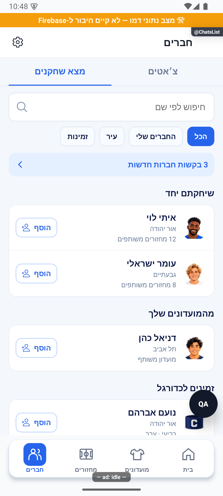
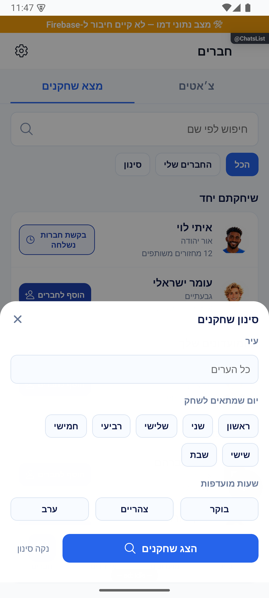
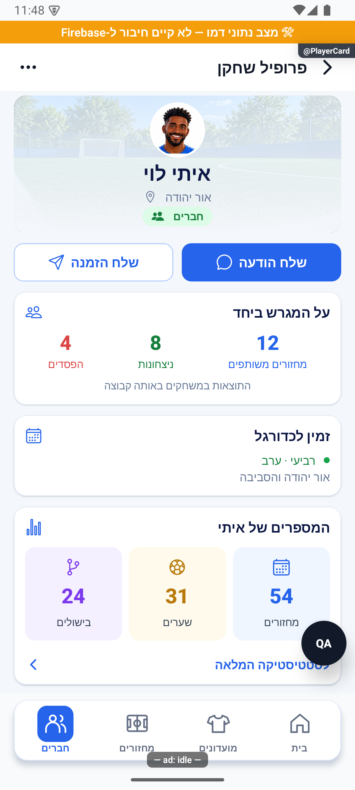

# למצוא שחקנים ולהתחבר

## קיצור טעינה ומניעת קריאות כפולות — 23.10.2026

בכרטיס שחקן, חלונית ההזמנות משתמשת בטעינת המחזורים האחרונה במקום לבקש מיד את אותה רשימה שוב. טעינה שנכשלה מאפשרת ניסיון נוסף, ומידע ישן מתרענן. השינוי מקומי וטרם הופץ.

[בדיקות, צילומים ומגבלות](../../changes/2026-10-23-screen-loading.md).

## ניסיון חוזר לקריאת מידע זמנית — 23.10.2026

קריאת מידע שנכשלת זמנית יכולה להתבצע פעם נוספת, במקום להיעלם מיד. חשבון שהתחלף מפסיק את הבקשה; כשל מתמשך נשאר כשל ולא מוצג כרשימה ריקה תקינה. השינוי מקומי וטרם הופץ. [פירוט האימות והמגבלות](../../changes/2026-10-23-crash-test-and-pulse-followup.md).

## תלויות משותפות — 23.10.2026

בדיקת קשר עם שחקן אינה מדווחת עוד על בקשת חברות חסרה כתקלה אוטומטית. כשלים אחרים עדיין מטופלים ככשלים; התיקון מקומי וטרם הופץ.

## תיעוד כשלים — 20.10.2026

נוסף תיעוד אוטומטי לנקודות כשל במסלול הזה, עם מקור התקלה. הפעולה המקורית שומרת על ערכי החזרה והודעות השגיאה שלה. השינוי מקומי, טרם הופץ, ואין אימות מסירה חיה לפולס.

[דוח דיווח השגיאות והראיות](../../changes/2026-10-20-error-reporting-audit.md).

## הזמנות ואישור מראש — 11.10.2026

הזמנה אישית ממנהל מאפשרת להצטרף בלי אישור נוסף, גם למועדון סגור. מצטרפים רק אחרי שלוחצים להצטרף; ההזמנה אינה שומרת מקום. במחזור מלא נכנסים להמתנה, ובמועדון מלא ההצטרפות נחסמת. קישור שיתוף רגיל אינו אישור מראש. הזמנה חדשה תקפה לשבעה ימים ולמחזור לא מעבר לגבול ההרשמה שלו; חסימה ודחייה קודמת אינן מתבטלות בגללה.

ברשימת ההזמנות מופיעים גם מצבים כמו הצטרפת, ממתין לאישור, המועדון מלא, הרשמה שטרם נפתחה והזמנה שאינה זמינה. השינוי מקומי ועדיין דורש פריסה והפצת גרסה.

עדכון 11.10.2026: מעל לשוניות החיפוש והשיחות נמצא ״חברים והזמנות״, שפותח את [מסך החברים וההזמנות](friends.simple.md). אותו מסך נפתח גם מתפריט הבית. קיצור הבקשות הישן הוסר מתוצאות החיפוש.

[הסבר מעמיק](player-discovery.md)

בלשונית ״חברים״ אפשר לעבור בין השיחות לחיפוש שחקנים. מחפשים לפי שם, עיר או זמינות, מסננים לחברים ורואים שחקנים שכבר שיחקתם איתם או חברים במועדונים שלכם.

הפרופיל הקיים מציג תמונה, עיר, זמינות, מועדונים ונתונים משותפים. אפשר לבקש חברות, ולשלוח הודעה לאחר שהחברות אושרה. מנהל יכול לשלוח הזמנה למועדון או למחזור שלו. ההזמנה למועדון אינה מצרפת את השחקן אוטומטית.

בהגדרות ״פרטיות השחקן״ אפשר להסתיר את עצמך מהחיפוש ולבחור מי רואה את הסטטיסטיקה: כולם, חברים או רק אתה. ברירת המחדל היא הופעה בחיפוש וסטטיסטיקה לחברים בלבד. אפשר להגיע להגדרות מהחיפוש ומתפריט הבית.

מצב מקומי, 11.10.2026: התצוגות נצפו באימולטור בנתוני המחשה, והפעולות נבדקו במסד מקומי. טרם הופץ. הגנת הפרטיות אושרה והושלמה מקומית: הנתונים האישיים מוגבלים, הודעות חדשות דורשות חברות, והיסטוריית שיחות נשמרת. ההפצה צריכה לכלול את עדכון האפליקציה והשירותים יחד; הכללים טרם נפרסו.

## סינון ותקציר מעודכנים — 11.10.2026

בכפתור ״סינון״ בוחרים יחד עיר, יום ושעות. אפשר לנקות בחירות ולהחיל אותן בלחיצה על ״הצג שחקנים״. סגירת החלון בלי החלה שומרת את הסינון הקודם. כפתורי החברות עדינים יותר והבקשה שנשלחה מוצגת במלואה. תקציר הפרופיל מציג מחזורים, שערים ובישולים עם אייקונים, בלי ציונים ובלי גרף.

## מתג מציאת שחקנים — 11.10.2026

המתג למציאת שחקנים הוחלף בכדור התלת־ממדי המתגלגל של טפסי המחזור. במצב פעיל הכדור משמאל ובמצב כבוי מימין.
# סינון ובקשות חברות — עדכון 11.10.2026

תוקן גם כפתור ההוספה במסך ההדגמה: לחיצה יוצרת בקשה מקומית ומשנה את הכפתור למצב בקשה שנשלחה. [צילום מהאימולטור](../screenshots/player-request-sent-2026-10-11.png). אין שליחת בקשה אמיתית לשרת במצב זה.

אפשר לבחור כמה ימים וכמה שעות בחלונית הסינון. מוצגים שחקנים עם זמינות באחד הצירופים שבחרת, בנוסף לסינון העיר והחברים. כפתור ״נקה סינון״ מואר כשיש בחירה ומושבת כשאין; אחרי ניקוי יש ללחוץ ״הצג שחקנים״ כדי להחיל.

שליחת בקשת חברות מעדכנת את הכפתור של השחקן בלי למחוק ולטעון מחדש את רשימת החיפוש.

[צילום מהאימולטור עם נתוני הדגמה](../screenshots/player-multifilter-2026-10-11.png). בדיקת חברות מול שרת אמיתי לא בוצעה בסבב זה.

## שני חברים קבועים בנתוני ההדגמה — 11.10.2026

למשתמש ההדגמה נוספו איתי לוי ודניאל כהן כחברים מאושרים והדדיים. איתי מדגים חבר עם 12 מחזורים משותפים ודניאל חבר ללא מחזורים משותפים. רשימת החברים, החיפוש והפרופיל קוראים את אותו מצב חברות מקומי. הנתונים נטענים מחדש בהפעלה מלאה וניתנים לשינוי במהלך ההדגמה; אין חשבונות חדשים או כתיבה לנתוני ייצור.

## ניסוח בעת צפייה בשחקן אחר — 11.10.2026

מסלול הסטטיסטיקה הקיים מעביר לרכיב הכרטיס את `isOwn={!otherPlayer}`. בצפייה בשחקן אחר הכותרות ניטרליות: המספרים על המגרש, ציוני המחזורים, הרגעים הבולטים, תוצאות המשחקים, שותפים ויריבים. גם הסברי ההשתתפות, הפנדלים והצמדים אינם פונים לצופה. שם בעל הנתונים נשאר בראש הכרטיס. בצפייה עצמית נשמר הניסוח האישי. אין שינוי במקור הנתונים, בחישובים או בהרשאות; מצב ללא נתונים של שחקן אחר אינו משתמש במסך ההסבר האישי.

## הסיפור שלכם על המגרש

בפרופיל חבר אפשר לראות כמה משחקים שיחקתם באותה קבוצה ואת הניצחונות, ההפסדים והתיקו; כמה שיחקתם אחד מול השני ומי ניצח; וכמה בישולים מסרתם אחד לשני. בנפרד מופיעים מספר המחזורים ששניכם השתתפתם בהם ותאריך המחזור המשותף האחרון. הנתונים מצטברים מכל המועדונים והעונות.

אין היסטוריה? מופיעה הזמנה להתחיל את הסיפור שלכם. כבר שיחקתם בלי בישולים? מחכה לכם מסר למסירה הראשונה. למטה מוצגים קודם המועדונים המשותפים שלכם ואחריהם המועדונים הנוספים של החבר.

[תוצאות הצמד](../screenshots/friend-pair-story-2026-10-11.png) · [בישולים ומפגש אחרון](../screenshots/friend-pair-assists-2026-10-11.png) · [מועדונים משותפים ונוספים](../screenshots/friend-clubs-split-2026-10-11.png) · [ללא פעילות](../screenshots/friend-pair-empty-2026-10-11.png). נצפו באמולטור דמו בלבד. בדיקות טיפוסים ללקוח ולשרת עברו; בריצה המלאה החוזרת עברו 254 חבילות ו־3418 בדיקות. פירוט הכשל האקראי בריצה הראשונה נשמר ביומן השינוי.

## גובה חלונית שליחת הזמנה — 11.10.2026

חלונית ההזמנה בפרופיל שחקן מותאמת לגובה תוכנה במקום למלא 90% מהמסך. נקודת ההתחלה הקבועה של `SpringSheet` מבוטלת רק בחלונית זו (`top: auto`), תוך שמירת תקרת גובה 90% וגלילה לרשימות ארוכות. תוכן קצר אינו נמתח; נשאר ריווח תחתון של 16 נקודות אחרי סגירה. אין שינוי ליתר החלוניות או לפעולות ההזמנה.

[חלונית ההזמנה בגובה התוכן](../screenshots/invite-sheet-content-height-2026-10-11.png). נצפתה באמולטור עם מועדון וארבעה מחזורים, ללא שליחת הזמנה. אין בדיקת מכשיר חדשה לרשימה ארוכה יותר או אייפון.

## סגירה אחידה לחלונית ההזמנה — 11.10.2026

חלונית שלח הזמנה משתמשת כעת ברכיב `DraggableMenuSheet` הקיים: ידית במרכז, כפתור סגירה בצד שמאל, גרירה למטה מהכותרת, לחיצה מחוץ לחלונית וכפתור החזרה של המכשיר. הגרירה מוגבלת לכותרת כדי לא לפגוע בגלילת רשימת המחזורים. הגובה עדיין לפי התוכן, עם תקרה של 88% לפי רכיב התפריטים המשותף. כפתור הסגירה הכפול בתחתית הוסר. אין שינוי בשליחת הזמנות או ברכיב התפריטים עצמו.

[סגירה אחידה של חלונית ההזמנה](../screenshots/invite-sheet-dismiss-2026-10-11.png). כיווניות, הידית וכפתור הסגירה נצפו באמולטור דמו.

## הקשחת אבטחה מקומית — 11.10.2026

חיפוש שחקנים עובר דרך השרת ומכבד את הגדרות הפרטיות. בקשות חברות והצטרפות נשלחות במסלולים המאומתים.

## תיקוני טעינה וחברות — 12.10.2026

בכשל טעינה תופיע הודעה עם ״נסה שוב״, במקום להציג בטעות שאין חברים. ניסיון חוזר יכול להחזיר את הרשימה. תוצאה ישנה לא תדרוס רענון חדש, ופעולה שהחלה בחשבון קודם לא תישלח בשם חשבון שהתחבר אחריו. התיקונים מקומיים ואינם כלולים עדיין בגרסת החנות.

## סבב דיווחים — 12.10.2026

ברירת המחדל של מצא שחקנים מציגה אנשים שעדיין אינם חברים שלכם. לבחירת חברים קיימים מפעילים ״החברים שלי״. הרשימה נטענת בהדרגה, עם חיווי וטעינה נוספת בקרבה לתחתית. בפרופיל מופיעה הכותרת ״כרטיס שחקן״, הזמינות מוצגת בטבלת ימים ושעות, ותפריט האפשרויות נפתח מלמטה. בשליחת הזמנה מופיע מחוון בשורה שנלחצה.

התיקונים מקומיים וטרם הופצו. מקור: `ec536c6f` עם שינויים מקומיים. [דוח הסבב ומגבלות הבדיקה](../../changes/2026-10-12-pulse-sweep.md).

## תלות בעדכון העונות — 19.10.2026

קובץ תשתית משותף עודכן במסגרת העונות. שינוי זה אינו מוסיף פעולה חדשה למסך המתואר כאן; פרטי העונות והבדיקות מופיעים במסמך העונות.

[מצב המימוש, הבדיקות ומגבלות האימות של העונות](../clubs/seasons.md). מקומי בלבד; לא בוצעה פריסה במסגרת המשימה.

## תלות במידע על סגירת עונה — 23.10.2026

נוסף מידע משותף שמאפשר להסביר מדוע עונה מתעכבת בסגירה. אין שינוי נוסף בפעולות המתוארות כאן; השינוי מקומי וטרם הופץ. [המסלול, הבדיקות והמגבלות](../../changes/2026-10-23-season-automatic-recovery.md).

## עדכון תלות משותפת בקריאות מידע — 23.10.2026

בקובצי השירות המשותפים נוספה אפשרות מפורשת לניסיון חוזר אחד בקריאה זמנית שנכשלה, תוך עצירה אם החשבון מתחלף. החיבור מוגבל ל־14 נקודות קריאה המפורטות בדוח; אין כאן טענה שכל פעולה בפיצ׳ר קיבלה ניסיון חוזר או שנבדק מסך חדש. בדיקות המאגר המלאות עברו (5,261 בדיקות ב־472 חבילות), אך אינן הוכחת הרצה במכשיר. הקוד מקומי וטרם הופץ. [מסלול, ראיות ומגבלות](../../changes/2026-10-23-four-open-errors.md).

## עדכון מסבב הפולס — 23.10.2026

תוקנה הצגת זמינות ישנה בכרטיס שחקן, פריסת הטקסט בקרוסלת הטיפים ועיצוב חלונית שמירת העונה. נוסף טיפול מוגבל בתקלות זמניות בטעינת מועדונים ובספק הכתובת באנדרואיד. אלו שינויים ברכיבים משותפים; לא כל פעולה במסך השתנתה. התיקונים מקומיים וטרם הופצו. [בדיקות, צילומים ומגבלות](../../changes/2026-10-23-pulse-resweep.md).

## תלות בשמירת צבעי המחזור — 24.10.2026

שמירת המידע המשותפת עודכנה כדי להעביר את צבעי הקבוצות ממסכי הכוחות להכנה וללייב. אין תוספת פעולה במסך הזה, והוא לא נבדק מחדש במכשיר במסגרת התוספת. השינוי מקומי וטרם הופץ. [פרטי התוספת ומגבלות הבדיקה](../rounds/draft-setup.md#צבעים-לפני-שיבוץ-ובכל-שיטת-חלוקה--24102026).
