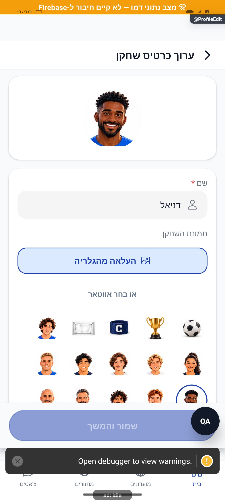
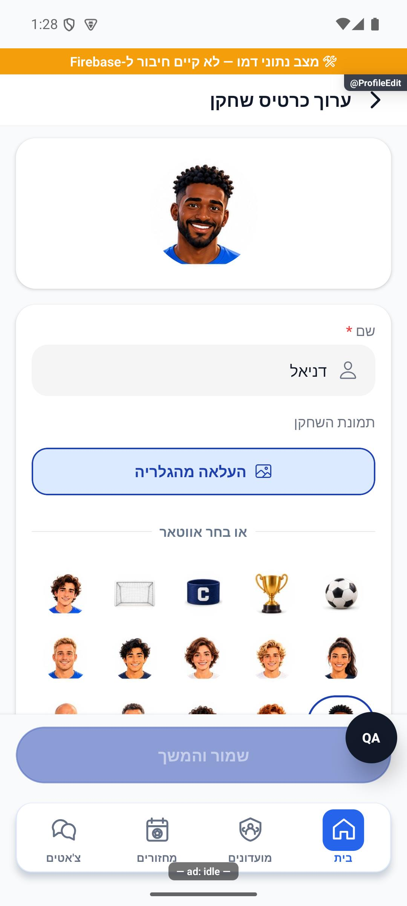
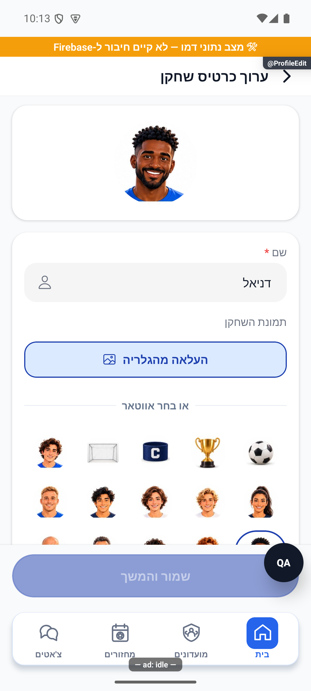
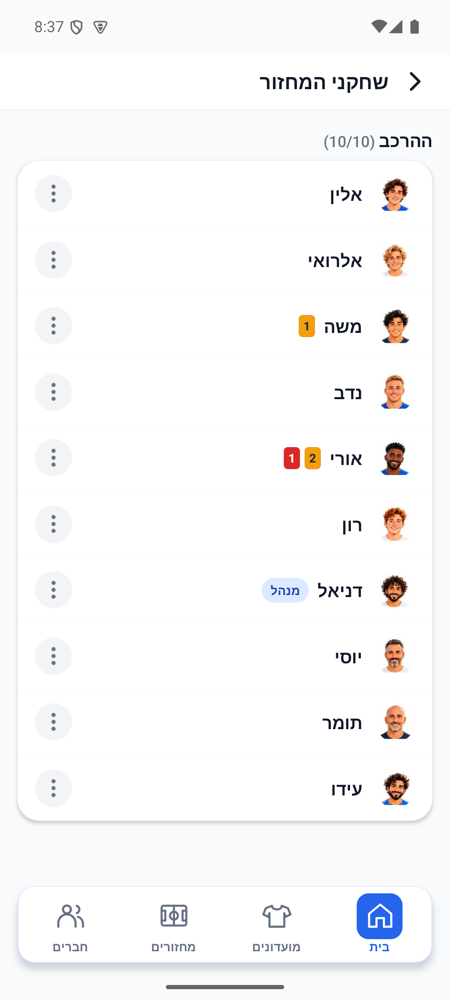

# עריכת כרטיס השחקן ותמונת הפרופיל

## תיעוד כשלים — 20.10.2026

נוספו תצפיות דיווח בנקודות הכשל של המקורות המשויכים לפיצ׳ר, במסגרת הרחבה רוחבית. נשמרו ערכי החזרה, הזריקות ותנאי הפעולה הקיימים; נוסף מקור קוד והקשר לדיווח. כיסוי תחבירי אינו הוכחת הרצה של כל מצב. השינוי מקומי וטרם הופץ; בדיקות המסירה, מגבלות מניעת הכפילויות והמסלולים שטרם חוברו מתועדים בדוח המשותף.

[דוח דיווח השגיאות והראיות](../../changes/2026-10-20-error-reporting-audit.md).

[לקריאה קצרה ופשוטה](profile-edit.simple.md)

עודכן: 07.10.2026; מקור `8e8fde5`, `1.1.35` בבנייה. `src/screens/tabs/ProfileEditScreen.tsx`, מסלול `ProfileEdit`, כניסה מהאווטאר בבית. תפקיד: המשתמש עורך את עצמו.

## אזורים ופעולות

שם שחקן, תמונה נוכחית, בחירת תמונה מהמכשיר או אווטאר מובנה, תצוגה מקדימה וכפתור שמירה. מערך האווטארים החדש מציג דיוקנאות קדמיים; `getAvatarById` משמר תאימות מזהי אווטארים ישנים. תמונת כתובת קיימת נשארת בעדיפות על מזהה מובנה, ולכן שחקני דמו עם `avatarUrl` חיצוני עשויים להיראות בסגנון אחר בלי כשל במיפוי המזהים.

בצילום נראה אווטאר כהה עם חולצה כחולה, בחירה במסגרת ומצב שמירה מושבת. תמונת משתמש חיצונית בעדיפות אינה מוחלפת אוטומטית בגלל עיצוב האווטארים.

## מצבים וכתיבות

| מצב/פעולה | תגובה | כתיבה | ראיה |
|---|---|---|---|
| ללא שינוי | שמירה מושבתת | אין | דמו וקוד |
| שם ריק/לא תקין | שמירה חסומה | אין | קוד |
| תמונה מהמכשיר | הרשאה, בחירה והעלאה; תצוגה מקדימה | אחסון תמונה ועדכון פרופיל בעת שמירה | קוד; לא הועלתה תמונה |
| בחירת אווטאר | תצוגה מקדימה; ניקוי תמונה בפרופיל הנשמר | הסרת תמונה ישנה אחרי הצלחת עדכון | קוד |
| שינוי שלא נשמר וחזרה | שמור / התעלם וצא / בטל | שמירה רק בבחירה המתאימה | קוד |
| כשל שמירה | הודעת כשל ושימור עריכה | אין הצלחה מדומה | קוד |

בחירת עמדה מועדפת הוסרה לבקשת הבעלים; סגנונות שנותרו בקובץ אינם הוכחה לבורר פעיל. הגדרת `dmFriendsOnly` אינה מוצגת בעורך הזה כיום. אין להחזיר תכונות מתוך הערות או סגנונות מתים.

## שירותים, ממיר ובדיקות

קרא `src/services/userService.ts`, מערך האווטארים, `UserAvatar`, `src/firebase/firestore.ts`, `src/utils/officialAccount.ts`. שינוי שדה שם/אווטאר/תמונה חייב להתאים גם לממיר המשתמש ולמראה הציבורית. ההבדל לעומת ההיכרות: כאן מחיקת התמונה הישנה נדחית עד אחרי עדכון פרופיל מוצלח.

בדיקה קיימת: `tests/logic/avatarCompatibility.test.ts`; הוקים וכיוון מלל נבדקים רוחבית. לא בוצעה שמירה חיה. לשחזור: תמונה קיימת→אווטאר, אווטאר→תמונה, ביטול הרשאה/בחירה, כשל העלאה, שם ארוך, עזיבה עם שינוי, והצגה בכרטיס שחקן/חברים/צ׳אט. תאימות מזהה ישן יש לבדוק גם בקריאת מסד אמיתית; דמו עוקף ממיר.

## פירוט מימוש ונקודות שינוי — העמקה 07.10.2026

`nameDirty` דורש שם לא ריק ששונה מהשם השמור; `photoDirty` ו־`avatarDirty` משווים את החלופות; `canSave` דורש שינוי, ללא `busy` או `uploading`. השדות מסונכרנים מחדש כשזהות המשתמש או ערכיו משתנים. `previewUser` מציג שם חלופי שמור אם הטיוטה ריקה, אבל תצוגה זו אינה עצמה כתיבה.

`beforeRemove` קורא `dirtyRef` ו־`savingRef` בזמן האירוע כדי למנוע חלון שמירה נוסף לפני הרינדור שאחרי הצלחה. `save` בונה patch רק משדות ששונו, ממתין ל־`updateProfile`, מנקה תמונה קודמת בניסיון שקט רק אחרי הצלחה, מאפס dirty ומנווט. בכשל שם שמור/אימייל מתקבל נוסח ייעודי; כשל אחר משאיר את הטופס. שינוי בחירת אווטאר אינו רשאי למחוק קובץ לפני השמירה, כי ביטול היה משאיר מסמך שמפנה לתמונה שנמחקה. בדיקות התאימות של האווטארים נוגעות למזהים קיימים, לא למסע העלאה חי.

הבדיקות, מצבי המסך והראיות שכבר פורטו במסמך נשמרו. ההעמקה מבוססת על קריאת מקור ולא על הרצת פעולות נוספות; שינוי עתידי יצריך עדכון של שני המסמכים ובחינת המצבים הממוקדים.

## התאמת רשת הדמויות — 9.10.2026

ב־ProfileEdit רשת האווטארים מחולקת לחמש עמודות (`width:20%`). רוחב הרשת נמדד ב־onLayout וגודל הדמות הוא `min(48,max(24,width/5-10))`; עשרת הפיקסלים מפנים מקום למסגרת ולריפוד. אין רווח אופקי שמגדיל את רוחב חמש העמודות מעבר לרשת. גובה מטרה מזערי 44. המזהים, סדר הבחירה, העלאה ושמירה לא השתנו; מסך ההיכרות לא שונה במשימה זו.

## תיקוני עיצוב ונגישות — 10.10.2026

מקור: `a348b9f235f1e1433497600555303231512a0834` עם שינויים מקומיים. אין בסעיף זה הוכחת גרסת חנות.

`InputField` משתמשת בשורה רגילה: הטקסט קודם לסמל, ללא שילוב של כיוון כתיבה מפורש עם היישור הלוגי. שם נגיש נלקח מתווית או ממילוי המקום, וניתן לדריסה מפורשת. שדה בחירה מציג תפקיד כפתור, ערך ומצב מושבת כאשר `editable=false`. שדה טקסט נשאר שדה עריכה. כפתור העלאת תמונה מסודר טקסט ואז אייקון. תהליך השמירה והוולידציה נשמרו. בדיקות: `tests/logic/accessibleControls.test.tsx`; צילום עריכת הפרופיל נבדק בפועל.

הצילום: אנדרואיד בדמו במעטפת פיתוח `1.1.33/1`, ללא שמירה חיה; אין הוכחת אייפון או קורא מסך.

## אחידות תמונות משתמשי הדמו — 15.10.2026

`mockPlayers` ב־`src/data/mockData.ts` מקצה לכל שחקן `avatarId` קבוע מתוך מזהי הדיוקנאות הארוזים המעודכנים. הבחירה מחזורית לפי מיקום בסגל, ללא כתובת תמונה חיצונית וללא טעינת נכסי תמונה מתוך מודול הנתונים. השם השני בסגל הוא אלרואי. אין שינוי במזהי משתמשים, בנתוני ייצור, במסלול עריכת הפרופיל או בפעולת השמירה.

`mockCurrentUser`, מתאמי הדמו ב־`userService` וב־`groupService`, נתוני `mockPairCompare`, תצוגת החלוקה הידנית ומועמדי תצוגת השחקנים הזמינים מעבירים את אותו `avatarId` במקום תמונה חיצונית או מזהה קבוע שאינו שייך לשחקן. מקור חלופי `photoUrl` נשמר כאשר קיים. מסלולי בדיקה: `MatchPlayers`, `CommunityStats`, `PlayerCompare`, `AvailablePlayersPreview`; צילום הסגל נצפה באימולטור אנדרואיד במצב דמו. אין כאן הוכחת שמירה או קריאת ממיר מייצור.

המקור והחותמת במניפסט הצילומים; צולם עם שינויים מקומיים, ללא פריסה וללא בניית חנות. בדיקת טיפוסים עברה. בהרצת כל 323 החבילות עברו 3844 מתוך 3845 בדיקות; בדיקת זמן קיימת של חלוקת כוחות חרגה מסף 150 מילישניות (220.4), וגם בהרצה ממוקדת (181.8). לאחר סיום ייצוא הסרטון עברה שוב כל החבילה הממוקדת: 24 מתוך 24 בדיקות, כולל סף הזמן. ההרצה המלאה הקודמת אינה מסומנת כהצלחה מלאה. אלגוריתם החלוקה לא שונה במשימה זו. בדיקת תיעוד הפיצ׳רים עברה. סרטון ההדגמה משתמש בצילומי מסכים אמיתיים שחוברו לתנועת גלילה רציפה בעריכה; אינו הוכחת גלילה חיה או פעולה מול השרת.

## סבב פולס — 18.10.2026

`deleteUserPhoto` מתייחס רק ל־storage/object-not-found כהשלמת המחיקה. הרשאה, רשת וכל קוד אחר ממשיכים להגיע ל־logError. אין ניסיון מחיקה נוסף ואין שינוי בשמירת הפרופיל. `pulse18ReadFailures.test.ts` מפעיל את גוף הפונקציה המקורי ומבדיל בין היעדר תמונה לבין כשל הרשאה.

השינויים מקומיים וטרם הופצו. לא שונו הרשאות ולא נשלחו הזמנות או הודעות. בדיקת הדפדפן משתמשת בקוד הרכיבים בפועל, במתאם סגנונות, בסמלים חלופיים ובנתוני הדגמה; אינה הוכחת אנדרואיד או אייפון. שני האמולטורים לא הגיבו לפקודות או לצילום בסבב זה.

## הישנות דיווח מחיקת תמונה — 18.10.2026

אירוע נוסף מ־18:59:22 לפי UTC הגיע מ־`1.1.56` עם אותו קוד `storage/object-not-found`. מקור הבנייה המאומתת `96e94cf3066c5bcafa80fc304f654f025ea90872` אינו כולל את תנאי ההצלחה לקובץ חסר; הקוד המקומי כולל אותו. לכן סגירת האירוע הקודם לא הייתה הפצה של התיקון, והלקוחות בגרסה זו יכולים להמשיך לדווח אותו.

בשני האירועים תועדו `profile_created`, `onboarding_completed` ו־`profile_confirmed` לפני `deleteUserPhoto`. קריאה עדכנית של שני מסמכי המשתמשים אישרה דמות מובנית, היעדר כתובת תמונה והשלמת היכרות. זו תקלה ברישום ניקוי קובץ חסר, ללא ראיה לכשל שמירת הפרופיל. לא בוצעה מחיקה נוספת לבדיקה. התיקון המקומי הקיים מספיק לקוד השגיאה הזה; כשל הרשאה או רשת ממשיך להירשם. [ראיות ללא פרטי משתמש](../../changes/evidence/2026-10-18-photo-recurrence/verification.json). אין שינוי חזותי או תיקון מוצר נוסף בסבב הבדיקה הזה.

## תלות בעדכון העונות — 19.10.2026

נבדק ההפרש בקבצים המשותפים הרשומים כאן: `src/firebase/firestore.ts`. השינוי ממוקד במדיניות העונות, קריאת מצבן, שיוך מחזור ופקודות ניהולן; אין שינוי מכוון בחוזה העצמאי המתואר במסמך זה. אין להסיק מכך שהמסך הזה הורץ מחדש.

[מצב המימוש, הבדיקות ומגבלות האימות של העונות](../clubs/seasons.md). מקומי בלבד; לא בוצעה פריסה במסגרת המשימה.

## בדיקת פולס חוזרת — 19.10.2026

אירוע נוסף של `deleteUserPhoto` הגיע מ־1.1.56 עם `storage/object-not-found`. התיקון המקומי הקיים מטפל בקובץ חסר, בעוד כשל הרשאה ממשיך להירשם; מקור הבנייה 96e94cf3 עדיין אינו מכיל אותו. בסבב זה לא נוסף שינוי מוצר. האירוע נמסר ל״בוצע ע״י רובנס״ תוך שמירת מצב המקור פתוח לאישור הבעלים. [ממצאים ומגבלות](../../changes/2026-10-19-pulse-errors-reports.md).

## אימות — 21.10.2026

מחיקת תמונת פרופיל שכבר חסרה נחשבת הצלחה ואינה מייצרת דיווח שגיאה. הורחבה הבדיקה גם למסלול הדיווח האוטומטי; כשלים אחרים באחסון עדיין מדווחים. התיקון מקומי ולא נבדק כאן מול אחסון ייצור.

## תלות במידע על סגירת עונה — 23.10.2026

בדיקת ההבדל ב־`src/firebase/firestore.ts` וב־`src/types/index.ts` מראה שהשינוי מוגבל לקריאת `seasons.closureStatus` בחוזה `GroupSeasons`. יתר ממירי הנתונים והמסלולים המתועדים כאן לא שונו במשימה זו. אימות הריצה החדש מתייחס להתאוששות ולכרטיס העונה, ולא להרצה חדשה של כל מצבי המסך הזה. [המסלול, הבדיקות והמגבלות](../../changes/2026-10-23-season-automatic-recovery.md).
