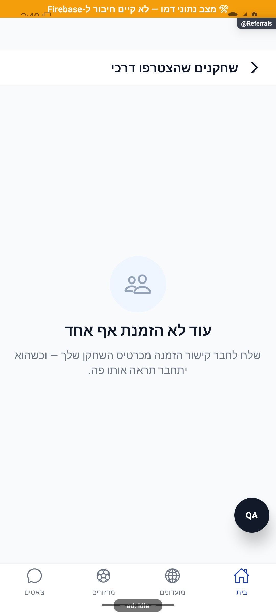

# שחקנים שהצטרפו דרכי

## מדידת פעולות ואמינות נתונים, 5.11.2026

במיפוי מקור הרכיבים המוזכרים במסמך נמצאו 5 נקודות מטפל ו-3 מזהי פעולה. הספירה מתארת קוד וכוללת רכיבים משותפים; אין לחבר אותה לספירות של מסמכים אחרים ואין לראות בה הרצת כל המסך. המדידה מפורטת לפי גבול פקד מקורי, פעולה עסקית ומצב חשבון. תשובה מאוחרת נבדקת מול בעל הפעולה, ומצב קיים או בקשה חוזרת אינם תמיד הצלחה חדשה. רשימת המקרים שהורצו ומגבלות המסד, המכשיר והכיסוי נשמרות [בדוח המדידה](../../audits/2026-11-04-system-night/product-measurement.md) ובדוחות המקושרים אליו. המימוש מקומי; לא בוצעה בדיקה חדשה של כל מצבי הפיצר.

## חיפוש שחקנים וזמני טעינה, 4.11.2026

קריאת מחזורים עתידיים של מועדון יכולה להעביר כשל גישה לחלונית ההזמנה כשהיא מבקשת תשובה מאומתת. ברירת המחדל של יתר הקוראים נשמרת. בדיקה זו תחומה למקור המשותף, ללא הרצה חדשה של כל המסך העצמאי. מימוש מקומי שטרם הופץ. [השינוי, המדידות והבדיקות](../../changes/2026-11-04-player-discovery-speed.md).

## ציר פעילות פרטי בפולס, 4.11.2026

לאחר אישור מחיקת חשבון מתנקה גם תור הפעילות המקומי של אותו חשבון, לרבות חסימת תוצאה מאוחרת. אין מחיקה של אירועי חשבון אחר.

נבדקו התוספות במקורות המשותפים לצורך ציר פעילות פרטי בפולס: דיווח ניווט והקשר, תיעוד ניסיון הרשמה ותוצאתו וגבולות זהות ומחיקת חשבון. התוספת היא תיעוד ברקע במקומות הנתמכים; אין מכך אימות חדש של כל מצבי הפיצר הזה או שינוי בחישוביו. מקומי וטרם הופץ או נפרס. [היקף, מקורות, בדיקות ומגבלות](../shared/usage-activity.md).

## השפעת שיפורי הטעינה המשותפים, 4.11.2026

קריאות חופפות לזהויות שחקנים או לדירוגי מועדון חולקות עבודה פעילה באותה התחברות. שמירת פרופיל או דירוג מבטלת שיתוף קודם, ולא נשמרת תשובה שהושלמה לשימוש חוזר. אין שינוי במקור הרשאות או בחוזה הנתונים העצמאי של הפיצר.

מקורות משויכים שנבדקו בהיקף השינוי: `src/services/userService.ts`, `tests/logic/clientAuditRecovery.test.ts`.

מימוש מקומי וטרם הופץ. אין בכך אימות מכשיר חדש של הפיצר הזה או מדידת מהירות של כל מסלוליו. [המדידות התחומות, הבדיקות והמגבלות](../../changes/2026-11-04-screen-performance.md).

## ליטוש מקומי והשפעת רכיבים, 3.11.2026

השפעה עקיפה דרך `Avatar`: כשל כתובת תמונה מציג אותיות שם באותן מידות, וכתובת חדשה מתחילה ניסיון חדש. אין שינוי בנתונים או בכללי הפעולות העצמאיות של הפיצר. לפירוט הנעילה, הנתונים, הכשל וגבולות ההרצה ראו [חוזי הרכיבים המשותפים](../shared/menus-and-motion.md). אין כאן טענה שכל זרימת שחקנים שהצטרפו דרכי הורצה.

השינוי מקומי וטרם הופץ. אין כאן אימות חדש של מסך מוצר מלא, מכשיר, קורא מסך או שרת. [הראיות והמגבלות של המשימה](../../changes/2026-11-03-overnight-mission.md).

## אימות פרסום קבוצות בפולס, 2.11.2026

נבדק ההפרש התחום בשירות המשותף של המחזורים: נוספה בדיקת אישור לפרסום קבוצות כאשר תשובת הפעולה אובדת. אין שינוי בחישוב, במכנים או בפעולות העצמאיות של הפיצר המתואר כאן. התיקון מקומי וטרם הופץ; אין בדיקת מכשיר חדשה לפיצר זה.

השינוי ב-`src/services/gameService.ts` מוגבל ל-`publishDraftTeams` ולתלות בסיווג כשלים זמניים. נבדקו גבולות קבלת השרת, התאמת החשבון והחלוקה, ושימור השגיאה כאשר האימות נכשל. `tests/logic/publishTeamsReceipt.test.ts` מפעיל את פונקציית השירות מול תחליפי קריאה וכתיבה; אין בכך הרצת כל המסלולים של המסמך הזה.

[דוח הטיפול, הבדיקות והמגבלות](../../changes/2026-11-02-pulse-sweep.md).

## בקשות לשיחה אישית, 2.11.2026

נבדקה השפעת תוספת בקשות השיחה במקורות המשותפים. השינוי ממוקד בהרשאת שיחה, בשדות פרטיות ההודעות ובחיבורי הבדיקות; אין מכך אימות חדש של מסך זה במכשיר. המימוש מקומי וטרם הופץ או נפרס. [התנהגות, בדיקות ומגבלות](../chat/message-requests.md).

מקורות משותפים שנבדקו בהיקף השינוי הזה: `src/firebase/firestore.ts`, `src/services/userService.ts`, `src/types/index.ts`, `tests/logic/clientAuditRecovery.test.ts`. אין בסעיף זה טענה להרצת כל המסלולים ההיסטוריים של הפיצר. [מסירת המימוש](../../changes/2026-11-02-message-requests.md).

## החלפת הקבוצה הבועטת בפנדלים, 30.10.2026

נבדק ההבדל התחום במשימה במקורות המשותפים `src/services/gameService.ts`, `src/types/index.ts` ו-`src/firebase/firestore.ts`: הוא מוסיף ומשמר תור מפורש לפנדלי ההכרעה ומעדכן אותו ברישום ובביטול בעיטה. אין שינוי בשדות, בחישובים או במסלול הנתונים העצמאי של הפיצר המתואר כאן. בדיקת הקורא והעסקאות מפורטת בדוח; אין בכך הרצה מחדש של המסך הזה. [התנהגות, בדיקות ומגבלות](../../changes/2026-10-30-shootout-turn.md).

## התאוששות משגיאות בפולס, 28.10.2026

ב-`src/services/userService.ts`, קריאת הפרופיל של החשבון הנוכחי ב-`getUserById` וקריאת האתחול ב-`getCurrentUser` משתמשות ב-`retryRead`. נבדק שהחשבון לא התחלף לפני הקריאה, אחרי תשובתה ולפני החזרת מטמון. באתחול נשמרת תקרה כוללת של שמונה שניות, והדגל `readExpired` מונע התחלת ניסיון נוסף אחרי התקרה. מטמון תואם נשמר בכשל מתמשך, ובהיעדרו הכשל נזרק. לא שונו סכמת המשתמש, הרשאות, יצירת פרופיל או מחיקתו. בדיקות ההתאוששות והחלפת החשבון נמצאות ב-`tests/logic/pulseReadRecovery.test.ts`.

השינוי מקומי וטרם הופץ או נפרס. אין שינוי חזותי ואין צילום מכשיר חדש. [ממצאים, בדיקות ומגבלות](../../changes/2026-10-28-pulse-errors.md).

## הרחבת אבחון דיווחים, 27.10.2026

נוספה מעטפת אבחון מקומית עם מצב בזמן הכשל, שלבים בעלי מזהה ותזמון, מצב רשת ובנייה ומופעים נפרדים לשגיאה. נקודת הכניסה לתעבורת השרת עוברת כעת דרך העטיפה המשותפת; תשובות, חריגות, אפשרויות קריאה ומדיניות הפיצר נשמרות. אין כאן שינוי בהרשאות או בחישובי המוצר. הבדיקות המלאות ומגבלות האימות מתועדות בדוח המקושר; אין טענה לאימות מכשיר או להפצה. [היקף, ראיות ומגבלות](../../changes/2026-10-27-diagnostic-context.md).

באימות הסופי עברו כל 6,231 הבדיקות ב-555 חבילות, ובדיקות הטיפוסים של הלקוח, השרת והפולס נקיות. צילום הדפדפן והידור מקורות האנדרואיד הם בדיקות מקומיות; אין הוכחת מכשיר, הידור אייפון או מסירה חיה של הבנייה החדשה. רישום יומן השחרור נחשב מאומת רק לפי קבלת הקריאה החוזרת בדוח השינוי.

## קישורי שיתוף בדומיין החדש - 26.10.2026

קישור אישי חדש משתמש בדומיין החדש ובקוד קצר, ושיוך המזמין נשמר בקוד. קישור שלא פוענח נשמר לניסיון נוסף; כשל בשמירת קוד חדש מחזיר את הקישור המלא.

המימוש המשותף משתמש ב-`src/utils/linkDomains.ts`, ב-`src/services/inviteLinkService.ts`, ב-`src/services/deepLinkService.ts` וב-`src/services/incomingInvite.ts`. קישורים קצרים אינם משכפלים את `invitedBy`; הבעלות נקראת מהמסמך הקיים. כשל שמירת קוד מחזיר כתובת מלאה, ופענוח שנכשל נשמר לשחזור. אין שינוי במונים, בהרשאות או במסלול ההצטרפות.

השינוי מקומי וטרם הופץ. הבדיקות, מסלולי הנתונים ומגבלות האימות מפורטים ב[דוח השינוי](../../changes/2026-10-26-share-domain.md). אין כאן אימות חדש של כל מצבי המסך.

## שעון מדויק וכיתוב פנדל - 25.10.2026

במקורות המשותפים נוסף שימור השעון המדויק של פנדל במהלך משחק, וכיתוב ההבקעה ביומן קוצר. אין שינוי במונים או בתהליך העצמאי המתואר כאן; לא נערכה לו בדיקת ממשק חדשה במסגרת העדכון. השינוי מקומי וטרם הופץ. [פרטים וראיות](../../changes/2026-10-25-in-play-penalties.md#שעון-מדויק-וכיתוב-אירוע).

## פנדל במהלך משחק חי - 25.10.2026

נבדק השינוי הממוקד במקורות המשותפים: נוספו חוזי אירועי פנדל במהלך משחק, קוראים ומוני סטטיסטיקה, והגנות בעסקאות סיום ואיפוס משחק. מסלול הפיצר המתואר כאן אינו נקודת הכניסה להזנה החדשה. בדיקות המאגר עברו, אך אינן הוכחת הרצה חדשה של כל מצבי התהליך או של פריסה.

השינוי מקומי. נדרשת פריסת שרת לפני הפצת לקוח שמשתמש באפשרות; לא בוצעו פריסה או שינוי הרשאות. [חוזה הנתונים, התהליך, הבדיקות ומגבלות ההפצה](../../changes/2026-10-25-in-play-penalties.md).

## תיעוד כשלים — 20.10.2026

נוספו תצפיות דיווח בנקודות הכשל של המקורות המשויכים לפיצ׳ר, במסגרת הרחבה רוחבית. נשמרו ערכי החזרה, הזריקות ותנאי הפעולה הקיימים; נוסף מקור קוד והקשר לדיווח. כיסוי תחבירי אינו הוכחת הרצה של כל מצב. השינוי מקומי וטרם הופץ; בדיקות המסירה, מגבלות מניעת הכפילויות והמסלולים שטרם חוברו מתועדים בדוח המשותף.

[דוח דיווח השגיאות והראיות](../../changes/2026-10-20-error-reporting-audit.md).

## עדכון מקומי — 10.10.2026

`userService.listInvitedUsers` ו־`getInvitedUsersCount` זורקים כשל במקום `[]` או 0. `ReferralsListScreen` מחזיק בנפרד `loading`, `failed`, `rows` ומספר בקשה. כשל ראשון מציג הסבר וניסיון חוזר; כשל אחרי הצלחה שומר את הרשימה הקודמת. יציאה ממיקוד או החלפת מזהה מבטלות את הבקשה הישנה; רשימה מחשבון קודם אינה מוצגת בחשבון החדש. קריאה מוצלחת של אפס תוצאות היא מצב ריק אמיתי. פתיחת הכרטיס נשארת `PlayerCard` ללא מועדון מומצא, והמיון נשאר לפי תאריך ייחוס.

נבדקו שירות זורק, כשל ראשון, הצלחה, כשל רענון ושמירת רשימה במבחנים המפעילים את פונקציות המקור. אין יצירת מוזמנים או בדיקת ייחוס בחשבון אמיתי.

**מצב האימות:** תיקון מקומי, 10.10.2026. ראיות השירותים ופונקציות המקור ב־`tests/logic/clientAuditRecovery.test.ts`; הריצה הממוקדת המתועדת עברה 417 בדיקות ב־8 חבילות; השלמת שחזור מאוחר תועדה בדוח התיקון. [דוח התיקון והגבולות](../../../artifacts/pre-release-2026-10-10/client-fixes.md). לא הורצו כאן פעולות מול מסד אמיתי ולא צולמו מצבי כשל רשת חדשים; התמונות ההיסטוריות אינן הוכחה לתיקון זה.

[לקריאה קצרה ופשוטה](referrals.simple.md)

עודכן: 07.10.2026; מקור `8e8fde5`, `1.1.35` בבנייה. `src/screens/profile/ReferralsListScreen.tsx`, מסלול `Referrals`; כניסה מתפריט הבית/כרטיס עצמי לפי דגל התכונה. תפקיד: המשתמש רואה את ייחוס ההזמנות שלו.

## מבנה ונתונים

רשימת משתמשים ש־`invitedBy` שלהם הוא מזהה המשתמש הנוכחי, החדשים תחילה, עם זהות ותאריך וקישור `PlayerCard` ללא כפיית מועדון. ספירה זו אינה מספר הקישורים שנשלחו ואינה מספר חברים מאושרים. צעד ההזמנות בבית תלוי באנשים שיוחסו, לא בפתיחת שיתוף.

| תנאי | תוצאה | כתיבה | ראיה |
|---|---|---|---|
| במיקוד | קריאת המצטרפים | אין | קוד |
| בטעינה | אין רשימת אנשים מדומה | אין | קוד |
| יש אנשים | רשימה לפי תאריך וקישור כרטיס | אין | קוד |
| תאריך חסר | תווית לא ידוע, לא תאריך מומצא | אין | קוד |
| רשימה ריקה | הסבר שיתוף קישור מכרטיס | אין | דמו |
| קריאה נכשלת | הסבר, ניסיון חוזר ושמירת רשימה קודמת | אין | מבחנים מבודדים |

## מקורות אמת וסיכונים

`src/services/userService.ts` מבצע את קריאת המצטרפים/הספירה; `src/services/pendingAction.ts` ו־`src/services/storage.ts` משמרים את ייחוס הקישור. `src/services/inviteLinkService.ts`, `src/services/deepLinkService.ts` ושערי הכניסה הם המקור למסע הייחוס, ולא מסך הרשימה. פרטי המשתמש תלויים בממיר `src/firebase/firestore.ts` ובנתון `invitedBy` שנשמר בעת ההצטרפות.

הפער ההיסטורי שבו כשל הוחזר כ־`[]` תוקן מקומית ב־10.10; השירות זורק והמסך מציג ניסיון חוזר. אין בכך אימות שרת חי. בדיקות הפעולה הממתינה והקישור האישי מכסות חלק מהשרשרת אך צילום אפס מצטרפים אינו מוכיח שהייחוס תקין.

לשחזור עם נתונים מאושרים: מצטרף טרי, קישור ללא מזהה מזמין, כניסה לחשבון קיים, כשל רשת, תאריך חסר, יותר ממשתמש אחד וחזרה מכרטיס. לא להזמין אנשים או ליצור חשבונות לצורך בדיקת המיפוי.

## פירוט מימוש ונקודות שינוי — העמקה 07.10.2026

`load` קורא `userService.listInvitedUsers(currentUserId)` במיקוד; `loading` מייצג טעינה, `failed` מייצג כשל, ו־`rows.length === 0` אחרי הצלחה הוא ריק. אירוע פתיחה נרשם פעם בהרכבה עם מספר התוצאות; רענון חוזר אינו הרשמה חדשה דרך הזמנה. `openCard` מוסר רק userId, בלי להמציא הקשר מועדון.

בכשל קריאה נרשמת `loadReferrals` ונקבע `failed = true`; הנתון הקודם נשמר והכשל מובדל ממספר מוזמנים אפס. `invitedAt` משמש תאריך יחסי; חותמת חסרה אינה מוחלפת במועד פתיחת המסך. שינוי ספירה צריך לקרוא את ייחוס ההזמנה בשירות המשתמש: שיתוף קישור או לחיצה עליו אינם משתמש שהצטרף. שינוי חוויית הכשל צריך להוסיף מצב מזוהה וראיה, ולא לשנות את שאילתת הייחוס לצורך מילוי הרשימה.

הבדיקות, מצבי המסך והראיות שכבר פורטו במסמך נשמרו. ההעמקה מבוססת על קריאת מקור ולא על הרצת פעולות נוספות; שינוי עתידי יצריך עדכון של שני המסמכים ובחינת המצבים הממוקדים.

## תלות בעדכון העונות — 19.10.2026

נבדק ההפרש בקבצים המשותפים הרשומים כאן: `src/firebase/firestore.ts`. השינוי ממוקד במדיניות העונות, קריאת מצבן, שיוך מחזור ופקודות ניהולן; אין שינוי מכוון בחוזה העצמאי המתואר במסמך זה. אין להסיק מכך שהמסך הזה הורץ מחדש.

[מצב המימוש, הבדיקות ומגבלות האימות של העונות](../clubs/seasons.md). מקומי בלבד; לא בוצעה פריסה במסגרת המשימה.

## תלות במידע על סגירת עונה — 23.10.2026

בדיקת ההבדל ב־`src/firebase/firestore.ts` וב־`src/types/index.ts` מראה שהשינוי מוגבל לקריאת `seasons.closureStatus` בחוזה `GroupSeasons`. יתר ממירי הנתונים והמסלולים המתועדים כאן לא שונו במשימה זו. אימות הריצה החדש מתייחס להתאוששות ולכרטיס העונה, ולא להרצה חדשה של כל מצבי המסך הזה. [המסלול, הבדיקות והמגבלות](../../changes/2026-10-23-season-automatic-recovery.md).

## תלות בשמירת צבעי המחזור — 24.10.2026

במסגרת בחירת צבעים לפני שיבוץ עודכנו מקורות משותפים הרשומים לפיצ׳ר: `src/firebase/firestore.ts`, `src/types/index.ts`. השינוי מוסיף מפת צבעים למחזור, קריאה וכתיבה שלה ושימורה במסלולי הכוחות וההכנה. אין כאן פעולת ממשק חדשה במסך זה. זו בדיקת השפעת התוספת הממוקדת, ולא חקירה או אימות חזותי מחודש של הפיצ׳ר. כל 480 חבילות הבדיקה ו־5,343 הבדיקות עברו; טיפוסי הלקוח והשרת נקיים. השינוי מקומי וטרם הופץ. [מסלול הנתונים, ראיות ומגבלות](../rounds/draft-setup.md#צבעים-לפני-שיבוץ-ובכל-שיטת-חלוקה--24102026).

## התאמת בדיקת המקור המשותפת בלילה של 25.10.2026

ההבדל החדש ב-`tests/logic/clientAuditRecovery.test.ts` מוגבל לשלוש בדיקות הסטטיסטיקה: איתור `useFocusEffect` במקום `useEffect`, חילוץ גוף `React.useCallback`, ומתאם לקריאת `pairStats` המקבילה. התרחישים והתנאים של יתר בדיקות המקור בקובץ נשמרו. אין שינוי בקוד המוצר של התחום המתואר כאן במסגרת התאמת המבחן, ואין אימות מכשיר חדש שלו. [תיקוני הטעינה, תוצאות הבדיקות ומגבלות](../../changes/2026-10-24-loading-performance.md).

## המשך קיצור טעינות בלילה של 25.10.2026

ב-`tests/logic/clientAuditRecovery.test.ts` נוסף למתאם בדיקת כשל ההישגים גם מקור ההזמנות שמתחיל כעת במקביל. בדיקות התחומים האחרים וציפיית זריקת הכשל נשמרו. אין אימות מכשיר חדש של כל מצבי הפיצר המתואר כאן. [בדיקות, ראיות ומגבלות](../../changes/2026-10-24-loading-performance.md).

## תאימות לשמירת פקודת רכיב הבית - 25.10.2026

השינוי התחום במקורות המשותפים `src/types/index.ts` ו-`src/firebase/firestore.ts` מוסיף ומשמר את `liveMatch.lastWidgetCommandId`, מזהה אטום למניעת ביצוע חוזר של פקודת רכיב הבית. הוא אופציונלי במסמכים ישנים ואינו משנה מונים, הכרעות, ניווט או הרשאות של הפיצר המתואר כאן. בדיקה מפעילה את ממיר הקריאה המקורי ומאמתת שימור ערך והיעדרו. אין בכך בדיקת מכשיר חדשה לכל מצבי הפיצר. [מקור הבדיקה והמגבלות](../../changes/2026-10-25-widget-completion.md).

## שלמות החלוקה המתוזמנת, 29.10.2026

נבדק השינוי הממוקד במקורות המשותפים: נוספו אזורי קבוצה שש ושבע למתאמי החלוקה ולקורא ההשמות, וסוננו אורחים ממתינים בשני מסלולי היצירה בשרת. אין שינוי בליבת האיזון או בחישובים העצמאיים של המסלול המתואר כאן. 15 בדיקות ממוקדות של החלוקה וקורא הנתונים עברו, וכן בדיקות הטיפוסים של הלקוח והשרת. אין אימות מכשיר חדש, שינוי חזותי מתוכנן או פריסה.

[היקף, בדיקות, פערים פתוחים ומגבלות](../../changes/2026-10-29-scheduled-balance-integrity.md).

## איזון ופיזור רמות לפני גיוון, 30.10.2026

נבדק שינוי תחום במקורות המשותפים של חלוקת הכוחות ומדדי השמירה. החישוב נותן עדיפות לפער ממוצעים, אחריו לפיזור הקצוות ולפרופיל הרמות, ולבסוף לציוותים חוזרים. התג rating_priority_v3 נוסף בלי להסיר קריאת דורות ישנים. אין שינוי מכוון בחישובים העצמאיים או בניווט המתוארים כאן. 112 בדיקות ממוקדות ובדיקות הטיפוסים של הלקוח והשרת עברו; אין בכך הרצה של המסך במכשיר או הפצה.

[מימוש, נוסחאות, בדיקות ומגבלות](../../changes/2026-10-30-rating-balance-priority.md).

## אימות כשלים בקבלת פרסום, 2.11.2026

בבדיקת אישור פרסום הקבוצות, כשל שלא ניתן לאמת כהצלחה נשאר כשל גלוי ונשמר באבחון. הבדיקה אינה שולחת הודעות שוב ואינה משנה הרשאות. השינוי תחום לשירות המשותף, מקומי וטרם הופץ.

נוסף תיעוד תצפית בנקודות הכשל של אימות קבלת הפרסום ב-`src/services/gameService.ts`. בדיקת `tests/logic/authTransientReads.test.ts` סופרת כעת גם את קריאת הקבלה, עם הרשאת ניסיון חוזר לקריאה בלבד; כתיבת תחילת העונה נשארת ללא ניסיון חוזר זמני. אין שינוי בזרימות העצמאיות האחרות המתוארות במסמך זה.

[דוח הטיפול והראיות](../../changes/2026-11-02-pulse-sweep.md).

## תיקו בשתיים או בשלוש קבוצות, 6.11.2026

נבדק שינוי תחום במקורות המשותפים `src/services/gameService.ts`, `src/types/index.ts`: נוסף מסלול סיום משחק בתיקו בשתיים או בשלוש קבוצות, עם בחירה ידנית של הקבוצה שנשארת ושמירה במוני התיקו הקיימים. אין שינוי מכוון בפעולות העצמאיות של הפיצר המתועד כאן. בדיקות המסלול מפעילות שירות לקוח, ממירים וגוף שרת במאגר זיכרון; אין בכך הרצה חדשה של מסך זה. המימוש מקומי, ללא הפצה או פריסת שירות השמירה החדש. [התנהגות, נתונים, בדיקות ומגבלות](../../changes/2026-11-06-manual-draw.md).

## תלות משותפת בציון המחזור החדש, 6.11.2026

נוספה תמיכה מקומית בגרסת ציון למחזורי העתיד ובקריאת הרף הקפוא, תוך שמירת המודל של מחזורים קודמים. השינוי כאן תחום לתלות במקורות המשותפים, ואינו אימות חדש של כל המסלול העצמאי. המקורות המשותפים שנבדקו בהפרש התחום: src/firebase/firestore.ts, src/types/index.ts. אין פריסה, הסבת נתונים או שינוי ציוני עבר. [התנהגות, בדיקות ומגבלות](../../changes/2026-11-06-shared-evening-score.md).
