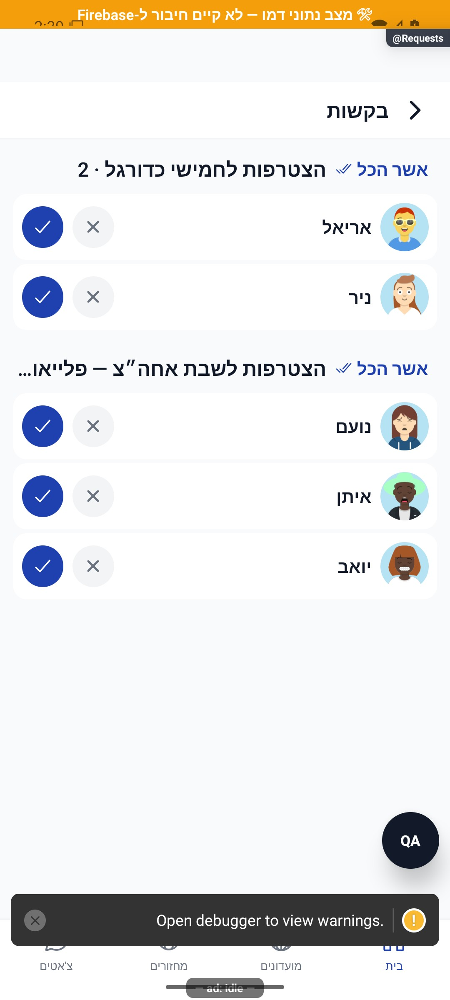
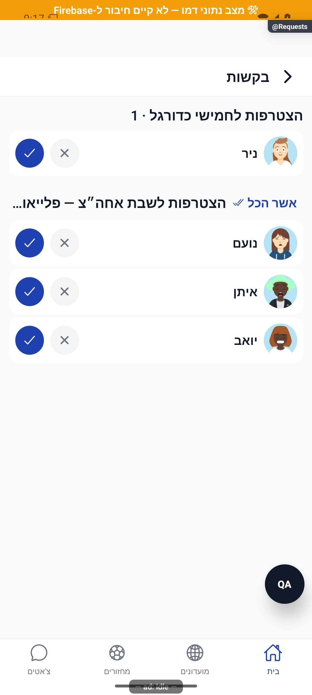
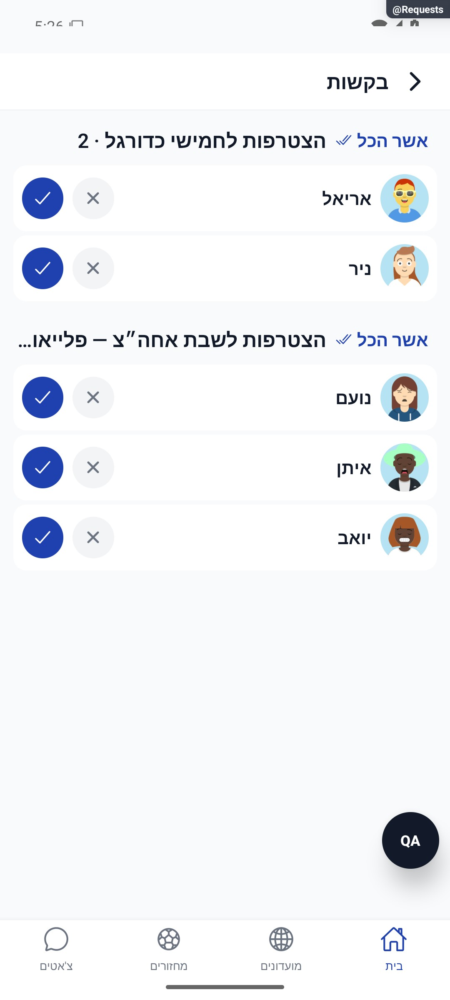
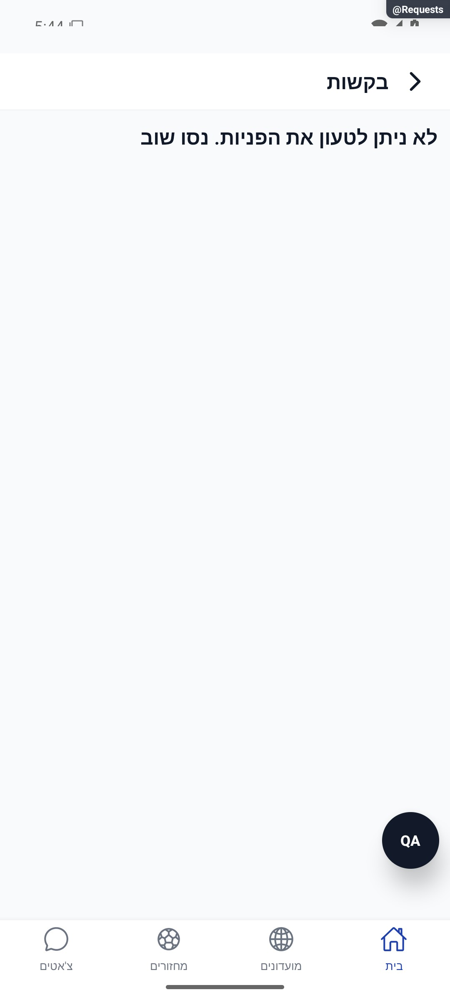
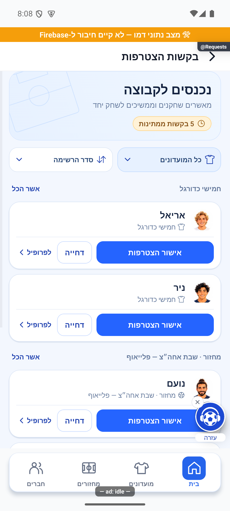

# בקשות ואישורים מאוחדים

## טעינת בקשות במצב אורח — 23.10.2026

`RequestsBell.fetchCount` ו־`GamesListScreen.fetchCount` מדלגים על
`getInboxCount` כשאין משתמש או כשהוא אורח ומאפסים את המונה המקומי בלבד.
ניקוי האפקט מבטל קבלת מונה מבקשה של החשבון הקודם. `RequestsScreen.load`
מגדיל קודם את `loadVersion`, ובמצב אורח מאפס את נתוני התצוגה ואת דגלי
הטעינה והכשל, ללא קריאת `getInboxRequests`. תלות `isGuest` מבטיחה
טעינה מחדש גם בשדרוג חשבון ששומר את אותו מזהה.
אין החזרת רשימה ריקה משירות בגלל כשל או החלפת זהות: ההחרגה נמצאת
בתצוגה ורק במצב שבו תיבת חשבון רשום אינה שייכת למשתמש הנוכחי. כשלים
בחשבון רשום ממשיכים לדיווח ולטיפול הקיימים. לא שונו אישור בקשות,
הרשאות או ניווט. `tests/logic/pulse23ExpectedConditions.test.ts` מפעיל
את פונקציות המקור עבור אורח, חשבון רשום ותגובה מאוחרת לאחר ניקוי.
אין אימות מכשיר חדש בסבב זה; התיקון מקומי וטרם הופץ.

## תיעוד כשלים — 20.10.2026

נוספו תצפיות דיווח בנקודות הכשל של המקורות המשויכים לפיצ׳ר, במסגרת הרחבה רוחבית. נשמרו ערכי החזרה, הזריקות ותנאי הפעולה הקיימים; נוסף מקור קוד והקשר לדיווח. כיסוי תחבירי אינו הוכחת הרצה של כל מצב. השינוי מקומי וטרם הופץ; בדיקות המסירה, מגבלות מניעת הכפילויות והמסלולים שטרם חוברו מתועדים בדוח המשותף.

[דוח דיווח השגיאות והראיות](../../changes/2026-10-20-error-reporting-audit.md).

[לקריאה קצרה ופשוטה](requests.simple.md)

עודכן: 07.10.2026; מקור `8e8fde5`, `1.1.35` בבנייה. `src/screens/RequestsScreen.tsx`, מסלול `Requests`; פעמון הבית וקישורי אישורים. תפקיד: משתמש לכל בקשות החברות, מנהל למחזורי/מועדוני סמכותו.

## תכולה

שלושה מקורות: בקשות חברות נכנסות, בקשות למועדונים שהמשתמש מנהל, ובקשות למחזור שיצר או שהוא מנהל בו. רשומות כוללות זהות, הקשר, כפתורי אישור/דחייה וכניסה ל־`PlayerCard`. פעולת אישור קבוצתית תלויה בקבוצה/מחזור ומטפלת גם בהצלחה חלקית.

בצילום נצפו חמש בקשות למחזור ושתי בקשות מועדון. התמונות החיצוניות של שחקני הדמו מקבלות קדימות על האווטאר המובנה; אין מכאן ראיה לכשל החלפת האווטארים.

| מצב/פעולה | התנהגות | כתיבה | ראיה |
|---|---|---|---|
| טעינה/רענון | איסוף תורים וזהויות | אין | קוד |
| אין בקשות | מצב ריק מאוחד | אין | קוד |
| אישור/דחייה בודדים | נעילה לפי פריט, עדכון ורענון | שירות חברות/מועדון/מחזור | קוד; לא בוצע חי |
| אישור כמה | תוצאות חלקיות אינן הצלחה של כולם | כל עסקה לפי הרשאה | קוד |
| מחזור מלא בעת אישור | תוצאה יכולה להיות המתנה | רישום לתוצאה האמיתית | קוד |
| לחיצה על שחקן | כרטיס שחקן בהקשר מתאים | אין | קוד |

## מקור אמת ובדיקות

`src/services/requestsService.ts`, `src/services/friendsService.ts`, `src/services/groupService.ts`, `src/services/gameService.ts`, `src/components/RequestsBell.tsx`. ספירה זולה לפעמון אינה תחליף לרשימת תורים מלאה. השמות נפתרים מהזהויות, וקבלת החלטה צריכה לאמת הרשאה ומצב מחודש בשירות. הממירים ב־`src/firebase/firestore.ts` קובעים אילו שדות בקשה/משתמש נשמרים בקריאה אמיתית.

בדיקות הרשמה וקיבולת: `tests/logic/registrationQa.test.ts`, `tests/logic/joinCtaCapacity.test.ts`; אין מכאן כיסוי אוטומטי לכל קומבינציית שלושת התורים. צילום דמו מוכיח תצוגה, לא החלטות שרת.

## שחזור וסיכונים

לבדוק משתמש ללא סמכות, מנהל בכמה מועדונים, שמות חסרים, פריט שהוכרע במכשיר אחר, בקשה למחזור שהתמלא, אישור קבוצתי עם כשל חלקי וחזרה מכרטיס שחקן. אין לאשר/לדחות בקשות ייצור לצורך המיפוי. לפני שינוי איחוד/ספירה, להבחין בין בקשת חברות, חברות מועדון והרכב מחזור.

## פירוט מימוש ונקודות שינוי — העמקה 07.10.2026

`load` קורא את התיבה המלאה ומתחדש במיקוד וברענון. `act(key, fn)` מסמן פעולה בתהליך, ממתין לשירות, מפעיל משוב ומרענן את הרשימה; מזהים בנויים מהסוג, המועדון/מחזור והמשתמש כדי להבדיל שורות. `approveAll` מבקש אישור מראש, מקבל `BulkResult` ומציג במפורש מספר הצלחות וכישלונות, לא ״הכול אושר״ כשיש כשל חלקי.

אישור חברות עובר דרך `friendsService.acceptRequest`, חברות מועדון דרך `approveMember`, ומחזור דרך `approveGameJoin`; אלה אינם אותו מושג או אותה כתיבה. האישור הקבוצתי צריך לכבד קיבולת ותוצאה של המתנה. `busy` הוא מזהה יחיד למסך, לא מפה של מספר פעולות מקבילות; שינוי מקביליות מחייב בדיקה של חסימת כל הכפתורים ושל רענון תוצאה מאוחרת. כשל טעינה נרשם אך לא מוצג כיום מצב שגיאה נפרד בתיבה; אין להפוך רשימה קודמת/ריקה להוכחה שאין בקשות.

הבדיקות, מצבי המסך והראיות שכבר פורטו במסמך נשמרו. ההעמקה מבוססת על קריאת מקור ולא על הרצת פעולות נוספות; שינוי עתידי יצריך עדכון של שני המסמכים ובחינת המצבים הממוקדים.

## עדכון 8.10.2026 — תנועה ותיקוני דיווחים

`Row` משתמש ב־`Animated.View`, יציאה `FadeOut` במשך 180 ותזוזת פריסה `LinearTransition` במשך 220 אלפיות שנייה. ההסרה מתחילה בעקבות התוצאה של `act` ורענון `load`, ולא בלחיצה או בסיום האנימציה. בכישלון השורה נשארת. תנועה מופחתת מבטלת יציאה ותזוזה.

**ראיה ומגבלות:** אושרה בקשת אריאל בנתוני דמו; מספר הממתינים במועדון ירד משניים לאחד. כשל שרת ופירוק באמצע פעולה לא הורצו חזותית.

בדיקת הטיפוסים ו־183 חבילות הבדיקות עברו, 2,752 בדיקות. מצב המקור: `9ec0dfd` עם שינויים מקומיים; אין גרסה חדשה שפורסמה. [יומן השינוי וההקלטות](../../changes/2026-10-08-motion-and-pulse.md).

## תיקוני סבב הבאגים — 8.10.2026

B01–B02: requestsService מפיצה כשל מקור במקום להמיר אותו למערך ריק. פתרון שמות משמר את המזהה ומחזיר שם חלופי משתמש. RequestsScreen שומרת רשימה קודמת, מציגה loadFailed ומונעת מצב ריק בשגיאה. הבדיקה משווה ספירת פעמון ורשימה כשהפרופיל חסר ובודקת דחיית קריאה.

[ראיות, בדיקות ומגבלות](../../changes/2026-10-08-audit-fixes.md).

רשימת פניות רגילה בדמו; מצב כשל המקור ושם חסר נבדקו מבודד, ולא בצילום זה.

כשל קריאה יזום בשירות הפניות בדמו. נצפתה הודעת ניסיון חוזר ולא רשימה ריקה. הזרקת הכשל הוסרה והמקור הוחזר במדויק.

## איחוד ועיצוב קומפקטי — 18.10.2026

מקור: `5148f63c2a8e9c454b68132fdb0d683a98a4adc9` עם שינויים מקומיים. לא הופץ. המימוש הנוכחי מחליף את התיאור החזותי ההיסטורי לעיל.

### ניווט ורכיבים

`AdminApprovalScreen.tsx` מייצא את `RequestsScreen` בשם הקודם: אין שני מימושים נפרדים. שני המסלולים רשומים במחסניות הבית, המועדונים, המחזורים והשיחות. `CommunityDetailsScreen` ו־`ManagerDashboardScreen` שולחים `{groupId}`; פעמון הבית פותח ללא סינון. הטיפוסים בשלוש מחסניות הבסיס מקבלים פרמטרים אופציונליים; מחסנית השיחות יורשת את טיפוס מחסנית המועדונים. פרמטר ניווט חדש מאפס את בחירת המועדון, והמשתמש יכול לשנותה בחלון בחירה.

`requestInboxRows` משטח את שלושת תורי הבקשות. סינון מועדון כולל בקשות חברות באותו מועדון ובקשות למחזורים ש־`game.groupId` שלהם תואם; בקשות חברות אישיות ומחזורים ללא מועדון מופיעים רק ב״כל המועדונים״. מזהה שורה משלב סוג, יעד ומשתמש, ולכן אותו שחקן בשני מועדונים או במחזור אינו מתאחד. הסינון הוא תצוגתי, ולא מעניק הרשאות או מוסיף שאילתות.

### תצוגה וחישובים

כותרת עם איור מגרש עדין, מונה, בורר מועדון ובורר מיון. `RequestCard` כולל תמונה בגודל 42, שם והקשר בשורה העליונה, ופרופיל/אישור/דחייה בשורת הפעולות. אין גובה קשיח לכרטיס: טקסט הפעולות יכול לגדול עם גופן מערכת, ושמות ארוכים נחתכים בשורה אחת. עיר מוצגת רק מתוך `user.availability.homeCity`, ללא השלמה מעיר המועדון.

המונה הוא `rows.length` אחרי הסינון: מספר בקשות, לא מספר שחקנים ייחודיים. לדוגמה, בקשת מועדון ובקשת מחזור של אותו אדם נספרות פעמיים. מיון לפי שם משתמש ב־`localeCompare(..., 'he')` על עותק השורות; ברירת המחדל שומרת סדר מקור, ואינה מתיימרת להיות סדר כרונולוגי. תאריך מוצג רק בבקשת חברות שיש לה `request.createdAt`; נתוני תורי המועדון והמחזור אינם כוללים כיום זמן בקשה, ולכן אין תאריך מומצא או שימוש בתאריך יצירת המשתמש.

### מצבים וכתיבות

| מצב | התנהגות |
|---|---|
| טעינה ראשונה | מציג טעינת כדור; לא מצב ריק מוקדם |
| רענון נכשל | שומר מידע קודם, מסמן שהמונה טרם עודכן ומציג ניסיון חוזר |
| אין בקשות בסינון | מסביר שאין בקשות במועדון ומציע לבחור מועדון אחר |
| פרופיל חסר | משמר את מזהה המשתמש ואת הבקשה, עם שם חלופי |
| אישור/דחייה | `actionLock` נועל מיד גם לחיצה שנייה לפני רינדור; כל כפתורי ההחלטה נעולים עד סוף הפעולה |
| אישור מועדון | עטיפת חנות המועדונים הקיימת לעדכון המטמון, מדידה והישגים; שירות ישיר רק אם המועדון טרם נטען לחנות; לאחר מכן רענון התיבה |
| מחזור מלא | הודעת המתנה לפי `approveGameJoin().bucket` |
| מועדון מלא | הודעת הקיבולת הקיימת עבור `GROUP_FULL` |
| אישור קבוצתי | אישור מקדים, תוצאות חלקיות; במועדון מתבצע גם רענון חנות המועדונים |
| רענון חופף/עזיבה | מונה `loadVersion` מונע מתשובת טעינה ישנה לדרוס תשובה עדכנית |

הכתיבות נשארות בשירותי החברות, המועדונים והמחזורים הקיימים. אין שינוי בכללי הרשאות, בממירים או בסכמת מסד. פרופיל נפתח עם `userId` ובהקשר מועדון כשיש `groupId`. אישור קבוצתי זמין לכל יעד בנפרד בסדר המקורי, ולא מערבב מועדונים.

### בדיקות וראיות

`tests/logic/requestInboxView.test.ts`: שמירת שלושת התורים וזהות חסרה; סינון מועדון ומחזוריו; מועדון ללא בקשות; ביטול סינון; מיון ללא שינוי המקור; שמירת מפתחות נפרדים; הימנעות מהמצאת תאריכים.

מקור ומגבלות הצילומים נרשמים במניפסט. בדיקת הכתיבות נעשית בדמו בלבד; אין אישור או דחייה של בקשות ייצור. לא נטען שהרשאות או תחרות בין שני מנהלים נבדקו מול שרת חי.

ליטוש 18.10.2026 לפי בקשת הבעלים: סדר ילדי שורת הפעולות הוא אישור, דחייה, פרופיל. במצב הכיווניות של היישום, אישור ודחייה מוצגים בימין והפרופיל משמאל. אין שימוש בהיפוך שורה, ואין שינוי בפעולות עצמן או בגובה הכרטיס.

## תלות בעדכון העונות — 19.10.2026

נבדק ההפרש בקבצים המשותפים הרשומים כאן: `src/firebase/firestore.ts`, `src/services/gameService.ts`. השינוי ממוקד במדיניות העונות, קריאת מצבן, שיוך מחזור ופקודות ניהולן; אין שינוי מכוון בחוזה העצמאי המתואר במסמך זה. אין להסיק מכך שהמסך הזה הורץ מחדש.

[מצב המימוש, הבדיקות ומגבלות האימות של העונות](../clubs/seasons.md). מקומי בלבד; לא בוצעה פריסה במסגרת המשימה.

## תלות במידע על סגירת עונה — 23.10.2026

בדיקת ההבדל ב־`src/firebase/firestore.ts` וב־`src/types/index.ts` מראה שהשינוי מוגבל לקריאת `seasons.closureStatus` בחוזה `GroupSeasons`. יתר ממירי הנתונים והמסלולים המתועדים כאן לא שונו במשימה זו. אימות הריצה החדש מתייחס להתאוששות ולכרטיס העונה, ולא להרצה חדשה של כל מצבי המסך הזה. [המסלול, הבדיקות והמגבלות](../../changes/2026-10-23-season-automatic-recovery.md).

## בידוד מונה בקשות והתאוששות מרקע — 23.10.2026

`groupService.listForUser(userId, { includeAdminRatings: false })` מחזיר את נתוני החברות ללא קריאות `getClubAdminRatings` וללא שדה דירוגים. ברירת המחדל של מסכי המועדון שומרת את טעינת הדירוגים ואת התנהגות הכשל הקיימת. `requestsService.myAdminGroupsWithPending` משתמש במסלול המצומצם: מספר בקשות חברות + סכום הממתינים במועדונים שמנוהלים בידי המשתמש + סכום הממתינים במחזורים שיצר. אין שינוי במכנה או בהרשאות. אפקט המיקוד של מונה הבית מאזין גם ל־`AppState`: מעבר מצב מבטל דור קודם, חזרה ל־`active` מבצעת קריאה חדשה; ניקוי מסיר מאזין ומונע תוצאה מאוחרת. `inboxRatingsIsolation` מריץ את מתודות המקור ומוכיח ספירה של 4 גם כששרת הדירוגים נכשל ושימור כשל מקור אמיתי; `homeInboxResume` מריץ את אפקט המקור ומאמת תוצאה חדשה מול ישנה, ניקוי ואורח. אין כאן הוכחת פתרון לכל חריגת זמן, חיבור רשת או כניסת אפל. אין אימות מכשיר חדש של תרחיש רשת זה. [הסבר, יומני שרת ומגבלות](../../changes/2026-10-23-inbox-resume.md).

## עדכון תלות משותפת בקריאות מידע — 23.10.2026

בקובצי השירות המשותפים נוספה אפשרות מפורשת לניסיון חוזר אחד בקריאה זמנית שנכשלה, תוך עצירה אם החשבון מתחלף. החיבור מוגבל ל־14 נקודות קריאה המפורטות בדוח; אין כאן טענה שכל פעולה בפיצ׳ר קיבלה ניסיון חוזר או שנבדק מסך חדש. בדיקות המאגר המלאות עברו (5,261 בדיקות ב־472 חבילות), אך אינן הוכחת הרצה במכשיר. הקוד מקומי וטרם הופץ. [מסלול, ראיות ומגבלות](../../changes/2026-10-23-four-open-errors.md).
