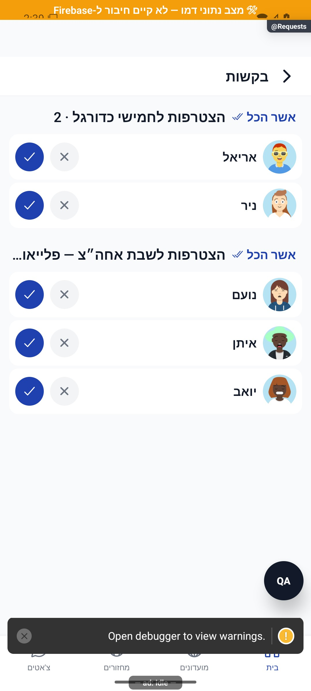
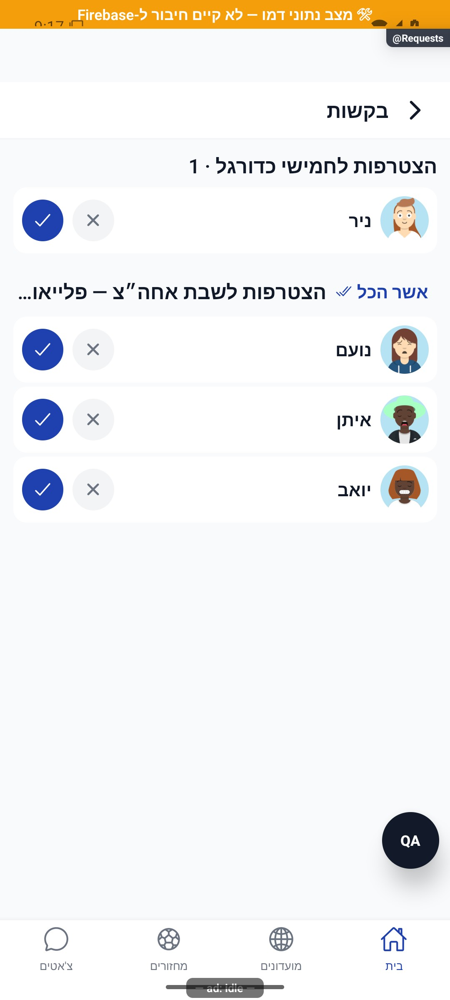
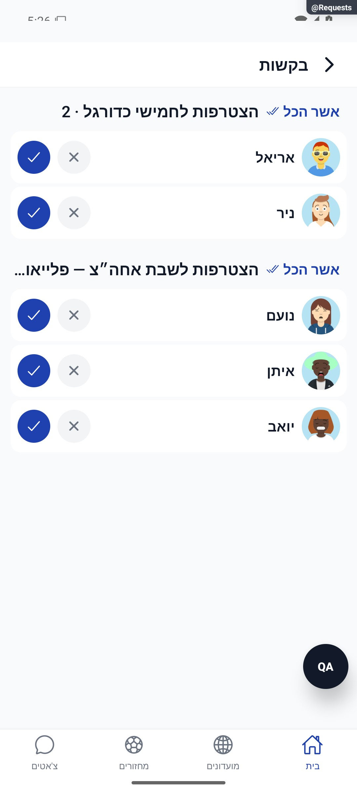
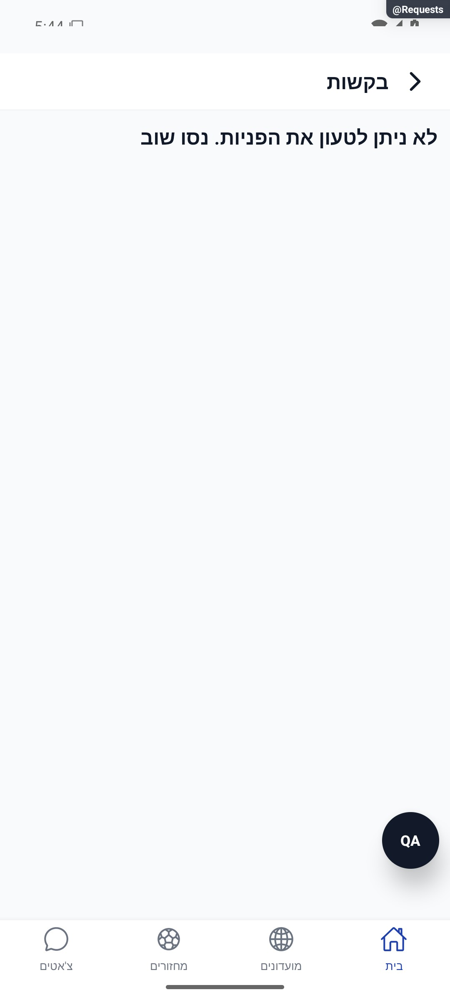
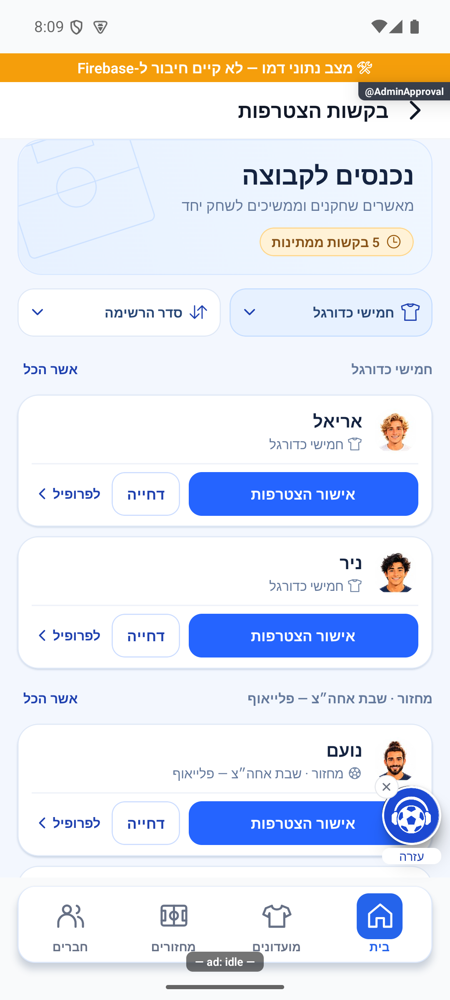

# בקשות ואישורים מאוחדים

## עצירת מחזור קבוע ללא פעילות, 6.11.2026

נבדק השינוי התחום ב-`functions/src/clubDeletion.ts`, `functions/src/index.ts`, `tests/logic/clubDeletion.test.ts`: בדיקת חוסר פעילות לפני יצירת מחזור קבוע ושמירת שלוש החלטות בזמן ניקוי מחזורים ריקים. ההכרעה משתמשת במקור הקיים לקיום מחזור ומגינה על מחזור עם הרשמה שנותר לא מוכרע. עסקאות היצירה והניקוי נשארות מוגנות מפני שינוי מקביל ומועדון חסר. אין שינוי מכוון בחישובים, במכנים, בהרשאות, בניווט או בפעולות העצמאיות האחרות של הפיצר הזה. בדיקות מקור השרת הורצו במאגר זיכרון; הפריסה הממוקדת של שני שירותי התזמון אומתה בייצור מול המקור שנבדק, ותועדה הרצת שירות חמש הדקות ללא שגיאות. אין בכך אימות חדש של המסך או של יתר פעולות הפיצר. [ההתנהגות, מסלול הנתונים, הבדיקות ומגבלות ההפעלה](../../changes/2026-11-06-inactive-recurring-rounds.md).

## דירוג בסיס לשחקן ללא דירוג, 6.11.2026

נבדק שינוי תחום במקורות המשותפים של הכוחות האוטומטיים: שחקן ללא דירוג מחושב כ-2.5 מתוך 5, וההסברים תואמים. דירוג מפורש נשמר. אין כאן אימות חדש של כל מצבי הפיצר העצמאי; השינוי מקומי וטרם הופץ. המקורות המשותפים שנבדקו בהפרש זה: `functions/src/index.ts`. [ההתנהגות, הבדיקות ומגבלות האימות](../rounds/draft-setup.md#דירוג-בסיס-לשחקן-ללא-דירוג-6112026).

## ממצאי סבב הפולס, 5.11.2026

בבדיקה חיה של מטא הנתונים בשרת, `getMyRoundFillerNotices` החזיר 404, בעוד `getSocialPlayerProfile` באותו פרויקט ואזור נמצא פעיל. שתי שגיאות חדשות, מתוך `FillerInterestsSection` ומתוך התיבה המאוחדת, מציינות בדיוק את הקריאה החסרה. הפונקציה קיימת ב-`functions/src/index.ts`, והמימוש המקומי תואם ללקוח. דרושה פריסה מתואמת של מסלול בקשות ההשלמה המתועד ב-4.11, ללא הסבת נתונים או הרחבת הרשאות. לא בוצעה פריסה בסבב זה; השגיאות נשארו פתוחות. מקומי, ללא הפצה או אימות מכשיר חדש. [ממצאים, בדיקות ומגבלות](../../changes/2026-11-05-pulse-sweep.md).

## מדידת פעולות ואמינות נתונים, 5.11.2026

במיפוי מקור הרכיבים המוזכרים במסמך נמצאו 16 נקודות מטפל ו-15 מזהי פעולה. הספירה מתארת קוד וכוללת רכיבים משותפים; אין לחבר אותה לספירות של מסמכים אחרים ואין לראות בה הרצת כל המסך. המדידה מפורטת לפי גבול פקד מקורי, פעולה עסקית ומצב חשבון. תשובה מאוחרת נבדקת מול בעל הפעולה, ומצב קיים או בקשה חוזרת אינם תמיד הצלחה חדשה. רשימת המקרים שהורצו ומגבלות המסד, המכשיר והכיסוי נשמרות [בדוח המדידה](../../audits/2026-11-04-system-night/product-measurement.md) ובדוחות המקושרים אליו. המימוש מקומי; לא בוצעה בדיקה חדשה של כל מצבי הפיצר.

## בקשות השלמה בפעמון ובתיבה, 4.11.2026

src/services/requestsService.ts משתמש באותו מקור לתיבה ולמונה: חברויות, בקשות למועדונים מנוהלים, בקשות רגילות למחזור שיצר המשתמש ובקשות השלמה למחזורים שבניהולו. מחזור שנמצא הן דרך היוצר והן דרך המועדון נספר פעם אחת לפי מזהה. מנהל מועדון קורא בקשות ממתינות לפי מחזור. יוצר שאינו מנהל המועדון מקבל דרך getMyRoundFillerNotices בקשות שהשרת ייעד לו באותה עסקה, גם בלי הודעת טלפון. בבקשות היסטוריות ללא נמען נבדקות ההתראות האישיות שלו. בשני המסלולים מאומתים מחדש היוצר, הסטטוס והסגל. מקור חסר אינו הופך לאפס: ספירת פעמון חלקית נדחית והתיבה מציגה פריטים שהצליחו עם הודעת ניסיון חוזר. src/utils/requestInboxView.ts מסנן גם את בקשות ההשלמה לפי מועדון. האישור והדחייה פרטניים ונשלחים לפעולת ההשלמה, לא לפעולת ההרשמה הרגילה. tests/logic/fillerRequestsInbox.test.ts בודק ספירה, תפקידים, כשל והחלפת מסלול. מקומי וטרם הופץ. [הראיות והמגבלות](../../changes/2026-11-04-filler-requests.md) · [דרכי הכניסה וההמלצות](../../specs/2026-11-04-outside-round-players.md).

## חיפוש שחקנים וזמני טעינה, 4.11.2026

קריאת מחזורים עתידיים של מועדון יכולה להעביר כשל גישה לחלונית ההזמנה כשהיא מבקשת תשובה מאומתת. ברירת המחדל של יתר הקוראים נשמרת. שירות החיפוש, הכרטיס וגיוס הפנויים התעדכן. מסלולי התאימות של זהויות, סטטיסטיקה מלאה והזמנות ממשיכים לבדוק גישה. נקודת הכניסה מייצאת את מעדכן מפתח השמות הפרטי. אירוע זה דורש פריסה נפרדת. בדיקה זו תחומה למקור המשותף, ללא הרצה חדשה של כל המסך העצמאי. מימוש מקומי שטרם הופץ. [השינוי, המדידות והבדיקות](../../changes/2026-11-04-player-discovery-speed.md).

## ציר פעילות פרטי בפולס, 4.11.2026

בציר הפעילות, תשובת שרת על מצב הרשמה קיים אינה נספרת כהרשמה חדשה. קבלה ללא סימון יצירה מפורש מוצגת עם מגבלת אמינות.

נבדקו התוספות במקורות המשותפים לצורך ציר פעילות פרטי בפולס: דיווח ניווט והקשר, תיעוד ניסיון הרשמה ותוצאתו וגבולות זהות ומחיקת חשבון. התוספת היא תיעוד ברקע במקומות הנתמכים; אין מכך אימות חדש של כל מצבי הפיצר הזה או שינוי בחישוביו. מקומי וטרם הופץ או נפרס. [היקף, מקורות, בדיקות ומגבלות](../shared/usage-activity.md).

## השפעת שיפורי הטעינה המשותפים, 4.11.2026

עודכנה תלות משותפת במסלול טעינה או במתאם הבדיקה, בהיקף השינוי המתועד בלבד. אין שינוי מכוון בחישובים או בפעולות העצמאיות של הפיצר הזה.

מקורות משויכים שנבדקו בהיקף השינוי: `tests/logic/pulse23ExpectedConditions.test.ts`.

מימוש מקומי וטרם הופץ. אין בכך אימות מכשיר חדש של הפיצר הזה או מדידת מהירות של כל מסלוליו. [המדידות התחומות, הבדיקות והמגבלות](../../changes/2026-11-04-screen-performance.md).

## השפעת שיפורי הטעינה המשותפים, 4.11.2026

קריאות חופפות לזהויות שחקנים או לדירוגי מועדון חולקות עבודה פעילה באותה התחברות. שמירת פרופיל או דירוג מבטלת שיתוף קודם, ולא נשמרת תשובה שהושלמה לשימוש חוזר. אין שינוי במקור הרשאות או בחוזה הנתונים העצמאי של הפיצר.

מקורות משויכים שנבדקו בהיקף השינוי: `src/services/groupService.ts`.

מימוש מקומי וטרם הופץ. אין בכך אימות מכשיר חדש של הפיצר הזה או מדידת מהירות של כל מסלוליו. [המדידות התחומות, הבדיקות והמגבלות](../../changes/2026-11-04-screen-performance.md).

## גרסת אנדרואיד פנימית 1.1.73, 3.11.2026

קוד הלקוח המתואר במסמך נכלל בגרסת האנדרואיד הפנימית 1.1.73/305. מקור החבילה, החתימה והמסלול אומתו מול החנות; הייצור נשאר 1.1.72/304. אין אימות התקנה מחנות או גרסת אייפון חדשה. הבדיקות החוזרות כוללות 6,815 בדיקות יישום, 360 בדיקות הרשאות מקומיות ו-38 בדיקות שירותי שרת במסד מקומי. אין שינוי כללי הרשאות או הסבת נתוני ייצור; צילומי התיקון הקודמים נשארים ראיה בהיקפם, ולא בדיקת המכשיר של חבילת החנות. [מקור, בדיקות, קבלות ומגבלות](../../changes/2026-11-03-internal-1.1.73.md).

## תיקוני דיווחי הפולס, 3.11.2026

מסכי RequestsScreen ו-AdminApprovalScreen משתמשים באותו requestInboxRows. ברירת המחדל הופכת עותקים של מערכי הממתינים וממיינת בקשות חברות לפי זמנן; סוג הבקשה, מזהה המשתמש והיעד נשמרים. אין תאריך מומצא לפי פתיחת החשבון ואין שינוי באישור, דחייה או מכסות. פירוט המקור, מיון בין הקשרים והבדיקה בזוג מסמכי clubs/requests-and-approvals. הבדיקה החזותית היא רינדור מסך מקור עם מתאמי דפדפן ונתוני הדגמה, ולא הרצה במכשיר.

[פירוט התיקונים, הבדיקות, הצילומים והמגבלות](../../changes/2026-11-03-pulse-sweep.md).

## העברת אורח לרשימת המתנה, 3.11.2026

נבדק ההפרש הממוקד במקור המשותף `functions/src/index.ts`: תנאי `guestSeatFreed` ב-`onGameRosterChanged` מבחין כעת בין הסרת אורח פעיל לבין העברה ידנית להמתנה. אין שינוי מכוון בחישובים, בנתונים, בניווט או בפעולות העצמאיות של הפיצר המתואר כאן. בדיקות גילוי העזיבה והקידום מכסות את השינוי המשותף; אין בדיקת מסך חדשה לפיצר זה. התיקון מקומי וטרם נפרס או הופץ.

[היקף, בדיקות ומגבלות](../../changes/2026-11-03-guest-waitlist.md).

## ליטוש מקומי והשפעת רכיבים, 3.11.2026

השפעה עקיפה דרך `Avatar`: כשל כתובת תמונה מציג אותיות שם באותן מידות, וכתובת חדשה מתחילה ניסיון חדש. אין שינוי בנתונים או בכללי הפעולות העצמאיות של הפיצר. לפירוט הנעילה, הנתונים, הכשל וגבולות ההרצה ראו [חוזי הרכיבים המשותפים](../shared/menus-and-motion.md). אין כאן טענה שכל זרימת בקשות ואישורים מאוחדים הורצה.

השינוי מקומי וטרם הופץ. אין כאן אימות חדש של מסך מוצר מלא, מכשיר, קורא מסך או שרת. [הראיות והמגבלות של המשימה](../../changes/2026-11-03-overnight-mission.md).

## אימות פרסום קבוצות בפולס, 2.11.2026

נבדק ההפרש התחום בשירות המשותף של המחזורים: נוספה בדיקת אישור לפרסום קבוצות כאשר תשובת הפעולה אובדת. אין שינוי בחישוב, במכנים או בפעולות העצמאיות של הפיצר המתואר כאן. התיקון מקומי וטרם הופץ; אין בדיקת מכשיר חדשה לפיצר זה.

השינוי ב-`src/services/gameService.ts` מוגבל ל-`publishDraftTeams` ולתלות בסיווג כשלים זמניים. נבדקו גבולות קבלת השרת, התאמת החשבון והחלוקה, ושימור השגיאה כאשר האימות נכשל. `tests/logic/publishTeamsReceipt.test.ts` מפעיל את פונקציית השירות מול תחליפי קריאה וכתיבה; אין בכך הרצת כל המסלולים של המסמך הזה.

[דוח הטיפול, הבדיקות והמגבלות](../../changes/2026-11-02-pulse-sweep.md).

## בקשות לשיחה אישית, 2.11.2026

נבדקה השפעת תוספת בקשות השיחה במקורות המשותפים. השינוי ממוקד בהרשאת שיחה, בשדות פרטיות ההודעות ובחיבורי הבדיקות; אין מכך אימות חדש של מסך זה במכשיר. המימוש מקומי וטרם הופץ או נפרס. [התנהגות, בדיקות ומגבלות](../chat/message-requests.md).

מקורות משותפים שנבדקו בהיקף השינוי הזה: `functions/src/index.ts`, `functions/src/socialPlayers.ts`, `src/firebase/firestore.ts`, `src/types/index.ts`. אין בסעיף זה טענה להרצת כל המסלולים ההיסטוריים של הפיצר. [מסירת המימוש](../../changes/2026-11-02-message-requests.md).

## הסרת מגבלת החברים במועדון, 1.11.2026

נבדקה השפעת השינוי הממוקד במקורות המשותפים: הוסרה מגבלת החברים במועדון. אין שינוי מכוון בהתנהגות העצמאית של המסך המתואר כאן או במספר המקומות במחזור. התיקון מקומי וטרם הופץ; אין בדיקת מכשיר חדשה לפיצר זה.

מקורות ששונו בהיקף המשימה: `functions/src/index.ts`, `functions/src/socialPlayers.ts`, `src/services/groupService.ts`. מספרי החברים אינם משמשים עוד כתנאי תפוסה במועדון. שדות התאימות הישנים אינם נאכפים.

[מסלול הנתונים, התנאים, התאימות, הבדיקות ומגבלות ההפצה](../../changes/2026-11-01-unlimited-club-members.md).

## פריסת הגנות הסרת המחזור, 30.10.2026

נפרסו שבע חבילות מבודדות, ועדכון המקור בלבד אומת מול כל הקבצים הפעילים. הגדרות השירותים והאירועים ו-111 השירותים האחרים נשמרו. אומתו מוכנות ותעבורה לגרסאות החדשות, קריאה עצמית עם חשבון בדיקות קיים ושימור גרסאות כל 496 המסמכים שבגיבוי. שש דחיות בקשות דפדפן לא תקינות סווגו לפי מזהי בקשה; לא זוהה כשל ריצה עסקי בלתי צפוי. לא הופעלו מחיקה, חסימת מחזור או בקשת שמירה תקינה על נתוני המועדון. זו ראיית הפריסה התחומה ולא הרצה מחודשת של כל מסך.

[גרסאות פעילות, בדיקות שרת וגבולות האישור](../../changes/2026-10-30-evening-removal-server-deployment.md).

## השלמת הגנת הסרת המחזור, 30.10.2026

הורחבה ההגנה ב-`functions/src/personalActivity.ts` וב-`functions/src/managerRoundHistory.ts`: קריאת `gameRemovalBlocksWrite` וקיום המחזור בתוך עסקת יצירת הנתונים. בקשת סנכרון לאחר הסרה מחזירה כשל מפורש במקום ניסיון חוזר ללא סוף. ב-`functions/src/index.ts` גם חבילת סטטיסטיקה מלקוח ישן מעדכנת את המחזור עם תנאי גרסה, ומכסת הפעולות כוללת תמיד כתיבת הגנה זו. אין שינוי בחישובי התוצאות, הפרטיות או הניווט מעבר להגדרת המחזור המתועד שפורטה קודם. נבדקו ארבעה עשר תרחישים ראשיים, שמונה תרחישי חסימה ושחזור, שמונה בדיקות חבילות ושבע בדיקות פעילות ונתוני מנהל במסד מקומי. ההיקף הוא בדיקת השינוי התחום במקורות משותפים, ולא הרצה מחודשת של כל מסך או של תשתית מסירת האירועים. התיקונים טרם נפרסו.

[תוכנית הביצוע, החבילות, הבדיקות וגבולות האישור](../../changes/2026-10-30-evening-removal-readiness.md).

## הגנה בהסרת מחזור היסטורי, 30.10.2026

השינוי התחום ב-`functions/src/index.ts` עוטף את עיבוד אירועי הסגל בזכות עיבוד כדי לסנכרן הסרה ניהולית עתידית; הוא מוסיף קריאת קיום מחזור בעסקאות של השלמת היסטוריה ושמירת פעילות. השינוי ב-`functions/src/socialPlayers.ts` משווה את הגדרת המחזור המתועד לחישוב העצמי. אין שינוי מכוון בפעולות העצמאיות האחרות המתועדות כאן, בהרשאות או בניווט. זו בדיקת השפעה תחומה של המקורות המשותפים, ולא הרצה של כל מצבי הפיצר. אין פריסה או אימות מכשיר חדש.

[התנהגות, סדר הפעולות, חישובים, בדיקות וגבולות האישור](../../changes/2026-10-30-evening-removal-readiness.md).

## החלפת הקבוצה הבועטת בפנדלים, 30.10.2026

נבדק ההבדל התחום במשימה במקורות המשותפים `src/services/gameService.ts`, `src/types/index.ts` ו-`src/firebase/firestore.ts`: הוא מוסיף ומשמר תור מפורש לפנדלי ההכרעה ומעדכן אותו ברישום ובביטול בעיטה. אין שינוי בשדות, בחישובים או במסלול הנתונים העצמאי של הפיצר המתואר כאן. בדיקת הקורא והעסקאות מפורטת בדוח; אין בכך הרצה מחדש של המסך הזה. [התנהגות, בדיקות ומגבלות](../../changes/2026-10-30-shootout-turn.md).

## התאוששות משגיאות בפולס, 28.10.2026

במקור המשותף `src/services/gameService.ts`, הקריאות `getGameById` ו-`getCommunityChampionship` משתמשות כעת ב-`withAuthRaceRetry` עם `retryTransientReads: true`. כשל זמני מאפשר ניסיון קריאה נוסף אחרי 500 אלפיות שנייה עם בדיקת בעלות על החשבון. מסלול החלוקה השמורה נשאר במסלול ההמתנה המדויק שלו. מסמך חסר נשאר חסר, סירוב הרשאה שומר על הטיפול הקיים וכשל מתמשך נזרק. אין שינוי בכתיבות, במכנים, בחישובי המחזור או בהכרעת התוצאה.

השינוי מקומי וטרם הופץ או נפרס. אין שינוי חזותי ואין צילום מכשיר חדש. [ממצאים, בדיקות ומגבלות](../../changes/2026-10-28-pulse-errors.md).

## תלות בסינון הצעות השלמה - 28.10.2026

השינוי הנוכחי ב-`functions/src/index.ts` מוגבל לבחירת הצעות השלמה: סף תפוסה של 70 אחוז ובדיקת הרשמה מתנגשת לפני יצירת התראה. אין שינוי מכוון בתהליך העצמאי המתואר כאן ואין אימות חדש שלו. רענון המקור המשותף אינו מאמת שינויים קודמים שהיו בו מאז קליטת התיעוד. [היקף, בדיקות ומגבלות](../../changes/2026-10-28-filler-eligibility.md). מקומי וטרם נפרס.

## הרחבת אבחון דיווחים, 27.10.2026

נוספה מעטפת אבחון מקומית עם מצב בזמן הכשל, שלבים בעלי מזהה ותזמון, מצב רשת ובנייה ומופעים נפרדים לשגיאה. נקודת הכניסה לתעבורת השרת עוברת כעת דרך העטיפה המשותפת; תשובות, חריגות, אפשרויות קריאה ומדיניות הפיצר נשמרות. אין כאן שינוי בהרשאות או בחישובי המוצר. הבדיקות המלאות ומגבלות האימות מתועדות בדוח המקושר; אין טענה לאימות מכשיר או להפצה. [היקף, ראיות ומגבלות](../../changes/2026-10-27-diagnostic-context.md).

באימות הסופי עברו כל 6,231 הבדיקות ב-555 חבילות, ובדיקות הטיפוסים של הלקוח, השרת והפולס נקיות. צילום הדפדפן והידור מקורות האנדרואיד הם בדיקות מקומיות; אין הוכחת מכשיר, הידור אייפון או מסירה חיה של הבנייה החדשה. רישום יומן השחרור נחשב מאומת רק לפי קבלת הקריאה החוזרת בדוח השינוי.

## טיפול מלא בפריטי הפולס הפתוחים, 27.10.2026

נבדק השינוי הממוקד במקור המשותף: התנגשות גרסת מועדון בעת זקיפת השתתפות נשלחת כעת לניסיון חוזר מקומי מוגבל שבונה מחדש את אותה כתיבה ואת הגנת העונה. סמן מניעת הכפילות נשמר. אין שינוי בהרשאות, בניווט או במדיניות הפיצר הזה. אין אימות מכשיר חדש או פריסה. [ממצאים, בדיקות ומסירה](../../changes/2026-10-27-pulse-completion.md).

## טיפול בתקלות הפולס, 26.10.2026

השינוי במקור המשותף מוגבל לסיווג תוצאה צפויה לפני רישום שגיאה: תיעוד מחיקת מחזור שכבר קיים אינו כשל חדש, והתנגשות גרסה בעדכון עונה אינה מבטלת את הגנת הגרסה. אין שינוי בחוזה הפיצר, במכנים, בניווט או בהרשאות; לא נערכה הרצה חדשה לכל מצבי הפיצר. כשל לא צפוי בתיעוד מחיקה נזרק שוב כדי לאפשר ניסיון שרת חוזר.

השינוי מקומי וטרם הופץ. [בדיקות, מסירה ומגבלות](../../changes/2026-10-26-pulse-fixes.md).

מקורות שנבדקו בסבב: `functions/src/index.ts`.

## ביטול פעילות אחרי מחיקת מועדון - 26.10.2026

נבדקה השפעת השינוי התחום ב-`src/services/groupService.ts`, ב-`src/services/seriesService.ts` וב-`functions/src/index.ts`: עצירת סדרות לפני מחיקת מסמך ההרשאה, הפעלת ביטול פעילות באירוע מחיקת המועדון, ועסקאות יצירה שמאמתות את קיום המועדון והסדרה גם במנגנון ההעתקה הישן. `functions/src/clubDeletion.ts` שומרת מחזורים שהסתיימו ונתוני עבר, מבטלת מצבים פעילים, דוחה בקשות חברות ממתינות, מסירה רק את המועדון שנמחק מהרשמות להתראות ומסירה את ההעתק הציבורי. המימוש והבדיקות ב-`tests/logic/clubDeletion.test.ts` וב-`tests/logic/clubDeletionClient.test.ts` מפורטים ב[דוח התיקון](../../changes/2026-10-26-deleted-club-recurring.md). אין שינוי מסכים, ניווט, נוסחאות או הרשאות במסגרת תיקון זה. זו בדיקת השפעה ממוקדת ואינה אימות מחודש של שינויים קודמים במקורות המשותפים. תיקון השרת נפרס ואומת באישור הבעלים, עם השוואת המקור הפרוס והקוד המהודר ושימור יתר הפונקציות. הסדרה, הרשמת ההתראות והכרטיס הציבורי של המקרה הידוע טופלו ונקראו חזרה; המחזור כבר היה חסר בבדיקה העדכנית. שינוי הלקוח טרם נכלל בבינארי. סעיף הפריסה בדוח כולל את מגבלות בדיקת החבילה המבודדת, ללא טענה למחיקת מועדון בדיקה בייצור.

## השפעת מקור משותף במשימת השעון - 26.10.2026

נבדק ההפרש ב-`src/services/gameService.ts`: `stopRotation` עוצר את השעון וסוגר קטע ריצה באותה טרנזקציה שמשחזרת את ההרכב; `_persistRotation` משמר קטע ריצה פתוח לפני איפוס שעון המשחק הבא. נשמרים `startedAt` והיסטוריית `activeIntervals`, ונמנעים שיבוצים ישנים אחרי עצירת הרוטציה. השוואת שתי המתודות למצב הקודם משחזרת את חותמת המקור שנרשמה לפיצר לפני תיקון זה. תורי ההרשמה והאישורים אינם משמשים הוכחת השתתפות במגרש, ומסלולם לא שונה בתיקון זה. זו בדיקת השפעת השינוי התחום במקור המשותף, ולא הרצה מחודשת של כל מצבי הפיצר. השינוי מקומי; מסמך זה אינו מאשר פריסה, שינוי הרשאות או העלאה לחנות. הצילומים בסיכום האישי מבוססים על רכיבי המקור עם מתאמי דפדפן ונתוני בדיקה, ולא על הרצת אנדרואיד או שעון. [היקף המימוש, הבדיקות, מגבלות האישור והצילומים](../../changes/2026-10-26-android-personal-activity.md).

## הפצה פנימית 1.1.61 - 25.10.2026

הבינארי `1.1.61/295` הופץ ואומת במסלול הפנימי באנדרואיד. תיקוני הלקוח נכללים בו, ושירות הפרופיל נפרס ואומת בנפרד. גם תיקוני הסגל, שמירת התוצאה והתראת השגיאה בשרת נפרסו ואומתו באישור מפורש. שינויי יישום הפולס עצמו טרם הופצו. אין שינוי כללי הרשאה או הסבת נתונים. ניסוחי המצב המקומי בסעיפים הקודמים נכתבו לפני ההפצה; [דוח ההפצה](../../changes/2026-10-25-internal-1.1.61.md) מפרט בדיוק מה נכלל, מה נבדק ומה עדיין מקומי.

מקורות ממוקדים בסבב: `src/services/readRetry.ts`.

## תיקוני הפולס - 25.10.2026

`receivedInvitationsService.listInbox` עוטף את הקריאה ל-`getReceivedInvitations` ב-`retryRead` עם `assertOwner`. הבדיקה פועלת לפני ניסיון, לפני המתנה ולאחר תשובה. החלפת חשבון מפסיקה את הניסיון הבא; אין החזרת רשימה ריקה במקום כשל. המעבר לשאילתת הנמען הוותיקה נשמר רק לקודים של נקודת קצה חסרה. קובץ המקור: `src/services/receivedInvitationsService.ts`.

[מקורות, בדיקות, צילומים ומגבלות](../../changes/2026-10-25-pulse-fixes.md).

## שעון מדויק וכיתוב פנדל - 25.10.2026

במקורות המשותפים נוסף שימור השעון המדויק של פנדל במהלך משחק, וכיתוב ההבקעה ביומן קוצר. אין שינוי במונים או בתהליך העצמאי המתואר כאן; לא נערכה לו בדיקת ממשק חדשה במסגרת העדכון. השינוי מקומי וטרם הופץ. [פרטים וראיות](../../changes/2026-10-25-in-play-penalties.md#שעון-מדויק-וכיתוב-אירוע).

## פנדל במהלך משחק חי - 25.10.2026

נבדק השינוי הממוקד במקורות המשותפים: נוספו חוזי אירועי פנדל במהלך משחק, קוראים ומוני סטטיסטיקה, והגנות בעסקאות סיום ואיפוס משחק. מסלול הפיצר המתואר כאן אינו נקודת הכניסה להזנה החדשה. בדיקות המאגר עברו, אך אינן הוכחת הרצה חדשה של כל מצבי התהליך או של פריסה.

השינוי מקומי. נדרשת פריסת שרת לפני הפצת לקוח שמשתמש באפשרות; לא בוצעו פריסה או שינוי הרשאות. [חוזה הנתונים, התהליך, הבדיקות ומגבלות ההפצה](../../changes/2026-10-25-in-play-penalties.md).

## טעינת בקשות במצב אורח — 23.10.2026

`RequestsBell.fetchCount` ו־`GamesListScreen.fetchCount` מדלגים על
`getInboxCount` כשאין משתמש או כשהוא אורח ומאפסים את המונה המקומי בלבד.
ניקוי האפקט מבטל קבלת מונה מבקשה של החשבון הקודם. `RequestsScreen.load`
מגדיל קודם את `loadVersion`, ובמצב אורח מאפס את נתוני התצוגה ואת דגלי
הטעינה והכשל, ללא קריאת `getInboxRequests`. תלות `isGuest` מבטיחה
טעינה מחדש גם בשדרוג חשבון ששומר את אותו מזהה.
אין החזרת רשימה ריקה משירות בגלל כשל או החלפת זהות: ההחרגה נמצאת
בתצוגה ורק במצב שבו תיבת חשבון רשום אינה שייכת למשתמש הנוכחי. כשלים
בחשבון רשום ממשיכים לדיווח ולטיפול הקיימים. לא שונו אישור בקשות,
הרשאות או ניווט. `tests/logic/pulse23ExpectedConditions.test.ts` מפעיל
את פונקציות המקור עבור אורח, חשבון רשום ותגובה מאוחרת לאחר ניקוי.
אין אימות מכשיר חדש בסבב זה; התיקון מקומי וטרם הופץ.

## תיעוד כשלים — 20.10.2026

נוספו תצפיות דיווח בנקודות הכשל של המקורות המשויכים לפיצ׳ר, במסגרת הרחבה רוחבית. נשמרו ערכי החזרה, הזריקות ותנאי הפעולה הקיימים; נוסף מקור קוד והקשר לדיווח. כיסוי תחבירי אינו הוכחת הרצה של כל מצב. השינוי מקומי וטרם הופץ; בדיקות המסירה, מגבלות מניעת הכפילויות והמסלולים שטרם חוברו מתועדים בדוח המשותף.

[דוח דיווח השגיאות והראיות](../../changes/2026-10-20-error-reporting-audit.md).

[לקריאה קצרה ופשוטה](requests.simple.md)

עודכן: 07.10.2026; מקור `8e8fde5`, `1.1.35` בבנייה. `src/screens/RequestsScreen.tsx`, מסלול `Requests`; פעמון הבית וקישורי אישורים. תפקיד: משתמש לכל בקשות החברות, מנהל למחזורי/מועדוני סמכותו.

## תכולה

שלושה מקורות: בקשות חברות נכנסות, בקשות למועדונים שהמשתמש מנהל, ובקשות למחזור שיצר או שהוא מנהל בו. רשומות כוללות זהות, הקשר, כפתורי אישור/דחייה וכניסה ל־`PlayerCard`. פעולת אישור קבוצתית תלויה בקבוצה/מחזור ומטפלת גם בהצלחה חלקית.

בצילום נצפו חמש בקשות למחזור ושתי בקשות מועדון. התמונות החיצוניות של שחקני הדמו מקבלות קדימות על האווטאר המובנה; אין מכאן ראיה לכשל החלפת האווטארים.

| מצב/פעולה | התנהגות | כתיבה | ראיה |
|---|---|---|---|
| טעינה/רענון | איסוף תורים וזהויות | אין | קוד |
| אין בקשות | מצב ריק מאוחד | אין | קוד |
| אישור/דחייה בודדים | נעילה לפי פריט, עדכון ורענון | שירות חברות/מועדון/מחזור | קוד; לא בוצע חי |
| אישור כמה | תוצאות חלקיות אינן הצלחה של כולם | כל עסקה לפי הרשאה | קוד |
| מחזור מלא בעת אישור | תוצאה יכולה להיות המתנה | רישום לתוצאה האמיתית | קוד |
| לחיצה על שחקן | כרטיס שחקן בהקשר מתאים | אין | קוד |

## מקור אמת ובדיקות

`src/services/requestsService.ts`, `src/services/friendsService.ts`, `src/services/groupService.ts`, `src/services/gameService.ts`, `src/components/RequestsBell.tsx`. ספירה זולה לפעמון אינה תחליף לרשימת תורים מלאה. השמות נפתרים מהזהויות, וקבלת החלטה צריכה לאמת הרשאה ומצב מחודש בשירות. הממירים ב־`src/firebase/firestore.ts` קובעים אילו שדות בקשה/משתמש נשמרים בקריאה אמיתית.

בדיקות הרשמה וקיבולת: `tests/logic/registrationQa.test.ts`, `tests/logic/joinCtaCapacity.test.ts`; אין מכאן כיסוי אוטומטי לכל קומבינציית שלושת התורים. צילום דמו מוכיח תצוגה, לא החלטות שרת.

## שחזור וסיכונים

לבדוק משתמש ללא סמכות, מנהל בכמה מועדונים, שמות חסרים, פריט שהוכרע במכשיר אחר, בקשה למחזור שהתמלא, אישור קבוצתי עם כשל חלקי וחזרה מכרטיס שחקן. אין לאשר/לדחות בקשות ייצור לצורך המיפוי. לפני שינוי איחוד/ספירה, להבחין בין בקשת חברות, חברות מועדון והרכב מחזור.

## פירוט מימוש ונקודות שינוי — העמקה 07.10.2026

`load` קורא את התיבה המלאה ומתחדש במיקוד וברענון. `act(key, fn)` מסמן פעולה בתהליך, ממתין לשירות, מפעיל משוב ומרענן את הרשימה; מזהים בנויים מהסוג, המועדון/מחזור והמשתמש כדי להבדיל שורות. `approveAll` מבקש אישור מראש, מקבל `BulkResult` ומציג במפורש מספר הצלחות וכישלונות, לא ״הכול אושר״ כשיש כשל חלקי.

אישור חברות עובר דרך `friendsService.acceptRequest`, חברות מועדון דרך `approveMember`, ומחזור דרך `approveGameJoin`; אלה אינם אותו מושג או אותה כתיבה. האישור הקבוצתי צריך לכבד קיבולת ותוצאה של המתנה. `busy` הוא מזהה יחיד למסך, לא מפה של מספר פעולות מקבילות; שינוי מקביליות מחייב בדיקה של חסימת כל הכפתורים ושל רענון תוצאה מאוחרת. כשל טעינה נרשם אך לא מוצג כיום מצב שגיאה נפרד בתיבה; אין להפוך רשימה קודמת/ריקה להוכחה שאין בקשות.

הבדיקות, מצבי המסך והראיות שכבר פורטו במסמך נשמרו. ההעמקה מבוססת על קריאת מקור ולא על הרצת פעולות נוספות; שינוי עתידי יצריך עדכון של שני המסמכים ובחינת המצבים הממוקדים.

## עדכון 8.10.2026 — תנועה ותיקוני דיווחים

`Row` משתמש ב־`Animated.View`, יציאה `FadeOut` במשך 180 ותזוזת פריסה `LinearTransition` במשך 220 אלפיות שנייה. ההסרה מתחילה בעקבות התוצאה של `act` ורענון `load`, ולא בלחיצה או בסיום האנימציה. בכישלון השורה נשארת. תנועה מופחתת מבטלת יציאה ותזוזה.

**ראיה ומגבלות:** אושרה בקשת אריאל בנתוני דמו; מספר הממתינים במועדון ירד משניים לאחד. כשל שרת ופירוק באמצע פעולה לא הורצו חזותית.

בדיקת הטיפוסים ו־183 חבילות הבדיקות עברו, 2,752 בדיקות. מצב המקור: `9ec0dfd` עם שינויים מקומיים; אין גרסה חדשה שפורסמה. [יומן השינוי וההקלטות](../../changes/2026-10-08-motion-and-pulse.md).

## תיקוני סבב הבאגים — 8.10.2026

B01–B02: requestsService מפיצה כשל מקור במקום להמיר אותו למערך ריק. פתרון שמות משמר את המזהה ומחזיר שם חלופי משתמש. RequestsScreen שומרת רשימה קודמת, מציגה loadFailed ומונעת מצב ריק בשגיאה. הבדיקה משווה ספירת פעמון ורשימה כשהפרופיל חסר ובודקת דחיית קריאה.

[ראיות, בדיקות ומגבלות](../../changes/2026-10-08-audit-fixes.md).

רשימת פניות רגילה בדמו; מצב כשל המקור ושם חסר נבדקו מבודד, ולא בצילום זה.

כשל קריאה יזום בשירות הפניות בדמו. נצפתה הודעת ניסיון חוזר ולא רשימה ריקה. הזרקת הכשל הוסרה והמקור הוחזר במדויק.

## איחוד ועיצוב קומפקטי — 18.10.2026

מקור: `5148f63c2a8e9c454b68132fdb0d683a98a4adc9` עם שינויים מקומיים. לא הופץ. המימוש הנוכחי מחליף את התיאור החזותי ההיסטורי לעיל.

### ניווט ורכיבים

`AdminApprovalScreen.tsx` מייצא את `RequestsScreen` בשם הקודם: אין שני מימושים נפרדים. שני המסלולים רשומים במחסניות הבית, המועדונים, המחזורים והשיחות. `CommunityDetailsScreen` ו־`ManagerDashboardScreen` שולחים `{groupId}`; פעמון הבית פותח ללא סינון. הטיפוסים בשלוש מחסניות הבסיס מקבלים פרמטרים אופציונליים; מחסנית השיחות יורשת את טיפוס מחסנית המועדונים. פרמטר ניווט חדש מאפס את בחירת המועדון, והמשתמש יכול לשנותה בחלון בחירה.

`requestInboxRows` משטח את שלושת תורי הבקשות. סינון מועדון כולל בקשות חברות באותו מועדון ובקשות למחזורים ש־`game.groupId` שלהם תואם; בקשות חברות אישיות ומחזורים ללא מועדון מופיעים רק ב״כל המועדונים״. מזהה שורה משלב סוג, יעד ומשתמש, ולכן אותו שחקן בשני מועדונים או במחזור אינו מתאחד. הסינון הוא תצוגתי, ולא מעניק הרשאות או מוסיף שאילתות.

### תצוגה וחישובים

כותרת עם איור מגרש עדין, מונה, בורר מועדון ובורר מיון. `RequestCard` כולל תמונה בגודל 42, שם והקשר בשורה העליונה, ופרופיל/אישור/דחייה בשורת הפעולות. אין גובה קשיח לכרטיס: טקסט הפעולות יכול לגדול עם גופן מערכת, ושמות ארוכים נחתכים בשורה אחת. עיר מוצגת רק מתוך `user.availability.homeCity`, ללא השלמה מעיר המועדון.

המונה הוא `rows.length` אחרי הסינון: מספר בקשות, לא מספר שחקנים ייחודיים. לדוגמה, בקשת מועדון ובקשת מחזור של אותו אדם נספרות פעמיים. מיון לפי שם משתמש ב־`localeCompare(..., 'he')` על עותק השורות; ברירת המחדל שומרת סדר מקור, ואינה מתיימרת להיות סדר כרונולוגי. תאריך מוצג רק בבקשת חברות שיש לה `request.createdAt`; נתוני תורי המועדון והמחזור אינם כוללים כיום זמן בקשה, ולכן אין תאריך מומצא או שימוש בתאריך יצירת המשתמש.

### מצבים וכתיבות

| מצב | התנהגות |
|---|---|
| טעינה ראשונה | מציג טעינת כדור; לא מצב ריק מוקדם |
| רענון נכשל | שומר מידע קודם, מסמן שהמונה טרם עודכן ומציג ניסיון חוזר |
| אין בקשות בסינון | מסביר שאין בקשות במועדון ומציע לבחור מועדון אחר |
| פרופיל חסר | משמר את מזהה המשתמש ואת הבקשה, עם שם חלופי |
| אישור/דחייה | `actionLock` נועל מיד גם לחיצה שנייה לפני רינדור; כל כפתורי ההחלטה נעולים עד סוף הפעולה |
| אישור מועדון | עטיפת חנות המועדונים הקיימת לעדכון המטמון, מדידה והישגים; שירות ישיר רק אם המועדון טרם נטען לחנות; לאחר מכן רענון התיבה |
| מחזור מלא | הודעת המתנה לפי `approveGameJoin().bucket` |
| מועדון מלא | הודעת הקיבולת הקיימת עבור `GROUP_FULL` |
| אישור קבוצתי | אישור מקדים, תוצאות חלקיות; במועדון מתבצע גם רענון חנות המועדונים |
| רענון חופף/עזיבה | מונה `loadVersion` מונע מתשובת טעינה ישנה לדרוס תשובה עדכנית |

הכתיבות נשארות בשירותי החברות, המועדונים והמחזורים הקיימים. אין שינוי בכללי הרשאות, בממירים או בסכמת מסד. פרופיל נפתח עם `userId` ובהקשר מועדון כשיש `groupId`. אישור קבוצתי זמין לכל יעד בנפרד בסדר המקורי, ולא מערבב מועדונים.

### בדיקות וראיות

`tests/logic/requestInboxView.test.ts`: שמירת שלושת התורים וזהות חסרה; סינון מועדון ומחזוריו; מועדון ללא בקשות; ביטול סינון; מיון ללא שינוי המקור; שמירת מפתחות נפרדים; הימנעות מהמצאת תאריכים.

מקור ומגבלות הצילומים נרשמים במניפסט. בדיקת הכתיבות נעשית בדמו בלבד; אין אישור או דחייה של בקשות ייצור. לא נטען שהרשאות או תחרות בין שני מנהלים נבדקו מול שרת חי.

ליטוש 18.10.2026 לפי בקשת הבעלים: סדר ילדי שורת הפעולות הוא אישור, דחייה, פרופיל. במצב הכיווניות של היישום, אישור ודחייה מוצגים בימין והפרופיל משמאל. אין שימוש בהיפוך שורה, ואין שינוי בפעולות עצמן או בגובה הכרטיס.

## תלות בעדכון העונות — 19.10.2026

נבדק ההפרש בקבצים המשותפים הרשומים כאן: `src/firebase/firestore.ts`, `src/services/gameService.ts`. השינוי ממוקד במדיניות העונות, קריאת מצבן, שיוך מחזור ופקודות ניהולן; אין שינוי מכוון בחוזה העצמאי המתואר במסמך זה. אין להסיק מכך שהמסך הזה הורץ מחדש.

[מצב המימוש, הבדיקות ומגבלות האימות של העונות](../clubs/seasons.md). מקומי בלבד; לא בוצעה פריסה במסגרת המשימה.

## תלות במידע על סגירת עונה — 23.10.2026

בדיקת ההבדל ב־`src/firebase/firestore.ts` וב־`src/types/index.ts` מראה שהשינוי מוגבל לקריאת `seasons.closureStatus` בחוזה `GroupSeasons`. יתר ממירי הנתונים והמסלולים המתועדים כאן לא שונו במשימה זו. אימות הריצה החדש מתייחס להתאוששות ולכרטיס העונה, ולא להרצה חדשה של כל מצבי המסך הזה. [המסלול, הבדיקות והמגבלות](../../changes/2026-10-23-season-automatic-recovery.md).

## בידוד מונה בקשות והתאוששות מרקע — 23.10.2026

`groupService.listForUser(userId, { includeAdminRatings: false })` מחזיר את נתוני החברות ללא קריאות `getClubAdminRatings` וללא שדה דירוגים. ברירת המחדל של מסכי המועדון שומרת את טעינת הדירוגים ואת התנהגות הכשל הקיימת. `requestsService.myAdminGroupsWithPending` משתמש במסלול המצומצם: מספר בקשות חברות + סכום הממתינים במועדונים שמנוהלים בידי המשתמש + סכום הממתינים במחזורים שיצר. אין שינוי במכנה או בהרשאות. אפקט המיקוד של מונה הבית מאזין גם ל־`AppState`: מעבר מצב מבטל דור קודם, חזרה ל־`active` מבצעת קריאה חדשה; ניקוי מסיר מאזין ומונע תוצאה מאוחרת. `inboxRatingsIsolation` מריץ את מתודות המקור ומוכיח ספירה של 4 גם כששרת הדירוגים נכשל ושימור כשל מקור אמיתי; `homeInboxResume` מריץ את אפקט המקור ומאמת תוצאה חדשה מול ישנה, ניקוי ואורח. אין כאן הוכחת פתרון לכל חריגת זמן, חיבור רשת או כניסת אפל. אין אימות מכשיר חדש של תרחיש רשת זה. [הסבר, יומני שרת ומגבלות](../../changes/2026-10-23-inbox-resume.md).

## עדכון תלות משותפת בקריאות מידע — 23.10.2026

בקובצי השירות המשותפים נוספה אפשרות מפורשת לניסיון חוזר אחד בקריאה זמנית שנכשלה, תוך עצירה אם החשבון מתחלף. החיבור מוגבל ל־14 נקודות קריאה המפורטות בדוח; אין כאן טענה שכל פעולה בפיצ׳ר קיבלה ניסיון חוזר או שנבדק מסך חדש. בדיקות המאגר המלאות עברו (5,261 בדיקות ב־472 חבילות), אך אינן הוכחת הרצה במכשיר. הקוד מקומי וטרם הופץ. [מסלול, ראיות ומגבלות](../../changes/2026-10-23-four-open-errors.md).

## עדכון תלות מסבב הפולס — 23.10.2026

בתלות המשותפת נוספו התאוששות מוגבלת להעשרת מועדונים ובדיקות לביטול קריאה של חשבון או דור ישן. אין שינוי מכוון בכללי המוצר של המסך הזה ואין אימות מסך חדש עבורו. הקוד מקומי וטרם הופץ. [תחום השינוי והבדיקות](../../changes/2026-10-23-pulse-resweep.md).

## תלות בשמירת צבעי המחזור — 24.10.2026

במסגרת בחירת צבעים לפני שיבוץ עודכנו מקורות משותפים הרשומים לפיצ׳ר: `src/firebase/firestore.ts`, `src/services/gameService.ts`, `src/types/index.ts`. השינוי מוסיף מפת צבעים למחזור, קריאה וכתיבה שלה ושימורה במסלולי הכוחות וההכנה. אין כאן פעולת ממשק חדשה במסך זה. זו בדיקת השפעת התוספת הממוקדת, ולא חקירה או אימות חזותי מחודש של הפיצ׳ר. כל 480 חבילות הבדיקה ו־5,343 הבדיקות עברו; טיפוסי הלקוח והשרת נקיים. השינוי מקומי וטרם הופץ. [מסלול הנתונים, ראיות ומגבלות](../rounds/draft-setup.md#צבעים-לפני-שיבוץ-ובכל-שיטת-חלוקה--24102026).

## תלות בעריכת קבוצות בלייב — 24.10.2026

בקובץ השירות המשותף נוסף מסלול לעריכת הקבוצות והתור במשחק חי, כולל איפוס המשחק הנוכחי בלבד בעת החלפת קבוצה. לא שונו מסלולי הפיצ׳ר הזה במסגרת התוספת ולא בוצע לו אימות מסך חדש. [מסלול השינוי, הבדיקות והמגבלות](../rounds/live-advanced.md#עריכת-הקבוצות-והתור-בזמן-הלייב--24102026). מקומי וטרם הופץ.

## בדיקת עומק לעריכת הקבוצות — 24.10.2026

בקובץ השירות המשותף תוקן שימור זהות המשחק במחזור ישן בעת שינוי תור בלייב. הדיווח על הצלחת החלפה נשלח כעת רק אחרי שמירה. מסלולי הפיצ׳ר הזה לא שונו ולא בוצעה לו בדיקת מסך חדשה. כל 5,496 בדיקות הפרויקט עברו; אין בכך הוכחת מסד חי או הפצה. [הראיות ומגבלות הבדיקה](../../audits/2026-10-24-live-teams.md). מקומי וטרם הופץ.

## דיווחים ושגיאות וסגירה לפי גיל — 24.10.2026

עודכנו תלויות משותפות בכרטיס העצמי ובקריאת חברים: כפתורי הכרטיס מציגים סמל משמאל לטקסט, והיעדר פרופיל ברשימת החברים נשאר כשל מפורש. אין שינוי ייעודי נוסף או אימות מסך חדש של פיצ׳ר זה.

[מקור הדיווחים, הבדיקות ומגבלות הסבב](../../changes/2026-10-24-pulse-age-pass.md). השינויים מקומיים וטרם הופצו.

## המשך קיצור טעינות בלילה של 25.10.2026

נבדק ההבדל ב-`src/services/gameService.ts`: הוא מוגבל לאיחוד בקשות פעילות במטמון רשימות המחזורים, מניעת מילוי המטמון מתשובה שלפני ביטולו, וזריקת כשל כששתי שאילתות הרשימה נכשלו. סינון הרשימות, חצי תשובה מוצלח, פעולות המחזור, מנויי הלייב והמונים לא שונו. [חוזה המטמון והבדיקות](../home/round-cards.md). אין אימות מכשיר חדש של כל מצבי הפיצר המתואר כאן. [בדיקות, ראיות ומגבלות](../../changes/2026-10-24-loading-performance.md).

## תגובה מיידית לכפתורי השעון - 25.10.2026

נבדק ההפרש ב-`src/services/gameService.ts`: פעולות התחלת והשהיית שעון מחזירות את מצב הלייב מהעסקה הקיימת לשימוש בתגובת התצוגה. אין שינוי בעוגני הזמן, בכתיבות, בהגנות מעבר משחק או במידע שהקוראים האחרים שומרים. אין הרצה חדשה של כל מצבי הפיצר המתואר כאן. [בדיקות, ראיות ומגבלות](../../changes/2026-10-25-live-timer-response.md). התיקון מקומי וטרם הופץ.

## תאימות לשמירת פקודת רכיב הבית - 25.10.2026

השינוי התחום במקורות המשותפים `src/types/index.ts` ו-`src/firebase/firestore.ts` מוסיף ומשמר את `liveMatch.lastWidgetCommandId`, מזהה אטום למניעת ביצוע חוזר של פקודת רכיב הבית. הוא אופציונלי במסמכים ישנים ואינו משנה מונים, הכרעות, ניווט או הרשאות של הפיצר המתואר כאן. בדיקה מפעילה את ממיר הקריאה המקורי ומאמתת שימור ערך והיעדרו. אין בכך בדיקת מכשיר חדשה לכל מצבי הפיצר. [מקור הבדיקה והמגבלות](../../changes/2026-10-25-widget-completion.md).

## תלות בהיסטוריית הרשמה בלוח המנהל - 28.10.2026

בקובץ `functions/src/index.ts` נוספו רק ייצואים עצמאיים של איסוף היסטוריית הרשמה וקריאתה למנהלי מועדון. אין שינוי מכוון במסלול הפיצר המתואר כאן, בחישוביו או בהרשאותיו, ולא נערכה לו בדיקת מסך חדשה. השירותים החדשים מקומיים וטרם נפרסו. [היקף, חישובים וראיות בלוח המנהל](../clubs/manager-dashboard.md).

## שלמות החלוקה המתוזמנת, 29.10.2026

נבדק השינוי הממוקד במקורות המשותפים: נוספו אזורי קבוצה שש ושבע למתאמי החלוקה ולקורא ההשמות, וסוננו אורחים ממתינים בשני מסלולי היצירה בשרת. אין שינוי בליבת האיזון או בחישובים העצמאיים של המסלול המתואר כאן. 15 בדיקות ממוקדות של החלוקה וקורא הנתונים עברו, וכן בדיקות הטיפוסים של הלקוח והשרת. אין אימות מכשיר חדש, שינוי חזותי מתוכנן או פריסה.

[היקף, בדיקות, פערים פתוחים ומגבלות](../../changes/2026-10-29-scheduled-balance-integrity.md).

## נתונים עדכניים בעסקת החלוקה, 29.10.2026

נבדק השינוי התחום במקורות המשותפים של החלוקה: בדיקת מצב ותזמון בתוך העסקה, הגדרות וסגל עדכניים, קריאת דירוגים בתוך העסקה והשמטת כל הדירוגים בהגרלה אקראית. אין שינוי בחישוב האיזון או בהתנהגות העצמאית של המסלול המתואר כאן. 41 בדיקות ממוקדות עברו; אין בכך אימות מכשיר או מסירה חיה. השינוי מקומי וטרם נפרס.

[מימוש, בדיקות ומגבלות](../../changes/2026-10-29-scheduled-balance-races.md).

## איזון ופיזור רמות לפני גיוון, 30.10.2026

נבדק שינוי תחום במקורות המשותפים של חלוקת הכוחות ומדדי השמירה. החישוב נותן עדיפות לפער ממוצעים, אחריו לפיזור הקצוות ולפרופיל הרמות, ולבסוף לציוותים חוזרים. התג rating_priority_v3 נוסף בלי להסיר קריאת דורות ישנים. אין שינוי מכוון בחישובים העצמאיים או בניווט המתוארים כאן. 112 בדיקות ממוקדות ובדיקות הטיפוסים של הלקוח והשרת עברו; אין בכך הרצה של המסך במכשיר או הפצה.

[מימוש, נוסחאות, בדיקות ומגבלות](../../changes/2026-10-30-rating-balance-priority.md).

## אימות כשלים בקבלת פרסום, 2.11.2026

בבדיקת אישור פרסום הקבוצות, כשל שלא ניתן לאמת כהצלחה נשאר כשל גלוי ונשמר באבחון. הבדיקה אינה שולחת הודעות שוב ואינה משנה הרשאות. השינוי תחום לשירות המשותף, מקומי וטרם הופץ.

נוסף תיעוד תצפית בנקודות הכשל של אימות קבלת הפרסום ב-`src/services/gameService.ts`. בדיקת `tests/logic/authTransientReads.test.ts` סופרת כעת גם את קריאת הקבלה, עם הרשאת ניסיון חוזר לקריאה בלבד; כתיבת תחילת העונה נשארת ללא ניסיון חוזר זמני. אין שינוי בזרימות העצמאיות האחרות המתוארות במסמך זה.

[דוח הטיפול והראיות](../../changes/2026-11-02-pulse-sweep.md).

## תיקו בשתיים או בשלוש קבוצות, 6.11.2026

נבדק שינוי תחום במקורות המשותפים `functions/src/index.ts`, `src/services/gameService.ts`, `src/types/index.ts`: נוסף מסלול סיום משחק בתיקו בשתיים או בשלוש קבוצות, עם בחירה ידנית של הקבוצה שנשארת ושמירה במוני התיקו הקיימים. אין שינוי מכוון בפעולות העצמאיות של הפיצר המתועד כאן. בדיקות המסלול מפעילות שירות לקוח, ממירים וגוף שרת במאגר זיכרון; אין בכך הרצה חדשה של מסך זה. המימוש מקומי, ללא הפצה או פריסת שירות השמירה החדש. [התנהגות, נתונים, בדיקות ומגבלות](../../changes/2026-11-06-manual-draw.md).

## תלות משותפת בציון המחזור החדש, 6.11.2026

נוספה תמיכה מקומית בגרסת ציון למחזורי העתיד ובקריאת הרף הקפוא, תוך שמירת המודל של מחזורים קודמים. השינוי כאן תחום לתלות במקורות המשותפים, ואינו אימות חדש של כל המסלול העצמאי. המקורות המשותפים שנבדקו בהפרש התחום: src/firebase/firestore.ts, src/types/index.ts. אין פריסה, הסבת נתונים או שינוי ציוני עבר. [התנהגות, בדיקות ומגבלות](../../changes/2026-11-06-shared-evening-score.md).
