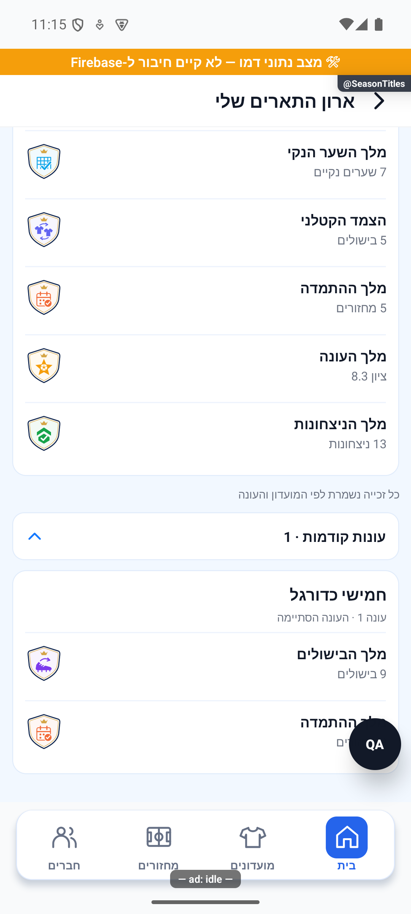
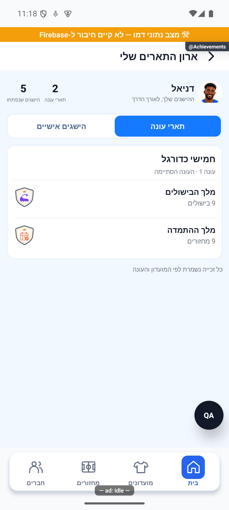
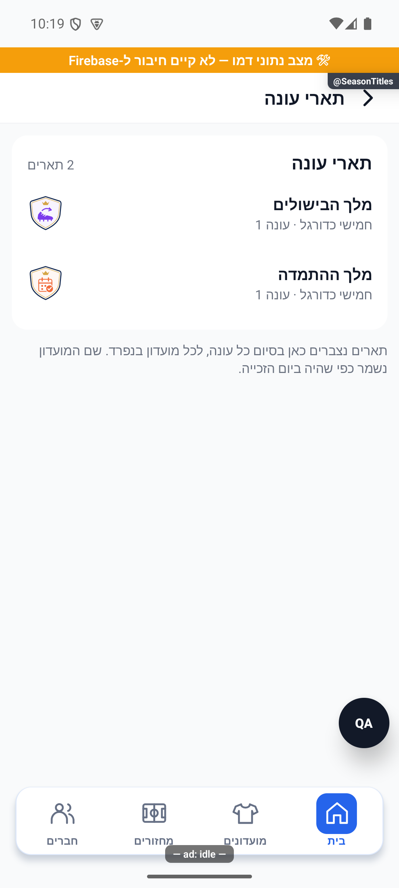
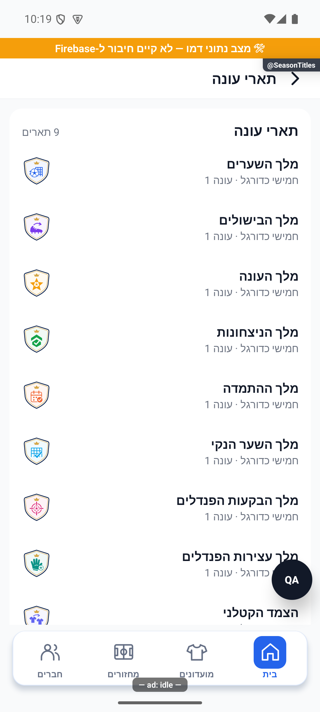
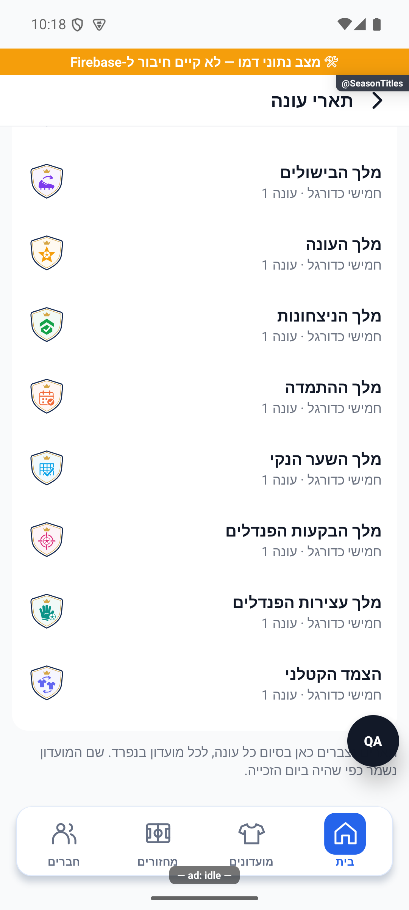

# תארי עונה אישיים

## תיעוד כשלים — 20.10.2026

נוספו תצפיות דיווח בנקודות הכשל של המקורות המשויכים לפיצ׳ר, במסגרת הרחבה רוחבית. נשמרו ערכי החזרה, הזריקות ותנאי הפעולה הקיימים; נוסף מקור קוד והקשר לדיווח. כיסוי תחבירי אינו הוכחת הרצה של כל מצב. השינוי מקומי וטרם הופץ; בדיקות המסירה, מגבלות מניעת הכפילויות והמסלולים שטרם חוברו מתועדים בדוח המשותף.

[דוח דיווח השגיאות והראיות](../../changes/2026-10-20-error-reporting-audit.md).

## אימות מול שרת אמיתי והגבלת המתנה — 20.10.2026

נפרסו באישור16 שירותי עונות ונבדקו140 קובצי מקור לכל שירות. במועדון הבדיקות עבר רצף הפעלה עם7 מחזורים, יעד שכבר הושג, חלון תיקונים מדויק, סגירה ידנית, שמונה תארים, ארכיון ופתיחת עונה2 עם0 מחזורים ויעד24. עברו50 השוואות נתונים; המצטיין8.36 ומלך הניצחונות78.57%. ברכיב הסטטיסטיקות נוסף `withSeasonReadTimeout`:30 שניות לתמונת מצב עקבית, רשימת עונות וארכיון/כל הזמנים כולל בדיקת עקביות בסוף. כשל מוביל לניסיון חוזר ואינו מספר אפס; תוצאה מאוחרת אינה מוחלת. התיקון המקומי בלקוח נבדק במסך עם קריאה מושהית והחלמה, וב־5,093 בדיקות ובדיקת טיפוסים. נוסחאות התארים לא שונו. הסגירה הטבעית אחרי24 שעות, כמה זכאים וכימיה של שני חשבונות אמיתיים לא הורצו בייצור.

[הבדיקה, המקור, הצילומים והמגבלות](../reviews/2026-10-20-seasons-live.md).

## תיקון פערי העונות — 20.10.2026

`seasonLock.ts` אוכפת פקיעה גם לפני הסריקה; השלמת עיבוד מחזור מותרת במפורש בלי לפתוח ארכיון חתום. שינוי יעד נבדק גם בעסקת `acquireSeasonOperation`. `seasonManager.needsVerification` משותפת לרשימה ולחסמי הסגירה; `setEveningPlayed` בודקת מועד, שיוך והרשאה מתוך נתונים עדכניים בעסקה. `src/utils/seasonReadConsistency.ts` וחותמת עונה מהחנות מונעות קריאה מעורבת ומרעננות לשונית שנשארה מותקנת. `seasonSummaryService.ts` בוחרת מונים חיים לעונה פעילה ואינה דורשת ארכיון חסר; משתתף שעזב ממשיך לקרוא ארכיון מורשה. אין שינוי בנוסחאות או בהרשאות.

עברו 5,090 בדיקות באפליקציה, 352 בדיקות הרשאות, 52 תרחישי מדיניות/גבולות/רצף, 38 תרחישי ארכיון ובדיקות טיפוסים והידור. שני תרחישי הרצף הורצו גם דרך שירותי הקריאה של האפליקציה ולקוח מזוהה מול הכללים המלאים. `functions/seasonAudit20261020.emulator.test.mjs` עובר כעת; נוספו `functions/seasonFullFlow.emulator.test.mjs`, `tests/logic/seasonReadConsistency.test.ts` ו־`tests/logic/communitySeasonRefresh.test.ts`. הפלטים ב־`artifacts/seasons-fixes-2026-10-20`. מסירת אירועי הענן מדומה; אין טענה לפריסה או לבדיקת שני מכשירים/אייפון.

[דוח תיקונים, בדיקות ומגבלות](../reviews/2026-10-20-seasons-fixes.md).

[להסבר הקצר](season-titles.simple.md)

## המימוש הנוכחי — 18.10.2026

תארי העונה מופיעים בלשונית הימנית בארון התארים החדש `AchievementsScreen`. המסלול `SeasonTitles` נשמר כרכיב יצוא של אותו מסך מלא. הכניסה הרגילה היא מתפריט הבית למסלול `Achievements`; אין צורך בשורת תפריט כפולה. [הארון וההישגים האישיים](achievements.md).

הקורא עבר מ־`SeasonTitlesShelf.loadTitles` ל־`src/services/seasonTitlesService.ts`. `list` קורא את אותו תת־אוסף `users/{uid}/seasonTitles`, שנכתב בסגירת עונה בלבד. `readHeldSeasonTitle` נושא את מזהה המסמך שהוחזר, `groupId`, `seasonId`, שם המועדון הקפוא, מספר העונה, מפתח התואר, `at` וגם `value`. שדה הערך כבר נכתב ב־`functions/src/seasonRollover.ts`; הקורא הקודם השמיט אותו. אין קריאת ארכיון חלופית או חישוב מחודש של הזכייה. חסר/ערך לא סופי נשאר לא ידוע ומושמט בשורה, בעוד אפס אמיתי נשמר. מפתח תואר לא מוכר מסונן.

`groupHeldSeasonTitles` ממיין לפי `at` יורד ואז מזהה, מקבץ לפי מזהי המועדון והעונה ושם המועדון שנשמר, ומשמר את סדר הזכיות בתוך כל קבוצה. מזהים חסרים משתמשים בשם ובמספר העונה לתאימות; אם כמה מועדונים ישנים בעלי אותו שם נשמרו בלי מזהים, אי אפשר להבחין ביניהם בוודאות. אין השלמת שם מועדון חי. הקבוצות החדשות ביותר מוצגות תחילה, ושאר הקבוצות נפתחות ב״עונות קודמות״.

`SeasonTitlesShelf` הוא כעת רכיב תצוגה עם `titles`, ללא קריאה כפולה. הארון מחזיק מצב קריאה ובעלות על מזהה המשתמש. מזהה חסר נדחה; כשל קריאה זורק ומוצג עם ניסיון חוזר, במקום החזרת `[]` מהקורא הישן. רשימה ריקה בהצלחה מציגה הסבר שאין עדיין זכיות. הספירה בכותרת כוללת את כל הזכיות, גם את הקבוצות הסגורות בהיסטוריה; בטעינה/כשל היא קו מפריד.

מגני `SeasonTitleEmblem` נשמרים בדיוק כרכיב משותף, בגודל 38 ומשמאל לטקסט, עם שמות `he.seasonTitleNames` וערכים דרך `he.seasonTitleValue`. שורות בגובה מינימלי 61, עם תווית זכייה ותת־שורה מספרית כשקיים ערך. הכותרת מציגה מועדון ועונה פעם אחת לכל קבוצה.

המסך נצפה באמולטור בדמו מנותק: שני תארים מקוריים, חמש זכיות עונה סינתטיות נוספות בזיכרון ופתיחת הקבוצה הישנה. לא נסגרה עונה ולא הוענק תואר אמיתי. `seasonTitlesService.test.ts` מריצה את קורא המסמכים ומכסה זהויות וערכים, קיבוץ לפי מזהים וכשל שאינו הופך לריק. 425 חבילות ו־4,996 בדיקות עברו; בדיקת טיפוסים נקייה. [יומן השינוי ומגבלות האימות](../../changes/2026-10-18-achievement-cabinet.md).

## רקע היסטורי — התיאורים להלן קודמים לארון החדש

המבנה, הקורא ומצב הכשל לעיל מחליפים את המדף והקורא המקומי הישנים. כללי הזכאות והשם הקפוא נשמרים.

[לקריאה קצרה ופשוטה](season-titles.simple.md)

עודכן: 18.10.2026; בסיס `5148f63c2a8e9c454b68132fdb0d683a98a4adc9` בתוספת שינויים מקומיים. `src/screens/profile/SeasonTitlesScreen.tsx`, מסלול `SeasonTitles`; `SeasonTitlesShelf` בתוך `Achievements`. תפקיד: המשתמש רואה תארים שזכה בהם בכל מועדוניו.

## מקור ותצוגה

תואר נכתב בסגירת עונה אל `users/{uid}/seasonTitles`. הוא כולל מועדון ועונה, סוג זכייה ופרטי תצוגה; שם המועדון מוקפא בעת הזכייה כדי לשרוד עזיבה או שינוי שם. המסך הוא מעטפת דקה למדף המשותף ולמשפט הסבר. רשימת מפתחות התארים מכירה את הזכיות הנתמכות ומתעלמת ממפתח לא מוכר; מיון לפי זמן יורד ומזהה לשבירת שוויון.

בצילום מלך הבישולים ומלך ההתמדה בחמישי כדורגל, עונה 1. אין זו הוכחת זכייה/סגירת עונה בייצור.

| תנאי | תצוגה | כתיבה | ראיה |
|---|---|---|---|
| מזהה משתמש קיים | טעינת תת־האוסף | אין | קוד |
| יש תארים | כרטיסי זכייה עם מקור עונתי | אין | דמו וקוד |
| אין תארים/בטעינה | המדף אינו מציג תוכן | אין | קוד |
| כשל קריאה | חוזר כיום כ־`[]`; אין הבדל חזותי במדף | אין | קוד; סיכון |
| מסך ייעודי ללא תוכן | משפט הסבר נשאר | אין | קוד |
| סגירת עונה | יצירת תארים במזהים יציבים | מנגנון סגירת עונה | קוד; לא בוצע |

## ניווט ומקורות

המסלול נשאר רשום ב־`ProfileStack`. שורת תפריט נפרדת הוסרה ב־`ProfileScreen` כי המדף כבר מופיע במסך ההישגים; הערת הכותרת של `SeasonTitlesScreen` הטוענת שיש לו כניסה בתפריט אינה עדכנית. צילום המסלול נוצר באמצעות כלי בדיקה ואינו הוכחה שיש כעת קיצור ישיר בממשק הרגיל.

`src/components/profile/SeasonTitlesShelf.tsx` מגדיר את הקורא המקומי `loadTitles`. הקריאה של תת־האוסף היא בניית נתוני תואר ייעודית ולא ממיר `User` הרגיל; הוספת שדה תואר צריכה לעדכן את הקורא הזה. יש לבדוק יחד עם כותב סגירת העונה וארכיון העונות.

## בדיקות ושחזור

בדיקות עונה ואישיות כגון `tests/logic/seasonPersonal.test.ts` מגנות על הפרדה בין נתונים עונתיים למצטברים, אך צילום שני תארים אינו בדיקת כל סוגי הזכייה. לבדוק תארים משני מועדונים, שמות שהשתנו, עזיבת מועדון, זמן שווה, סוג לא מוכר וכשל קריאה. אין לסגור עונה אמיתית לצורך בדיקה.

ב־18.10.2026 הוסר ממשפט ההסבר `writingDirection: rtl` ונשמר רק `RTL_LABEL_ALIGN`, לפי כללי הכיווניות. המשפט והשמות נצפו מיושרים לימין בצילום הדמו המעודכן. אין כאן בדיקת כל הרזולוציות או גודל גופן מערכת מוגדל.

## פירוט מימוש ונקודות שינוי — העמקה 07.10.2026

`SeasonTitlesShelf.loadTitles` קורא `users/{uid}/seasonTitles` ישירות ללא ממיר User, ומאמת `titleKey` מול `SEASON_TITLE_KEYS`. מפתח לא מוכר מדולג; שם חסר הופך ריק, מספר עונה או at שאינם מספר הופכים 0. המיון הוא at יורד ואז מזהה לקביעות כשכמה תארים נחתמו יחד.

המדף מחזיק null בטעינה, ו־null/רשימה ריקה לא מרנדרים מדף. כשל שירות מחזיר [] אחרי לוג ולכן המדף נעלם כמו מצב ללא תארים; זה לא מצב שגיאה מופרד. אפקט הקריאה תלוי userId ומשתמש ב־alive, ללא רענון מיקוד עצמאי. שינוי שם מועדון לתואר חייב לשמר snapshot ולא לעשות lookup חי; כתיבת תארים שייכת לסגירת עונה בלבד. `SeasonTitlesScreen` משתמש באותו מדף ורשום בערימה, אבל אין שורת כניסה ייעודית בתפריט הבית.

הבדיקות, מצבי המסך והראיות שכבר פורטו במסמך נשמרו. ההעמקה מבוססת על קריאת מקור ולא על הרצת פעולות נוספות; שינוי עתידי יצריך עדכון של שני המסמכים ובחינת המצבים הממוקדים.

## סמלי אליפות אחידים — 18.10.2026

`SeasonTitlesShelf` משלב את `src/components/SeasonTitleEmblem.tsx` בגודל 38 בשמאל כל שורת תואר, וטקסט התואר והמועדון מימין. גובה השורה המינימלי 64; טקסט יכול להרחיב את השורה. זהו אותו רכיב שמופיע בשתי לשוניות סיכום העונה ובתמונות השיתוף. רכיב המדף משותף גם למסך ההישגים; לא עוצב מחדש כל מסך התארים ולא נוסף מסלול ניווט.

תשעת הציורים הווקטוריים, צבעיהם והשמות הקיימים מייצרים זהות קבועה לכל תואר. שמות נקראים מ־`he.seasonTitleNames`; צבעים מ־`seasonTitleTint`. אין תלות בסוג המועדון, במספר העונה, במספר הזכיות או במקום בדירוג. אין כאן דרגות מדליה או הסקת זכייה מהסמל. ה־SVG אינו מתהפך לפי הכיווניות של שורת הטקסט, ואינו מבצע קריאת רשת או טעינת גופן.

הסמל דקורטיבי ליד טקסט ולכן אינו מכפיל את ההקראה. תווית נגישה אופציונלית נתמכת לשימוש עצמי. אין שינוי בקריאת `users/{uid}/seasonTitles`, במיון, בפילטר המפתחות, בשם המועדון הקפוא, בתנאי הזכאות או בשמירת זכיות. מגבלת מצב הכשל של הקורא הקיים המתוארת לעיל נשארה; לא בוצע תיקון קריאה במשימת עיצוב זו.

תשעת הסוגים נבדקו על ידי הזרקת רשימה זמנית לזיכרון הדמו בלבד, מעבר לשני התארים בדמו הרגיל. הרשימה לא נכתבה למסד או לחנות המשתמש ושוחזרה אחרי הצילומים. לכן צילומי התשעה אינם ראיית זכייה, יצירת ארכיון או סגירת עונה אמיתית. צילום המסלול הייעודי אינו הוכחה לכניסה אליו מתפריט הבית.

[ההתנהגות המשותפת בסיכום](../statistics/season-summary.md) · [יומן שינוי, בדיקות ומגבלות](../../changes/2026-10-18-season-title-emblems.md).

## תלות בעדכון העונות — 19.10.2026

פרסום התארים הועבר לאחר השלמת הארכוב ומעבר העונה. publicationPending מונעת הצגת סיכום שטרם פורסם. הזכאות למצטיין משתמשת במלוא מחזורי העונה, והדירוג משתמש בציונים תקפים בלבד; ערך חסר אינו אפס. תארים מצטברים דורשים ערך חיובי, ללא סף נוכחות. קורא המדף ממשיך להשתמש באותם מסמכי תארים.

[מצב המימוש, הבדיקות ומגבלות האימות של העונות](../clubs/seasons.md). מקומי בלבד; לא בוצעה פריסה במסגרת המשימה.

## השלמת תצוגת ציוני המצטיין — 19.10.2026

`src/utils/seasonCoverage.ts` שומרת גם מדגם מלא, ואינה מסתירה 10 מתוך 10. `src/services/seasonSummaryService.ts` נושאת לכל זוכה את `coverageByWinner` האישי. `src/components/summary/SeasonClubSummary.tsx` מציגה את המדגם המשותף כשזהה, וכשהמדגמים שונים מפנה בלחיצה ארוכה לפרט של כל שחקן. בעונה פעילה, שם וציון מצטיין מסוננים גם ברכיב התצוגה; התווית החזותית ותווית הנגישות אומרות שיתגלה בסיום. אין שימוש בציון משחקון.

בדיקות `tests/logic/seasonSummaryAwards.test.tsx`, `tests/logic/seasonCoverage.test.ts`, `tests/logic/mvpCoverageWinners.test.ts` ו־`tests/logic/seasonAwardsMirror.test.ts` עברו: 31 בדיקות. [הסתרת המצטיין](../screenshots/seasons-mvp-hidden-after-2026-10-19.png) ו[מדגם לכל זוכה](../screenshots/seasons-mvp-samples-after-2026-10-19.png) נצפו בתצוגת רכיב המקור דרך מתאם דפדפן מנותק. אלו צילומי אחרי בלבד; סמלים ותמונות שחקן מותאמים לבדיקה, והלחיצה הארוכה מוחלפת באירוע מתאם. אין הוכחת רינדור או מחוות במכשיר. פירוט הבדיקות המלאות ב[דוח העבודה](../../changes/2026-10-19-seasons-implementation.md).

האימות הכולל האחרון: 443 חבילות ו־5,065 בדיקות אפליקציה, 90 בדיקות מסד, טיפוסים נקיים ובדיקת ניקיון הפרשים. תצוגת הדפדפן אינה אימות במכשיר; הבהרת הבעלים הושלמה: ניסיון קצר חוזר למאגר ללא עונה ונכלל בהפעלה הבאה.

עדכון מאגר המחזורים שומר שמות קפואים גם כשהרישום החי או חשבון השחקן חסרים. קבלות של תקופות לא תחרותיות שומרות שמות ומונים אפסיים אחרי ההעברה, כך שכל הזמנים נשאר מדויק. סגירה חדשה משתמשת בשם החי כאשר קיים ובשם המועבר כגיבוי.

## הבהרת התצוגה וסיכום אישי — 19.10.2026

הרכיבים והמלל המשותפים של סיכום העונה עודכנו: ניסוח ברור לניצחונות ולהפסדים, אוואטרים למובילים וכפתור ״סיכום העונה שלי״ בעיצוב כרטיס. הספירות, מסנן העונה, התארים וכללי הזכאות לא השתנו. המסכים האחרים בתחום לא הורצו מחדש במסגרת תיקון התצוגה. [פירוט וראיות בסיכום העונה](../statistics/season-summary.md). השינוי מקומי וטרם הופץ.

## מלך הניצחונות לפי אחוז — 19.10.2026

״מלך הניצחונות״ בעונות החדשות נקבע לפי אחוז הניצחונות מתוך כל המשחקים שהשחקן שיחק בעונה, כולל תיקו במכנה. חובה להשתתף בלפחות מחצית ממחזורי העונה, בעיגול כלפי מעלה: 7 מתוך 13. האחוז מעוגל לשתי ספרות אחרי הנקודה; שוויון אחרי העיגול מזכה את כל השותפים. אין צורך בציון מחזור לצורך תואר זה. בלי זכאי עם נתונים תקפים ולפחות ניצחון אחד אין תואר, ובסיכום מוצגת הסיבה. יתר התארים המצטברים שומרים על הכללים הקיימים, ללא סף נוכחות. התארים שכבר נסגרו נשארים כפי שנקבעו. `computeTopWinner` משותף ללקוח ולהעתק השרת ב־`seasonAwards.ts`. שער הנוכחות משתמש ב־`games` מול `ceil(completedRounds / 2)`; האחוז משתמש ב־`wins / rounds * 100`, כאשר `rounds` הוא משחקים, לא מחזורים. המכנה חייב להיות חיובי וסופי; ניצחונות חייבים להיות חיוביים ולא לעבור את המכנה. אורחים אינם זכאים. אחוז חיובי שמתעגל ל־0.00 אינו מתפרש כאפס ניצחונות. בתוצאה החדשה `value` הוא 0–100 ו־`valueUnit: percent`; היעדר יחידה נשאר ספירה היסטורית, לרבות הערך 1. הסף אינו תלוי בציונים. נתיב השמירה כולל `functions/src/seasonRollover.ts`, `functions/src/seasonPublication.ts`, `seasonSummary.awards`, `seasonCards.winners` ותארי הפרופיל. `awardsVersion: 2` מתעד את כללי העונה גם כשלא הוענק תואר; `winnerIds` בכרטיס מונע התאמת זוכים לפי שם משותף. מסלול חידוש סגירה ופרסום חוזר משתמש במידע החתום. הקוראים ב־`seasonHistoryService`, `seasonSummaryService` ו־`seasonTitlesService` מעבירים את היחידה. כל מציגי התואר ותמונות השיתוף מעבירים אותה למפרמטים המשותפים; `medalTier` מדרג אחוז חדש אחרי חלוקה ב־100 ומשמר ספירות ישנות. בסטטיסטיקת העונה הפעילה משתמשים בחישוב המשותף; בעונה סגורה חדשה משתמשים בזוכים החתומים לפי מזהה. תצוגת כל הזמנים וסדר טבלת המועדון נשארו ללא שינוי. [צילום קודם](../screenshots/season-polish-club-after-2026-10-19.png), [תצוגת האחוז והסף](../screenshots/season-win-rate-after-2026-10-19.png). התצוגה נבדקה ברכיב המקור דרך `artifacts/seasons-implementation-2026-10-19/preview-win-rate.cjs`, עם נתוני דמה ושירותים מנותקים. סמלי גופן ותארים מותאמים; אין אימות במכשיר. בדיקות ממוקדות מכסות מכנה, תיקו, מחצית עונה אי־זוגית, שוויון מעוגל, נתונים חסרים ולא תקפים, אורחים וקריאת ארכיון ישן וחדש. 122 בדיקות מסד עברו, לרבות כתיבת היחידה בשלוש ההעתקות ופרסום חוזר. פלטים עם הקידומת `win-rate-` ביומן השינויים. השינוי מקומי וטרם הופץ.

## אוואטרים לכל המובילים משמאל לטקסט — 20.10.2026

האוואטר מופיע כעת משמאל לכותרת ולשם בכל שורת תואר שיש בה מוביל. נתוני הדמה של כל התארים, הפעילים והסגורים, הושלמו עם מזהי השחקנים; קודם המזהים היו חסרים ברוב השורות ולכן הוצג אוואטר רק במלך הניצחונות. תואר ללא מוביל והמצטיין החסוי אינם מציגים אוואטר. ב־`SeasonAwardRows` סדר הילדים הוא טקסט, אוואטר, ערך, סמל תואר; תחת כיווניות הממשק האוואטר נמצא משמאל לטקסט. אין התאמת זהות לפי שם. דוגמת `mockSeasonSummary` כוללת `winners` עם מזהים לכל תואר. נבדקות העברת הזהויות גם בעונה פעילה וגם בסגורה, ומיקום האוואטר בסדר הרכיבים. [לפני — צילום שסיפק הבעלים](../screenshots/season-avatars-user-before-2026-10-20.png), [אחרי — מתאם דפדפן](../screenshots/season-avatars-left-after-2026-10-20.png). המקור הוא `artifacts/seasons-implementation-2026-10-19/preview-avatars-left.cjs`, עם רכיב המקור ואוואטרים מקוריים, סמלי תארים וגופן מותאמים ונתונים מנותקים. אין אימות חדש במכשיר. השינוי מקומי וטרם הופץ.

## בחירה סופית: אוואטרים מימין — 20.10.2026

לפי בחירת הבעלים האוואטרים הוחזרו לימין הכותרת ושם השחקן בכל תואר שיש בו מוביל. הצגת אוואטר לכל המובילים נשמרה. בחירה זו מחליפה את ניסיון ההצבה משמאל שתועד קודם. ב־`SeasonAwardRows` בלוק האוואטר קודם שוב לבלוק הטקסט בסדר הילדים, כמתחייב מכיווניות הממשק. [לפני](../screenshots/season-avatars-left-android-2026-10-20.png), [אחרי](../screenshots/season-avatars-right-android-2026-10-20.png): צילומים מקוריים מהאימולטור עם נתוני דמה וקוד המקור המקומי. לא שונו חישובי תארים ולא בוצעה פריסה. השינוי מקומי וטרם הופץ.
