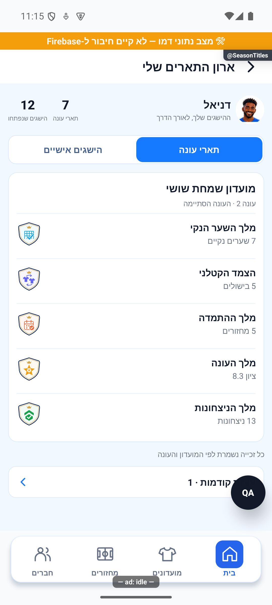

# תארי העונה שלי

## תיעוד כשלים — 20.10.2026

נוסף תיעוד אוטומטי לנקודות כשל במסלול הזה, עם מקור התקלה. הפעולה המקורית שומרת על ערכי החזרה והודעות השגיאה שלה. השינוי מקומי, טרם הופץ, ואין אימות מסירה חיה לפולס.

[דוח דיווח השגיאות והראיות](../../changes/2026-10-20-error-reporting-audit.md).

## אימות מול שרת אמיתי והגבלת המתנה — 20.10.2026

במועדון הבדיקות נבדקו מול השרת האמיתי הפעלת עונה עם שבעה מחזורים, סגירה ידנית, חלוקת שמונה תארים ופתיחת עונה שנייה ריקה. הנתונים נשמרו בארכיון ובכל הזמנים. שירותי העונות נפרסו באישור; תיקון נוסף בלקוח מציג אפשרות לנסות שוב אחרי30 שניות של קריאה תקועה, והוא עדיין דורש הפצת לקוח. לא המתנו24 שעות בפועל ולא בדקנו כאן סגירה של עונה קצרה.

[הבדיקה, המקור, הצילומים והמגבלות](../reviews/2026-10-20-seasons-live.md).

## תיקון פערי העונות — 20.10.2026

כל חמשת הפערים בביקורת טופלו מקומית: אכיפת סוף חלון התיקונים, חסימת הארכה מאוחרת, אימות ללא מועד, התאמת מועד לשיוך ורענון הסטטיסטיקות. תוקנה גם פתיחת סיכום עונה פעילה שנכשלה מול ההרשאות. אין שינוי בכללי התארים או בשלוש בחירות ההפעלה. אפשר לדחות מחזור שלא התקיים גם בלי להמציא לו תאריך; אישור שהתקיים עדיין דורש מועד. התיקון טרם הופץ.

[דוח תיקונים, בדיקות ומגבלות](../reviews/2026-10-20-seasons-fixes.md).

[לפירוט הטכני](season-titles.md)

פותחים את ארון התארים שלי מתפריט הבית. בלשונית ״תארי עונה״ מופיעות הזכיות מקובצות לפי המועדון והעונה, עם המגנים הקבועים של סיכומי העונה וערך הזכייה כשנשמר. אפשר לפתוח גם עונות קודמות.

שם המועדון נשמר כפי שהיה ביום הזכייה. זכיות ממועדונים שונים נשמרות בנפרד. הספירה למעלה כוללת גם את הזכיות שבעונות הקודמות. אם הטעינה נכשלת מופיע ניסיון חוזר, ולא מוצג כאילו אין זכיות.

המסלול הישן לתארי העונה פותח כעת את אותו ארון מלא. הסמלים ותנאי הזכייה נשמרו. השינוי נבדק בדמו מנותק ב־18.10.2026 וטרם הופץ.

## תלות בעדכון העונות — 19.10.2026

תארים מתפרסמים רק לאחר סגירה. המצטיין זקוק לנוכחות במחצית המחזורים, וההשוואה היא לממוצע מעוגל לשתי ספרות; שוויון מזכה את כולם.

[מצב המימוש, הבדיקות ומגבלות האימות של העונות](../clubs/seasons.md). מקומי בלבד; לא בוצעה פריסה במסגרת המשימה.

## מספר הציונים של המצטיין — 19.10.2026

בסיום העונה מוצג כמה ציוני מחזור נכללו בממוצע המצטיין, גם אם יש ציון בכל מחזור. כשיש זכייה משותפת ומספר הציונים שונה, אפשר לפתוח את רשימת הזוכים בלחיצה ארוכה ולראות את המספר של כל אחד. לפני הסיום מופיע שהמצטיין יתגלה בסוף העונה. השינוי מקומי בלבד; התצוגה נבדקה במתאם דפדפן, ללא אימות מחוות במכשיר.

הבדיקות הכוללות של העדכון המקומי עברו; האימות החזותי במכשיר עדיין לא הושלם. מסלול ההפעלה עודכן כך שכל המחזורים ללא עונה זמינים לבחירה, כולל ניסיונות שבוטלו.

גם שמות שנשמרו לשחקנים שכבר אינם במועדון נשמרים בעת הכללת פעילות ללא עונה בתחרות חדשה; הנתונים אינם נספרים פעמיים.

## הבהרת התצוגה וסיכום אישי — 19.10.2026

הרכיבים והמלל המשותפים של סיכום העונה עודכנו: ניסוח ברור לניצחונות ולהפסדים, אוואטרים למובילים וכפתור ״סיכום העונה שלי״ בעיצוב כרטיס. [פירוט וראיות בסיכום העונה](../statistics/season-summary.md). השינוי מקומי וטרם הופץ.

## מלך הניצחונות לפי אחוז — 19.10.2026

״מלך הניצחונות״ בעונות החדשות נקבע לפי אחוז הניצחונות מתוך כל המשחקים שהשחקן שיחק בעונה, כולל תיקו במכנה. חובה להשתתף בלפחות מחצית ממחזורי העונה, בעיגול כלפי מעלה: 7 מתוך 13. האחוז מעוגל לשתי ספרות אחרי הנקודה; שוויון אחרי העיגול מזכה את כל השותפים. אין צורך בציון מחזור לצורך תואר זה. בלי זכאי עם נתונים תקפים ולפחות ניצחון אחד אין תואר, ובסיכום מוצגת הסיבה. יתר התארים המצטברים שומרים על הכללים הקיימים, ללא סף נוכחות. התארים שכבר נסגרו נשארים כפי שנקבעו. השינוי מקומי וטרם הופץ.

## אוואטרים לכל המובילים משמאל לטקסט — 20.10.2026

האוואטר מופיע כעת משמאל לכותרת ולשם בכל שורת תואר שיש בה מוביל. נתוני הדמה של כל התארים, הפעילים והסגורים, הושלמו עם מזהי השחקנים; קודם המזהים היו חסרים ברוב השורות ולכן הוצג אוואטר רק במלך הניצחונות. תואר ללא מוביל והמצטיין החסוי אינם מציגים אוואטר. השינוי מקומי וטרם הופץ.

## בחירה סופית: אוואטרים מימין — 20.10.2026

לפי בחירת הבעלים האוואטרים הוחזרו לימין הכותרת ושם השחקן בכל תואר שיש בו מוביל. הצגת אוואטר לכל המובילים נשמרה. בחירה זו מחליפה את ניסיון ההצבה משמאל שתועד קודם. השינוי מקומי וטרם הופץ.

## דיווחים חדשים במהלך הסבב — 23.10.2026

בסיכום עונה סגורה, היעדר צמדים מוצג כהיעדר נתונים בעונה הזאת, בלי להבטיח משחקים עתידיים. חלונית הצמד הקטלני מציגה כל צמד בנפרד; בלשונית המועדון ההסבר מפנה לסטטיסטיקות המועדון בבחירת כל הזמנים. נבדק באנדרואיד עם דמו; מקומי וטרם הופץ. [ראיות ומגבלות](../../changes/2026-10-23-crash-test-and-pulse-followup.md).
