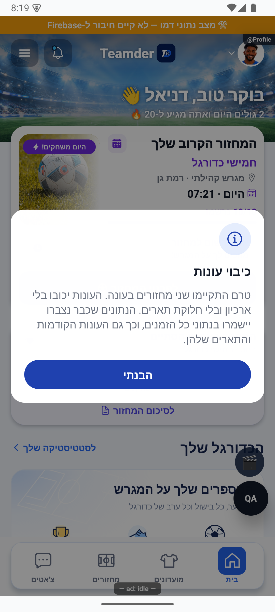

# תיקוני עונות — 11.10.2026

## מצב והיקף

כל 13 סעיפי [דוח הסקירה](2026-10-11-seasons-audit.md) טופלו בקוד ובתיעוד המקומיים. מקור: `ec536c6f` עם שינויים שלא נשמרו עדיין בקומיט. אין כאן טענה שהקוד המתוקן כבר בייצור: לא בוצעו פריסה, בנייה לחנות, דחיפה לגיט, שינוי הרשאות או הסבת נתונים. שינויי הקוד האחרים שכבר היו בתיקייה נשמרו.

הנתונים המקומיים נוצרו בפרויקטי המחשה בתוך מסד מדומה מקומי. לא נוצרו או שונו חשבונות, מועדונים או מחזורים אמיתיים. בהתאם לכללי המאגר נרשמו 13 תיקונים ושני צילומי הוכחה ביומן השחרור; כתיבת תיעוד אינה פריסת מוצר. אישור הכתיבה המקומי נשמר ב־`artifacts/seasons-audit-2026-10-11/release-log-receipt.json`.

## טיפול בכל הממצאים

| ממצא | התיקון | ראיה |
|---|---|---|
| ע־01: נתוני כיבוי זולגים לעונה חדשה | ארכיון `nonSeason` נפרד, ללא תארים; שמירת צבירת חיים והתחלה נקייה. תקופה קצרה מסומנת מחדש לפני שימוש חוזר במספר העונה. | פעולות השרת המהודרות: 5 שערים בעונה + 2 בכיבוי = 7 בארכיונים, 0 בעונה החדשה; בדיקה נוספת לעונה קצרה. |
| ע־02: חתימת היסטוריה לפי מונה מאוחר | חתימה משתמשת בספירה מלאה של מחזורים שהתקיימו, ולא ב־`eveningsSealed`. | 205 מחזורים ומונה 3 הפיקו ארכיון עם 205; שחזור מבודד נוסף: 8 מול 3 הפיק 8. |
| ע־03: כיבוי עוקף נעילת היסטוריה | חותמת עונה נשמרת ונבדקת גם כשהפיצ׳ר כבוי; רק תקופת הכיבוי הנוכחית פתוחה. נוספו הגנות עסקאות וגרסת מועדון לכתיבות סטטיסטיקה. | בדיקות נעילה, כיבוי וחידוש; בדיקת גרסת מועדון גם בשחזור התחייבות מחזור. |
| ע־04: חידוש סגירה מפחית נתונים חדשים | ההפחתה מסתמכת על ארכיון קפוא לכל שחקן, צמד ומועדון, עם חותמת לכל שורה. פתיחה מחדש מנקה גם את חותמת מוני המועדון. | כשל לפני השחקן השני עם תרומות חדשות: שחקן 2 שערים, צמד 3, מועדון 2 נשארו אחרי החידוש. |
| ע־05: מגבלת 200 וכשל שהופך לאפס | דפדוף מלא; שגיאה אינה מוסווית כאפס. | 205 מחזורים נספרו; קריאה שנכשלה נדחתה. |
| ע־06: חלונות ופעולות מתחרות | אחיזה בעסקה עם מצב צפוי וקלט; אימות מחדש של היעד והחלון; ניסיון חוזר לאותה פעולה אחרי כשל. | שתי סגירות במקביל התקדמו פעם אחת; כשל יזום אחרי ארכיון התאושש; חלון לעונה אחרת נדחה, יעד מוארך אינו פותח חלון, מועד קיים נשמר וסגירה מוקדמת נדחית. |
| ע־07: סגירת עונת תאריך ריקה | סף 2 מחזורים חל גם בסריקה, עם פינוי חלון שלא נדרש. | סגירה מתוזמנת עם 0 לא יצרה ארכיון ולא הגדילה מספור. |
| ע־08: ערבוב טווחים אחרי כיבוי | כל הזמנים כברירת מחדל; ללא ״נוכחית״ או חזרה אליה במצב כשל; כולל תקופות כיבוי בכל מקורות הצבירה. | בדיקות אפשרויות הטווח וקריאת הקוד בכל צרכני ההיסטוריה וההשוואה. מעבר המסך מול נתוני ייצור לא הורץ. |
| ע־09: עונה חסרה מוצגת כחדשה | בקשה לעונה היסטורית חסרה מחזירה חוסר נתונים; אין שאילתות מונים חיים. | בדיקה מפעילה את שירות האפליקציה ומוודאת שלא נקראו נתוני העונה הפעילה. |
| ע־10: אפשרויות והסברים מטעים | סוג עונה ננעל לאחר תחילתה; היעד מסתנכרן לשינוי בשרת; סיבות סירוב ונוסח כיבוי קצר תוקנו. | צילום הרכיב האמיתי בנתוני המחשה, צילום הודעת כיבוי קצרה; בדיקת יעד לא תקין ושינוי סוג מול פעולות השרת. |
| ע־11: מחיקת צמדים מעל 1,200 | עמודי ארכיון, יצירה אטומית וקריאה מלאה; חריגה מהסף הטכני נכשלת לפני מחיקת מונים. | 1,771 צמדים נשמרו ונפתחו מחדש; עמוד חסר נכשל; משתתף שעזב יכול לקרוא עמוד, אדם זר אינו יכול. |
| ע־12: התראות לא מתאוששות | דגל מסירה עמיד, דפדוף בתור הניסיונות, זיהוי כשל מוחזר ומועד קבוע למניעת כפל. | כשל יזום ביצירת ההתראה שמר `notificationPending` אחרי התקדמות העונה. מסירה לטלפון לא נבדקה. |
| ע־13: ביטחון יתר מבדיקות ישנות | שלוש ציפיות מיושנות הוחלפו בחוזים העדכניים: מספר מחזורי עונה, סף המצטיין בלבד ומחיקת צמדי אורחים. נוספו בדיקות זרימה ושחזור ותועדו מגבלות. | בדיקות הגלגול כולן עברו; הדוח הישן נשמר ומסומן כמצב לפני תיקון. |

תיקון נוסף מכלי התחזוקה: פתיחה מחדש נדחית גם כשמוני העונה הבאה אומרים 0 אך קיימת פעילות חיה מתקופת הכיבוי. הארכיון אינו נמחק עד שהשחזור והתקדמות המועדון הושלמו. כך הכלי אינו מערבב פעילות מאוחרת בתוך עונה סגורה.

## מה הורץ בפועל

- `npx tsc --noEmit` — נקי.
- `npx tsc -p functions/tsconfig.json` — נקי.
- `npx jest --runInBand` — 3,340 בדיקות ב־241 חבילות.
- `node --test --test-concurrency=1 functions/seasonRollover.emulator.test.mjs` — 42 בדיקות.
- `node --test --test-concurrency=1 functions/seasonLifecycle.emulator.test.mjs` — 9 בדיקות, עם פעולות השרת המהודרות ומסד מקומי אמיתי, ללא החלפת בדיקות מנהל/שקט/מונים.
- בדיקות הכללים המלאים בהרצה סדרתית — 312 בדיקות ב־34 קבוצות; לא נערך קובץ הכללים.
- `node scripts/audits/season-lifecycle-probes.cjs` — שחזורי המחקר המעודכנים עברו. בחלקם בדיקות הרשאה, שקט ומונים מוזנים בקלט מבוקר; אלה אינם בדיקת שירות ענן מהטלפון.
- ממיר המועדון נבדק על השדות החדשים `disabledAt` ו־`operation`, כולל אי־חשיפת האסימון הפנימי.
- בדיקות קריאת ארכיון באפליקציה מכסות צירוף עמודים, עמוד חסר/זר וסירוב להציג עונה אחרת במקום עונה חסרה.

[תוצאות מספריות של השחזורים](seasons-fix-results.json). יומני הרצות מלאים: `artifacts/seasons-audit-2026-10-11/`. מבחני הרגרסיה הישנים עודכנו כך שידמו גם את תנאי גרסת המועדון החדש; לא הועלה סף ביצועים ולא הוסרו בדיקות כשל.

## בדיקה חזותית

הרכיב האמיתי מוצג באמולטור אנדרואיד עם נתוני המחשה ופעולות מנוטרלות. נבדקו עברית, יישור, הסבר והאפשרות המושבתת לסוג אחר. אין כאן טענה להפעלת עונה דרך חשבון אמיתי.

הודעת ההמחשה משתמשת בנוסח האמיתי ובכפתור ״הבנתי״ בלבד. היא אינה מכבה עונה. מקור, חותמות ומגבלות נשמרו בקובץ הצילומים.

## מגבלות והמשך הפצה

- יש לפרוס את פונקציות השרת המעודכנות ולהפיץ את האפליקציה בתיאום. חלק מתיקוני החיים, הצמדים והטווחים דורשים קורא חדש; לקוח ישן לא מכיר עמודי ארכיון או תקופות כיבוי. אין להציג גרסת חנות ישנה כאילו כוללת תיקון זה.
- לא שוחזרו נתונים שאבדו מסגירות ישנות. אם נדרשת הסבה, יש לתכנן אותה לפי הנתונים האמיתיים ולקבל אישור נפרד.
- כשל באמצע פעולה משאיר הגנה מכוונת. יש לחזור על אותה פעולה; אחרי עצירה קשה מחכים לפקיעת אחיזה של עד 20 דקות. אין מעבר אוטומטי מפעולה שנקטעה לפעולה מסוג אחר.
- לא נבדקו מכשיר אייפון, מסירת דחיפה למכשיר, השהיות ברשת אמיתית או כל וריאציה אפשרית. בדיקות הטלפון שנעשו כאן הן תצוגה מנותקת בלבד.
- כלי פתיחה מחדש נשאר כלי מפעיל מוגבל. הוא אינו משחזר כימיית אורחים שנמחקה קודם, ואינו מבטל הודעות שכבר נמסרו. לא הורחבה גישה לכלי.

ההתנהגות המלאה ומסלול הנתונים מתועדים ב[עונות](../clubs/seasons.md), [טווחי נתונים](../statistics/scopes-and-data.md), [סיכום עונה](../statistics/season-summary.md) ובזוגות ההסברים הפשוטים שלהם.
