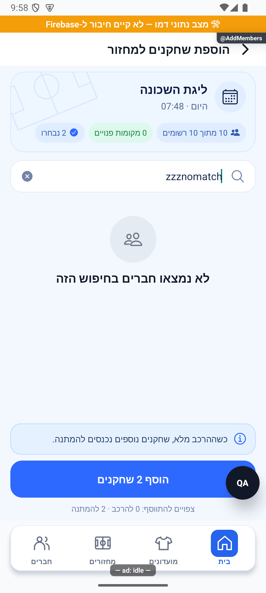

# רישום חברי מועדון ושריון מקומות

## שורת צירוף ובדיקת הפולס — 17.10.2026

`MatchDetails → players → צרף מהמועדון → AddMembers {gameId,reserve:isScheduled(game)}`. תנאי הכניסה נשאר מנהל ומחזור לא סופי. אין שינוי ב־adminAddPlayers, בקיבולת, בהתראות או בהקצאת עודפים להמתנה. נצפתה פתיחת המסך בהדגמה בלי לבחור או לשלוח הוספה.

[בדיקות, צילומים ומגבלות](../../changes/2026-10-17-roster-recruitment-and-pulse.md).

עודכן: 7.10.2026. מקור הקוד: `8e8fde5`, גרסה `1.1.35`. מסמך זה מתאר את הקוד; מצב חנות ופריסת שרת דורשים ראיה נפרדת.

## כניסה ותפקידים

לשונית שחקנים → צרף מהמועדון → AddMembers {gameId, reserve}

מנהל בלבד; reserve משנה מלל למחזור שתזמון ההרשמה שלו טרם נפתח.

## רכיבים ומצבים

| רכיב / מצב | התנהגות וחוזה |
|---|---|
| מועמדים | חברי מועדון שאינם ברשימה; טעינת משתמשים והסתרת מזהים שאי אפשר לטעון |
| בחירה | רב־בחירה, מספר נבחרים, משוב רטט וכפתור הגשה |
| שריון | אותו מסלול שרת כמו הוספה רגילה; אינו מנגנון קיבולת שני |
| תוצאה | adminAddMembers מוסיף הרשומים ומעביר עודפים להמתנה; התראות למתווספים |
| חריגים | מזהה חסר, מחזור חסר, ללא הרשאה, אין מועמדים, כתיבה ממתינה/נכשלה |

## מסלול נתונים ומקומות שינוי

[`src/screens/games/AddMembersScreen.tsx`](../../../src/screens/games/AddMembersScreen.tsx)

gameService.getGameById/adminAddMembers → פעולת שרת adminAddPlayers; userService.getUserById; חנות קבוצות וזהות. תפוסה כוללת activeGuestCount ולא כל האורחים.

ממיר המחזור: [`src/firebase/firestore.ts`](../../../src/firebase/firestore.ts), `gameDocConverter.fromFirestore`; סוגים: [`src/types`](../../../src/types). שינוי שדה דורש מעקב כתיבה → ממיר → שירות/חנות → רכיב. ניווט: [`GameStack.tsx`](../../../src/navigation/GameStack.tsx), ובמסכים משותפים גם המחסניות שמארחות אותם.

## בדיקות וראיות

בדיקות הרשמה וקיבולת; תרחיש עודפים להמתנה בחשבון בדיקה בלבד.

צילומי המיפוי מהאמולטור נעשו במצב נתוני דמו, המסומן בפס כתום. הם מוכיחים את הרכיב והמצב המוצגים בלבד, ולא ממירי Firebase, נתוני ייצור או כתיבה. צילומי תיקונים קודמים מסומנים בנפרד. שגיאת מזהה, מצב טעינה או שער הגנה אינם הוכחת הפעולה המלאה.

## גבולות והערות תחזוקה

שגיאת מזהה חסר בתמונה אינה הוכחת פעולת הוספה מוצלחת.

לפני שינוי פתח את הקוד המקושר ואת [כללי הפרויקט](../../../AGENTS.md). לאחר שינוי עדכן במסמך זה את התאריך, נקודת הקוד, המצבים שהתעדכנו, הבדיקות והצילום. אין לטעון שכל מצב/תפקיד נבדק רק משום שקיים צילום אחד.

## פירוט טכני ממוקד: זרימה, חישוב ונקודות שינוי

[הסבר פשוט למשתמש](add-members.simple.md)

העמקה: 07.10.2026, מול קוד המקור שב־`8e8fde5`. בעת הכתיבה HEAD הוא `50d508f`; בדיקת ההפרש בין הנקודות ב־`src` וב־`functions` לא מצאה שינוי קוד. הסעיפים וההסתייגויות הקיימים נשמרו. זו קריאת קוד ותיעוד, בלי הרצת תרחישי כתיבה חדשים.

המסך מקבל `gameId` ו־`reserve`, טוען מחזור וחברי מועדון, פותר זהויות ומחזיק רב־בחירה. `reserve` משנה הקשר ומלל; אינו מסלול קיבולת מקביל. `gameService.adminAddMembers` פונה לפעולת השרת `adminAddPlayers`.

יש לסנן מי שכבר נמצא ברשימה ולמנוע מזהה כפול בבחירה; מזהה שלא נפתר אינו שם מומצא. הכרעת הוספה להרכב או להמתנה שייכת לשרת, כולל אורחים פעילים ומקום שמור להצעה. לדוגמה, 8 רשומים+אורח+הצעה בקיבולת 10 לא מותירים מקום לחבר נוסף; חיווי נבחרים ״3״ אינו הבטחה לשלושה מקומות.

שמירה ממתינה וחסימת כפתור כפול מגינות על ממשק; אין להסיק מהן אידמפוטנטיות לכל שליחת פוש. יש לבדוק טרנזקציית הרוסטר ותוצאת השרת גם אם הודעה למתווסף נכשלה. שינוי רשימת מועמדים שייך למסך, שינוי קיבולת לפעולת השרת. צילום חסר מזהה שנשמר במסמך אינו הוכחת הוספה.

## עדכון חזותי — 14.10.2026

מקור: `4a3cb346` עם שינויים מקומיים. `AddMembersScreen` עודכן לפי סקיצה 04: תקציר תכלת עם מגרש עדין, חיפוש מקומי, כרטיסי חברים עם אווטאר ותיבות בחירה, הסבר המתנה וכפתור כחול. סדר הילדים מותאם לכיווניות: אווטאר מימין ותיבת בחירה משמאל. אין שינוי במסלול ההרשמה או בפעולת השרת.

- החיפוש מסנן שמות ללא תלות באותיות גדולות; `selected` נפרד מהתוצאות ולכן אינו מתאפס בחיפוש. רשימה ללא התאמות מקבלת הודעה ייעודית.
- תפוסה מוצגת = רשומים + אורחים פעילים. מקומות פנויים = מקסימום פחות תפוסה ופחות מקום שמור להצעת קידום, עם רצפה אפס. מכסה חסרה מוצגת ללא הגבלה.
- תחזית הוספה להרכב = המינימום בין נבחרים למקומות הפנויים; יתר הנבחרים להמתנה. זו תחזית לפי הנתונים שנטענו; התוצאה הקובעת היא תשובת השרת. מצב שריון עדיין אינו מאפשר בחירת עודפים.
- `inFlight` נועל לחיצה כפולה ומשבית שינוי בחירה עד לסיום הבקשה; כשל משחרר את הנעילה.
- תג זמינות נשען על `userService.findAvailablePlayers` ופעולת `findAvailableSocialPlayers`, לפי המחזור. התוצאה מוגבלת ל־50: העדר תג אינו אומר אי־זמינות. כשל נרשם ומשאיר את בורר החברים פעיל. תגובה מאוחרת אחרי יציאה אינה משנה מצב. בדמו השירות מחזיר רשימה ריקה, ולכן תג חי אינו מוכח בצילומים.
- נבדקו חזותית בחירת שני חברים בהרכב מלא, חיפוש ללא תוצאות ושימור הבחירה. לא נשלחה הוספה, ולא נבדק מסלול כתיבה חי או אייפון. בדיקת טיפוסים וכל חבילת הבדיקות מתועדות ביומן המשימה.

### פישוט שורות השחקנים — 14.10.2026

לפי בקשת הבעלים הוסרו מכל שורה הכיתוב ״חבר מועדון״ ואייקון האיש. נותרו תמונה, שם ותיבת בחירה; תג זמינות נשמר כאשר יש התאמה. נבדק חזותית באמולטור בדמו.

## תיקוני דיווחים חדשים — 15.10.2026

`AddMembersScreen` מקטין גובה מינימלי של שורה מ־88 ל־66, ריווח אנכי ל־10 ותמונת שחקן מ־50 ל־42. תג זמינות יכול להרחיב את השורה לפי התוכן. אין שינוי בסינון חברים, שריון, קיבולת, המתנה או פעולת הצירוף. נצפתה רשימת הדמו באימולטור ללא צירוף משתמש או כתיבת מחזור.

שינויים מקומיים אחרי גרסה 1.1.51; אינם כלולים בבינארי שכבר הועלה. תצוגה שנבדקה היא בדמו אנדרואיד בלבד, ללא בדיקת אייפון או חשבון המדווח.

