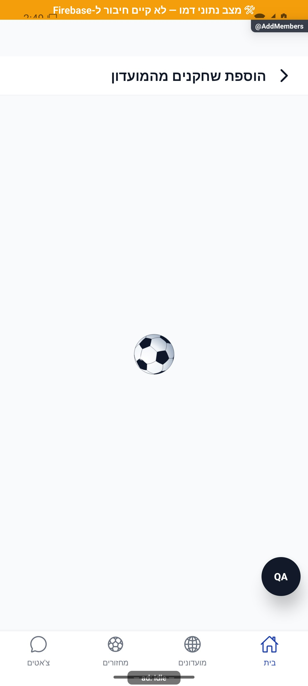
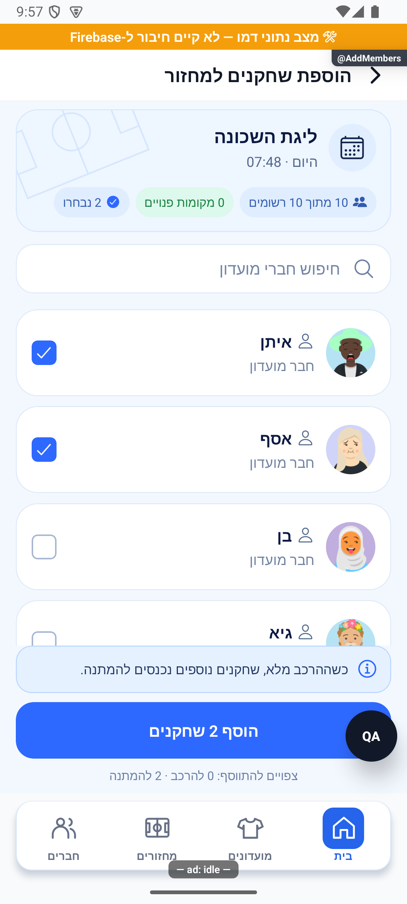
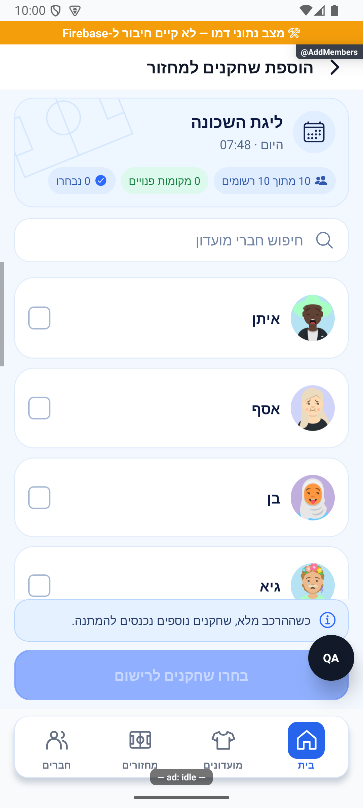
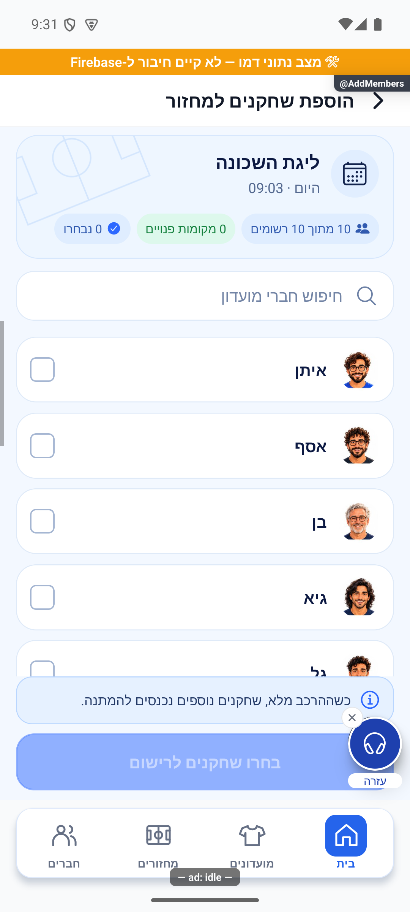

# רישום חברי מועדון ושריון מקומות — הסבר פשוט

## הרחבת אבחון דיווחים, 27.10.2026

הדיווחים יוכלו לכלול מה ניסו לבצע, מה היה מצב האפליקציה ומה החזיר השרת. פרטים חסרים מוצגים כלא ידועים, ומספר מוגבל של מופעים נשמר בלי למחוק את המופע הראשון. השינוי מקומי וטרם הופץ, ואינו משלים פרטים לדיווחים ישנים. [היקף, ראיות ומגבלות](../../changes/2026-10-27-diagnostic-context.md).

בדיקות הקוד הושלמו, אך השינוי עדיין מקומי ולא הופץ. פרטים שלא נאספו בדיווחים ישנים אינם משוחזרים בדיעבד.

## שעון מדויק וכיתוב פנדל - 25.10.2026

במקורות המשותפים נוסף שימור השעון המדויק של פנדל במהלך משחק, וכיתוב ההבקעה ביומן קוצר. אין שינוי במונים או בתהליך העצמאי המתואר כאן; לא נערכה לו בדיקת ממשק חדשה במסגרת העדכון. השינוי מקומי וטרם הופץ. [פרטים וראיות](../../changes/2026-10-25-in-play-penalties.md#שעון-מדויק-וכיתוב-אירוע).

## פנדל במהלך משחק חי - 25.10.2026

עודכנו מקורות משותפים לצורך פנדלים במהלך משחק. אין שינוי מכוון בתהליך העצמאי המתואר במסמך הזה, ולא נערכה לו בדיקת ממשק חדשה במסגרת המשימה.

השינוי מקומי. נדרשת פריסת שרת לפני הפצת לקוח שמשתמש באפשרות; לא בוצעו פריסה או שינוי הרשאות. [חוזה הנתונים, התהליך, הבדיקות ומגבלות ההפצה](../../changes/2026-10-25-in-play-penalties.md).

## חזרה מארון התארים לכרטיס המקורי — 24.10.2026

לערימת הניווט המשותפת נוסף רישום מקומי של ארון התארים, כדי שחזרה מכרטיס שחקן לא תחליף לשונית. אין שינוי מכוון בהתנהגות העצמאית המתוארת כאן, ואין בדיקת ממשק חדשה שלה. התיקון מקומי ולא הופץ. [מסלול הניווט, בדיקות, צילומים ומגבלות](../../changes/2026-10-24-cabinet-back.md).

## תיעוד כשלים — 20.10.2026

נוסף תיעוד אוטומטי לנקודות כשל במסלול הזה, עם מקור התקלה. הפעולה המקורית שומרת על ערכי החזרה והודעות השגיאה שלה. השינוי מקומי, טרם הופץ, ואין אימות מסירה חיה לפולס.

[דוח דיווח השגיאות והראיות](../../changes/2026-10-20-error-reporting-audit.md).

## שורת צירוף ובדיקת הפולס — 17.10.2026

כניסה לצירוף חברי המועדון נמצאת עכשיו בשורת הפעולות בלשונית השחקנים. הבחירה, השריון וההמתנה פועלים כפי שפעלו.

[בדיקות, צילומים ומגבלות](../../changes/2026-10-17-roster-recruitment-and-pulse.md).

מנהל בוחר חברי מועדון ומוסיף אותם למחזור. אם ההרשמה עדיין לא פתוחה, אותה פעולה מוצגת כשריון. כשהמחזור מלא, השרת יכול להעביר עודפים להמתנה.

[להסבר המעמיק ולמפת הקוד](add-members.md)

## צילום והיקף ההוכחה

הצילומים מציגים רק את המצבים המתועדים במסמך המעמיק. חלקם נתוני דמו, חלקם הוכחות מתיקון קודם, ובכמה מהם טעינה או הודעת הגנה; הם אינם אישור שכל התהליך או השרת נבדקו.

## העיצוב המעודכן — 14.10.2026

כרטיס המחזור מציג מועד, תפוסה, מקומות פנויים וכמות נבחרים. אפשר לחפש חברי מועדון ולבחור כמה שחקנים; החיפוש אינו מוחק את הבחירה. לפני האישור מוצגת תחזית ההוספה להרכב ולהמתנה. בשריון מוקדם נשמרת המגבלה למספר המקומות הפנויים. תג זמינות מופיע רק למי שנמצא מתאים במערכת הזמינות.

צילום אמולטור עם נתוני דמו; נבחרו שני שחקנים ללא אישור הוספה.

### פישוט שורות השחקנים — 14.10.2026

לפי בקשת הבעלים הוסרו מכל שורה הכיתוב ״חבר מועדון״ ואייקון האיש. נותרו תמונה, שם ותיבת בחירה; תג זמינות נשמר כאשר יש התאמה. נבדק חזותית באמולטור בדמו.

## תיקוני דיווחים חדשים — 15.10.2026

כרטיסי חברי המועדון קצרים יותר, כך שאפשר לראות יותר שחקנים ברשימה. השם, התמונה, הסימון ותג הזמינות נשארו.

שינויים מקומיים אחרי גרסה 1.1.51; אינם כלולים בבינארי שכבר הועלה. תצוגה שנבדקה היא בדמו אנדרואיד בלבד, ללא בדיקת אייפון או חשבון המדווח.

## תלות בעדכון העונות — 19.10.2026

קובץ תשתית משותף עודכן במסגרת העונות. שינוי זה אינו מוסיף פעולה חדשה למסך המתואר כאן; פרטי העונות והבדיקות מופיעים במסמך העונות.

[מצב המימוש, הבדיקות ומגבלות האימות של העונות](../clubs/seasons.md). מקומי בלבד; לא בוצעה פריסה במסגרת המשימה.

## תלות במידע על סגירת עונה — 23.10.2026

נוסף מידע משותף שמאפשר להסביר מדוע עונה מתעכבת בסגירה. אין שינוי נוסף בפעולות המתוארות כאן; השינוי מקומי וטרם הופץ. [המסלול, הבדיקות והמגבלות](../../changes/2026-10-23-season-automatic-recovery.md).

## תלות בשמירת צבעי המחזור — 24.10.2026

שמירת המידע המשותפת עודכנה כדי להעביר את צבעי הקבוצות ממסכי הכוחות להכנה וללייב. אין תוספת פעולה במסך הזה, והוא לא נבדק מחדש במכשיר במסגרת התוספת. השינוי מקומי וטרם הופץ. [פרטי התוספת ומגבלות הבדיקה](../rounds/draft-setup.md#צבעים-לפני-שיבוץ-ובכל-שיטת-חלוקה--24102026).

## מניעת טעינה אחרי עדכון פרופיל בלבד - 25.10.2026

עדכון שם, תמונה או נתונים אישיים באותו חשבון אינו טוען שוב את המסך ללא צורך. החלפת חשבון ושינוי גישה עדיין מרעננים את המידע. התיקון מקומי ונבדק בקוד, ללא מדידת זמן במכשיר. [בדיקות ומגבלות](../../changes/2026-10-24-loading-performance.md).

## תלות בניווט עריכת קבוצות - 25.10.2026

נבדק השינוי הממוקד במקורות המשותפים: `src/navigation/GameStack.tsx`. נוסף מעבר מתפריט הלייב לחלוקת הכוחות עם שימור מפתח מסך המקור. אין שינוי נוסף בתהליך העצמאי המתואר כאן ולא נערכה לו בדיקת מסך חדשה. [היקף, בדיקות ומגבלות](../../changes/2026-10-25-live-draft-entry.md).

## תאימות לשמירת פקודת רכיב הבית - 25.10.2026

נוספה הגנה פנימית מפני ביצוע חוזר של פעולת רכיב הבית. התהליך המתואר בעמוד זה לא השתנה במכוון, ונתונים ישנים נשארים נתמכים. התיקון מקומי וטרם הופץ. [מקור הבדיקה והמגבלות](../../changes/2026-10-25-widget-completion.md).
