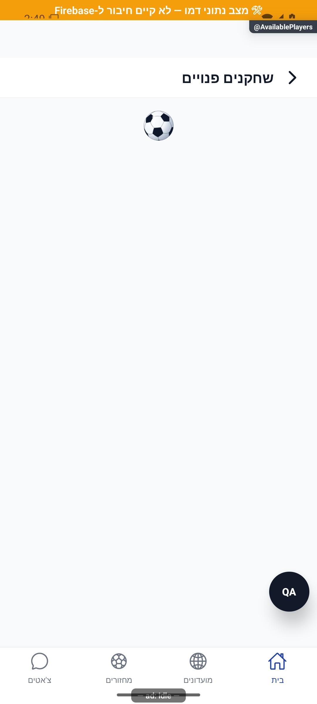
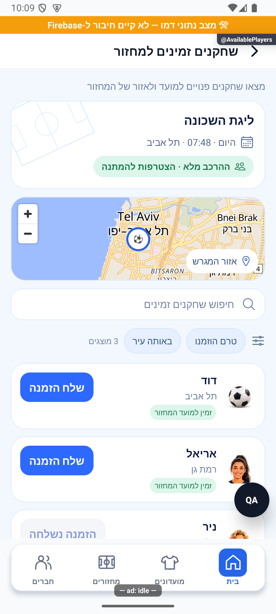
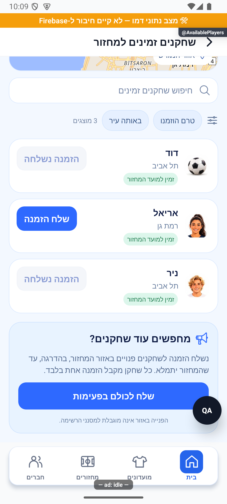
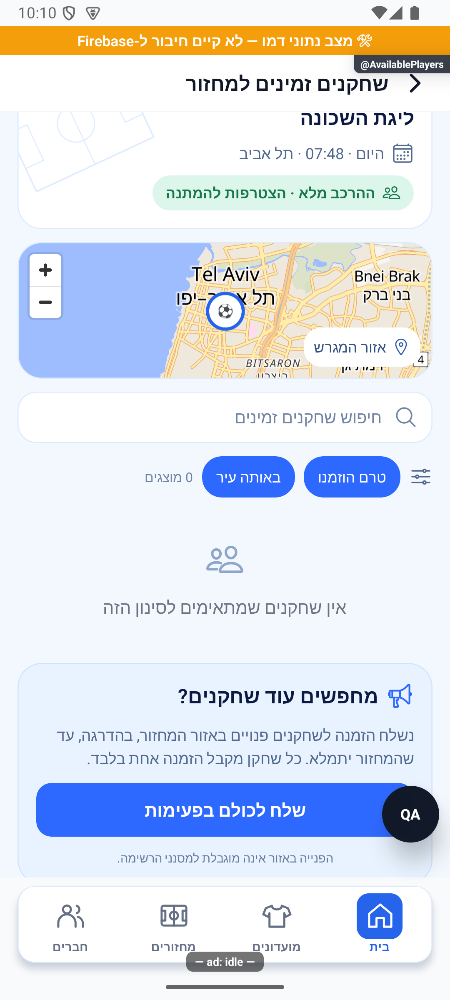
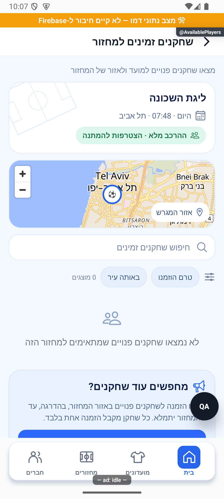
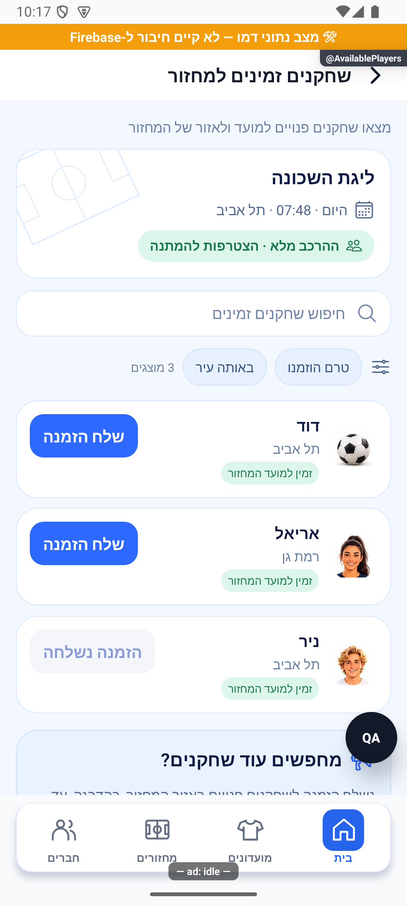
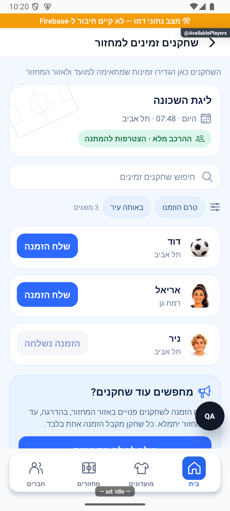

# איתור שחקנים זמינים והזמנות

## שורת צירוף ובדיקת הפולס — 17.10.2026

`MatchDetails → players → הזמן פנויים → AvailablePlayers {gameId}`. נשמר התנאי מנהל ו־status=open, גם כשהרכב מלא בדיוק כפי שהיה בתפריט; מסך היעד והשירות אחראים לקיבולת ולזכאות. אין שינוי בחיפוש, בפרטיות, במסננים או בשליחת פעימות. נצפה מצב ללא מועמדים בהדגמה; לא נשלחו הזמנות.

[בדיקות, צילומים ומגבלות](../../changes/2026-10-17-roster-recruitment-and-pulse.md).

עודכן: 7.10.2026. מקור הקוד: `8e8fde5`, גרסה `1.1.35`. מסמך זה מתאר את הקוד; מצב חנות ופריסת שרת דורשים ראיה נפרדת.

## כניסה ותפקידים

MatchDetails → שחקנים → הזמן פנויים → AvailablePlayers {gameId}

מנהל מחזור; מאמת לפי המשתמש והמועדונים.

## רכיבים ומצבים

| רכיב / מצב | התנהגות וחוזה |
|---|---|
| מועמדים | findAvailablePlayers לפי יום, עיר ושעה; מוציא שכבר במחזור |
| כרטיס | PlayerIdentity ושם; לחיצה פותחת כרטיס בהקשר מועדון מתאים |
| הזמנה | inviteToGame לשחקן; invitedIds מקומי מונע חזרה באותה תצוגה |
| פעימה | startFillerPulse; TOO_LATE/TOO_EARLY/GAME_FULL/NO_CITY/GAME_NOT_OPEN הם הסברים שונים |
| טעינה | מפתח מועדונים יציב מונע טעינה מלאה אחרי כל הזמנה; רשימה ריקה, טעינה ושגיאה נפרדות |

## מסלול נתונים ומקומות שינוי

[`src/screens/games/AvailablePlayersScreen.tsx`](../../../src/screens/games/AvailablePlayersScreen.tsx)

userService.findAvailablePlayers; gameService.getGameById; notificationsService.inviteToGame; gameService.startFillerPulse; הישגים ואירועי מדידה. מועמדות לזמינות אינה רישום אוטומטי.

ממיר המחזור: [`src/firebase/firestore.ts`](../../../src/firebase/firestore.ts), `gameDocConverter.fromFirestore`; סוגים: [`src/types`](../../../src/types). שינוי שדה דורש מעקב כתיבה → ממיר → שירות/חנות → רכיב. ניווט: [`GameStack.tsx`](../../../src/navigation/GameStack.tsx), ובמסכים משותפים גם המחסניות שמארחות אותם.

## בדיקות וראיות

בדיקות זמינות, פעימות והזמנות; לוודא לחיצה חוזרת וסיבות חסימה.

צילומי המיפוי מהאמולטור נעשו במצב נתוני דמו, המסומן בפס כתום. הם מוכיחים את הרכיב והמצב המוצגים בלבד, ולא ממירי Firebase, נתוני ייצור או כתיבה. צילומי תיקונים קודמים מסומנים בנפרד. שגיאת מזהה, מצב טעינה או שער הגנה אינם הוכחת הפעולה המלאה.

הצילום שנאסף מציג טעינה בלבד; אינו מוכיח שיש מועמדים, שהרשימה ריקה או שהזמנה נשלחה.

## גבולות והערות תחזוקה

עדכון 14.10.2026: טעינת המחזור עברה לקריאה לפי מזהה; כשל טעינה מוצג עם ניסיון חוזר ואינו מוצג כאפס מועמדים.

לפני שינוי פתח את הקוד המקושר ואת [כללי הפרויקט](../../../AGENTS.md). לאחר שינוי עדכן במסמך זה את התאריך, נקודת הקוד, המצבים שהתעדכנו, הבדיקות והצילום. אין לטעון שכל מצב/תפקיד נבדק רק משום שקיים צילום אחד.

## פירוט טכני ממוקד: זרימה, חישוב ונקודות שינוי

[הסבר פשוט למשתמש](available-players.simple.md)

העמקה: 07.10.2026, מול קוד המקור שב־`8e8fde5`. בעת הכתיבה HEAD הוא `50d508f`; בדיקת ההפרש בין הנקודות ב־`src` וב־`functions` לא מצאה שינוי קוד. הסעיפים וההסתייגויות הקיימים נשמרו. זו קריאת קוד ותיעוד, בלי הרצת תרחישי כתיבה חדשים.

המסך טוען את המחזור, מחשב יום/עיר/שעה ופונה ל־`userService.findAvailablePlayers`; לאחר מכן מוציא משתמשים שכבר בהקשר המחזור. `notificationsService.inviteToGame` שולח הזמנה, ואוסף `invitedIds` המקומי מונע חזרה באותו מסך בלבד — אין להציג אותו כמפתח מניעת כפילות בשרת.

`startFillerPulse` מפעיל מסלול חיפוש נפרד. `TOO_LATE`, `TOO_EARLY`, `GAME_FULL`, `NO_CITY`, `GAME_NOT_OPEN` צריכים לשמור הסבר מותאם; לא לאחד אותם ל״אין שחקנים״. מספר מועמדים מוצגים אינו מספר מקומות שנפתחו: 20 זמינים וקיבולת פנויה 2 אינם 20 הזמנות מאושרות.

בכשל טעינת המחזורים יש לבחון סינון ולא להסיק שאין למשתמש מחזורים. שינוי התאמת זמנים צריך להצליב `preferredDays/preferredTimes` עם מסלול הפעימה בשרת, כי חיפוש ידני ופעימה אינם מובטחים להיות אותה שאילתה. הבדיקה המוצגת כיום היא טעינה בלבד; התאמה, פוש ואישור דורשים ראיות נפרדות.

## עיצוב ומצבים מעודכנים — 14.10.2026

מקור `4a3cb346` עם שינויים מקומיים. תקציר מחזור עם שם, יום ושעה ועיר; מפה של מיקום המגרש בלבד (או מיקום המועדון כשקואורדינטות המגרש חסרות); כרטיסי מועמדים עם תמונה, שם, עיר ותג התאמה. אין חשיפה של מיקום אישי או רדיוס חיפוש מומצא. כשהקואורדינטות חסרות אין מפה.

התאמה ליום, שעה ואזור נשארת ב־`findAvailableSocialPlayers`; השאילתה מוציאה חברי מועדון, מי שכבר ברשימות המחזור, חסומים ומשתמשים שאינם גלויים. הלקוח מציג עד 50 תוצאות, ולכן המונה הוא ״מוצגים״ ולא ספירת כל הזמינים במערכת. `availability.preferredCity` בתשובה מכיל את עיר המשתמש המותרת לתצוגה. תג התאמה אינו אישור השתתפות.

מסנני הסקיצה ״היום״ ו״בערב״ אינם מתאימים למחזור עם מועד קבוע ולכן הוחלפו בשני מסננים מצטברים: טרם הוזמנו ובאותה עיר. חיפוש לפי שם מקומי; שום מסנן אינו מרחיב את מאגר המועמדים או משנה את כללי ההתאמה. סינון עיר משתמש בעיר השמורה, בלי להמציא מרחקים.

כפתור הזמנה אישי חובר מחדש לפעולת `inviteToGame` הקיימת. `invitedUserIds` מהמחזור מזין את המצב ההתחלתי, והצלחה מוסיפה מזהה מקומי מיד. `inviteLock` מונע שתי בקשות לפני הרינדור הבא; כשל משחרר נעילה ואינו מסמן הצלחה. שליחה בפעימות נשארה עם חלונית אישור, הסברי החסימה והשרת המקוריים; `pulseLock` מונע אישור כפול. המסננים המקומיים אינם מגבילים את פעולת האזור, והדבר מצוין בכרטיס.

מקומות פנויים = מקסימום פחות רשומים, אורחים פעילים ומקום שמור להצעת קידום, עם רצפה אפס. מכסה חסרה מוצגת ללא מכסה. הרכב מלא מצוין כהצטרפות להמתנה; השליחה הקבוצתית עדיין כפופה לחסימת `GAME_FULL` הקיימת.

טעינה, כשל עם ניסיון חוזר, מחזור חסר, אין מועמדים ואין תוצאות לסינון מוצגים בנפרד. הנתונים נטענים לפי `gameId` ישירות ולא מחיפושי מחזורים כלליים שמסתירים כישלונות.

### ראיות ומגבלות

- בדיקת טיפוסים וכל הבדיקות הורצו; נוספו שלוש בדיקות ב־`availablePlayersInvite.test.ts`: נעילה כפולה והצלחה, כשל ומניעת הזמנה חוזרת, ותצוגת דמו שאינה שולחת הודעות או אירועי מדידה.
- באמולטור נבדקו מצב ריק, טעינת מפה אמיתית, רשימה בת שלושה שחקני דמו קיימים, שינוי כפתור לאחר הזמנה מקומית, שילוב שני מסננים וגלילה לכרטיס הפעימות.
- מסלול `AvailablePlayersPreview` מאפשר נתוני תצוגה רק כאשר `__DEV__`, נתוני דמו, דגל מסלולי בדיקה ופרמטר תצוגה כולם פעילים. לא נוצרים חשבונות או מסמכים. פעולות הזמנה ופעימה בו מקומיות בלבד. המסלול הרגיל נשאר ללא הזרקת מועמדים.
- לא נבדקו משלוח פוש אמיתי, התאמת זמינות בשרת, אישור הצטרפות, כתיבה בייצור או אייפון. לא שונו הרשאות ולא בוצעה פריסה.

## הסרת המפה — 14.10.2026

לפי בקשת הבעלים הוסרה המפה מהמסך, כולל טעינת רכיב המפה וחישוב הסמנים. פרטי המחזור, החיפוש, הסינון וההזמנות נשארו. הצילומים הקודמים עם מפה מתעדים מצב קודם. נבדק חזותית באימולטור בדמו; ללא שליחת הזמנות.

## הסרת תג הזמינות החוזר — 14.10.2026

תג ״זמין למועד המחזור״ הוסר מכל שחקן. בראש המסך מופיע הסבר יחיד: ״השחקנים כאן הגדירו זמינות שמתאימה למועד ולאזור המחזור״. סינון המועמדים לא השתנה. נבדק חזותית באימולטור בדמו.

## סבב פולס — 18.10.2026

`userService.findAvailablePlayersPage(gameId,cursor)` מחזיר עמוד יחיד וסמן, דוחה סמן תקוע ומגביל כל בקשת עמוד ל־15,000 מילישניות; הבקשה המרוחקת אינה מבוטלת אך תשובתה המאוחרת אינה נצרכת לאחר פקיעת Promise.race. `AvailablePlayersScreen` טוען עמוד ראשון; loadMore מאחד לפי id, ננעל סינכרונית ומסנן תשובה לפי pageEpoch. כשל המשך שומר את המועמדים ואת הסמן ומציע ניסיון חוזר. סוף רשימה טוען אוטומטית כאשר מוצגים מועמדים; בעמוד ריק נדרש כפתור ההמשך. ההתאמה והפרטיות ממשיכות להיקבע בשרת; פונקציית השרת לא שונתה. `pulse18ReadFailures.test.ts` ו־`availablePlayersInvite.test.ts` מכסים זמן קצוב, סמן תקוע, נעילה, כשל ותשובה ממחזור קודם.

השינויים מקומיים וטרם הופצו. לא שונו הרשאות ולא נשלחו הזמנות או הודעות. בדיקת הדפדפן משתמשת בקוד הרכיבים בפועל, במתאם סגנונות, בסמלים חלופיים ובנתוני הדגמה; אינה הוכחת אנדרואיד או אייפון. שני האמולטורים לא הגיבו לפקודות או לצילום בסבב זה.

## תלות בעדכון העונות — 19.10.2026

נבדק ההפרש בקבצים המשותפים הרשומים כאן: `src/firebase/firestore.ts`. השינוי ממוקד במדיניות העונות, קריאת מצבן, שיוך מחזור ופקודות ניהולן; אין שינוי מכוון בחוזה העצמאי המתואר במסמך זה. אין להסיק מכך שהמסך הזה הורץ מחדש.

[מצב המימוש, הבדיקות ומגבלות האימות של העונות](../clubs/seasons.md). מקומי בלבד; לא בוצעה פריסה במסגרת המשימה.
