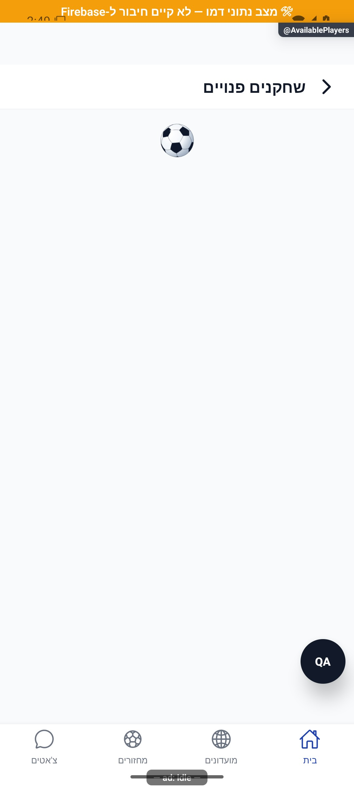
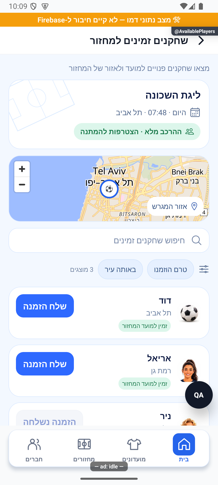
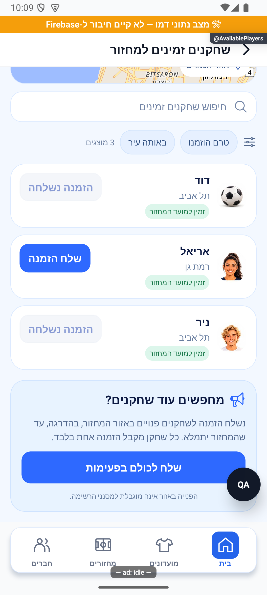
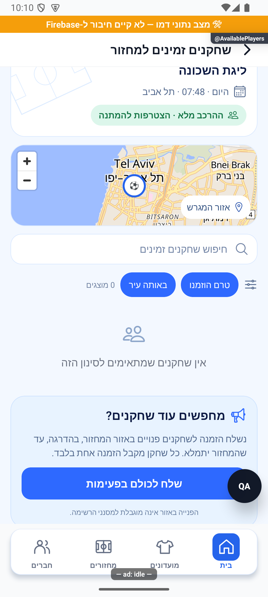
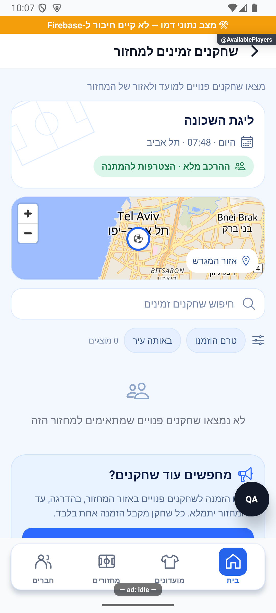
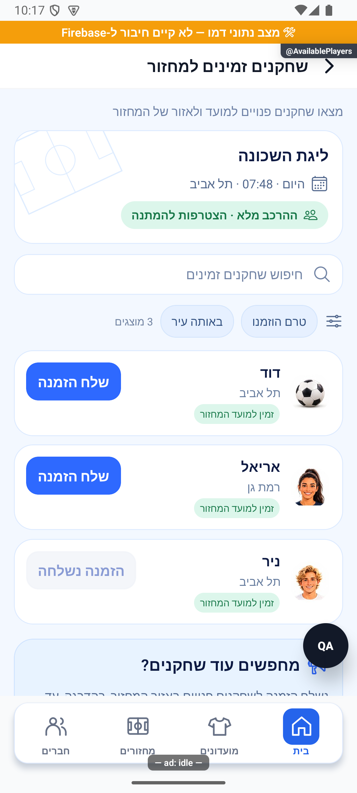
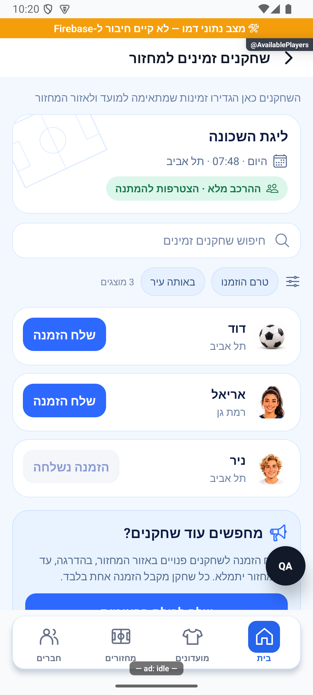

# איתור שחקנים זמינים והזמנות

## תנאי ההצעה בשרת, 6.11.2026

`startGameFillerPulse` והפעימות אוכפים בשרת `canOfferFiller`: קיבולת חיובית, לפחות 70 אחוז תפוסה ופחות מקיבולת מלאה. `occupancyOf` אינו סופר אורח עם `waitlisted`; הצעת קידום ממתינה אינה נחשבת להרשמה לצורך הסף. בדיקת `availablePlayersPulseCapacity.test.tsx` עודכנה לצפות לתפוסה תשע עם שמונה רשומים, אורח פעיל ואורח ממתין. מונה `availablePlayersPulseAvailability` בלקוח נשאר כפי שהיה, ולכן עשוי עדיין להחזיר `pulse-full` במצב הזה. לא שונו ממשק, חסימות הלקוח, הזמנות אישיות או ניווט ולא נטען שנערכה בדיקת מכשיר. [הפריסה, החישובים, הבדיקות והמגבלות](fillers.md#סף-תפוסה-פעיל-בשרת-6112026).

## מדידת פעולות ואמינות נתונים, 5.11.2026

במיפוי מקור הרכיבים המוזכרים במסמך נמצאו 10 נקודות מטפל ו-10 מזהי פעולה. הספירה מתארת קוד וכוללת רכיבים משותפים; אין לחבר אותה לספירות של מסמכים אחרים ואין לראות בה הרצת כל המסך. המדידה מפורטת לפי גבול פקד מקורי, פעולה עסקית ומצב חשבון. תשובה מאוחרת נבדקת מול בעל הפעולה, ומצב קיים או בקשה חוזרת אינם תמיד הצלחה חדשה. רשימת המקרים שהורצו ומגבלות המסד, המכשיר והכיסוי נשמרות [בדוח המדידה](../../audits/2026-11-04-system-night/product-measurement.md) ובדוחות המקושרים אליו. המימוש מקומי; לא בוצעה בדיקה חדשה של כל מצבי הפיצר.

## הזמנה אישית מול הצעה לפנויים, 4.11.2026

איתור שחקנים ושליחת הזמנה אישית לא השתנו. במסלול ההצעה לפנויים, src/services/notificationActionService.ts מעביר את משטח השליחה לשרת. פתיחה מהתראה רגילה ממשיכה למסך המחזור, ולכן משטח מסך אינו ראיה לקישור. העתקים ישנים של הבקשה יכולים שלא להכיל מקור. מקומי וטרם הופץ. [הראיות והמגבלות](../../changes/2026-11-04-filler-requests.md) · [דרכי הכניסה וההמלצות](../../specs/2026-11-04-outside-round-players.md).

## מדידה מול הייצור, 4.11.2026

שירות האיתור נפרס ונמדד באותו חשבון ניהול ובאותו מחזור בדיקה פרטי. בכל שבע הבקשות משני צדי הפריסה התקבלו 37 מועמדים בעמוד אחד. החציון מהכניסה למסך ועד לשחקן הראשון ירד מ-6.480 ל-2.070 שניות. לא נשלחו הזמנות. [מדידות, בדיקות ומגבלות](../../changes/2026-11-04-player-discovery-production.md).

## חיפוש שחקנים וזמני טעינה, 4.11.2026

ב-`findAvailableSocialPlayers` הסריקה נשארת 250 חשבונות לעמוד ועד 50 התאמות. בדיקת חסימות בשני הכיוונים מאוגדת אחרי סינוני המועד, האזור, הזמינות והסגל. בעמוד מלא הסמן הוא השחקן החמישים שהוחזר, ובסריקה שמוצתה הוא המסמך האחרון שנבדק. נבדק רצף של שני עמודים עם חסימות מעורבות. מימוש מקומי שטרם הופץ. [השינוי, המדידות והבדיקות](../../changes/2026-11-04-player-discovery-speed.md). [לפני](../screenshots/discovery-speed-recruit-before-2026-11-04.png) ו[אחרי](../screenshots/discovery-speed-recruit-after-2026-11-04.png).

## שיפור זמני טעינה, 4.11.2026

`src/screens/games/AvailablePlayersScreen.tsx` מתחיל `getGameById` ו-`findAvailablePlayersPage(gameId)` ב-`Promise.all`. שתי הקריאות מקבלות מזהה קיים מהנתיב ואוכפות גישה בעצמן. אין פרסום מועמדים לפני קבלת שתי התשובות; מחזור חסר אינו מפרסם דף מועמדים. מיקום, זמינות, חברות ופרטיות נשארים באחריות השירות והשרת. דפדוף, מצב שליחה ובדיקת תפוסה חיה נשמרו. `tests/logic/availablePlayersPulseCapacity.test.tsx` כולל בדיקות התחלה משותפת, דף שמגיע לפני המחזור ומחזור חסר.

[היקף השינוי, המדידות והמגבלות](../../changes/2026-11-04-screen-performance.md).

## ליטוש מקומי והשפעת רכיבים, 3.11.2026

נוסף `availablePlayersPulseAvailability` ב-`src/screens/games/AvailablePlayersScreen.tsx`. מונה המקומות המוצג נשאר בדיוק: אם `maxPlayers` קיים כאמת, `free = max(0, maxPlayers - players.length - activeGuestCount(guests) - (pendingPromotion.uid ? 1 : 0))`; אחרת `null`. `activeGuestCount` אינו כולל אורח עם `waitlisted: true`. אין שינוי במכנה הסגל.

החסימה `roster-full` חלה כש-`free === 0`. חסימת `pulse-full` נבדקת בנפרד כש-`maxPlayers > 0` וגם `players.length + guests.length >= maxPlayers`, לפי מונה הפעימות הקיים בשרת: כל האורחים נכללים והצעת קידום אינה שמורה בו. ל-`roster-full` קדימות. אי ההתאמה בין שני המונים נשארת מגבלה גלויה; השרת לא שונה.

בשתי החסימות מוצגת כותרת הזמנה ידנית והכפתור מושבת. החסימה הראשונה מסבירה שההרכב מלא ומפנה להזמנה ידנית להמתנה; השנייה מסבירה שהפעימות אינן זמינות בלי לטעון שהסגל עצמו מלא. `subscribeLiveGame` מעדכן רק `players`, `guests`, `maxPlayers` ו-`pendingPromotion`. ההפניה מתעדכנת לפני הרינדור, והקיבולת נבדקת שוב בלחיצה ובאישור, עם נעילה סינכרונית וזהות מחזור וחשבון. אין טעינה חוזרת של המועמדים בגלל עדכון זה. כשל הפעלה של הבקשה הנוכחית משחרר את הנעילה שבבעלותה ומאפשר ניסיון נוסף.

בבדיקת המשך הוחלף `gameId` באותו מופע רכיב בזמן בקשת פעימות ממתינה. לפני תיקון המקור שלוש בדיקות נכשלו: שגיאת הבקשה הישנה הוצגה בהקשר החדש, סימון שליחה עבר למחזור החדש, והבקשה הישנה השאירה את הפעולה החדשה עסוקה. זו הוכחת קוד עם הבטחות מושהות ודחייה, ולא מסלול ניווט ששוחזר במכשיר. מקור לפני ופלט הכשל נשמרו ב-`artifacts/overnight-2026-11-02/pulse-scope-before` וב-`artifacts/overnight-2026-11-02/pulse-scope-before-tests.log`.

`pulseScope` מזהה מופע הקשר של מחזור וחשבון, ומתחדש גם בחזרה ממחזור אחד לאחר וחזרה לראשון. `pulseState` הוא מקור התצוגה של ההמתנה והשליחה, ומוצג רק כשהוא שייך להקשר הנוכחי. `pulseRequestRef` מחזיק את בעלות הבקשה על הנעילה, ו-`pulseSentScopeRef` מונע שליחה חוזרת רק בהקשר שבו הצליחה. אחרי תשובה או שגיאה נבדקים גם ההקשר וגם בעלות הבקשה לפני הודעה או שינוי מצב; `finally` מנקה רק את הבקשה שבבעלותו ואינו משחרר בקשה חדשה. חלון אישור מהקשר שנעזב אינו מתעורר מחדש בחזרה לאותו מזהה. אין שינוי במונים, בשירותים, במלל או בתצוגת אותו מחזור.

אחרי התיקון עברו 25 בדיקות ממוקדות ב-`tests/logic/availablePlayersPulseCapacity.test.tsx` וב-`tests/logic/availablePlayersInvite.test.ts`: שני המונים, אורח ממתין, הצעת קידום, שינוי לפני רינדור ובזמן אישור, כפילות, כשל והפרדת הקשרים. נבדקו גם הצלחה ודחייה מאוחרות בזמן בקשה חדשה, חזרת נעילה אחרי כשל וחזרה לאותו מחזור. פלט ההצלחה נשמר ב-`artifacts/overnight-2026-11-02/pulse-scope-after-tests.log`. הבדיקות מפעילות רכיב מקור עם תחליפים וכוללות השוואה לעוזר התפוסה האמיתי של השרת; אין כאן קריאת שרת, משלוח הזמנות, שינוי הרשאות או אימות החלפת ההקשר באימולטור. ההזמנה הידנית, המסננים ומצבי טעינה וכשל של המועמדים לא שונו. במסגרת תיקון ההקשר לא הורצו טיפוסים או הסדרה המלאה, והבדיקות הכוללות נותרו אצל הסוכן הראשי.

השינוי מקומי וטרם הופץ. אין כאן אימות חדש של מסך מוצר מלא, מכשיר, קורא מסך או שרת. [הראיות והמגבלות של המשימה](../../changes/2026-11-03-overnight-mission.md).

## הרחבת אבחון דיווחים, 27.10.2026

נוספה מעטפת אבחון מקומית עם מצב בזמן הכשל, שלבים בעלי מזהה ותזמון, מצב רשת ובנייה ומופעים נפרדים לשגיאה. נקודת הכניסה לתעבורת השרת עוברת כעת דרך העטיפה המשותפת; תשובות, חריגות, אפשרויות קריאה ומדיניות הפיצר נשמרות. אין כאן שינוי בהרשאות או בחישובי המוצר. הבדיקות המלאות ומגבלות האימות מתועדות בדוח המקושר; אין טענה לאימות מכשיר או להפצה. [היקף, ראיות ומגבלות](../../changes/2026-10-27-diagnostic-context.md).

באימות הסופי עברו כל 6,231 הבדיקות ב-555 חבילות, ובדיקות הטיפוסים של הלקוח, השרת והפולס נקיות. צילום הדפדפן והידור מקורות האנדרואיד הם בדיקות מקומיות; אין הוכחת מכשיר, הידור אייפון או מסירה חיה של הבנייה החדשה. רישום יומן השחרור נחשב מאומת רק לפי קבלת הקריאה החוזרת בדוח השינוי.

## שעון מדויק וכיתוב פנדל - 25.10.2026

במקורות המשותפים נוסף שימור השעון המדויק של פנדל במהלך משחק, וכיתוב ההבקעה ביומן קוצר. אין שינוי במונים או בתהליך העצמאי המתואר כאן; לא נערכה לו בדיקת ממשק חדשה במסגרת העדכון. השינוי מקומי וטרם הופץ. [פרטים וראיות](../../changes/2026-10-25-in-play-penalties.md#שעון-מדויק-וכיתוב-אירוע).

## פנדל במהלך משחק חי - 25.10.2026

נבדק השינוי הממוקד במקורות המשותפים: נוספו חוזי אירועי פנדל במהלך משחק, קוראים ומוני סטטיסטיקה, והגנות בעסקאות סיום ואיפוס משחק. מסלול הפיצר המתואר כאן אינו נקודת הכניסה להזנה החדשה. בדיקות המאגר עברו, אך אינן הוכחת הרצה חדשה של כל מצבי התהליך או של פריסה.

השינוי מקומי. נדרשת פריסת שרת לפני הפצת לקוח שמשתמש באפשרות; לא בוצעו פריסה או שינוי הרשאות. [חוזה הנתונים, התהליך, הבדיקות ומגבלות ההפצה](../../changes/2026-10-25-in-play-penalties.md).

## חזרה מארון התארים לכרטיס המקורי — 24.10.2026

לערימת הניווט המשותפת נוסף רישום מקומי של ארון התארים, כדי שחזרה מכרטיס שחקן לא תחליף לשונית. אין שינוי מכוון בהתנהגות העצמאית המתוארת כאן, ואין בדיקת ממשק חדשה שלה. התיקון מקומי ולא הופץ. [מסלול הניווט, בדיקות, צילומים ומגבלות](../../changes/2026-10-24-cabinet-back.md).

## תיעוד כשלים — 20.10.2026

נוספו תצפיות דיווח בנקודות הכשל של המקורות המשויכים לפיצ׳ר, במסגרת הרחבה רוחבית. נשמרו ערכי החזרה, הזריקות ותנאי הפעולה הקיימים; נוסף מקור קוד והקשר לדיווח. כיסוי תחבירי אינו הוכחת הרצה של כל מצב. השינוי מקומי וטרם הופץ; בדיקות המסירה, מגבלות מניעת הכפילויות והמסלולים שטרם חוברו מתועדים בדוח המשותף.

[דוח דיווח השגיאות והראיות](../../changes/2026-10-20-error-reporting-audit.md).

## שורת צירוף ובדיקת הפולס — 17.10.2026

`MatchDetails → players → הזמן פנויים → AvailablePlayers {gameId}`. נשמר התנאי מנהל ו־status=open, גם כשהרכב מלא בדיוק כפי שהיה בתפריט; מסך היעד והשירות אחראים לקיבולת ולזכאות. אין שינוי בחיפוש, בפרטיות, במסננים או בשליחת פעימות. נצפה מצב ללא מועמדים בהדגמה; לא נשלחו הזמנות.

[בדיקות, צילומים ומגבלות](../../changes/2026-10-17-roster-recruitment-and-pulse.md).

עודכן: 7.10.2026. מקור הקוד: `8e8fde5`, גרסה `1.1.35`. מסמך זה מתאר את הקוד; מצב חנות ופריסת שרת דורשים ראיה נפרדת.

## כניסה ותפקידים

MatchDetails → שחקנים → הזמן פנויים → AvailablePlayers {gameId}

מנהל מחזור; מאמת לפי המשתמש והמועדונים.

## רכיבים ומצבים

| רכיב / מצב | התנהגות וחוזה |
|---|---|
| מועמדים | findAvailablePlayers לפי יום, עיר ושעה; מוציא שכבר במחזור |
| כרטיס | PlayerIdentity ושם; לחיצה פותחת כרטיס בהקשר מועדון מתאים |
| הזמנה | inviteToGame לשחקן; invitedIds מקומי מונע חזרה באותה תצוגה |
| פעימה | startFillerPulse; TOO_LATE/TOO_EARLY/GAME_FULL/NO_CITY/GAME_NOT_OPEN הם הסברים שונים |
| טעינה | מפתח מועדונים יציב מונע טעינה מלאה אחרי כל הזמנה; רשימה ריקה, טעינה ושגיאה נפרדות |

## מסלול נתונים ומקומות שינוי

[`src/screens/games/AvailablePlayersScreen.tsx`](../../../src/screens/games/AvailablePlayersScreen.tsx)

userService.findAvailablePlayers; gameService.getGameById; notificationsService.inviteToGame; gameService.startFillerPulse; הישגים ואירועי מדידה. מועמדות לזמינות אינה רישום אוטומטי.

ממיר המחזור: [`src/firebase/firestore.ts`](../../../src/firebase/firestore.ts), `gameDocConverter.fromFirestore`; סוגים: [`src/types`](../../../src/types). שינוי שדה דורש מעקב כתיבה → ממיר → שירות/חנות → רכיב. ניווט: [`GameStack.tsx`](../../../src/navigation/GameStack.tsx), ובמסכים משותפים גם המחסניות שמארחות אותם.

## בדיקות וראיות

בדיקות זמינות, פעימות והזמנות; לוודא לחיצה חוזרת וסיבות חסימה.

צילומי המיפוי מהאמולטור נעשו במצב נתוני דמו, המסומן בפס כתום. הם מוכיחים את הרכיב והמצב המוצגים בלבד, ולא ממירי Firebase, נתוני ייצור או כתיבה. צילומי תיקונים קודמים מסומנים בנפרד. שגיאת מזהה, מצב טעינה או שער הגנה אינם הוכחת הפעולה המלאה.

הצילום שנאסף מציג טעינה בלבד; אינו מוכיח שיש מועמדים, שהרשימה ריקה או שהזמנה נשלחה.

## גבולות והערות תחזוקה

עדכון 14.10.2026: טעינת המחזור עברה לקריאה לפי מזהה; כשל טעינה מוצג עם ניסיון חוזר ואינו מוצג כאפס מועמדים.

לפני שינוי פתח את הקוד המקושר ואת [כללי הפרויקט](../../../AGENTS.md). לאחר שינוי עדכן במסמך זה את התאריך, נקודת הקוד, המצבים שהתעדכנו, הבדיקות והצילום. אין לטעון שכל מצב/תפקיד נבדק רק משום שקיים צילום אחד.

## פירוט טכני ממוקד: זרימה, חישוב ונקודות שינוי

[הסבר פשוט למשתמש](available-players.simple.md)

העמקה: 07.10.2026, מול קוד המקור שב־`8e8fde5`. בעת הכתיבה HEAD הוא `50d508f`; בדיקת ההפרש בין הנקודות ב־`src` וב־`functions` לא מצאה שינוי קוד. הסעיפים וההסתייגויות הקיימים נשמרו. זו קריאת קוד ותיעוד, בלי הרצת תרחישי כתיבה חדשים.

המסך טוען את המחזור, מחשב יום/עיר/שעה ופונה ל־`userService.findAvailablePlayers`; לאחר מכן מוציא משתמשים שכבר בהקשר המחזור. `notificationsService.inviteToGame` שולח הזמנה, ואוסף `invitedIds` המקומי מונע חזרה באותו מסך בלבד — אין להציג אותו כמפתח מניעת כפילות בשרת.

`startFillerPulse` מפעיל מסלול חיפוש נפרד. `TOO_LATE`, `TOO_EARLY`, `GAME_FULL`, `NO_CITY`, `GAME_NOT_OPEN` צריכים לשמור הסבר מותאם; לא לאחד אותם ל״אין שחקנים״. מספר מועמדים מוצגים אינו מספר מקומות שנפתחו: 20 זמינים וקיבולת פנויה 2 אינם 20 הזמנות מאושרות.

בכשל טעינת המחזורים יש לבחון סינון ולא להסיק שאין למשתמש מחזורים. שינוי התאמת זמנים צריך להצליב `preferredDays/preferredTimes` עם מסלול הפעימה בשרת, כי חיפוש ידני ופעימה אינם מובטחים להיות אותה שאילתה. הבדיקה המוצגת כיום היא טעינה בלבד; התאמה, פוש ואישור דורשים ראיות נפרדות.

## עיצוב ומצבים מעודכנים — 14.10.2026

מקור `4a3cb346` עם שינויים מקומיים. תקציר מחזור עם שם, יום ושעה ועיר; מפה של מיקום המגרש בלבד (או מיקום המועדון כשקואורדינטות המגרש חסרות); כרטיסי מועמדים עם תמונה, שם, עיר ותג התאמה. אין חשיפה של מיקום אישי או רדיוס חיפוש מומצא. כשהקואורדינטות חסרות אין מפה.

התאמה ליום, שעה ואזור נשארת ב־`findAvailableSocialPlayers`; השאילתה מוציאה חברי מועדון, מי שכבר ברשימות המחזור, חסומים ומשתמשים שאינם גלויים. הלקוח מציג עד 50 תוצאות, ולכן המונה הוא ״מוצגים״ ולא ספירת כל הזמינים במערכת. `availability.preferredCity` בתשובה מכיל את עיר המשתמש המותרת לתצוגה. תג התאמה אינו אישור השתתפות.

מסנני הסקיצה ״היום״ ו״בערב״ אינם מתאימים למחזור עם מועד קבוע ולכן הוחלפו בשני מסננים מצטברים: טרם הוזמנו ובאותה עיר. חיפוש לפי שם מקומי; שום מסנן אינו מרחיב את מאגר המועמדים או משנה את כללי ההתאמה. סינון עיר משתמש בעיר השמורה, בלי להמציא מרחקים.

כפתור הזמנה אישי חובר מחדש לפעולת `inviteToGame` הקיימת. `invitedUserIds` מהמחזור מזין את המצב ההתחלתי, והצלחה מוסיפה מזהה מקומי מיד. `inviteLock` מונע שתי בקשות לפני הרינדור הבא; כשל משחרר נעילה ואינו מסמן הצלחה. שליחה בפעימות נשארה עם חלונית אישור, הסברי החסימה והשרת המקוריים; `pulseLock` מונע אישור כפול. המסננים המקומיים אינם מגבילים את פעולת האזור, והדבר מצוין בכרטיס.

מקומות פנויים = מקסימום פחות רשומים, אורחים פעילים ומקום שמור להצעת קידום, עם רצפה אפס. מכסה חסרה מוצגת ללא מכסה. הרכב מלא מצוין כהצטרפות להמתנה; השליחה הקבוצתית עדיין כפופה לחסימת `GAME_FULL` הקיימת.

טעינה, כשל עם ניסיון חוזר, מחזור חסר, אין מועמדים ואין תוצאות לסינון מוצגים בנפרד. הנתונים נטענים לפי `gameId` ישירות ולא מחיפושי מחזורים כלליים שמסתירים כישלונות.

### ראיות ומגבלות

- בדיקת טיפוסים וכל הבדיקות הורצו; נוספו שלוש בדיקות ב־`availablePlayersInvite.test.ts`: נעילה כפולה והצלחה, כשל ומניעת הזמנה חוזרת, ותצוגת דמו שאינה שולחת הודעות או אירועי מדידה.
- באמולטור נבדקו מצב ריק, טעינת מפה אמיתית, רשימה בת שלושה שחקני דמו קיימים, שינוי כפתור לאחר הזמנה מקומית, שילוב שני מסננים וגלילה לכרטיס הפעימות.
- מסלול `AvailablePlayersPreview` מאפשר נתוני תצוגה רק כאשר `__DEV__`, נתוני דמו, דגל מסלולי בדיקה ופרמטר תצוגה כולם פעילים. לא נוצרים חשבונות או מסמכים. פעולות הזמנה ופעימה בו מקומיות בלבד. המסלול הרגיל נשאר ללא הזרקת מועמדים.
- לא נבדקו משלוח פוש אמיתי, התאמת זמינות בשרת, אישור הצטרפות, כתיבה בייצור או אייפון. לא שונו הרשאות ולא בוצעה פריסה.

## הסרת המפה — 14.10.2026

לפי בקשת הבעלים הוסרה המפה מהמסך, כולל טעינת רכיב המפה וחישוב הסמנים. פרטי המחזור, החיפוש, הסינון וההזמנות נשארו. הצילומים הקודמים עם מפה מתעדים מצב קודם. נבדק חזותית באימולטור בדמו; ללא שליחת הזמנות.

## הסרת תג הזמינות החוזר — 14.10.2026

תג ״זמין למועד המחזור״ הוסר מכל שחקן. בראש המסך מופיע הסבר יחיד: ״השחקנים כאן הגדירו זמינות שמתאימה למועד ולאזור המחזור״. סינון המועמדים לא השתנה. נבדק חזותית באימולטור בדמו.

## סבב פולס — 18.10.2026

`userService.findAvailablePlayersPage(gameId,cursor)` מחזיר עמוד יחיד וסמן, דוחה סמן תקוע ומגביל כל בקשת עמוד ל־15,000 מילישניות; הבקשה המרוחקת אינה מבוטלת אך תשובתה המאוחרת אינה נצרכת לאחר פקיעת Promise.race. `AvailablePlayersScreen` טוען עמוד ראשון; loadMore מאחד לפי id, ננעל סינכרונית ומסנן תשובה לפי pageEpoch. כשל המשך שומר את המועמדים ואת הסמן ומציע ניסיון חוזר. סוף רשימה טוען אוטומטית כאשר מוצגים מועמדים; בעמוד ריק נדרש כפתור ההמשך. ההתאמה והפרטיות ממשיכות להיקבע בשרת; פונקציית השרת לא שונתה. `pulse18ReadFailures.test.ts` ו־`availablePlayersInvite.test.ts` מכסים זמן קצוב, סמן תקוע, נעילה, כשל ותשובה ממחזור קודם.

השינויים מקומיים וטרם הופצו. לא שונו הרשאות ולא נשלחו הזמנות או הודעות. בדיקת הדפדפן משתמשת בקוד הרכיבים בפועל, במתאם סגנונות, בסמלים חלופיים ובנתוני הדגמה; אינה הוכחת אנדרואיד או אייפון. שני האמולטורים לא הגיבו לפקודות או לצילום בסבב זה.

## תלות בעדכון העונות — 19.10.2026

נבדק ההפרש בקבצים המשותפים הרשומים כאן: `src/firebase/firestore.ts`. השינוי ממוקד במדיניות העונות, קריאת מצבן, שיוך מחזור ופקודות ניהולן; אין שינוי מכוון בחוזה העצמאי המתואר במסמך זה. אין להסיק מכך שהמסך הזה הורץ מחדש.

[מצב המימוש, הבדיקות ומגבלות האימות של העונות](../clubs/seasons.md). מקומי בלבד; לא בוצעה פריסה במסגרת המשימה.

## אימות — 21.10.2026

קובץ הבדיקות המשותף `tests/logic/pulse18ReadFailures.test.ts` הורחב בבדיקת מחיקת תמונת פרופיל. מסלול חיפוש השחקנים הזמינים ובדיקות העימוד וההמתנה שלו לא שונו בסבב זה.

## תלות במידע על סגירת עונה — 23.10.2026

בדיקת ההבדל ב־`src/firebase/firestore.ts` וב־`src/types/index.ts` מראה שהשינוי מוגבל לקריאת `seasons.closureStatus` בחוזה `GroupSeasons`. יתר ממירי הנתונים והמסלולים המתועדים כאן לא שונו במשימה זו. אימות הריצה החדש מתייחס להתאוששות ולכרטיס העונה, ולא להרצה חדשה של כל מצבי המסך הזה. [המסלול, הבדיקות והמגבלות](../../changes/2026-10-23-season-automatic-recovery.md).

## תלות בשמירת צבעי המחזור — 24.10.2026

במסגרת בחירת צבעים לפני שיבוץ עודכנו מקורות משותפים הרשומים לפיצ׳ר: `src/firebase/firestore.ts`, `src/types/index.ts`. השינוי מוסיף מפת צבעים למחזור, קריאה וכתיבה שלה ושימורה במסלולי הכוחות וההכנה. אין כאן פעולת ממשק חדשה במסך זה. זו בדיקת השפעת התוספת הממוקדת, ולא חקירה או אימות חזותי מחודש של הפיצ׳ר. כל 480 חבילות הבדיקה ו־5,343 הבדיקות עברו; טיפוסי הלקוח והשרת נקיים. השינוי מקומי וטרם הופץ. [מסלול הנתונים, ראיות ומגבלות](../rounds/draft-setup.md#צבעים-לפני-שיבוץ-ובכל-שיטת-חלוקה--24102026).

## תלות בניווט עריכת קבוצות - 25.10.2026

נבדק השינוי הממוקד במקורות המשותפים: `src/navigation/GameStack.tsx`. נוסף מעבר מתפריט הלייב לחלוקת הכוחות עם שימור מפתח מסך המקור. אין שינוי נוסף בתהליך העצמאי המתואר כאן ולא נערכה לו בדיקת מסך חדשה. [היקף, בדיקות ומגבלות](../../changes/2026-10-25-live-draft-entry.md).

## תאימות לשמירת פקודת רכיב הבית - 25.10.2026

השינוי התחום במקורות המשותפים `src/types/index.ts` ו-`src/firebase/firestore.ts` מוסיף ומשמר את `liveMatch.lastWidgetCommandId`, מזהה אטום למניעת ביצוע חוזר של פקודת רכיב הבית. הוא אופציונלי במסמכים ישנים ואינו משנה מונים, הכרעות, ניווט או הרשאות של הפיצר המתואר כאן. בדיקה מפעילה את ממיר הקריאה המקורי ומאמתת שימור ערך והיעדרו. אין בכך בדיקת מכשיר חדשה לכל מצבי הפיצר. [מקור הבדיקה והמגבלות](../../changes/2026-10-25-widget-completion.md).

## שלמות החלוקה המתוזמנת, 29.10.2026

נבדק השינוי הממוקד במקורות המשותפים: נוספו אזורי קבוצה שש ושבע למתאמי החלוקה ולקורא ההשמות, וסוננו אורחים ממתינים בשני מסלולי היצירה בשרת. אין שינוי בליבת האיזון או בחישובים העצמאיים של המסלול המתואר כאן. 15 בדיקות ממוקדות של החלוקה וקורא הנתונים עברו, וכן בדיקות הטיפוסים של הלקוח והשרת. אין אימות מכשיר חדש, שינוי חזותי מתוכנן או פריסה.

[היקף, בדיקות, פערים פתוחים ומגבלות](../../changes/2026-10-29-scheduled-balance-integrity.md).

## איזון ופיזור רמות לפני גיוון, 30.10.2026

נבדק שינוי תחום במקורות המשותפים של חלוקת הכוחות ומדדי השמירה. החישוב נותן עדיפות לפער ממוצעים, אחריו לפיזור הקצוות ולפרופיל הרמות, ולבסוף לציוותים חוזרים. התג rating_priority_v3 נוסף בלי להסיר קריאת דורות ישנים. אין שינוי מכוון בחישובים העצמאיים או בניווט המתוארים כאן. 112 בדיקות ממוקדות ובדיקות הטיפוסים של הלקוח והשרת עברו; אין בכך הרצה של המסך במכשיר או הפצה.

[מימוש, נוסחאות, בדיקות ומגבלות](../../changes/2026-10-30-rating-balance-priority.md).

## תיקו בשתיים או בשלוש קבוצות, 6.11.2026

נבדק שינוי תחום במקורות המשותפים `src/types/index.ts`: נוסף מסלול סיום משחק בתיקו בשתיים או בשלוש קבוצות, עם בחירה ידנית של הקבוצה שנשארת ושמירה במוני התיקו הקיימים. אין שינוי מכוון בפעולות העצמאיות של הפיצר המתועד כאן. בדיקות המסלול מפעילות שירות לקוח, ממירים וגוף שרת במאגר זיכרון; אין בכך הרצה חדשה של מסך זה. המימוש מקומי, ללא הפצה או פריסת שירות השמירה החדש. [התנהגות, נתונים, בדיקות ומגבלות](../../changes/2026-11-06-manual-draw.md).

## תלות משותפת בציון המחזור החדש, 6.11.2026

נוספה תמיכה מקומית בגרסת ציון למחזורי העתיד ובקריאת הרף הקפוא, תוך שמירת המודל של מחזורים קודמים. השינוי כאן תחום לתלות במקורות המשותפים, ואינו אימות חדש של כל המסלול העצמאי. המקורות המשותפים שנבדקו בהפרש התחום: src/firebase/firestore.ts, src/types/index.ts. אין פריסה, הסבת נתונים או שינוי ציוני עבר. [התנהגות, בדיקות ומגבלות](../../changes/2026-11-06-shared-evening-score.md).
