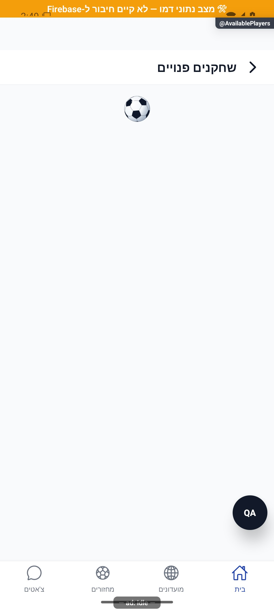
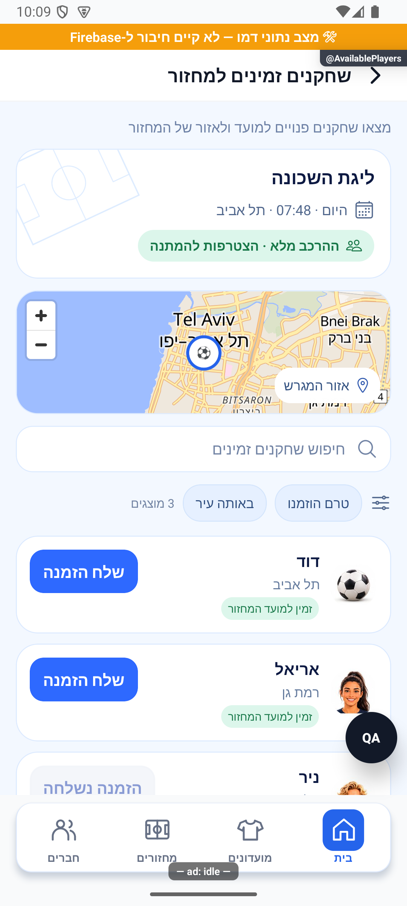
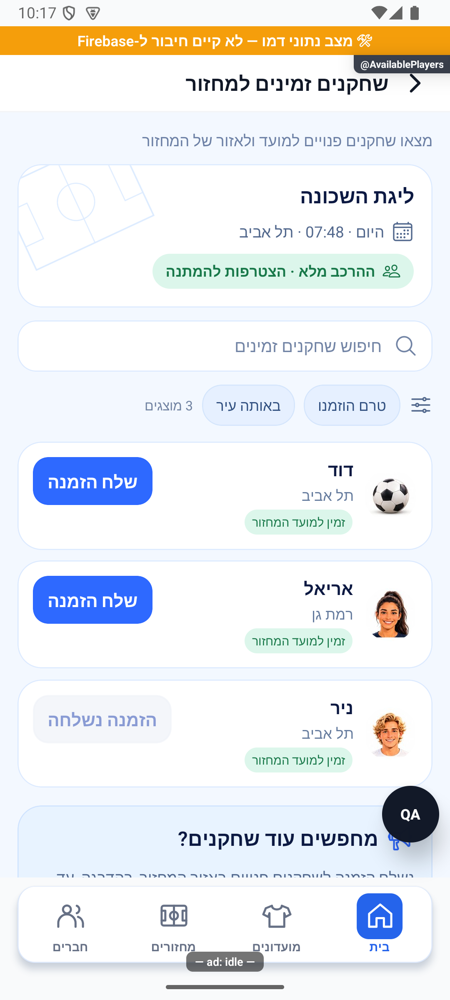
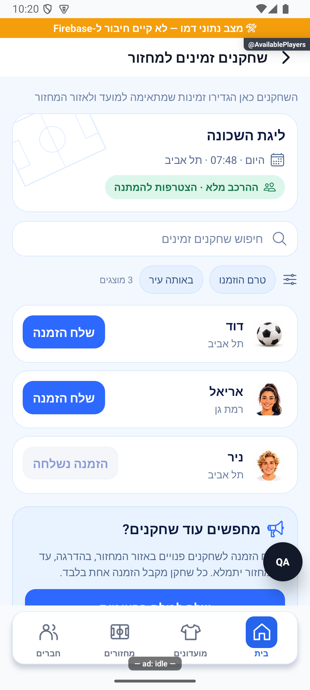

# איתור שחקנים זמינים והזמנות — הסבר פשוט

## תנאי ההצעה בשרת, 6.11.2026

השרת שולח הצעות השלמה רק למחזור בתפוסה של לפחות 70 אחוז שעדיין אינו מלא. אורח בהמתנה אינו נחשב למקום תפוס. פריסת השרת אינה משנה את מסך ההזמנות; בלקוח הקיים הכפתור עשוי עדיין להיחסם באופן שמרני בנוכחות אורח בהמתנה. [היקף הפריסה והבדיקות](fillers.md#סף-תפוסה-פעיל-בשרת-6112026).

## מדידת פעולות ואמינות נתונים, 5.11.2026

נוספה הכנה למדידת הפעולות ברכיבים המתועדים כאן. בפולס אפשר לראות ביצועים וחשבונות ייחודיים לפי פעולה ותקופה, כאשר קיים כיסוי מדידה. איסוף החשבונות החדש עדיין כבוי והמימוש מקומי. [פירוט והיקף הבדיקות](../../audits/2026-11-04-system-night/product-measurement.md).

## הזמנה אישית מול הצעה לפנויים, 4.11.2026

הזמנה לשחקן מסוים והצעה לשחקנים באזור הן שתי פעולות שונות. ההזמנה האישית מאפשרת לשחקן לקבל מקום בכפוף למצב המחזור. הצעה לפנויים מזמינה את השחקן להגיש בקשה שמופיעה למנהל בתיבה. מקומי וטרם הופץ. [הראיות והמגבלות](../../changes/2026-11-04-filler-requests.md) · [דרכי הכניסה וההמלצות](../../specs/2026-11-04-outside-round-players.md).

## מדידה מול הייצור, 4.11.2026

במחזור הבדיקה הופיע השחקן הראשון אחרי 2.07 שניות במקום 6.48. מספר המועמדים נשאר 37 בכל הבדיקות, בלי להזמין איש. [מדידות, בדיקות ומגבלות](../../changes/2026-11-04-player-discovery-production.md).

## חיפוש שחקנים וזמני טעינה, 4.11.2026

איתור פנויים מתוך מחזור בודק כמה מועמדים יחד ומחזיר את הראשונים שעומדים בתנאים. גם עמוד שממשיך אחרי שחקנים חסומים שומר את סדר המועמדים. מימוש מקומי שטרם הופץ. [השינוי, המדידות והבדיקות](../../changes/2026-11-04-player-discovery-speed.md). [לפני](../screenshots/discovery-speed-recruit-before-2026-11-04.png) ו[אחרי](../screenshots/discovery-speed-recruit-after-2026-11-04.png).

## שיפור זמני טעינה, 4.11.2026

המחזור ורשימת המועמדים מתחילים להיטען יחד. השחקנים יוצגו רק לאחר שאושר שהמחזור קיים, וההזמנות ממשיכות להיבדק מול השרת. השינוי מקומי וטרם הופץ.

[היקף השינוי, המדידות והמגבלות](../../changes/2026-11-04-screen-performance.md).

## ליטוש מקומי והשפעת רכיבים, 3.11.2026

כשההרכב מלא, ההזמנה בפעימות מושבתת ומוסבר שאפשר להזמין ידנית לרשימת ההמתנה. אם רק בדיקת התפוסה של הפעימות חוסמת, מוצגת הודעה נפרדת בלי לשנות את מספר המקומות שמוצג במסך. שינוי תפוסה בזמן חלון האישור נבדק שוב לפני הפעלה; רשימת המועמדים והזמנה ידנית נשמרות.

נוספה הגנה להחלפת מחזור באותו מסך: הודעה או תשובה של פעולה מהמחזור הקודם אינן משנות את מצב הפעולה במחזור החדש. גם סימון שליחה והמתנה אינם עוברים בין המחזורים. עברו 25 בדיקות ממוקדות בקוד, כולל תשובות שמתעכבות; החלפת המחזור הזאת לא שוחזרה באימולטור. אין שינוי במספרים, בהזמנה הידנית או בתצוגה באותו מחזור. התיקון מקומי וטרם הופץ.

[הראיות והמגבלות של המשימה](../../changes/2026-11-03-overnight-mission.md).

## הרחבת אבחון דיווחים, 27.10.2026

הדיווחים יוכלו לכלול מה ניסו לבצע, מה היה מצב האפליקציה ומה החזיר השרת. פרטים חסרים מוצגים כלא ידועים, ומספר מוגבל של מופעים נשמר בלי למחוק את המופע הראשון. השינוי מקומי וטרם הופץ, ואינו משלים פרטים לדיווחים ישנים. [היקף, ראיות ומגבלות](../../changes/2026-10-27-diagnostic-context.md).

בדיקות הקוד הושלמו, אך השינוי עדיין מקומי ולא הופץ. פרטים שלא נאספו בדיווחים ישנים אינם משוחזרים בדיעבד.

## שעון מדויק וכיתוב פנדל - 25.10.2026

במקורות המשותפים נוסף שימור השעון המדויק של פנדל במהלך משחק, וכיתוב ההבקעה ביומן קוצר. אין שינוי במונים או בתהליך העצמאי המתואר כאן; לא נערכה לו בדיקת ממשק חדשה במסגרת העדכון. השינוי מקומי וטרם הופץ. [פרטים וראיות](../../changes/2026-10-25-in-play-penalties.md#שעון-מדויק-וכיתוב-אירוע).

## פנדל במהלך משחק חי - 25.10.2026

עודכנו מקורות משותפים לצורך פנדלים במהלך משחק. אין שינוי מכוון בתהליך העצמאי המתואר במסמך הזה, ולא נערכה לו בדיקת ממשק חדשה במסגרת המשימה.

השינוי מקומי. נדרשת פריסת שרת לפני הפצת לקוח שמשתמש באפשרות; לא בוצעו פריסה או שינוי הרשאות. [חוזה הנתונים, התהליך, הבדיקות ומגבלות ההפצה](../../changes/2026-10-25-in-play-penalties.md).

## חזרה מארון התארים לכרטיס המקורי — 24.10.2026

לערימת הניווט המשותפת נוסף רישום מקומי של ארון התארים, כדי שחזרה מכרטיס שחקן לא תחליף לשונית. אין שינוי מכוון בהתנהגות העצמאית המתוארת כאן, ואין בדיקת ממשק חדשה שלה. התיקון מקומי ולא הופץ. [מסלול הניווט, בדיקות, צילומים ומגבלות](../../changes/2026-10-24-cabinet-back.md).

## תיעוד כשלים — 20.10.2026

נוסף תיעוד אוטומטי לנקודות כשל במסלול הזה, עם מקור התקלה. הפעולה המקורית שומרת על ערכי החזרה והודעות השגיאה שלה. השינוי מקומי, טרם הופץ, ואין אימות מסירה חיה לפולס.

[דוח דיווח השגיאות והראיות](../../changes/2026-10-20-error-reporting-audit.md).

## שורת צירוף ובדיקת הפולס — 17.10.2026

כפתור ״הזמן פנויים״ זמין למנהל בשורת הפעולות של לשונית השחקנים. הוא מוביל למסך ההזמנה הקיים.

[בדיקות, צילומים ומגבלות](../../changes/2026-10-17-roster-recruitment-and-pulse.md).

מארגן יכול למצוא שחקנים שסימנו זמינות ולשלוח להם הזמנה למחזור. אפשר גם לשלוח פנייה לשחקנים מתאימים באזור. הזמנה עדיין אינה הרשמה של השחקן.

[להסבר המעמיק ולמפת הקוד](available-players.md)

## צילום והיקף ההוכחה

הצילומים מציגים רק את המצבים המתועדים במסמך המעמיק. חלקם נתוני דמו, חלקם הוכחות מתיקון קודם, ובכמה מהם טעינה או הודעת הגנה; הם אינם אישור שכל התהליך או השרת נבדקו.

## המסך המעודכן — 14.10.2026

המסך מציג את המחזור ואזור המגרש, ולאחריהם שחקנים שסימנו זמינות מתאימה. אפשר לחפש לפי שם, להציג רק מי שטרם הוזמן ולסנן לאותה עיר. אפשר להזמין שחקן בנפרד; לאחר השליחה הכפתור מציג ״הזמנה נשלחה״. אפשר גם לפתוח פנייה בפעימות לשחקנים באזור, לפי הכללים הקיימים; פעולה זו אינה מוגבלת לסינון שמוצג ברשימה.

הצילום מציג תצוגת בדיקה עם שחקני דמו. לא נשלחו הזמנות אמיתיות.

## הסרת המפה — 14.10.2026

לפי בקשת הבעלים הוסרה המפה מהמסך, כולל טעינת רכיב המפה וחישוב הסמנים. פרטי המחזור, החיפוש, הסינון וההזמנות נשארו. הצילומים הקודמים עם מפה מתעדים מצב קודם. נבדק חזותית באימולטור בדמו; ללא שליחת הזמנות.

## הסרת תג הזמינות החוזר — 14.10.2026

תג ״זמין למועד המחזור״ הוסר מכל שחקן. בראש המסך מופיע הסבר יחיד: ״השחקנים כאן הגדירו זמינות שמתאימה למועד ולאזור המחזור״. סינון המועמדים לא השתנה. נבדק חזותית באימולטור בדמו.

## סבב פולס — 18.10.2026

הרשימה מציגה את עמוד התוצאות הראשון בלי להמתין לסריקת כל המשתמשים. כשיש המשך, אפשר להציג שחקנים נוספים. עמוד ריק עם המשך אינו מוצג כהוכחה שאין שחקנים. בקשה שלא עונה בתוך 15 שניות מאפשרת לנסות שוב.

השינויים מקומיים וטרם הופצו. לא שונו הרשאות ולא נשלחו הזמנות או הודעות. בדיקת הדפדפן משתמשת בקוד הרכיבים בפועל, במתאם סגנונות, בסמלים חלופיים ובנתוני הדגמה; אינה הוכחת אנדרואיד או אייפון. שני האמולטורים לא הגיבו לפקודות או לצילום בסבב זה.

## תלות בעדכון העונות — 19.10.2026

קובץ תשתית משותף עודכן במסגרת העונות. שינוי זה אינו מוסיף פעולה חדשה למסך המתואר כאן; פרטי העונות והבדיקות מופיעים במסמך העונות.

[מצב המימוש, הבדיקות ומגבלות האימות של העונות](../clubs/seasons.md). מקומי בלבד; לא בוצעה פריסה במסגרת המשימה.

## אימות — 21.10.2026

קובץ הבדיקות המשותף `tests/logic/pulse18ReadFailures.test.ts` הורחב בבדיקת מחיקת תמונת פרופיל. מסלול חיפוש השחקנים הזמינים ובדיקות העימוד וההמתנה שלו לא שונו בסבב זה.

## תלות במידע על סגירת עונה — 23.10.2026

נוסף מידע משותף שמאפשר להסביר מדוע עונה מתעכבת בסגירה. אין שינוי נוסף בפעולות המתוארות כאן; השינוי מקומי וטרם הופץ. [המסלול, הבדיקות והמגבלות](../../changes/2026-10-23-season-automatic-recovery.md).

## תלות בשמירת צבעי המחזור — 24.10.2026

שמירת המידע המשותפת עודכנה כדי להעביר את צבעי הקבוצות ממסכי הכוחות להכנה וללייב. אין תוספת פעולה במסך הזה, והוא לא נבדק מחדש במכשיר במסגרת התוספת. השינוי מקומי וטרם הופץ. [פרטי התוספת ומגבלות הבדיקה](../rounds/draft-setup.md#צבעים-לפני-שיבוץ-ובכל-שיטת-חלוקה--24102026).

## תלות בניווט עריכת קבוצות - 25.10.2026

נבדק השינוי הממוקד במקורות המשותפים: `src/navigation/GameStack.tsx`. נוסף מעבר מתפריט הלייב לחלוקת הכוחות עם שימור מפתח מסך המקור. אין שינוי נוסף בתהליך העצמאי המתואר כאן ולא נערכה לו בדיקת מסך חדשה. [היקף, בדיקות ומגבלות](../../changes/2026-10-25-live-draft-entry.md).

## תאימות לשמירת פקודת רכיב הבית - 25.10.2026

נוספה הגנה פנימית מפני ביצוע חוזר של פעולת רכיב הבית. התהליך המתואר בעמוד זה לא השתנה במכוון, ונתונים ישנים נשארים נתמכים. התיקון מקומי וטרם הופץ. [מקור הבדיקה והמגבלות](../../changes/2026-10-25-widget-completion.md).

## שלמות החלוקה המתוזמנת, 29.10.2026

במקורות המשותפים תוקנה שמירת חלוקה מתוזמנת לשש ולשבע קבוצות וסוננו אורחים שממתינים. דרך חישוב האיזון נשמרה. אין שינוי מכוון בפעולות העצמאיות המתוארות בעמוד זה ואין אימות מסך חדש שלהן; השינוי מקומי וטרם הופץ.

[היקף, בדיקות, פערים פתוחים ומגבלות](../../changes/2026-10-29-scheduled-balance-integrity.md).

## איזון ופיזור רמות לפני גיוון, 30.10.2026

עודכן החישוב המשותף של חלוקת כוחות לפי הדירוג הכללי: איזון הממוצעים קודם לפיזור הרמות, והגיוון מכריע אחרי שניהם. אין שינוי מכוון במבנה המסך או בפעולות העצמאיות המתוארות כאן, ואין אימות מכשיר חדש שלהן. השינוי מקומי וטרם הופץ או נפרס.

[מימוש, נוסחאות, בדיקות ומגבלות](../../changes/2026-10-30-rating-balance-priority.md).

## תיקו בשתיים או בשלוש קבוצות, 6.11.2026

נבדק שינוי תחום במקורות המשותפים `src/types/index.ts`: נוסף מסלול סיום משחק בתיקו בשתיים או בשלוש קבוצות, עם בחירה ידנית של הקבוצה שנשארת ושמירה במוני התיקו הקיימים. אין שינוי מכוון בפעולות העצמאיות של הפיצר המתועד כאן. בדיקות המסלול מפעילות שירות לקוח, ממירים וגוף שרת במאגר זיכרון; אין בכך הרצה חדשה של מסך זה. המימוש מקומי, ללא הפצה או פריסת שירות השמירה החדש. [התנהגות, נתונים, בדיקות ומגבלות](../../changes/2026-11-06-manual-draw.md).

## תלות משותפת בציון המחזור החדש, 6.11.2026

נוספה תמיכה מקומית בגרסת ציון למחזורי העתיד ובקריאת הרף הקפוא, תוך שמירת המודל של מחזורים קודמים. השינוי כאן תחום לתלות במקורות המשותפים, ואינו אימות חדש של כל המסלול העצמאי. אין פריסה, הסבת נתונים או שינוי ציוני עבר. [התנהגות, בדיקות ומגבלות](../../changes/2026-11-06-shared-evening-score.md).
