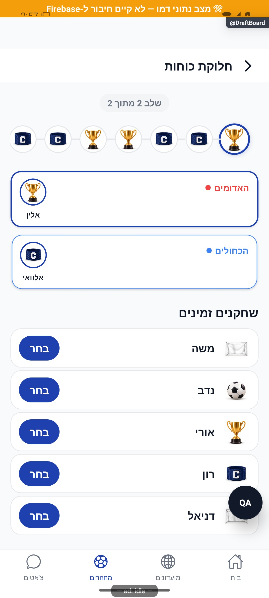
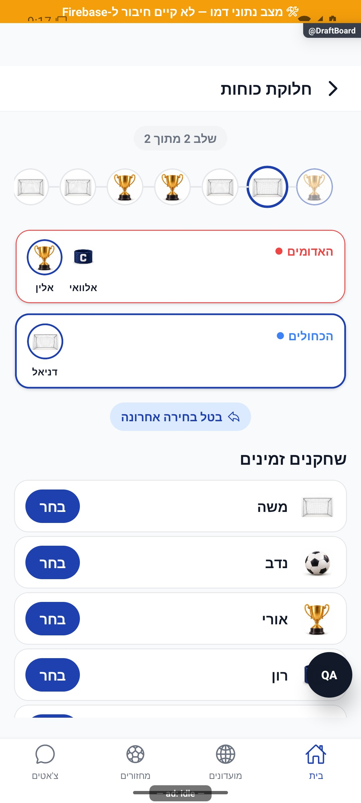
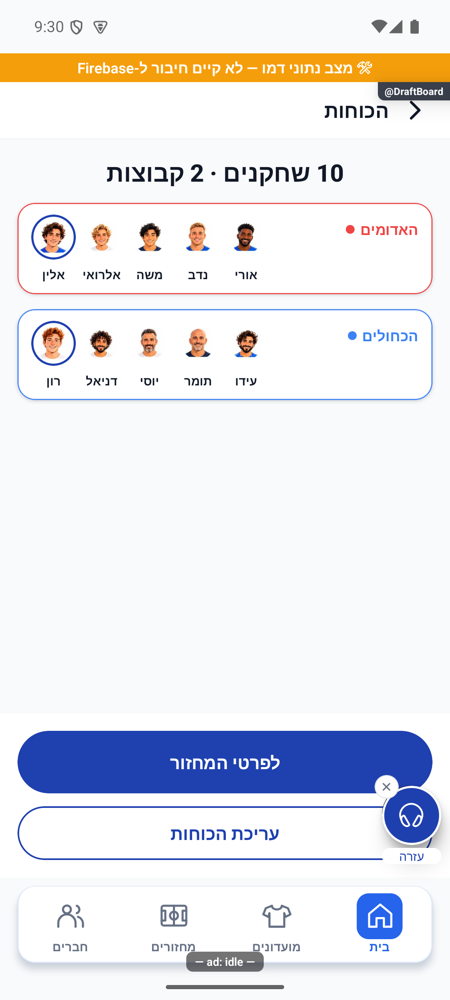

# לוח בחירה, החלפה ופרסום קבוצות

## סגל קפטנים לאחר עזיבת שחקן — 18.10.2026

`DraftBoardScreen` משתמש ב־`activeDraftRosterIds` לבדיקת הקפטנים בכניסה, למאגר הבחירה, לשחזור בחירות ולקריאת הסגל הטרי לפני שמירה. רשימת הזהויות המלאה נשמרת לצפייה בהיסטוריה ובסיכום; רק זמינות הבחירה מסננת `leftHome`. כך גם אורח שסומן שעזב אינו חוזר דרך בחירת קפטנים או שמירת חלוקה מחדש. האימות האטומי בשירות נשאר הסמכות ברגע הכתיבה. אין שינוי בתורות, בצבעים, בפעולת הפרסום או בנתוני משחק שכבר נשמר.

שתי בדיקות של פונקציות הסגל האמיתיות ב־`finalForcesAudit.test.ts` מכסות את מסכי ההכנה והלוח, ושש נוספות מכסות עוזבים, החזרה מפורשת, שימור מצב חי והתנגשות בעת שמירה. `dataDraftSavedResume.test.tsx` ממשיך לאמת טעינה לפי דור החלוקה והמתנה לאישור השמירה. ההרצות מבודדות ואינן מהוות הוכחת ממשק במכשיר או עסקת מסד בייצור.

## בדיקות הפולס והגרסה הפנימית 1.1.55 — 17.10.2026

תווית `DraftBoardScreen` היא `draftStepLabel(3,3)` בעקבות הפרדת שני שלבי ההכנה. לא השתנו בחירת שחקן, סדר התורות, שמירת חלוקה, החלפה, צבע או פרסום.

[ראיות, בדיקות ומגבלות](../../changes/2026-10-17-internal-1.1.55.md).

## חמישה שחקנים בשורה — 17.10.2026

הרחבת תא השם הקודמת ל־60 נקודות, יחד עם כותרת הקבוצה באותה שורה, צמצמה את הרוחב שנותר לארבעה שחקנים. בענף הרגיל של `DraftTeamCard` הכרטיס הוא כעת עמודה: `teamNameRow` מעל `chips`, ושניהם ברוחב הכרטיס. אזור ההרכב נמתח לרוחב בלי `flex:1` שהיה מצמצם אותו בציר האנכי. ההרכב עצמו נשאר `row` עם גלישה, הקפטן ראשון במקור ומימין בתצוגה, ואחריו חברי הקבוצה בסדר הקיים. הכותרת והתגים נשארים בשורה עברית רגילה; אין `row-reverse`.

תא שחקן נשאר ברוחב 60, עם אווטר ושם עד שתי שורות; רווח אופקי 4. חמישה תאים דורשים `5 × 60 + 4 × 4 = 316` נקודות בתוך הכרטיס. במסך צר יותר מרוחב זה תיתכן גלישה מכוונת, כדי לשמור על קריאות. אין הבטחה לחמישה בכל רוחב או בכל הגדלת טקסט. ענף קבוצות עם השלמות, תגי דירוג, החלפת צבעים, אנימציות גדילה והיעלמות ופתיחת כרטיס שחקן לא השתנו. אין שינוי בשיבוץ, נתונים, שירותים, הרשאות, פרסום או ניווט. הרכיב משותף ללוח הכוחות ולתצוגת הכוחות בפרטי המחזור; תצוגת פרטי המחזור לא צולמה בנפרד בתיקון זה.

`draftTeamCardRtl.test.tsx` עודכן להפרדת הכותרת מההרכב ולשימור הסדר גם בחמישה שחקנים, בנוסף ל־4, 7 ו־11. אלה בדיקות מבנה וזהות ולא מדידת פריסה מקורית. באימולטור דמו, 411×914 נקודות וגופן רגיל, נצפו שלוש קבוצות של חמישה באותה שורה. בהיררכיה המקורית גבולות חמשת התאים האדומים הם באותו טווח אנכי `[580,782]`, הכחולים `[935,1137]` והירוקים `[1290,1492]`. [צילום מקורי שנפתח ונבחן](../screenshots/draft-five-per-row-2026-10-17.png). שמות ארוכים, הרכבי 7 ו־11, מסך קטן וגופן מוגדל לא נבדקו במכשיר במסגרת התיקון. לוגי הבדיקות נשמרים ב־`artifacts/draft-five-2026-10-17`.

## כיווניות ושמות בכרטיסי הקבוצות — 17.10.2026

בצילום המקורי של חלוקת בדיקת 11 נצפו 33 משתתפים בשלוש קבוצות, אך הקפטן הופיע משמאל והסגל התקדם משמאל לימין. קוד `DraftTeamCard` השתמש בארבע שורות הפוכות תחת הכיווניות הכפויה. בתיקון הכיווניות הקודם, הכרטיס, כותרת הקבוצה, תג הדירוג ואזור השחקנים עברו ל־`row` רגיל. כעת הכרטיס החיצוני הופרד לעמודה כמפורט בסעיף לעיל; שאר השורות נשארו רגילות; הכותרת היא הילד הראשון בכרטיס, ואחריה אזור השחקנים. באזור זה הקפטן נשאר ראשון במקור, ואז `members` בסדר המקורי ולבסוף פריט רפאים בתהליך היעלמות, אם קיים. `justifyContent: flex-start` מיישר גם שורה חלקית לתחילת הקריאה. מערכי שיבוץ, תור הבחירה, דירוג, צבע, כתיבה, פרסום ואנימציות הבחירה לא השתנו.

באותו צילום שני שמות שהתחילו ב״אלכסנדר״ נחתכו באופן זהה, מפני שהרכיב הציג רק את המילה הראשונה בתא ברוחב 40. כעת התא ברוחב 60, הטקסט הוא השם המלא ללא רווחים בקצוות, עם עד שתי שורות, גובה שורה 15, גובה מזערי 30 וקיצור בסוף אם עדיין אין מקום. התאמת גודל יכולה להקטין עד 85% מהגודל המבוקש; אין חסימת הגדלת גופן גורפת. שם מלא נשמר גם ב־`accessibilityLabel` של הפעולה. איורי הפרופיל ומזהי השחקנים נשארים ללא שינוי. תוספת הרוחב עשויה להגדיל את מספר שורות הכרטיס בקבוצות גדולות; האזור נשאר בעל גובה טבעי וגלישה של ההרכב, בלי לשנות סדר או להסיר משתתפים. מסלול `completionCapacity` שומר את פריסת ההשלמה הקיימת, שכבר השתמשה בשורה רגילה ושמות בשתי שורות.

`draftTeamCardRtl.test.tsx` מוסיף שש בדיקות רכיב: סדר מקור וזהויות ב־4/7/11, שתי תוויות ארוכות מובחנות ופעולותיהן, שימור עטיפות גדילה/היעלמות והחזרה בסיום, ושמירת קבוצת השלמה לבנה עם מקומות חסרים. הבדיקות מפעילות את הרכיב האמיתי עם מארחים מקוריים מדומים; הן אינן מדידת מיקום של מנוע הפריסה. יחד עם `forcesAudit` ושומר סדר ההוקים עברו שלוש חבילות ו־340 בדיקות. צילום מקור הממצא הוא `tmp/live-action-production/shots/eleven-regenerate-stream-ready.png` וההיררכיה הקפואה היא `eleven-regenerate-stream-ui-proof.xml`; שניהם לפני התיקון ואינם הוכחת הכיווניות החדשה. המוביל ישלים צילום מקורי לאחר פתיחה קרה ובדיקת שני השמות במכשיר. אין כאן טענה שהרינדור המתוקן כבר אומת.

## סבב פולס מאושר — 16.10.2026

DraftBoardScreen מעדכן loading לפני קריאת getGameById במיקוד, ומציג שער טעינה/כשל לפני תוכן הכוחות. כשל או מסמך חסר אינם מציגים את game הקודם; retryLoad מפעיל קריאה חוזרת. alive מונע מתשובה מאוחרת לאחר טשטוש להחליף את הקריאה החדשה. אין שינוי ב־saveDraftTeams או במבנה החלוקה היחידה. draftBoardRefresh מריץ את callback האמיתי ומכסה טעינה מושהית, כשל ותשובה ממיקוד קודם. לא נטען שהורץ שחזור מלא של המחזור הפרטי בייצור.

השינוי מקומי וטרם הופץ. [דוח, בדיקות וראיות](../../changes/2026-10-16-pulse-sweep.md).

## חלוקה שמורה אחת — 15.10.2026

כל מסלולי השמירה משתמשים ב־saveDraftTeams. כל שמירה מפורשת מעתיקה את draft.teams אל originalTeams גם בזמן משחק, ומתעלמת מתמונת מקור ישנה שהועברה מהעורך. באותה עסקה מתעדכן rotation.baseTeams, מתנקים loans של החלוקה הקודמת, ותור ההמתנה מותאם לאינדקסי הקבוצות החדשים תוך שמירת סדרו. אין שינוי ב־playing, round, roundInstanceId, lastRoundAt, wins, בשעון או בשערים. הסרת צד שמשחק כעת נדחית לפני הכתיבה; שינוי סגל נדחה ב־validateDraftRoster במסלולים המפעילים אותו. גם העורך הישן שאינו מפעיל אימות סגל משתמש בעסקה וקורא את הרוטציה העדכנית. אין כתיבה לאוסף המשחקונים או לסטטיסטיקה. מילוי זמני/קבוע ועזיבת שחקן עדיין משתמשים בסגל העבודה; originalTeams ו־baseTeams הם תמונת החלוקה השמורה האחרונה, ולא רשימות חלוקה מתחרות. מונה updatedAt מתעדכן גם בדמו. בדיקות savedAllocationReplacement מריצות את מתודת השירות עצמה בנתיב עסקה ובדמו, רצף ארבע שמירות, תמונת מקור ישנה, שימור תוצאה/שעון/זהות משחקון, ביטול טיוטה מקומית ישנה, כשל שמירה ללא שינוי חלקי, ותור המתנה ב־3/4/7 קבוצות. אין שינוי ניווט, נוסחת דירוג, חישוב סטטיסטי או מכנה.

ראיות ומגבלות: [דוח התיקון](../../changes/2026-10-15-single-allocation.md). הצילום הוא תצוגת שתי קבוצות בדמו בלבד; רצף השמירות נבדק בשירות, ולא כתרחיש מלא במכשיר מול מסד אמיתי.

## שחזור חלוקה שמורה — 14.10.2026

בכניסה עם `resume:true`, כל השיטות מציגות את `draftTeams.teams` שנשמרו, בלי המרה לתורות קפטנים. הדבר שומר חלוקות לא שוות, למשל 4,5,4, שנפגעו משחזור רשימת בחירות לסדר שאינו תואם לגודליהן. העריכה נפתחת ב־`DraftSetup {editExisting:true}` ומשם בחלוקה הידנית עם עדיפות לשמירה העדכנית. בכניסת קפטנים חדשה ממשיכות בדיקות הקפטנים והתורות; בכניסת חידוש אין דרישה שקפטנים ישנים יישארו בסגל הנוכחי. שמות מזהים מהחלוקה השמורה נטענים גם אם המשתמש עזב מאז.

שער ניהול נשאר בכל כניסה לעריכה. צפייה ישירה בטיוטה לא מפורסמת נחסמת בממשק למי שאינו מנהל; לא שונו כללי הקריאה בשרת. שמירה מלוח הקפטנים משתמשת באימות הסגל האטומי ומתחשבת גם בהגדרות המקור. [דוח ובדיקות](../../audits/2026-10-14-forces-audit.md).

עודכן: 7.10.2026. מקור הקוד: `8e8fde5`, גרסה `1.1.35`. מסמך זה מתאר את הקוד; מצב חנות ופריסת שרת דורשים ראיה נפרדת.

## כניסה ותפקידים

DraftSetup → DraftBoard {gameId,captainIds,method,resume,readOnly}

מנהל בוחר/מתקן; צופה readOnly רואה חלוקה בלי סמכות כתיבה.

## רכיבים ומצבים

| רכיב / מצב | התנהגות וחוזה |
|---|---|
| בחירה | רשימת משתתפים שנותרו, תור קפטן ושיטת סדר; אורחים מסומנים בשם ואינם משתמשים |
| שיקום | resume משחזר בחירות מסגל חי ומסנן מי שאינו פעיל; צבעי קבוצות משוקמים |
| תנועה | בחירה וביטול עם מעבר גודל/פריט; בזמן תנועה לא מקבלים פעולה נוספת |
| סיכום | קבוצות, שינוי צבעים, גרירה בין קבוצות ותיקון ידני |
| שמירה ופרסום | saveDraftTeams שומר; פרסום והודעת הקבוצות נעשים בפרטי המחזור בנפרד |
| קריאה בלבד | אין פעולות עריכה; ייתכנו נתונים ישנים שמשוקמים חלקית |

## מסלול נתונים ומקומות שינוי

[`src/screens/games/DraftBoardScreen.tsx`](../../../src/screens/games/DraftBoardScreen.tsx); [`src/components/draft/DraftTeamCard.tsx`](../../../src/components/draft/DraftTeamCard.tsx)

gameService.saveDraftTeams; מודל DraftTeamsResult ודירוגים; byId עשוי להכיל שמות מהמתנה אך participants בפועל מסנן waitlisted. יש לעקוב דרך הממיר ולא להסתמך על נתוני דמו.

ממיר המחזור: [`src/firebase/firestore.ts`](../../../src/firebase/firestore.ts), `gameDocConverter.fromFirestore`; סוגים: [`src/types`](../../../src/types). שינוי שדה דורש מעקב כתיבה → ממיר → שירות/חנות → רכיב. ניווט: [`GameStack.tsx`](../../../src/navigation/GameStack.tsx), ובמסכים משותפים גם המחסניות שמארחות אותם.

## בדיקות וראיות

draftTeamsView, draft, draftStore ובדיקות balanceMeta; לראות שמות ארוכים, לטיניים, אורחים וצבעים.

צילומי המיפוי מהאמולטור נעשו במצב נתוני דמו, המסומן בפס כתום. הם מוכיחים את הרכיב והמצב המוצגים בלבד, ולא ממירי Firebase, נתוני ייצור או כתיבה. צילומי תיקונים קודמים מסומנים בנפרד. שגיאת מזהה, מצב טעינה או שער הגנה אינם הוכחת הפעולה המלאה.

## גבולות והערות תחזוקה

פרסום אינו תוצאה של עצם פתיחת הלוח. שינוי קבוצה בסוף ערב אינו מקור לדקות משחק של מי שעזב מוקדם.

לפני שינוי פתח את הקוד המקושר ואת [כללי הפרויקט](../../../AGENTS.md). לאחר שינוי עדכן במסמך זה את התאריך, נקודת הקוד, המצבים שהתעדכנו, הבדיקות והצילום. אין לטעון שכל מצב/תפקיד נבדק רק משום שקיים צילום אחד.

## פירוט טכני ממוקד: זרימה, חישוב ונקודות שינוי

[הסבר פשוט למשתמש](draft-board.simple.md)

העמקה: 07.10.2026, מול קוד המקור שב־`8e8fde5`. בעת הכתיבה HEAD הוא `50d508f`; בדיקת ההפרש בין הנקודות ב־`src` וב־`functions` לא מצאה שינוי קוד. הסעיפים וההסתייגויות הקיימים נשמרו. זו קריאת קוד ותיעוד, בלי הרצת תרחישי כתיבה חדשים.

הכניסה נושאת `captainIds/method/resume/readOnly`. סדר בחירת הקפטנים קובע שיוך קבוצות; `snake` משנה את כיוון הסבב ו־`regular` חוזר לאותו כיוון. לדוגמה בשלוש קבוצות סדר נחש הוא א,ב,ג,ג,ב,א, ואילו רגיל א,ב,ג,א,ב,ג. זו דוגמת סדר, לא חלוקת דירוג.

ב־`resume` יש לשחזר סגל פעיל וצבעים, לא להחזיר שחקן שכבר עבר להמתנה. מזהה אורח חייב להשתמש באותה מוסכמה של הלוח והחלוקה; שם מתוך `byId` אינו הוכחה שהזהות עדיין מועמדת לבחירה. מצב `readOnly` צריך לחסום גם פעולות החלפה ולא רק כפתור שמירה.

`saveDraftTeams` שומר הרכבים ומטא־נתוני איזון; הפרסום בפרטי המחזור נפרד. אנימציה וחסימת פעולה נוספת בזמן מעבר מונעות שתי בחירות מקומיות לאותו תור, אך סמכות ההרכב נמצאת בנתונים שנשמרו. בדוק חזרה בזמן מעבר, משתמש שהוסר, אורח קפטן, שמירה שנכשלה וכניסה לצפייה בלבד. שינוי סדר התורות צריך להגיע גם לשיקום בחירות ולמבחני `draft`.

## עדכון 8.10.2026 — תנועה ותיקוני דיווחים

`GrowIn` ו־`ShrinkOut` משלבים אטימות, תזוזה אופקית עד 16 והגדלה 0.85–1 במשך 240 אלפיות שנייה. `ShrinkOut` קורא `onDone` רק בסיום שהושלם; פירוק מבטל את התנועה. `DraftOrderPath` מפעיל פעימה על תוכן הסמל ומשאיר את הגדלת התור הפעיל במעטפת. סדר הבחירה, החישובים ופרסום הקבוצות לא השתנו.

**ראיה ומגבלות:** נבחרו שחקנים בדראפט מקומי בדמו ונצפה מעבר התור. לא נלחץ פרסום ואין כאן הוכחת שמירת חלוקה בייצור.

בדיקת הטיפוסים ו־183 חבילות הבדיקות עברו, 2,752 בדיקות. מצב המקור: `9ec0dfd` עם שינויים מקומיים; אין גרסה חדשה שפורסמה. [יומן השינוי וההקלטות](../../changes/2026-10-08-motion-and-pulse.md).

## תיקוני סבב הבאגים — 8.10.2026

B13: כניסה לעריכה ב־DraftBoard מאמתת ייחודיות קפטנים ונוכחותם בסגל הפעיל. resume מסננת גם אורחים בהמתנה. לפני finish נקרא מחזור עדכני ונבדקים קפטנים ובחירות מול סגל פעיל; אי התאמה עוצרת שמירה ומסבירה לחזור להגדרה. saveDraftTeams מופעלת עם validateActiveRoster:true; השירות קורא את הסגל ובודק קפטנים וכל playerIds בתוך אותה טרנזקציה שכותבת את החלוקה. שינוי סגל מקביל גורם לקריאה מחודשת או DRAFT_ROSTER_CHANGED במקום שמירת קפטן ממתין. מסלולי חלוקה אחרים שומרים את החוזה הקיים. בדיקה מבודדת של השירות דוחה קפטן בהמתנה ללא כתיבה ומאשרת אותו אחרי הפיכתו לפעיל.

[ראיות, בדיקות ומגבלות](../../changes/2026-10-08-audit-fixes.md).

## תיקוני עיצוב ונגישות — 10.10.2026

מקור: `a348b9f235f1e1433497600555303231512a0834` עם שינויים מקומיים. אין בסעיף זה הוכחת גרסת חנות.

ב־`DraftBoardScreen` צבע הוא אפשרות בחירה יחידה עם מצב נבחר/תפוס, וכפתור צירוף מכיל שחקן וקפטן יעד. `TeamsEditModal` מכריזה על מקור נבחר ועל מעבר לבחירת יעד; לכל שחקן שם, קבוצה, בחירה והסבר. באנר ההחלפה משתמש בשורה רגילה, טקסט לפני אייקון. `useReducedMotion` מבטל הבהוב ואנימציית חלון ומשאיר סימון קבוע. אין שינוי בפרוטוקול הבחירה, החלפה או פרסום. הסמנטיקה ומנגנון צמצום התנועה נקראו בקוד; לא בוצעה חלוקה או החלפה מול שרת.

ראיית דמו: [סיכום החלוקה](../screenshots/forces-audit-saved-2026-10-14.png) ו[פתיחתה לעריכה](../screenshots/forces-audit-edit-2026-10-14.png).

## תיקוני דיווחים חדשים — 15.10.2026

`DraftBoardScreen` קורא מחדש את המחזור בכל מיקוד דרך `useFocusEffect(useCallback(...))`, עם ביטול תגובה לאחר יציאה. במצב resume הוא מציג את `draftTeams.teams` השמורים ומאפס את מפת הצבעים גם כשהחלוקה החדשה אינה מכילה צבעים מותאמים. footer מקבל gap של `spacing.md`. אומתו באימולטור 10 שחקנים, חמישה בכל קבוצה, ושמירת אותן זהויות לאחר לחיצה על עריכת הכוחות. לא בוצעה שמירת שיבוץ לייצור. מקור בדיקות ההגנה: `draftLoadingRace.test.ts` ו־`forcesAudit.test.ts`.

שינויים מקומיים אחרי גרסה 1.1.51; אינם כלולים בבינארי שכבר הועלה. תצוגה שנבדקה היא בדמו אנדרואיד בלבד, ללא בדיקת אייפון או חשבון המדווח.

## צילומי הסבב המאושר — 16.10.2026

## מניעת סיכום מחלוקה קודמת — 17.10.2026

בבדיקת הייצור המאושרת של שבעה מול שבעה נצפה סיכום של 21 שחקנים משלוש קבוצות, אך זהויות השחקנים השתייכו לחלוקה הקודמת. בפרטי המחזור הופיעה החלוקה החדשה. השוואת שתי קריאות הנתונים מצאה `draftTeams.createdAt` שונה ושיבוצים שונים; ספירת השחקנים לבדה לא הוכיחה שסיכום החלוקה מעודכן. הופעה מוקדמת יותר של שלושה קפטנים בלבד נבעה מחבילת יישום ישנה ונעלמה אחרי טעינה נקייה; היא אינה הראיה לתקלה זו.

`DraftSetupScreen.runGenerate` מוסר לניווט `expectedDraftCreatedAt` רק אחרי אישור `saveDraftTeams`. הפרמטר אופציונלי ומוגדר בשלוש מחסניות הניווט המארחות. `DraftBoardScreen` מגדיר הקשר קריאה לפי מזהה המחזור, המשתמש, מצב הכניסה, השיטה, הקפטנים והגרסה הצפויה. שינוי ההקשר מסתיר את הסיכום הקודם כבר ברינדור הראשון, לפני שהשפעת המיקוד מתחילה. תגובה מתקבלת רק אם המסך עדיין ממוקד וההקשר שלה עדיין נוכחי. בכך נחסמת גם תגובה שמגיעה אחרי שינוי הפרמטרים ולפני ניקוי השפעת המיקוד הקודמת.

| מצב | תוצאה |
|---|---|
| קריאה ממתינה או הקשר חדש | טעינה; אין כרטיסים מהחלוקה הקודמת |
| חזרה לאחר יצירה, וגרסת הנתון תואמת לגרסה שאושרה | סיכום ישיר של כל `draftTeams.teams` וזהויותיהם |
| אירוע ראשוני שאינו הגרסה שאושרה, או צילום מטמון/כתיבה ממתינה במסלול שלאחר שמירה | המשך טעינה, ללא כרטיסים; המתנה מוגבלת לצילום שרת תואם |
| כשל, מסמך שרת חסר או תום ההמתנה בלי הגרסה שאושרה | שגיאה מפורשת ו״נסו שוב״; אין מעבר לבחירת קפטנים |
| תגובה מהקשר ישן או אחרי יציאה ממיקוד | התעלמות, כולל עדכוני שגיאה וסיום טעינה |
| כניסה קיימת ללא גרסה צפויה | תאימות למסלול הקיים; מוצגת החלוקה השמורה שהקריאה החזירה |

אין שינוי באלגוריתם החלוקה, בממיר, בהרשאות או בשרת. `getGameById` קורא מסמך דרך הממיר ואינו מחזיק מטמון יישומי של חלוקה. `saveDraftTeams` שומר את תוצאת הלקוח ואת תמונת ההרכב המקורי באותה עסקה; הוא אינו מפעיל איזון נוסף. אין בשינוי הבטחה לנעילת החלוקה מול עריכה של מנהל אחר: שינוי מקביל שמחליף את הגרסה הצפויה מוצג ככשל קריאה של התוצאה המבוקשת, ודורש חזרה ופתיחה של הנתון העדכני.

בהרצת המכשיר הראשונה לאחר ההגנה לא הוצגה עוד חלוקה ישנה, אך הקריאה הראשונה נדחתה כ־`SAVED_DRAFT_UNAVAILABLE`; ניסיון חוזר ידני הציג את החלוקה הנכונה. `expectedDraftCreatedAt` תאם למסד בקריאה המאושרת `data-seven-regenerate-version.json`. לא נאספו מאפייני מקור של הקריאה שנדחתה, ולכן מקור המטמון היה הסבר אפשרי. נוסף תחילה פרמטר אופציונלי `{source:'server'}` לקריאה יחידה, אולם בדיקת אחד עשר המתועדת להלן הוכיחה שגם זה לא השלים את חוזה הגרסה במסלול שנבדק. ההמתנה התחומה מחליפה כעת את אותה קריאה יחידה בכניסה שאחרי שמירה; קריאות המוצר ללא גרסה צפויה נשארות בהתנהגותן הקודמת.

`dataDraftSavedResume.test.tsx` מפעיל את רכיב המסך ואת פעולת היצירה האמיתיים: יצירה מחדש באותו מחזור ובאותם קפטנים, הסתרה לפני השפעות, דחיית קריאה ישנה, ניסיון חוזר, חלוקה חסרה, תגובה מאוחרת, יציאה וחזרה למיקוד, תאימות לכניסה ישנה וניווט רק אחרי אישור השמירה. שבע הבדיקות החדשות וחמש חבילות הרגרסיה עברו — 51 בדיקות בשש חבילות. זו הוכחת רכיב וחוזה קריאה; האימות המרונדר לאחר התיקון מתועד בנפרד בדוח המשימה ובמניפסט בידי המוביל. אין פריסה או תיקון נתוני ייצור במסגרת שינוי זה.

לאחר הוספת הקריאה הטרייה נוספו חמישה מבחנים המפעילים את פעולת השירות האמיתית: נתון שרת חדש מול מטמון ישן בכניסה שנוצרה, מקור רגיל ללא שינוי, כשל שרת שאינו מוחלף בנתון ישן, מסמך חסר/הרשאה, וקריאה בדמו ללא מסד. אין לראות בצילום הניסיון החוזר הוכחה למסלול הישיר לאחר תוספת זו; הוא מתעד את ההגנה הראשונה בלבד.

## המתנה תחומה לגרסה שנשמרה — המשך 17.10.2026

בבדיקת הייצור המאושרת של אחד עשר נלכדה תוצאה ראשונה שאינה תואמת לגרסה החדשה: `eleven-draft-regenerate-trace.json` מראה קריאת `DraftBoard` עם `{source:'server'}` וגרסה צפויה `1792205344866`, אך תוצאת השירות הייתה החלוקה הקודמת `1792204996256`, עדיין עם 33 שחקנים. `data-eleven-regenerated-traced.json` מאשר שהגרסה החדשה נשמרה. זהו פער נצפה בין הגרסאות; לא נאספו באותה קריאה מאפייני המטמון של צילום הספרייה, ואין כאן קביעה שהוכח באג כללי בספריית הנתונים. שרשרת הממיר הורצה גם בבידוד: `docs.game` יורש את `gameDocConverter`, המזהה נלקח מ־`snap.id`, ו־`readDraftTeams` משמר את `createdAt` המספרי ואת כל 33 הזהויות.

רק `getGameById` עם `expectedDraftCreatedAt` מוגדר משתמש ב־`waitForSavedDraft`. הוא פותח `onSnapshot` יחיד עם `includeMetadataChanges:true` וממתין עד שמתקבל צילום עם `fromCache=false`, `hasPendingWrites=false`, מזהה המחזור וגרסת `draftTeams.createdAt` התואמים בדיוק, ולפחות קבוצה אחת. הגרסה נבדקת בשוויון; ערך גבוה יותר אינו תחליף, ואין הנחת סדר של שעוני מכשירים. אירוע ישן, מטמון או כתיבה ממתינה אינם נחשפים למסך. שינויים במאפייני המקור בלבד יכולים להשלים את ההמתנה בלי שינוי נוסף בנתוני החלוקה. [מקור התנהגות ההאזנה ומאפייני האישור](https://firebase.google.com/docs/firestore/query-data/listen).

ההמתנה נמשכת עד שמונה שניות; אחריה נדחית שגיאה קריאה עם קוד `SAVED_DRAFT_UNAVAILABLE`. שגיאת ההאזנה נשמרת, והרשאה נדחית מומרת ל־`ACCESS_BLOCKED` לפי חוזה השירות הקיים. מסמך שאינו קיים בצילום שרת מחזיר `null`. בכל הצלחה, כשל, תום זמן או ביטול מנוקים ההאזנה, הזמן הקצוב ומאזין הביטול, כולל אירוע סינכרוני שחוזר לפני יצירת פונקציית הניתוק וביטול שכבר התרחש. אין סבב קריאות, ניסיון חוזר רקורסיבי או כתיבה למסד. קריאות בלי גרסה צפויה וכניסות ישנות נשארות ללא שינוי; בדמו נבדקת התאמת הגרסה המקומית בלבד ואינו מוצג אישור שרת מדומה.

`DraftBoardScreen` יוצר `AbortController` בתוך השפעת המיקוד ומוסר את הגרסה ואת `signal` עם אפשרות המקור. ביציאה ממיקוד הוא מסמן קודם שהבקשה אינה חיה ואז מבטל אותה. הגנת הבעלות והבדיקה החוזרת של הגרסה במסך נשמרו. לכן תגובה שכבר הוכנסה לתור לפני ביטול אינה משנה מסך חדש, וכשל בזמן יציאה אינו מציג שגיאת טעינה.

`dataDraftSavedResume.test.tsx` מפעיל את קוד העזר והשירות האמיתיים עם אירועי זרם: ישן→חדש, מטמון, כתיבה ממתינה, שינוי מאפיינים בלבד, גרסה אחרת, תום שמונה שניות, שגיאות הרשאה ורשת, מסמך חסר, כשל ממיר, ביטול מוקדם/תוך הרשמה/אחרי הצלחה וניקוי תגובות מאוחרות. הרכיב האמיתי נשאר בטעינה עד האירוע המדויק ומבטל בהחלפת מיקוד. יחד עם `draftBoardRefresh`, `draftLoadingRace`, `manualDraftResume` ו־`savedAllocationReplacement` עברו 55 בדיקות בחמש חבילות, ובדיקת הטיפוסים נקייה. צילום יצירה ישירה ללא ניסיון חוזר בלקוח המעודכן מרוכז אצל המוביל; בעת עדכון המסמך טרם נצפה, ואין לראות בצילום השגיאה או הניסיון החוזר הקודם הוכחת התיקון החדש.

## כרטיסי סיכום בפרטי המחזור — 17.10.2026

`DraftTeamCard` מציע כעת תצוגת סיכום עם חולצות, דירוג בצד הנגדי ואווטרים אחידים, המשמשת את אזור הכוחות בפרטי המחזור. תאי השחקנים מקבלים חמישית מרוחב ההרכב וגלישה לשורות נוספות. תצוגת לוח הבחירה והעריכה ממשיכה להשתמש במצב הרגיל. [החוזה, חוסרים, הרשאות, צילום ובדיקות](match-details.md#אזור-כוחות-עם-כותרת-משולבת-וכרטיסי-סיכום--17102026).

## סיכום חלוקה אחיד לאוטומטי ולאקראי — 17.10.2026

ענף `resume && game.draftTeams` ב־`DraftBoardScreen` מציג מעתה `DraftTeamCard summary`, אותו רכיב שכבר משמש את פרטי המחזור. מסלולי היצירה האוטומטית והאקראית מגיעים לאותו ענף לאחר שמירה וטעינת החלוקה הצפויה. לכן אין מימוש עיצוב נפרד שיכול לסטות ביניהם. כותרת ״הכוחות למחזור״ מיושרת לתחילת הקריאה, ומונה השחקנים והקבוצות מוצג מתחתיה. המקור למונה נשאר סכום אורכי הסגלים השמורים ומספר הקבוצות; אין ספירת מחזור או משחק נוספת.

שם וצבע, קפטן וחברים, סדר השחקנים, אווטרים ותמונות פרופיל, חיווי `completionCapacity` ופעולת `openCard` נשארים מהמקור השמור. מצב הסיכום מספק חולצה קיימת, גוון בהיר בכותרת, מסגרת נייטרלית, אווטרים אחידים ושמות עד שתי שורות. לכל תא 20% מרוחב ההרכב ולכן שורה מכילה חמישה תאים; 7 נפרסים 5+2 ו־11 נפרסים 5+5+1. כרטיס גדל עם התוכן בתוך אזור הגלילה. לא נוסף כאן דירוג חדש: רכיב הסיכום מסוגל להציג דירוג אם נמסר לו, אך מסך הכוחות השמורים ממשיך ללא ערך דירוג כפי שהיה לפני השינוי. אין הרחבת חשיפה של דירוג פנימי.

כפתור פרטי המחזור ממשיך לנווט ל־`MatchDetails`, וכפתור העריכה ממשיך ל־`DraftSetup` עם `editExisting:true`. האייקון החדש של העריכה הוא משמאל לכיתוב באמצעות `iconLeft`. הכפתור עדיין מוסתר ב־`readOnly`. הודעות ההשלמות ושמירת קבוצות הבסיס נשארות במצבן הקיים. לוח הבחירה האינטראקטיבי, הצביעה לפני שמירה וסיכום סיום בחירת קפטנים לא שונו. אין שינוי בשמירה, באלגוריתם, בממיר, בהרשאות או בהמתנה לגרסת חלוקה עדכנית.

בדיקת הטיפוסים נקייה וכל 361 החבילות ו־4,399 הבדיקות עברו, כולל בדיקות הקריאה והגרסה השמורה ובדיקות רכיב הסיכום לסגלי 4/5/7/11, תמונות, צבע לבן וחוסרים. לא נוסף מבחן שמעתיק את שינוי הסגנון. [לוג](../../../artifacts/saved-teams-summary-2026-10-17/jest.log).

באימולטור דמו 411×914 בגופן רגיל נפתח מסך הסיכום של החלוקה הקיימת, עם שלוש קבוצות של חמישה. [הצילום שנפתח ונבחן](../screenshots/saved-teams-summary-2026-10-17.png) מציג את החולצות, האווטרים והשמות מימין לשמאל ואת שתי פעולות התחתית. ההיררכיה מראה שכל חמשת השחקנים בכל קבוצה באותה שורה. כדי לטעון קוד מעודכן בוצע רענון דמו לאחר צילום מצב עדכני; החלוקות הוחזרו והושוו ונשארו זהות. [הוכחת שימור](../../../artifacts/saved-teams-summary-2026-10-17/preservation.json). לא נוצרה חלוקה חדשה, לא הופעלה עריכה ולא נבדקה כתיבת ייצור במשימה זו. אין לייחס את הצילום להרצה מלאה חדשה של כל אחת משיטות היצירה. מסך קטן, טקסט מוגדל, חוסרים והרכבים גדולים לא צולמו בסבב הזה. אין פריסה, בנייה או העלאה.

## צמצום גובה כרטיסי הסיכום — 17.10.2026

ב־`DraftTeamCard` במצב `summary` בלבד, ריפוד הכותרת האנכי ירד מ־8 ל־5, ריפוד ההרכב העליון מ־10 ל־6 והתחתון מ־6 ל־3. לכן כרטיס עם שורת שחקנים אחת נמוך ב־13 יחידות פריסה. מרווח שורות נוספות ירד מ־8 ל־6. אווטרים בגודל 40, שטח אווטר 44, שמות בשתי שורות וסדר השחקנים נשמרו. אין שינוי נתונים, חישובים, הרשאות, שמירה או ניווט; כרטיסי העריכה הרגילים לא השתנו. השינוי משותף לסיכום הכוחות השמורים ולפרטי המחזור.

באימולטור דמו 411×914 וגופן רגיל נבחן סיכום קיים של שלוש קבוצות של חמישה. כל השמות והתמונות נראים בשורה אחת והקבוצה השלישית נכנסת במלואה מעל התחתית. [צילום](../screenshots/compact-team-cards-2026-10-17.png), [היררכיה](../../../artifacts/compact-team-cards-2026-10-17/rendered.xml) ו[שימור ההרכבים](../../../artifacts/compact-team-cards-2026-10-17/preservation.json). רענון הדמו נעשה אחרי גיבוי עדכני ושחזור; לא נוצרה חלוקה. פרטי המחזור, סגלים גדולים, מסך קטן וגופן מוגדל לא צולמו מחדש. באנר אזהרת פיתוח גלוי בתחתית. בדיקת הטיפוסים וכל חבילת הבדיקות הורצו; [לוג](../../../artifacts/compact-team-cards-2026-10-17/jest.log). אין פריסה, בנייה או העלאה.
