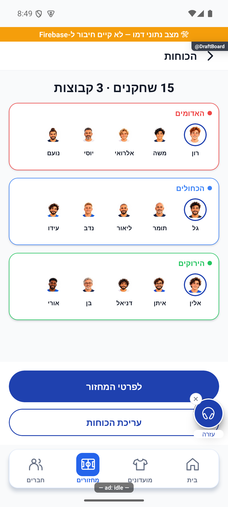
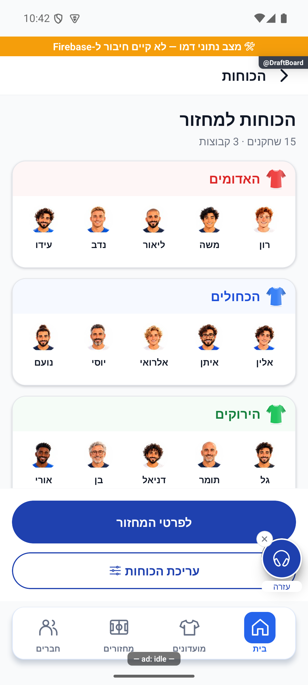

# לוח בחירה, החלפה ופרסום קבוצות — הסבר פשוט

## תיעוד כשלים — 20.10.2026

נוסף תיעוד אוטומטי לנקודות כשל במסלול הזה, עם מקור התקלה. הפעולה המקורית שומרת על ערכי החזרה והודעות השגיאה שלה. השינוי מקומי, טרם הופץ, ואין אימות מסירה חיה לפולס.

[דוח דיווח השגיאות והראיות](../../changes/2026-10-20-error-reporting-audit.md).

## שחקן שכבר הלך הביתה — 18.10.2026

מי שסומן שעזב אינו זמין לקפטן או לבחירה מחדש, גם כשהרשמתו למחזור נשארת. צפייה בחלוקה שמורה עדיין מציגה את הנתונים השמורים שלה. כדי להחזיר שחקן למשחק צריך לבצע החזרה מפורשת בלייב. שינוי הסגל בזמן הבחירה מחייב רענון לפני שמירה. נבדק בקוד מבודד; אין כאן צילום חדש או אימות ייצור.

## בדיקות הפולס והגרסה הפנימית 1.1.55 — 17.10.2026

לוח החלוקה מופיע כשלב השלישי, אחרי בחירת קפטנים ובחירת סדר התורות. אופן הבחירה, ההחלפה והפרסום נשמר.

[ראיות, בדיקות ומגבלות](../../changes/2026-10-17-internal-1.1.55.md).

## חמישה שחקנים בשורה — 17.10.2026

שם הקבוצה מופיע כעת בשורה קטנה מעל ההרכב, כדי להשאיר לשחקנים את כל רוחב הכרטיס. כך חמישה שחקנים נכנסים בשורה אחת ברוחב הטלפון שנבדק, בלי להקטין את התמונות או השמות. בקבוצות גדולות ההרכב ממשיך לשורות נוספות מימין לשמאל.

הצילום נבדק באימולטור דמו ברוחב 411 נקודות ובגופן רגיל. התיקון משנה תצוגה בלבד; לא נערכו הכוחות. [פירוט](draft-board.md#חמישה-שחקנים-בשורה--17102026).

## סדר ושמות בכרטיסי הקבוצות — 17.10.2026

בכרטיס הקבוצה, שם הקבוצה מימין והרכב השחקנים מתחיל מימין עם הקפטן. השחקנים ממשיכים לפי סדר ההרכב, גם כשנדרשת שורה נוספת. שמות מוצגים עד שתי שורות, כדי שאפשר יהיה להבדיל למשל בין שני שחקנים בשם ״אלכסנדר״; השם המלא נשאר גם בתווית הנגישה של פעולת הפתיחה. תאים רחבים מעט יותר יכולים להוסיף שורת שחקנים בקבוצה גדולה.

השינוי מקומי ואינו משנה שיבוץ או נתונים שמורים. בדיקות רכיב עברו ל־4, 7 ו־11 שחקנים. הצילום המקורי שבו נמצא הכיוון ההפוך קודם לתיקון; צילום מקורי מעודכן ובדיקת שמות במכשיר עדיין ממתינים אצל המוביל. [החוזה והבדיקות](draft-board.md#כיווניות-ושמות-בכרטיסי-הקבוצות--17102026).

## כוחות מעודכנים אחרי יצירה מחדש — 17.10.2026

לאחר יצירת כוחות חדשים המסך ממתין לאישור הנתון של החלוקה המדויקת שנשמרה, עד שמונה שניות, ומציג את השחקנים שלה. הוא אינו מציג בינתיים את הקבוצות מהחלוקה הקודמת, גם אם מספר השחקנים והקפטנים לא השתנו. כשהתוצאה החדשה מגיעה ההמשך אוטומטי, בלי לחיצה נוספת. אם לא ניתן לקבל אותה בזמן או שהקריאה נכשלת, מופיעה הודעה עם ״נסו שוב״ במקום לחזור בטעות לבחירת קפטנים. יציאה מהמסך מפסיקה את ההמתנה.

השינוי מקומי. בדיקות אוטומטיות עברו; היקף בדיקת התצוגה מתועד במסמך המעמיק ובדוח המשימה.

## סבב פולס מאושר — 16.10.2026

בחזרה לכוחות מופיע מצב טעינה עד שהחלוקה המעודכנת נטענת. אם הקריאה נכשלת, מוצג ניסיון חוזר במקום להציג כוחות ישנים כאילו הם עדכניים.

השינוי מקומי וטרם הופץ. [דוח, בדיקות וראיות](../../changes/2026-10-16-pulse-sweep.md).

## חלוקה שמורה אחת — 15.10.2026

במחזור יש חלוקת כוחות שמורה אחת. שמירת חלוקה חדשה, בכל שיטה, מחליפה את הקודמת גם בזמן לייב. פתיחת שיטה אחרת לבדה אינה משנה את הכוחות. טיוטה ידנית חלקית נשארת במכשיר ואינה מחליפה חלוקה מלאה. התוצאה והשעון של המשחק הפעיל נשמרים; תוצאות משחקונים שכבר נשמרו אינן נערכות מחדש.

פתיחת כוחות שמורים מציגה את השיבוץ המדויק, גם אם הקבוצות שונות בגודל. הכפתור ״עריכת הכוחות״ פותח את החלוקה הידנית עם הכוחות המעודכנים. שחקנים רואים את הכוחות רק לאחר פרסום.

הקפטנים בוחרים שחקנים בתורות עד שמתקבלות הקבוצות. אפשר לחזור לחלוקה קיימת ולתקן אותה בהתאם להרשאה. שמירת החלוקה אינה פרסום שלה לכל השחקנים.

[להסבר המעמיק ולמפת הקוד](draft-board.md)

## צילום והיקף ההוכחה

הצילומים מציגים רק את המצבים המתועדים במסמך המעמיק. חלקם נתוני דמו, חלקם הוכחות מתיקון קודם, ובכמה מהם טעינה או הודעת הגנה; הם אינם אישור שכל התהליך או השרת נבדקו.

## עדכון 8.10.2026 — תנועה ותיקוני דיווחים

השחקן שנבחר נכנס לקבוצה בתנועה קצרה, והתור החדש מקבל הדגשה. הכפתורים ממשיכים להגיב במהירות.

## תיקוני סבב הבאגים — 8.10.2026

אם קפטן או שחקן עברו להמתנה או יצאו מהסגל, צריך לעדכן את הבחירה לפני שמירת הקבוצות.

## תיקוני עיצוב ונגישות — 10.10.2026

מקור: `a348b9f235f1e1433497600555303231512a0834` עם שינויים מקומיים. אין בסעיף זה הוכחת גרסת חנות.

בבחירת צבע או שחקן מקריאים מה נבחר, איזה צבע תפוס ולאיזו קבוצה מצרפים. כשמצמצמים תנועה במכשיר סימון ההחלפה נשאר קבוע.

## תיקוני דיווחים חדשים — 15.10.2026

הכוחות השמורים מתרעננים בחזרה למסך. בעריכה נשמרים השחקנים והצבע של כל קבוצה, ובין כפתורי פרטי המחזור ועריכת הכוחות יש רווח ברור.

שינויים מקומיים אחרי גרסה 1.1.51; אינם כלולים בבינארי שכבר הועלה. תצוגה שנבדקה היא בדמו אנדרואיד בלבד, ללא בדיקת אייפון או חשבון המדווח.

## צילומי הסבב המאושר — 16.10.2026

## כרטיסי סיכום בפרטי המחזור — 17.10.2026

`DraftTeamCard` מציע כעת תצוגת סיכום עם חולצות, דירוג בצד הנגדי ואווטרים אחידים, המשמשת את אזור הכוחות בפרטי המחזור. תאי השחקנים מקבלים חמישית מרוחב ההרכב וגלישה לשורות נוספות. תצוגת לוח הבחירה והעריכה ממשיכה להשתמש במצב הרגיל. [החוזה, חוסרים, הרשאות, צילום ובדיקות](match-details.md#אזור-כוחות-עם-כותרת-משולבת-וכרטיסי-סיכום--17102026).

## סיכום כוחות בעיצוב אחיד — 17.10.2026

המסך שמציג את הכוחות שנשמרו לאחר יצירה אוטומטית או אקראית משתמש כעת באותו עיצוב קבוצות של פרטי המחזור: חולצה ושם בכותרת צבעונית עדינה, רקע לבן ותמונות שחקנים בגודל אחיד. חמישה שחקנים מוצגים בשורה, והרכבים גדולים ממשיכים לשורות נוספות. כשחסרים שחקנים נשמר ההסבר על ההשלמה לפני המשחק.

למעלה מוצגת הכותרת ״הכוחות למחזור״ ומספר השחקנים והקבוצות. ״לפרטי המחזור״ ו״עריכת הכוחות״ נשארים בתחתית, ולעריכה נוסף אייקון ניהול. הרשאות העריכה אינן משתנות.

המסך נבדק באימולטור עם החלוקה הקיימת, בלי ליצור כוחות מחדש. [המימוש והיקף הבדיקות](draft-board.md#סיכום-חלוקה-אחיד-לאוטומטי-ולאקראי--17102026).

## כרטיסי קבוצות נמוכים יותר — 17.10.2026

צומצמו מעט הרווחים בכותרת וסביב השחקנים בכרטיסי הסיכום המשותפים למסך הכוחות ולפרטי המחזור. גודל התמונות, הטקסט, שתי שורות לשם וחמישה שחקנים בשורה נשמרו. [צילום בדמו](../screenshots/compact-team-cards-2026-10-17.png).

## תלות בעדכון העונות — 19.10.2026

קובץ תשתית משותף עודכן במסגרת העונות. שינוי זה אינו מוסיף פעולה חדשה למסך המתואר כאן; פרטי העונות והבדיקות מופיעים במסמך העונות.

[מצב המימוש, הבדיקות ומגבלות האימות של העונות](../clubs/seasons.md). מקומי בלבד; לא בוצעה פריסה במסגרת המשימה.

## תלות במידע על סגירת עונה — 23.10.2026

נוסף מידע משותף שמאפשר להסביר מדוע עונה מתעכבת בסגירה. אין שינוי נוסף בפעולות המתוארות כאן; השינוי מקומי וטרם הופץ. [המסלול, הבדיקות והמגבלות](../../changes/2026-10-23-season-automatic-recovery.md).
