# הגדרת חלוקת כוחות

## השלמת דיווחי הפולס — 17.10.2026

ManualAllocation מפעיל appAlert עם football=true ו־tone=warning. ההמשך משאיר את החלוקה; איפוס עדיין מפעיל apply לרשימות ריקות ונשמר בהיסטוריית ביטול מקומית. אין שמירה לשרת עד שמירת הטיוטה הקיימת. נפתחה החלונית בדמו דרך callback מרונדר בלי לאשר איפוס.

[צילומים, בדיקות ומגבלות](../../changes/2026-10-17-roster-recruitment-and-pulse.md).

## בדיקות הפולס והגרסה הפנימית 1.1.55 — 17.10.2026

`captainStep` מפריד `captains` ו־`order`. כפתור ההמשך בשלב הראשון דורש `captainsOk` בלבד; בשני נדרשים גם הקפטנים וגם `method`. רשימת הקפטנים אינה מופיעה בשלב הסדר. כניסה חדשה לשיטת קפטנים חוזרת לשלב הראשון; חזרה מהכותרת בשלב הסדר מחזירה לקפטנים. `captainsOk` דורש שכל מזהה נבחר עדיין קיים ב־`participants`; אפקט מסיר מזהים שעזבו וחוזר לשלב הראשון. אורחים בהמתנה נשארים בחוץ. הניווט ל־`DraftBoard` מעביר את אותם `gameId/captainIds/method`, ושמירת הסגל האטומית בשירות נשארת מחייבת.

[ראיות, בדיקות ומגבלות](../../changes/2026-10-17-internal-1.1.55.md).

## שיתוף איור החולצה עם לוח המשחק — 16.10.2026

הציור המקומי של `DraftGenerationPreview` הועבר ללא שינוי צורה או מידות ל־`TeamShirtIllustration` בקובץ `src/components/match/TeamShirt.tsx`. תצוגת ההכנה עדיין משתמשת ברוחב 76 ובגובה 82 ובצבעי ברירת המחדל. לוח הלייב משתמש באותו ציור ברוחב 42, לפי צבעי הקבוצות בפועל. מזהי מעברי הצבעים ייחודיים למופע באמצעות `useId`. אין שינוי בחישוב, בשיבוץ, בניווט או בשמירת כוחות. תצוגת הכוחות לא הורצה מחדש בסבב הזה; הצורה והמידות הושוו בקוד. בדיקת הטיפוסים וכל 3,983 הבדיקות עברו. [הראיות מהלייב ומגבלות](../../changes/2026-10-16-live-shirt-centering.md).

## גישה לכוחות ובחירת הלייב — 16.10.2026

ב־MatchDetailsScreen הוסרה מגבלת msToKickoff>-2h מתנאי showCreateTeamsBanner. שאר התנאים נשמרו: מנהל, לפחות שני אנשים פעילים, אין חלוקה/טיוטה מקומית, לא סופי ועד 24 שעות לפני ההתחלה. ב־LiveMatchScreen נבחר המצב ב־useFocusEffect/useCallback לפי advancedMode או completionMode=balanced. selection קשור ל־gameId; תשובה לאחר blur נזרקת. כשל/מסמך חסר מוביל למסך הסבר עם retry וחזרה, ללא fallback שקרי ל־plain. במיקוד חוזר לא מאפסים בחירה תקפה ולכן רכיב חי באותו מצב אינו מפורק ולא מאבד משלימים מקומיים. אין שינוי באלגוריתם חלוקה, בנוסחאות, במכנים, בסגל או בסמכויות כתיבה. קישורי דמו חדשים במפעיל הפיתוח מכסים כשל חד־פעמי ומחזור ללא קבוצות חמש שעות אחרי תחילה; הם לא נרשמים במסד. 16 בדיקות liveModeRouting מריצות את callback הטעינה ותנאי התצוגה האמיתיים. [ממצאים והפעלת ההגדרה שאושרה בשכחת שושי](../../changes/2026-10-16-live-mode-routing.md).

## חלוקה שמורה אחת — 15.10.2026

כל מסלולי השמירה משתמשים ב־saveDraftTeams. כל שמירה מפורשת מעתיקה את draft.teams אל originalTeams גם בזמן משחק, ומתעלמת מתמונת מקור ישנה שהועברה מהעורך. באותה עסקה מתעדכן rotation.baseTeams, מתנקים loans של החלוקה הקודמת, ותור ההמתנה מותאם לאינדקסי הקבוצות החדשים תוך שמירת סדרו. אין שינוי ב־playing, round, roundInstanceId, lastRoundAt, wins, בשעון או בשערים. הסרת צד שמשחק כעת נדחית לפני הכתיבה; שינוי סגל נדחה ב־validateDraftRoster במסלולים המפעילים אותו. גם העורך הישן שאינו מפעיל אימות סגל משתמש בעסקה וקורא את הרוטציה העדכנית. אין כתיבה לאוסף המשחקונים או לסטטיסטיקה. מילוי זמני/קבוע ועזיבת שחקן עדיין משתמשים בסגל העבודה; originalTeams ו־baseTeams הם תמונת החלוקה השמורה האחרונה, ולא רשימות חלוקה מתחרות. מונה updatedAt מתעדכן גם בדמו. בדיקות savedAllocationReplacement מריצות את מתודת השירות עצמה בנתיב עסקה ובדמו, רצף ארבע שמירות, תמונת מקור ישנה, שימור תוצאה/שעון/זהות משחקון, ביטול טיוטה מקומית ישנה, כשל שמירה ללא שינוי חלקי, ותור המתנה ב־3/4/7 קבוצות. אין שינוי ניווט, נוסחת דירוג, חישוב סטטיסטי או מכנה.

ראיות ומגבלות: [דוח התיקון](../../changes/2026-10-15-single-allocation.md). הצילום הוא תצוגת שתי קבוצות בדמו בלבד; רצף השמירות נבדק בשירות, ולא כתרחיש מלא במכשיר מול מסד אמיתי.

## ביקורת מסלולי הכוחות — 14.10.2026

כל שמירה מלאה מהכנה אוטומטית/אקראית, מהחלוקה הידנית ומלוח הקפטנים מאמתת את הסגל בתוך פעולת הכתיבה. `validateDraftRoster` דורש שיבוץ חד־פעמי של כל הרשומים והאורחים הפעילים, קפטן בקבוצתו, מספר קבוצות ואינדקסים תקינים, ומבנה מחזור שלא השתנה מאז המסך. אורחים בהמתנה אינם נכללים. סיום או ביטול חוסמים שמירה. אם הסגל השתנה השמירה הקודמת נשארת, ומוצגת בקשה לטעון את הנתונים מחדש. אין מניעת שמירה רק משום שהמחזור התחיל.

יצירה מושבתת כשכמות השחקנים קטנה ממספר הקבוצות המוגדר, כדי לא ליצור בשקט פחות קבוצות. דירוג חסר מתואר כבסיס 3 מתוך 5. האבחון האקראי מסומן `random_even_v1` ונשמר בממיר; עריכה ידנית מנקה אבחון קודם. צבעי קבוצות נשמרים בהצגה, בבחירת יעדי שיבוץ ובשמירה הידנית לפי אינדקס. פעולת כניסה `editExisting` טוענת כוחות שמורים עדכניים ומבטלת את פרמטר הפעולה לאחר צריכתו; `resumeManual` משחזרת טיוטה מקומית התואמת לגרסת הכוחות.

החלטת הבעלים מ־14.10.2026: עריכה וחילופים באמצע משחק נשארים אפשריים בהתנהגות הקיימת; ההרכב בסיום משמש לזקיפת השתתפות ותוצאה, לצד שיחזור כובשים ומבשלים זכאים מתוך אירועי שערים בשרת. אין הקפאת משתתפים או דחיית עריכה למשחק הבא. פתרון מלא לחילופים נשאר לאפיון עתידי. מצב ההשלמות נשאר בכוחות אוטומטיים בלבד, ללא הרחבה לידנית/אקראית. [ממצאים, בדיקות ומגבלות](../../audits/2026-10-14-forces-audit.md).

בדיקת דמו מרונדרת: נוצרה חלוקה אקראית חדשה ונפתחה לעריכה; שני הסגלים נשארו זהים לסיכום השמור. אין בדיקת שרת/שני מנהלים. [צילום העריכה](../screenshots/forces-audit-edit-2026-10-14.png).

## הכנה אוטומטית ואקראית — עיצוב 14.10.2026

עיצוב נוסף לכרטיס נתוני הכוחות: שלוש משבצות בגוון כחול עדין, עם אייקון ייעודי לשחקנים, לקבוצות ולפורמט, מספר בולט ותווית. הקווים המפרידים הוחלפו ברווחים ובמסגרות מעוגלות. כל משבצת מקובצת לנגישות עם הערך והיחידה; ערך ותווית מתאימים את הגופן לרוחב. הרכיב משותף לאוטומטי ולאקראי, ללא שינוי במקור הנתונים או בחישובים. נבדק באימולטור במצב האקראי של 10 שחקנים, שתי קבוצות ו־5 על 5; לא נוצרו כוחות ולא נבדק קורא מסך.

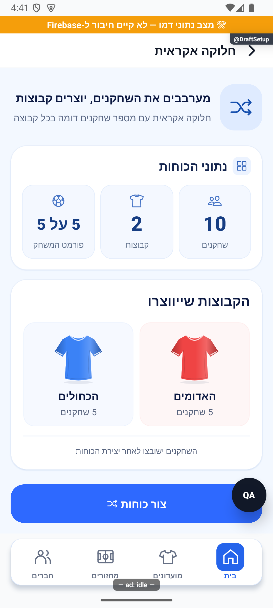

התאמת הכותרת באותו יום: כותרת הפתיח הוקטנה מ־21 ל־17 ומוגבלת לשורה אחת עם התאמת גודל לטקסט הזמין. ההתאמה משותפת למצבים האוטומטי והאקראי. אין שינוי בנוסח או בפעולת החלוקה.

אימות התאמת הכותרת: בדיקת טיפוסים וכל 3761 הבדיקות עברו. לאחר תקיעת האימולטור נדרש אתחול וחיבור מחדש לשרת הדמו. צילום עדכני של המצב האקראי מאמת כותרת בשורה אחת ברכיב המשותף. הכוחות האוטומטיים לא נפתחו בבדיקה זו משום שהדירוג הפנימי בדמו כבוי; אין כאן הוכחה לכל גודל מסך או גופן. לא נוצרו כוחות ולא נכתבו נתוני משחק.

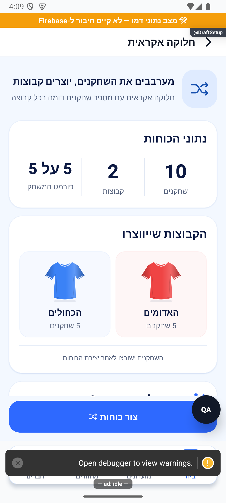

`DraftGenerationPreview` משותף לשני מצבי ההכנה בתוך `DraftSetupScreen`: פתיח ואייקון מותאמים לשיטה, נתוני הכוחות, תצוגת הקבוצות שייווצרו, הסבר והערת עריכה. הנתונים הם המשתתפים הפעילים (כולל אורחים, ללא אורחי המתנה), מספר הקבוצות המוגדר במחזור והפורמט. החולצות מאוירות מקומית בצבעי ברירת המחדל של הקבוצות; אין כאן שיבוץ שחקנים או הבטחה לשימור צבעי חלוקה קודמת. עד שלוש קבוצות בשורה, והיתר נגללות בשורות נוספות.

גודל התצוגה הוא `floor(N/K)` עד `ceil(N/K)`: 15 בשלוש קבוצות מציג 5 לכל קבוצה; 13 מציג 4–5, כי הקבוצה שתקבל שחקן נוסף נקבעת ביצירה. זהו הסבר לפני יצירה, לא תוצאה שמורה. המסלול האקראי ממשיך להעביר דירוגים והיסטוריה ריקים ואינו מפעיל `completionMode`; ההסבר שלו מציין הגרלה וגודל דומה. באוטומטי ההסבר מתייחס לדירוג פנימי ולערך הניטרלי עבור חסר דירוג. אפשרות קבוצות עם השלמות נשמרת במצב חסר מתאים, ומבהירה שבחירת המשלימים ידנית.

החץ העליון חוזר לבחירת שיטה. מעבר שיטה ממפתח מחדש את מיכל הגלילה כדי להציג את הפתיח מראשו. כפתור יצירה קבוע בתחתית ומציג אייקון שונה בכל מצב, עם מנגנוני טעינה ומניעת לחיצה כפולה הקיימים. אין שינוי בחישוב, בשמירה, בהרשאות או בניווט לאחר יצירה.

אימות חזותי: שני מסכי ההכנה נפתחו ונסקרו באימולטור אנדרואיד בנתוני דמו של 10 שחקנים ושתי קבוצות; נבדקה גלילה להסבר האקראי. לא נלחץ כפתור יצירת כוחות ולא נכתבו נתוני משחק. מספרי קבוצות נוספים, גופן מוגדל וכתיבת שרת לא הורצו במסגרת השינוי הזה.

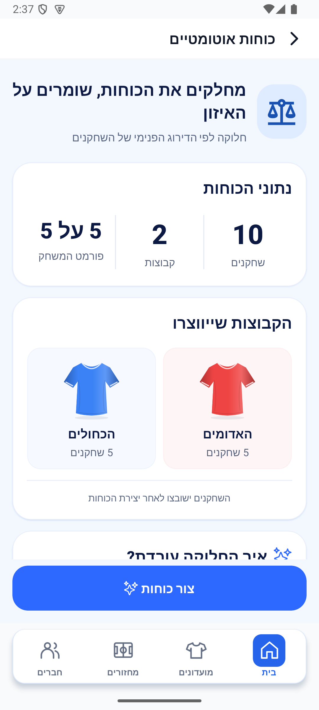
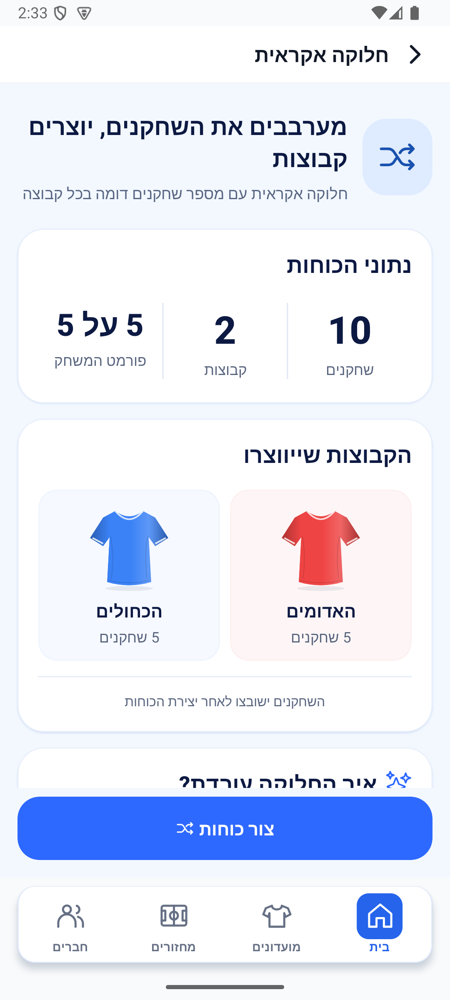
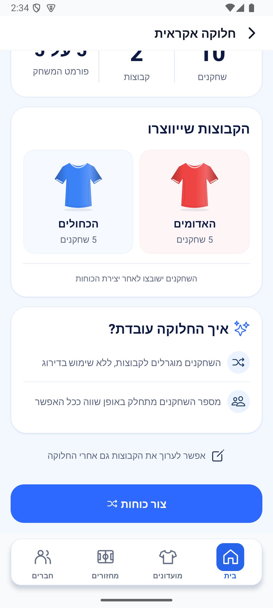

עודכן: 7.10.2026. מקור הקוד: `8e8fde5`, גרסה `1.1.35`. מסמך זה מתאר את הקוד; מצב חנות ופריסת שרת דורשים ראיה נפרדת.

## כניסה ותפקידים

MatchDetails → חלוקה → DraftSetup {gameId}

מנהל; חילוק אוטומטי לפי דירוג זמין כשיש דירוג פנימי, ואקראי הוא חלופה.

## רכיבים ומצבים

| רכיב / מצב | התנהגות וחוזה |
|---|---|
| שיטה | אוטומטי מאוזן / אקראי / בחירה ידנית |
| קבוצות | 2–7, מוגבל גם בגודל הסגל; ברירת מספר קבוצות מהמחזור |
| קפטנים | בחירת מספר קפטנים השווה למספר קבוצות; צריך לפחות משתתף אחד שאינו קפטן |
| סדר | נחש או רגיל, וסדר הקפטנים; בחירה מגדירה תורות בהמשך |
| אוטומטי | דירוגי מנהל ודירוג אורח משוער >0; אורחים בהמתנה אינם נכנסים לריצה |
| תוצאה | פער, טווח, חזרות, ממוצעי קבוצות, חסרי דירוג וחלופה; balanceMeta נשמר |
| שמירה | saveDraftTeams עם published:false; מעבר ללוח בחירה אינו פרסום לכל המשתתפים |

## מסלול נתונים ומקומות שינוי

[`src/screens/games/DraftSetupScreen.tsx`](../../../src/screens/games/DraftSetupScreen.tsx)

getRecentSplits בלי המחזור הנוכחי בשיטה מאוזנת; balanceTeams עם seed וחיפוש קבוע; שיטה אקראית אינה קוראת היסטוריה. rating_balanced_v2 נשמר ב־balanceMeta. קיימת רצפת זמן תצוגה כ־300 אלפיות שנייה שאינה מדד זמן האלגוריתם.

ממיר המחזור: [`src/firebase/firestore.ts`](../../../src/firebase/firestore.ts), `gameDocConverter.fromFirestore`; סוגים: [`src/types`](../../../src/types). שינוי שדה דורש מעקב כתיבה → ממיר → שירות/חנות → רכיב. ניווט: [`GameStack.tsx`](../../../src/navigation/GameStack.tsx), ובמסכים משותפים גם המחסניות שמארחות אותם.

## בדיקות וראיות

tests/logic/draft.test.ts, balanceTeams.test.ts, balanceVariety.test.ts, מבחני התאמה ודירוג. כל 2749 בדיקות עברו לאחר תיקון סביבת Jest בלבד; אין שינוי סף.

צילומי המיפוי מהאמולטור נעשו במצב נתוני דמו, המסומן בפס כתום. הם מוכיחים את הרכיב והמצב המוצגים בלבד, ולא ממירי Firebase, נתוני ייצור או כתיבה. צילומי תיקונים קודמים מסומנים בנפרד. שגיאת מזהה, מצב טעינה או שער הגנה אינם הוכחת הפעולה המלאה.

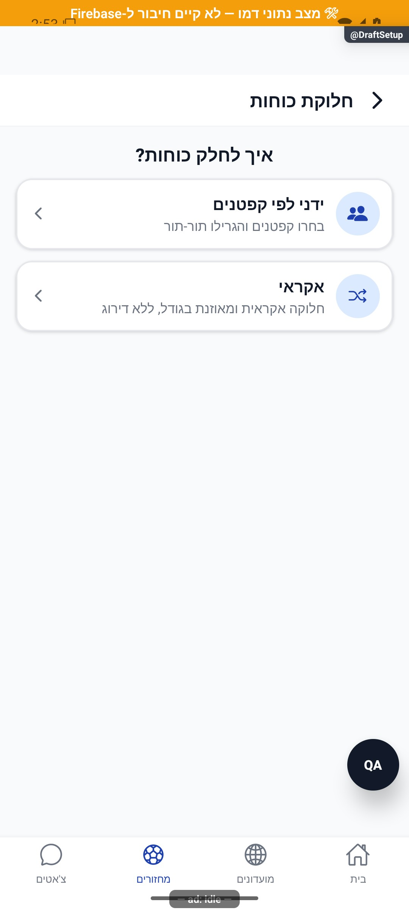

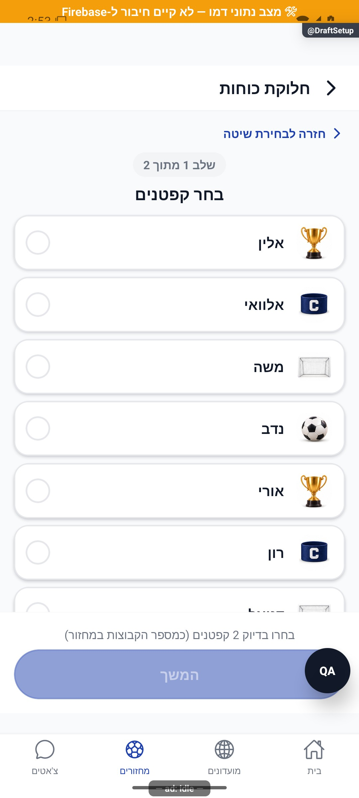

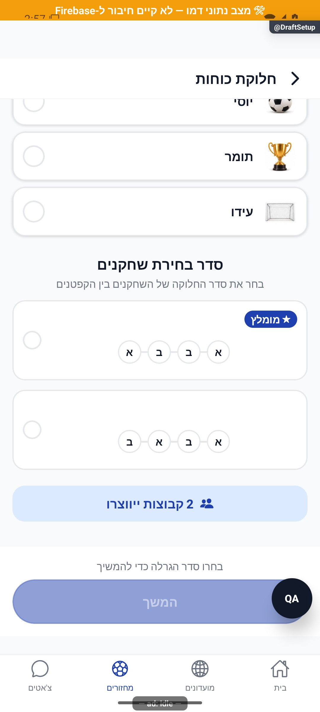

## גבולות והערות תחזוקה

אורחים בהמתנה מסוננים מתוך participants; הממצא ההיסטורי תוקן בסבב 8.10.2026.

לפני שינוי פתח את הקוד המקושר ואת [כללי הפרויקט](../../../AGENTS.md). לאחר שינוי עדכן במסמך זה את התאריך, נקודת הקוד, המצבים שהתעדכנו, הבדיקות והצילום. אין לטעון שכל מצב/תפקיד נבדק רק משום שקיים צילום אחד.

## פירוט טכני ממוקד: זרימה, חישוב ונקודות שינוי

[הסבר פשוט למשתמש](draft-setup.simple.md)

העמקה: 07.10.2026, מול קוד המקור שב־`8e8fde5`. בעת הכתיבה HEAD הוא `50d508f`; בדיקת ההפרש בין הנקודות ב־`src` וב־`functions` לא מצאה שינוי קוד. הסעיפים וההסתייגויות הקיימים נשמרו. זו קריאת קוד ותיעוד, בלי הרצת תרחישי כתיבה חדשים.

מסלול אוטומטי ב־`runGenerate`: בניית רשומים+אורחים פעילים → דירוגי מנהל/אורח → `getRecentSplits` בלי המחזור הנוכחי בשיטה המאוזנת → [ליבת איזון](../../../src/utils/teamBalanceCore.ts) → `saveDraftTeams` עם `published:false`. המסלול האקראי אינו צריך את היסטוריית החזרות. מסלול קפטנים דורש בדיוק מספר קפטנים צפוי, לפחות שחקן שאינו קפטן ובחירת סדר.

חלוקת הגדלים: `placed=min(count,numTeams×capacity)`, גודל בסיס `floor(placed/numTeams)`, ושארית `placed%numTeams` ניתנת לקבוצות שנבחרו באקראי לפי הזרע. 14 שחקנים בשלוש קבוצות שקיבולתן 5 נותנים 5,5,4; הקבוצה הגדולה אינה תמיד הראשונה.

ממוצע קבוצה הוא סכום הדירוגים חלקי מספר שחקניה; פער הוא הממוצע הגבוה פחות הנמוך. 16 נקודות ל־5 שחקנים מול 12.4 ל־4 הם ממוצעים 3.2 ו־3.1, פער 0.1, אף שסכומי הדירוג שונים. חסר דירוג מקבל בסיס ניטרלי 3; `normalizeRating` תומך בערכי עבר מעל 5.

החיפוש בונה 64 מועמדים, משפר בהחלפות, מפזר קצוות ומשקלל חזרות. `balancePenalty` רציף: בפער 0.1 העלות 0.15; בפער 0.15 היא 0.5; בפער 0.2 היא 1.2. חזרות זוגות משוקללות לפי מפגשים אחרונים 1,0.6,0.3, ומנורמלות למבנה הקבוצות; אין להשוות עונש גולמי של שניים מול שבעה צוותים בלי המכנה.

נקודות שינוי: המסך לבחירה והצגה, הליבה והעותק בשרת לחישוב, `balanceMeta` והממיר להסבר שנשמר. יש לבדוק אותו זרע ואותו קלט, קיבולת, דירוגי עבר, חזרות וביצועים. רצפת זמן תצוגה אינה זמן האלגוריתם; אין להגדיל סף כדי להסתיר האטה.

### הנוסחאות וסדר הסינון בליבה

`normalizeRating(v) = clamp(v > 5 ? v/2 : v, 0, 5)`: למשל דירוג עבר 8 הופך ל־4, ודירוג חדש 0.5 נשאר 0.5. דירוג חסר מטופל ב־3 במסלול בניית הקלט; אין להחליף אפס תקף ב־3.

עונש האיזון לפער `g` הוא פונקציה רציפה:

| טווח | `balancePenalty(g)` |
|---|---|
| עד 0.10 | `0.15 × g/0.10` |
| עד 0.15 | `0.15 + 0.35 × (g-0.10)/0.05` |
| עד 0.20 | `0.50 + 0.70 × (g-0.15)/0.05` |
| מעל 0.20 | `1.20 + 6 × (g-0.20)` |

`repeatPenalty` מסכמת משקל חזרה לכל זוג באותה קבוצה. `repeatScale = max(1, 0.2 × Σ(nTeam × (nTeam-1)/2))`. לדוגמה, שלוש קבוצות של חמישה מכילות 30 זוגות אפשריים; המכנה 6. שישה זוגות שחזרו מהמפגש האחרון מוסיפים עלות 1. בשיטת `A`, עלות מועמד היא `balancePenalty(gap) + repeatPenalty/repeatScale`, ולכן לא מנרמלים ביחס למועמדים האחרים שנולדו באותה ריצה.

לאחר 64 המועמדים מחשבים `minGap`. אם הוא עד 0.2, מגבלת הקבלה היא 0.2; אחרת `minGap+0.03`. בתוך המועמדים הקבילים בוחרים את עומס הקצוות המינימלי; אם נותרו פחות משמונה מועמדים, מרחיבים ל־`minStack+2`. בחירת `A` מסירה הרכבים כפולים, מסננת לעלות הטובה ביותר ועוד `SELECT_MAX_TRADE` ומגבילה ל־`FINALISTS` לפני בחירה אקראית. אין לבלבל את סף המועמדים הזה עם `COST_EPSILON` שמשמש בהליכה הצדית. אחרי הבחירה מותרת הליכה של עשר החלפות, תחת מגבלת פער `min(gapLimit, chosenGap+0.03)`; המדדים מחושבים מחדש אחרי ההליכה.

שיטת `B` היא מסלול בחירה נפרד ב־`pickStrategyB`; אין לייחס לה את נוסחת העלות של `A`. הקלט `strategy` ואת אתר הקריאה צריך לבדוק כשמשנים הגדרה. שינוי ליבה מחייב יצירה מחדש של עותק השרת באמצעות `scripts/genTeamBalanceCore.mjs` ומבחן ההתאמה `balanceParity.test.ts`; אין לערוך ידנית שני אלגוריתמים נפרדים.

## תיקוני סבב הבאגים — 8.10.2026

B13: DraftSetupScreen.participants מסננת guest.waitlisted ושומרת מזהי אורחים עם guest:. כמות הקפטנים חייבת להתאים למספר הקבוצות; צריך גם שחקן שאינו קפטן. בדיקה מבודדת מאמתת שאורח בהמתנה אינו מועמד.

[ראיות, בדיקות ומגבלות](../../changes/2026-10-08-audit-fixes.md).

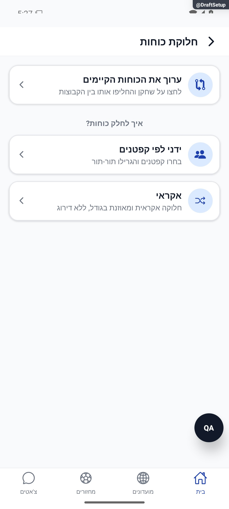

תפריט שיטות החלוקה בדמו; קפטן בהמתנה ושינוי סגל נבדקו בשירות מבודד.

## תיקוני עיצוב ונגישות — 10.10.2026

מקור: `a348b9f235f1e1433497600555303231512a0834` עם שינויים מקומיים. אין בסעיף זה הוכחת גרסת חנות.

קפטן מקבל תפקיד תיבת סימון, שם שחקן ומצב מסומן. שיטת החלוקה היא כפתור בעל שם; סדר הבחירה מוכרז כאפשרות בחירה יחידה עם מצב נבחר. אין שינוי בסינון השחקנים, מספר הקפטנים, seed, חיפוש איזון או שמירת חלוקה. ההגדרה הסמנטית נקראה בקוד בלבד; בחירה בקורא מסך לא הורצה.

## צמצום חישוב חוזר — 12.10.2026

`teamBalanceCore.repeatScorer` מכין טבלת משקלי צמדים לכל מועמד לפני חיפוש ההחלפות. החיפוש קורא ערכים מספריים בלי לייצר מפתח מחרוזת בכל השוואה. רק שחקני המועמד נכללים; המשקלים וסדר החיבור לא משתנים במהלך החיפוש. מספר המועמדים, הספים, הדירוגים, סדר הקריאות למחולל האקראי והכרעת המנצח לא שונו. עותק `functions/src/teamBalanceCore.ts` נוצר עם `functions/scripts/genTeamBalanceCore.mjs` ולא נערך ידנית.

12 תוצאות של אסטרטגיות A ו־B נבדקו מול חתימות מלפני התיקון, כולל ספסל. 40 בדיקות מגוון, זמן תגובה והתאמת עותקי הלקוח והשרת עברו. [דוח וגבולות המדידה](../../changes/2026-10-12-bug-sweep.md). זהו שינוי מקומי אחרי 1.1.47/280; לא נפרס שרת ולא נבנתה גרסת חנות חדשה.

## בחירת שיטה בעיצוב החדש — 14.10.2026

מקור: `4a3cb346` עם שינויים מקומיים. בחלק העליון מוצגים מספר הרשומים, מספר הקבוצות והפורמט ללא שם המועדון. הרשומים כוללים אורחים פעילים בהרכב ולא כוללים המתנה. מספר הקבוצות מגיע מהגדרת המחזור בגבולות הנתמכים; בהגדרה חסרה נשמרת ברירת שתי קבוצות הקיימת. פורמט חסר מוצג כלא מוגדר.

ארבע אפשרויות מוצגות כבחירה יחידה: כוחות אוטומטיים לפי דירוג, בחירת קפטנים, חלוקה ידנית חופשית וחלוקה אקראית. לא נוצרת חלוקה בלחיצה על הכרטיס: הבחירה מסומנת ורק הכפתור ״לחלוקת הקבוצות״ מעביר לשלב הקיים. ללא בחירה הכפתור מושבת. כוחות אוטומטיים מוצגים מושבתים עם הסבר כשאין דירוג פנימי; כשהוא פעיל מוצג תג ירוק. שם האפשרות האקראית מתאר את ההתנהגות הקיימת, ולא את המלל ״ידנית״ שבסקיצה. כוחות קיימים עדיין ניתנים לעריכה מקישור נפרד.

`selectedMode` הוא בחירה מקומית מקדימה, ו־`chooseSplitMode` ממשיך ל־`splitMode` הקיים. האלגוריתם, סדר בחירת הקפטנים, מסך הכוחות וכתיבת טיוטות לא השתנו. פעולת הכפתור בודקת מחדש שיש מחזור ושדירוג פנימי פעיל לבחירה אוטומטית.

המסך צולם באמולטור עם נתוני דמו: 10 רשומים, 2 קבוצות ו־5 על 5; נבדקה בחירת קפטנים וחיווי כפתור פעיל. לא נוצרו ולא נשמרו כוחות. מצב דירוג פעיל לא צולם, ואין הוכחת בדיקה באייפון. בדיקת טיפוסים וכל 3706 הבדיקות עברו.

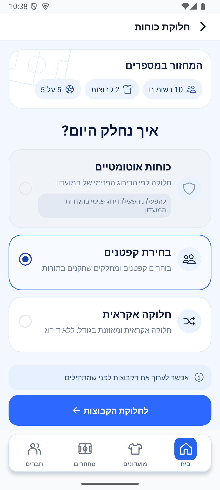

### כותרת ומיקום עריכת כוחות — 14.10.2026

כותרת התקציר שונתה ל״נתוני הכוחות״. הקישור ״ערוך את הכוחות הקיימים״ הועבר מתחת לתקציר ומעל ״איך נחלק היום?״; הוא ממשיך להופיע רק כשיש כוחות קיימים. נבדק חזותית באימולטור, בלי פתיחת העורך או שמירת כוחות.

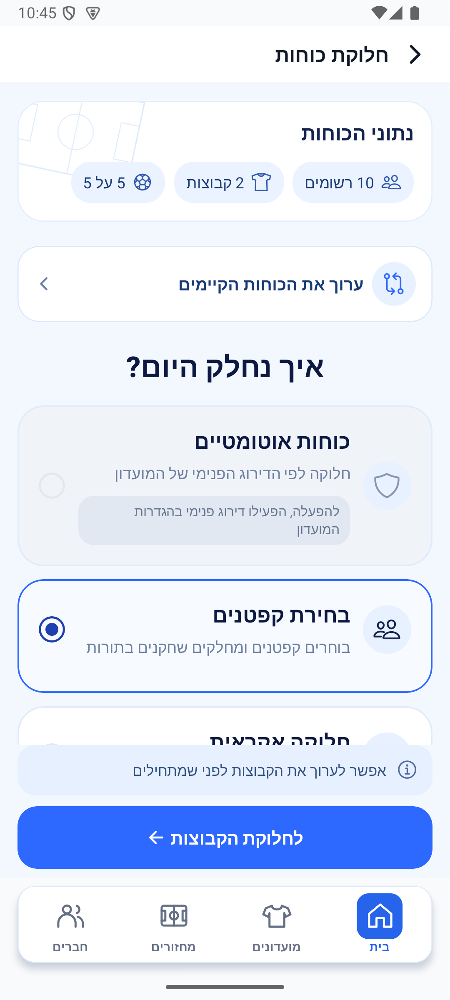

כרטיס עריכת הכוחות עוצב כרקע לבן עם מסגרת עדינה ופינות מעוגלות, אייקון בעיגול תכלת מימין וחץ משמאל. הצילום האחרון לעיל עודכן ונבדק באימולטור. הפעולה נשארה זהה.

## חלוקה ידנית חופשית — 14.10.2026

מקור: שינויים מקומיים מעל `4a3cb346`; לא הופץ. נוסף מצב `free` בתוך `DraftSetup`, לצד המצבים הקיימים. אין מסלול ניווט חדש; הרכיב [`ManualAllocation.tsx`](../../../src/components/draft/ManualAllocation.tsx) משתמש בהרשאת המנהל ובסגל שהמסך טוען. השם `manual` הקודם ממשיך לציין קפטנים ואינו משנה משמעות.

### תצוגה ופעולות

- מספר הקבוצות הוא `expectedCaptains` מהמחזור בגבולות הנתמכים. שתי קבוצות מוצגות בשתי עמודות; משלוש ומעלה, כרטיסים ברוחב המסך בגלילה אנכית. כפתור השמירה מחוץ לגלילה.
- `capacity = max(playersPerTeam(format), ceil(participants.length / count))`, בהתאמה ליכולת האוטומטית להכיל סגל גדול מהפורמט. הפורמט מוצג בנפרד כמספר השחקנים על המגרש. לדוגמה: 21 רשומים, 3 קבוצות, 7 על 7 → שבעה מקומות; 22 רשומים באותה תצורה → שמונה מקומות לכל קבוצה לכל היותר. השחקנים הם רשומים ואורחים פעילים בלבד; אורח מזוהה עם `guest:`.
- אזור טרם שובצו נגזר מהסגל פחות איחוד השיבוצים, כולל חיפוש ופתיחה של הרשימה המלאה; ברירת המחדל מציגה שישה. בכל קבוצה ארבעה תאים בשורה במסך רחב של קבוצה, ושורה לכל שחקן במצב שתי עמודות.
- לחיצה על שחקן פותחת בחירת יעד; יעד מלא דורש בחירת שחקן להחלפה. החלפה ממאגר לא משובץ מחזירה את המוחלף למאגר. ניתן להחזיר כל משובץ למאגר.
- הוסף שחקנים פותח בחירה מרובה מתוך המאגר, מוגבלת למקומות הפנויים. השיבוץ חל רק לאחר אישור החלונית.
- גרירה מתחילה בלחיצה ממושכת של 350 אלפיות שנייה על הכרטיס; שני קווי הידית הוסרו. לחיצה קצרה ממשיכה לפתוח בחירת יעד. יעדים נמדדים בעת השחרור; קיימת גלילה אוטומטית סמוך לשולי אזור הגלילה. ביטול מחווה מנקה את מצב הגרירה. מוצג עותק צף של השחקן.
- היסטוריה מקומית עד 30 פעולות, ביטול פעולה אחרונה ואיפוס עם אישור. יציאה עם שינויים לא שמורים מבקשת אישור. בזמן שמירה הכתיבה נעולה גם באמצעות ref.

### שמירה ונתונים

המודל הקיים של כוחות והמשך הרוטציה מניחים קפטן וקבוצה שאינה ריקה. לכן טיוטה חלקית נשמרת ב־AsyncStorage במפתח `manual-allocation:<userId>:<gameId>` במכשיר בלבד; הטקסט במסך מציין זאת. זו אינה טיוטת שרת ואינה זמינה במכשיר אחר. בטעינה מסננים שחקנים שהוסרו, כפילויות, עודף מקומות וקבוצות שאינן מוגדרות עוד. פעולות הנתונים הטהורות נמצאות ב־[`manualAllocation.ts`](../../../src/utils/manualAllocation.ts).

לאחר שכל הסגל שובץ וכל קבוצה מכילה לפחות שחקן אחד: קריאה מחודשת של המחזור מאמתת שלא השתנו הסגל, הפורמט ומספר הקבוצות ושלא התחילה רוטציה/לא הסתיים או בוטל המחזור. נשמר `DraftTeamsResult` עם `published:false`, `method:regular`, וקפטן פנימי ראשון בכל קבוצה לתאימות המודל הקיים, ללא תהליך בחירת קפטנים. הקריאה היא `saveDraftTeams(..., undefined, true)` עם אימות סגל פעיל בעסקת הכתיבה הקיימת. אין שינוי בממיר או בהרשאות. לאחר הצלחה הטיוטה המקומית נמחקת והניווט לפרטי המחזור, שם ממשיכים למסלול פרסום הכוחות הקיים. כשל מחיקה מקומית אינו מדווח כשגיאת שמירת שרת.

כשל טעינה מקומית מציג הודעה; כשל שמירה משאיר את העבודה במכשיר. שינוי הרכב דורש חזרה למסך החלוקה לטעינה מחדש. האימות בעסקה הקיימת בודק חברות בסגל; שינוי הגדרות בין הקריאה המקדימה לעסקה אינו נעול במנגנון זה. לא נוספה נעילת עריכה מקבילית בין שני מנהלים.

### ראיות וגבולות

בדיקות יחידה מכסות 2×5, 3×5, 3×7, 4×7, 7×11, החלפה עם יעד מלא, שחקן שלא שובץ, החזרה למאגר, אי־שינוי מערך המקור ושחזור סגל ללא כפילויות/שחקנים שהוסרו. טיפוסים וכל 3715 הבדיקות עברו (304 חבילות).

באימולטור אנדרואיד נבדקו פתיחה, גלילה, בחירת יעד ושיבוץ יחיד, גרירה בין שתי קבוצות ופתיחת הבחירה המרובה. תצוגות 3 ו־4 קבוצות נפתחו במסלולי פיתוח מבודדים `ManualAllocationThree/Four`: מותנים ב־`__DEV__`, מצב דמו ודגל QA, משתמשים בזהויות מקומיות קיימות, ואינם מאפשרים שמירה לשרת. תצוגת שלוש קבוצות מציגה 21 שחקנים, 18 משובצים; ארבע קבוצות מציגה את כל 25 זהויות הדמו הקיימות כלא משובצות. לא נוצרו חשבונות או מחזורים, ולא נשמרו כוחות למחזור בזמן הבדיקה. אין כאן הוכחת כתיבה לשרת או בדיקה באייפון; גלילת קצה בגרירה ושחזור אחרי הפעלה מחדש לא הורצו מקצה לקצה.

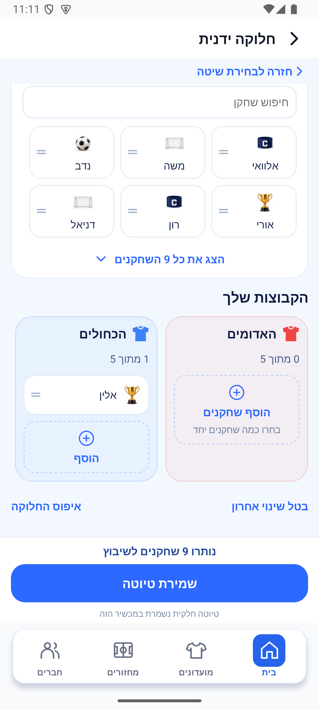
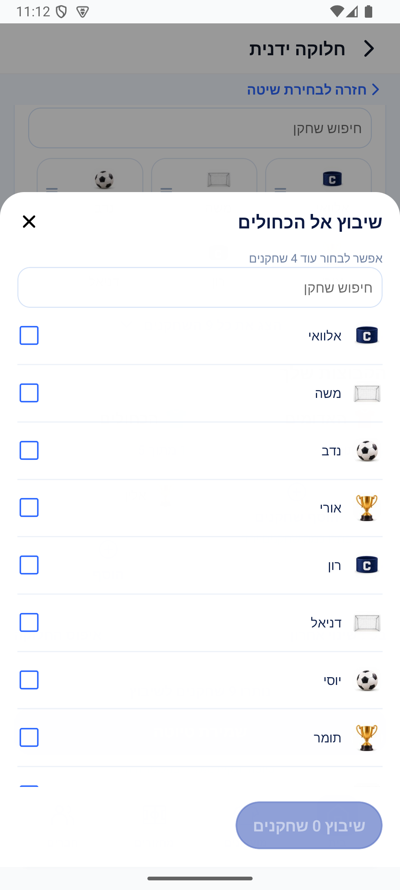
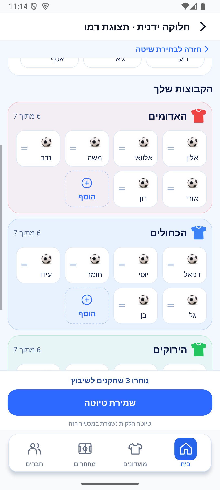
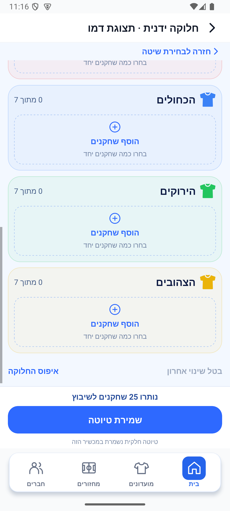

### ליטוש כרטיסי שחקנים — 14.10.2026

כרטיס ״נתוני הכוחות״ הוסר מתוך העורך הידני בלבד. אזור ״טרם שובצו״ מוצג בשלוש עמודות, ובכל כרטיס האייקון מימין והשם משמאל באותה שורה. השם יכול להתפרס לעד שתי שורות, עם גובה שמור ואחיד המותאם לגודל הגופן במכשיר. מעבר לכך השם מתקצר בשלוש נקודות; חלונית בחירת הקבוצה מציגה את השם המלא ללא מגבלת שורות. שני קווי הגרירה הוסרו מכל הכרטיסים; מחוות הגרירה עברה ללחיצה ממושכת. המונים בכל קבוצה ובמאגר נשמרו.

הצילום מאמת את הפריסה והכיווניות באמולטור אנדרואיד עם השמות הקיימים. שם ארוך במיוחד ומחוות הגרירה החדשה לא נבדקו בפועל בצילום זה; לא שונו שיבוצי המשתמש ולא בוצעה שמירה למחזור.

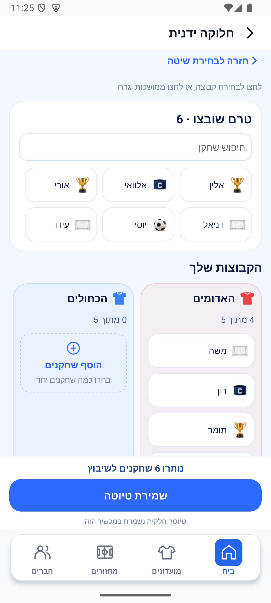

### חלונית איפוס מעוצבת — 14.10.2026

אישור האיפוס משתמש כעת בחלונית האפליקציה `appAlert` במקום חלונית המערכת. כרטיס מעוגל, אייקון אזהרה, טקסט לימין, כפתור ״להמשיך בעריכה״ וכפתור ״איפוס החלוקה״. ההסבר כולל את האפשרות לבטל דרך ״בטל שינוי אחרון״. פעולת האיפוס המקומית לא השתנתה; סגירה או ביטול אינם משנים שיבוצים. החלוניות האחרות במסך לא שונו במשימה זו.

נבדק וצולם באנדרואיד בתצוגת דמו מבודדת; האיפוס עצמו לא אושר בבדיקה. טיפוסים וכל 3715 הבדיקות עברו.

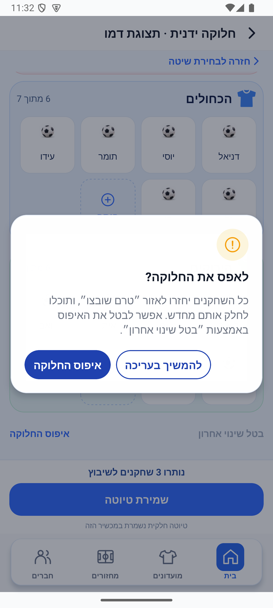

### אישורי יציאה וחזרה באותו עיצוב — 14.10.2026

גם ״לצאת בלי לשמור?״ ו״לחזור לבחירת שיטה?״ משתמשים כעת ב־`appAlert` בגוון אזהרה, כמו אישור האיפוס. תנאי ההצגה, חסימת יציאה בזמן שמירה והפעולות לאחר אישור נשארו זהים. ״המשך עריכה״ וסגירה משאירים את השיבוצים ללא שינוי.

שתי החלוניות נפתחו וצולמו באמולטור אנדרואיד; ביטול החזרה נבדק. לא אושרה יציאה שמאבדת שינויים ולא נשמרו נתונים למחזור. טיפוסים וכל 3715 הבדיקות עברו.

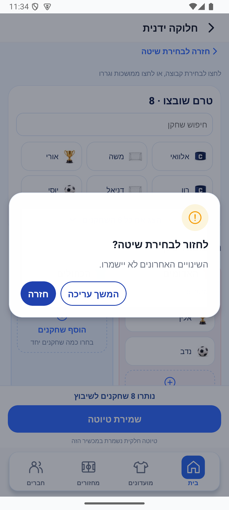
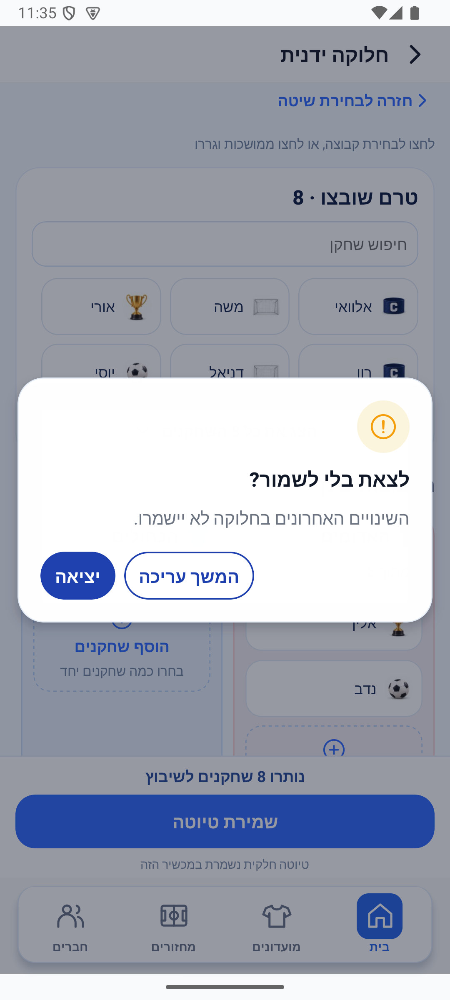

### הגדלה קלה של שורת החזרה — 14.10.2026

״חזרה לבחירת שיטה״ בעורך הידני הוגדלה מעט: טקסט 15 במקום 14, חץ 20 במקום 18, ריווח אנכי 9 במקום 6 וגובה לחיץ מינימלי 44. השינוי ממוקד בשורה זו בלבד. נבדק חזותית באנדרואיד; פעולת החזרה לא השתנתה ולא שונו שיבוצים.

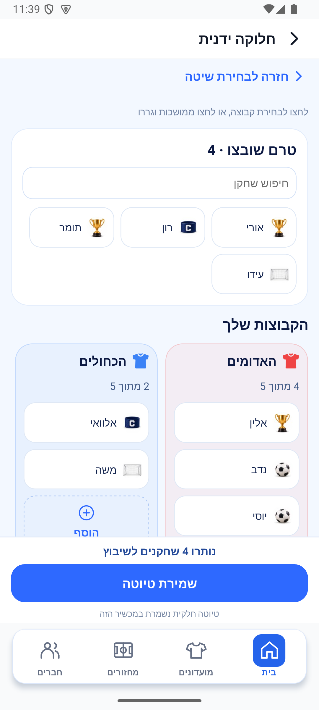

### יישור זהויות בקבוצות — 14.10.2026

בפריסה של שלוש קבוצות ומעלה, האייקון ממורכז מעל השם ומוגדל מ־28 ל־34. השם ממורכז ברוחב הכרטיס ומקבל מקום קבוע לעד שתי שורות, ללא כיווץ אנכי. הריווח אחיד גם כששם עברי קצר ושם לטיני ארוך מופיעים בקבוצות שונות. הפריסה באזור ״טרם שובצו״ ובשתי קבוצות לא השתנתה. אין שינוי בשיבוץ, בגרירה או בשמירה.

נבדק בצילום האימולטור עם שלוש קבוצות, שמות בעברית ושם לטיני בשתי שורות. לא שונו שיבוצים ולא בוצעה שמירה. הגדלת גופן מערכת לא נבדקה בפועל.

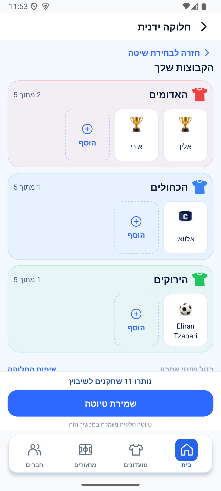

### חזרה לטיוטה ידנית חלקית — 14.10.2026

פרטי המחזור בודקים במיקוד המסך את הטיוטה המקומית במפתח `manual-allocation:userId:gameId`. טיוטה תקינה מפעילה כפתור ״המשך חלוקה ידנית״ למנהל במחזור שאינו סופי, גם מעבר לחלון הזמן של הצעת יצירת כוחות. לשונית המידע מציינת שמדובר בטיוטה, ולא בכוחות מוכנים. הכפתור מעביר `resumeManual` למסך החלוקה, שפותח ישירות את העורך ומשחזר את השיבוץ. הפרמטר רשום בשלוש מחסניות הניווט המארחות. זיהוי הטיוטה אינו משנה הרשאות או מפרסם כוחות; טיוטה חלקית עדיין נשמרת במכשיר בלבד. קריאה מאוחרת אחרי החלפת משתמש או מחזור מתעלמת מהתוצאה הישנה.

בדיקות `manualDraftResume.test.ts` מכסות טיוטה חלקית, טיוטה ריקה שמורה ונתונים לא תקינים. באימולטור אומתו הכפתור ופתיחת הטיוטה הקיימת עם השיבוצים, ללא שמירה חדשה או שינוי נתוני מחזור. טרם הופץ.

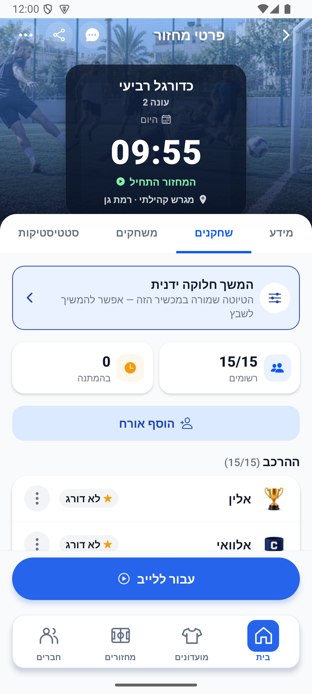
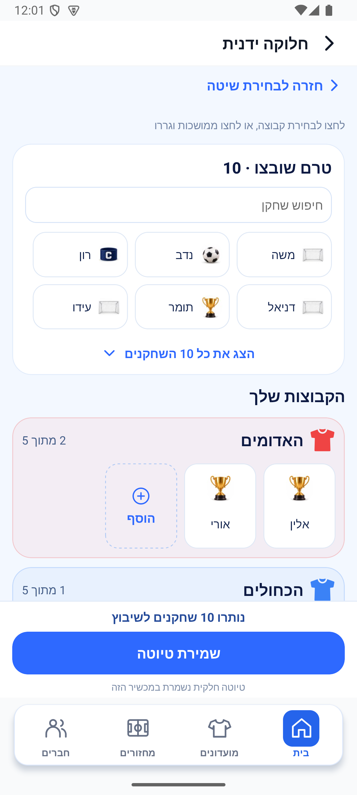

### הודעה כשמכסת הבחירה מלאה — 14.10.2026

בבחירת שחקנים לקבוצה, ניסיון לבחור מעבר למספר המקומות הפנויים מציג הודעה בולטת בתוך החלונית: ״לא ניתן לבחור עוד שחקנים — כל המקומות הפנויים נבחרו. כדי לבחור שחקן אחר, בטל קודם בחירה.״ ההודעה נעלמת בביטול בחירת שחקן או בסגירת החלונית. `toggleBatchPlayer` שומר על המכסה `capacity - teams[batchTarget].length`; ניסיון נוסף אינו משנה את הבחירה. ההודעה מוכרזת גם לקורא מסך. אין שינוי בקיבולת או באישור השיבוץ.

אומת באימולטור: בחירת שלושה שחקנים לשלושה מקומות וניסיון לבחור רביעי. לא אושר שיבוץ ולא נשמרו נתונים.

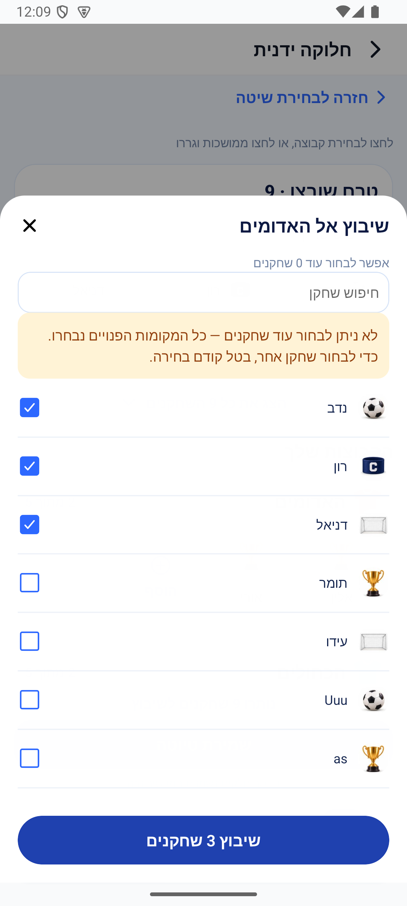

### עיצוב אחיד לשחקנים משובצים ולא משובצים — 14.10.2026

לבקשת הבעלים, העיצוב האנכי בקבוצות הוחלף: בכל כרטיס אייקון בגודל 28 מימין ושם משמאל באותה שורה, בדיוק כמו באזור ״טרם שובצו״. גם בקבוצות שלוש עמודות ברוחב 31%, ושם מוגבל לשתי שורות בגובה המותאם לגופן. בשתי קבוצות נשמר הכרטיס האופקי ברוחב עמודת הקבוצה. כפתור ההוספה מתאים לרוחב הכרטיס החדש. זה מחליף את עיצוב האייקון מעל השם שתואר קודם; פעולות השיבוץ והגרירה לא השתנו.

נבדק בצילום באימולטור עם הקבוצות והשמות הקיימים, ללא שמירה או שינוי שיבוצים לצורך הבדיקה.

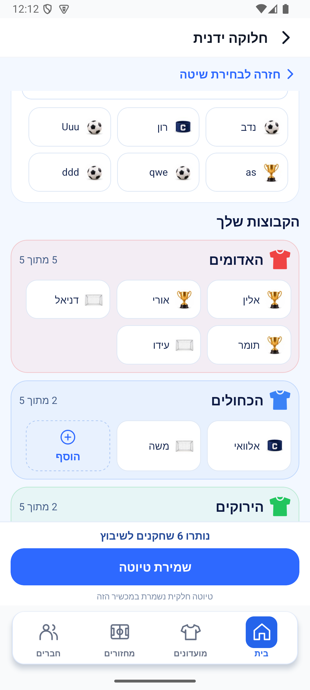

### שמירה במחזור פעיל ועדיפות לחלוקה האחרונה — 14.10.2026

לבקשת הבעלים, החלוקה הידנית מאפשרת שמירה גם כאשר המחזור התחיל, בדומה לאוטומטית. הוסרה חסימת `liveMatch.startedAt` וקיום `rotation.baseTeams`; מחזור שסיים או בוטל עדיין חסום. בדיקות שינוי ההרכב, מספר הקבוצות והפורמט נשמרו. בשמירה מועבר `originalTeams` הקיים כדי ששירות השמירה ישמר את היסטוריית פתיחת המחזור כשהוא פעיל. אין שינוי ברוטציה או בתוצאות משחקים.

טיוטה מקומית שומרת `baseDraftRevision`, חתימה על זמן יצירת הכוחות והרכבי הקבוצות שעליהם התבססה. פרטי המחזור והעורך משתמשים ב־`hasManualDraft(raw, savedRevision)`; חלוקה חדשה שנשמרה בשרת, גם בשיטה אחרת או במכשיר אחר, מבטלת את העדיפות של הטיוטה הישנה. הקובץ המקומי אינו נמחק, אך אינו משוחזר אוטומטית. טיוטות ישנות ללא חתימה משוחזרות רק כשאין חלוקה שמורה בשרת. פרסום בלבד אינו מבטל טיוטה. אין צורך בשדה חדש במסד או בממיר.

בדיקות `manualDraftResume.test.ts` מכסות את העדיפות, תאימות הטיוטות הישנות, שינוי הרכב עם אותו זמן יצירה ושמירת הגנות מצב סופי. צילום האימולטור מאמת שכפתור ״נהל כוחות״ מופיע במקום המשך ידני לאחר החלוקה האוטומטית הקיימת. לא בוצעה שמירה חדשה לשרת או בדיקת כתיבה במחזור פעיל באימולטור.

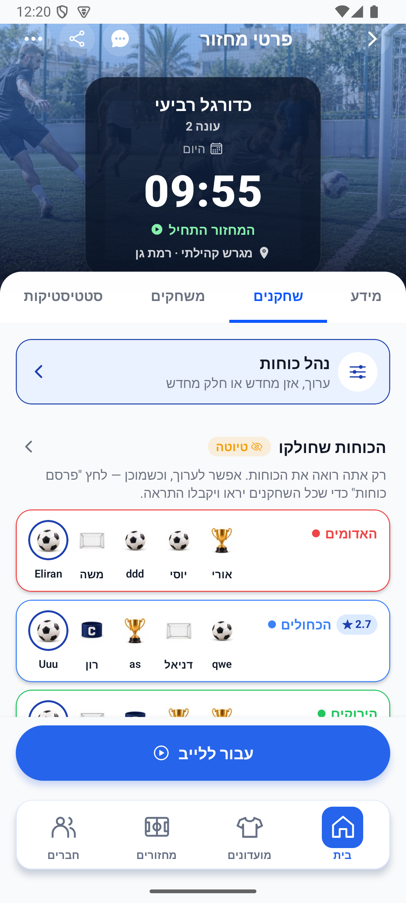

### תיקון החלפת כוחות ידניים והסבר הטיוטה — 14.10.2026

התיקון הקודם ששמר את `fresh.draftTeams.originalTeams` הוחלף: הוא גרם לפרטי המחזור להמשיך להציג את החלוקה הישנה למרות ששדה `teams` כבר הכיל את החדשה. כעת `createManualDraft` בונה גם `teams` וגם עותק נפרד `originalTeams` מהחלוקה הידנית החדשה, כמו חלוקה חדשה אוטומטית. `resolveSplitTeams` מציג אותה גם כשהרוטציה מכילה הרכב ישן; שינויים שוטפים בהרכב אינם משנים את העותק הקפוא החדש. לא משתנים הרכבי משחקים קודמים או נתוני הרוטציה.

פתיחת העורך מעדיפה טיוטה מקומית תקפה; בהיעדרה נטענת החלוקה השמורה מ־`draftTeams.teams`, ולא העותק הישן המיועד לתצוגה. היא מסוננת לפי המשתתפים הפעילים ומותאמת לקיבולת. כך אפשר לפתוח שיבוץ שכבר נשמר ולשמור אותו שוב בלי לבנותו מחדש. התיקון חל על שמירות חדשות; לא בוצעה הסבה של מסמכי מחזור קיימים.

משמעות השמירה: חלוקה חלקית נשמרת במכשיר בלבד ואינה מחליפה כוחות במחזור; חלוקה מלאה נשמרת בשרת עם `published:false`, מחליפה את הכוחות ומוצגת למנהל. פרסום חושף אותה לשחקנים. בדיקות `manualDraftReplacement.test.ts` מכסות החלפה עם רוטציה ישנה, תצוגה לפני ואחרי פרסום ועצמאות העותק הקפוא. לא בוצעה שמירה לשרת באימולטור לצורך הבדיקה; אין שינוי עיצוב.

### השבתת בחירות כשהמכסה מלאה — 14.10.2026

ההודעה אינה ממתינה עוד לניסיון לבחור שחקן נוסף. כאשר מספר הבחירות מגיע למקומות הפנויים (`capacity - teams[batchTarget].length`), מוצג מיד: ״כל המקומות הפנויים נבחרו. כדי לבחור שחקן אחר, בטלו אחת מהבחירות.״ תיבות הסימון של שחקנים שלא נבחרו אפורות והבחירה בהם חסומה; השם והאווטאר שומרים על מראם. השחקנים שנבחרו נשארים פעילים לביטול בחירה. ביטול מפנה מקום, מסתיר את ההודעה ומאפשר שוב לבחור אחרים. הנגישות כוללת תפקיד תיבת סימון ומצב בחירה והשבתה.

אומת באימולטור בתצוגת הדגמה מבודדת עם מקום פנוי אחד ושלושה מועמדים, ללא אישור שיבוץ או שמירה.

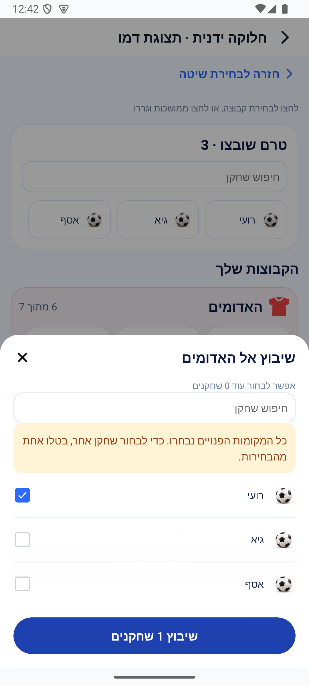

### עריכת כוחות קיימים במסך הידני — 14.10.2026

הכפתור ״ערוך את הכוחות הקיימים״ במסך בחירת השיטה אינו פותח עוד `TeamsEditModal`. הוא קורא מחדש את המחזור, ואז פותח `ManualAllocation` עם `preferSaved` ומספר הקבוצות בחלוקה השמורה. כך `draftTeams.teams` המעודכן מקבל עדיפות על טיוטה מקומית בכניסה זו. הכפתור מושבת בזמן הקריאה, ובכשל מוצגת הודעה ונשארים בבחירת השיטה. חזרה לבחירת שיטה מבטלת את מצב העדיפות; מסלול ״המשך חלוקה ידנית״ ממשיך לשחזר טיוטה מקומית תקפה כרגיל.

אין מסך ניווט חדש; חלונית העריכה הוסרה ממסך בחירת השיטה בלבד, ושימושיה במסכים אחרים לא שונו. מנגנוני השיבוץ והשמירה נשארו במסך הידני. נבדק באימולטור: לחיצה על הכפתור פתחה שתי קבוצות של חמישה עם כל השיבוצים. לא נשמרו כוחות בבדיקה.

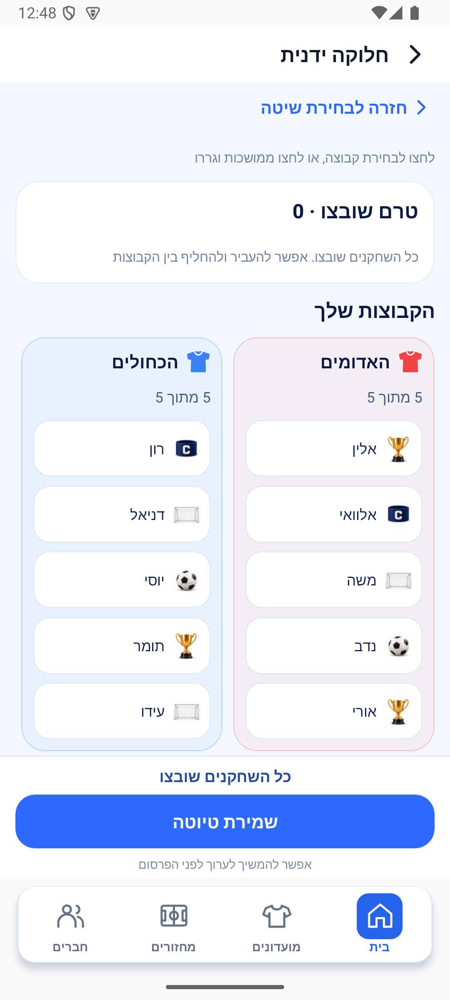

### חזרה מבחירה ידנית דרך החץ העליון — 14.10.2026

שורת ״חזרה לבחירת שיטה״ הוסרה. `ManualAllocation` מציג כעת את `ScreenHeader` ומעביר את פעולת `back` לחץ העליון. ללא שינויים חוזרים לבחירת שיטה; עם שינויים שלא נשמרו נשאר אישור החזרה המעוצב; בזמן שמירה החזרה נחסמת. רכיב הכותרת תומך ב־`onBack` אופציונלי, וברירת המחדל בשאר המסכים נשארת `navigation.goBack`. מסלול ההדגמה שומר על פעולת החזרה שלו. אין שינוי בכפתור החזרה של מערכת ההפעלה.

נבדק באימולטור: שורת החזרה הנוספת אינה מופיעה, ולחיצה על החץ העליון מחזירה למסך בחירת השיטה. לא אושרה יציאה עם שינויים ולא נשמרו נתונים.

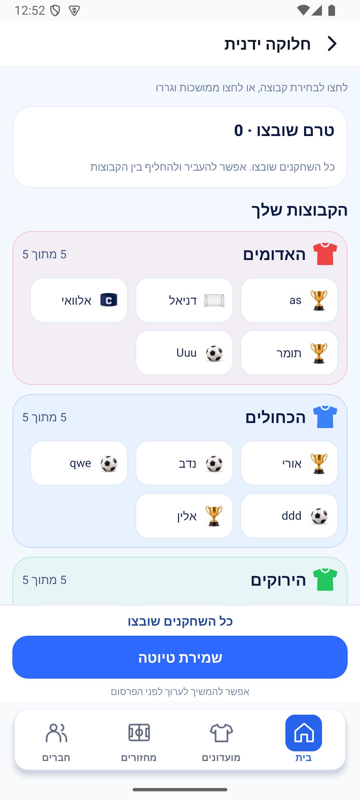
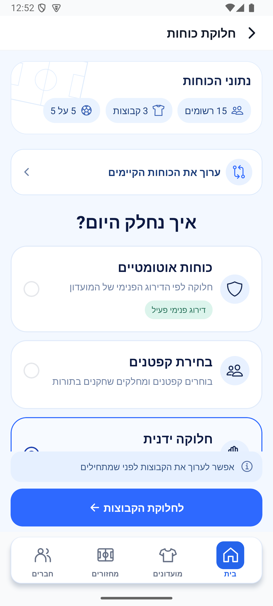

## קבוצות עם השלמות — 14.10.2026, שינוי מקומי

מצב `draftTeams.completionMode='balanced'` מוצע בחלוקה לפי דירוג כשיש יותר משתי קבוצות וסגל קטן ממספר הקבוצות כפול הקיבולת. ניתן לכבות לפני יצירת הכוחות. אין שינוי בשיטות אחרות או בנתוני עבר. החלוקה שומרת גדלים קרובים (12: 4/4/4; 13: 5/4/4; 14: 5/5/4), ושחקן מופיע פעם אחת בלבד. האורחים הפעילים נכללים; תור המתנה אינו משתתף.

`src/utils/balancedFill.ts`: לאחר חלוקת הבסיס הקיימת, `balanceWithFill` מבצע החלפות שומרות גודל. לכל זוג קבוצות `recommendFill` בודק השלמות שונות מהקבוצות הממתינות. ציון החלוקה הוא ארבע פעמים פער המפגש הגרוע ביותר ועוד ממוצע פערי המפגשים. כל החלפה מתקבלת רק אם הציון משתפר. החיפוש מוגבל ל־180 הערכות בסגלים קטנים, 24 בסגלים גדולים, ועד שלושה מעברים; רוחב החיפוש להערכת חלוקה 24, ולהמלצה לפני משחק 96. זה חיפוש מקורב ומוגבל, ולא הבטחה לאופטימום או לשוויון מוחלט. הממוצע הוא סכום הדירוגים חלקי מספר המשתתפים בצד אחרי השלמה; דירוג חסר מקבל 3, ודירוגי עבר מנורמלים בסולם הקיים. עד 0.05 מעל הפער הטוב שנמצא, העדיפות היא לעומס קטן יותר: 4×משחקים + השלמות + 2 אם השתתף במשחק הקודם. בשוויון מלא סדר המועמדים יציב.

המצב עובר דרך `balanceTeams` → `saveDraftTeams` → `readDraftTeams`; מדדי ממוצע/פער/חזרות מחושבים מחדש לאחר האופטימיזציה. סיכום `DraftBoardScreen` מציג ישירות את השיבוץ השמור, בלי לשחזר אותו לפי תורות קפטנים (שעלולים להעביר שחקנים בקבוצות לא שוות). עריכה ידנית שומרת את מצב ההשלמות. `DraftTeamCard` מציג מקומות מקווקווים והכיתוב ״השלמה לפני המשחק״; דירוג הבסיס מוצג רק כשאתר הקריאה מוסר דירוג מורשה.

ניהול המשחק במצב זה עובר למסך הרוטציה המתקדם גם אם המחזור נוצר ללא `advancedMode`. לפני משחק עם חוסרים נפתחת `BalancedFillModal` לשני הצדדים יחד: בחירה ידנית ללא המלצה או בחירה מראש, החלפה, מספר משחקים/השלמות, שחקן שנבחר לצד השני מושבת. בחוסר מועמדים מוצג חוסר מפורש וכפתור לאישור הרכבים חסרים. הבחירה נשמרת תחילה באמצעות `commitFilledRotation` והשעון נשאר עצור. הפעלת השעון היא פעולה נפרדת של המנהל. בזמן בחירה מושהית חסומה התחלה/חידוש שעון. סגירה לפני משחק ראשון מבטלת את ההצעה; אחרי שמירת תוצאה היא משאירה כפתור ״המשך בחירת משלימים״ כדי לא לאבד את המעבר.

`prepareBalancedNext` פועל אחרי שמירת תוצאה: מחשב `rotation.fillUsage` מהרכבים אפקטיביים עם ההשאלות, ואז מחזיר את כל המשלימים לקבוצות הבסיס לקראת המשחק הבא. `readRotation` משמר את מוני העומס ובודק מספרים סופיים לא שליליים. מונים אלה הם עזר להמלצות בתוך המחזור בלבד, לא מקור לסטטיסטיקת קריירה. מזהה המשחק ו־`rotationWriteSource` הקיימים מגינים מפני דריסת הצעה ישנה או מנהל מתחרה; שגיאת שמירה מוצגת למנהל. מילוי באמצע משחק קיים עדיין משתמש במסלול שמירת השעון הקיים ואינו מאפס את כל ההשאלות.

סטטיסטיקה: לא נוספה נוסחת קריירה חדשה ולא נכתב תיקון היסטורי. מסלול `gameService._commitRoundStatsAndClear` מוסר `rosterOf` הכולל משלימים לכל צד; `functions/src/roundSides.ts` מנקה כפילויות ומגדיר צדדים זרים. ניצחון אישי/הפסד/תיקו וצמדים נשענים על הצד בפועל, ותוצאת קבוצה נשארת לפי אינדקס הקבוצה ששיחקה. המחזור ממשיך להיספר פעם אחת לפי המנגנון הקיים. לא נטען למדידת דקות משחק או חפיפה מדויקת בהחלפות באמצע משחק.

בדיקות: `tests/logic/balancedFill.test.ts`, `balancedFillPersistence.test.ts`; סגלים 12/13/14/19/20, אי כפילות, חוסר תורמים, עדיפות מנוחה, חזרה לבסיס בניצחון ובתיקו, ממירי Firestore בפועל ומסלול צדדים לסטטיסטיקה. ראיות הרצת טיפוסים וכלל הבדיקות ב־`artifacts/balanced-fill-typecheck.log` ו־`artifacts/balanced-fill-jest.log`. הצילומים הם רכיבי אמת בתצוגת דמו מבודדת, לא משחק ששוחק ולא אישור כתיבת שרת. אין פריסה, שינוי הרשאות, הסבת נתונים, בניית חנות או דחיפה לגיט. לקוחות ישנים אינם מכירים את מצב ההשלמות החדש; יש לתאם עדכון לפני שימוש משותף בו.

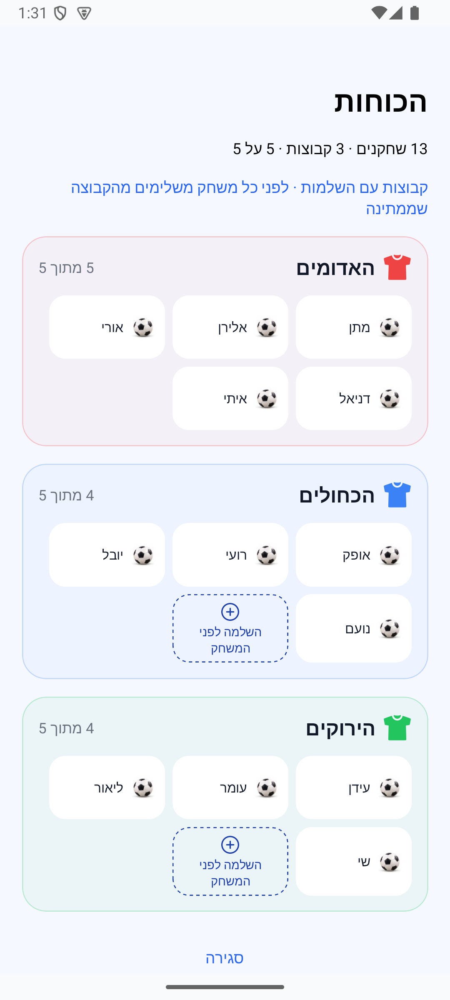
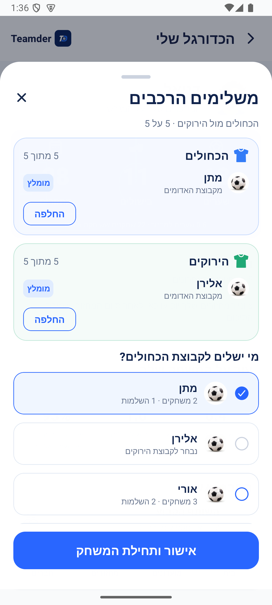

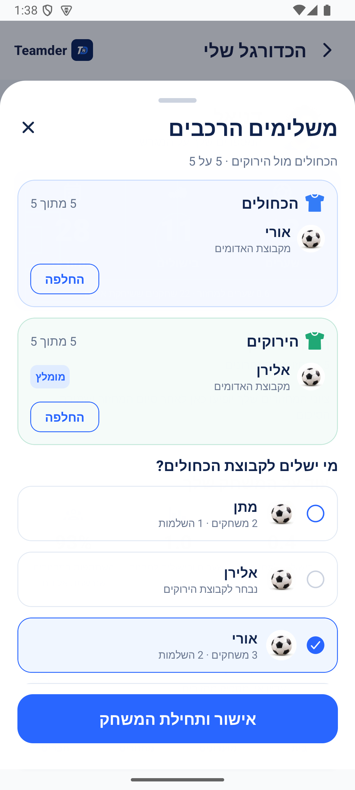

### עדכון בחירת המשלימים — 14.10.2026

לבקשת הבעלים בוטלה המלצה לשחקן בשלב ההשלמה. `BalancedFillRequest` אינו מכיל בחירה מומלצת; החלונית מתחילה בשתי בחירות ריקות, ללא תג מומלץ. החישוב הראשוני של חלוקת הבסיס עם השלמות אפשריות נשמר. גם חלונית המילוי הישנה מקבלת בחירה התחלתית ריקה. רשימת המועמדים נפתחת בצד הראשון שיש בו חוסר. אישור ההרכבים אינו קורא ל־`markGameStarted` או ל־`startTimer`: במעבר למשחק הבא השעון נשאר עצור, ובמילוי באמצע משחק נשמר מצב השעון הקודם.

כפתור האישור נקרא ״אישור ההרכבים״. לפני בחירה מלאה מוצגת בקשה לבחור את המספר החסר; רק חוסר אמיתי במועמדים מאפשר אישור הרכבים חסרים. צילום דמו ובדיקות טיפוסים/רגרסיה: `artifacts/manual-fill-*`. אין פריסה או בדיקת כתיבת משחק בייצור.

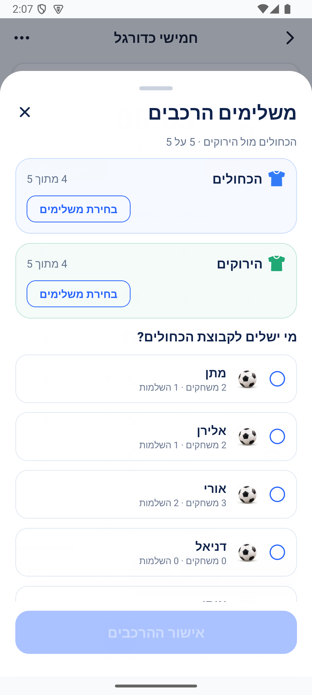

## תיקון מיקום גרירה — 15.10.2026

`ManualAllocation` ממיר נקודת מגע פיזית ל־`start` לוגי: בממשק עברי `start = rootWidth - (pageX - rootX) - 65`, ובממשק שמאל־לימין `start = pageX - rootX - 65`. הציר האנכי הוא `pageY - rootY - 24`. רוחב הכרטיס 130 וגובה תוכנו הרגיל 48; אין היפוך של הכרטיס או מחוות המשתמש. מדידת השורש מתחדשת בתחילת כל גרירה, מפני שאנימציית ניווט מקורית יכולה להסתיים אחרי `onLayout`: בבדיקה נמצא פער בין 26.29 ל־75.05 יחידות בציר האנכי. השורש מסומן `collapsable=false`, ושורש, חלון גלילה ויעדי שחרור נמדדים ב־`measure` באותה מערכת צירים של `pageX/pageY`. אין ערבוב עם `measureInWindow`. תגובה מאוחרת למדידה אינה מחייה גרירה שכבר הסתיימה.

`manualAllocation.test.ts` בודק מעקב לשני הכיוונים במערכת עברית ושמאל־לימין עם שורש מוזח. `manualDragOrigin.test.ts` מפעיל את callback המסך האמיתי מול מדידה מאוחרת וביטול. נצפו גרירה וציר מצביע באימולטור אנדרואיד במצב דמו, וכן שחרור שהעביר שחקן לקבוצה: 25→24 לא משובצים, 0→1 באדומים. לא נשמרה טיוטה או חלוקה לשרת, ואין בדיקת אייפון. התיקון מיועד לגרסה הפנימית שבהכנה.

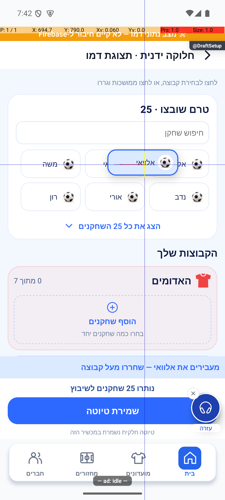
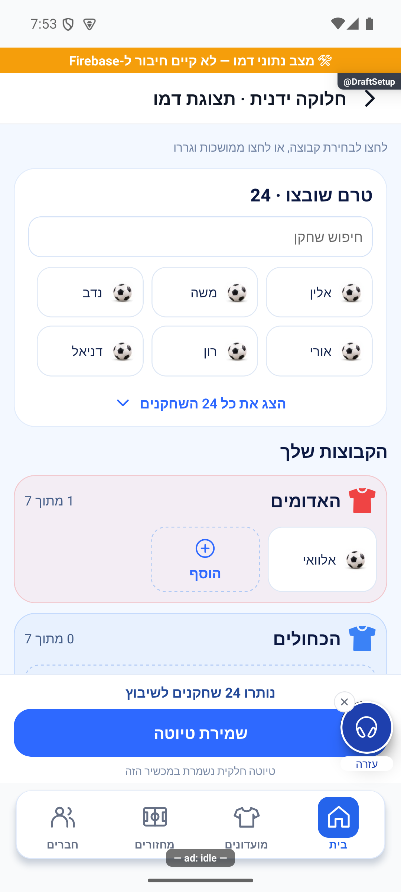

עדכון הפצה 15.10.2026: תיקון הגרירה נכלל בגרסה הפנימית באנדרואיד 1.1.51 / 284, ואומת מול קוד האריזה ומסלול החנות. בדיקת התצוגה והשיבוץ היא בדמו באימולטור בלבד; לא נבדק באייפון.

## תיקוני דיווחים חדשים — 15.10.2026

`DraftSetupScreen` מונע דריסה מקריאה ישנה באמצעות מונה `loadRevision` משותף לטעינה הראשונית ולכניסה לעריכה. טעינת הרקע מושהית כשהפרמטרים `editExisting` או `resumeManual` פעילים; כל כניסה למסך מרעננת דרך `useFocusEffect`, ותגובה ממסך שיצא ממיקוד נזרקת. בדיקה המפעילה את שני callbacks האמיתיים נכשלה לפני התיקון כאשר קריאה ראשונית איטית החליפה שיבוץ חדש, ועברה אחריו. אין שינוי באלגוריתם האיזון או בשיוך הצבעים. בדיקות 3, 4 ו־7 קבוצות עוברות דרך `readDraftTeams` האמיתי, משחזרות לפי index ושומרות צבע ושחקנים דרך `createManualDraft`. שני שדות החיפוש מקבלים `placeholderTextColor=#7284A5`; כפתור האיפוס כבר היה חסום לוגית באפס משובצים, וכעת יש גם צבע מושבת והכרזת נגישות. הנוסח החלקי הוא ״טיוטה חלקית נשמרת אך לא נחשבת כחלוקת כוחות״; הטיוטה עדיין נשמרת במכשיר בלבד.

שינויים מקומיים אחרי גרסה 1.1.51; אינם כלולים בבינארי שכבר הועלה. תצוגה שנבדקה היא בדמו אנדרואיד בלבד, ללא בדיקת אייפון או חשבון המדווח.

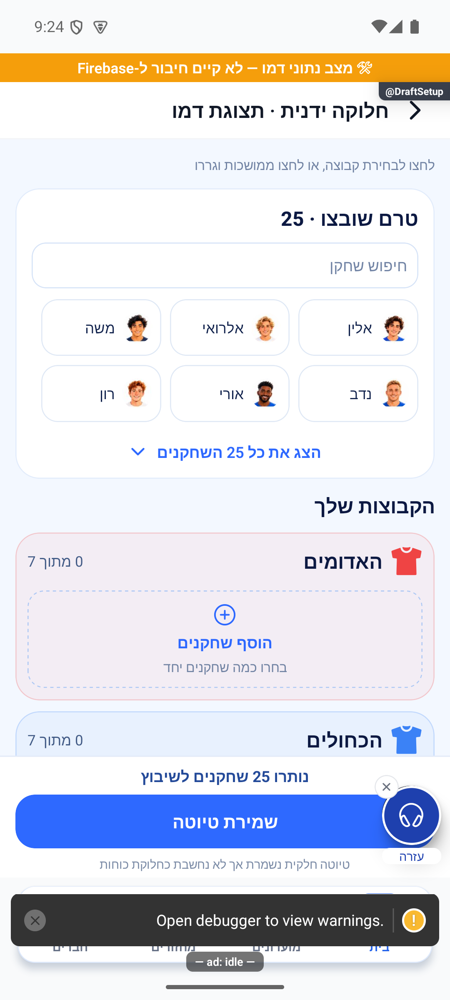

## שורה אחת בבחירת קפטנים — 15.10.2026

ב־DraftSetupScreen הוסרו flexWrap ו־flexShrink:0 של שם השחקן. playerIdentity מקבל flex:1 ו־minWidth:0, playerName מקבל flex:1 ו־minWidth:0 ו־numberOfLines:1 הקיים נשמר. לתג ולסימון הבחירה flexShrink:0, ובין הזהות לבחירה רווח spacing.sm. אין שינוי בסדר בחירת הקפטנים, בכמות הנדרשת, באורחים או בשמירת הכוחות. בדיקת טיפוסים נקייה; 328 חבילות / 3,881 בדיקות עברו. מקור: artifacts/release-1.1.52/tests.log. נבדק באימולטור אנדרואיד בדמו מנותק. אייפון, מכשיר פיזי וגופן מוגדל לא נבדקו.

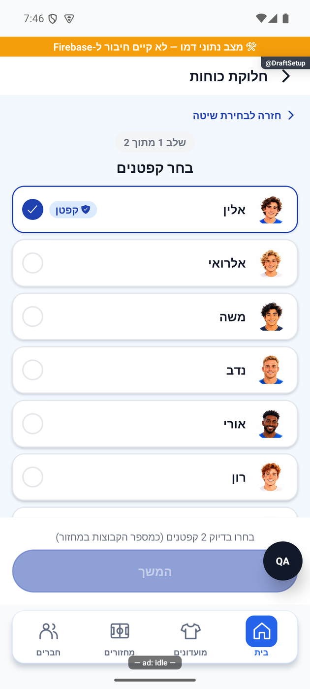

הפצה 15.10.2026: השינויים המקומיים המתוארים בסבב זה נכללו בגרסה הפנימית 1.1.52 / 285 באנדרואיד. [ראיות וגבולות](../../changes/2026-10-15-internal-1.1.52.md).

## אימות מרונדר — 16.10.2026

באימולטור דמו הוצג מחזור עם 10 שחקנים ללא קבוצות חמש שעות אחרי תחילה; כפתור צור כוחות פתח את בחירת השיטה. בכשל קריאה חד־פעמי הופיע ניסיון חוזר, ולחיצה עליו פתחה את הלייב המתקדם עם שתי קבוצות ותוצאה 2:1 מתוך נתוני הדמו. לא הוזנו שערים ולא נוצרו כוחות במהלך בדיקה זו. בדיקת טיפוסים נקייה; 330 חבילות ו־3,909 בדיקות עברו. אין בדיקת מכשיר הבעלים או אייפון.

[צילום 1](../screenshots/live-mode-no-teams-fixed-2026-10-16.png) · [צילום 2](../screenshots/live-mode-draft-entry-2026-10-16.png) · [צילום 3](../screenshots/live-mode-error-2026-10-16.png) · [צילום 4](../screenshots/live-mode-advanced-after-retry-2026-10-16.png)

## גרסת תוצאה מאושרת ביצירה וביצירה מחדש — 17.10.2026

במסלולי החלוקה האוטומטית והאקראית, `runGenerate` ממתין לשמירת `result` באמצעות `saveDraftTeams`, ואז מעביר ל־`DraftBoard` את `result.createdAt` בפרמטר `expectedDraftCreatedAt`. כך סיכום מחלוקה קודמת באותו מחזור אינו נחשב לתוצאת הפעולה החדשה, גם אם הקפטנים והכמות זהים. כשל שמירה נשאר במסך ההגדרה לפי מסלול השגיאה הקיים; לא נפתח סיכום לפני אישור השמירה. הגרסה אינה שדה מסד חדש ואינה משנה את החישוב, הפרסום או הסגל.

לוח התוצאה בודק את ההתאמה בעת קריאה חוזרת, מסתיר מיד נתון מהקשר קודם ומאפשר ניסיון חוזר במקרה של תוצאה ישנה או חסרה. [חוזה הקריאה והמצבים](draft-board.md#מניעת-סיכום-מחלוקה-קודמת--17102026). כניסות קיימות שלא מגיעות מפעולת יצירה אינן מחויבות למסור גרסה צפויה.

בכניסה עם גרסת התוצאה שאושרה, לוח הסיכום מוסר גם `expectedDraftCreatedAt` ו־`signal` ל־`getGameById`. השירות מאזין באופן תחום עד שמתקבל צילום שרת ללא כתיבה ממתינה ובגרסה המדויקת, עד שמונה שניות. גרסה אחרת אינה נחשפת גם כשמספר השחקנים נכון; אירוע מאוחר תואם משלים את המסלול בלי לחיצת ניסיון חוזר. כשל או תום ההמתנה עדיין מציגים שגיאה וניסיון חוזר. אין סבב קריאות או שינוי בקריאות המוצר ללא גרסה צפויה. פתרון הקריאה היחידה מהשרת הוחלף לאחר שבאחד עשר נלכדה תוצאה ישנה גם כשנמסרה אפשרות המקור; זו ראיה למסלול שנבדק, בלי ייחוס גורף של סיבה לספריית הנתונים. [החוזה, הניקוי והראיות](draft-board.md#המתנה-תחומה-לגרסה-שנשמרה--המשך-17102026).

בדיקת `dataDraftSavedResume.test.tsx` מפעילה את פעולת היצירה מול אישור שמירה מושהה ומוודאת שאין ניווט לפני האישור, ושגרסת התוצאה הנכונה נמסרת אחריו. בדיקות הרכיב מאמתות החלפה של כל זהויות השחקנים בסיכום, ולא רק ספירת שחקנים. 51 בדיקות ממוקדות עברו בשש חבילות. האימות המרונדר לאחר השינוי מתועד בידי המוביל; אין בשבעה מול שבעה שנצפה לפני התיקון הוכחה שסיכום התוצאה כבר נכון.

## שער טעינה בכניסה לניהול הכוחות — 17.10.2026

`DraftSetupScreen` רינדר את בורר השיטות לפני סיום `getGameById`: `game=null` גרם להצגת נתוני ברירת מחדל ולהסתרת עריכת הכוחות, ואז הגעת המחזור שינתה את המסך. נוספו `loadingGame`, `loadFailed` ו־`retryLoad`. מצב הטעינה מתחיל פעיל; קריאת מיקוד חדשה מפעילה אותו ומנקה כשל, ורק הקריאה הפעילה שמסומנת ב־`loadRevision` רשאית לסיים אותו. ניקוי המיקוד מחזיר אותו לפעיל, כדי שביקור חוזר לא יציג תוכן קודם. שער התצוגה לפני כל מסלולי ההכנה בודק גם `openingExisting`, כשל, היעדר מחזור ואי התאמת `game.id` למזהה המבוקש.

בזמן המתנה מוצגים הכותרת הקיימת, מחוון והודעת טעינה; אין מדדים, עריכת כוחות או בחירת שיטה פעילה. אחרי קריאה מוצלחת נשמרים המחזור ומספר הקבוצות המוגדר לפני הסרת השער. כשל קריאה או מסמך חסר מציגים כשל מפורש וניסיון חוזר, שמפעיל את קריאת המיקוד מחדש. תגובה מביקור קודם נזרקת לפי מנגנון `alive/revision` הקיים. הכניסה המפורשת לעריכה או שחזור ידני מעדכנת גם היא את אותם מצבי טעינה וכשל; קדימותה מול קריאת המיקוד נשמרה. כל ההוקים נשארים לפני החזר התצוגה המותנה. אין שינוי בשיטת החלוקה, בשמירה, בממירים, בהרשאות, במכנים או בנתיב הניווט.

`draftSetupLoading.test.ts` מפעיל את קריאת המיקוד ואת תנאי התצוגה מהמקור: חסימת הבורר עד הגעת המחזור ומספר הקבוצות יחד, כשל/מסמך חסר וניסיון חוזר, ביקור חוזר ותגובה מאוחרת, ואי מרוץ מול כניסה ידנית מפורשת. שני מבחני הרגרסיה הקיימים ב־`forcesAudit` וב־`draftLoadingRace` עודכנו למארחי מצבי הטעינה החדשים ושומרים את בדיקות המרוץ המקוריות. בדיקת טיפוסים נקייה; כל 361 החבילות ו־4,399 הבדיקות עברו. [לוגים](../../../artifacts/draft-entry-2026-10-17/jest-final.log).

באימולטור דמו 411×914 בגופן רגיל, בוצעו שתי כניסות דרך ״נהל כוחות״ עם השהיית קריאה ייעודית לדמו בלבד. בהמתנה לא הופיע בורר השיטה; לאחר שחרור הקריאה נראו 15 רשומים,3 קבוצות,5 על 5 ועריכת הכוחות הקיימים. השירות המקורי הוחזר, וכל חלוקות הכוחות הושוו ונשארו זהות. [טעינה](../screenshots/draft-entry-loading-2026-10-17.png) · [מסך מוכן](../screenshots/draft-entry-ready-2026-10-17.png) · [הוכחת השחזור](../../../artifacts/draft-entry-2026-10-17/release-final.json). הצילומים נפתחו ונבחנו, כולל כיווניות; פס רענון הפיתוח בראש צילום הטעינה אינו מצב מוצר. לא נערכו כוחות ולא נשמרה חלוקה. זו אינה מדידת כל פריים או בדיקת שיהוי אמיתי בייצור. כשל, ניסיון חוזר וסנכרון תגובות נבדקו אוטומטית בלבד, ללא צילום כשל במכשיר. אין פריסה, בנייה או העלאה.

## עיצוב הסיכום אחרי יצירה — 17.10.2026

סיכום הכוחות השמורים המשותף ליצירה אוטומטית ואקראית עודכן לכרטיסי הקבוצות של פרטי המחזור. מסלולי היצירה, השמירה וטעינת הגרסה נשארו כפי שהיו. [התנהגות, צילום ומגבלות האימות](draft-board.md#סיכום-חלוקה-אחיד-לאוטומטי-ולאקראי--17102026).

## הפצה פנימית — 17.10.2026

שינויי הלקוח האחרונים המתועדים כאן נכללו בבינארי הפנימי `1.1.53 / 286` באנדרואיד. המסלול אומת בגוגל; הייצור נשאר בגרסה הקודמת. זה אינו אימות חדש של תרחיש ייצור או של מכשיר אפל. [מקור הבינארי, פריסת השרת, בדיקות ומגבלות](../../changes/2026-10-17-internal-1.1.53.md).
